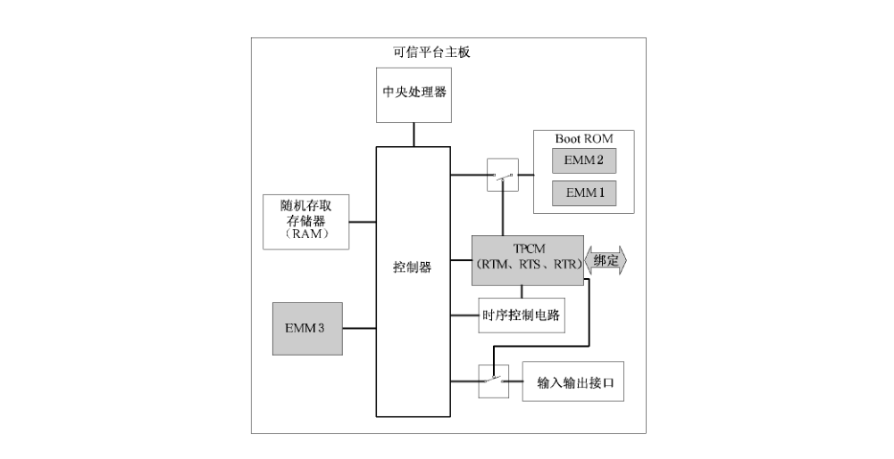
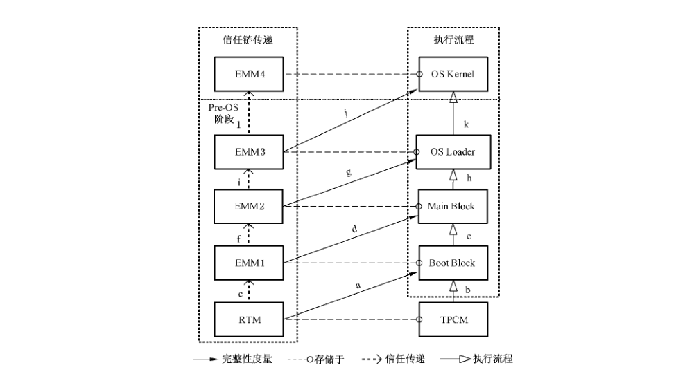
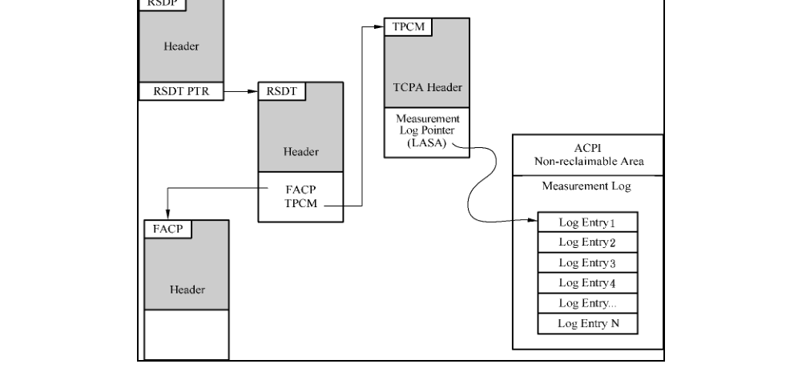
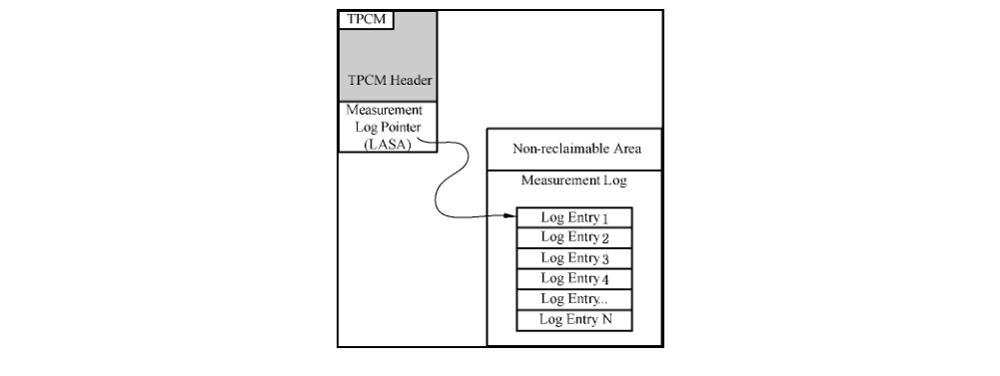
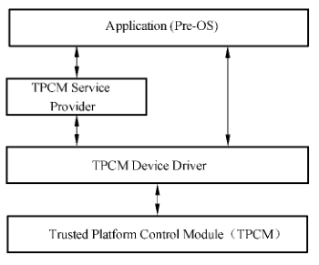
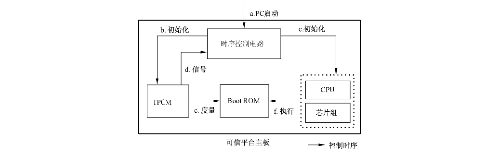

# GB/T 29827-2013 信息安全技术 可信计算规范 可信平台主板功能接口

> 来源：[GB/T 29827-2013 国家标准详情](https://openstd.samr.gov.cn/bzgk/std/newGbInfo?hcno=2C64DF15C61CC69F30E9658E86A0EA4F)；发布日期：2013-11-12；实施日期：2014-02-01。
> 官方 PDF SHA-256：`31cd46d3eab87c520fd76ea79f54f1710280bc5f4a95630901db2d6aa90f0c4d`。
> 转写说明：逐页对照官方 PDF 的全部 44 张页面图像，校正正文、代码、图示和跨页表格；省略封面、目录、页眉、页脚、页码及出版信息，合并跨页段落。原件中的名称和字段不一致处按原文保留；正式引用请核对官方原件。

## 前言

本标准按照 GB/T 1.1—2009 给出的规则起草。

本标准由全国信息安全标准化技术委员会（SAC/TC 260）提出并归口。

本标准主要起草单位：北京工业大学、中国长城计算机深圳股份有限公司、南京百敖软件股份有限公司、航天科工集团二院七〇六所、武汉大学、中国电子科技集团公司信息化工程总体研究中心、北京龙芯中科技术服务中心有限公司、江南计算技术研究所、瑞达信息安全产业股份有限公司、中安科技集团有限公司、中船重工集团 707 所、北京中科院软件研究中心、北京华大恒泰科技有限责任公司、北京超毅世纪网络技术股份有限公司、华为技术有限公司、桂林长海科技有限责任公司、中国电子技术标准化研究所。

本标准主要起草人：沈昌祥、韩永飞、张兴、王冠、林诗达、徐明迪、王正鹏、蒋志翔、赵丽娜、周艺华、石明、张斌、孔雷、张焕国、汪文杰、胡明昌、吴新军、陈林、李大东、王然、张向阳、艾方、童广胜、徐庶桓、李晨、贾兵、杜中平、杜晖、谢乾、赵波、张超、吴勇、石良军、马银生、郭景川、魏靖、宋洋、高瞻、曲新春、余发江、陈小春、蔡晔、袁爱东、庄琭、曾颖明、孙永泉、段丽娟、宋靖、朱贺新、郭灵儿、刘智君、滕志刚、靳浡、郭毅、肖祎、孙圣超、刘军，陈莹，邹娜。

## 1 范围

本标准规定了可信平台主板的组成结构、信任链构建流程、功能接口。

本标准适用于基于可信平台控制模块的可信平台主板的设计、生产和使用。

## 2 规范性引用文件

下列文件对于本文件的应用是必不可少的。凡是注日期的引用文件，仅注日期的版本适用于本文件。凡是不注日期的引用文件，其最新版本（包括所有的修改单）适用于本文件。

GB/T 29829—2013 信息安全技术 可信计算密码支撑平台功能与接口规范

UEFI V2.1 统一可扩展固件接口规范（Unified Extensible Firmware Interface Specification）

## 3 术语和定义

下列术语和定义适用于本文件。

### 3.1 可信根 root of trust

对应 TPCM 模块。

### 3.2 可信度量根 root of trust for measurement

一个能够可靠进行完整性度量的计算引擎，是信任传递链的起始点。

### 3.3 可信存储根 root of trust for storage

一个能够可靠进行安全存储的计算引擎。

### 3.4 可信报告根 root of trust for reporting

一个能够可靠报告可信存储根所保存信息的计算引擎。

### 3.5 通用设备 general device

在原有 PC 主板上兼容的硬件设备，包括中央处理器（CPU）、外部存储器、随机存储器、视频控制器等。

### 3.6 初始只读存储器 boot ROM

在计算机启动过程中提供最底层硬件设置的固件。

> 注：初始只读存储器在组成结构上分为 Boot Block 和 Main Block 两部分，按照类型分为传统 BIOS 和 UEFI BIOS。

### 3.7 初始引导模块 boot block

存储在 Boot ROM 中，最先被 CPU 执行的一段平台初始引导模块，负责初始化最基本的平台部件。

> 注：被初始化的平台部件如内存等。

### 3.8 主引导模块 main block

存储在 Boot ROM 中，在 Boot Block 之后被执行的代码，负责初始化除在 Boot Block 中已经被配置的平台启动部件。

### 3.9 板卡固件 option ROM

存储平台启动部件的启动和配置代码的只读存储器。

### 3.10 扩展度量模块 extended measurement module

计算机启动过程中的代码度量执行部件组，实现对后续执行代码的完整性度量和信任链扩展。根据其在系统中的启动顺序，分为 EMM1、EMM2、EMM3 三个执行部件。

### 3.11 扩展度量模块1 EMM1

嵌入于 Boot ROM 中的 Boot Block 内的代码，负责对 Main Block 中的 EMM2 进行度量。

### 3.12 扩展度量模块2 EMM2

嵌入于 Boot ROM 中的 Main Block 内的代码，负责对平台启动部件和 EMM3 进行度量。

### 3.13 扩展度量模块3 EMM3

嵌入于 OS Loader 中的代码，负责对操作系统内核和 EMM4 进行度量的代码。

### 3.14 扩展度量模块4 EMM4

嵌入于 OS 内核中的代码，负责对内核文件进行度量。

### 3.15 度量代理点 measurement agent point

代码度量部件子模块，负责度量系统的部分装载和执行代码，实现 EMM 之间信任传递。

### 3.16 操作系统装载器 operating system loader

负责加载操作系统内核的代码或部件。

### 3.17 度量事件 measurement event

对代码进行完整性度量和存储的全过程。

### 3.18 日志存储区 log storage area

不可篡改区域，用于存储完整性度量日志。

### 3.19 信任链 trust chain

在计算系统启动和运行过程中，使用完整性度量方法在部件之间所建立的信任传递关系。

### 3.20 可信平台控制模块 trusted platform control module

一种集成在可信计算平台中，用于建立和保障信任源点的硬件核心模块，为可信计算提供完整性度量、安全存储、可信报告以及密码服务等功能。

### 3.21 可信平台控制模块设备驱动 trusted platform control module device driver; TDD

TPCM 为上层应用提供的服务驱动接口。

### 3.22 统一扩展固件接口 unified extensible firmware interface; UEFI

提供一组在OS加载、启动前，在所有平台上一致的、正确指定的启动服务。

### 3.23 引导连接向量 boot connection vector; BCV

指向 Option ROM 中某一段代码的指针，所指向的代码负责执行部件的初始化、检测硬件或者在必要时加载 Int 13 h 的服务。

### 3.24 引导项向量 boot entry vector; BEV

指向 Option ROM 中负责载入系统的代码的指针，并在必要时加载 Int 18 h 或 Int 19 h 的服务。

> 注：通常在网卡的远端启动中使用。

## 4 缩略语

下列缩略语适用于本文件。

ACPI 高级配置和电源管理接口（Advanced Configuration and Power Management Interface）

BIOS 基本输入输出系统（Basic Input Output System）

CMOS 互补金属氧化物半导体（Complementary Metal Oxide Semiconductor）

ESCD 扩展系统配置数据（Extended System Configuration Data）

FWH 固件中心（Firmware Hub）

GUID 全局唯一标识符（Globally Unique Identifier）

I/O 输入/输出（Input/Output）

IPL 初始程序加载器（Initial Program Loader）

LPC 少针脚型接口（Low Pin Count）

LSA 日志存储区（Log Storage Area）

NVRAM 非易失性随机访问存储器（Non-Volatile Random Access Memory）

OS 操作系统（Operating System）

PARTIES 保护区域运行态接口扩展服务（Protected Area Run Time Interface Extension Services）

PC 个人计算机（Personal Computer）

PCR 平台配置寄存器（Platform Configuration Register）

PE 可移植执行体（Portable Executable）

POST 开机自检（Power On Self Test）

RAM 随机存取存储器（Random Access Memory）

ROM 只读存储器（Read Only Memory）

SMBIOS 系统管理基本输入输出系统（System Management Basic Input Output System）

SMM 系统管理模式（System Management Mode）

SPI 串行外设接口（Serial Peripheral Interface）

TDD 可信平台控制模块设备驱动（Trusted Platform Control Module Device Driver）

TPCM 可信平台控制模块（Trusted Platform Control Module）

UEFI 统一扩展固件接口（Unified Extensible Firmware Interface）

## 5 组成结构

可信平台主板是由可信平台控制模块和其他通用部件组成，实现从开机到操作系统内核加载前的平台可信引导功能。通用部件主要包括：中央处理器、随机存取存储器（RAM）、输入输出接口、Boot ROM 固件等。

可信平台主板组成结构见图1。



图1中各部件的关系如下：

可信平台控制模块（TPCM）：

- TPCM 由物理硬件、嵌入式系统、对外的接口等实体组成。
- TPCM 是可信平台的唯一可信根，其包括：可信度量根（RTM）、可信存储根（RTS）和可信报告根（RTR）。
- TPCM 通过系统总线连接到可信平台主板的控制器。

可信平台主板：

- 嵌入 TPCM，支持 TPCM 功能，实现信任链传递的计算机主板。
- 包括中央处理器、控制器、随机存取存储器、TPCM 硬件设备、Boot ROM 固件层支撑模块及其设备驱动程序和 TPCM 嵌入式系统等实体。
- 支持 TPCM 对输入输出接口的控制，TPCM 最少但不限于控制以下输入输出接口的开启或关闭：USB、PS/2、PCIE、PCI、SATA、串口、并口、网络接口。
- 必须确保可信平台主板和 TPCM 一对一的绑定关系。
- TPCM 与可信平台主板其他部件的协作关系应满足如下要求：
  - 在 CPU 执行 Boot ROM 代码前，TPCM 先启动。
  - TPCM 通过电路连接，可靠地读取平台 Boot ROM 的初始引导模块（Boot Block）。
  - TPCM 中的 RTM 对 Boot ROM 中的 Boot Block 进行完整性度量和度量结果的存储。

扩展度量模块（EMM）：

- EMM 作为 RTM 度量根的扩展度量模块，实现对执行部件的完整性度量，实现信任链传递。
- EMM1：存储于 Boot ROM 的初始引导模块（Boot Block）中，被 RTM 度量；EMM1 对 Boot ROM 的版本信息和 EMM2 进行完整性度量。
- EMM2：存储于 Boot ROM 的主引导模块（Main Block）中，被 EMM1 度量；EMM2 对平台启动部件，以及 OS Loader 进行完整性度量。
- EMM3：存储于外部存储器中的 OS Loader 中，被 EMM2 度量；EMM3 对操作系统内核进行度量。本标准对 OS Loader 存储的位置不作规定，图中 OS Loader 存储于外部存储器只是示例。
- 扩展度量模块 EMM 通过 TPCM 提供的接口，访问 TPCM，存储度量结果和日志。

## 6 信任链传递

### 6.1 信任链建立流程

信任链从开机到操作系统内核装载之前的建立过程应满足如下要求：TPCM 作为信任链的信任根，EMM 作为度量代理节点，通过完整性度量，实现信任传递与扩展。

主板引导过程部件信任传递关系网络和信任链建立流程见图2。

a）TPCM 先于 Boot ROM 被执行前启动，由 TPCM 中的 RTM 度量 Boot ROM 中的初始引导模块（Boot Block），生成度量结果和日志，并存储于 TPCM 中；

b）TPCM 发送控制信号，使 CPU、控制器和动态存储器等复位；平台加载并执行 Boot ROM 中的 Boot Block 代码；

c）Boot Block 中的 EMM1 获得系统执行控制权，信任从 RTM 传递到 EMM1；

d）EMM1 度量 Boot ROM 版本信息和 Main Block 中的 EMM2 代码；EMM1 存储度量结果到 TPCM 中的 PCR 并存储度量日志；

e）平台加载并执行 Main Block 中 EMM2 的代码；

f）Main Block 中的 EMM2 获得系统执行控制权，信任从 EMM1 传递到 EMM2；

g）EMM2 将在 a）步骤中存储在 TPCM 中的日志存储到 LSA 中；EMM2 将在 d）步骤中存储在 Boot Block 中的日志存储到 LSA 中；EMM2 度量平台启动部件，包括显示卡、硬盘、网卡等外部设备；在完成对平台启动部件度量后，EMM2 度量存储在外存中的操作系统装载器（OS Loader）；EMM2 生成对平台启动部件和 OS Loader 的度量结果和日志，度量结果存储到 TPCM 的 PCR 中，度量事件日志保存到 LSA 中；

h）平台加载并执行 OS Loader 的代码；

i）OS Loader 中的 EMM3 获得系统执行控制权，信任从 EMM2 传递到 EMM3；

j）EMM3 度量操作系统内核，生成度量结果和日志，度量结果存储到 TPCM 的 PCR 中，度量事件日志保存到 LSA 中；

k）平台加载并执行 OS Kernel 的代码；

l）OS Kernel 中的 EMM4 获得系统执行控制权，信任从 EMM3 传递到 EMM4。



### 6.2 信任链建立要求

信任链建立要求：

a）信任链的建立过程必须以可信度量根 RTM 为起点；

b）当需要装载并运行一个部件前，应由 RTM 或者 EMM 对该部件进行完整性度量，然后再将其加载和运行；

c）TPCM 中 PCR 存储的杂凑值应与系统引导过程中的度量事件和度量顺序相对应；

d）TPCM 中 PCR 存储的杂凑值应与系统引导过程中生成的度量日志相对应；

e）在每次开机时应重新生成 LSA 中的度量日志和 TPCM 中 PCR 存储的杂凑值。

## 7 完整性度量

### 7.1 完整性度量方法

信任链基于可信度量根 RTM 建立，通过扩展度量模块 EMM 实现信任传递。RTM 和 EMM 采用杂凑算法对部件代码进行完整性计算，并存储度量结果，实现完整性度量。一次完整的度量流程见图3。


完整性度量流程：

a）RTM 或者 EMM 使用杂凑算法对“部件 i”的二进制代码进行计算；

b）RTM 或者 EMM 生成在第 a）步中对“部件 i”的计算结果“度量事件 i 描述”；该描述包括杂凑算法的结果，“度量值 i”，以及本次度量事件的上下文信息“度量事件 i 上下文”；

c）RTM 或者 EMM 通过接口调用 TPCM，将“度量值 i”扩展存储到预先定义与部件 i 相关的 PCR[i] 中。扩展（Extend）存储方式详细规则见 GB/T 29829—2013 的 5.7.4；

d）RTM 或者 EMM 将“度量事件 i 描述”存储于 LSA 中。

完成上述4个步骤的整个过程为一次完整性度量事件。

### 7.2 完整性度量存储

完整性度量事件日志应存放于系统的 LSA 中，LSA 存储结构见图4。


对于支持 ACPI 规范的系统而言，完整性度量事件日志应存放于系统的 ACPI 表中，定义了度量事件日志在 ACPI 表中的存放位置，并定义了事件日志的起始位置见图5。



对于不支持 ACPI 规范的系统而言，完整性度量结果采用图6描述的存储结构、事件日志存储方法、起始位置，这个表结构所在的内存区域是设定为受保护的内存区域。



事件日志通用定义名称见表1。

**表1 事件日志通用定义名称**

| 区域 | 值 | 描述 |
| --- | --- | --- |
| 长度 | 32h | 表的大小 |
| 版本 | 02 h | 专指 PC 机的版本 |
| 平台类型 | 00 h | PC 机 |

可信计算 PC 硬件接口描述见表2。

**表2 可信计算PC硬件接口描述**

| 区域 | 长度（字节） | 偏移 | 描述 |
| --- | --- | --- | --- |
| 特征码 | 1 | 00 h | 包含 TCPA 的 4 个字符串 |
| 长度 | 4 | 04 h | 从特征码到 LASA 之间的总长度，针对 PC，该值为 32 h |
| 版本 | 1 | 08 h | 默认值为 02 h；该值随版本更新变化；该值随 LASA 更新而变化 |
| 校验值 | 1 h | 09 h | 用于对整个表进行校验 |
| OEMID | 6 h | 0 Ah | 厂商名称 |
| OEM Table ID | 8 h | 10 h | 厂商表名称，根据厂商名称来确定 |
| OEM Revision | 4 h | 18 h | 厂商版本，该值随版本更新变化 |
| Creator ID | 4 h | 1 Ch | 表的创建者名称 |
| Creator Revision | 4 h | 20 h | 表的创建者版本号 |
| 平台类型 | 2 h | 24 h | 默认值为 0000 h |
| 事件日志的最小长度（LAML） | 4 h | 26 h | 该区域表明了系统进入操作系统前，事件日志的最小长度；针对 PC 而言，事件日志长度的最小值应为 64 KB。注意：事件日志的大小范围应该从 LASA 到 LASA＋（LAML－1） |
| 事件日志的入口指针 | 8 h | 2 Ah | 64 位的事件入口物理地址，用 8 个字节来表示 |

### 7.3 可信平台主板功能接口（Driver 结构）

可信平台主板功能接口见图7。

可信平台主板功能接口包括与底层 TPCM 的接口和与上层应用之间的接口。在 TPCM 上建立设备驱动层（TPCM Device Driver: TDD）实现主板可信应用功能对底层 TPCM 的调用。在 TDD 之上，可建立服务提供层（TPCM Service Provider）对 TDD 进行再封装，为上层应用提供更高层次的接口，简化上层编程实现。本文余下的内容是在传统 BIOS 和 UEFI BIOS 中实现 TDD 的具体数据结构和设计。



## 8 初始度量

### 8.1 时序控制电路

要求实现对 TPCM 和计算机主板及其他部件之间的加电开机启动时序控制；实现启动 PC 后，在 CPU 执行 Boot ROM 代码前，由 TPCM 先对 Boot ROM 的初始启动代码（Boot Block）实现完整性度量。TPCM 中的 RTM 度量完 Boot Block 后，TPCM 发出控制信号启动 CPU、芯片组和动态存储器等通用设备。

TPCM 与主板其他通用设备复位时序关系见图8。



主板复位时序为：

a）PC 加电启动；

b）时序控制电路先初始化 TPCM；

c）TPCM 执行 RTM；RTM 可靠地读取 Boot ROM 中初始引导模块（Boot Block）的代码；RTM 度量 Boot Block 代码的完整性；

d）度量完毕后，TPCM 发出控制信号给时序控制电路；

e）时序控制电路初始化 CPU 和芯片组；

f）CPU 执行 Boot ROM 进行平台初始化。

### 8.2 RTM 度量 Boot Block

Boot Block 的存储结构见图9。


RTM 度量 Boot Block 的过程：

a）TPCM 执行 RTM 程序代码；

b）TPCM 通过与 Boot ROM 连接的总线，可靠地读取 Boot ROM 中的 Boot Block 代码；

c）RTM 对 Boot Block 执行杂凑计算，并将度量结果和日志寄存在 TPCM 中；

d）EMM1 嵌入在 Boot Block 中，被 RTM 度量。

## 9 传统 BIOS 完整性度量

### 9.1 度量流程

传统 BIOS 完整性度量过程：

a）被 TPCM 度量过的 EMM1 获得控制权后，对 BIOS 的版本信息和扩展度量模块 EMM2 进行度量，并将度量结果进行存储并传递控制权。EMM2 获得控制权后对平台启动部件和操作系统装载器进行度量；

b）EMM2 度量的部件主要包括平台启动部件、操作系统装载器和 EMM3。EMM2 产生事件日志的方法及其对 PCR 寄存器的修改方法参见 7.1、7.2；

c）EMM3 度量操作系统内核。

### 9.2 EMM1 度量 Main Block

EMM1 的度量内容如下：

a）Main Block 的版本信息；

b）扩展度量模块 EMM2；

EMM1 度量过程如下：

a）EMM1 对 Main Block 版本标识符和 EMM2 进行完整性度量；

b）EMM1 存储度量结果和日志：

1）EMM1 检测主机系统内存当前可用状态；当内存可用时，将度量结果扩展到 PCR[0]，并记录度量日志到 ACPI 表中；

2）若内存处于缺失状态，EMM1 调用 TPCM，将度量结果扩展到 PCR[0]，并记录度量日志到 Boot Block 中。

### 9.3 EMM2 度量平台启动部件和操作系统加载器

#### 9.3.1 度量平台启动部件内容

平台启动部件包含了能够使平台硬件环境正常运行的基本部件，包括 BIOS POST 代码、板载固件代码。

PCR[1] 平台部件代码度量对象见表3。

**表3 平台部件代码度量对象**

| 度量代理 | 度量对象 | 必须/可选 |
| --- | --- | --- |
| EMM2 | POST BIOS 代码 | 必须度量 |
| EMM2 | SMM（系统管理模式）代码和建立系统管理模式的程序 | 必须度量 |
| EMM2 | ACPI Flash 数据 | 必须度量 |
| EMM2 | 硬盘特征信息（包括硬盘生产商和序列号） | 可选度量 |
| EMM2 | 光驱特征信息（包括光驱生产商、型号等信息） | 可选度量 |
| EMM2 | 网卡特征信息（包括生产商、型号、MAC 地址等信息） | 可选度量 |
| EMM2 | 显卡特征信息 | 可选度量 |
| EMM2 | 声卡特征信息 | 可选度量 |
| EMM2 | 其他与输出和启动相关的硬件信息 | 可选度量 |

PCR[2] 平台部件数据配置信息对象见表4。

**表4 平台部件数据配置信息度量对象**

| 度量代理 | 度量目标 | 必须/可选 |
| --- | --- | --- |
| EMM2 | 任何对 CPU 进行升级的微码 | 必须度量 |
| EMM2 | 主机平台配置事件 | 必须度量 |
| EMM2 | ESCD、CMOS 和其他 NVRAM 数据 | 可选度量 |
| EMM2 | SMBIOS 结构 | 可选度量 |

PCR[3] Option ROM 代码度量对象见表5。

**表5 Option ROM 代码度量对象**

| 度量代理 | 度量目标 | 必须/可选 |
| --- | --- | --- |
| EMM2 | 被 BIOS 调用的 Option ROM Code | 必须度量 |
| EMM2 | 针对 BIOS 不可见的 Option ROM Code 部分 | 必须度量 |
| EMM2 | 固化在主机平台的主板上，但由非设备制造商控制的 Option ROM Code | 必须度量 |

PCR[4] Option ROM 配置信息度量对象见表6。

**表6 Option ROM 配置信息度量对象**

| 度量代理 | 度量目标 | 必须/可选 |
| --- | --- | --- |
| EMM2 | Option ROM 所使用的配置信息 | 必须度量 |
| EMM2 | Option ROM 所使用的数据 | 必须度量 |

PCR[5] 状态迁移度量对象见表7。

**表7 状态迁移度量对象**

| 度量代理 | 度量目标 | 必须/可选 |
| --- | --- | --- |
| EMM2 | 系统从 S3/S4（休眠）和 S5（关机）状态返回到 S0（全速运行）状态的状态转换事件 | 必须度量 |

#### 9.3.2 度量操作系统装载器

操作系统装载器被调用前，必须被 Boot ROM 中的 EMM2 度量。

EMM2 度量操作系统装载器具体流程见图 10。


图10所示的度量流程中，EMM2 通过调用 TPCM 中的杂凑算法，对位于外部存储器中的操作系统装载器进行完整性度量。EMM2 通过 TPCM 厂商提供的驱动程序访问 TPCM 的密码运算功能，该驱动程序应由 TPCM 制造厂商提供。

位于外部存储器内部的操作系统装载器是操作系统启动前的代码，负责装载，校验和启动操作系统内核。操作系统装载器包含了磁盘启动扇区和必要启动文件。磁盘启动扇区又包含了主引导扇区和其他辅助扇区，必要启动文件包含了操作系统装载器运行所需要的辅助文件，对磁盘主引导记录的度量为必须，对必要启动文件的度量为可选。

操作系统装载器度量对象见表8。

**表8 操作系统装载器度量对象**

| 度量对象 | 必须/可选 | 占用 PCR 寄存器 |
| --- | --- | --- |
| 主引导扇区 | 必须 | PCR[8] |
| 辅助扇区 | 必须 | PCR[9] |
| 辅助文件 | 可选 | PCR[10] |

### 9.4 EMM3 度量操作系统内核

位于操作系统装载器中的 EMM3 负责对操作系统内核进行度量，保证操作系统内核程序的完整性。

操作系统内核代码：

- 包括操作系统内核程序和运行时监控程序；
- 度量值扩展到 PCR[14]。

操作系统核心配置信息和数据：

- 包括操作系统内核程序和运行时监控程序使用的配置信息和数据；
- 度量值扩展到 PCR[15]。

对以上所有度量事件不要求将其记录于事件日志表中。

## 10 UEFI BIOS 完整性度量

### 10.1 度量流程

度量流程如下：

- 信任链建立流程见 6.1；
- RTM 度量 Boot Block 部分见 8.2；
- EMM3 度量 OS 内核部分见 9.4；
- 针对 UEFI，本章包括 EMM1 度量 Main Block 和 EMM2 度量操作系统装载器。

### 10.2 UEFI 平台 EMM1 度量 Main Block

本标准以表格的形式描述了与 UEFI BIOS 平台有关的各个部件度量所必需的内容，包括度量主体、度量对象、度量时采用的事件类型以及该部分是否为必需度量。其中各个度量部件以 PE32 格式（Image）或者表（Table）的形式出现。与 UEFI 平台相关的各个部分度量值存储在 TPCM 的 PCR[0] 到 PCR[3]。

PCR[0] 相关度量内容见表9。

**表9 PCR[0] 相关度量内容**

| 度量代理点 | 度量对象 | 事件类型 | 必须/可选 |
| --- | --- | --- | --- |
| 系统平台固件 | 固件 ID | EV_S_CRTM_VERSION | 必须度量 |
| 系统平台固件（运行时服务和引导服务，UEFI 平台中这些代码） | 嵌入在系统 ROM 中的 UEFI 驱动程序 | EV_UEFI_BOOT_SERVICES_DRIVER | 可选度量 |
| EMM1 或者已经被度量到 PCR[0] 中的代码 | 静态 ACPI 表 | EV_UEFI_HANDOFF_TABLES | 必须度量 |

PCR[1] 相关部件的度量内容见表10。

**表10 PCR[1] 相关度量内容**

| 度量代理点 | 度量对象 | 事件类型 | 必须/可选 |
| --- | --- | --- | --- |
| EMM1 或者已经被度量到 PCR[0] 中的代码 | 其他数据表 | EV_UEFI_HANDOFF_TABLE | 可选度量 |
| EMM1 或者已经被度量到 PCR[0] 中的代码 | 影响系统配置的 UEFI 变量 | EV_UEFI_VARIABLE_CONFIG | 可选度量 |

PCR[2] 相关部件的度量内容见表11。

**表11 PCR[2] 相关度量内容**

| 度量代理点 | 度量对象 | 事件类型 | 必须/可选 |
| --- | --- | --- | --- |
| 平台固件（包含运行时服务和引导服务） | 适配器中 UEFI 引导服务驱动程序 | EV_UEFI_BOOT_SEAVICES_DRIVER | 必须度量 |
| 平台固件（包含运行时服务和引导服务） | 适配器或外部存储中 UEFI 引导时服务应用程序 | EV_UEFI_BOOT_SEAVICES_APPLICATION | 必须度量 |

PCR[3] 相关部件的度量内容见表12。

**表12 PCR[3] 相关度量内容**

| 度量代理点 | 度量对象 | 事件类型 | 必须/可选 |
| --- | --- | --- | --- |
| 运行时服务和引导服务，其度量值被存储在 PCR[2] | UEFI 变量 | EV_UEFI_VARIABLE_CONFIG | 可选度量 |

### 10.3 EMM2 度量操作系统加载器（OS Loader）

本标准以表格的形式描述了与 Boot OS 有关的各个部件度量所必需的内容，包括度量代理、度量目标、度量时采用的事件类型以及该部分是否为必需度量。其中各个度量部件以 PE32 格式（Image）或者表（Table）的形式出现。与 Boot OS 相关的各个部分度量值存储在 TPCM 的 PCR[4] 到 PCR[5]。

PCR[4] 相关部件的度量内容见表13。

**表13 PCR[4] 相关度量内容**

| 度量代理点 | 度量对象 | 事件类型 | 必须/可选 |
| --- | --- | --- | --- |
| 平台厂商提供的 UEFI 固件，其度量值被存储在 PCR[0] | UEFI 运行时应用程序（UEFI OS Loader） | EV_UEFI_BOOT_SEAVICES_APPLICATION | 必须度量 |
| 平台厂商提供的 UEFI 固件，其度量值被存储在 PCR[0] | UEFI 运行时应用程序（HBA 系统配置工具 OS Loader） | EV_UEFI_BOOT_SEAVICES_APPLICATION | 必须度量 |
| 平台厂商提供的 UEFI 固件，其度量值被存储在 PCR[0] | UEFI 运行时应用程序（UEFIChkDsk.UEFI or Diskpart.UEFI） | EV_UEFI_BOOT_SEAVICES_APPLICATION | 必须度量 |

PCR[5] 相关部件的度量内容见表14。

**表14 PCR[5] 相关度量内容**

| 度量代理点 | 度量对象 | 事件类型 | 必须/可选 |
| --- | --- | --- | --- |
| 平台厂商提供的 UEFI 固件，其度量值被存储在 PCR[0] | UEFI 引导变量 BootOrder 变量 | EV_UEFI_VARIABLE_EVENT | 必须度量 |
| 平台厂商提供的 UEFI 固件，其度量值被存储在 PCR[0] | GPT 表 | EV_UEFI_GPT_EVENT | 必须度量 |
| UEFI 应用程序，其度量值被存储在 PCR[4]，例如 OS Loader | UEFI 规范或私人定义的 UEFI 变量，这些变量不随启动顺序或系统配置信息改变而改变 | EV_UEFI_VARIABLE_GBEVENT | 可选度量 |

主动度量的结果存于 PCR[26]，见可信平台控制模块规范。

UEFI 事件类型列表见表15。

**表15 UEFI 事件类型列表**

| 事件类型 | 值 | 描述 |
| --- | --- | --- |
| EV_POST_CODE | 0x01 | TPCM_PCR_EVENT.PCRIndex = 0<br />TPCM_PCR_EVENT.digest = EMM1 的杂凑结果<br />TPCM_PCR_EVENT.Event[1] = UEFI_PLATFORM_FIRMWARE_BLOB 结构 |
| EV_SEPARATOR | 0x04 | TPCM_PCR_EVENT.PCRIndex = 任意 PCR[0-7]<br />TPCM_PCR_EVENT.digest = SCH 杂凑 0x00000000<br />TPCM_PCR_EVENT.Event[1] = 0x00000000 |
| EV_S_CRTM_VERSION | 0x08 | TPCM_PCR_EVENT.PCRIndex = 0<br />TPCM_PCR_EVENT.digest = EMM1 的版本字符串的杂凑结果<br />TPCM_PCR_EVENT.Event[1] = EMM1 的版本字符串 |
| EV_S_CRTM_CONTENTS | 0x07 | TPCM_PCR_EVENT.PCRIndex = 0<br />TPCM_PCR_EVENT.digest = EMM1 的版本相关内容的杂凑结果<br />TPCM_PCR_EVENT.Event[1] = UEFI_PLATFORM_FIRMWARE_BLOB 结构 |
| EV_UEFI_EVENT_BASE | 0x80000000 | 后续 UEFI 平台相关的事件的基准值 |
| EV_UEFI_VARIABLE_DRIVER_CONFIG | EV_UEFI_EVENT_BASE + 0x1 | TPCM_PCR_EVENT.PCRIndex = 1、3 或者 5<br />TPCM_PCR_EVENT.digest = 变量、GUID、Unicode 字符串的杂凑结果<br />TPCM_PCR_EVENT.Event[1] = UEFI_VARIABLE_DATA |
| EV_UEFI_VARIABLE_BOOT | EV_UEFI_EVENT_BASE + 0x2 | TPCM_PCR_EVENT.PCRIndex = 5<br />TPCM_PCR_EVENT.digest = UEFI 引导服务相关的变量<br />TPCM_PCR_EVENT.Event[1] = UEFI_VARIABLE_DATA |
| EV_UEFI_BOOT_SERVICES_APPLICATION | EV_UEFI_EVENT_BASE + 0x3 | TPCM_PCR_EVENT.PCRIndex = 2、4<br />TPCM_PCR_EVENT.digest = UEFI 引导时服务的应用程序的杂凑结果<br />TPCM_PCR_EVENT.Event[1] = UEFI_IMAGE_LOAD_EVENT |
| EV_UEFI_BOOT_SERVICES_DRIVER | EV_UEFI_EVENT_BASE + 0x4 | TPCM_PCR_EVENT.PCRIndex = 0、2<br />TPCM_PCR_EVENT.digest = UEFI 引导时服务的驱动程序的杂凑结果<br />TPCM_PCR_EVENT.Event[1] = UEFI_IMAGE_LOAD_EVENT |
| EV_UEFI_RUNTIME_SERVICES_DRIVER | EV_UEFI_EVENT_BASE + 0x5 | TPCM_PCR_EVENT.PCRIndex = 0、2<br />TPCM_PCR_EVENT.digest = UEFI 运行时服务的驱动程序的杂凑结果<br />TPCM_PCR_EVENT.Event[1] = UEFI_IMAGE_LOAD_EVENT |
| EV_UEFI_GPT_EVENT | EV_UEFI_EVENT_BASE + 0x6 | TPCM_PCR_EVENT.PCRIndex = 5<br />TPCM_PCR_EVENT.digest = GPT 表的杂凑结果<br />TPCM_PCR_EVENT.Event[1] = UEFI_GPT_DATA |
| EV_UEFI_ACTION | EV_UEFI_EVENT_BASE + 0x7 | TPCM_PCR_EVENT.PCRIndex = 4、5<br />TPCM_PCR_EVENT.digest = Event[1] 项中字符串的杂凑结果<br />TPCM_PCR_EVENT.Event[1] = EV_UEFI_ACTION 字符串 |
| EV_UEFI_PLATFORM_FIRMWARE_BLOB | EV_UEFI_EVENT_BASE + 0x8 | TPCM_PCR_EVENT.PCRIndex = ＞1<br />TPCM_PCR_EVENT.digest = UEFI_PLATFORM_FIRMWARE_BLOB 的杂凑结果<br />TPCM_PCR_EVENT.Event[1] = UEFI_PLATFORM_FIRMWARE_BLOB |

## 11 可信平台主板功能接口

### 11.1 功能接口类型

本标准描述了可信平台主板中所涉及的 BIOS 接口，分为传统 BIOS 和 UEFI BIOS 两类。

### 11.2 传统 BIOS 接口

#### 11.2.1 完整性度量日志

每一个事件日志的结构如下：

```text
TPCM_PCClientPCREventStruc
{
    pcrIndex        DD ?
    eventType       DD ?
    Digest          DB 32 dup (?)
    eventDataSize   DD ?
    event           DD ?
}TPCM_PCClientPCREventStruc
```

该结构体中的每个元素含义见表16。

**表16 事件日志的数据结构含义**

| 属性 | 描述 |
| --- | --- |
| pcrIndex | 将该事件扩展到某个 PCR 寄存器，该 PCR 的寄存器编号 |
| eventType | 见表17 |
| digest | 扩展到 PCR 寄存器的杂凑值 |
| eventDataSize | 事件日志的大小 |
| event | 事件日志的内容 |

事件日志类型见表17。

**表17 事件日志类型**

| 标记 | 值 | 描述 |
| --- | --- | --- |
| EV_PREBOOT_CERT | 00h | 该事件包含证书，如验证证书 |
| EV_POST_CODE | 01h | 该事件日志结构应包含对 POST BIOS 代码的杂凑值 |
| EV_UNUSED | 02h | 保留 |
| EV_NO_ACTION | 03h | 该事件日志结构包含敏感数据，此数据的杂凑值不应被扩展到任何 PCR 寄存器中；结构中的 pcrIndex 和 digest 值为 0 |
| EV_SEPARATOR | 04h | 用于划分操作系统启动前和操作系统运行的界定事件 |
| EV_ACTION | 05h | 将事件度量作为一个字符串，该字符串的定义见表5 |
| EV_S_CRTM_CONTENTS | 07h | 该事件对应的结构中 digest 包含了对 EMM1 代码的杂凑值；event 部分可以包含标示 EMM1 的信息，不包含 EMM1 代码 |
| EV_S_CRTM_VERSION | 08h | 该事件对应结构中的 event 包含了 EMM1 的版本号码 |
| EV_CPU_MICROCODE | 09h | 该事件对应的结构中 event 包含了对 CPU 补丁代码的描述，digest 包含了该补丁代码的杂凑值 |
| EV_PLATFORM_CONFIG_FLAGS | 0Ah | 由厂商来定义该事件所对应结构的格式和内容 |
| EV_TABLE_OF_DEVICES | 0Bh | 该事件对应的结构中 event 包含了厂商设备列表，厂商给出设备列表的内容和格式 |
| EV_COMPACT_HASH | 0Ch | 当操作系统装载器调用 TPCM_CompactHashLogExtendEvent 命令时，进入该事件 |
| EV_IPL | 0Dh | 该事件对应的结构中 digest 包含了操作系统装载器第一个扇区的杂凑值，event 不含有该扇区的实际内容值，也不含有硬盘分区的信息 |
| EV_IPL_PARTITION_DATA | 0Eh | 操作系统装载器第一个扇区中的数据和硬盘分区信息 |
| EV_NONHOST_CODE | 0Fh | 非主板部件的执行代码。该事件对应的结构中 event 内容由部件厂商定义 |
| EV_NONHOST_CONFIG | 10h | 非主板部件的配置信息。该事件对应的结构中 event 内容由部件厂商定义 |
| EV_NONHOST_INFO | 11h | 该事件对应的结构中 event 内容包含了非主板部件的相关信息，如厂商名称、型号、类型、版本等 |

当事件日志的结构中的 TPCM_PCClientPCREventStruc.EventType 为 EV_ACTION 类型时，TPCM_PCClientPCREventStruc.Event 见表18。

**表18 EV_ACTION 字符串**

| 事件索引 | 字符串 | 用途和注解 | PCR |
| --- | --- | --- | --- |
| 0 | “Calling INT 19h” | BIOS 正在调用 INT 19h，这表明调用该函数的软件还没有将控制权交还给 BIOS | 5 |
| 1 | “Returned INT 19h” | 进入 INT 19h 句柄。这表明 BIOS 要么已经将控制权交给 INT 19h 句柄，要么操作系统装载器将控制权返还给 BIOS | 5 |
| 2 | “Return via INT 18h” | BIOS 接收到通过 INT 18h 返回的控制权 | 5 |
| 3 | “Booting BCV Device s” | BIOS 正在加载一个 BCV 设备 | 5 |
| 4 | “Booting BEV Device s” | BIOS 正在加载一个 BEV 设备 | 5 |
| 5 | “Entering ROM Based Setup” | BIOS 正在进入 Setup 界面 | 1 |
| 6 | “Booting to Parties N” | BIOS 正在加载一个 Parties 分区 | 5 |
| 7 | “User Password Entered” | 用户输入了正确的用户密码 | 5 |
| 8 | “Administrator Password Entered” | 用户输入了正确的管理员密码 | 5 |
| 9 | “Password Failure” | 用户输入的密码不正确 | 5 |
| 10 | “Wake Event n” | S4 或者 S5 引发的休眠事件 | 6 |
| 11 | “Boot Sequence User Intervention” | 用户改变了启动次序 | 5 |
| 12 | “Chassis Intrusion” | 机箱被打开了 | 2 |
| 13 | “Non Fatal Error” | 发生了非致命的 POST 错误（如键盘失效），该错误允许系统继续运行 | 2 |
| 14 | “Start Option ROM Scan” | BIOS 已经开始对 Option ROM 进行扫描 | 3 |
| 15 | “Unhiding Option ROM Code” | 未被隐藏的 Option ROM 代码 | 3 |
| 16 | “〈OpRom Specific non-IPL String〉” | Option ROM 厂商为 Option ROM 非启动事件定义的字符串 | 4 |
| 17 | “〈OpRom Specific IPL String〉” | Option ROM 厂商为 Option ROM 启动事件定义的字符串 | 5 |

#### 11.2.2 平台启动部件度量接口

要求 Boot ROM 中有 MP 驱动，支持 EMM2 调用 TPCM 的密码运算功能。Boot ROM 代码负责为 TPCM 设备映射到一个基地址，实现与 TPCM 通讯。

#### 11.2.3 度量操作系统装载器度量接口

EMM2 对操作系统装载器完整性的度量需要在 Main Block 中实现如下功能接口：

- 初始化 TPCM：该函数对 TPCM 设备进行初始化，使其处于正常使用状态；
- 关闭 TPCM：该函数关闭 TPCM 访问者与 TPCM 之间的正常连接关系，使得访问者不能继续使用 TPCM 的功能；
- 获取 TPCM 状态：该函数得到 TPCM 当前状态；
- 杂凑计算：该函数向 TPCM 发送杂凑命令以对指定的内存范围进行杂凑计算，并将杂凑结果写入指定 PCR 寄存器。

#### 11.2.4 度量接口

在操作系统装载器中，传统 BIOS 和 UEFI BIOS 在对 TPCM 驱动程序支持情况上有所不同，操作系统厂商需要在操作系统装载器中增加对 TPCM 初始化和功能调用的相关代码，使得操作系统装载器能够正确调用 TPCM 杂凑算法对操作系统内核代码进行完整性检查，该代码的完整性由 EMM2 来保障。

#### 11.2.5 MP 驱动的基本定义及基本函数格式

MP 驱动的基本定义及基本函数格式如下：

x86 系列：

- MP 驱动的工作模式：MP 驱动的工作模式是 32 位保护模式。代码是浮动地址代码，不得对指令指针的值做任何规定；
- MP 驱动段：在内存可用驱动中，数据段应该是 32 位保护模式地址。

非 x86 系列：

- MP 驱动的工作模式：MP 驱动的工作模式是 32 位内核模式。代码是浮动地址代码，不得对指令指针的值做任何规定。

#### 11.2.6 TPCMTransmitEntry

该结构用于 TPCMTransmit 函数传输输入输出参量：

```text
STRUC TPCMTransmitEntryStruct
{
    pbInBuf    DD ?    ; [IN]
    dwInLen    DD ?    ; [IN]
    pbOutBuf   DD 0    ; [OUT]
    dwOutLen   DD 0    ; [IN/OUT]
} TPCMTransmitEntryStruct
```

TPCMTransmitEntry 数据结构见表19。

**表19 TPCMTransmitEntry 数据结构**

| 数据 | 描述 |
| --- | --- |
| pbInBuf | 指向传送给 TPCM 的输入数据 |
| pbOutBuf | 指向由 TPCM 传出的输出缓冲 |
| dwInLen | 输入数据记录的长度 |
| dwOutLen | DWORD 用以存储输出数据记录的长度信息 |

#### 11.2.7 MPInitTPCM

MPInitTPCM 函数（函数号：01h），本函数对 TPCM 和驱动进行初始化。

MPInitTPCM 函数结构见表20。

**表20 MPInitTPCM 函数结构**

| 项目 | 内容 |
| --- | --- |
| 函数原型 | `BYTE MPInitTPCM (void);` |
| 输入参数 | 无 |
| 输出参数 | 无 |
| 返回值 | AL = 返回值<br />TPCM_OK<br />TPCM_INVALID_ADR_REQUEST<br />TPCM_IS_LOCKED<br />TPCM_INVALID_DEVICE_ID<br />TPCM_INVALID_VENDOR_ID<br />TPCM_RESERVED_REG_INVALID<br />TPCM_FIRMWARE_ERROR<br />TPCM_UNABLE_TO_OPEN<br />TPCM_GENERAL_ERROR |

#### 11.2.8 MPCloseTPCM

函数 MPCloseTPCM（函数号：02h），关闭对 TPCM 设备的连接。

MPCloseTPCM 函数结构见表21。

**表21 MPCloseTPCM 函数结构**

| 函数原型 | `BYTE MPCloseTPCM (void);` |
| --- | --- |
| 输入参数 | 无 |
| 输出参数 | 无 |
| 返回值 | AL = 返回值<br />TPCM_OK<br />TPCM_INVALID_ADR_REQUEST<br />TPCM_UNABLE_TO_CLOSE<br />TPCM_GENERAL_ERROR |

#### 11.2.9 MPGetTPCMStatusInfo

MPGetTPCMStatusInfo 函数（Function-Nr-AL-Register: 03h），该函数从 TPCM 设备读取当前错误和状态信息。

MPGetTPCMStatusInfo 函数结构见表 22。

**表22 MPGetTPCMStatusInfo 函数结构**

| 函数原型 | `DWORD MPGetTPCMStatusInfo (void);` |
| --- | --- |
| 输入参数 | 无 |
| 输出参数 | 无 |
| 返回值 | EAX = 返回值<br />见参数说明 |

#### 11.2.10 MPTPCMTransmit

MPTPCMTransmit 函数（Function-Nr-AL-Register: 04h）从输入缓冲（*pbInBuf）向 TPCM 传送数据，并向输出缓冲（*pbOutBuf）读取 TPCM 的响应。

MPTPCMTransmit 函数结构见表 23。

**表23 MPTPCMTransmit 函数结构**

| 函数原型 | `BYTE MPTPCMTransmit (MPTPCMTransmitEntryStruct *lpTPCMTransInfo);` |
| --- | --- |
| 输入参数 | ESI = 指向 TPCMTransmitEntryStruct 结构的地址<br />pbInBuf：输入数据地址<br />dwInLen：输入数据长度 |
| 输入/输出参数 | dwOutLen：输出数据长度 |
| 输出参数 | pbOutBuf：输出数据 |
| 返回值 | AL = 返回值<br />TPCM_OK<br />TPCM_IS_LOCKED<br />TPCM_NO_RESPONSE<br />TPCM_INVALID_RESPONSE<br />TPCM_RESPONSE_TIMEOUT<br />TPCM_INVALID_ACCESS_REQUEST<br />TPCM_FIRMWARE_ERROR<br />TPCM_GENERAL_ERROR<br />TPCM_TRANSFER_ABORT |

#### 11.2.11 MPGetTPCMStatusInfo

MPGetTPCMStatusInfo 返回值状态说明见表24。

**表24 MPGetTPCMStatusInfo 返回值状态说明**

| 位 | 描述 |
| --- | --- |
| 0 | 如果设置成 1，TPCM 连接的普通错误情况被启用 |
| 1 | 如果设置成 1，无效状态/错误请求访问 |
| 2 | 如果设置成 1，在 TPCM 启动时发生了固件错误 |
| 3 | 如果设置成 1，向 TPCM 设备发送请求无响应 |
| 4 | 如果设置成 1，TPCM 通信中无响应 |
| 5 | 如果设置成 1，与 TPCM 设备的传输通信中断 |
| 6 | 保留。该位处于只读状态且值为 0 |
| 7 | 保留。该位处于只读状态且值为 0 |
| 8 | 保留。该位处于只读状态且值为 0 |
| 9 | 保留。该位处于只读状态且值为 0 |
| 10 | 保留。该位处于只读状态且值为 0 |
| 11 | 保留。该位处于只读状态且值为 0 |
| 12 | 保留。该位处于只读状态且值为 0 |
| 13 | 保留。该位处于只读状态且值为 0 |
| 14 | 保留。该位处于只读状态且值为 0 |
| 15 | 保留。该位处于只读状态且值为 0 |
| 16 | 如果设置成 1，该 TPCM 的普通状态信息可用 |
| 17 | 如果设置成 1，TPCM 设备不可用 |
| 18 | 如果设置成 1，TPCM 初始化中完整性度量值不一致 |
| 19 | 如果设置成 1，TPCM 设备自检完成 |
| 20 | 如果设置成 1，与 TPCM 设备的数据传输激活 |
| 21 | 保留。该位处于只读状态且值为 0 |
| 22 | 保留。该位处于只读状态且值为 0 |
| 23 | 保留。该位处于只读状态且值为 0 |
| 24 | 保留。该位处于只读状态且值为 0 |
| 25 | 保留。该位处于只读状态且值为 0 |
| 26 | 保留。该位处于只读状态且值为 0 |
| 27 | 保留。该位处于只读状态且值为 0 |
| 28 | 保留。该位处于只读状态且值为 0 |
| 29 | 保留。该位处于只读状态且值为 0 |
| 30 | 保留。该位处于只读状态且值为 0 |
| 31 | 保留。该位处于只读状态且值为 0 |

### 11.3 UEFI BIOS 接口

#### 11.3.1 UEFI_TPCM_PROTOCOL

##### 11.3.1.1 PROTOCOL 成员

UEFI_TPCM_PROTOCOL 用于完成可信计算完整性度量所需操作，GUID 值为：`{0xef899e8, 0x7a5e, 0x41a6, 0x92, 0x45, 0x7f, 0xcf, 0xa6, 0xa4, 0xcc, 0x16}`。

UEFI_TPCM_PROTOCOL 应包含 6 个操作函数，原型如下：

```c
typedef struct
{
    UEFI_TPCM_READ_LOG                 ReadLog;
    UEFI_TPCM_STATUS_CHECK             StatusCheck;
    UEFI_TPCM_HASH_ALL                 HashAll;
    UEFI_TPCM_LOG_EVENT                LogEvent;
    UEFI_TPCM_PASS_THROUGH_TO_TPCM     PassThroughToTPCM;
    UEFI_TPCM_HASH_LOG_EXTEND_EVENT    HashLogExtendEvent;
} UEFI_TPCM_PROTOCOL;
```

UEFI_TPCM_PROTOCOL 成员描述见表25。

**表25 UEFI_TPCM_PROTOCOL 成员描述**

| 数据 | 描述 |
| --- | --- |
| ReadLog | 读取事件日志 |
| StatusCheck | 提供 TPCM 信息的服务，反映 TPCM 的当前状态 |
| HashAll | 提供 Hash 操作的服务，生成程序或数据指纹 |
| LogEvent | 增加一个 Event Log 的服务 |
| PassThroughToTPCM | 提供 TPCM 的服务 |
| HashLogExtendEvent | 提供在数据缓冲器中进行 Hash 操作的服务、将 Hash 结果放入 TPCM PCR 中和增加一个 Event Log 的服务 |

当调用 ExitBootService（详细规则见 UEFI V2.1）函数后，启动服务结束。所有在启动服务期间占用的内存都需要释放。当调用 ExitBootService（）函数时，OS 将必须装载自己的 TPCM 驱动。

Event Log 是当平台程序或者数据记录 PCR 记录时，描述用于记录相关信息的数据结构。在授权方的可信度验证过程中需要使用 Event Log 数据结构。

Event Log 的结构如下：

```c
typedef struct
{
    TPCM_PCRINDEX   PCRIndex;
    TPCM_EVENTTYPE  EventType;
    TPCM_DIGEST     Digest;
    UINT32          EventSize;
    UINT8           Event[1];
} TPCM_PCR_EVENT;

#define SCH_DIGEST_SIZE 32
typedef struct {
    UINT8 Digest[SCH_DIGEST_SIZE];
} TPCM_DIGEST;

typedef UINT32 TPCM_EVENTTYPE;
```

该结构代表 Event Log 的一个数据项，Event Log 是 Pre-OS 过程中程序指纹的记录日志，它保存在 LSA 中。结构体的每个数据项含义见表26。

**表26 TPCM_PCR_EVENT 成员描述**

| 数据 | 描述 |
| --- | --- |
| PCRIndex | PCR 寄存器的序号，即对第几个 PCR 寄存器作了程序或数据的指纹记录 |
| EventType | 该记录的类型，详见本规范其他章节相关介绍 |
| Digest | 记录到 PCR 寄存器中程序或数据的指纹（Hash 值） |
| EventSize | 记录内容的大小 |
| Event[1] | 所记录事件的内容 |

##### 11.3.1.2 UEFI_TPCM_READ_LOG

UEFI_TPCM_READ_LOG 用于获取事件日志，其原型定义为：

```c
typedef UEFI_STATUS (UEFIAPI * UEFI_TPCM_READ_LOG)
(
    IN struct _UEFI_TPCM_PROTOCOL *This,
    IN BOOL Flag,
    IN UINT32 LogIndex,
    OUT TPCM_PCR_EVENT *EventLog
);
```

参数说明见表27。

**表27 UEFI_TPCM_READ_LOG 函数参数描述**

| 数据 | 描述 |
| --- | --- |
| This | 指向 UEFI_TPCM_PROTOCOL 的指针 |
| Flag | Flag = 0，读取 RTM 度量的 Event Log；Flag = 1，读取事件日志列表中事件日志 |
| LogIndex | 将要读取的日志在日志列表中的位置 |
| EventLog | 指示 EventLog 位置的指针 |

##### 11.3.1.3 UEFI_TPCM_STATUS_CHECK

UEFI_TPCM_STATUS_CHECK 用于获取 TPCM 当前状况的信息以及 Event Log 相关内容，其原型定义为：

```c
typedef UEFI_STATUS (UEFIAPI * UEFI_TPCM_STATUS_CHECK)
(
    IN struct _UEFI_TPCM_PROTOCOL *This,
    OUT TPCM_BOOT_SERVICE_CAPABILITY *ProtocolCapability,
    OUT UINT32 *TPCMFeatureFlags,
    OUT UEFI_PHYSICAL_ADDRESS *EventLogLocation,
    OUT UEFI_PHYSICAL_ADDRESS *EventLogLastEntry
);
```

参数说明见表28。

**表28 UEFI_TPCM_STATUS_CHECK 函数参数描述**

| 数据 | 描述 |
| --- | --- |
| This | 指向 UEFI_TPCM_PROTOCOL 的指针 |
| ProtocolCapability | 该参数用于返回当前 TPCM 的状态信息 |
| TPCMFeatureFlags | 该指针用于指示 feature |
| EventLogLocation | 指示 EventLog 位置的指针 |
| EventLogLastEntry | 如果 Event Log 不止一个 Entry，这个指针将指示内存中最后一个 Entry 的起始地址 |

UEFI_TPCM_STATUS_CHECK 中涉及的相关数据结构定义如下：

```c
typedef struct
{
    UINT8 Major;
    UINT8 Minor;
    UINT8 RevMajor;
    UINT8 RevMinor;
} TPCM_VERSION;

typedef UINT64 UEFI_PHYSICAL_ADDRESS

typedef struct
{
    UINT8 Size;
    TPCM_VERSION StructureVersion;
    TPCM_VERSION ProtocolSpecVersion;
    UINT8 HashAlgorithmBitmap;
    BOOL TPCMPresentFlag;
    BOOL TPCMDeactivatedFlag;
} TPCM_UEFI_BOOT_SERVICE_CAPABILITY;
```

##### 11.3.1.4 UEFI_TPCM_HASH_ALL

UEFI_TPCM_HASH_ALL 用于提供 HASH 操作，其原型定义为：

```c
typedef UEFI_STATUS (UEFIAPI * UEFI_TPCM_HASH_ALL)
(
    IN struct _UEFI_TPCM_PROTOCOL *This,
    IN UINT8 *HashData,
    IN UINT64 HashDataLen,
    IN TPCM_ALGORITHM_ID AlgorithmId,
    IN OUT UINT64 *HashedDataLen,
    IN OUT UINT8 **HashedDataResult
);
```

参数说明见表29。

**表29 UEFI_TPCM_HASH_ALL 函数参数描述**

| 数据 | 描述 |
| --- | --- |
| This | 指向 UEFI_TPCM_PROTOCOL 的指针 |
| HashData | 指向将要被 Hash 的数据缓冲区的指针 |
| HashDataLen | 用于描述将要被 Hash 的数据缓冲区的长度 |
| AlgorithmId | 用于标示 Hash 算法 |
| HashedDataLen | Hash 结果的长度 |
| HashedDataResult | 指向 Hash 结果的指针 |

UEFI_TPCM_HASH_ALL 中涉及的相关数据结构定义如下：

```c
typedef UINT32 TPCM_ALGORITHM_ID;
```

##### 11.3.1.5 UEFI_TPCM_LOG_EVENT

UEFI_TPCM_LOG_EVENT 用于提供 Log Event 性能的操作，并将结果添加到 Event Log 的入口，其原型定义为：

```c
typedef UEFI_STATUS (UEFIAPI * UEFI_TPCM_LOG_EVENT)
(
    IN struct _UEFI_TPCM_PROTOCOL *This,
    IN TPCM_PCR_EVENT *TPCMLogData,
    IN OUT UINT32 *EventNumber,
    IN UINT32 Flags
);
```

参数说明见表30。

**表30 UEFI_TPCM_LOG_EVENT 函数参数描述**

| 数据 | 描述 |
| --- | --- |
| This | 指向 UEFI_TPCM_PROTOCOL 的指针 |
| TPCMLogData | 指向内存中 TPCM_PCR_EVENT 数据结构的首地址的指针 |
| EventNumber | 用于描述刚刚被 Log 的 Event 的数目 |
| Flags | 标志位 |

##### 11.3.1.6 UEFI_TPCM_PASS_THROUGH_TO_TPCM

UEFI_TPCM_PASS_THROUGH_TO_TPCM 用于以 byte 形式向 TPCM 发送命令，同时负责返回 TPCM 以 byte 流形式的结果，其原型定义为：

```c
typedef UEFI_STATUS (UEFIAPI * UEFI_TPCM_PASS_THROUGH_TO_TPCM)
(
    IN struct _UEFI_TPCM_PROTOCOL *This,
    IN UINT32 TpcmInputParameterBlockSize,
    IN UINT8 *TpcmInputParameterBlock,
    IN UINT32 TpcmOutputParameterBlockSize,
    IN UINT8 *TpcmOutputParameterBlock
);
```

参数说明见表31。

**表31 UEFI_TPCM_PASS_THROUGH_TO_TPCM 函数参数描述**

| 数据 | 描述 |
| --- | --- |
| This | 指向 UEFI_TPCM_PROTOCOL 的指针 |
| TpcmInputParameterBlockSize | TPCM 输入参数块的大小 |
| TpcmInputParameterBlock | 指向 TPCM 输入参数块的指针 |
| TpmOutputParameterBlockSize | TPCM 输出参数块的大小 |
| TpmOutputParameterBlock | 指向 TPCM 输出参数块的指针 |

##### 11.3.1.7 UEFI_TPCM_HASH_LOG_EXTEND_EVENT

UEFI_TPCM_HASH_LOG_EXTEND_EVENT 用于提供 Hash 以及 Extends Event 的功能，其原型定义为：

```c
typedef UEFI_STATUS (UEFIAPI * UEFI_TPCM_HASH_LOG_EXTEND_EVENT)
(
    IN struct _UEFI_TPCM_PROTOCOL *This,
    IN UEFI_PHYSICAL_ADDRESS HashData,
    IN UINT64 HashDataLen,
    IN TPCM_ALGORITHM_ID AlgorithmId,
    IN OUT TPCM_PCR_EVENT *TPCMLogData,
    IN OUT UINT32 *EventNumber,
    OUT UEFI_PHYSICAL_ADDRESS *EventLogLastEntry
);
```

参数说明见表32。

**表32 UEFI_TPCM_HASH_LOG_EXTEND_EVENT 函数参数描述**

| 数据 | 描述 |
| --- | --- |
| This | 指向 UEFI_TPCM_PROTOCOL 的指针 |
| HashData | 指向将要被 Hash 的数据缓冲区的指针 |
| HashDataLen | 用于描述将要被 Hash 的数据缓冲区的长度 |
| AlgorithmId | 用于标示 Hash 算法 |
| TPCMLogData | 指向物理地址中包含 TPCM_PCR_EVENT 结构起始位置的指针 |
| EventNumber | 用于描述刚刚被 Log 的 Event 的数目 |
| EventLogLastEntry | 指向物理地址中刚刚放置的 Event Log 首字节的指针 |

#### 11.3.2 UEFI TPCM OPERATE PROTOCOL

##### 11.3.2.1 操作函数

UEFI TPCM OPERATE PROTOCOL 定义了与 TPCM 操作相关的函数指针。使用该 Protocol 可以实现 TPCM 驱动与应用分离，可使用该 Protocol 编写 TPCM Setup 驱动，也可以编写 TPCM 在 shell 下的使用工具。其 GUID 值为：`{0xef899e8, 0x7a5e, 0x41a6, 0x92, 0x45, 0x7f, 0xcf, 0xa6, 0xa4, 0xcc, 0x16}`。

UEFI_TPCM_OP_PROTOCOL 应包含 16 个操作函数，原型如下：

```c
typedef struct _UEFI_TPCM_OP_PROTOCOL {
    UEFI_TPCM_TRANSMIT         TPCMTransmit;
    TPCM_COMM_EXTEND           TPCMCommExtend;
    TPCM_NV                   *NV;
    TPCM_READ_PCR              TPCMReadPCR;
    TPCM_START_UP              TPCMStartup;
    TPCM_SELF_TEST             TPCMSelfTest;
    TPCM_CLEAR_OWNER           TPCM_ClearOwner;
    TPCM_GET_CAP               TPCM_GetCapability;
    TPCM_GET_ALL_STATUS        TPCM_GetAllStatus;
    TPCM_GET_OWNER_STATUS      TPCM_GetOwnerStatus;
    TPCM_GET_PP_STATUS         TPCM_GetPhysicalPresenceStatus;
    TPCM_SCH_START             TPCM_SCHStart;
    TPCM_SCH_UPDATE            TPCM_SCHUpdate;
    TPCM_SCH_COMPLETE_EXTEND   TPCM_SCHCompleteExtend;
    TPCM_SCH_EXTEND            TPCM_SCHExtend;
    TPCM_SCH_SELF_TEST         TPCM_SCH_SelfTest;
} UEFI_TPCM_OP_PROTOCOL;
```

UEFI_TPCM_OP_PROTOCOL 将常用的 TPCM 操作进行了封装，便于驱动程序和应用程序的调用，从而使驱动部分和应用分离。便于驱动（如 setup 界面响应）的单独开发，减少代码耦合。

##### 11.3.2.2 UEFI_TPCM_OP_PROTOCOL.TPCMTransmit()

TPCMTransmit() 用于将 TPCM 命令包通过 LPC 一次性发送给 TPCM 芯片，并将芯片返回结果返回，该函数能用于封装其他命令，其原型定义为：

```c
typedef UEFI_STATUS (UEFIAPI * UEFI_TPCM_TRANSMIT)(
    IN UINT8 *InputPtr,
    IN UINT32 InputLen,
    IN UINT8 *OutputPtr,
    IN UINT32 OutputLen
);
```

参数说明见表33。

**表33 UEFI_TPCM_TRANSMIT 函数参数描述**

| 数据 | 描述 |
| --- | --- |
| InputPtr | 输入命令指针 |
| InputLen | 输入长度 |
| OutputPtr | 芯片返回结果指针 |
| OutputLen | 返回结果长度 |

TPCMTransmit 发送和接收的数据都是以整个数据包的形式进行的，常用的方法是将待发送的命令定义成相应的数据结构，并填充该结构的各个域，并发送该指针，及结构的大小。输出结构最好也采用数据结构的方式，同时也可在读取到返回结构后强制转换成对应的类型，从而进行相关操作。

返回的状态代码见表34。

**表34 UEFI_TPCM_TRANSMIT 函数返回状态码**

| UEFI_SUCCESS | 发送的命令已执行，芯片正常返回 |
| --- | --- |
| UEFI_DEVICE_ERROR | 芯片无响应，查看是否发送参数错误 |

##### 11.3.2.3 UEFI_TPCM_OP_PROTOCOL.TPCMCommExtend()

TPCMCommExtend() 用于将 Digest 扩展到对应的平台控制寄存器，并返回扩展后该寄存器的结果，其原型定义为：

```c
typedef UEFI_STATUS (UEFIAPI * TPCM_COMM_EXTEND)(
    IN TIS_TPCM_HANDLE TPCMHandle,
    IN TPCM_DIGEST *DigestToEntend,
    IN TPCM_PCRINDEX PcrIndex,
    OUT TPCM_DIGEST *NewPcrValue
);
```

参数说明见表35。

**表35 TPCM_COMM_EXTEND 函数参数描述**

| 数据 | 描述 |
| --- | --- |
| TPCMHandle | TPCM 的 Handle，用于 Locality 的选择 |
| DigestToEntend | 指针指向将要扩展到 PCR 的 Digest 的内容 |
| PcrIndex | 将要扩展到的 PCR |
| NewPcrValue | 扩展后的 PCR 值 |

TPCMCommExtend 用于 Digest 扩展，该扩展将改变 PCR 值，也是唯一的改变 PCR 值的方法，在平台启动过程中不同的内容将按照特定方式生成 Digest，Digest 根据 TPCM 相关规范要求扩展到对应的 PCR 中，从而实现平台度量。

返回的状态代码见表36。

**表36 TPCM_COMM_EXTEND 函数返回状态码**

| UEFI_SUCCESS | 发送的命令已执行，芯片正常返回 |
| --- | --- |
| UEFI_INVALID_PARAMETER | 发送参数错误 |

##### 11.3.2.4 UEFI_TPCM_OP_PROTOCOL.NV()

NV 区域相关的操作都在此处进行，包括 NV 区域的初始化、读 NV、写 NV 等操作，但没有锁定 NV 的操作。该 Protocol 的后续版本将对其进行丰富。NV() 中包含的成员部分是以函数指针的形式存在，另一部分针对应用进行定制。其原型定义如下：

```c
typedef struct _TPCM_nv {
    TPCM_NV_DEFINE_SPACE TPCMNVDefineSpace;
    TPCM_NV_WRITE_VALUE  TPCMNVWriteValue;
    TPCM_NV_READ_VALUE   TPCMNVReadValue;
    UINT8 NVCompared;
    UINT8 Index5[32 * 6];
    UINT8 Index6[32];
} TPCM_NV;
```

参数说明见表37。

**表37 NV 函数参数描述**

| 数据 | 描述 |
| --- | --- |
| TPCMNVDefineSpace | 指向定义 NV 区域的函数指针 |
| TPCMNVWriteValue | 写入 NV 区域内容的函数指针 |
| TPCMNVReadValue | 读取 NV 区域内容的函数指针 |
| NVCompared | NV 中 Index[5] 的内容是否与 PCR0-5 的内容相符，如果一致 NVCompared=1，不一致则为 0 |
| Index5 | 基准值 PCR0-5 |
| Index6 | Owner 口令的杂凑值 |

定义的操作一般情况下只需要进行一次，定义后 NV 的内容为 FF，可以使用 TPCMNVWriteValue() 和 TPCMNVReadValue() 进行写入和读取的操作，若读取或写入未经定义的 NV 区域将无法预期结果。

Index5 存储的 PCR 0-5 的结果，是在 Windows 下用一定工具进行写入的，初始化值为 0。Index6 存储的是 Owner 口令的杂凑结果也是在 Windows 下采用一定的方式写入的，初始化结果为 0。NVCompared 是在 UEFI 启动过程是在触发 ReadyToBootEvent 事件后对当前的 PCR 0-5 结果与 NV 中 Index5 结果比对后的结果。其后没有单独的 UEFI 文件被执行，否则将会再次启动文件度量机制，从而改变 PCR 值。

NV() 中涉及的相关数据结构定义如下：

TPCM_NV_DEFINE_SPACE：

```c
typedef UEFI_STATUS (UEFIAPI * TPCM_NV_DEFINE_SPACE)(
    IN TIS_TPCM_HANDLE TPCMHandle,
    IN TPCM_OP_NV_DATA_PUBLIC *NVDataPublic,
    IN TPCM_OP_ENCAUTH *encAuth
);
```

参数说明见表38。

**表38 TPCM_NV_DEFINE_SPACE 函数参数描述**

| 数据 | 描述 |
| --- | --- |
| TPCMHandle | TPCM 的 Handle，用于 Locality 的选择 |
| NVDataPublic | NV 定义相关内容的指针 |
| encAuth | encAuth 指针 |

TPCM_NV_DEFINE_SPACE 用于定义 NV 结构。TPCM_OP_NV_DATA_PUBLIC 定义如下：

```c
typedef struct tdTPCM_OP_NV_DATA_PUBLIC {
    TPCM_STRUCTURE_TAG tag;
    TPCM_NV_INDEX nvIndex;
    TPCM_OP_PCR_INFO pcrInfoRead;
    TPCM_OP_PCR_INFO pcrInfoWrite;
    TPCM_OP_NV_ATTRIBUTES permission;
    UINT8 bReadSTClear;
    UINT8 bWriteSTClear;
    UINT8 bWriteDefine;
    UINT32 dataSize;
} TPCM_OP_NV_DATA_PUBLIC;

typedef struct tdTPCM_OP_PCR_INFO {
    TPCM_STRUCTURE_TAG tag;
    UINT8 localityAtCreation;
    UINT8 localityAtRelease;
    TPCM_CREATE_PCR_SELECTION creationPCRSelection;
    TPCM_CREATE_PCR_SELECTION releasePCRSelection;
    TPCM_DIGEST digestAtCreation;
    TPCM_DIGEST digestAtRelease;
} TPCM_OP_PCR_INFO;

typedef struct tdTPCM_CREATE_PCR_SELECTION {
    UINT16 sizeOfSelect;
    UINT16 pcrSelect;
} TPCM_CREATE_PCR_SELECTION;

typedef UINT16 TPCM_STRUCTURE_TAG;
typedef UINT32 TPCM_NV_INDEX;

#define TPCM_DIGEST_SIZE 32

typedef struct tdTPCM_OP_NV_ATTRIBUTES {
    TPCM_STRUCTURE_TAG tag;
    UINT32 attributes;
} TPCM_OP_NV_ATTRIBUTES;

typedef UINT8 TPCM_OP_AUTHDATA[TPCM_DIGEST_SIZE];
typedef unsigned long TPCM_SEQ;
typedef TPCM_OP_AUTHDATA TPCM_OP_ENCAUTH;

typedef struct tdTPCM_NV_DATA_SENSITIVE {
    TPCM_STRUCTURE_TAG tag;
    TPCM_OP_NV_DATA_PUBLIC pubInfo;
    TPCM_OP_AUTHDATA authValue;
    UINT8 *data;
} TPCM_NV_DATA_SENSITIVE;

#define TPCM_SCH_256_HASH_LEN 0x20
#define TPCM_SCHBASED_NONCE_LEN TPCM_SCH_256_HASH_LEN

typedef struct tdTPCM_DIGEST {
    UINT8 digest[TPCM_SCH_256_HASH_LEN];
} TPCM_DIGEST;
```

返回的状态代码见表34。

TPCM_NV_WRITE_VALUE：

```c
typedef UEFI_STATUS (UEFIAPI * TPCM_NV_WRITE_VALUE)(
    IN TIS_TPCM_HANDLE TPCMHandle,
    IN UINT32 nvIndex,
    IN UINT32 offset,
    IN UINT8 *data,
    IN UINT32 dataSize
);
```

参数说明见表39。

**表39 TPCM_NV_WRITE_VALUE 函数参数描述**

| 数据 | 描述 |
| --- | --- |
| TPCMHandle | TPCM 的 Handle，用于 Locality 的选择 |
| nvIndex | 写入区域的序号 |
| offset | 写入偏移 |
| data | 指向写入数据内容的指针 |
| dataSize | 写入内容的大小 |

TPCM_NV_WRITE_VALUE 函数用于向已定义的 NV 区域内写入内容，前提是待写区域在定义过程中定义为可写入状态，若定义为仅能写入一次，则对于该区域只能调用一次该函数，否则结果将不可预期。写入内容的大小最多不能大于 nvIndex 所指示区域所定义的大小。

返回的状态代码见表34。

TPCM_NV_READ_VALUE：

```c
typedef UEFI_STATUS (UEFIAPI * TPCM_NV_READ_VALUE)(
    IN TIS_TPCM_HANDLE TPCMHandle,
    IN UINT32 nvIndex,
    IN UINT32 offset,
    IN UINT32 dataSize,
    OUT UINT8 *NVData,
    IN OUT UINT32 *NVDataSzie
);
```

参数说明见表40。

**表40 TPCM_NV_READ_VALUE 函数参数描述**

| 数据 | 描述 |
| --- | --- |
| TPCMHandle | TPCM 的 Handle，用于 Locality 的选择 |
| nvIndex | 将要读取的 NV区域的序号 |
| offset | 读取数据偏移 |
| data | 指向读取数据内容的指针 |
| dataSize | 返回读取内容的大小 |

TPCM_NV_READ_VALUE 函数可以用于从已定义的 NV 区域内读取内容。读取位置由 nvIndex 和 offset 联合表示，dataSize 和 offset 之和不能大于 nvIndex 所指示区域所定义的大小，否则读取到的结果将不可预期。

返回的状态代码见表34。

##### 11.3.2.5 UEFI_TPCM_OP_PROTOCOL.TPCMReadPCR()

TPCMReadPCR() 能读取 TPCM 平台配置寄存器 PCR 的内容，可以将读取到的结果用于完整性比对、内容检测等。其原型定义如下：

```c
typedef UEFI_STATUS (UEFIAPI * TPCM_READ_PCR)(
    IN UINT32 PCRNum,
    OUT UINT8 *PcrInfo,
    OUT UINT32 InfoSize
);
```

参数说明见表41。

**表41 TPCM_READ_PCR 函数参数描述**

| 数据 | 描述 |
| --- | --- |
| PCRNum | 待读取的 PCR 序号 |
| PcrInfo | 输出参数，针针所指向的内容为 PCR 值 |
| InfoSize | PCR 值的大小 |

TPCMReadPCR() 用于读取 PCR 内容，参数中 PCRNum 表示待读取 PCR 序号，该序号大于 0，且小于 TPCM 芯片 PCR 总数 16。针对 TPCM 芯片 PCR 内容的长度为固定值三十二。

返回的状态代码见表34。

##### 11.3.2.6 UEFI_TPCM_OP_PROTOCOL.TPCMStartup()

在 TPCM 执行命令之前必须执行一次 TPCMStartup()，该命令相当于唤醒或提示 TPCM 工作。该命令是必须要被执行的。其原型定义如下：

```c
typedef UEFI_STATUS (UEFIAPI * TPCM_START_UP) ();
```

TPCMStartup() 在安装 UEFI TPCM OPERATE PROTOCOL 就已经被执行过一次，外界不需要再次调用，如果多次重复调用将返回错误。错误码为 0x00000026，可以用该错误码判读是否已经 startup 过。

返回的状态代码见表34。

##### 11.3.2.7 UEFI_TPCM_OP_PROTOCOL.TPCMSelfTest()

TPCMSelfTest() 用于 TPCM 芯片自我检测。该命令必须在 TPCMStartup() 后发送。其原型定义如下：

```c
typedef UEFI_STATUS (UEFIAPI * TPCM_SELF_TEST) ();
```

返回的状态代码见表34。

##### 11.3.2.8 UEFI_TPCM_OP_PROTOCOL.TPCM_ClearOwner()

TPCM_ClearOwner() 将实现强制清除 TPCM 所有内容，包括 NV 区域、PCR 等，直接返回到出厂默认设置状态。其原型定义如下：

```c
typedef UEFI_STATUS (UEFIAPI * TPCM_CLEAR_OWNER) ();
```

TPCM_ClearOwner() 功能需要在 TPCM Enable 状态才能被执行，该命令倍执行后芯片将返回到出厂设置，清除所有 Owner 信息，但 OS 下 Owner 的数据不会因为该命令的执行而自动删除。ClearOwner 之后芯片状态为 Disable、No Owner。

返回的状态代码见表34。

##### 11.3.2.9 UEFI_TPCM_OP_PROTOCOL.TPCM_GetCapability()

TPCM_GetCapability() 函数用于获取 TPCM 芯片的属性信息，该信息可用于界面显示，如 setup 界面。其原型定义如下：

```c
typedef UEFI_STATUS (UEFIAPI * TPCM_GET_CAP) (
    IN UINT8 FlagType,
    IN OUT GetCapResp *TPCMStatus,
    IN OUT UINT32 *FlagLength
);
```

参数说明见表42。

**表42 TPCM_GET_CAP 函数参数描述**

| 数据 | 描述 |
| --- | --- |
| FlagType | 属性种类标示符 |
| TPCMStatus | 输出参数，指向属性结果的指针 |
| FlagLength | 输出参数，标示 TPCMStatus 的长度 |

属性信息体现 TPCM 的各个状态，FlagType 值的不同将分别返回不同的状态信息：FlagType=0，TPCMStatus 指针所指向的内容为 FLAG_VOLATILE；FlagType=1，TPCMStatus 指针所指向的内容为 FLAG_PERMANENT；FlagType=2，TPCMStatus 指针所指向的内容为 FLAG_Property。

TPCM_GET_CAP 中涉及的相关数据结构定义如下：

```c
typedef union {
    TPCM_PERMANENT_FLAGS PermanentFlags;
    TPCM_VOLATILE_FLAGS VolatileFlags;
    UINT8 Property;
} GetCapResp;
```

```c
typedef struct _TPCM_PERMANENT_FLAGS {
    UINT16 tag;
    UINT8 disable;
    UINT8 ownership;
    UINT8 deactivated;
    UINT8 readPubek;
    UINT8 disableOwnerClear;
    UINT8 physicalPresenceLifetimeLock;
    UINT8 physicalPresenceHWEnable;
    UINT8 physicalPresenceCMDEnable;
    UINT8 CEKPUsed;
    UINT8 TPCMpost;
    UINT8 TPCMpostLock;
    UINT8 operator;
    UINT8 enableRevokeEK;
    UINT8 nvLocked;
    UINT8 TPCMEstablished;
} TPCM_PERMANENT_FLAGS;

typedef struct _TPCM_VOLATILE_FLAGS {
    UINT16 tag;
    UINT8 deactivated;
    UINT8 disableForceClear;
    UINT8 physicalPresence;
    UINT8 physicalPresenceLock;
    UINT8 bGlobalLock;
} TPCM_VOLATILE_FLAGS;
```

返回的状态代码见表43。

**表43 TPCM_GET_CAP 函数返回状态码**

| 状态码 | 描述 |
| --- | --- |
| UEFI_SUCCESS | 发送的命令已执行，芯片正常返回 |
| UEFI_INVALID_PARAMETER | 芯片无响应，查看是否发送参数错误 |
| UEFI_DEVICE_ERROR | 设备出错 |

##### 11.3.2.10 UEFI_TPCM_OP_PROTOCOL.TPCM_GetAllStatus()

TPCM_GetAllStatus() 是通过对 TPCM_GetCapability() 进行封装而实现的，该函数将 TPCM 常用的各种状态都通过参数返回了，强烈建议调用该函数来判读芯片的各种状态信息。其原型如下：

```c
typedef UEFI_STATUS (UEFIAPI * TPCM_GET_ALL_STATUS) (
    IN OUT GetCapResp *VolatileFlags,
    IN OUT GetCapResp *PermanentFlags,
    IN OUT GetCapResp *Property
);
```

参数说明见表44。

**表44 TPCM_GET_ALL_STATUS 函数参数描述**

| 数据 | 描述 |
| --- | --- |
| VolatileFlags | 返回 TPCM VolatileFlags 相关信息 |
| PermanentFlags | 返回 TPCM VolatileFlags 相关信息 |
| Property | 返回 TPCM 是否 Ownered |

返回的状态代码见表34。

##### 11.3.2.11 UEFI_TPCM_OP_PROTOCOL.TPCM_GetOwnerStatus()

TPCM_GetEnableStatus() 通过返回值判断芯片是否出于 Ownered 状态。其原型如下：

```c
typedef BOOLEAN (UEFIAPI * TPCM_GET_OWNER_STATUS) ();
```

返回的状态代码见表45。

**表45 TPCM_GetOwnerStatus() 返回状态码**

| 状态码 | 描述 |
| --- | --- |
| FALSE | 无 Owner |
| TRUE | 芯片处于 Ownered 状态 |

##### 11.3.2.12 UEFI_TPCM_OP_PROTOCOL.TPCM_GetPhysicalPresenceStatus()

TPCM_GetPhysicalPresenceStatus() 通过返回值判断芯片是否出于 PhysicalPresence 状态。其原型如下：

```c
typedef BOOLEAN (UEFIAPI * TPCM_GET_PP_STATUS) ();
```

返回的状态代码见表46。

**表46 TPCM_GetPhysicalPresenceStatus() 返回状态码**

| 状态码 | 描述 |
| --- | --- |
| FALSE | 芯片未处于 PhysicalPresence 状态 |
| TRUE | 芯片处于 PhysicalPresence 状态 |

##### 11.3.2.13 UEFI_TPCM_OP_PROTOCOL.TPCM_SCHStart()

TPCM_SCHStart() 用于启动 TPCM 中 SCH 相关的硬件引擎。必须要在 Update 和 complete 之前执行 TPCM_SCHStart。其原型如下：

```c
typedef UEFI_STATUS (UEFIAPI * TPCM_SCH_START) ();
```

TPCM_SCHCompleteExtend() 执行后若需要再次使用 SCH 引擎，必须重新调用 TPCM_SCHStart()，否则 Update 和 Complete 的结果会与预期结果不同。

返回的状态代码见表 47。

##### 11.3.2.14 UEFI_TPCM_OP_PROTOCOL.TPCM_SCHUpdate()

TPCM_SCHUpdate() 将传入的数据做 Update 的操作，每次 Update 的长度最大长度为 64 字节。其原型如下：

```c
typedef UEFI_STATUS (UEFIAPI * TPCM_SCH_UPDATE) (
    IN UINT8 *HashData,
    IN UINT32 UpdateDataLen
);
```

参数说明见表 47。

**表47 TPCM_SCH_UPDATE 函数参数描述**

| 数据 | 描述 |
| --- | --- |
| HashData | 输入参数，为指向待 Update 数据的指针 |
| UpdateDataLen | 输入参数，描述 HashData 的长度 |

使用 TPCM_SCHUpdate() 在效率上将明显的低于使用软件 SCH 实现，推荐使用本规范中 SCH 的软件算法实现，但从安全性角度考虑，仍支持硬件实现。

UpdateDataLen 不能大于 64 字节，否则大于 64 字节部分内容不能正确的 Update 到 TPCM 芯片的 SCH 算法引擎，若需要 Update 的数据量较大时，可以通过多次调用 TPCM_SCHUpdate() 来实现。

返回的状态代码见表34。

##### 11.3.2.15 UEFI_TPCM_OP_PROTOCOL.TPCM_SCHCompleteExtend()

TPCM_SCHCompleteExtend() 将传入的数据以及 Update 的内容扩展到对应的 PCR 寄存器中，每次 CompleteExtend 的长度最大长度为 64 字节。其原型如下：

```c
typedef UEFI_STATUS (UEFIAPI * TPCM_SCH_COMPLETE_EXTEND) (
    IN UINT8 *HashData,
    IN UINT32 UpdateDataLen,
    IN UINT32 PcrNum
);
```

参数说明见表48。

**表48 TPCM_SCH_COMPLETE_EXTEND 函数参数描述**

| 数据 | 描述 |
| --- | --- |
| HashData | 输入参数，为指向待 Update 数据的指针 |
| UpdateDataLen | 输入参数，描述 HashData 的长度 |
| PcrNum | Complete 的结果将要扩展到的 PCR |

SCHCompleteExtend 不能大于 64 字节，否则大于 64 字节部分内容不能正确的 Update 到 TPCM 芯片的 SCH 算法引擎，若需要处理的数据量较大时，可以通过多次调用 TPCM_SCHUpdate() 最后在调用 TPCM_SCHCompleteExtend 来实现。

返回的状态代码见表34。

##### 11.3.2.16 UEFI_TPCM_OP_PROTOCOL.TPCM_SCHExtend()

TPCM_SCHExtend() 将杂凑结果扩展到对应的 PCR 寄存器。其原型如下：

```c
typedef UEFI_STATUS (UEFIAPI * TPCM_SCH_EXTEND) (
    IN UINT8 *InDigest,
    IN UINT32 pcrNum
);
```

参数说明见表49。

**表49 TPCM_SCH_EXTEND 函数参数描述**

| 数据 | 描述 |
| --- | --- |
| InDigest | 指向杂凑结果的指针 |
| pcrNum | 将要扩展杂凑结果的 PCR |

TPCM_SCHExtend() 可以将 32 字节长的杂凑结果扩展到特定的 PCR 中，该方法是唯一改变 PCR 内容的方法。该函数能够将软件 SCH 计算出的杂凑结果扩展到 PCR 中从而减轻 TPCM 的运算工作量。

返回的状态代码见表34。

##### 11.3.2.17 UEFI_TPCM_OP_PROTOCOL.TPCM_SCH_SelfTest()

TPCM_SCH_SelfTest() 用于检测 HW 的 SCH 是否能正常工作。其原型如下：

```c
typedef UEFI_STATUS (UEFIAPI * TPCM_SCH_SELF_TEST) (
    IN UINT8 *HashData,
    IN UINT32 HashDataLen,
    IN UINT32 PcrNum
);
```

参数说明见表50。

**表50 TPCM_SCH_SELF_TEST 函数参数描述**

| 数据 | 描述 |
| --- | --- |
| HashData | 输入参数，为指向待 Update 数据的指针 |
| UpdateDataLen | 输入参数，描述 HashData 的长度 |
| PcrNum | 杂凑结果将要扩展到的 PCR |

TPCM_SCH_SelfTest() 为 SCH 硬件引擎测试程序，该函数中调用了 TPCM_SCHStart()、TPCM_SCHUpdate()、TPCM_SCHCompleteExtend() 等。

返回的状态代码见表51。

**表51 TPCM_SCH_SelfTest() 状态返回码**

| 状态码 | 描述 |
| --- | --- |
| UEFI_SUCCESS | SCH 测试通过 |
| UEFI_DEVICE_ERROR | 芯片无响应，查看是否发送参数错误 |
