# GB/T 29828-2013 信息安全技术 可信计算规范 可信连接架构

> 来源：[GB/T 29828-2013 国家标准详情](https://openstd.samr.gov.cn/bzgk/std/newGbInfo?hcno=4B7BEE5E2871152D8F1E146D9C177811)。
> PDF SHA-256：8b1dbbd8ceb0ff2c004b725f60d10b2274745dbfd82b86c7bc35dcbdf58e8ff3。
> 转写说明：将官方 PDF 全部 148 页渲染为图像并用图像识别核对文字、标题、列表、图示和表格；省略页眉页脚及页码，合并跨页内容。正式引用请核对原页面图像。

## 前言

本标准按照GB/T1.1—2009的规则起草。

本标准由全国信息安全标准化技术委员会（SAC/TC 260）提出并归口。

本标准主要起草单位：北京工业大学、西安西电捷通无线网络通信股份有限公司，瑞达信息安全产业股份有限公司、西安电子科技大学、北京理工大学、武汉大学、北京天融信科技有限公司、北京电子科技学院、北京金奥博数码信息技术有限责任公司、中国电子科技集团公司第三十研究所、国家无线电监测中心、北京网贝合创科技有限公司、中国航天科工集团二院七O六所、郑州信大捷安信息技术有限公司、上海格尔软件股份有限公司、西安邮电大学、江南计算机技术研究所、国家广播电影电视总局广播科学研究院、中国电子技术标准化研究院、华为技术有限公司、深圳长城电脑有限公司、中安科技集团有限公司、长春吉大正元信息技术股份有限公司、北京鼎普科技股份有限公司、成都卫士通信息产业股份有限公司、北京密安网络技术股份有限公司、中国电力科学研究院、无线网络安全技术国家工程实验室。

本标准主要起草人：沈昌祥、肖跃雷、曹军、张立强、张兴、韩永飞、方娟、李海鹏、黄振海、陈曦、祝烈煌、李兆斌、刘彤、冷冰、宋起柱、陈志浩、张焕国、秦志强、段丽娟、李晖、张龙、铁满霞、赖晓龙、常超稳、谭武征、韩勇桥、刘智君、姚琦、裴庆祺、张子剑、葛莉、鞠磊、赵桂芳、朱林、朱志祥、蒋炎河、王磊、邹冰玉、赖英旭、马卓、张变玲、杜志强、胡亚楠、刘卫国、池亚平、吴素研、苑克龙、王晓程、于昇、李兴华、王轲、张国强、李琴、刘贤刚、位继伟、尹瀚、秦晰、魏占祯、李瑛、刘了、梁晋春、公备、邵存金、李大东、何长龙、万俊、贾科、张世雄、王明坤、高昆仑、许胜伟、姚金利、王勇、侯亚菜、任兴田、杨宇光、赵国磊、韩培胜、曹慧渊、郭沛宇、郎风华。

## 引言

随着信息化的逐渐发展，网络安全面临严峻的考验，各种计算机网络遭受的攻击和破坏80%是来自于内部。目前业内的安全解决方案往往侧重于先防外后防内，先防服务设施后防终端设施。而可信计算技术则逆其道而行之，首先保证所有终端的可信赖性，通过可信赖的组件来组建更大的可信系统。

可信计算平台在底层进行防护，通过可信硬件对上层进行保护，为用户提供更强的安全防护。可信网络连接本质上包含两个方面的内容：第一方面需要创建一套在网络内部系统运行状况的策略；第二方面，只有遵守网络设定的策略的终端才能访问网络，网络将隔离和定位那些不遵守策略的设备。

本标准的主要目标是提出一个实现终端连接到网络的双向用户身份鉴别和平台鉴别，进而实现可信网络连接的可信连接架构，并定义其层次、实体、组件、接口、实现流程、评估、隔离和修补以及各个接口的具体实现。

本标准主要内容是：-—可信连接架构，实现终端连接到网络的双向用户身份鉴别和平台鉴别。

-定义可信连接架构中各个接口的具体实现。

本标准的使用者是可信计算的生产企业、检测机构和科研机构。

本标准的发布机构提请注意，声明符合本标准时，可能涉及第5章与“一种基于三元对等鉴别的可信网络连接方法”、“一种基于三元对等鉴别的可信网络连接系统”等相关的专利的使用。

本标准的发布机构对于该专利的真实性、有效性和范围无任何立场。

该专利持有人已向本标准的发布机构保证，他愿意同任何申请人在合理且无歧视的条款和条件下，就专利授权许可进行谈判。该专利持有人的声明已在本标准发布机构备案。相关信息可通过以下联系方式获得：专利权人：西安西电捷通无线网络通信股份有限公司地址：西安市高新区科技二路68号 西安软件园秦风阁 A201联系人：刘长春邮政编码：710075电子邮件：ipri@iwncomm.com电 话：029-87607836传真：029-87607829网 址：http://www.iwncomm.com请注意除了上述专利外，本标准的某些内容仍可能涉及专利。本标准的发布机构不承担识别这些专利的责任。

VI

## 1 范围

本标准规定了可信连接架构的层次、实体、组件、接口、实现流程、评估、隔离和修补以及各个接口的具体实现，解决终端连接到网络的双向用户身份鉴别和平台鉴别问题，实现终端连接到网络的可信网络连接。

本标准适用于具有可信平台控制模块的终端与网络的可信网络连接。

： 规范性引用文件下列文件对于本文件的应用是必不可少的。凡是注日期的引用文件，仅注日期的版本适用于本文件。凡是不注日期的引用文件，其最新版本（包括所有的修改单）适用于本文件。

GB 15629.11—2003 信息技术 系统间远程通信和信息交换局域网和城域网 特定要求 第11部分：无线局域网媒体访问控制和物理层规范GB 15629.11—2003/XG1—2006 信息技术 系统间远程通信和信息交换 局域网和城域网 特定要求 第11 部分：无线局域网媒体访问控制和物理层规范 第1号修改单GB/T 28455—2012 信息安全技术 引入可信第三方的实体鉴别及接入架构规范ISO/IEC 9798-3:1998/Amd.1:2010 信息技术 安全技术 实体鉴别 第3部分：采用数字签名技术的机制 第1号修改单：引入在线可信第三方的机制（Information technology—Security tech- niques—Entity authentication—Part 3: Mechanisms using digital signature techniques—Amendment 1:Mechanisms involving an on-line trusted third party）ISO/IEC 18028-5:2006 信息技术 安全技术 IT 网络安全 第5部分：使用虚拟专用网的跨网通信安全保护（Information technologySecurity techniques—IT network securityPart 5: Securing communications across networks using virtual private networks）IETF RFC 2138 远程认证拨入用户服务（Remote Authentication Dial In User Service）IETF RFC 2246 TLS 协议 1.0版本（The TL.S Protocol Version 1.0）IETF RFC 2547 边界网关协议/多协议标签交换 虚拟专用网（BGP/MPLS VPNs）IETF RFC 2675 Ipv6 巨型包（IPv6 Jumbograms）IETF RFC 2865 远程认证拨入用户服务（Remote Authentication Dial In User Service）IETF RFC 2866 远程认证拨入用户服务的计费（RADIUS Accounting）IETF RFC 3280 X.509公钥基础设施证书和证书撤销列表轮廓（Internet X.509 Public Key In- frastructure Certificate and Certificate Revocation List Profile）IETF RFC 3539 认证、授权和计费传输轮廓（Authentication Authorization and Accounting Transport Profile）IETF RFC 3588 Diameter 基础协议（Diameter Base Protocol）IETF RFC 3589 3GPP 的 Diameter 命令代码（Diameter Command Codes for Third Generation Partnership Project Release 5）IETF RFC 4346 TLS 协议 1.1版本（The TL.S Protocol Version 1.1）IETF RFC 4675 RADIUS VLAN 与优先级（RADIUS Attributes for Virtual LAN and Priority Support）IETF RFC 5246 TLS 协议 1.2 版本（The TLS Protocol Version 1.2）

## 3 术语和定义

下列术语和定义适用于本文件。

### 3.1 组件 component

计算系统中可被度量的软件、固件和硬件模块。

### 3.2 完整性度量 integrity measurement

使用杂凑算法对被度量对象计算其杂凑值的过程。

### 3.3 完整性度量值 integrity measurement value

组件被杂凑算法计算后得到的杂凑值。

### 3.4 完整性报告 integrity report

包含快照和 Quote 数据的信息集合。

### 3.5 完整性基准值 predefined integrity value

组件在发布时或在可信状态下被度量得到的杂凑值，作为完整性校验的参考基准。

### 3.6 平台鉴别 platform authentication

实现平台身份鉴别和平台完整性评估的过程。

### 3.7 平台配置寄存器 platform configuration register

可信平台控制模块内部用于存储完整性度量值的存储单元。

### 3.8 平台身份鉴别 platform identity authentication

对平台身份进行验证的过程。

### 3.9 平台身份密钥 platform identity key

可信平台控制模块的身份密钥。

### 3.10 信任链 trusted chain

在计算系统启动和运行过程中，使用完整性度量方法在组件之间所建立的信任传递关系。

### 3.11 可信计算平台 trusted computing platform

通过可信平台控制模块在计算系统中建立的支撑系统，用于实现可信计算功能的，对计算系统实施保护和管理。

### 3.12 可信基础支撑软件 trusted basic supporting software

可信计算平台支撑体系中的基础软件部分，用于保障信任链在软件系统的传递，保证系统软件的可信性，为应用开发提供必要的标准编程接口，管理可信计算平台的可信资源。

### 3.13 三元对等架构 tri-element peer architecture

引入在线第三方的安全架构，实现实体之间的双向鉴别。

### 3.14 基于三元对等架构的访问控制技术 TePA-based access control

一种基于端口控制的访问控制方法，通信双方在三元对等架构下依据鉴别协议的结果进行端口控制。

### 3.15 三元可扩展鉴别协议 tri-element authentication extensible protocol

满足基于三元对等鉴别的访问控制技术的可扩展鉴别协议，采用了复用模型，即鉴别协议的传输需经两次封装过程。

### 3.16 可信网络连接 trusted network connection

终端连接到受保护网络的过程，包括用户身份鉴别、平台身份鉴别和平台完整性评估三个步骤。

### 3.17 可信连接架构 trusted connect architecture

-种基于三元对等鉴别的可信网络连接架构，实现双向用户身份鉴别和平台鉴别。

### 3.18 可信平台控制模块 trusted platform control module

可信平台控制模块是一种集成在可信计算平台中，用于建立和保障信任源点的硬件核心模块，可信计算提供完整性度量、安全存储、可信报告以及密码服务等功能。

### 3.19 可信第三方 trusted third party

一个安全的权威方，它为其他安全相关实体所信任。

### 3.20 用户身份鉴别 user identity authentication

对用户身份进行验证的过程。

4缩略语下列缩略语适用于本文件。

AC 访问控制器（Access Controller）AE 鉴别器实体（Authenticator Entity）AP 接入点（Access Point）APS 鉴别策略服务者（Authentication Policy Server）ASN 抽象语法标记（Abstract Syntax Notation）ASE 鉴别服务实体（Authentication Service Entity）ASU 鉴别服务单元（Authentication Service Unit）ASUE 鉴别请求者实体（Authentication Supplicant Entity）AR 访问请求者（Access Requestor）BK 基密钥（Base Key）BIOS 基本输入输出系统（Basic Input Output System）CBC-MAC 密码块链接消息鉴别编码（Cipher Block Chaining Message Authentication Code）DER 可辨别编码规则（Distinguish Encoding Rule）EAP 可扩展鉴别协议（Extensible Authentication Protocol）ECC 椭圆曲线密码学（Elliptic Curve Cryptography）ECDH 椭圆曲线密码体制的 Diffie-Hellman 交换（Elliptic Curve Diffie-Hellman）ECDSA 椭圆曲线数字签名算法（Elliptic Curve Digital Signature Algorithm）EPS 评估策略服务者（Evaluation Policy Server）ETLS 增强型 TLS 协议（Enhanced TLS）EWAI 增强型 WAI 协议（Enhanced WAl IF-APS 鉴别策略服务接口（Authentication Policy Service Interface）IF-EPS 评估策略服务接口 （Evaluation Policy Server Interface）IF-IM 完整性度量接口（Integrity Measurement Interface）IF-IMC 完整性度量收集接口 （Integrity Measurement Collector Interface）IF-IMV 完整性度量校验接口 （Integrity Measurement Verifier Interface）IF-TNCCAP TNC 客户端-TNC 接入点接口（TNC Client-Server Interface）IF-TNT 可信网络传输接口（Trusted Network Transport Interface）IMC 完整性度量收集者（Integrity Measurement Collector）IMV 完整性度量校验者（Integrity Measurement Verifier）IP 因特网协议（Internet Protocol）IPL 初始程序装载（Initial Program Laoder）LAN 局域网（Local Area Network）MAC 媒体访问控制（Medium Access Control）MAK 消息鉴别密钥（Message Authentication Key）NAC 网络访问控制者（Network Access Controller）NAR 网络访问请求者（Network Access Requestor）OFB 输出反馈（Output Feed Back）OID 客体标识符（Object Identifier）PAI 平台鉴别基础设施（Platform Authentication Infrastucture）PCR 平台配置寄存器（Platform Configuration Register）PIK 平台身份密钥（Platform Identity Key）PM 策略管理器（Policy Manager）RADIUS 远程认证拨入用户服务（Remote Authentication Dial In User Service）ROM 只读内存（Read-Only Memory）STA 站点（Station）SML 度量存储日志（Stored Measurement Log）TCA 可信连接架构（Trusted Connect Authentication）TAEP 三元可扩展鉴别协议（Tri-element Extensible Authentication Protocol）TePA 三元对等架构（Tri-element Peer Authentication）TePA-AC 基于三元对等架构的访问控制技术（TePA-based Access Control）TLS 传输层安全（Transport Layer Security）TNC 可信网络连接（Trusted Network Connect）TNCC TNC 客户端（TNC Client）TNCAP TNC 接入点（TNC Access Point）TPCM 可信平台控制模块（Trusted Platform Control Module）TTP 可信第三方（Trusted Third Party）UCK 单播完整性校验密钥（Unicast Integrity Check Key）UEK 单播加密密钥（Unicast Encryption Key）VLAN 虚拟局域网（Virtual LAN）VPN 虚拟专用网（Virtual Private Network）WAI 无线局域网鉴别基础结构（WLAN Authentication Infrastucture）WAPI 无线局域网鉴别与保密基础结构（WLAN Authentication and Privacy Infrastuc- ture）WIE WAPI 信息元素（WAPI Information Element）WLAN 无线局域网（Wireless LAN）

## 5 总体描述

### 5.1 概述

可信连接架构（TCA）规定了具有可信平台控制模块（TPCM）的终端接入网络的可信网络连接（TNC），如图1所示。TCA 是一种基于三元对等实体鉴别（见 ISO/IEC 9798-3:1998/Amd.1:

2010）的可信网络连接架构，实现双向用户身份鉴别和平台鉴别。

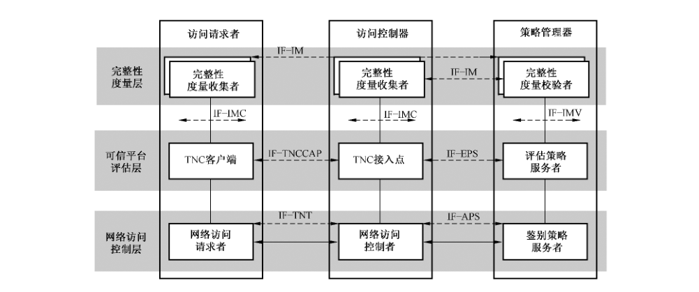

在图1所示的TCA中，存在3个实体：访问请求者（AR）、访问控制器（AC）和策略管理器（PM），从上至下分为3个抽象层：完整性度量层、可信平台评估层和网络访问控制层。在每个实体中，矩形方框表示实体中的组件。组件之间存在相应的接口，用带名称的双向虚线箭头表示。

AR 和AC都具有TPCM,AR 请求访问受保护网络，AC控制 AR对受保护网络的访问。PM对AR 和 AC进行集中管理。AR 和 AC 基于 PM 来实现 AR 和 AC 之间的双向用户身份鉴别和平台鉴别，其中平台鉴别包括平台身份鉴别和平台完整性评估，PM在用户身份鉴别和平台鉴别过程中充当可信第三方。平台完整性评估包含两个阶段：第一阶段，校验平台完整性度量值是否被篡改；第二阶段，评估平台完整性度量值是否与相应的基准完整性度量值相同。

### 5.2 实体

#### 5.2.1 访问请求者

AR 是请求接入受保护网络的实体，包含的组件为：网络访问请求者（NAR）、TNC 客户端（TNCC）和完整性度量收集者（IMC），其中 TNCC 和 IMC之间的接口完整性度量收集接口（IF-IMC）。AR的功能为：向 AC 发送访问请求，基于PM实现与AC 之间的双向用户身份鉴别和平台鉴别，依据本地所做出的访问决策执行访问控制。

#### 5.2.2 访问控制器

AC 是控制 AR 访问受保护网络的实体，包含的组件为：网络访问控制者（NAC）、TNC接入点（TNCAP）和IMC，其中 TNCAP和IMC之间接口为IF-IMC。AC 的功能为：基于PM实现与AR之间双向用户身份鉴别和平台鉴别，依据本地所做出的访问决策执行访问控制。

#### 5.2.3 策略管理器

PM是AR和AC 的集中管理方，包含的组件为：鉴别策略服务者（APS）、评估策略服务者（EPS）和完整性度量校验者（IMV），其中 EPS 和IMV之间的接口为完整性度量校验接口（IF-IMV）。PM 的功能为：协助 AR 和AC实现它们之间的双向用户身份鉴别和平台鉴别。在用户身份鉴别和平台鉴别过程中，PM充当 AR 和AC 的可信第三方。

### 5.3 层次

#### 5.3.1 网络访问控制层

网络访问控制层包含的组件为：NAR、NAC 和 APS，其中 NAR 和 NAC之间的接口为可信网络传输接口（IF-TNT），NAC 和 APS之间的接口为鉴别策略服务接口（IF-APS）。网络访问控制层中的IF-TNT 和IF-APS定义了网络传输机制和访问控制机制，用于实现网络访问控制层的用户身份鉴别功能、网络传输功能和访问控制功能，具体见第6章。

#### 5.3.2 可信平台评估层

可信平台评估层包含的组件：TNCC、TNCAP 和 EPS，其中 TNCC 和 TNCAP之间的接口为TNC客户端-TNC接入点接口（IF-TNCCAP），TNCAP 和 EPS 之间的接口为评估策略服务接口（IF-EPS）。可信平台评估层中的IF-TNCCAP 和 IF-EPS定义了平台鉴别基础设备（PAI），用于实现可信平台评估层的平台鉴别功能，具体见第7章。

#### 5.3.3 完整性度量层

完整性度量层包含的组件为：IMC 和 IMV，其中IMC 和IMV 之间的接口为完整性度量接口（IF-IM）。完整性度量层中 IF-IM 定义了IMC 和 IMV 之间的消息交互（见第8章）。

### 5.4 组件

#### 5.4.1 网络访问请求者

NAR是AR中的一个组件，其功能为：负责向 AC发起访问请求，与NAC 和 APS执行用户身份鉴别协议来实现 AR和 AC 之间的双向用户身份鉴别，传送和接收用户身份鉴别协议和平台鉴别协议数据，向 TNCC发送平台鉴别请求，从TNCC接收它所做出的访问决策，依据 NAR 所做出的访问决策或从 TNCC 接收到的访问决策执行访问控制。

#### 5.4.2 网络访问控制者

NAC是AC 中的一个组件，其功能为：负责启动用户身份鉴别协议，与NAR 和 APS执行用户身份鉴别协议来实现 AR 和 AC之间的双向用户身份鉴别，传送和接收用户身份鉴别协议和平台鉴别协议数据，向 TNCAP发送平台鉴别请求，从TNCAP接收它所做出的访问决策，依据 NAC所做出的访问决策或从 TNCAP接收到的访问决策执行访问控制。

#### 5.4.3 鉴别策略服务者

APS是PM 中的一个组件，其功能为：作为可信第三方与 NAR 和 NAC执行用户身份鉴别协议来实现 AR 和AC之间的双向用户身份鉴别，传送和接收用户身份鉴别协议和平台鉴别协议数据。值得注意的是，APS 可以不参与用户身份鉴别协议。

#### 5.4.4 TNC 客户端

TNCC的功能：执行网络连接管理，通过IF-IMC（见5.5.6）接口与它上端的各个 IMC进行信息交互，与TNCAP 和 EPS执行一轮或多轮平台鉴别协议，实现 AR 和AC之间的双向平台鉴别，其中EPS 充当可信第三方。

平台鉴别过程完成时，TNCC生成它的访问决策并发送给网络访问控制层中的 NAR。

#### 5.4.5 TNC 接入点

TNCAP 的功能为：执行网络连接管理，通过IF-IMC（见5.5.6）接口与它上端的各个IMC进行信息交互，与 TNCC和 EPS执行一轮或多轮平台鉴别协议，实现 AR 和 AC之间的双向平台鉴别，其中 EPS充当可信第三方。

平台鉴别过程完成时，TNCAP生成它的访问决策并发送给网络访问控制层中的 NAC。

#### 5.4.6 评估策略服务者

EPS 的功能为：不参与TNCC 与TNCAP之间的网络连接管理，通过IF-IMV（见5.5.7）接口与它上端的各个 IMV 进行信息交互，作为可信第三方与 TNCC 和 TNCAP执行平台鉴别协议，实现 AR和AC之间的双向平台鉴别。在平台鉴别协议中，EPS验证 AR 和AC的PIK证书的有效性，以及评估AR 和AC的平台完整性。

#### 5.4.7 完整性度量收集者

IMC是运行在 AR 和 AC上的组件，它收集 AR 和 AC的平台完整性度量值，并发送给相应的IMV。

#### 5.4.8 完整性度量校验者

IMV 是运行在 PM 上的组件，它校验和评估所接收到的 AR 和AC的平台完整性度量值。

### 5.5 接口

#### 5.5.1 可信网络传输接口

IF-TNT是 NAR 和NAC之间的接口，负责完成网络访问控制层的用户身份鉴别功能、网络传输功能和访问控制功能，具体见第6章。

#### 5.5.2 鉴别策略服务接口

IF-APS是 NAC 和APS之间的接口，负责完成网络访问控制层的用户身份鉴别功能和网络传输功能，具体见 6.2。

#### 5.5.3 TNC客户端-INC接入点接口

IF-TNCCAP是TNCC 和TNCAP之间的接口，负责完成可信平台评估层的平台鉴别功能，具体见第7章。

#### 5.5.4 评估策略服务接口

IF-EPS 是TNCAP 和EPS之间的接口，负责完成可信平台评估层的平台鉴别功能，具体见第7章。

#### 5.5.5 完整性度量接口

IF-IM 是IMC 和 IMV 之间的接口，定义IMC 和IMV之间交换的特定厂商的组件信息，具体见第8章。

#### 5.5.6 完整性度量收集接口

IF-IMC是 TNCC与它上端的各个 IMC 之间的接口，负责完成 TNCC与它上端的各个 IMC 之间的信息交互，用于实现平台鉴别功能（见9.2）。IF-IMC是 TNCAP与它上端的各个 IMC 之间的接口，负责完成 TNCAP 与它上端的各个 IMC之间的信息交互，用于实现平台鉴别功能（见9.2）

#### 5.5.7 完整性度量校验接口

IF-IMV 是EPS与它上端的各个 IMV 之间的接口，负责完成 EPS与它上端的各个 IMV 之间的信息交互，用于完成平台鉴别功能（见9.3）。

### 5.6 实现过程

TCA 的实现过程如图2所示。

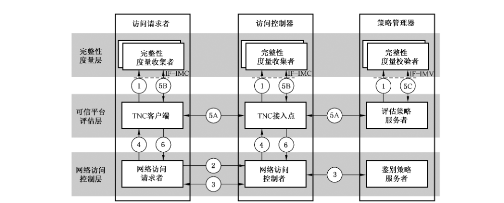

在图2中，TCA 的实现过程的具体步骤 ：

1） 在建立可信网络连接之前，TNCC 和 TNCAP 必须分别根据特定平台绑定函数来加载它们上端的各个 IMC，而EPS必须根据特定平台绑定函数加载它上端的各个 IMV，其中特定平台绑定函数不在本标准中规定。

2） NAR向NAC发起网络访问请求。

3） NAC 收到 NAR的网络访问请求后，与NAR 和 APS执行用户身份鉴别协议来实现AR和AC 之间的双向用户身份鉴别，其中 APS 可以不参与用户身份鉴别协议。若APS参与该用户身份鉴别协议，则APS在该用户身份鉴别协议中充当可信第三方。在用户身份鉴别协议中，NAR 和NAC协商出 AR 和AC之间的主密钥或会话密钥。若用户身份鉴别完成后要求立即做出访问决策，则 NAR 和 NAC 分别依据用户身份鉴别结果生成访问决策，然后跳至步骤7。

4） 若NAR 需要执行平台鉴别过程，则 NAR 向 TNCC发送平台鉴别请求，若 NAC需要执行平台鉴别过程，则NAC向 TNCAP 发送平台鉴别请求。

5A） 当 TNCAP 收到平台鉴别请求信息时，启动平台鉴别过程，与TNCC 和 EPS执行一轮或多轮平台鉴别协议来实现 AR 和AC之间的平台鉴别。当TNCC 收到 NAR的平台鉴别请求信息，或一轮平台鉴别协议结束后还没完成对 AC 的平台鉴别时，TNCC 等待 TNCAP 发起的一轮平台鉴别协议。

5B） 在平台鉴别过程中，TNCC通过IF-IMC（见 5.5.6）与它上端的各个IMC进行信息交互。

TNCAP 通过IF-IMC（见5.5.6）与它上端的各个 IMC 进行信息交互。

5C）EPS负责验证 AR 和AC的PIK 证书，并通过IF-IMV（见5.5.7）调用它上端的各个IMV来校验和评估 AR 和 AC的平台完整性度量值。EPS 依据平台完整性评估策略生成 AR 和 AC的平台完整性评估结果，最后将 PIK 证书验证结果和平台完整性评估结果发送给 TNCC 和TNCAP.

6） 当AR 和AC的平台鉴别完成时，TNCC 和 TNCAP 分别依据 EPS生成 AR 和 AC的PIK证书验证结果和平台完整性评估结果生成访问决策（允许/禁止/隔离），并分别发送给 NAR和 NAC。

7） NAR 依据它所生成的访问决策或从 TNCC 接收到的访问决策执行访问控制，NAC依据它所生成的访问决策或从 TNCAP接收到的访问决策执行访问控制，从而实现可信网络连接，即AC依据访问决策控制 AR对受保护网络的访问，AR依据访问决策判定是否连接至该受保护网络，其中过程中所涉及的算法均以套件形式存在，需符合国家对于密码管理的有关规定。

### 5.7 评估、隔离和修补

#### 5.7.1 具有隔离修补层的 TCA

隔离和修补功能是TCA 中的重要组成部分。若平台身份未被成功鉴别，则断开连接；否则，校验和评估平台完整性。若平台完整性校验和评估未成功通过，则接入隔离域对平台进行修补，通过平台修补后可重新执行平台鉴别过程。具有隔离和修补功能的TCA 如图3所示。

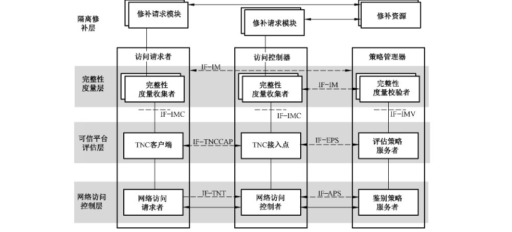

在图3中的隔离修补层，驻留在 AR 和 AC的修补请求模块可向 PM所提供的修补资源请求修补。

当AR的平台需要进行修补时，AR的各个IMC调用驻留在AR 的修补请求模块向 PM 所提供的修补资源请求修补并完成自身平台修补；当AC的平台需要进行修补时，AC的各个 IMC 调用驻留在AC的修补请求者模块向 PM所提供的修补资源请求修补并完成自身平台修补。

#### 5.7.2 评估

平台鉴别包括平台身份鉴别和平台完整性评估。这里，评估是依据AR 和 AC 的平台完整性度量值进行的，其中完整性管理框架参见附录A。

TCA 中的TNCC和 TNCAP分别将 AR 和 AC 的平台完整性度量值发送给EPS（平台完整性度量值通过平台 PIK 私钥签名确保平台完整性度量值来源的抗抵赖性），EPS调用它上端的各个 IMV对AR 和AC 的平台完整性度量值进行校验和评估，生成平台完整性评估结果，并发送给 TNCC和TNCAP。

当 TNCC 和 TNCAP 收到平台完整性评估结果后，若 AR 和AC 的平台需要修补，则分别通知NAR 和NAC进行隔离，NAR 和 NAC 将访问隔离域并依照 EPS传输过来的平台修补信息进行修补。

平台修补完成后，TNCC和 TNCAP将平台修补部分的平台完整性度量值发送给 EPS（平台完整性度量值通过平台 PIK 私钥签名确保平台完整性度量值来源的抗抵赖性），执行下一个平台鉴别过程。

#### 5.7.3 隔离

对实体进行隔离的技术有：VL.AN 隔离、IP 过滤和基于端口的控制。

##### 5.7.3.1 VLAN 隔离

VLAN隔离（见RFC 2675）是使AR 和AC 接入一个虚拟局域网，该虚拟局域网为 AR和AC提供了平台修补资源（如软件补丁、病毒更新文件等）。

##### 5.7.3.2 IP 过滤

IP 过滤是使用AC 配置IP 的过滤集，通过这些IP 过滤集来实现隔离（见 RFC 2865）。

##### 5.7.3.3 基于端口的控制

基于端口的控制是指定义两种逻辑端口：非受控端口和受控端口，通过对受控端口进行控制来实现隔离（见6.3.1）。

#### 5.7.4 修补

修补是使 AR 和AC的平台安全状态符合对方定义的平台完整性评估策略所指定的平台安全状态，这可通过对平台组件进行更新或升级的方式来实现。当AR 和 AC 的平台不能通过平台完整性评估时，证明它们的平台安全状态未达到对方定义的平台完整性评估策略所指定的平台安全状态，则AR和 AC 将被接入隔离域并进行平台修补。

## 6 网络访问控制层

### 6.1 概述

在网络访问控制层，NAR、NAC 和 APS采用三元可扩展鉴别协议（TAEP）来实现TCA 的网络传输，其中 TCA 的TAEP实现方式包括：序列 TAEP 鉴别方式和隧道 TAEP鉴别方式。

在网络访问控制层，NAR 和 NAC 采用基于三元对等架构的访问控制技术（TePA-AC）来实现TCA 的访问控制，其中 TCA 的TePA-AC 实现方式包括：全端口控制实现方式和部分端口控制方式。

TAEP 和 TePA-AC 的定义见 GB/T 28455—2012。

### 6.2 网络传输机制

#### 6.2.1 序列 TAEP 鉴别方式

##### 6.2.1.1 概述

序列 TAEP 鉴别方式是指采用一序列TAEP 鉴别方法来实现TCA 的双向用户身份鉴别和平台鉴别。本标准规定了两种适用于 TCA 的序列 TAEP 鉴别实现（见6.2.1.2 和 6.2.1.3），前者适用于 AR 和AC 在用户身份鉴别过程中生成会话密钥的情况，后者适用于 AR 和 AC 在用户身份鉴别过程中生成主密钥的情况，也可以适用于 AR 和 AC 在用户身份鉴别过程中生成会话密钥的情况。

##### 6.2.1.2 TCA 的序列 TAEP鉴别实现一

###### 6.2.1.2.1 层次模型

图4为TCA 的序列 TAEP 鉴别实现一的层次模型。

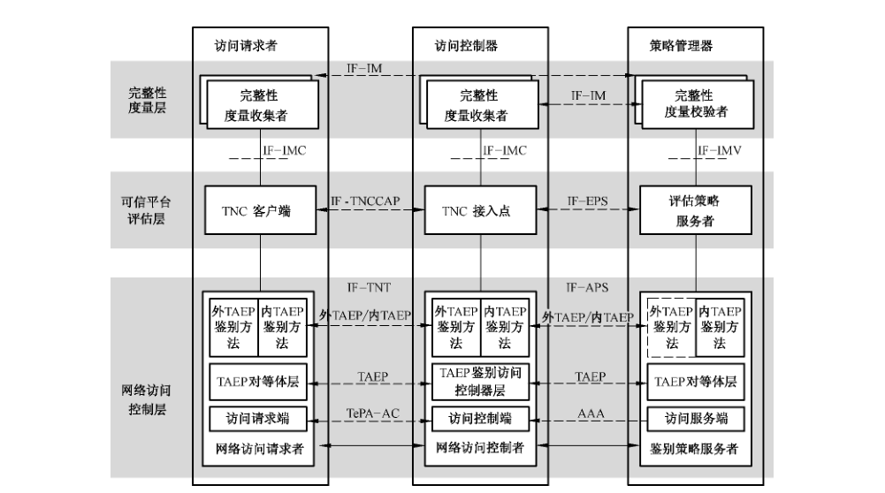

在图4中，NAR、NAC 和 APS先执行一个外 TAEP 鉴别方法，然后再执行一个内 TAEP 鉴别方法，其中 AR 和 AC 之间的内 TAEP鉴别方法中的数据字段被外 TAEP 鉴别方法协商的 AR和AC 之间的会话密钥所保护。保护机制中的密码算法采用 SM4。TAEP 对等体层和 TAEP 鉴别访问控制器层TAEP层次模型（见 GB/T 28455—2012）中的两种角色。访问请求端和访问控制端利用 TePA- AC 来实现 TCA 的访问控制（见6.3），其中 TAEP包承载在TePA-AC 上。访问控制端和访问服务端可以利用 AAA协议（见 RFC 3539）来承载 TAEP 包，例如：RADIUS 和 Diameter（见 RFC 2138、RFC 2865、RFC 2866.RFC 4675、RFC 3588 和 RFC 3589）。

APS 中的外 TAEP 鉴别方法为虚线框，表示 APS可以不参与外 TAEP 鉴别方法。

对于 TCA 的这种序列 TAEP鉴别实现，内 TAEP 包中的PIK 签名必须密码绑定外 TAEP 鉴别方法为 AR 和AC 之间建立的会话密钥，密码绑定方法是将该会话密钥作PIK 签名的外部数据输入。

###### 6.2.1.2.2 外 TAEP 鉴别方法

外 TAEP鉴别方法用于实现 AR 和 AC之间的双向用户身份鉴别，以及协商 AR 和AC之间的会话密钥。外 TAEP 鉴别方法用于封装传输用户身份鉴别协议，它可以封装各种用户身份鉴别协议。

外 TAEP 包可以封装基于预共享密钥的 WAI 协议单播密钥协商过程（见 GB 15629.11—2003 和GB 15629.11—2003/XG1—2006）。当外 TAEP 包封装WAI 协议单播密钥协商过程时，本标准规定相应的外 TAEP 鉴别方法的 Type 字段 TAEP-WAI（值为200）。

外 TAEP 包封装的双向用户身份鉴别协议也可以根据不同的网络环境选用。

###### 6.2.1.2.3 内TAEP鉴别方法

内TAEP 鉴别方法用于实现 AR 和 AC 之间的平台鉴别。

当内 TAEP 包封装 PAI 协议（见7.2.2）时，本标准规定相应的内 TAEP 鉴别方法的Type 字段力TAEP-PAI（值为 201）。

###### 6.2.1.2.4 TAEP 交互过程

TCA 的TAEP 交互过程如下：

a） NAC向NAR 发送 TAEP 的 Request 分组，其中 Type 字段的值为 Identity。

b） NAR向NAC 发送 TAEP 的 Response 分组，其中 Type 字段的值为 Identity,Type-Data 字段的值包含AR的身份。

c） NAC 向 APS发送 TAEP 的 Request 分组，其中 Type 字段的值 TP Authentication, Type- Data字段的值包含 AR 和 AC的身份。

d） APS向 NAC 发送TAEP 的Response 分组，其中 Type 字段的值 TP Authentication, Type- Data 字段的值包含 PM 所支持的各种 TAEP 鉴别方法类型。

NAC选取一种外 TAEP 鉴别方法与 NAR、APS执行外 TAEP 鉴别方法过程，即 NAC与NAR之间、NAC与 APS之间交互一系列 TAEP 的 Request 分组和 Response 分组，直至外TAEP 鉴别方法过程完成，其中 Type 字段的值为 NAC选取的外 TAEP 鉴别方法类型，Type- Data 字段的值包含该外 TAEP鉴别方法类型对应的外 TAEP鉴别方法消息。

若步骤e）完成后 NAC 还需要执行平台鉴别过程，则执行步骤g）；否则利用 TAEP 的 Success分组或 Failure 分组结束鉴别过程，即若在步骤e）中的外 TAEP 鉴别方法过程中 NAC成功鉴别AR 的用户身份，则向 NAR发送 TAEP 的 Success 分组；若在步骤e）中的外 TAEP 鉴别方法过程中 NAC 不能成功鉴别 AR的用户身份，则向 NAR 发送 TAEP 的Failure 分组。

gq） NAC选取一种内 TAEP 鉴别方法与 NAR、APS 执行内 TAEP 鉴别方法过程，即NAC与NAR之间、NAC 和 APS之间交互一系列 TAEP 的Request 分组和 Response 分组，直到内TAEP 鉴别方法过程完成，其中 Type 字段的值为 NAC选取的内 TAEP 鉴别方法类型，Type- Data 字段的值为 NAC选取的内 TAEP 鉴别方法类型对应的内 TAEP 鉴别方法消息。内TAEP 鉴别方法消息由可信平台评估层中的TNCC、TNCAP 和 EPS进行相应处理。

h NAC 利用 TAEP 的 Success 分组或Failure 分组结束鉴别过程，即：若在步骤g）中的内TAEP鉴别方法过程中 TNCAP 成功鉴别 AR 的平台（包括平台身份鉴别和平台完整性评估），则向NAR发送 TAEP 的 Success 分组。若在步骤g）中的内 TAEP鉴别方法过程中 TNCAP不能成功鉴别 AR 的平台，则向 NAR发送 TAEP 的Failure 分组。

以上步骤描述了TCA 的序TAEP 鉴别实现一的典型TAEP 交互过程，但根据鉴别方法的不同，步骤过程会有不同。

当外 TAEP 鉴别方法的 Type 字段为 TAEP-WAI 且封装基于预共享密钥的WAI 协议单播密钥协商过程，内 TAEP鉴别方法的Type 字段为 TAEP-PAI 时且封装PAI 协议（见7.2.2）时，TCA 的序列 TAEP 鉴别实现一的一个完整的 TAEP交互过程如图5所示。

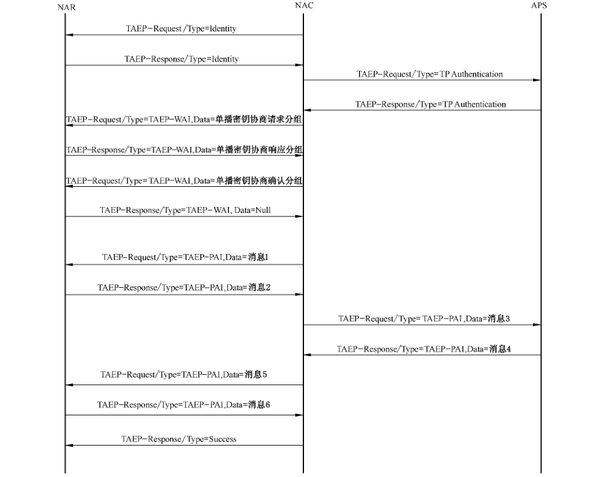

在图5中，根据PAI 协议的特点，与TAEP-PAI 相关的消息1～消息6的TAEP 交互可能执行多轮次。

在一轮 PAI 协议中，当消息5未被生成时，消息5和消息6的TAEP 交互不存在。

在一轮 PAI 协议中，当消息5被生成，但消息6未被生成时，消息6的TAEP 交互存在，其 Data 值为NULL。

##### 6.2.1.3 TCA 的序列 TAEP 鉴别实现二

###### 6.2.1.3.1 层次模型

图6为TCA的序列 TAEP鉴别实现二的层次模型。

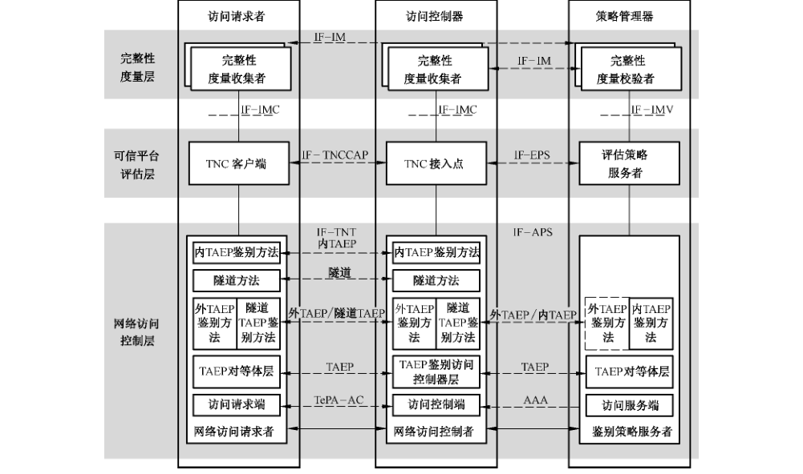

在图6中，NAR、NAC和APS先执行一个外 TAEP 鉴别方法，然后再执行一个隧道 TAEP 鉴别方法，其中隧道 TAEP 鉴别方法包含两个阶段：隧道方法和内 TAEP 鉴别方法。TAEP 对等体层和TAEP 鉴别访问控制器层是 TAEP 层次模型（见GB/T 28455—2012）中的两种角色。访问请求端和访问控制端利用 TePA-AC来实现TCA 的访问控制（见6.3），其中 TAEP 包承载在TePA-AC上。访问控制端和访问服务端可以利用 AAA 协议（见 RFC 3539）来承载 TAEP 包，例如，RADIUS 和 Diameter（见 RFC 2138.RFC 2865、RFC 2866.RFC 4675、RFC 3588 和 RFC 3589）。外 TAEP鉴别方法建立AR 和AC之间的主密钥或会话密钥。外 TAEP 鉴别方法还可以建立 AR 和PM之间的会话密钥，以及AC和PM之间的会话密钥。隧道 TAEP 鉴别方法中的隧道方法建立 AR 和 AC之间的隧道密钥。

APS 中的外 TAEP 鉴别方法为虚线框，表示 APS可以不参与外 TAEP 鉴别方法。

对于 TCA 的这种序列 TAEP 鉴别实现，内TAEP 包中的PIK 签名必须密码绑定外 TAEP 鉴别方法为 AR和AC之间建立的主密钥或会话密钥、隧道TAEP 鉴别方法中隧道方法所建立的隧道密钥，密码绑定方法是将这两阶段密钥作为 PIK 签名的外部数据输入。

###### 6.2.1.3.2 外 TAEP 鉴别方法

外 TAEP 鉴别方法用于实现 AR 和AC 之间的双向用户身份鉴别，以及协商 AR和 AC之间的主密钥或会话密钥。外 TAEP 鉴别方法用于还可以用于协商 AR 和PM 之间的会话密钥，以及AC和PM之间的会话密钥。外 TAEP 鉴别方法用于封装传输用户身份鉴别协议，它可以封装各种用户身份鉴别协议。

当采用公钥证书时，外 TAEP 包可以封装基于证书的 WAI 协议（见GB 15629.11—2003 和GB 15629.11—2003/XG1—2006）及增强型WAI 协议（见6.2.1.3.5）的证书鉴别过程、三元对等鉴别协议（见ISO/IEC 9798-3:1998/Amd.1:

2010）。当采用预共享密钥时，外 TAEP包可以封装基于预共享密钥的 WAI 协议单播密钥协商过程（见 GB 15629.11—2003 和 GB 15629.11—2003/XG1—2006）。当外 TAEP包封装 WAI 协议及增强型 WAI 协议时，本标准规定相应的外 TAEP 鉴别方法的Type字段为 TAEP-WAI外 TAEP包封装的双向用户身份鉴别协议也可以根据不同的网络环境选用。

0.2.1.3.3 隧道TAEP 鉴别方法隧道 TAEP 鉴别方法用于封装传输平台鉴别协议，如 PAI 协议（见7.2.2），它包含以下两个阶段：第一阶段，NAR 和 NAC利用隧道方法建立 AR 和AC 之间的安全隧道。

第二阶段：NAR、NAC和 APS交互内 TAEP鉴别方法的内 TAEP包，其中 AR和 AC之间的内TAEP 包是利用隧道方法所建立的安全隧道进行保护的。

对于隧道方法，本标准推荐采用 TLS协议（见 RFC 2246、4346 和 5246）的全匿名模式，其中 ECDH交换参数采用国家密码管理局批准的ECC 域参数，杂凑算法采用国家密码管理局批准的KD-HMAC- SHA256、HMAC-SHA256 和 SHA256算法，分组算法采用国家密码管理局批准的SM4算法，加密工作模式采用 OFB模式，完整性校验工作模式采用CBC-MAC 模式，从而本标准将相应的TLS 密码套件规定为 TLS_ECDH_anon_WITH_SM4_OFB_CBC_MAC_SHA256，其值为10x00,0xfe）。

当采用TLS协议的完全匿名模式作为隧道方法时，本标准规定相应的隧道TAEP 鉴别方法的Type 字段 TAEP-TTLS（值为202）。

内TAEP 鉴别方法用于实现 AR 和 AC 之间的平台鉴别。当内 TAEP 包封装 PAI 协议（见7.2.2）时，本标准规定相应的内 TAEP鉴别方法的Type字段 TAEP-PAI。

###### 6.2.1.3.4 TAEP 交互过程

TCA 的TAEP交互过程如下：

a） NAC 向NAR 发送 TAEP 的Request 分组，其中Type 字段的值为 Identity。

b） NAR向NAC 发送 TAEP 的 Response 分组，其中 Type 字段的值为 Identity，Type-Data 字段的值包含 AR 的身份。

c） NAC向 APS发送 TAEP 的 Request 分组，其中 Type 字段的值 TP Authentication, Type- Data 字段的值包含AR和AC 的身份。

d） APS向 NAC 发送 TAEP 的Response 分组，其中 Type 字段的值 TP Authentication, Type- Data 字段的值包含 PM所支持的各种 TAEP 鉴别方法类型。

e） NAC选取一种外 TAEP 鉴别方法与 NAR、APS执行外 TAEP 鉴别方法过程，即 NAC与NAR之间、NAC与 APS之间交互一系列 TAEP 的 Request 分组和 Response 分组，直至外TAEP 鉴别方法过程完成，其中 Type 字段的值为 NAC 选取的外 TAEP 鉴别方法类型，Type- Data 字段的值包含该外 TAEP 鉴别方法类型对应的外 TAEP鉴别方法消息。

f） 若步骤e）完成后 NAC 还需要执行平台鉴别过程，则执行步骤g），否则利用 TAEP 的 Success分组或 Failure 分组结束鉴别过程，即若在步骤e）中的外TAEP鉴别方法过程中 NAC成功鉴别 AR的用户身份，则向 NAR发送 TAEP 的 Success 分组；若在步骤e）中的外 TAEP鉴别方法过程中 NAC 不能成功鉴别 AR的用户身份，则向 NAR 发送 TAEP 的Failure 分组。

g） NAC 选取一种隧道 TAEP 鉴别方法与 NAR执行隧道方法过程建立 AR 和 AC之间的安全隧道，即 AR 和 AC 之间交互一系列 TAEP 的 Request 分组和 Response 分组，直至隧道方法过程完成，其中 Type 字段的值为隧道 TAEP 鉴别方法类型，Type-Data 字段的值为隧道方法消息。

h） NAC向 NAR 发送 TAEP 的 Request 分组，其中 Type字段的值为步骤g）中的隧道 TAEP鉴别方法类型，Type-Data 字段的值为利用步骤g）建立的安全隧道进行保护的内TAEP 包。内TAEP 包的 Code 字段的值为 Request,Type 字段的值Identity。当 TNCAP 需要请求用于内TAEP鉴别方法的AR 的身份时，TNCAP通知 NAC发送该内 TAEP包。当 NAR 收到该内 TAEP包时，NAR 向 TNCC 请求用于内 TAEP鉴别方法的AR的身份。

NAR 向 NAC 发送 TAEP 的 Response 分组，其中 Type 字段对应步骤h）中 TAEP的 Request分组中的Type 字段，Type-Data 字段的值利用步骤g）建立的安全隧道进行保护的内TAEP 包。内TAEP包的Code 字段的值为 Response, Type 字段对应步骤h）中内 TAEP包的 Request 分组中的Type字段，Type-Data 字段中包含用于内 TAEP鉴别方法的AR的身份。当 NAR 从 TNCC 接收到用于内 TAEP鉴别方法的AR的身份时，NAR 向 NAC发送该内TAEP包。当NAC收到该内 TAEP包时，NAC 向 TNCAP 发送用于内TAEP 鉴别方法的AR的身份。

j） NAC向 APS发送 TAEP 的 Request 分组，其中 Type 字段的值 TP Authentication, Type- Data 字段中 Subtype字段的值 FF-FF-FE（用于标识 TCA 中内 TAEP包的TP Authentica- tion 类型分组），Subdata 字段的值包含用于内 TAEP 鉴别方法的 AR和 AC身份。Subdata字段的值还可以包含对 AR 的平台鉴别策略请求信息，具体值不在本标准中规定。当TNCAP 需要向 EPS 请求内 TAEP 鉴别方法类型或对AR 的平台鉴别策略时，TNCAP通知NAC发送该内 TAEP包。当APS 收到该内TAEP包时，APS 向 EPS发送用于内 TAEP鉴别方法的 AR 和 AC身份或对 AR 的平台鉴别策略请求信息。

k） APS向 NAC 发送 TAEP 的 Response 分组，其中 Type 字段对应步骤j中 TAEP 的 Request分组中的 Type 字段，Type-Data 字段中 Subtype的值次 FF-FF-FE,Subdata 字段的值包含各个内TAEP鉴别方法类型。Subdata 字段的值还可以包含EPS分发给TNCAP的对AR的平台鉴别策略。当 APS从 EPS接收到各个内鉴别方法类型或对AR 的平台鉴别策略时，APS向 NAC发送该内 TAEP 包，NAC 收到该内 TAEP 包后将其 Subdata 字段的值发送给TNCAP，然后 TNCAP选取一种内 TAEP 鉴别方法发起内 TAEP 鉴别过程。对AR的平台鉴别策略的管理参见附录 B。

1） NAC 根据 TNCAP选取的一种内 TAEP 鉴别方法与 NAR、APS 交互一系列 TAEP 的Request 分组和 Response 分组，直到内 TAEP 鉴别方法过程完成。对于 NAC与 NAR之间交互的一系列 TAEP 的 Request 分组和 Response 分组，其中 Type字段的值步骤g）中的隧道 TAEP 鉴别方法类型，Type-Data 字段的值为利用步骤g）建立的安全隧道进行保护的内TAEP包。内 TAEP包的 Type 字段的值为 TNCAP 选取的内 TAEP 鉴别方法类型，Type- Data 字段的值TNCAP选取的内 TAEP 鉴别方法类型对应的内 TAEP 鉴别方法消息。对于 NAC与APS之间交互的一系列 TAEP的 Request 分组和 Response 分组，其中 Type 字段的值为 TNCAP选取的内 TAEP 鉴别方法类型，Type-Data 字段的值 TNCAP选取的内TAEP鉴别方法类型对应的内 TAEP 鉴别方法消息。内TAEP 鉴别方法消息由可信平台评估层中的 TNCC、TNCAP 和 EPS 进行相应处理。

m） NAC 利用 TAEP 的 Success 分组或 Failure 分组结束鉴别过程，即：若在步骤1）中的内TAEP 鉴别方法过程中 TNCAP 成功鉴别 AR 的平台（包括平台身份鉴别和平台完整性评估），则向 NAR 发送 TAEP 的 Success 分组。若在步骤1）中的内 TAEP 鉴别方法过程中TNCAP 不能成功鉴别AR 的平台，则向 NAR 发送 TAEP的 Failure 分组。

以上步骤描述了TCA 的序TAEP 鉴别实现二的典型 TAEP 交互过程，但根据鉴别方法的不同，步骤过程会有不同。

当外 TAEP 鉴别方法的 Type字段为 TAEP-WAI 且封装基于证书的 WAI 协议的证书鉴别过程，隧道 TAEP鉴别方法的 Type 字段为 TAEP-TTLS 且隧道方法为全匿名模式 TLS 协议，内 TAEP鉴别方法的Type 字段为 TAEP-PAI 且封装 PAI 协议（7.2.2）时，TCA 的序 TAEP 鉴别实现二的一个完整的 TAEP交互过程如图？所示。

NAC APs NAR TAEP-Request/Type=ldenity TAEP-Response/Type=ldentity TAEP-Request/Type-TP Authentication TAEP-Response/ Type =TP Authentication TAEP-Request/Type=TAEP-WAI,Data=鉴别激活分组TAEP-Response/Type-TAEP-WAL,Data=接入鉴別请求分组_ TAEP-Request /Type=TAEP-WAL Daiaz-证书鉴别清求分组。

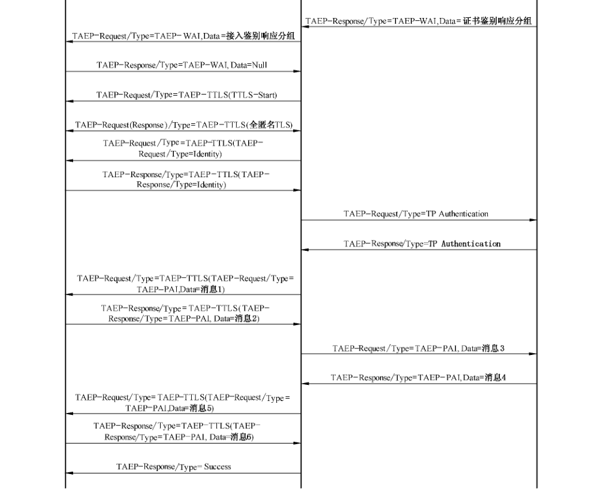

在图7中，根据 PAI 协议的特点，与 TAEP-PAI 相关的消息1～消息6的TAEP 交互可能执行多轮次。

在一轮 PAI 协议中，当消息5未被生成时，消息5和消息6的TAEP交互不存在。

在一轮 PAI 协议中，当消息5被生成，但消息6未被生成时，消息6的TAEP 交互存在，其Data 值为NULL。

当外 TAEP 鉴别方法的 Type 字段为 TAEP-WAI 且封装基于证书的增强型 WAI 协议（见6.2.1.3.5）的证书鉴别过程，隧道 TAEP 鉴别方法的 Type字段 TAEP-TTLS 且隧道方法为全匿名模式TLS协议，内 TAEP 鉴别方法的 Type 字段 TAEP-PAI 且封装 PAI 协议（7.2.2）时，TCA 的序TAEP鉴别实现二的一个完整的 TAEP交互过程如图8所示。

NAR NAC APs TAEP-Request/Type=Tdentit TAEP-Response/Type=ldentity TAEP-Request/Type=TP Authentication TAEP-Response/Type=TP Authentication TAEP-Reques/Type= TABP-WAL, Date-消息1 TAEP-Request/Type=TAEP-WAI, Dat=消息2 TAEP-Request/Type=TAEP-WAI. Data=消息3 TABP-Response/Type=TAEP-WAI, Dat=消息4 TAEP-Request/Type=TAEP-WAI, Date=消息5 TAEP-Response/Type= TAEP-WAL, Data=消息6 TAEP-Request/Type=TAEP-WAI,Data=消息？TAEP-Response/Type =TAEP-WAI, Data=消息8 TAEP-Response/Type=TAEP-WAL, Data-消息9 TAEP-Response/Type=TAEP-WAI. Data-NULL TAEP-Request/Iype=TAEP-TTLS（TTLS-Start）， TAEP-Requcst （Response/Iype =TAEP-TTLS（全医名ILS）。

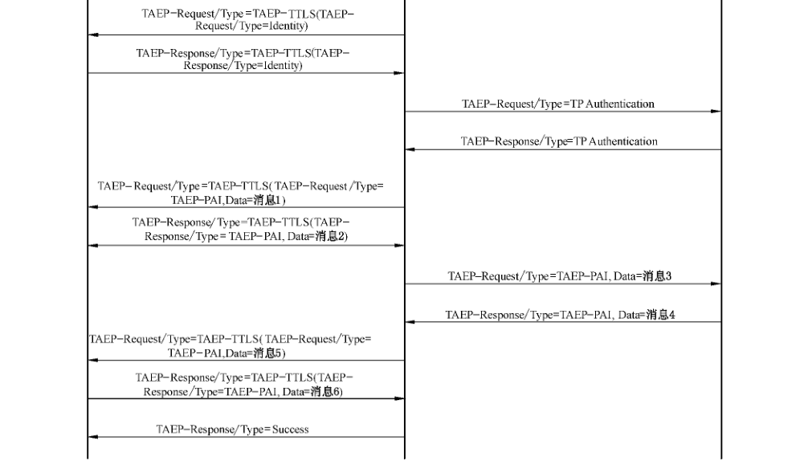

在图8中，根据 PAI 协议的特点，与TAEP-PAI 相关的消息1～消息6的TAEP 交互可能执行多轮次。

在一轮 PAI 协议中，当消息5未被生成时，消息5和消息6的TAEP交互不存在。

在一轮 PAI 协议中，当消息5被生成，但消息6未被生成时，消息6的TAEP交互存在，其 Data 值为NULL。

###### 6.2.1.3.5 增强型 WAl协议

###### 6.2.1.3.5.1 概述

WAI协议（见 GB 15629.11—2003 和 GB 15629.11—2003/XG1—2006）中的STA、AP和ASU分别对应于本标准中的 AR、AC 和 PM。ASUE驻留在STA 中，AE驻留在AP或STA 中，ASE驻留在ASU 中。相对于 WAI 协议，增强型 WAI（EWAI）协议增加了 ASUE 与 ASU 之间、AE和ASU之间的密钥协商，使得其证书鉴别过程与 WAI 协议的证书鉴别过程不相同。本标准规定EWAI 协议中的STA 和AP都信任同一个 ASU。EWAI 协议中未明确规定部分参见 WAI协议，包括单播密钥协商过程、组播密钥/站间密钥通告过程等。

在执行 EWAI 协议之前，ASUE 和AE 利用 WAPI 信息元素（见 GB 15629.11—2003 和 GB 15629.11—2003/XG1—2006）协商鉴别和密钥管理套件以及 ASUE 是否需要建立与 ASU 之间的会话密钥及密码套件，具体协商过程不在本标准中规定。

###### 6.2.1.3.5.2 增强型 WAI 协议分组格式

EWAI 协议分组格式与 WAI 协议相同，其中类型字段的值如下：1 WAI 协议分组；

2 EWAI 协议分组；

其他值保留。

子类型字段的值如下：1 消息1；

2 消息2；

消息3；

4 消息4；

5 消息5；

6 消息6；

7 消息7；

8 消息8；

9 消息9；

其他值保留。

EWAI 协议分组中其他字段的定义与 WAI 协议相同。

###### 6.2.1.3.5.2.1 增强型 WAI 协议分组数据字段的固定内容

a）标识 FLAG标识 FL.AG 字段中比特7表示密钥协商请求标识。若比特7的值为1，表示 ASUE 需要与 ASU协商它们之间的会话密钥及密码套件，否则不需要。

标识 FLAG 字段中其他比特的定义与 WAI 协议相同。

b） FLAG长度1个八位位组，格式如图9所示。

其中：-证书验证请求标识比特：1表示需要验证 ASUE 和 AE 的证书；0表示不需要验证。

ASUE 和 ASU 之间密钥协商请求标识比特：1表示需要协商 ASUE 和 ASU 之间的会话密钥及密码套件；0表示不需要协商。

AE 与 ASU 之间密钥协商请求标识比特：1表示需要协商 AE 和 ASU 之间的会话密钥及密码套件；0表示不需要协商。

EWAI 协议分组数据字段中的其他固定内容定义与 WAI 协议相同。

###### 6.2.1.3.5.2.2 增强型 WAI 协议分组数据字段的属性内容

EWAI 协议分组数据字段的属性内容定义与 WAI 协议相同。

###### 6.2.1.3.5.3 增强型 WAI 协议的证书鉴别过程

EWAI 协议的证书鉴别过程如图10所示。

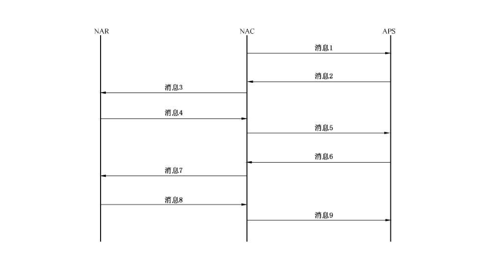

###### 6.2.1.3.5.3.1 消息1

消息1的数据字段格式如图11所示。

其中：—FLAG 字段长度1个八位组，定义如前，比特1和2有意义。比特1和2的值不能同时为0。

-ECDH 参数字段由参数标识和参数长度和参数内容组成，参数标识字段长度为1个八位位组，参数长度字段2个八位位组，表示参数内容字段的八位位组数。参数字段的值定义如下：• 参数标识为1时，参数内容以 OID 方式表示，参数长度字段表示 OID 标识的八位位组数，参数内容OID编码。本规范采用值 1.2.156.11235.1.1.2.1 的 OID表示国家密码管理局批准的 ECC 域参数，OID 编码采用 ASN.1/DER。

• 参数标识其他值保留。

当STA 关联或重新关联至 AP/STA，ASUE 和 AE 选择采用证书鉴别及密钥管理方法，或AE收到ASUE 的预鉴别开始分组时，若 ASUE 需要协商与 ASU之间的会话密钥及密码套件、或AE需要协商与 ASU 之间的会话密钥及密码套件，则AE 向 ASU 发送消息1。

ASU 收到消息1后，执行如下处理：

a） 利用随机数产生器生成ASU 询问。

b） 选择 WAPI 信息元素，包含单播密码套件列表、当前使用的鉴别和密钥管理套件，构成WIEAsu。

c） 依据 FLAG、ECDH 参数、ASU 询问和 WIEAsu构成消息2.并发送给 AE。

###### 6.2.1.3.5.3.2 消息2

消息2的数据字段格式如图12所示。

其中：FLAG 字段长度为1个八位组，定义如前，比特1和2有意义。FL.AG 字段的值与消息1中的FLAG 字段的值相同。

ECDH 参数字段长度可变，其值与消息1中的ECDH 参数字段的值相同。

ASU 询问字段长度为32个八位位组，由ASU 采用随机数生成算法生成，记作NAsU。

WIEAsu字段长度为可变，是ASU 选择的WAPI 信息元素，包含单播密码套件列表、当前鉴别和密钥管理套件。

当ASU 收到 AE发送的消息1时，ASU 向 AE发送消息2。

AE 收到消息2后，执行如下处理：

a） 检查 FLAG 字段中比特1的值，若值为0，则执行步骤b）；否则执行步骤c）。

b） 检查 FLAG 字段中比特2的值，若值为0，则丢弃消息1；否则执行步骤d）。

c） 检查 FLAG 字段中比特2的值，若值0，则执行步骤e）；否则执行步骤f）。

d） 首先生成标识 FLAG 和鉴别标识，然后依据标识 FLAG、鉴别标识、本地ASU 的身份、STAAE的证书、ECDH 参数、ASU 询问和 WIEAsu 构成消息3，并发送给 ASUE。

e） 首先从 WIEAsu 中选择一种用于 AE与 ASU之间的单播密码套件，然后生成标识 FLAG 和鉴别标识，最后依据标识 FLAG、鉴别标识、本地 ASU 的身份、STAAE的证书、ECDH 参数构成消息3，并发送给 ASUE。

首先从 WIEAsu 中选择一种用于 AE与 ASU 之间的单播密码套件，然后生成标识 FLAG 和鉴别标识，最后依据标识 FLAG、鉴别标识、本地ASU的身份、STAAE的证书、ECDH参数、ASU询问和 WIEAsu构成消息3，并发送给 ASUE。

###### 6.2.1.3.5.3.3 消息 3

消息3的数据字段格式如图13所示。

其中：标识 FLAG 字段长度为1个八位位组，定义如前，比特0、1和7有意义。当STA关联或重新关联至 AP 时进行证书鉴别过程，比特0（BK 更新标识）的值为0；当证书鉴别过程进行 BK 更新时，比特0（BK 更新标识）的值为1。如果不是预鉴别过程，比特1（预鉴别标识）的值0；如果是预鉴别过程，比特1（预鉴别标识）的值为1。若标识 FLAG 字段中比特7的值为1,ASU询问字段和 WIEAsu字段存在；否则不存在。当比特0的值为1时，ASUE 不需要与 ASU 协商它们之间的会话密钥及密码套件，AE 也不需要与 ASU 协商它们之间的会话密钥及密码套件。

鉴别标识字段长度为32个八位位组。若标识字段比特0（BK 更新标识）的值为0，则鉴别标识字段的值由 AE 采用随机数生成算法生成；若标识字段比特0（BK 更新标识）的值为1，则鉴别标识字段的值为上一次证书鉴别过程所协商的鉴别标识。

本地 ASU 的身份字段标识 AE 信任的 ASU，采用 GB 15629.11—2003/XG1—2006 的8.1.4.1.1中的定义。

STAAE（作为AE实体的站）的证书字段表示作 AE 实体的站的证书，采用GB 15629.11—2003/XG1—2006 的8.1.4.1.1的定义。

ECDH 参数字段长度可变。若 ASUE 需要协商与 ASU 之间的会话密钥及密码套件、或AE需要协商与 ASU 之间的会话密钥及密码套件，则 ECDH 参数字段的值与消息1中ECDH 参数字段的值相同；否则 ECDH 参数字段的值由参数标识和参数长度和参数内容组成，参数标识字段长度为1个八位位组，参数长度字段2个八位位组，表示参数内容字段的八位位组数。参数字段的值定义如下：• 参数标识为1时，参数内容以 OID 方式表示，参数长度字段表示 OID标识的八位位组数，参数内容为 OID编码。本规范采用值 1.2.156.11235.1.1.2.1 的 OID 表示国家密码管理局批准的 ECC 域参数，OID 编码采用 ASN.1/DER。

• 参数标识其他值保留。

-ASU 询问字段长度32个八位位组，由ASU 采用随机数生成算法生成。

WIEAsU字段长度为可变，是ASU 选择的 WAPI 信息元素，包含单播密码套件列表、当前鉴别和密钥管理套件。

当 STA 关联或重新关联至 AP/STA，ASUE 和AE选择采用证书鉴别及密钥管理方法，或AE收到 ASUE 的预鉴别开始分组时，若 ASUE 不需要协商与 ASU 之间的会话密钥及密码套件、且AE 不需要协商与 ASU 之间的会话密钥及密码套件，则AE 首先生成标识 FLAG 和鉴别标识，然后依据标识FLAG、鉴别标识、本地ASU 的身份、STAAE的证书、ECDH参数构成消息3，并发送给ASUE；当AE的本地策略要求重新进行证书鉴别过程时，AE 首先生成标识 FLAG 和鉴别标识，然后依据标识 FLAG、鉴别标识、本地ASU 的身份、STAAE的证书、ECDH参数构成消息3，并发送给 ASUE；当 AE 收到 ASU发送的消息2时，AE 向 ASUE 发送消息3。

ASUE 接收到由 AE发送的消息3后，进行如下处理：

a） ASUE 检查消息3中标识字段的比特0（BK 更新标识）的值，当值1时执行步骤b）；当值为0时执行步骤c）。

b） ASUE 检查消息3中鉴别标识字段与上一次证书鉴别过程中保存的鉴别标识是否一致，若不一致，则丢弃该消息 3；否则执行步骤c）。

c） 检查标识 FLAG 字段中比特7的值，若值为0，则执行步骤d）；否则执行步骤e）。

d） ASUE 根据消息3中的AE 信任的ASU 身份选择由该ASU 颁发的证书或者根据本地策略选择证书，产生用于 ECDH交换的临时私钥x、临时公钥x•P 和32个八位位组的ASUE 询问 NAsUE（随机数），然后依据标识 FLAG、鉴别标识、ASUE 询问、ASUE 密钥数据、STAA的身份、STAAsuE的证书、ECDH参数、ASUE信任的ASU列表、ASUE 的签名构成消息4，并发送给 AE。

e） 首先从 WIEAsu中选择一种用于 ASUE 与ASU 之间的单播密码套件，然后根据消息3中的AE 信任的ASU 身份选择由该 ASU 颁发的证书或者根据本地策略选择证书，产生用于ECDH 交换的临时私钥x、临时公钥x•P 和32个八位位组的 ASUE 询问 NAsuE（随机数），最后依据标识 FLAG、鉴别标识、ASUE 询问、ASUE密钥数据、STAA的身份、STAASUE的证书、ECDH 参数、ASUE信任的ASU列表、WIEASUE.ASU、对ASUE密钥数据的签名、ASUE 的签名构成消息4，并发送给 AE。

###### 6.2.1.3.5.3.4 消息 4

消息4的数据字段格式如图14所示。

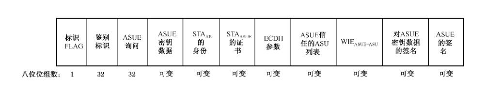

其中：标识 FLAG 字段长度为1个八位位组，定义如前，比特0、1、2、3和7有意义。本字段除比特2（证书验证请求标识）、比特3（可选字段标识）以外的其他比特，应与AE发送的消息3中标识字段对应比特相同。比特2（证书验证请求标识）为1表示 ASUE 要求验证 AE 证书的有效性，为0表示不需要验证 AE 证书的有效性。当在比特0（BK 更新标识）为。时，比特2必须为1，即不是进行 BK 更新时，必须验证 AE证书的有效性。比特3（可选字段标识）为1表示分组中有可选字段，为0表示没有。若标识 FLAG 字段中比特7的值为1,WIEAsU字段和对ASUE 密钥数据的签名字段存在；否则不存在。当比特0的值为1时，ASUE 不需要与 ASU协商它们之间的会话密钥及密码套件，AE也不需要与 ASU 协商它们之间的会话密钥及密码套件。

鉴别标识字段长度为32个八位位组。若 ASUE发起BK 更新，则鉴别标识字段的值为上一次证书鉴别过程所协商的鉴别标识；否则本字段值应与AE 发送的消息3中鉴别标识字段值相同。

ASUE 询问字段长度为32个八位位组，由 ASUE 采用随机数生成算法生成，记作 NASUE。

ECDH 参数字段长度为可变。若 ASUE发起 BK 更新，则本字段的值与上一次证书鉴别过程的消息3中的ECDH 参数字段的值相同；否则本字段的值应与消息3中的ECDH 参数字段相同。

ASUE 密钥数据格式如前定义，内容是 ASUE生成的用于 ECDH 交换的临时公钥。

STAAE的身份字段，采用 GB 15629.11—2003/XG1—2006 的8.1.4.1.1中的定义。

STAASUE（作为 ASUE 实体的站）的证书字段表示作为ASUE 实体的站的证书，采用GB 15629.11—2003/XG1—2006 的 8.1.4.1.1 的定义。

STAASUE信任的服务器列表字段，该字段为可选字段，采用身份列表属性表示，其定义如前。

内容包含 STAASUE信任的服务器，但不包含 STAASUE的证书颁发者。若ASUE 除了信任他的证书颁发者以外，还信任其他的某些实体，可以通过该字段通知鉴别服务器。当标识 FLAG字段中比特7的值为1时，STAAsUE信任的服务器列表字段的值消息3中本地 ASU 的身份字段的值。

WIEAsUE AsU字段长度为可变，是ASUE选择的 WAPI 信息元素，包含当前鉴别和密钥管理套件、ASUE选择的用于 ASUE 与 ASU 之间的单播密码套件。

对 ASUE 密钥数据的签名字段采用签名属性表示，其定义如前，它是 ASUE 生成的对 ASUE密钥数据字段的签名。

ASUE 的签名字段采用签名属性表示，其定义如前，它是对本分组中除本字段之外所有数据字段的签名。

当ASUE 收到AE的消息3或ASUE 要求进行BK更新时，ASUE 发送消息4给AE。

AE 收到 ASUE发来的消息4后，进行如下处理：

a） 如果AE没有发送消息3，则检查鉴别标识字段值和上一次证书鉴别过程中保存的鉴别标识是否相同，若相同，执行步骤b）；否则丢弃该分组。如果 AE 发送了消息3，则比较鉴别标识宁段值及标识字段的比特0、比特1与AE发送的消息3中相应字段的值是否相同，若不同，则丢弃该分组；否则，执行步骤b）。

b） 检查STAAE的身份字段是否与自己的身份一致，以及 ECDH参数字段是否与自己在消息3中的ECDH 参数一致，若不一致，则丢弃该分组；否则验证 ASUE 签名，若验证不通过，则丢弃该分组；若标识字段的比特2为1或AE 的本地策略要求使用 ASU 鉴别 STAASUE的证书，则设置 FLAG 字段中比特0的值为1，然后执行步骤c）；否则执行步骤h）。

若消息4中比特7的值为0且 AE不需要与ASU 协商它们之间的会话密钥及密码套件，则执行步骤d）；若消息4中比特7的值为1且消息1中比特2的值为0，则执行步骤e）；若消息4中比特7的值为。且消息1中比特2的值1，则执行步骤f）；若消息4中比特7的值为1且消息1中比特2的值为1，则执行步骤g）。

d） 依据 FLAG、ADDID、AE 询问、ASUE 询问、STAASUE 的证书、STAAE的证书、ASUE信任的ASU 列表构成消息5，并发送给 ASU。

e）依据 FLAG、ADDID、AE 询问、ASUE 询问、STAASLE的证书、STAAE的证书、ASUE信任的ASU 列表、WIEASUEASU、ASUE 密钥数据、对ASUE 密钥数据的签名构成消息5，并发送给 ASU。

首先产生用于 ECDH交换的临时私钥y、临时公钥y•P和32个八位位组的AE询问 NAE （随机数），然后依据 FLAG、ADDID、AE 询问、ASUE 询间、STAAsu的证书、STAAE的证书、ASUE 信任的ASU 列表、WIEAE-ASU、AE 密钥数据、对AE密钥数据的签名构成消息5，并发送给 ASU。

g） 首先产生用于 ECDH交换的临时私钥y、临时公钥y•P和32个八位位组的AE询问 NAE（随机数），然后依据 FLAG、ADDID、AE 询问、ASUE 询问、STAASUE 的证书、STAAE的证书、ASUE 信任的 ASU 列表、WIEASUE:ASU、ASUE 密钥数据、对 ASUE 密钥数据的签名、WIEAE:ASU、AE 密钥数据、对AE密钥数据的签名构成消息5，并发送给 ASU。

h） 若消息4中比特7的值0且AE不需要与ASU 协商它们之间的会话密钥及密码套件，则执行步骤i）；若消息4中比特7的值为1且比特2的值0，则执行步骤j）；若消息4中比特7的值为0且比特2的值为1，则执行步骤k）；若消息4中比特7的值为1且比特2的值1，则执行步骤 1）。

i） AE本地鉴别 STAASUE的证书，即根据本地缓存的STAASUE证书的验证结果及其根据本地策略所定义的时效性确定 STAASUE证书的验证结果。若STAASUE证书为有效，则AE 首先设定接入结果为成功，然后本地生成用于 ECDH 交换的临时私钥y、临时公钥y•P和32个八位位组的AE 询问 NAE（随机数），使用自己的临时私钥y和消息 4中 ASUE 的临时公钥x•P进行ECDH 计算，得到主密钥种子（x•y•P）abciss，对其进行扩展 KD-HMAC-SHA256（（x •y•P）abscisa, NAE |I NASUE||"base key expansion for key and additional nonce”），生成长度为16个八位位组的基密钥 BK 和长度为32个八位位组的下一次证书鉴别过程的鉴别标识种子，接着对该鉴别标识种子进行 SHA-256运算，得到长度为32个八位位组的下一次证书鉴别过程的鉴别标识，接着将标识字段的比特3（可选字段标识）置为0，表示没有可选字段，最后依据标识FLAG、ASUE 询问、AE询问、接入结果、ASUE 密钥数据、AE 密钥数据、STAAE 的身份、STAASUE 的身份、AE的签名构成消息7，并发送给 ASUE。若 STAAsuE证书无效，则AE首先设定接入结果为不成功，然后设置 AE 的询问 NAE和AE的密钥数据（AE 的临时公钥）任意值，接着将标识字段的比特3（可选字段标识）置为0，表示没有可选字段，最后依据标识FLAG、ASUE 询问、AE 询问、接入结果、ASUE 密钥数据、AE 密钥数据、STAAE 的身份、STAASUE的身份、AE 的签名构成消息7，并发送给 ASUE。

j） AE 本地鉴别STAAsUE的证书，即根据本地缓存的STAASUE证书的验证结果及其根据本地策略所定义的时效性确定 STAAsUE证书的验证结果。若STAASUE证书为有效，则依据 FLAG、AD- DID、ASUE 询问、STAASUE的证书、WIEASUE ASU、ASUE 密钥数据、对 ASUE密钥数据的签名构成消息5，并发送给 ASU。若 STAAsUE证书为无效，则AE首先设定接入结果为不成功，然后设置AE的询问 NAE、AE 的密钥数据（AE 的临时公钥）、ASU 密钥数据、对 ASU 密钥数据的签名、ASU-ASUE 消息鉴别码为任意值，接着将标识字段的比特3（可选字段标识）置0，表示没有可选字段，最后依据标识 FLAG、ASUE询问、AE询问、接入结果、ASUE 密钥数据、AE 密钥数据、STAAE的身份、STAASUE 的身份、ASU 密钥数据、对ASU 密钥数据的签名、ASU-ASUE 消息鉴别码、AE 的签名构成消息7，并发送给 ASUE。

k） AE 本地鉴别 STAASUE的证书，即根据本地缓存的STAAsUE 证书的验证结果及其根据本地策略所定义的时效性确定 STAAsUE证书的验证结果。若 STAASUE证书为有效，则首先产生用于ECDH 交换的临时私钥y、临时公钥y•P 和32个八位位组的 AE 询问 NAE（随机数），然后依据FLAG、ADDID、AE 询问、STAAE的证书、WIEAE-ASU、AE 密钥数据、对AE密钥数据的签名构成消息5，并发送给 ASU。若 STAASUE证书无效，则AE首先设定接入结果不成功，然后设置AE的询问 NAE 和AE的密钥数据（AE 的临时公钥）为任意值，接着将标识字段的比特3（可选字段标识）置0，表示没有可选字段，最后依据标识 FLAG、ASUE 询问、AE 询问、接入结果、ASUE 密钥数据、AE 密钥数据、STAAE的身份、STAASUE 的身份、AE的签名构成消息7，并发送给 ASUE。

I AE 本地鉴别 STAASUE的证书，即根据本地缓存的STAASUE证书的验证结果及其根据本地策略所定义的时效性确定 STAASUE证书的验证结果。若 STAASUE证书为有效，则首先产生用于ECDH 交换的临时私钥y、临时公钥y•P 和32个八位位组的 AE 询问 NAE（随机数），然后依据FLAG、ADDID、AE询问、ASUE询问、STAASUE 的证书、STAAE的证书、WIEASUE-ASU、ASUE密钥数据、对 ASUE 密钥数据的签名、WIEAE-ASU、AE 密钥数据、对AE 密钥数据的签名构成消息5，并发送给 ASU。若 STAAsSUE证书无效，则AE 首先设定接入结果为不成功，然后设置AE 的询间 NAE、AE 的密钥数据（AE 的临时公钥）、ASU 密钥数据、对ASU 密钥数据的签名、ASU-ASUE 消息鉴别码为任意值，接着将标识字段的比特3（可选字段标识）置0，表示没有可选字段，最后依据标识 FLAG、ASUE 询问、AE 询问、接入结果、ASUE 密钥数据、AE 密钥数据、STA n的身份、STAASuE的身份、ASU 密钥数据、对ASU密钥数据的签名、ASU-ASUE消息鉴别码、AE的签名构成消息7，并发送给 ASUE。

###### 6.2.1.3.5.3.5 消息5

消息5的数据字段格式如图15所示。

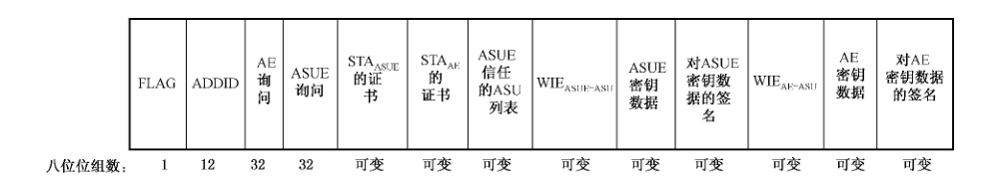

其中：-FLAG 字段长度为1个八位位组，定义如前，比特0、1和2有意义。若标识 FLAG字段的比特2为1或AE 的本地策略要求使用ASU 鉴别STAASUE的证书，则设置 FLAG字段中比特◎的值为1；否则设置为0。若 ASUE 需要与ASU 协商它们之间的会话密钥及密码套件，则设置 FLAG 字段中比特1 的值为1；否则设置为0。若AE需要与 ASU 协商它们之间的会话密钥及密码套件，则设置 FLAG 字段中比特2的值为1；否则设置为0。

ADDID 字段长度12个八位位组，由 MACAE||MACASUE组成。当FLAG 字段中比特0的值为1时，本字段存在。

AE 询问字段长度为32个八位位组。由AE 采用随机数生成算法生成，记作 NAE。当 FLAG字段中比特0或比特1的值1时，本字段存在。

ASUE 询问字段长度为32个八位位组。本字段值应与 ASUE 发送的消息4 中 ASUE 询问字段值相同。当FLAG 字段中比特0或比特2的值为1时，本字段存在。

STAASUE的证书字段，定义如前。该字段和消息4 中 STAAsSU的证书字段相同。当 FLAG 字段中比特0或比特2的值为1时，本字段存在。

STAAE的证书字段，定义如前。内容包含STAAE的证书。当FLAG 字段中比特0或比特1的值为1时，本字段存在。

ASUE 信任的服务器列表字段，该字段为可选字段，采用身份列表属性表示，其定义如前。本字段值应与 ASUE 发送的消息4中的ASUE 信任的服务器列表字段相同。当FLAG 字段中比特0的值为1时，本字段存在。

WIEAsuE:AsU字段长度可变，其值与消息4中 WIEASUE:AsU字段的值相同。当FL.AG 字段中比特2的值为1时，本字段存在。

ASUE 密钥数据字段长度为可变，其值与消息4中 ASUE 密钥数据字段的值相同。当 FL.AG字段中比特2的值为1时，本字段存在。

对ASUE 密钥数据字段长度为可变，其值与消息4中对ASUE 密钥数据字段的值相同。当FLAG 字段中比特2的值为1时，本字段存在。

WIEAE:AsU字段长度为可变，是AE 选择的WAPI 信息元素，包含当前鉴别和密钥管理套件、AE选择的用于AE与 ASU之间的单播密码套件。当FL.AG 字段中比特1 的值1时，本字段存在。

AE 密钥数据格式如前定义，内容是 AE生成的用于 ECDH 交换的临时公钥。当FLAG 字段中比特1的值为1时，本字段存在。

对AE密钥数据的签名字段采用签名属性表示，其定义如前，它是 AE生成的对AE密钥数据字段的签名。当FLAG 字段中比特1的值1时，本字段存在。

当消息4中标识 FLAG 指示要进行证书验证或 AE 自己需要进行证书验证，或 ASUE 需要与ASU 协商它们之间的会话密钥及密码套件，或AE 需要与 ASU 协商它们之间的会话密钥及密码套件时，AE 向 ASU 发送消息5。

AE 接收到 ASUE 发送的消息4后，向 ASU 发送消息5。在消息5超时时间内 AE 不对 ASUE发送的消息4进行处理。

ASU 收到消息5后，进行如下处理：

a） 检查 FLAG 字段中的比特。的值，若值为0，则执行步骤b）；否则执行步骤f）。

b） 检查消息1中 FLAG 字段中比特1和2的值，若比特1的值为0且比特2的值为0，则丢弃消息5；若比特1的值为1且比特2的值为0，则执行步骤c）；若比特1的值为0且比特2的值1，则执行步骤d）；若比特1的值为1且比特2的值为1，则执行步骤e）。

首先生成用于 ECDH 交换的临时私钥z和临时公钥z•P，然后计算 KD-HMAC-SHA256（（x •z • P） absrisss, ADDID|| NAsU |INASUE ||"pairwise key expansion for unicast and additional keys and nonce”），其中 NAsu为 ASU 询问，NASUE 为ASUE 询问，生成48个八位位组为 ASU与 ASUE之间的单播会话密钥（第一个16个八位位组为单播加密密钥 UEK，第二个16个八位位组为单播完整性校验密钥 UCK，第三个16 个八位位组为消息鉴别密钥 MAK），最后依据FLAG、ADDID、ASU 密钥数据、对ASU 密钥数据的签名、ASU-ASUE 消息鉴别码构成消息6，并发送给 AE。

d） 首先生成用于 ECDH 交换的临时私钥z和临时公钥z• P，然后计算 KD-HMAC-SHA256（（y•z•P）abxciss, ADDIDI| NAsu |INAE ||"pairwise key expansion for unicast and additional keys and nonce”），其中 NASU为ASU 询问，NAE为AE询问，生成48个八位位组为ASU 与 AE之间的单播会话密钥（第一个 16个八位位组为单播加密密钥 UEK，第二个16个八位位组为单播完整性校验密钥 UCK，第三个 16个八位位组消息鉴别密钥 MAK），最后依据 FLAG、ADDID、ASU 密钥数据、对ASU 密钥数据的签名、ASU-AE 消息鉴别码构成消息6，并发送给 AE。

e） 首先生成用于 ECDH 交换的临时私钥z和临时公钥z•P，然后计算 KD-HMAC-SHA256（（x •z•P） absisss,ADDIDI| NAsu|| NAsUE ||"pairwise key expansion for unicast and additional keys and nonce”），其中 NAsu为 ASU 询问，NASUE为ASUE 询问，生成48个八位位组为 ASU与ASUE之间的单播会话密钥（第一个16个八位位组为单播加密密钥 UEK，第二个16个八位位组为单播完整性校验密钥 UCK，第三个 16个八位位组消息鉴别密钥 MAK），接着计算KD-HMAC-SHA256（（y• z • P） abscissa, ADDID| NAsU | NAE||"pairwise key expansion for unicast and additional keys and nonce”），其中 NAsu为ASU 询问，NAE为AE询问，生成48个八位位组 ASU 与 AE之间的单播会话密钥（第一个 16个八位位组为单播加密密钥 UEK，第二个 16个八位位组单播完整性校验密钥 UCK，第三个 16 个八位位组为消息鉴别密钥MAK），最后依据 FLAG、ADDID、ASU 密钥数据、对ASU 密钥数据的签名、ASU-ASUE 消息鉴别码、ASU-AE 消息鉴别码构成消息6，并发送给 AE。

f） 检查消息1中 FLAG 字段中比特1和2的值，若比特1的值为0且比特2的值为0，则执行步骤gg）；若比特1的值为1且比特2的值为0，则执行步骤h）；若比特1的值为。且比特2的值为1，则执行步骤i）；若比特1的值为1且比特2的值为1，则执行步骤j）。

g） 首先 ASU 参照 RFC3280 验证 STAAE证书和 STAASUE证书，并生成 STAAE证书和 STAASUE证书的验证结果及签名，然后依据 FLAG、ADDID、证书的验证结果、ASU 的签名构成消息6，并发送给 AE。

h） 首先 ASU 参照 RFC 3280 验证 STAAE证书和 STAASUE证书，并生成STAAE证书和STAASUE证书的验证结果及签名，然后生成用于 ECDH 交换的临时私钥z和临时公钥z•P，接着计算KD-HMAC-SHA256（（x • z • P） absciss, ADDIDI| NAsU || NASUE||“pairwise key expansion for unicast and additional keys and nonce”），其中 NAsUASU 询问，NASUEASUE 询问，生成48个八位位组为ASU 与 ASUE之间的单播会话密钥（第一个16个八位位组为单播加密密钥UEK，第二个16个八位位组为单播完整性校验密钥 UCK，第三个16 个八位位组为消息鉴别密钥 MAK），最后依据 FLAG、ADDID、证书的验证结果、ASU的签名、ASU 密钥数据、对ASU 密钥数据的签名、ASU-ASUE 消息鉴别码构成消息6，并发送给 AE。

i） 首先 ASU 参照 RFC 3280 验证 STAAE证书和STAASUE证书，并生成 STAAE证书和 STAASUE证书的验证结果及签名，然后生成用于 ECDH交换的临时私钥z和临时公钥z•P，接着计算KD-HMAC-SHA256（（y •z • P） abxciss, ADDIDI| NASU || NAE I| *pairwise key expansion for unicast and additional keys and nonce”），其中 NAsu为ASU 询问，NAE为AE询问，生成48个八位位组为 ASU 与AE之间的单播会话密钥（第一个16个八位位组为单播加密密钥 UEK，第二个16个八位位组为单播完整性校验密钥 UCK，第三个 16个八位位组为消息鉴别密钥MAK），最后依据 FLAG、ADDID、证书的验证结果、ASU 的签名、ASU 密钥数据、对ASU密钥数据的签名、ASU-AE 消息鉴别码构成消息6.并发送给 AE。

首先 ASU 参照 RFC 3280 验证 STAE证书和STAASUE证书，并生成 STAAE证书和 STAASUE证书的验证结果及签名，然后生成用于 ECDH 交换的临时私钥z和临时公钥z•P，接着计算KD-HMAC-SHA256（（x •z •P）absisa,ADDIDI| NAsu | | NAsUE | |“pairwise key expansion for unicast and additional keys and nonce”），其中 NAsu为ASU 询问，NASUE 为ASUE 询问，生成48个八位位组为 ASU 与 AE 之间的单播会话密钥（第一个16 个八位位组为单播加密密钥UEK，第二个 16个八位位组为单播完整性校验密钥 UCK，第三个16个八位位组为消息鉴别密钥 MAK），接着计算 KD-HMAC-SHA256 （（y •z •P） absciss, ADDID |I NASU | | NAE ||“pairwise key expansion for unicast and additional keys and nonce”），其中 NASu为ASU 询问，NAE为AE 询问，生成48个八位位组 ASU 与 ASUE 之间的单播会话密钥（第一个16个八位位组为单播加密密钥 UEK，第二个16个八位位组为单播完整性校验密钥 UCK，第三个16个八位位组为消息鉴别密钥 MAK），最后依据 FLAG、ADDID、证书的验证结果、ASU 的签名、ASU 密钥数据、对 ASU 密钥数据的签名、ASU-ASUE 消息鉴别码、ASU-AE 消息鉴别码构成消息6，并发送给 AE。

6.2.1.3.5.3.6） 消息6消息6的数据字段格式如图 16 所示。

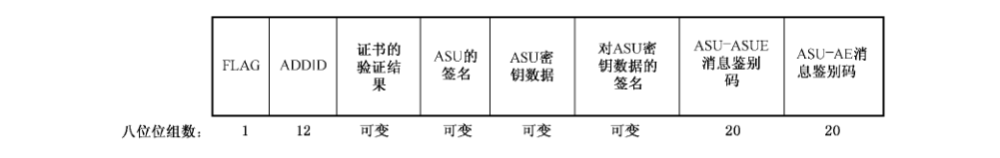

其中：-FLAG 字段长度为1个八位位组，定义如前，比特0、1和2有意义。比特0、1和2的值分别与消息5中比特0、1和2的值相同。

ADDID 字段长度为12个八位位组。该字段值和消息5中的ADDID 字段的值相同。

证书的验证结果字段采用证书验证结果属性表示，其格式定义如前。字段中的第一个一次性随机数值和消息5中的AE 询问值相同，第二个一次性随机数值和消息5中的ASUE 询问值相同。字段中的第一个证书及结果对应于消息5中的 STAAsUE证书，第二个证书及结果对应于消息5中的STAAE证书。当FLAG 字段中比特0的值为1时，本字段存在。验证结果定义如下：0 表示证书有效；

1 表示证书的颁发者不明确；

2 表示证书基于不可信任的根证书；

3 表示证书未到生效期或已过期；

4 表示签名错误；

5 表示证书已吊销；

6 表示证书未按规定用途使用；

7 表示证书吊销状态未知；

8 表示证书错误原因未知；

其他值保留。

ASU 的签名字段采用签名属性表示，其定义如前。它对证书的验证结果字段的签名。当FLAG字段中比特0的值为1时，本字段存在。

ASU 密钥数据格式如前定义，内容是ASU 生成的用于 ECDH 交换的临时公钥。当FLAG字段中比特1或2的值为1时，本字段存在。

对 ASU 密钥数据的签名字段采用签名属性表示，其定义如前，它是 ASU 生成的对ASU 密钥数据字段的签名。当FLAG 字段中比特0或1的值1时，本字段存在。

ASU-ASUE 消息鉴别码字段长度20个八位位组，其值为ASU 利用最新协商的 ASU 与ASUE 之间的消息鉴别密钥 MAK 通过 HMAC-SHA256算法对消息2中的 WIEAsu和 ASU询问，消息5中的 WIEASUEASU、ASUE 询问、STAASUE的证书、ASUE 密钥数据和对 ASUE 密钥数据的签名，消息6中 ASU 密钥数据和对 ASU 密钥数据的签名计算得到。当FLAG 字段中比特2的值为1时，本字段存在。

ASU-AE 消息鉴别码字段长度为20个八位位组，其值为ASU 利用最新协商的 ASU 与 AE之间的消息鉴别密钥 MAK 通过 HMAC-SHA256 算法对消息1、消息2、消息5和消息6本字段之前的所有字段计算得到，不包含各个消息的分组头。当 FLAG 字段中比特1的值1时，本字段存在。

ASU 收到消息5后，向 AE发送消息6。

AE 收到消息6后，进行如下处理：

a） 检查 FLAG 字段中的比特0的值，若值为0，则执行步骤b）；否则执行步骤f）。

b）， 检查消息1中 FLAG字段中比特1和2的值，若比特1的值为0且比特2的值为0，则丢弃消息5；若比特1的值为1且比特2的值为0，则执行步骤c）；若比特1的值为0且比特2的值1，则执行步骤d）；若比特1的值为1且比特2的值为1，则执行步骤e）。

c） 首先本地生成用于 ECDH交换的临时私钥y、临时公钥y•P和32个八位位组的AE询问NAE（随机数），使用自己的临时私钥y和消息4中 ASUE 的临时公钥x•P进行 ECDH 计算，得到主密钥种子（x•y•P）abscisse，对其进行打展 KD-HMAC-SHA256［（x•y•P） abscisa,NAE NAsUE|| “base key expansion for key and additional nonce”］，生成长度为16 个八位位组的基密钥 BK 和长度为32个八位位组的下一次证书鉴别过程的鉴别标识种子，然后对该鉴别标识种子进行 SHA-256运算，得到长度为32个八位位组的下一次证书鉴别过程的鉴别标识，接着设定接入结果为成功，接着将标识字段的比特3（可选字段标识）置0，表示没有可选字段，最后依据标识 FLAG、ASUE 询问、AE 询问、接入结果、ASUE 密钥数据、AE 密钥数据、STAAE的身份、STAAsuE的身份、ASU 密钥数据、对ASU 密钥数据的签名、ASU-ASUE 消息鉴别码、AE 的签名构成消息7，并发送给 ASUE。

d） 首先验证对 ASU 密钥数据的签名，若验证不通过，则丢弃消息 6；否则计算 KD-HMAC- SHA256 （（y•z •P） abaissa, ADDID|| NAsU | | NAE|| "pairwise key expansion for unicast and additional keys and nonce”），其中 NAsu为ASU 询问，NAE为AE 询问，生成48个八位位组为ASU 与AE 之间的单播会话密钥（第一个16个八位位组为单播加密密钥 UEK，第二个16个八位位组单播完整性校验密钥 UCK，第三个16个八位位组消息鉴别密钥 MAK），然后验证 ASU-AE 消息鉴别码，若验证不通过，则丢弃消息6；否则使用自己的临时私钥y和消息4中 ASUE 的临时公钥 x•P进行 ECDH 计算，得到主密钥种子（x•y•P）abocisse，对其进行扩展KD-HMAC-SHA256（（x •y • P） absriasa, NAE |I NASUE|| “base key expansion for key and addi- tional nonce”），生成长度为16个八位位组的基密钥 BK 和长度为32个八位位组的下一次证书鉴别过程的鉴别标识种子，接着对该鉴别标识种子进行 SHA-256 运算，得到长度32个八位位组的下一次证书鉴别过程的鉴别标识，接着设定接入结果为成功，接着将标识字段的比特3（可选字段标识）置0，表示没有可选字段，最后依据标识 FLAG、ASUE 询问、AE 询问、接入结果、ASUE 密钥数据、AE 密钥数据、STAAE的身份、STAASUE的身份、AE的签名构成消息7，并发送给 ASUE。

e） 首先验证对 ASU 密钥数据的签名，若验证不通过，则丢弃消息 6；否则计算 KD-HMAC- SHA256 （（y•z •P） abocissa, ADDIDI| NASU | | NAE||"pairwise key expansion for unicast and additional keys and nonce”），其中 NAsu为ASU 询问，NAE为AE询问，生成48个八位位组为ASU 与 AE之间的单播会话密钥（第一个16个八位位组单播加密密钥 UEK，第二个16个八位位组为单播完整性校验密钥 UCK，第三个16个八位位组为消息鉴别密钥 MAK），然后验证 ASU-AE 消息鉴别码，若验证不通过，则丢弃消息6；否则使用自己的临时私钥y和消息4中 ASUE 的临时公钥 x•P进行 ECDH 计算，得到主密钥种子（x•y•P） aboscisse，对其进行扩展KD-HMAC-SHA256 （（x •y •P）abocriss, NAE |I NASUE|| “base key expansion for key and addi- tional nonce”），生成长度为16个八位位组的基密钥 BK 和长度32个八位位组的下一次证书鉴别过程的鉴别标识种子，接着对该鉴别标识种子进行 SHA-256运算，得到长度为32个八位位组的下一次证书鉴别过程的鉴别标识，接着设定接入结果为成功，接着将标识字段的比特3（可选字段标识）置0，表示没有可选字段，最后依据标识 FLAG、ASUE 询问、AE 询问、接入结果、ASUE 密钥数据、AE 密钥数据、STAAE的身份、STAAsuE的身份、ASU 密钥数据、对ASU 密钥数据的签名、ASU-ASUE 消息鉴别码、AE的签名构成消息7，并发送给 ASUE。

f） 检查消息1中 FLAG 字段中比特1和2的值，若比特1的值0且比特2的值为0，则执行步骤g）；若比特1的值为1且比特2的值为0，则执行步骤h）；若比特1的值为0且比特2的值为1，则执行步骤i；若比特1的值为1且比特2的值为1，则执行步骤j。

g） 首先根据 ADDID 确定对应的消息6，检查证书的验证结果字段中的第一个一次性随机数值与自己在消息5中的AE 的询问是否相同，若不相同，则丢弃消息6；否则验证ASU 的签名，若不正确，则丢弃消息 6；否则：若 STAAsUE证书为有效，则首先设定接入结果为成功，然后本地生成用于 ECDH 交换的临时私钥y和临时公钥y•P，使用自己的临时私钥y和 ASUE 的临时公钥x•P进行 ECDH 计算，得到密钥种子（x•y•P）abscisa，对其进行扩展 KD-HMAC- SHA256（（x•y •P）abscissa, NAE || NAsUE||“base key expansion for key and additional nonce”），生成长度为16个八位位组的基密钥 BK 和长度为32个八位位组的下一次证书鉴别过程的鉴别标识种子，然后对该鉴别标识种子进行 SHA-256 运算，得到长度32个八位位组的下一次证书鉴别过程的鉴别标识并保存，最后依据标识 FLAG、ASUE 询问、AE询问、接入结果、ASUE 密钥数据、AE 密钥数据、STAAE的身份、STAAsuE的身份、复合的证书验证结果、AE 的签名构成消息7（若标识FLAG 字段的比特2为0，则消息7不包含复合的证书验证结果），并发送给 ASUE；若 STAASuE证书为无效，则首先AE 设定接入结果不成功，AE的询问NAE 和AE 的密钥数据（AE 的临时公钥）设置任意值，然后依据标识 FLAG、ASUE 询问、AE 询问、接入结果、ASUE 密钥数据、AE 密钥数据、STAAE的身份、STAASUE 的身份、复合的证书验证结果、AE的签名构成消息7（若标识 FLAG 字段的比特2为0，则消息7不包含复合的证书验证结果），并发送给 ASUE。

h） 首先根据 ADDID确定对应的消息6，检查证书的验证结果字段中的第一个一次性随机数值与自己在消息5中的AE的询问是否相同，若不相同，则丢弃消息6；否则验证 ASU 的签名，若不正确，则丢弃消息6；否则：若 STAASUE证书为有效，则首先设定接入结果为成功，然后本地生成用于 ECDH 交换的临时私钥y和临时公钥y•P，使用自己的临时私钥y和 ASUE 的临时公钥x•P 进行 ECDH 计算，得到密钥种子（x •y•P）absciss，对其进行扩展 KD-HMAC- SHA256（（x • P）abscissa, NAE |I NASUE|| “base key expansion for key and additional nonce”），生成长度为16个八位位组的基密钥 BK 和长度为32个八位位组的下一次证书鉴别过程的鉴别标识种子，然后对该鉴别标识种子进行 SHA-256运算，得到长度32个八位位组的下一次证书鉴别过程的鉴别标识并保存，最后依据标识 FLAG、ASUE 询问、AE 询问、接入结果、ASUE 密钥数据、AE 密钥数据、STAAE的身份、STAAsUE的身份、复合的证书验证结果、ASU 密钥数据、对ASU密钥数据的签名、ASU-ASUE 消息鉴别码、AE的签名构成消息7（若标识 FLAG 字段的比特2为0，则消息7不包含复合的证书验证结果），并发送给 ASUE；若STAASUE证书为无效，则AE首先设定接入结果为不成功，AE 的询问 NAE和AE的密钥数据（AE 的临时公钥）可设置任意值，然后依据标识 FLAG、ASUE 询问、AE询问、接入结果、ASUE 密钥数据、AE 密钥数据、STAAE的身份、STAASuE的身份、复合的证书验证结果、ASU密钥数据、对ASU 密钥数据的签名、ASU-ASUE 消息鉴别码、AE的签名构成消息7（若标识FL.AG 字段的比特2为0，则消息7不包含复合的证书验证结果），并发送给 ASUE。

i） 首先验证对ASU 密钥数据的签名，若验证不通过，则丢弃消息 6；否则计算 KD-HMAC- SHA256（（y •z •P） abociss, ADDIDI| NAsU | I NAE | | "pairwise key expansion for unicast and additional keys and nonce”），其中 NAsu为ASU 询问，NAE为AE询问，生成48个八位位组为ASU 与 AE之间的单播会话密钥（第一个16个八位位组为单播加密密钥 UEK，第二个16个八位位组为单播完整性校验密钥 UCK，第三个 16 个八位位组为消息鉴别密钥 MAK），然后验证 ASU-AE 消息鉴别码，若验证不通过，则丢弃消息6；否则根据 ADDID 确定对应的消息6，检查证书的验证结果字段中的第一个一次性随机数值与自己在消息5中的AE 的询问是否相同，若不相同，则丢弃消息6；杏则验证 ASU 的签名，若不正确，则丢弃消息6；否则若 STAASUE证书为有效，则首先设定接入结果成功，然后使用自己的临时私钥y和 ASUE 的临时公钥 x•P进行 ECDH 计算，得到密钥种子（x•y•P）absciss，对其进行打展 KD-HMAC-SHA256（（x •y•P）abscissa，NAE||NASUE||"base key expansion for key and additional nonce”），生成长度为16个八位位组的基密钥 BK 和长度为32个八位位组的下一次证书鉴别过程的鉴别标识种子，然后对该鉴别标识种子进行 SHA-256运算，得到长度为32个八位位组的下一次证书鉴别过程的鉴别标识并保存，最后依据标识 FLAG、ASUE 询问、AE询问、接入结果、ASUE 密钥数据、AE 密钥数据、STAAE的身份、STAAsUE的身份、复合的证书验证结果、AE的签名构成消息7（若标识 FL.AG 字段的比特2为0，则消息7不包含复合的证书验证结果），并发送给ASUE：若 STAAsUE证书为无效，AE 首先设定接入结果为不成功，然后依据标识 FLAG、ASUE询问、AE 询问、接入结果、ASUE 密钥数据、AE 密钥数据、STAAE的身份、STAASUE 的身份、复合的证书验证结果、AE 的签名构成消息7（若标识 FLAG 字段的比特2为0，则消息7不包含复合的证书验证结果），并发送给 ASUE。

j 首先验证对 ASU 密钥数据的签名，若验证不通过，则丢弃消息 6；否则计算 KD-HMAC- SHA256（（y •z •P） absdiss, ADDIDI| NAsU | | NAE | | "pairwise key expansion for unicast and additional keys and nonce”），其中 NAsu为ASU 询问，NA为AE 询问，生成48个八位位组力ASU 与 AE之间的单播会话密钥（第一个16 个八位位组为单播加密密钥 UEK，第二个16个八位位组为单播完整性校验密钥 UCK，第三个 16 个八位位组为消息鉴别密钥 MAK），然后验证 ASU-AE 消息鉴别码，若验证不通过，则丢弃消息 6；否则根据 ADDID 确定对应的消息6，检查证书的验证结果字段中的第一个一次性随机数值与自己在消息5中的AE的询问是否相同，若不相同，则丢弃消息6；否则验证 ASU 的签名，若不正确，则丢弃消息6；否则若 STAASUB证书为有效，则首先设定接入结果为成功，然后使用自己的临时私钥y和 ASUE的临时公钥x•P进行 ECDH 计算，得到密钥种子（x•y•P）absciss，对其进行扩展 KD-HMAC-SHA256（（x •y•P） abscissa, NAE||NASUE| |“base key expansion for key and additional nonce”），生成长度为16个八位位组的基密钥 BK 和长度为32个八位位组的下一次证书鉴别过程的鉴别标识种子，接着对该鉴别标识种子进行 SHA-256运算，得到长度为32个八位位组的下一次证书鉴别过程的鉴别标识并保存，最后依据标识 FLAG、ASUE 询问、AE 询问、接入结果、ASUE密钥数据、AE 密钥数据、STAAE的身份、STAAsUE的身份、复合的证书验证结果、ASU 密钥数据、对ASU 密钥数据的签名、ASU-ASUE 消息鉴别码、AE的签名构成消息7（若标识 FLAG 字段的比特2为0，则消息7不包含复合的证书验证结果），并发送给 ASUE；若 STAASUE证书为无效，AE 首先设定接入结果为不成功，然后依据标识 FLAG、ASUE 询问、AE 询问、接入结果、ASUE 密钥数据、AE密钥数据、STAA的身份、STA,ASUE的身份、复合的证书验证结果、ASU密钥数据、对ASU 密钥数据的签名、ASU-ASUE 消息鉴别码、AE 的签名构成消息了（若标识FLAG 字段的比特2为0，则消息7不包含复合的证书验证结果），并发送给 ASUE。

###### 6.2.1.3.5.3.7 消息7

消息7的数据字段格式如图 17所示。

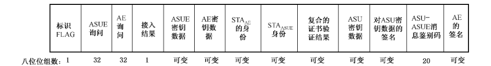

其中：一标识 FLAG 字段长度为1个八位位组，定义如前，比特0、1、3和7有意义。本字段比特0、比特1应与 ASUE发送的消息4中标识字段值相同。比特3（可选字段标识）由 ASUE 根据上下文环境设置。比特3（可选字段标识）为1表示分组中有可选字段（复合的证书验证结果），为0表示没有。若本字段中比特7的值为1，则 ASU 密钥数据字段、对ASU 密钥数据的签名字段和 ASU-ASUE 消息鉴别码字段存在；否则不存在。

ASUE 询问字段长度为32个八位位组。本字段值应与 ASUE 发送的消息4中 ASUE的询问字段值相同。

AE 询问字段长度为32个八位位组。字段值应与 AE 发送的消息5中 AE 的询问字段值相同。

-ASUE 密钥数据格式如前定义，内容是ASUE生成的用于 ECDH 交换的临时公钥，本字段值应与 ASUE 发送的消息 4中 ASUE 密钥数据字段值相同。

-AE 密钥数据格式如前定义，内容是 AE生成的用于 ECDH 交换的临时公钥。

STAA的身份字段，定义如前。

STAAsUE的身份字段，定义如前。

接入结果字段的长度为1个八位位组，其定义如前。具体意义如下：0 表示接入成功，对应证书验证结果值为0；

1 表示无法验证证书，对应证书验证结果值为1；

2 表示证书错误，对应证书验证结果除0和1之外的其他值；

3 表示本地策略禁止。

其他值保留。

复合的证书验证结果字段是可选的，若存在，则由消息6中证书的验证结果和 ASU 的签名两个字段组成，并且内容和它们相同。

ASU 密钥数据格式如前定义，其值与消息6中的ASU 密钥数据字段相同。

对 ASU 密钥数据的签名字段采用签名属性表示，其定义如前，其值与消息6中对 ASU 密钥数据的签名字段相同。

ASU-ASUE 消息鉴别码字段长度为20个八位位组，其值与消息6 中 ASU-ASUE 消息鉴别码字段相同。

AE 的签名字段采用签名属性表示，其定义如前。它是对本分组中除本字段之外所有数据字段的签名。

AE 收到消息6，或收到消息4后，发送消息7。

ASUE 收到消息7后，进行如下处理：

a） 根据 STAAE的身份和 STAAsu的身份判断是否为对应当前消息4的消息7，若不是，则丢弃消息7；否则，执行步骤b）。

b） 检查标识字段的比特0、比特1与自己发送的消息 4中相应字段的值是否相同，若不相同，则丢弃消息7；否则执行步骤c）。

c） 比较 ASUE的询问与自己在消息4中发送的 ASUE 询问是否相同、比较 ASUE 密钥数据与ASUE 发送的消息4中 ASUE 密钥数据是否相同，若不相同，则丢弃消息7；否则执行步骤

d）。

d） 验证 AE 的签名是否正确，若不正确，则丢弃消息7；否则若消息7中的接入结果不成功，则解除与该 STAAE的链路验证；否则执行步骤e）。

e） 若ASUE 在消息4中不要求进行证书验证，则执行步骤f）；否则执行步骤i）。

f） 检查标识 FLAG 字段中比特7的值，若值为0，则执行步骤g）；否则执行步骤h）。

g） 本地鉴别 STAAE的证书，即根据本地缓存的STAAE证书的验证结果及其根据本地策略所定义的时效性确定 STAAE证书的验证结果。若STA』E证书无效，则解除与该 STAAE的链路验证；若 STAAE证书为有效，则ASUE 使用自己的临时私钥x和 AE 的临时公钥y•P进行 EC- DH 计算，得到密钥种子（x•y•P） absdise，对其进行打展 KD-HMAC-SHA256（（x •y •P） abscissa， NAE|INASUE||"base key expansion for key and additional nonce”），生成长度16个八位位组的基密钥 BK 和长度32个八位位组的下一次证书鉴别过程的鉴别标识种子，然后对该鉴别标识种子进行 SHA-256运算，得到长度32个八位位组的下一次证书鉴别过程的鉴别标识。

h）首先验证对 ASU 密钥数据的签名，若验证不通过，则丢弃消息7；否则计算 KD-HMAC- SHA256 （（x •z•P） abocissa, ADDIDI| NAsU|| NASUE | | "pairwise key expansion for unicast and additional keys and nonce”），其中 NAsU为ASU 询问，NASUE为ASUE 询问，生成48个八位位组为 ASU 与 ASUE 之间的单播会话密钥（第一个16个八位位组为单播加密密钥 UEK，第二个16个八位位组为单播完整性校验密钥 UCK，第三个 16 个八位位组消息鉴别密钥MAK），然后验证ASU-ASUE 消息鉴别码，若验证不通过，则丢弃消息7；否则：本地鉴别STAAE的证书，即根据本地缓存的STA E证书的验证结果及其根据本地策略所定义的时效性确定 STAAE证书的验证结果。若STAA证书为无效，则解除与该STAA的链路验证；若STAAE证书为有效，则ASUE 使用自己的临时私钥x和AE的临时公钥y•P进行 ECDH 计算，得到密钥种子（x•y•P）absciss ，对其进行扩展 KD-HMAC-SHA256 （（x •y •P） abscisa, NAE IINASUE | |“base key expansion for key and additional nonce”），生成长度为16个八位位组的基密钥 BK 和长度为32个八位位组的下一次证书鉴别过程的鉴别标识种子，然后对该鉴别标识种子进行 SHA-256运算，得到长度为32个八位位组的下一次证书鉴别过程的鉴别标识。

最后依据标识 FLAG、ASUE-ASU 消息鉴别码构成消息8，并发送给 AE。

i） 检查标识 FLAG 字段中比特7的值，若值为0，则执行步骤j；否则执行步骤k）。

j） ASUE 检查证书的验证结果字段中的第二个一次性随机数值与自己在消息4中的ASUE 询问是否相同，若不相同，则丢弃消息7；否则验证 ASU 签名，若不正确，则丢弃消息7；否则检查AE 证书的鉴别结果，若STAE证书为无效，解除与该 STAAE的链路验证；若STAAE证书为有效，则 ASUE 使用自己的临时私钥x和 AE的临时公钥y•P进行ECDH 计算，得到密钥种子（x •y•P） abscisse，对其进行扩展 KD-HMAC-SHA256（（x •y •P） absciesn， NAE || NASUE||“base key expansion for key and additional nonce”），生成长度为16个八位位组的基密钥BK 和长度为32个八位位组的下一次证书鉴别过程的鉴别标识种子，然后对该鉴别标识种子进行 SHA- 256运算，得到长度为32个八位位组的下一次证书鉴别过程的鉴别标识。

k）首先验证对 ASU 密钥数据的签名，若验证不通过，则丢弃消息7；否则计算 KD-HMAC- SHA256（（x •z •P）absriss, ADDIDII NAsu | |NASUE | |"pairwise key expansion for unicast and additional keys and nonce”），其中 NAsU为ASU 询问，NASUE为ASUE 询问，生成48个八位位组为 ASU 与 ASUE 之间的单播会话密钥（第一个16个八位位组为单播加密密钥 UEK，第二个16个八位位组为单播完整性校验密钥 UCK，第三个16 个八位位组消息鉴别密钥MAK），然后验证 ASU-ASUE 消息鉴别码，若验证不通过，则丢弃消息7；否则检查证书的验证结果字段中的第二个一次性随机数值与自己在消息4中的ASUE 询问是否相同，若不相同，则丢弃消息7；否则验证 ASU 签名，若不正确，则丢弃消息7；否则检查 AE 证书的鉴别结果是否为有效，若 STAAE证书为无效，解除与该 STAAE的链路验证；若STAAE证书为有效，则ASUE 使用自己的临时私钥x和AE的临时公钥y•P进行ECDH 计算，得到密钥种子（x•y•P） absdiss，对其进行扩展 KD-HMAC-SHA256（（x •y •P） absdiss, NAE INASUE |"base key ex- pansion for key and additional nonce”），生成长度为16个八位位组的基密钥 BK 和长度为32个八位位组的下一次证书鉴别过程的鉴别标识种子，然后对该鉴别标识种子进行 SHA-256运算，得到长度为32个八位位组的下一次证书鉴别过程的鉴别标识。最后依据标识 FLAG、ASUE-ASU 消息鉴别码构成消息8，并发送给 AE。

###### 6.2.1.3.5.3.8 消息8

消息8的数据字段格式如图18所示。

其中：-标识 FLAG 字段长度为1个八位组，定义如前，比特7有意义。本字段比特7的值与消息7中本字段比特7的值相同。

ASUE-ASU 消息鉴别码字段长度为20个八位位组，其值为ASUE 利用最新协商的 ASU 与ASUE 之间的消息鉴别密钥 MAK 通过 HMAC-SHA256算法对消息3中的 WIEAsu和 ASU询问，消息4中的 WIEASUE-ASU、ASUE 询问、STAASUE的证书、ASUE 密钥数据和对 ASUE密钥数据的签名，消息7中 ASU 密钥数据、对ASU 密钥数据的签名、ASU-ASUE 消息鉴别码计算得到。

当ASUE 收到消息7，且消息7的标识 FLAG 字段中比特7的值1时，ASUE 向AE发送消息8。

AE 收到消息8后，进行如下处理：

a） 若消息6的FLAG 字段中比特1的值1，则执行步骤b）；否则执行步骤c）。

b）若消息6的FLAG 字段中比特2的值0，则依据 FLAG、ASUE-ASU 消息鉴别码构成消息9，并发送给 ASU；否则依据 FLAG、ASUE-ASU 消息鉴别码、AE-ASU 消息鉴别码构成消息9，并发送给 ASU。

c） 若消息6的 FLAG 字段中比特2的值为1，依据 FLAG、AE-ASU 消息鉴别码构成消息9，并发送给 ASU。

###### 6.2.1.3.5.3.9 消息9

消息9的数据字段格式如图19所示。

其中：—FLAG 字段长度为1个八位组，定义如前，比特1和2有意义。本字段的值与消息6中 FLAG字段的值相同。

ASUE-ASU 消息鉴别码字段长度为20个八位位组，其值与消息8中的 ASUE-ASU 消息鉴别码字段的值相同。当FLAG 字段中比特2的值为1时，本字段存在。

AE-ASU 消息鉴别码字段长度为20个八位位组，其值为 AE 利用最新协商的ASU与AE之间的消息鉴别密钥 MAK通过 HMAC-SHA256 算法对消息1、消息2、消息5、消息6、消息9本字段之前的所有字段计算得到，不包含各个消息的分组头。当FLAG 字段中比特1的值为1时，本字段存在。

当消息6的FLAG 字段中比特1的值为1，或消息6的FLAG 字段中比特2的值为1时，AE 向ASU 发送消息9。

ASU 收到消息9，进行如下处理：

a） 检查 FLAG 字段中比特1 的值，若值为1，执行步骤b）；否则执行步骤e）。

b）检查 FLAG 字段中比特2的值，若值为0，则执行步骤c）；否则执行步骤d）。

c） 验证 ASUE-ASU 消息鉴别码，若验证不通过，则丢弃消息9；否则成功协商了 ASUE 与 ASU之间的会话密钥及密码套件。

d） 验证 ASUE-ASU 消息鉴别码，若验证不通过，则丢弃消息9：否则继续验证 AE-ASU 消息鉴别码，若验证不通过，则丢弃消息 9；否则成功协商了 ASUE 与ASU 之间的会话密钥及密码套件，以及 AE与ASU 之间的会话密钥及密码套件。

e） 检查 FLAG 字段中比特2的值，若值为1，则验证 AE-ASU 消息鉴别码，若验证不通过，则丢弃消息9；否则成功协商了 AE与 ASU 之间的会话密钥及密码套件。

在证书鉴别过程中，对于 ASUE 与 ASU 之间、AE与ASU 之间协商的密码套件，其密码算法采用 SM4。

在证书鉴别过程中，要进行 ECDH 协商出基密钥，或要进行 ECDH 协商出 ASUE 与 ASU 之间的会话密钥，或要进行 ECDH 协商出 AE 与ASU 之间的会话密钥。对于 ECDH 算法，做以下说明：

1）临时私钥x、y、2是在［1..n一1间的整数，n是椭圆曲线域参数中基点P的阶。

2） 临时公钥x•P、y•P、z•P是椭圆曲线域参数定义的椭圆曲线上的点。

3） ECDH 协商出来密钥种子（x•y•P）absis是x•y•P的坐标，x•y•P不能是无穷远点；

ECDH 协商出来密钥种子（x •z•P）abstiss是x •z•P的坐标，x•z•P不能是无穷远点；

ECDH 协商出来密钥种子（x•y•P）absciksa是y•z•P的坐标，Y•z•P不能是无穷远点。

#### 6.2.2 隧道 TAEP 鉴别方式

##### 6.2.2.1 概述

隧道 TAEP 鉴别方式是指采用一个隧道TAEP 鉴别方法来实现 TCA 的双向用户身份鉴别和平台鉴别，其中 AR 和AC 之间的平台鉴别数据是利用隧道方法所建立的安全隧道进行保护的。隧道方法可以采用 TLS 协议和增强型 TLS 协议（见6.2.2.2.4）来建立。

##### 6.2.2.2 隧道 TABP 鉴别实现

###### 6.2.2.2.1 层次模型

图20为TCA的一种隧道TAEP 鉴别实现的层次模型。

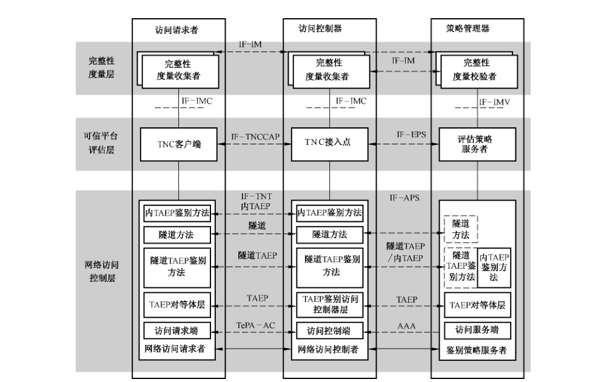

在图20中，NAR、NAC 和APS执行一个隧道 TAEP 鉴别方法，其中隧道 TAEP 鉴别方法包含两个阶段：隧道方法和内 TAEP 鉴别方法。TAEP 对等体层和 TAEP 鉴别访问控制器层是 TAEP 层次模型（见GB/T 28455—2012）中的两种角色。访问请求端和访问控制端利用 TePA-AC来实现 TCA 的访问控制（见6.3），其中 TAEP包承载在 TePA-AC上。访问控制端和访问服务端可以利用AAA 协议（见 RFC 3539）来承载 TAEP 包，例如：RADIUS 和 Diameter（见 RFC 2138、RFC 2865、RFC 2866.RFC 4675、RFC 3588 和 RFC 3589）。

APS中的隧道 TAEP 鉴别方法和隧道方法为虚线框，表示 APS可以不参与隧道方法。

对于 TCA 的隧道TAEP 鉴别方式，内 TAEP包中的PIK 签名必须密码绑定隧道 TAEP 鉴别方法中隧道方法所建立的隧道密钥，密码绑定方法是将该隧道密钥作为 PIK 签名的外部数据输入。

###### 6.2.2.2.2 隧道 TAEP 鉴别方法

隧道 TAEP 鉴别方法用于封装传输用户身份鉴别协议和平台鉴别协议，它包含以下两个阶段：第一阶段，NAR 和 NAC利用隧道方法建立 AR 和 AC之间的安全隧道，其中 APS可以参与该安全隧道的建立过程，也可以不参与该安全隧道的建立过程。

第二阶段：NAR、NAC 和 APS交互内 TAEP 鉴别方法的内 TAEP包，其中 AR和 AC 之间的内TAEP 包是利用隧道方法所建立的安全隧道进行保护的。

对于隧道方法，本标准推荐采用 TLS 协议（见 RFC 2246、RFC 4346、RFC 5246）及增强型 TLS协议的完全模式，其中 ECDH 交换参数应采用国家密码管理局批准的ECC域参数，签名算法应采用国家密码管理局批准的 ECDSA 算法，杂凑算法应采用国家密码管理局批准的 KD-HMAC-SHA256、HMAC-SHA256 和 SHA256算法，分组算法应采用国家密码管理局批准的SM4算法，加密工作模式应采用 OFB模式，完整性校验工作模式应采用CBC-MAC 模式，从而本标准将相应的TLS密码套件规定为 TL.S_ECDH_ECDSA_WITH_SM4_OFB_CBC_MAC_SHA256，其值为10x00,0xfd｝。

当采用 TLS协议及增强型TLS协议的完全模式作为隧道方法时，本标准规定相应的隧道TAEP鉴别方法的 Type 字段为 TAEP-TTLS。

内TAEP鉴别方法用于实现 AR 和 AC 之间的平台鉴别。当内 TAEP 包封装 PAI 协议（见7.2.2）时，本标准规定相应的内 TAEP鉴别方法的 Type 字段为 TAEP-PAI。

###### 6.2.2.2.3 TAEP 交互过程

TCA 的TAEP 交互过程如下：

a） NAC 向NAR 发送 TAEP 的 Request 分组，其中 Type 字段的值为 Identity。

b） NAR向NAC 发送 TAEP 的 Response 分组，其中 Type 字段的值 Identity, Type-Data 字段的值包含 AR 的身份。

c） NAC向 APS发送 TAEP 的 Request 分组，其中 Type 字段的值 TP Authentication, Type- Data 字段的值包含 AR 和 AC的身份。

d） APS向 NAC 发送 TAEP 的Response 分组，其中 Type 字段的值 TP Authentication, Type- Data 字段的值包含 PM所支持的各种 TAEP 鉴别方法类型。

e） NAC选取一种隧道 TAEP鉴别方法与 NAR、APS执行隧道方法过程建立 AR 和AC之间的安全隧道，即 AR 和 AC 之间交互一系列 TAEP 的 Request 分组和 Response 分组，以及 AC和 PM 之间交互一系列 TAEP 的Request 分组和 Response 分组（APS参与隧道方法的情况），直至隧道方法过程完成，其中 Type 字段的值为隧道 TAEP鉴别方法类型，Type-Data 字段的值为隧道方法消息。

f） NAC 向NAR 发送 TAEP 的 Request 分组，其中 Type字段的值为步骤e）中的隧道TAEP 鉴别方法类型，Type-Data 字段的值为利用步骤e）建立的安全隧道进行保护的内 TAEP包。内TAEP 包的Code 字段的值为 Request, Type 字段的值 Identity。当 TNCAP 需要请求用于内TAEP鉴别方法的AR 的身份时，TNCAP通知 NAC发送该内 TAEP包。当NAR 收到该内 TAEP 包时，NAR 向 TNCC 请求用于内 TAEP 鉴别方法的AR的身份。

g） NAR 向 NAC 发送 TAEP 的 Response 分组，其中 Type 字段对应步骤f）中 TAEP的Request分组中的 Type 字段，Type-Data 字段的值为利用步骤e）建立的安全隧道进行保护的内TAEP 包。内 TAEP 包的 Code 字段的值 Response, Type 字段对应步骤f）中内 TAEP包的 Request 分组中的Type 字段，Type-Data 字段中包含用于内 TAEP 鉴别方法的AR的身份。当 NAR从 TNCC接收到用于内 TAEP鉴别方法的AR 的身份时，NAR 向 NAC 发送该内 TAEP包。当NAC收到该内 TAEP 包时，NAC 向 TNCAP 发送用于内 TAEP 鉴别方法的 AR 的身份。

h） NAC向 APS发送 TAEP 的 Request 分组，其中 Type 字段的值 TP Authentication, Type- Data 字段中 Subtype字段的值 FF-FF-FE（用于标识 TCA 中内 TAEP包的 TP Authentica- tion 类型分组），Subdata 字段的值包含用于内 TAEP鉴别方法的AR 和AC身份。Subdata字段的值还可以包含对 AR的平台鉴别策略请求信息，具体值不在本标准中规定。当TNCAP需要向 EPS 请求内 TAEP 鉴别方法类型或对 AR的平台鉴别策略时，TNCAP通知NAC发送该内 TAEP包。当APS收到该内 TAEP 包时，APS 向 EPS发送用于内 TAEP 鉴别方法的AR 和AC 身份或对AR的平台鉴别策略请求信息。

i） APS 向 NAC 发送 TAEP 的 Response 分组，其中 Type字段对应步骤（h）中 TAEP 的 Request分组中的Type 字段，Type-Data 字段中 Subtype 的值为 FF-FF-FE.Subdata 字段的值包含各个内TAEP 鉴别方法类型。Subdata 字段的值还可以包含 EPS分发给 TNCAP的对 AR 的平台鉴别策略。当 APS从 EPS接收到各个内鉴别方法类型或对AR 的平台鉴别策略时，APS向 NAC发送该内 TAEP 包，NAC 收到该内 TAEP 包后将其 Subdata 字段的值发送给TNCAP，然后 TNCAP选取一种内 TAEP鉴别方法发起内 TAEP 鉴别过程。对AR的平台鉴別策略的管理参见附录 B。

j NAC 根据 TNCAP选取的一种内 TAEP 鉴别方法与 NAR、APS 交互一系列 TAEP 的Request 分组和 Response 分组，直到内 TAEP鉴别方法过程完成。对于 NAC与NAR之间交互的一系列 TAEP的 Request 分组和 Response 分组，其中 Type字段的值为步骤e）中的隧道 TAEP 鉴别方法类型，Type-Data 字段的值利用步骤e）建立的安全隧道进行保护的内TAEP包。内TAEP包的 Type 字段的值 TNCAP选取的内 TAEP 鉴别方法类型，Type- Data 字段的值 TNCAP选取的内 TAEP鉴别方法类型对应的内 TAEP鉴别方法消息。对于NAC与APS之间交互的一系列 TAEP的 Request 分组和 Response 分组，其中 Type 字段的值为 TNCAP选取的内 TAEP 鉴别方法类型，Type-Data 字段的值 TNCAP选取的内TAEP 鉴别方法类型对应的内TAEP鉴别方法消息。内TAEP 鉴别方法消息由可信平台评估层中的 TNCC、TNCAP 和 EPS进行相应处理。

k） NAC 利用 TAEP 的 Success 分组或 Failure 分组结束鉴别过程，即：若在步骤j）中的内 TAEP鉴别方法过程中 TNCAP 成功鉴别 AR 的平台（包括平台身份鉴别和平台完整性评估），则向NAR 发送TAEP 的 Success 分组。若在步骤j）中的内 TAEP 鉴别方法过程中TNCAP 不能成功鉴别 AR的平台，则向 NAR 发送 TAEP 的Failure 分组。

以上步骤描述了TCA 的隧道TAEP鉴别实现的典型 TAEP 交互过程，但根据鉴别方法的不同，步骤过程会有不同。

当隧道 TAEP 鉴别方法的Type 字段 TAEP-TTLS 且隧道方法为完全模式 TLS协议，内 TAEP鉴别方法的Type 字段为TAEP-PAI 且封装 PAI 协议（7.2.2）时，TCA 的隧道 TAEP 鉴别实现的一个完整的TAEP 交互过程如图21所示。

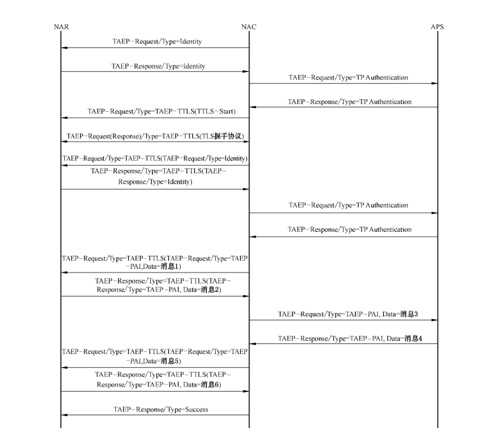

在图21中，根据 PAI 协议的特点，与TAEP-PAI 相关的消息1～消息6的TAEP交互可能执行多轮次。

在一轮 PAI 协议中，当消息5未被生成时，消息5和消息6的TAEP交互不存在。

在一轮 PAI 协议中，当消息5被生成，但消息6未被生成时，消息6的TAEP交互存在，其 Data 值为NULL。

当隧道 TAEP 鉴别方法的Type字段TAEP-TTLS且隧道方法为完全模式增强型TLS协议，内TAEP 鉴别方法的Type 字段为TAEP-PAI 且封装PAI 协议（7.2.2）时，TCA 的隧道 TAEP鉴别实现的一个完整的 TAEP 交互过程如图22所示。

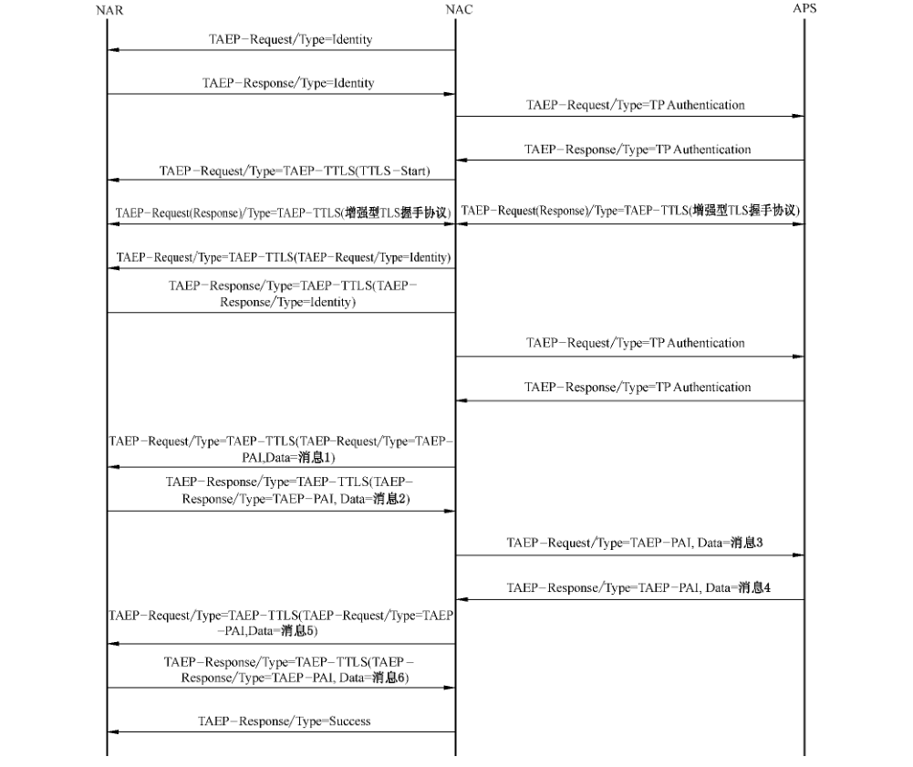

在图22中，根据 PAI 协议的特点，与TAEP-PAI 相关的消息1～消息6的TAEP交互可能执行多轮次。

在一轮 PAI协议中，当消息5未被生成时，消息5和消息6的TAEP交互不存在。

在一轮 PAI 协议中，当消息5被生成，但消息6未被生成时，消息6的TAEP 交互存在，其 Data 值为NULL。

###### 6.2.2.2.4 增强型 TLS协议

###### 6.2.2.2.4.1 概述

增强型 TLS（ETLS）协议是可信第三方（TTP）在线的TLS 协议。ETLS 协议中的客户端（Client）、服务端（Server）和 TTP分别对应于本标准中的AR、AC 和 PM。相对于TLS协议，ETL.S协议增加了 Client 证书和 Server 证书的集中验证，增加了 Client 与TTP 之间、Server 与 TTP 之间的会话密钥及密码套件的协商。

Client 与TTP之间、Server 与TTP之间的会话密钥生成方法与 Client 与 Server 之间的会话密钥生成方法相同，都是采用 KD-HMAC-SHA256 算法，其中输入参数与输出参数与 TLS协议相同。

ETLS协议中未明确规定部分参见 TLS协议。

###### 6.2.2.2.4.2 增强型TLS协议的记录协议

ETLS 记录协议仅使用于 Client 与 Server 之间，其中版本号 3.4（对应ETLS协议），其他与TL.S记录协议相同。

###### 6.2.2.2.4.3 增强型TLS 协议的握手协议

###### 6.2.2.2.4.3.1 封装方法

###### 6.2.2.2.4.3.1.1 Client 与 Server 之间

采用TLS协议的封装方法。

###### 6.2.2.2.4.3.1.2 Server 与TTP之间

ETLS 协议的握手协议分组格式如图 23所示。

其中：—版本字段长度为2个八位位组，表示 ETLS协议的版本号。当前版本为1；

类型字段长度为1个八位位组，表示协议类型，定义如下：1 ETLS协议分组；

其他值保留。

子类型字段的长度为1个八位位组，当类型字段的值为1时，子类型字段值定义如下；当类型字段其他值时，子类型字段值保留。

1 消息1；

2 消息2；

3 消息3；

4 消息4；

其他值保留。

一保留字段长度为2个八位位组，默认值为0。

-长度字段长度为2个八位位组，其值表示 ETLS 协议分组所有字段的八位位组数。

-分组序号字段长度为2个八位位组，其值表示协议分组序号。第一个分组序号为1，后序分组依次按1递增。

-分片序号字段长度为1个八位位组，其值表示分片的顺序编号，每一个分组的第一个分片序号内0，后序分片依次按1递增。

标识字段长度为1个八位位组，比特。表示后续是否有分片，值为。表示没有，值1表示有。

比特1至比特7保留。

-数据字段的内容根据类型和子类型的值而定，它除了包含固定的内容，还可以包含可选的属性。

###### 6.2.2.2.4.3.2 握手过程

ETLS 协议的握手过程如图24。

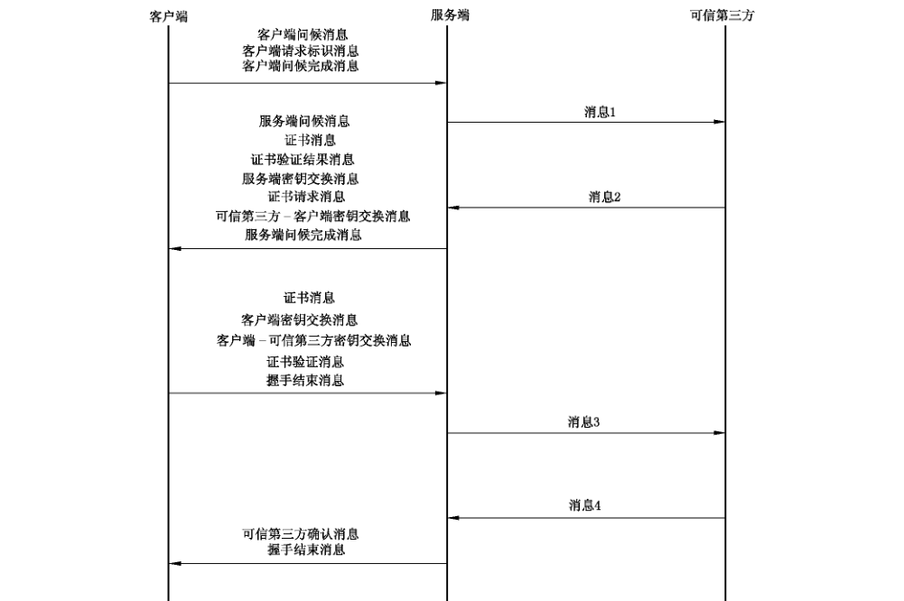

在图24中，客户端问候消息（ClientHello）、服务端问候消息（ServerHello）、证书消息（Certificate）、服务端密钥交换消息（ServerKeyExchange）、证书请求消息（CertificateRequest）、服务端问候完成消息（ServerHelloDone）、客户端密钥交换消息（ClientKeyExchange）、证书验证消息（CertificateVerify）和握手结束消息（Finished）与TLS 协议中所定义的握手消息相同。客户端请求标识消息（ClientRequest- Flag）、客户端问候完成消息（ClientHelloDone）、证书验证结果消息（CertificateValidationResult）、可信第三方一客户端密钥交换消息（TTPClientKeyExchange）、客户端一可信第三方密钥交换消息（Cli- entT'TPKeyExchange） 和可信第三方确认消息（TTPConfirmed）为新增加的6 种握手消息。

###### 6.2.2.2.4.3.2.1 消息 1

消息1的数据字段格式如图25所示。

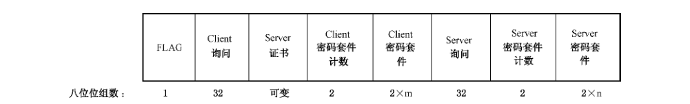

其中：-FLAG 字段长度1 个八位组，定义如图26所示。

其中：-Client 证书验证请求标识比特：1表示需要验证 Client证书的有效性；0表示不需要验证。

Server 证书验证请求标识比特：1表示需要验证 Server 证书的有效性；0表示不需要验证。

Client 与 TTP 之间密钥协商请求标识比特：1表示需要协商 Client 与TTP 之间的会话密钥及密码套件；0表示不需要协商。

Server 与 TTP 之间密钥协商请求标识比特：1 表示需要协商 Server 与TTP 之间的会话密钥及密码套件；0表示不需要协商。

比特1、2和3有意义。

Client 询问字段长度为32个八位位组，其格式定义参见 TLS 协议中的Random，其值Cli- entHello.random。当FLAG 字段中比特1或2的值1时，本字段存在。

Server 证书字段长度可变，其格式定义见TLS 协议中的 Certificate，其值 Server 发送的Certificate。当 FLAG 字段中比特1的值为1时，本字段存在。

Client 密码套件计数字段长度为2个八位位组，其值为 ClientHello.cipher_suites 的计数。当FLAG 字段中比特2的值1时，本字段存在。

Client 密码套件字段长度为2Xm，其中 m 为 Client 密码套件计数。Client 密码套件的值力ClientHello.cipher_suites。当 FLAG 字段中比特2的值为1时，本字段存在。

Server 询问字段长度为32个八位位组，其格式定义参见 TLS 协议中的Random，其值为ServerHello.random。当FLAG 字段中比特3的值为1时，本字段存在。

Server 密码套件计数字段长度为2个八位位组，其值为 ServerHello. cipher_suites 的计数。

当FLAG 字段中比特3的值为1时，本字段存在。

Server 密码套件字段长度2Xn，其中 n Server 密码套件计数。Server 密码套件的值为ServerHello.cipher_suites。当FLAG 字段中比特3的值为1时，本字段存在。

当 Server 收到 ClientHelloDone 时，若 Client 需要验证 Server 证书的有效性，或 Client 需要协商与TTP 之间的会话密钥及密码套件，或 Server 需要协商与 TTP 之间的会话密钥及密码套件，则 Server向 TTP 发送消息1。值得注意的是：若 Server 支持的最高版本低于 3.4，则 Server 丟弃 Client 发送的ClientRequestFlag 和 ClientHelloDone。

TTP 收到消息1后，进行如下处理：

a） 检查 FLAG 字段中比特1 的值，若值为0，执行步骤b）；否则执行步骤f）。

b）， 检查 FLAG 字段中比特2和3的值，若比特2的值为0且比特3的值为0，则丢弃消息1；若比特2的值为。且比特3的值为1，则执行步骤c）；若比特2的值为1且比特3的值为0，则执行步骤d）；若比特2的值为1且比特3的值为1，则执行步骤e）。

c） 首先选取一种用于 TTP 与 Server 之间的密码套件，然后依据 FLAG、TTP 询问、TTP-Server密码套件、TTP 密钥数据、对 TTP密钥数据的签名构成消息 2，并发送给 Server。

d） 首先选取一种用于 TTP 与 Client 之间的密码套件，然后依据 FLAG、TTP 询问、TTP-Client密码套件、TTP 密钥数据、对 TTP 密钥数据的签名构成消息 2，并发送给 Server。

e） 首先选取一种用于 TTP 与 Server 之间的密码套件，以及选取一种用于 TTP 与Client 之间的密码套件，然后依据 FLAG、TTP 询问、TTP-Client 密码套件、TTP-Server 密码套件、TTP 密钥数据、对 TTP 密钥数据的签名构成消息2，并发送给 Server。

f） 检查 FL.AG 字段中比特2和3的值，若比特2的值为0且比特3的值为0，则执行步骤g）；若比特2的值为。且比特3的值为1，则执行步骤h）；若比特2的值为1且比特3的值0，则执行步骤i）；若比特2的值为1且比特3的值为1，则执行步骤j）。

g） 首先生成 Server 证书的验证结果及相应的签名，然后依据 FLAG、Client 询问、Server 证书、Server 证书的验证结果、对 Server 证书验证结果的签名构成消息2，并发送给 Server。

h） 首先生成 Server 证书的验证结果及相应的签名，然后选取一种用于 TTP 与 Server 之间的密码套件，最后依据 FLAG、Client 询问、Server 证书、Server 证书的验证结果、对 Server 证书验证结果的签名、TTP 询问、TTP-Server 密码套件、TTP 密钥数据、对TTP 密钥数据的签名构成消息 2，并发送给 Server。

i） 首先生成 Server 证书的验证结果及相应的签名，然后选取一种用于 TTP 与Client 之间的密码套件，最后依据 FLAG、Client 询问、Server 证书、Server 证书的验证结果、对 Server 证书验证结果的签名、TTP 询问、TTP-Client 密码套件、TTP 密钥数据、对TTP密钥数据的签名构成消息 2，并发送给 Server。

j） 首先生成 Server 证书的验证结果及相应的签名，然后选取一种用于 TTP 与 Server 之间的密码套件，以及选取一种用于 TTP 与 Client 之间的密码套件，最后依据 FLAG、Client 询问、Server 证书、Server 证书的验证结果、对 Server 证书验证结果的签名、TTP 询问、TTP-Client密码套件、TTP-Server 密码套件、TTP 密钥数据、对TTP密钥数据的签名构成消息2，并发送给 Server。

###### 6.2.2.2.4.3.2.2 消息2

消息2的数据字段格式如图27所示。

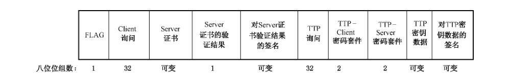

其中：-FL.AG 字段长度为1个八位组，定义如前，比特1、2和3有意义。

Client 询问字段长度为32个八位位组，其值 ClientHello.random。当 FLAG 字段中比特1的值为1时，本字段存在。

Server 证书字段长度为可变，其值为 Server 发送的Certificate。当FL.AG 字段中比特1 的值为1时，本字段存在。

Server 证书的验证结果字段为1个八位位组，验证结果的定义如前。当 FLAG 字段中比特1的值为1时，本字段存在。

对 Server 证书验证结果的签名字段长度为可变，采用签名属性格式定义，它是TTP生成的对Client 询问、Server 证书、Server 证书的验证结果的签名。当 FLAG 字段中比特1的值为1时，本字段存在。

TTP 询问字段长度为32个八位位组，其格式定义见 TLS协议中的Random，它是TTP生成的。当FLAG 字段中比特2或3的值为1时，本字段存在。

TTP-Client 密码套件字段长度为2个八位位组，其格式定义见 TL.S 协议中的CipherSuite，其值是 TTP选择的一种用于 TTP 与Client 之间的密码套件。当FLAG 字段中比特2的值为1时，本字段存在。

TTP-Server 密码套件字段长度为2个八位位组，其格式定义见TLS协议中的CipherSuite，其值是TTP选择的一种用于 TTP 与 Server 之间的密码套件。当FLAG 字段中比特3的值力1时，本字段存在。

TTP 密钥数据字段可变，其格式定义如前，它是 TTP生成的用于 ECDH 交换的临时公钥。

当FLAG 字段中比特2或3的值为1时，本字段存在。

对 TTP密钥数据的签名字段长度为可变，采用签名属性格式定义，它是 TTP生成的对 TTP密钥数据的签名。当FLAG 字段中比特2或3的值为1时，本字段存在。

当TTP 收到 Server 的消息1时，TTP 向 Server 发送消息2。

Server 收到消息2后，进行如下处理：

a） 检查 FLAG 字段中比特1 的值，若值为0，执行步骤b）；否则执行步骤f）。

b） 检查 FLAG 字段中比特2和3的值，若比特2的值0且比特3的值0，则丢弃消息1；若比特2的值为0且比特3的值1，则执行步骤c）；若比特2的值1且比特3的值为0，则执行步骤d）；若比特2的值为1且比特3的值为1，则执行步骤e）。

验证对 TTP 密钥数据的签名，若验证不通过，则丢弃消息 2；否则依次向 Client 发送 Server- Hello、Certificate、ServerKeyExchange、CertificateRequest 和 ServerHelloDone。

d） 依次向 Client 发送 ServerHello、Certificate、ServerKeyExchange、CertificateRequest、TTPCli- entKeyExchange、ServerHelloDone。

验证对 TTP 密钥数据的签名，若验证不通过，则丢弃消息 2；否则依次向 Client 发送 Server- Hello、Certificate、ServerKeyExchange、CertificateRequest、 T'TPClientKeyExchange、 Server- HelloDone。

f） 检查 FLAG 字段中比特2和3的值，若比特2的值为0且比特3的值为0，则执行步骤g）；若比特2的值为。且比特3的值为1，则执行步骤h）；若比特2的值为1且比特3的值0，则执行步骤i）；若比特2的值为1且比特3的值1，则执行步骤j）。

g） 依次向 Client 发送 ServerHello、Certificate、CertificateValidationResult、ServerKeyExchange、CertificateRequest、ServerHelloDone。

h） 验证对TTP 密钥数据的签名，若验证不通过，则丢弃消息3；否则依次向 Client 发送 Server- Hello、Certificate、CertificateValidationResult、 ServerKeyExchange、CertificateRequest、ServerHelloDone。

i） 依次向 Client 发送 ServerHello、Certificate、CertificateValidationResult、ServerKeyExchange、CertificateRequest、TTPClientKeyExchange、Server HelloDone。

j） 验证对 TTP 密钥数据的签名，若验证不通过，则丢弃消息 3；否则依次向 Client 发送 Server- Hello、Certificate、CertificateValidationResult、ServerKeyExchange、CertificateRequest、TTP- ClientKeyExchange、ServerHelloDone。

###### 6.2.2.2.4.3.2.3 消息3

消息3的数据字段格式如图28所示。

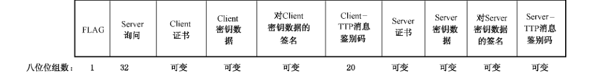

其中：——FLAG 字段长度为1个八位组，定义如前，比特0、1、2和3有意义。

Server 询问字段长度为32个八位位组，其值为 ServerHello.random。当FLAG 字段中比特0的值为1时，本字段存在。

Client 证书字段长度为可变，其值为 Client 发送的Certificate。当 FL.AG 字段中比特0或2的值为1时，本字段存在。

Client 密钥数据字段为可变，其格式定义如前，它是 Client 生成的用于 ECDH 交换的临时公钥。当FLAG 字段中比特2的值为1时，本字段存在。

对 Client 密钥数据的签名字段长度可变，采用签名属性格式定义，它是 Client生成的对Client 密钥数据的签名。当FLAG 字段中比特2的值为1时，本字段存在。

Client-TTP 消息鉴别码长度为20个八位位组，其值 Client 利用最新协商的 Client 与 TTP之间的消息鉴别密钥 MAK 通过HMAC-SHA256 算法对 Client 询问、Client 密码套件计数、Client 密码套件、TTP 询问、TTP-Server 密码套件、TTP 密钥数据、对TTP密钥数据的签名、Client 证书、Client 密钥数据、对 Client 密钥数据的签名计算得到。当FLAG 字段中比特2的值为1时，本字段存在。

Server 证书字段长度可变，其值 Server 发送的Certificate。当 FLAG 字段中比特3的值为1且比特1的值为0时，本字段存在。

Server 密钥数据字段为可变，其格式定义如前，它是 Server 生成的用于 ECDH交换的临时公钥。当FLAG 字段中比特3的值为1时，本字段存在。

对 Server 密钥数据的签名字段长度为可变，采用签名属性格式定义，它是 Server 生成的对Server 密钥数据的签名。当FLAG 字段中比特3的值为1时，本字段存在。

Server-TTP 消息鉴别码长度20个八位位组，其值为 Server 利用最新协商的 Server 与TTP之间的消息鉴别密钥 MAK 通过HMAC-SHA256 算法对消息1、消息2和消息3中本字段之前的所有字段计算得到。当FLAG 字段中比特3的值1时，本字段存在。

当 Server 收到 Client 发送的 Finished 时，若 Server 需要验证 Client 证书的有效性，或 Client 需要协商与 TTP之间的会话密钥及密码套件，或 Server 需要协商与TTP 之间的会话密钥及密码套件，则Server 向 TTP 发送消息3。

TTP 收到消息3后，进行如下处理：

a） 检查 FLAG 字段中比特0的值，若值为0，执行步骤b）；否则执行步骤f）。

b） 检查 FLAG 字段中比特2和3的值，若比特2的值为。且比特3的值为0，则丢弃消息3；若比特2的值为。且比特3的值为1，则执行步骤c）；若比特2的值为1且比特3的值为0，则执行步骤d）；若比特2的值为1且比特3的值为1，则执行步骤e）。

c） 首先验证 Server-TTP 消息鉴别码，若验证不通过，则丢弃消息3；否则依据 FLAG、TTP- Server 消息鉴别码构成消息4，并发送给 Server。

d） 首先验证 Client-TTP 消息鉴别码，若验证不通过，则丢弃消息3；否则依据 FLAG、TTP- Client 消息鉴别码构成消息 4，并发送给 Server。

e） 首先验证 Server-TTP 消息鉴别码，若验证不通过，则丢弃消息3，否则验证 Client-TTP 消息鉴别码，若验证不通过，则丢弃消息 3；否则依据 FLAG、TTP-Client 消息鉴别码、TTP-Server消息鉴别码构成消息 4，并发送给 Server。

f） 检查 FL.AG 字段中比特2和3的值，若比特2的值为0且比特3的值为0，则执行步骤g）；若比特2的值为。且比特3的值为1，则执行步骤h）；若比特2的值为1且比特3的值0，则执行步骤i）；若比特2的值为1且比特3的值为1，则执行步骤j）。

g） 首先生成 Client 证书的验证结果及相应的签名，然后依据 FLAG、Server 询问、Client 证书、Client 证书的验证结果、对 Client 证书验证结果的签名构成消息4，并发送给 Server。

h） 首先验证 Server-TTP 消息鉴别码，若验证不通过，则丢弃消息3；否则生成 Client 证书的验证结果及相应的签名，然后依据 FLAG、Server 询问、Client 证书、Client 证书的验证结果、对Client 证书验证结果的签名、TTP-Server 消息鉴别码构成消息 4，并发送给 Server。

首先验证 Client-TTP 消息鉴别码，若验证不通过，则丢弃消息3；否则生成 Client 证书的验证结果及相应的签名，然后依据 FLAG、Server 询问、Client 证书、Client 证书的验证结果、对Client 证书验证结果的签名、TTP-Client 消息鉴别码构成消息 4，并发送给 Server。

首先验证 Server-T'TP 消息鉴别码，若验证不通过，则丢弃消息3；否则验证 Client-TTP 消息鉴别码，若验证不通过，则丢弃消息3；否则生成 Client 证书的验证结果及相应的签名，然后依据FLAG、Server 询问、Client 证书、Client 证书的验证结果、对 Client 证书验证结果的签名、TTP-Client 消息鉴别码、TTP-Server 消息鉴别码构成消息4，并发送给 Server。

###### 6.2.2.2.4.3.2.4 消息 4

消息4的数据字段格式如图29所示。

其中：-FLAG字段长度为1个八位组，定义如前，比特0、2和3有意义。

Server 询问字段长度为32个八位位组，其值为 ServerHello. random。当 FLAG 字段中比特0的值1时，本字段存在。

Client 证书字段长度为可变，其值为 Client 发送的Certificate。当 FLAG 字段中比特0的值为1时，本字段存在。

Client 证书的验证结果字段为1个八位位组，验证结果的定义如前。当FLAG 字段中比特0的值为1时，本字段存在。

对 Client 证书验证结果的签名字段长度为可变，采用签名属性格式定义，它是 TTP生成的对Server 询问、Client 证书、Client 证书的验证结果的签名，当FLAG 字段中比特0的值为1时，本字段存在。

TTP-Client 消息鉴别码长度为20个八位位组，其值 TTP 利用最新协商的 TTP 与 Client之间的消息鉴别密钥 MAK 通过HMAC-SHA256 算法对 Client 询问、Client 密码套件计数、Client 密码套件、TTP 询问、TTP-Client 密码套件、TTP 密钥数据、对TTP 密钥数据的签名、Client 证书、Client 密钥数据、对 Client 密钥数据的签名、Client-TTP 消息鉴别码计算得到。

当 FLAG 字段中比特2的值为1时，本字段存在。

TTP-Server 消息鉴别码长度为20个八位位组，其值为 TTP 利用最新协商的 TTP 与 Server之间的消息鉴别密钥 MAK 通过HMAC-SHA256 算法对消息1、消息2、消息3、消息4中本字段之前的所有字段计算得到。当FLAG 字段中比特3的值为1时，本字段存在。

当TTP 收到消息3时，TTP 向 Server 发送消息4。

Server 收到消息4后，进行如下处理：进行如下处理：

a） 检查 FLAG 字段中比特。的值，若值为0，执行步骤b）；否则执行步骤f）。

b） 检查 FLAG 字段中比特2和3的值，若比特2的值为。且比特3的值为0，则丢弃消息3；若比特2的值为0且比特3的值为1，则执行步骤c）；若比特2的值1且比特3的值0，则执行步骤d）；若比特2的值为1且比特3的值为1，则执行步骤e）。

c） 首先验证 TTP-Server 消息鉴别码，若验证不通过，则丢弃消息 4；否则向 Client 发送 Fin- ished。

d） 依次向 Client 发送 TTPConformed、Finished。

e） 首先验证 TTP-Server 消息鉴别码，若验证不通过，则丢弃消息 4；否则依次向 Client 发送TTPConformed,Finished。

f） 检查 FLAG 字段中比特2和3的值，若比特2的值为0且比特3的值0，则执行步骤g）；若比特2的值为。且比特3的值为1，则执行步骤h）；若比特2的值为1且比特3的值0，则执行步骤i）；若比特2的值为1且比特3的值为1，则执行步骤j）。

g） 首先验证对 Client 证书验证结果的签名，若验证不通过，则丢弃消息 4；否则向 Client 发送Finished。

h） 首先验证对 Client 证书验证结果的签名，若验证不通过，则丢弃消息 4；否则验证 TTP-Server消息鉴别码，若验证不通过，则丢弃消息 4；否则向 Client 发送 Finished。

i） 首先验证对 Client 证书验证结果的签名，若验证不通过，则丢弃消息 4；否则向 Client 发送TTPConformed、Finished. j 首先验证对 Client 证书验证结果的签名，若验证不通过，则丢弃消息 4；否则验证 TTP-Server消息鉴别码，若验证不通过，则丢弃消息 4；否则向 Client 发送 TTPConformed、Finished。

当FLAG 字段中比特0的值为0时，Server 验证 Client 所发送的 Certificate，若 Client 所发送的Certificate 为无效，则 Server 丢弃 Client 所发送的 Certificate 或向 Client发送警告消息。当FLAG 字段中比特0的值为1时，Server 依据消息4 中 Client 证书的验证结果字段的值来验证 Client 所发送的Certificate，若 Client 所发送的Certificate 为无效，则 Server 中止该握手过程或向 Client 发送警告消息。

**6.2.2.2.4.3.2.5** ClientRequestFlagClientReuestFlag 的握手协议类型值为 40。

Client 在发送 ClientHello 后发送 ClientReuestFlag。

ClientReuestFlag 消息结构包含1个八位位组的flag，其比特0和1有意义。当比特0的值1时，表示 Client需要验证 Server 证书的有效性。当比特1的值为1时，表示 Client 需要与TTP协商它们之间的会话密钥及密码套件。

**6.2.2.2.4.3.2.6** ClientHelloDoneClientHelloDone 的握手协议类型值为41。

Client 发送此消息指明 ClientHello 和相关消息的完成。发送此消息之后，Client 等待 Server 的响应。收到 Client 的 ClientHelloDone 消息后，Server 便可以向 TTP 发送消息 1，或向 Client 发送ServerHello 消息。

ClientHelloDone 消息结构为空结构。

**6.2.2.2.4.3.2.7** CertificateValidation ResultCertificateValidationResult 的握手协议类型值为42。

Server 在发送 Certificate 后发送 CertificateValidationResult，用于向 Client 提供 Server 的证书验证结果。CertificateValidationResult 消息是可选的。当 ClientReuestFlag 中 flag 字段中比特0的值为1时，CertificateValidationResult 消息存在。

当 CertificateValidationResult 消息不存在时，Client 验证 Server 所发送的Certificate，若 Server 所发送的 Certificate 无效，则 Client 丢弃 Server 所发送的 Certificate 或向 Server 发送警告消息。当CertificateValidationResult 消息存在时，Client 依据 CertificateValidationResult 来验证 Server 所发送的 Certificate，若 Server 所发送的 Certificate 无效，则 Client 丟弃 Server 所发送的 Certificate 或向Server 发送警告消息。

CertificateValidationResult 的消息结构包含消息2中的 Client 询问、Server 证书、Server 证书的验证结果、对 Server 证书验证结果的签名。

**6.2.2.2.4.3.2.8** TTPClientKeyExchangeTTPClientKeyExchange 的握手协议类型值为43。

Server 在发送 CertificateRequest 后发送 TTPClientKeyExchange，用于 TTP 与 Client 协商它们之间的会话密钥。TTPClientKeyExchange 消息是可选的。当 ClientReuestFlag 中 flag 字段中比特1的值为1时，TTPClientKeyExchange 消息存在。

TTPClientKeyExchange 的消息结构包含消息2中的TTP 询问、TTP-Client 密码套件、TTP密钥数据、对 TTP 密钥数据的签名。

**6.2.2.2.4.3.2.9** ClientTTPKeyExchangeClientT'TPKeyExchange 的握手协议类型值为44。

Client 在发送 ClientKeyExchange 后发送 ClientTTPKeyExchange，用于 Client 与TTP 协商它们之间的会话密钥。ClientTTPKeyExchange 消息是可选的。当 ClientReuestFlag 中 flag 字段中比特 1的值为1时，ClientTTPKeyExchange 消息存在。

ClientTTPKeyExchange 的消息结构包含消息3中的对 Client 密钥数据的签名、Client-TTP 消息鉴别码。

**6.2.2.2.4.3.2.10** TTPKeyConformedTTPKeyConformed 的握手协议类型值为 45。

当 Server 收到消息4时，Server 向 Client 发送 TTPKeyConformed，用于确认 Client 与 TTP之间协商的会话密钥。TTPKeyConformed 消息是可选的。当 ClientReuestFlag 中 flag 字段中比特1的值为1时，TTPKeyConformed 消息存在。

TTPKeyConformed 的消息结构包含消息4中的 TTP-Client 消息鉴别码。

### 6.3 访问控制机制

#### 6.3.1 全端口控制实现方式

全端口控制实现方式是指完全采用端口控制来实现 TCA 的允许、禁止和隔离，其端口控制系统结构如图30所示。

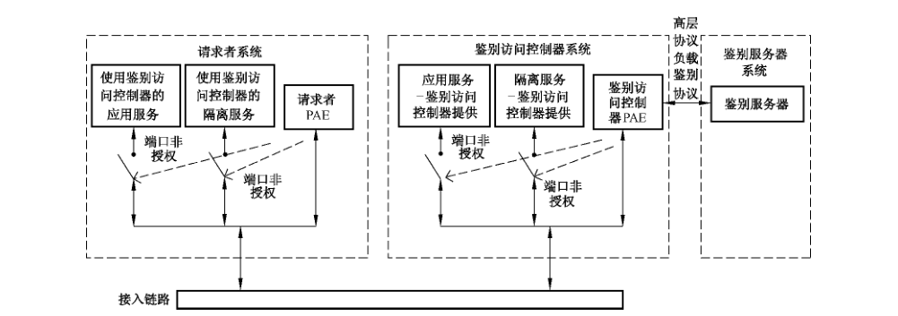

TCA 的 AR、AC 和PM分别对应图30中请求者系统、鉴别访问控制器系统和鉴别服务器系统。

在图30中，请求者系统和鉴别访问控制器系统的左边受控端口为应用服务受控端口，而右边受控端口为隔离服务受控端口。非受控端口只能传输 TAEP 数据包，应用服务受控端口能传输应用服务数据包，而隔离服务受控端口能传输隔离服务数据包。

当受控端口为强制授权时，请求者系统和鉴别访问控制器系统的应用服务受控端口无条件设置力授权，而请求者系统和鉴别访问控制器系统的隔离服务受控端口无条件设置为非授权。

当受控端口为强制非授权时，请求者系统和鉴别访问控制器系统的应用服务受控端口和隔离服务受控端口无条件设置內非授权。

当受控端口自动时，则请求者系统和鉴别访问控制器系统的应用服务受控端口和隔离服务受控端口根据请求者、鉴别访问控制器和鉴别服务器之间的鉴别结果来设置。请求者、鉴别访问控制器和鉴别服务器首先执行用户身份鉴别协议，用户身份鉴别完成后若要求立即做出访问决策，则请求者和鉴别访问控制器依据所做出的访问决策设置应用服务受控端口，即访问决策为允许时设置为授权，访问决策为禁止时不设置并断开链接；否则执行平台鉴别协议，平台鉴别完成后，若访问决策为允许，则请求者和鉴别访问控制器设置应用服务受控端口为授权，若访问决策为隔离，则请求者和鉴别访问控制器设置隔离服务受控端口为授权，若访问决策为禁止时不设置并断开链接。平台修补完成后，请求者和鉴别访问控制器的隔离服务受控端口设置为非授权，然后请求者、鉴别访问控制器和鉴别访问控制器重新执行平台鉴别。访问请求者中的应用服务受控端口和隔离服务受控端口处于互斥状态，即仅一个受控端口处于授权状态。访问控制器中的应用服务受控端口和隔离服务受控端口处于互斥状态，即仅一个受控端口处于授权状态。

#### 6.3.2 部分端口控制实现方式

部分端口控制实现方式是指采用端口控制来实现允许和禁止，而采用其他应用层技术（见 5.7.3）来实现隔离，其端口控制系统结构见 GB/T 28455—2012。

在 GB/T 28455—2012中，非受控端口传输 TAEP数据包，受控端口传输应用服务数据包。

## 7 可信平台评估层

### 7.1 概述

在一次可信网络连接过程中，可信平台评估层的 TNCC、TNCAP 和 EPS执行一个或多个平台鉴别过程来实现 AR 和 AC 之间的平台鉴别，其中每个平台鉴别过程包含一轮或多轮平台鉴别协议，EPS在平台鉴别协议中充当可信第三方。

可信平台评估层的平台鉴别实现见7.2定义的PAI，相应的平台鉴别协议为PAI 协议（见7.2.2）。

### 7.2 平台鉴别基础设施

PAI 包含以下部分：—PAI 管理；

-PAI 协议。

#### 7.2.1 PAI 管理

##### 7.2.1.1 网络连接管理

TNCC 和 TNCAP 参与网络连接管理，而 EPS不参与网络连接管理。

在一次可信网络连接过程的首个平台鉴别过程中，当 TNCAP 收到 NAC发送的平台鉴别请求（表示 NAC 在完成用户身份鉴别后不立即生成访问决策）时，TNCAP 本地创建一个网络连接标识，记为connectionID，它长度4个八位位组的整型数据。

在一次可信网络连接过程的首个平台鉴别过程中，当TNCC收到 NAR发送的平台鉴别请求（表示NAR 在完成用户身份鉴别后不立即生成访问决策）且收到TNCAP发送的首个平台鉴别过程中的首轮PAI 协议的消息1时，TNCC 本地创建一个 connectionlD，它长度4个八位位组的整型数据。

TNCC 和 TNCAP 本地创建的 connectionID 将持续至 AR 和 AC 断开网络连接。若AR和AC断开网络连接，则 TNCC 和 TNCAP 分别删除本地创建的 connectionID。

##### 7.2.1.2 平台鉴别过程管理

一次可信网络连接过程包含一个或多个平台鉴别过程，其中平台鉴别过程按平台鉴别需求可分以下3种平台鉴别过程：双向平台鉴别过程、对AR 的单向平台鉴别过程和对AC 的单向平台鉴别过程。在一个平台鉴别过程中，TNCAP生成的AC 的访问决策或 TNCC生成的AR的访问决策的值为允许、隔离或禁止。

一次可信网络连接过程中的平台鉴别过程管理如下：步骤1）当TNCAP 收到 NAC发送的平台鉴别请求时，TNCAP 执行如下步骤：步骤1.1）若 TNCC、TNCAP 和 EPS需要执行一个双向平台鉴别过程，则执行步骤2）；

步骤1.2）若 TNCC、TNCAP 和 EPS需要执行一个对 AR 的单向平台鉴别过程，则执行步骤 3）；

步骤1.3）若 TNCC、TNCAP 和 EPS需要执行一个对 AC 的单向平台鉴别过程，则执行步骤4）。

步骤2）当本平台鉴别过程完成时，若TNCAP生成的AC 的访问决策允许且 TNCC 生成的 AR的访问决策为允许，则表示可信网络连接成功；若TNCAP生成的AC 的访问决策允许且 TNCC 生成的AR的访问决策为隔离，则TNCC、TNCAP 和 EPS在AC 的平台修补完成后跳至步骤1.3）执行一个对AC 的单向平台鉴别过程；若TNCAP生成的AC 的访问决策为隔离且 TNCC生成的AR 的访问决策为允许，则 TNCC、TNCAP和 EPS在AR 的平台修补完成后跳至步骤1.2）执行一个对AR的单向平台鉴别过程；若TNCAP生成的AC的访问决策为隔离且TNCC生成的AR的访问决策为隔离，则TNCC、TNCAP 和EPS在AR的平台修补及 AC 的平台修补完成后跳至步骤1.1）执行一个双向平台鉴别过程；若TNCAP生成的AC 的访问决策为禁止，则 TNCAP通知 NAC断开与 AR的连接，而TNCC收到 AC 的访问决策后通知 NAR 断开与 AC 的连接；若TNCC生成的AR 的访问决策禁止，则 TNCC通知 NAR 断开与AC的连接，而TNCAP 收到AR的访问决策后通知 NAC 断开与 AR的连接。

步骤3）当本平台鉴别过程完成时，若TNCAP生成的AC 的访问决策为允许，则表示可信网络连接成功；若 TNCAP生成的AC的访问决策为隔离，则 TNCC、TNCAP 和 EPS在AR 的平台修补完成后跳至步骤1.2）执行一个对 AR的单向平台鉴别过程；若 TNCAP生成的AC的访问决策禁止，则TNCAP通知 NAC断开与 AR的连接，而TNCC收到AC的访问决策后通知 NAR断开与 AC 的连接。

步骤4）当本平台鉴别过程完成时，若TNCC生成的AR 的访问决策为允许，则表示可信网络连接成功；若TNCC生成的AR 的访问决策为隔离，则TNCC、TNCAP 和EPS在AC 的平台修补完成后跳至步骤1.3）执行一个对AC 的单向平台鉴别过程；若 TNCC 生成的AR 的访问决策为禁止，则 TNCC通知 NAR 断开与 AC的连接，而TNCAP 收到 AR 的访问决策后通知 NAC断开与AR的连接。

##### 7.2.1.3 PAI 协议管理

###### 7.2.1.3.1 PAI 协议基本流程

PAI 协议是由 TNCAP发起的，其基本流程如图31 所示。

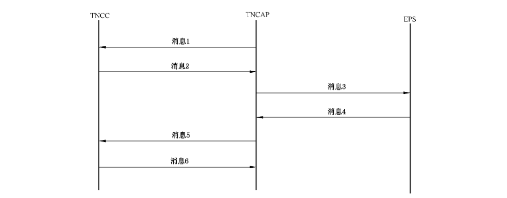

在图31 中，当TNCC 生成 AR 的访问决策时才会向 TNCAP 发送消息6。

###### 7.2.1.3.2 PAI 协议与平台鉴别过程的关系

一个平台鉴别过程包含一轮或多轮 PAI协议。在一次可信网络连接过程中，平台鉴别过程按执行顺序可分为以下2种平台鉴别过程：首个平台鉴别过程和非首个平台鉴别过程，其中首个平台鉴别过程可以为双向平台鉴别过程、对AR 的单向平台鉴别过程或对AC的单向平台鉴别过程，非首个平台鉴别过程也可以为双向平台鉴别过程、对AR的单向平台鉴别过程或对 AC的单向平台鉴别过程。

在一个平台鉴别过程中，PAI 协议按执行顺序可分为以下2种 PAI 协议：首轮 PAI 协议和非首轮PAI 协议。在一个双向平台鉴别过程中，首轮 PAI 协议必然为一轮双向 PAI 协议，而非首轮 PAI 协议可以为双向PAI协议、对AR的单向 PAI 协议或对AC的单PAI 协议。在一个对 AR 的单向平台鉴别过程中，首轮 PAI 协议和非首轮PAI协议都为一轮对 AR 的单向PAI协议。在一个对AC的单向平台鉴别过程中，首轮 PAI 协议和非首轮 PAI 协议都为一轮对AC 的单向 PAI协议。

###### 7.2.1.3.3 双向平台鉴别过程中的PAI协议管理

双向平台鉴别过程中的 PAI 协议管理如下：步骤 1）TNCC、TNCAP 和 EPS执行一轮双向 PAI 协议，若TNCAP 在本轮 PAI 协议中生成 AC的访问决策，则执行步骤1.1）；否则步骤1.2）。

步骤1.1）若 AC 的访问决策为禁止，则 TNCAP 向 TNCC 发送本轮 PAI 协议的消息5后通知NAC 断开与 AR 的连接，其中本轮 PAI 协议的消息5包含AC 的访问决策；TNCC 收到本轮 PAI 协议的消息5后通知 NAR 断开与 AC 的连接。若AC 的访问决策不为禁止，则 TNCAP 向 TNCC发送本轮 PAI 协议的消息 5;TNCC收到本轮 PAI 协议的消息5后，若TNCC生成AR的访问决策，则执行步骤 1.1.1）；否则执行步骤 1.1.2）。

步骤1.1.1）若AR的访问决策为禁止，则 TNCC向 TNCAP发送本轮 PAI 协议的消息6后通知NAR 断开与 AC的连接，其中本轮 PAI 协议的消息6包含AR 的访问决策；TNCAP 收到本轮 PAI 协议的消息6后通知 NAC断开与 AR的连接。若AR 的访问决策不为禁止，则 TNCC 向 TNCAP发送本轮 PAI协议的消息6;TNCAP 收到本轮 PAI协议的消息6后，本双向平台鉴别过程成功完成。

步骤1.1.2）TNCC、TNCAP 和EPS执行一轮对AC 的单向PAI 协议，若TNCC在本轮 PAI 协议中生成AR 的访问决策，则执行步骤1.1.2.1）；否则执行步骤1.1.2.2）。

步骤1.1.2.1）若AR的访问决策为禁止，则TNCC向 TNCAP 发送本轮PAI 协议的消息6后通知NAR断开与AC的连接，其中本轮 PAI 协议的消息6包含AR 的访问决策；TNCAP 收到本轮 PAI 协议的消息6后通知NAC断开与 AR的连接。若AR 的访问决策不为禁止，则 TNCC向 TNCAP发送本轮 PAI 协议的消息 6;TNCAP 收到本轮 PAI 协议的消息6后，本双向平台鉴别过程成功完成。

步骤1.1.2.2）TNCC、TNCAP 和 EPS 跳至步骤1.1.2）执行一轮对 AC 的单向 PAI协议。

步骤1.2）TNCAP 向TNCC 发送本轮 PAI 协议的消息5，其中本轮 PAI 协议的消息5中不包含AC 的访问决策；TNCC 收到本轮 PAI 协议的消息5后，若TNCC 生成 AR 的访问决策，则执行步骤1.2.1）；否则执行步骤 1.2.2）。

步骤1.2.1）若AR 的访问决策为禁止，则TNCC 向TNCAP 发送本轮 PAI 协议的消息6后通知NAR 断开与 AC 的连接，其中本轮 PAI 协议的消息6包含AR 的访问决策；TNCAP 收到本轮 PAI 协议的消息6后通知 NAC断开与 AR的连接。若AR 的访问决策不为禁止，则执行步骤1.2. 1.1）。

步骤1.2.1.1）TNCC、TNCAP 和 EPS执行一轮对 AR 的单向 PAI 协议，若TNCAP 在本轮 PAI协议中生成AC的访问决策，则执行步骤1.2.1.1.1）；否则执行步骤1.2.1.1.2）。

步骤1.2.1.1.1）若AC的访问决策为禁止，则TNCAP向TNCC发送本轮PAI 协议的消息5后通知 NAC断开与AR的连接，其中本轮 PAI 协议的消息5包含AC的访问决策；TNCC 收到本轮 PAI 协议的消息5后通知 NAR断开与 AC 的连接。若AC 的访问决策不为禁止，则本双向平台鉴别过程成功完成。

步骤1.2.1.1.2）TNCC、TNCAP 和EPS跳至步骤1.2.1.1）执行一轮对 AR的单向 PAI 协议。

步骤 1.2.2）TNCC、TNCAP 和 EPS 跳至步骤1）执行一轮双向 PAI 协议。

###### 7.2.1.3.4 对AR 的单向平台鉴别过程中的PAI 协议管理

对 AR 的单向平台鉴别过程中的PAI 协议管理如下：步骤1）TNCC、TNCAP 和EPS执行一轮对 AR 的单向 PAI 协议，若TNCAP 在本轮 PAI 协议中生成 AC 的访问决策，则执行步骤1.1）；否则执行步骤1.2）。

步骤1.1）若AC 的访问决策为禁止，则TNCAP 向 TNCC 发送本轮 PAI 协议的消息5后通知NAC 断开与 AR 的连接，其中本轮 PAI 协议的消息5包含 AC 的访问决策；TNCC收到本轮 PAI 协议的消息5后通知 NAR断开与 AC的连接。若AC 的访问决策不为禁止，则本对 AR的单向平台鉴别过程成功完成。

步骤1.2）TNCC、TNCAP 和 EPS 跳至步骤1）执行一轮对 AR 的单向PAI协议。

###### 7.2.1.3.5 对AC的单向平台鉴别过程中的PAI 协议管理

对AC 的单向平台鉴别过程中的PAI 协议管理如下：步骤1）TNCC、TNCAP 和 EPS执行一轮对 AC 的单向 PAI协议，若 TNCC在本轮 PAI 协议中生成 AR的访问决策，则执行步骤1.1）；否则执行步骤1.2）。

步骤1.1）若AR的访问决策为禁止，则TNCC 向TNCAP 发送本轮 PAI 协议的消息6后通知NAR断开与 AC 的连接，其中本轮 PAI 协议的消息6包含 AR 的访问决策；TNCAP 收到本轮 PAI 协议的消息6后通知 NAC断开与 AR的连接。若 AR 的访问决策不为禁止，则本对AC的单向平台鉴别过程成功完成。

步骤1.2）TNCC、TNCAP 和EPS跳至步骤1）执行一轮对 AR的单向PAI 协议。

#### 7.2.2 PAI 协议

##### 7.2.2.1 PAI 协议分组格式

PAI 协议分组格式如图32所示。

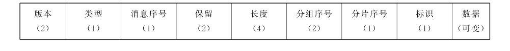

其中：-版本字段长度为2个八位位组，表示 PAI 的版本号。当前版本为1。

类型字段长度为1个八位位组，表示 PAI 协议类型，其值如下：1 PAI-1 协议；

2 PAI-2 协议；

其他值保留。

消息序号字段长度为1个八位位组，其值如下：1 消息1；

2 消息2；

3 消息3；

4 消息4；

5 消息5；

6 消息6；

其他值保留。

保留字段长度为2个八位位组，默认值为0。

长度字段长度为4个八位位组，其值 PAI 协议分组所有字段的八位位组数。

分组序号字段为2个八位位组，表示 PAI 协议分组序号。第一个分组序号1，后序分组依次按1递增。

分片序号字段为1个八位位组，表示分片的顺序编号。每一个分组的第一个分片序号为0，后序分片依次按1递增。

标识字段长度为1个八位位组，比特0表示后续是否有分片，值为。表示没有，值1表示有。

比特1至比特7保留。

数据字段长度为可变，其内容根据版本、类型和消息序号的值而定，它可以包含固定内容，还可以包含属性内容。

###### 7.2.2.1.1 PAI 协议分组数据字段的固定内容

a） 标识 FLAG长度为2个八位位组。格式如图33所示。

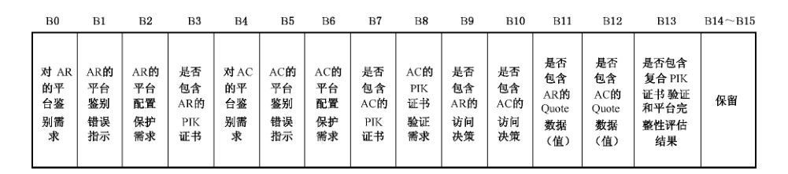

其中：对AR 的平台鉴别需求比特：1 表示 TNCAP 需要对 AR 进行平台鉴别；0表示 TNCAP 不需要对 AR 进行平台鉴别。

AR 的平台鉴别错误指示比特：1 表示 AR的平台鉴别错误指示存在；0表示AR的平台鉴别错误指示不存在。

AR 的平台配置保护需求比特：1表示 TNCC 需要对 AR 的平台配置进行保护；0表示 TNCC不需要对 AR的平台配置进行保护。

是否包含AR的PIK 证书比特：1表示包含 AR的PIK 证书；0表示不包含AR的PIK证书。

对 AC 的平台鉴别需求比特：1表示 TNCC 需要对AC 进行平台鉴别；0表示 TNCC 不需要对AC进行平台鉴别。

AC 的平台鉴别错误指示比特：1表示 AC 的平台鉴别错误指示存在；0表示AC 的平台鉴别错误指示不存在。

AC的平台配置保护需求比特：1表示 TNCAP 需要对 AC 的平台配置进行保护；0表示TNCAP 不需要对AC的平台配置进行保护。

是否包含AC 的PIK 证书比特：1表示包含AC的PIK 证书；0表示不包含AC的PIK证书。

AC 的PIK 证书验证需求比特：1表示需要验证 AC的PIK 证书有效性；0表示不需要验证 AC的 PIK 证书有效性。

是否包含 AR的访问决策比特：1表示包含AR 的访问决策；0表示不包含AR 的访问决策。

是否包含 AC 的访问决策比特：1表示包含 AC 的访问决策；0表示不包含 AC 的访问决策。

是否包含 AR 的 Quote 数据（值）比特：1表示包含 AR 的 Quote 数据值或AR 的 Quote 数据；

0 表示不包含 AR 的 Quote 数据值或 AR 的Quote 数据。

是否包含 AC的 Quote 数据（值）比特：1表示包含 AC 的 Quote 数据值或AC的 Quote 数据；0表示不包含 AC 的 Quote 数据值或 AC 的 Quote 数据。

是否包含复合 PIK 证书验证和平台完整性评估结果比特：1表示包含复合 PIK 证书验证和平台完整性评估结果；0表示不包含复合 PIK 证书验证和平台完整性评估结果。

b） 一次性随机数长度为32个八位位组。

c） 组件类型级平台完整性度量请求参数条目组件类型级平台完整性度量请求参数条目如图34所示。

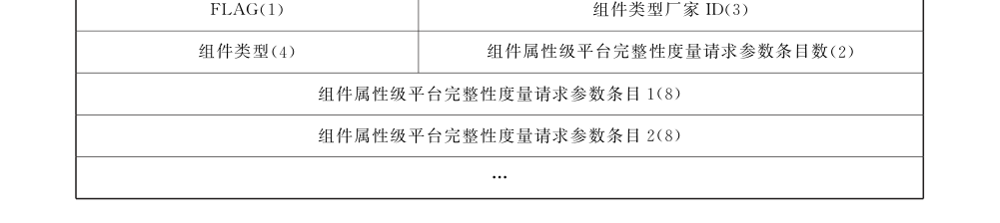

其中：-—FLAG 字段长度1个八位位组，比特。有意义。若比特。的值为0，则该组件类型级平台完整性度量请求参数条目可跳过。若比特。的值为1，则该组件类型级平台完整性度量请求参数条目不可跳过。

组件类型厂家 ID字段长度为3个八位位组，其定义见 8.2.2。

组件类型字段长度为4个八位位组，其定义见 8.2.2。

组件属性级平台完整性度量请求参数条目数字段长度为2个八位位组，其值为组件属性级平台完整性度量请求参数条目数的个数。

组件属性级平台完整性度量请求参数条目1、组件属性级平台完整性度量请求参数条日2.…为本条中d）定义的组件属性级平台完整性度量请求参数条目。

d） 组件属性级平台完整性度量请求参数条目组件属性级平台完整性度量请求参数条目如图35所示。

其中：保留字段长度为1个八位位组，其值默认为0。

组件属性类型厂家ID 字段长度为3个八位位组，其值如下：0 表示该组件属性类型是本标准定义的；

其他值保留。

组件属性类型字段长度为4个八位位组，其值如下：1 产品信息；

2 数字版本；

3 字符串版本；

4 操作状态；

5 完整性信息；

其他值保留。

e） 组件类型级平台完整性评估策略条目组件类型级平台完整性评估策略条目如图36所示。

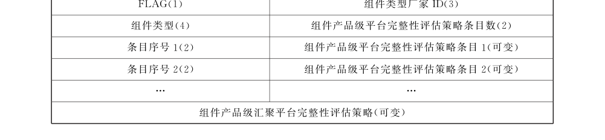

其中：—FLAG字段长度为1个八位位组，比特。有意义。若比特。的值为0，则组件产品级汇聚平台完整性评估策略字段不存在。若比特。的值为1，则组件产品级汇聚平台完整性评估策略字段存在。当组件产品级平台完整性评估策略条目数字段的值为1时，组件产品级汇聚平台完整性评估策略字段不存在。

组件类型厂家 ID 字段长度为3个八位位组，其定义如前。

组件类型字段长度4个八位位组，其定义如前。

组件产品级平台完整性评估策略条目数字段长度2个八位位组，其值为组件产品级平台完整性评估策略条目数的个数。

条目序号1、条目序号2、⋯分别对应各自后续字段中的组件产品级平台完整性评估策略条目1、组件产品级平台完整性评估策略条目2、⋯，其值为2个八位位组的整型数据。

组件产品级平台完整性评估策略条目1、组件产品级平台完整性评估策略条目2、⋯为本节中

f）定义的组件产品级平台完整性评估策略条目。

组件产品级汇聚平台完整性评估策略字段长度为可变，其格式为 7.2.2.1.2中j）定义的汇聚平台完整性评估策略。当组件产品级汇聚平台完整性评估策略字段中的汇聚平台完整性评估策略类型字段的值为1时，组件产品级汇聚平台完整性评估策略字段中的汇聚平台完整性评估策略值字段的值为条目序号1、条目序号2、⋯的或与表达式。

f） 组件产品级平台完整性评估策略条目组件产品级平台完整性评估策略条目如图37所示。

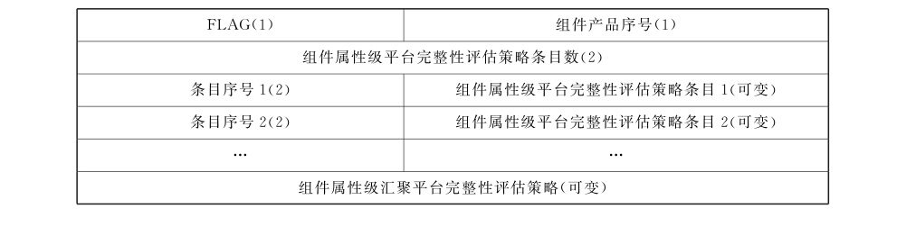

其中：—FLAG 字段长度为1个八位位组，比特。有意义。若比特0的值为0，则组件属性级汇聚平台完整性评估策略字段不存在。若比特。的值为1，则组件属性级汇聚平台完整性评估策略字段存在。当组件属性级平台完整性评估策略条目数字段的值为1时，组件属性级汇聚平台完整性评估策略字段不存在。

组件产品序号字段长度为1个八位位组，其值1、2、⋯，依次递增。当组件产品序号字段的值为0xff时，表示该组件产品级平台完整性评估策略条目不限定于某个组件产品，这时组件属性级平台完整性评估策略条目数字段的值为1。

组件属性级平台完整性评估策略条目数字段长度2个八位位组，其值为组件属性级平台完整性评估策略条目数的个数。

条目序号1、条目序号2、⋯分别对应各自后续字段中的组件属性级平台完整性评估策略条目1.组件属性级平台完整性评估策略条目2、⋯，其值2个八位位组的整型数据。

组件属性级平台完整性评估策略条目1、组件属性级平台完整性评估策略条目2、⋯为本节中

g）定义的组件属性级平台完整性评估策略条目。

组件属性级汇聚平台完整性评估策略字段长度为可变，其格式为 7.2.2.1.2中j）定义的汇聚平台完整性评估策略。当组件属性级汇聚平台完整性评估策略字段中的汇聚平台完整性评估策略属性字段的值为1时，组件属性级汇聚平台完整性评估策略字段中的汇聚平台完整性评估策略值字段的值为条目序号1、条目序号2、⋯的或与表达式。

gq） 组件属性级平台完整性评估策略条目组件属性级平台完整性评估策略条目如图 38所示。

其中：-保留字段长度为1个八位位组，其值默认为0。

组件属性类型厂家ID 字段长度为3个八位位组，其定义如前。

组件属性类型字段长度为4个八位位组，其定义如前。

组件属性级平台完整性评估策略字段长度为可变，其定义不在本标准中规定。

h） 组件类型级平台完整性度量值条目组件类型级平台完整性度量值条目如图39所示。

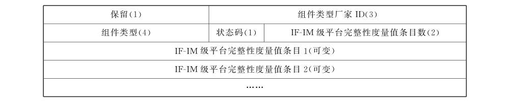

其中：-保留字段长度为1个八位位组，其值默认为0。

组件类型厂家 ID 字段长度为3个八位位组，其定义如前。

组件类型字段长度为4个八位位组，其定义如前。

状态码字段长度为1个八位位组，其值如下：1 支持；

2 不支持；

其他值保留。

若状态码字段的值为2，则状态码字段的后续字段不存在。

IF-IM 级平台完整性度量值条目数字段长度为2个八位位组，其值为IF-IM 级平台完整性度量值条目数的个数。

IF-IM级平台完整性度量值条目1、IF-IM级平台完整性度量值条目2、…为本节中i）定义的IF-IM 级平台完整性度量值条目。

i） IF-IM级平台完整性度量值条目IF-IM 级平台完整性度量值条目如图40所示。

其中：-IMC 标识字段长度为2个八位位组，其定义见 9.2.2.1.1。

IF-IM消息字段长度为可变，其定义见8.2。这里，IF-IM消息用于封装平台完整性度量值。

当IF-IM级平台完整性度量值条目用于 PAI-1 协议时，IF-IM 消息中包含完整性报告的IF- IM 属性。当IF-IM级平台完整性度量值条目用于PAI-2 协议时，IF-IM 消息中包含完整性报告索引信息的IF-IM 属性。

j） 组件类型级 Quote 数据值条目组件类型级 Quote 数据值条目如图41所示。

其中：保留字段长度为1个八位位组，其值默认为0。

组件类型厂家ID字段长度为3个八位位组，其定义如前。

组件类型字段长度为4个八位位组，其定义如前。

IF-IM 级 Quote 数据值条目数字段长度为2个八位位组，其值为 IF-IM 级 Quote 数据值条目数的个数。

IF-IM 级 Quote 数据值条目1、IF-IM 级 Quote 数据值条目2、…为本节中k）定义的IF-IM级Quote 数据值条目。

k） IF-IM级 Quote 数据值条目IF-IM 级 Quote 数据值条目如图42所示。

其中：-IMC 标识字段长度为2个八位位组，其定义见 9.2.2.1.1。

Quote 数据字段长度可变，其定义不在本标准中规定。

l 组件类型级平台配置保护策略条目组件类型级平台配置保护策略条目如图43所示。

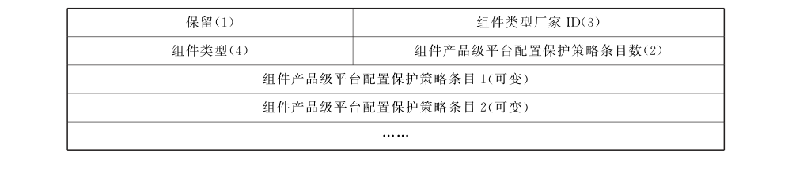

其中：-保留字段长度为1个八位位组，其值默认为0。

组件类型厂家 ID字段长度为3个八位位组，其定义如前。

组件类型字段长度4个八位位组，其定义如前。

组件产品级平台配置保护策略条目数字段长度为2个八位位组，其值为组件产品级平台配置保护策略条目数的个数。

组件产品级平台配置保护策略条目1、组件产品级平台配置保护策略条目2、…为本节中m）定义的组件产品级平台配置保护策略条目。

m） 组件产品级平台配置保护策略条目组件产品级平台配置保护策略条目如图44所示。

其中：——保留字段长度为1个八位位组，其值默认为0。

-组件产品序号字段长度为1个八位位组，其值1、2、⋯，依次递增。当组件产品序号字段的值为0xff时，表示该组件产品级平台配置保护策略条目不限定于某个组件产品。

组件属性级平台配置保护策略条目数字段长度为2个八位位组，其值为组件属性级平台配置保护策略条目数的个数。

组件属性级平台配置保护策略条目 1、组件属性级平台配置保护策略条目2、…为本节中n）定义的组件属性级平台配置保护策略条目。

n） 组件属性级平台配置保护策略条目组件属性级平台配置保护策略条目如图45所示。

其中：-保留字段长度为1个八位位组，值默认为0。

-组件属性类型厂家 ID 字段长度为3个八位位组，其定义如前。

组件属性类型字段长度为4个八位位组，其定义如前。

组件属性级平台配置保护策略字段长度为可变，其定义不在本标准中规定。

o） 组件类型级平台修补信息条目组件类型级平台修补信息条目如图 46所示。

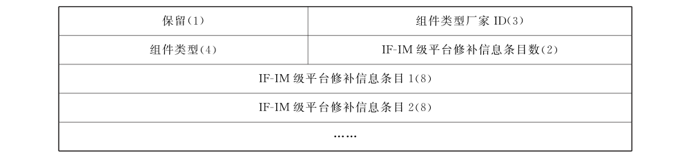

其中：保留字段长度为1个八位位组，其值默认0。

组件类型厂家 ID字段长度为3个八位位组，其定义如前。

组件类型字段长度为4个八位位组，其定义如前。

IF-IM 级平台修补信息条目数字段长度为2个八位位组，其值IF-IM 级平台修补信息条目数的个数。

IF-IM级平台修补信息条目1、IF-IM级平台修补信息条目2、…为本节中p）定义的IF-IM级平台修补信息条目。

p）IF-IM级平台修补信息条目IF-IM 级平台修补信息条目如图 47所示。

其中：——IMC 标识字段长度为2个八位位组，其定义如前。

IF-IM 消息字段长度为可变，其定义如前。这里，IF-IM 消息用于封装平台修补信息。

q 组件类型级错误原因信息条目组件类型级错误原因信息条目如图48所示。

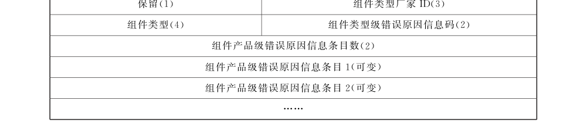

其中：保留字段长度1 个八位位组，其值默认为0。

组件类型厂家 ID字段长度为3个八位位组，其定义如前。

组件类型字段长度为4个八位位组，其定义如前。

组件类型级错误原因信息码字段长度为2个八位位组，其值如下：1 各个 IMVs不支持该消息类型（组件类型厂家 ID 及组件类型）；

2 各个 IMCs 不支持该消息类型（组件类型厂家 ID 及组件类型）；

3 生成各个组件产品级错误原因信息条目；

其他值保留。

当组件类型级错误原因信息码字段的值为3时，组件类型级错误原因信息码字段的后续字段才存在。

组件产品级错误原因信息条目数字段长度为2个八位位组，其值为组件产品级错误原因信息条目数的个数。

组件产品级错误原因信息条目1、组件产品级错误原因信息条目2、…为本节中r）定义的组件产品级错误原因信息条目。

r） 组件产品级错误原因信息条目组件产品级错误原因信息条目如图49所示。

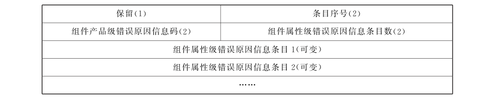

其中：一保留字段长度为1个八位位组，其值默认为0。

条目序号字段长度为2个八位位组，其值为相应组件产品级平台完整性评估策略条目对应的条目序号。

组件产品级错误原因信息码字段长度为2个八位位组，其值如下：1 IMV 不支持该组件产品级平台完整性评估策略条目所对应的组件产品序号及组件产品；

2 IMV 不支持该组件产品级平台完整性评估策略条目所对应的组件产品序号、组件属性类型厂家 ID 及组件属性类型；

3 IMC 不支持该组件产品级平台完整性评估策略条目所对应的组件产品；

4 IMC 不支持该组件产品级平台完整性评估策略条目所对应的组件属性类型厂家 ID 及组件属性类型；

5 生成各个组件属性级错误原因信息条目；

其他值保留。

当组件产品级错误原因信息码字段的值为5时，组件产品级错误原因信息码字段的后续字段才存在。

-组件属性级错误原因信息条目数字段长度为2个八位位组，其值为组件属性级错误原因信息条目数的个数。

一组件属性级错误原因信息条目1、组件属性级错误原因信息条目2、…为本节中s）定义的组件属性级错误原因信息条目。

s） 组件属性级错误原因信息条目组件属性级错误原因信息条目如图 50所示。

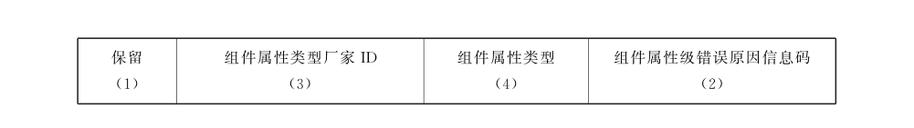

其中：保留字段长度为1个八位位组，值默认 0。

组件属性类型厂家ID 字段长度为3个八位位组，其定义如前。

组件属性类型字段长度为4个八位位组，其定义如前。

组件属性级错误原因信息码字段长度为2个八位位组，其值如下：1 组件属性级平台完整性评估策略和组件属性级平台配置保护策略冲突；

2 IMV 不支持该组件属性类型厂家ID 及组件属性类型；

3 IMC 不支持该组件属性类型厂寮ID 及组件属性类型；

4 该组件属性类型厂家 ID 及组件属性类型对应的组件属性修补失败；

其他值保留。

###### 7.2.2.1.2 PAI 协议分组数据字段的属性内容

属性采用类型-长度-值（TLV）的格式构成，格式如图51所示。

其中：-类型字段长度为1个八位位组，其值如下：1 签名属性；

2 平台完整性度量请求参数；

3 平台完整性评估策略；

4 平台完整性度量值；

5 Quote 数据值；

6 平台配置保护策略；

7 PIK 证书验证和平台完整性评估结果；

8 平台修补信息；

9 错误原因信息；

10 汇聚平台完整性评估策略；

其他值保留。

长度字段长度为4个八位位组，其值是值字段的八位位组数。

值字段长度为可变，表示属性的内容。

a） 签名属性签名属性如图 52所示。

其中身份 PM 的用户身份证书的身份，或者为 PIK 证书的身份。

签名算法包含长度和内容两个子字段。其长度字段为2个八位位组，表示内容字段的八位位组数。

内容字段由1个八位位组的杂凑算法标识、1个八位位组的签名算法标识和参数字段组成：杂凑算法标识定义如下：1 表示 SHA-256 杂凑算法；

其他值保留。

签名算法标识定义如下：1 表示 ECDSA-192；

2 表示 ECDSA-256；

其他值保留。

参数字段表示签名算法的参数，由参数标识、参数长度和参数内容组成。参数标识字段长度1个八位位组；参数长度字段为2个八位位组，表示参数内容字段的八位位组数；当签名算法标识字段值1时，参数字段的值定义如下：• 参数标识为1时，标识参数以 OID方式表示，参数长度字段表示 OID 标识的八位位组数，参数内容为 OID编码，本标准采用的 ECC 参数的 OID 为 1.2.156. 11235.1.1.2.1,O1D编码采用 ASN.1/DER。

• 参数标识其他值保留。

——签名值字段包含长度和内容，长度子字段为2个八位位组，表示内容子字段的八位位组数。内容子字段为签名的值。

b） 平台完整性度量请求参数平台完整性度量请求参数如图53所示。

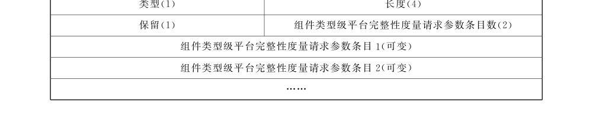

其中：—保留字段长度为1个八位位组，其值默认为0。

组件类型级平台完整性度量请求参数条目数字段长度为2个八位位组，其值为组件类型级平台完整性度量请求参数条目的个数。

组件类型级平台完整性度量请求参数条目1、组件类型级平台完整性度量请求参数条目2.：为7.2.2.1.1中c）定义的组件类型级平台完整性度量请求参数条目。

c） 平台完整性评估策略平台完整性评估策略如图54所示。

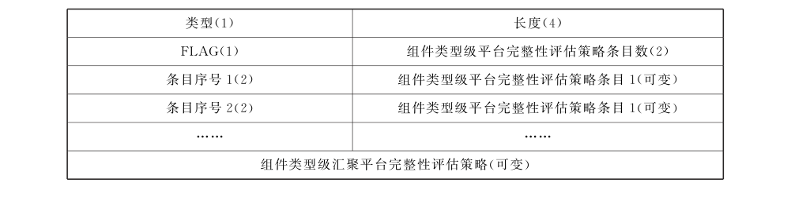

其中：FL.AG 字段长度1个八位位组，比特0有意义。若比特。的值为0，则组件类型级汇聚平台完整性评估策略字段不存在。若比特。的值为1，则组件类型级汇聚平台完整性评估策略字段存在。当组件类型级平台完整性评估策略条目数字段的值为1时，组件类型级汇聚平台完整性评估策略字段不存在。

组件类型级平台完整性评估策略条目数字段长度为2个八位位组，其值为组件类型级平台完整性评估策略条目的个数。

条目序号1、条目序号2、⋯分别对应各自后续字段中的组件类型级平台完整性评估策略条目1、组件类型级平台完整性评估策略条目2、⋯，其值为2个八位位组的整型数据。

组件类型级平台完整性评估策略条目1、组件类型级平台完整性评估策略条目2、⋯为7.2.2.1.1中e）定义的组件类型级平台完整性评估策略条目。

组件类型级汇聚平台完整性评估策略字段长度为可变，其格式为7.2.2.1.2中j）定义的汇聚平台完整性评估策略。当组件类型级汇聚平台完整性评估策略字段中的汇聚平台完整性评估策略类型字段的值为1时，组件类型级汇聚平台完整性评估策略字段中的汇聚平台完整性评估策略值字段的值为条目序号1、条目序号2、⋯的或与表达式。

平台完整性评估策略可以被分割为多个部分，其中每一个分割部分的格式与平台完整性评估策略的格式定义相同。平台完整性评估策略的分割方法如下：首先选取组件类型级汇聚平台完整性评估策略字段中的汇聚平台完整性评估策略值字段中的一个或多个或表达式，若所选取部分中不包含其他部分中的任意条目序号，则依据所选取部分和所选取部分中各个条目序号所对应的组件类型级平台完整性评估策略条目构成平台完整性评估策略的一个分割部分，然后依此方法继续分割直至选取完组件类型级汇聚平台完整性评估策略字段中的汇聚平台完整性评估策略值字段中的所有或表达式。平台完整性评估策略的一个分割部分中的条目序号及对应组件类型级平台完整性评估策略条目不包含在其他分割部分中。

d） 平台完整性度量值平台完整性度量值如图 55所示。

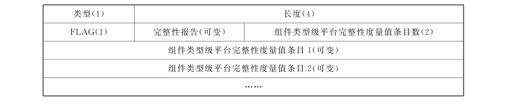

其中：—FLAG 字段长度为1个八位位组，比特。有意义。若比特0的值为1，则完整性报告字段存在；否则不存在。对于 PAI-1 协议，比特。的值设置为O。对于 PA1-2协议，比特。的值设置为1。

组件类型级平台完整性度量值条目数字段长度2个八位位组，其值为组件类型级平台完整性度量值条目的个数。

组件类型级平台完整性度量值条目1、组件类型级平台完整性度量值条目2、⋯为7.2.2.1.1中h）定义的组件类型级平台完整性度量值条目。

e） Quote 数据值Quote 数据值如图 56 所示。

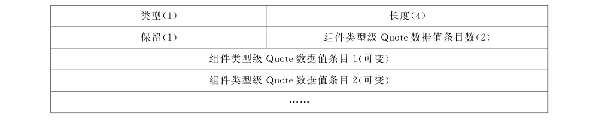

其中：保留字段长度为1个八位位组，其值默认为0。

-组件类型级 Quote 数据值条目数字段长度为2个八位位组，其值为组件类型级 Quote 数据值条目的个数。

组件类型级 Quote 数据值条目1、组件类型级 Quote 数据值条目2、⋯为7.2.2.1.1中j）定义的组件类型级 Quote 数据值条目。

f） 平台配置保护策略平台配置保护策略如图 57所示。

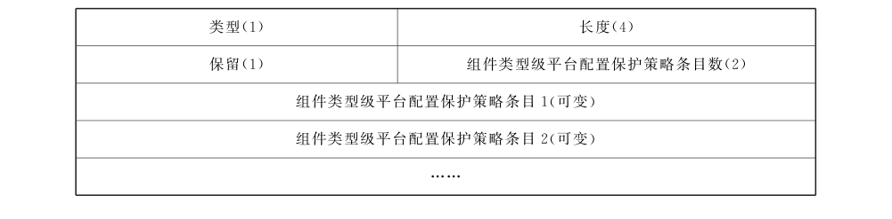

其中：——保留字段长度为1个八位位组，其值默认为0。

组件类型级平台配置保护策略条目数字段长度为2个八位位组，其值为组件类型级平台配置保护策略条目的个数。

组件类型级平台配置保护策略条目1、组件类型级平台配置保护策略条目2、⋯为7.2.2.1.1中1定义的组件类型级平台配置保护策略条目。

g） PIK 证书验证和平台完整性评估结果PIK 证书验证和平台完整性评估结果如图 58所示。

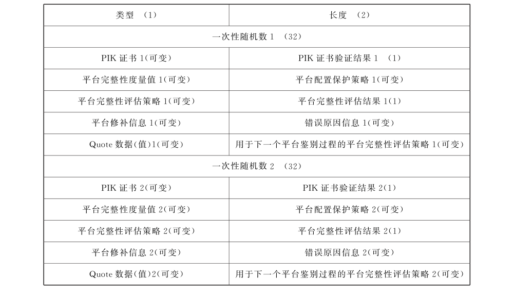

其中：一次性随机数1、一次性随机数2的长度为可变，一次性随机数1、一次性随机数2为7.2.2.1.1中b）定义的一次性随机数。

PIK 证书1、PIK 证书2字段长度可变，PIK证书1、PIK 证书2为PIK 证书。PIK 证书的定义不在本标准中规定。

PIK 证书验证结果1、PIK 证书验证结果2字段长度可变，PIK 证书验证结果1、PIK 证书验证结果2字段的值如下：◎ 表示证书有效；

1 表示证书的颁发者不明确；

2 表示证书基于不可信任的根证书；

3 表示证书未到生效期或已过期；

4 表示签名错误；

5 表示证书已吊销；

6 表示证书未按规定用途使用；

7 表示证书吊销状态未知；

8 表示证书错误原因未知；

其他值保留。

平台完整性度量值1、平台完整性度量值2字段长度为可变，平台完整性度量值1、平台完整性度量值2为本节d）中定义的平台完整性度量值。

平台配置保护策略1、平台配置保护策略2字段长度为可变，平台配置保护策略1、平台配置保护策略2为本节f）中定义的平台配置保护策略。

平台完整性评估策略1、平台完整性评估策略2字段长度为可变，平台完整性评估策略1、平台完整性评估策略2为本节c）中定义的平台完整性评估策略。

平台完整性评估结果1、平台完整性评估结果2字段长度可变，平台完整性评估结果1、平台完整性评估结果2字段的值如下：1 符合策略；

2 不符合策略且能修补；

3 不符合策略因为错误；

4 不符合策略且不能修补；

其他值保留。

平台修补信息1、平台修补信息2字段长度可变，平台修补信息1.平台修补信息2为本节h）中定义的平台修补信息。

错误原因信息1、错误原因信息2字段长度可变，错误原因信息1、错误原因信息2为本节i）中定义的错误原因信息。

Quote 数据（值）1、Quote 数据（值）2字段长度可变，Quote 数据值1、Quote 数据值2为本节e）中定义 Quote 数据值。Quote 数据1、Quote 数据2为两个 Quote 数据，其中 Quote 数据的定义不在本标准中规定。

下一个平台鉴别过程的平台完整性评估策略1、下一个平台鉴别过程的平台完整性评估策略2字段长度可变，下一个平台鉴别过程的平台完整性评估策略1、下一个平台鉴别过程的平台完整性评估策略2为本节c）中定义的平台完整性评估策略。

或表达式对应的平台完整性评估结果、组件类型级平台完整性评估结果、组件产品级平台完整性评估结果和组件属性级平台完整性评估结果的定义与上述平台完整性评估结果相同。

h）平台修补信息平台修补信息如图59所示。

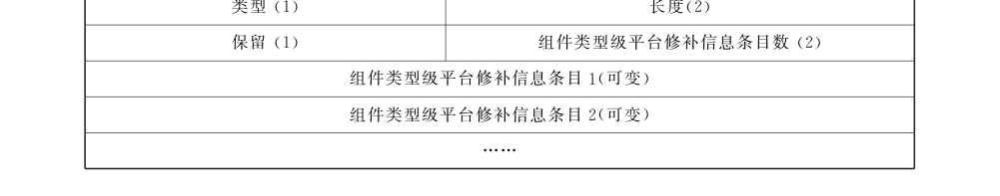

其中：-保留字段长度力1个八位位组，其值默认为0。

组件类型级平台修补信息条目数字段长度为2个八位位组，其值为组件类型级平台修补信息的条目的个数。

组件类型级平台修补信息条目1、组件类型级平台修补信息条目2、⋯为7.2.2.1.1中。）定义的组件类型级平台修补信息条目。

i） 错误原因信息错误原因信息如图60所示。

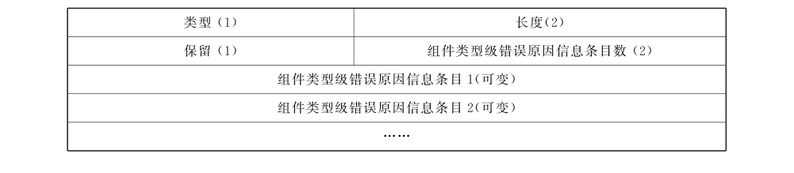

其中：-保留字段长度为1个八位位组，其值默认为0。

组件类型级错误原因信息条目数字段长度为2个八位位组，其值为组件类型级错误原因信息的条目的个数。

组件类型错误原因信息条目1、组件类型级错误原因信息条目2、为7.2.2.1.1中q）定义的组件类型级错误原因信息条目。

j） 汇聚平台完整性评估策略汇聚平台完整性评估策略如图61 所示。

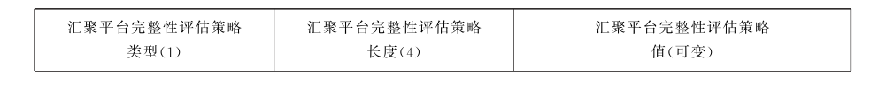

其中：一汇聚平台完整性评估策略类型字段长度为1个八位位组，其值如下：1 表示汇聚平台完整性评估策略值是基于逻辑与和逻辑或的逻辑表达式，且为或与表达式；

其他值保留。

-汇聚平台完整性评估策略长度字段长度4个八位位组，其值汇聚平台完整性评估策略值字段的八位位组数。

-汇聚平台完整性评估策略值字段长度为可变。当汇聚平台完整性评估策略类型字段的值为1时，则汇聚平台完整性评估策略值为或与表达式，即各个或表达式的与其中或表达式包括单元素或表达式和多元素或表达式（前者仅为一个元素，后者为多个元素的或）。

##### 7.2.2.2 PAI 协议过程

###### 7.2.2.2.1 PAI-1 协议

###### 7.2.2.2.1.1 消息1

消息1的数据字段格式如图62所示。

其中：标识 FLAG 字段长度为2个八位位组，定义如前，比特0有意义。比特0的值是 TNCAP 依据本轮 PAI 协议中的对 AR 的平台鉴别需求来设置的。在一次可信网络连接过程中，当本轮PAI 协议为首个平台鉴别过程中的首轮 PAI 协议时，本轮 PAI 协议中的对AR 的平台鉴别需求为 TNCAP 初始配置的对 AR 的平台鉴别需求；当本轮 PAI 协议非首个平台鉴别过程中的首轮 PAI 协议时，本轮 PAI 协议中的对AR 的平台鉴别需求为上一个平台鉴别过程中TNCAP设置的用于下一个平台鉴别过程的对 AR 的平台鉴别需求；当本轮 PAI 协议非首轮 PAI 协议时，本轮 PAI 协议中的对 AR 的平台鉴别需求为上一轮 PAI 协议中 TNCAP设置的用于下一轮 PAI 协议的对 AR 的平台鉴别需求。

TNCAP挑战字段长度为32个八位位组，其值由 TNCAP采用随机数生成算法生成。当标识FL.AG 字段中比特0的值为0时，TNCAP挑战字段不存在。

对AR 的平台完整性度量请求参数字段长度为可变，定义如前。当标识 FLAG 字段中比特0的值为0时，对AR 的平台完整性度量请求参数字段不存在。对AR 的平台完整性度量请求参数字段的值是 TNCAP依据本轮 PAI 协议中的对AR 的平台完整性评估策略生成的，其中平台完整性评估策略的定义如前。在一次可信网络连接过程中，当本轮 PAI 协议为首个平台鉴别过程中的首轮 PAI 协议时，本轮 PAI 协议中的对 AR 的平台完整性评估策略 TNCAP初始配置的对AR 的平台完整性评估策略或 TNCAP 初始配置的对 AR 的平台完整性评估策略的第一分割部分；当本轮 PAI 协议为非首个平台鉴别过程中的首轮 PAI 协议时，本轮 PAI协议中的对AR的平台完整性评估策略为上一个平台鉴别过程中 TNCAP设置的用于下一个平台鉴别过程的对 AR 的平台完整性评估策略或上一个平台鉴别过程中 TNCAP设置的用于下一个平台鉴别过程的对 AR 的平台完整性评估策略的第一分割部分；当本轮 PAI 协议非首轮 PAI 协议时，本轮 PAI 协议中的对 AR 的平台完整性评估策略为上一轮 PAI 协议中TNCAP设置的用于下一轮 PAI 协议的对 AR的平台完整性评估策略。TNCAP初始配置的对AR 的平台完整性评估策略的分割方法见7.2.2.1.2中的c）。

在一次可信网络连接过程中，当本轮 PAI 协议为首个平台鉴别过程中的首轮 PAI 协议时，TNCAP收到 NAC发送的平台鉴别请求后向 TNCC发送消息1。当本轮 PAI 协议非首个平台鉴别过程中的首轮 PAI 协议时，若本平台鉴别过程是一个双向平台鉴别过程，则TNCAP在AC完成平台修补且等待一个最大平台修补时间后向 TNCC发送消息1；若本平台鉴别过程是一个对AR 的单向平台鉴别过程，则 TNCAP在等待一个最大平台修补时间后向 TNCC发送消息1；若本平台鉴别过程是一个对AC的平台鉴别过程，则 TNCAP在AC 完成平台修补后向 TNCC发送消息1。当本轮 PAI 协议为非首轮PAI 协议时，TNCAP 在本轮 PAI 协议所在的平台鉴别过程还未完成时向 TNCC发送消息1。值得注意的是：当本轮 PAI 协议为非首个平台鉴别过程中的一轮 PAI 协议时，若 TNCAP 收到 AR的平台鉴别错误指示为2，则TNCAP 等待一个最大平台修补时间后向 TNCC发送消息1。最大平台修补时间不在本标准中规定。消息1的生成步骤如下：

a） 若本轮 PAI 协议中的对 AR 的平台鉴别需求的值为1，即表示 TNCAP 需要对 AR进行平台鉴别，则 TNCAP设置标识 FLAG 字段中比特0的值1。若本轮 PAI 协议中的对AR的平台鉴别需求的值为0，即表示 TNCAP 不需要对AR 进行平台鉴别，则TNCAP 设置标识FLAG 字段中比特0的值为0。若标识 FLAG 字段中的比特0的值为0，则TNCAP 执行步骤b>；否则执行步骤c）。

b） 根据标识 FLAG 构成消息1，并发送给 TNCC。

c） 首先生成 TNCAP 挑战，然后依据本轮 PAI 协议中的对 AR 的平台完整性评估策略生成对AR 的平台完整性度量请求参数，最后根据标识 FLAG、TNCAP 挑战和对AR 的平台完整性度量请求参数构成消息1，并发送给 TNCC。

在依据本轮 PAI 协议中的对AR的平台完整性评估策略生成对AR 的平台完整性度量请求参数的过程中，本轮 PAI协议中的对 AR的平台完整性评估策略中的一个组件类型级平台完整性评估策略条目生成对AR 的平台完整性度量请求参数中的一个组件类型级平台完整性度量请求参数条目，其中该组件类型级平台完整性度量请求参数条目中的消息类型与该组件类型级平台完整性评估策略条目中的消息类型相同，该组件类型级平台完整性度量请求参数条目中的一个组件属性级平台完整性度量请求参数条目中的组件属性类型厂家 ID及组件属性类型与该组件类型级平台完整性评估策略条目中的一个或多个组件属性级平台完整性评估策略条目中的组件属性类型厂家 ID 及组件属性类型相同。若该组件类型级平台完整性评估策略条目所对应的条目序号在本轮 PAI 协议中的对 AR的平台完整性评估策略中的组件类型级汇聚平台完整性评估策略中是一个单元素或表达式，则该组件类型级平台完整性度量请求参数条目中的FLAG 字段中比特0的值为1，表示该组件类型级平台完整性度量请求参数条目是不可跳过的。

TNCC 接收到 TNCAP 发送的消息1后，进行如下处理：

a） 检查标识 FLAG 字段中的比特0的值，若比特0的值为0，执行步骤b）；否则执行步骤c）。

b） 若本轮 PAI 协议中的对AC 的平台鉴别需求的值为0，即表示 TNCC 不需要对AC 进行平台鉴别，则TNCC 丢弃消息1；否则：设置标识 FLAG 字段中的比特4的值为1；若本轮PAI 协为首个平台鉴别过程中的首轮PAI 协议且 TNCC需要验证AC 的PIK 证书的有效性，则设置标识 FLAG 字段中的比特8的值为1；生成 TNCC 挑战；依据本轮 PAI 协议中的对AC的平台完整性评估策略生成对 AC 的平台完整性度量请求参数；根据标识 FL.AG、TNCC 挑战、对AC 的平台完整性度量请求参数和本轮 PAI 协议中的对AC的平台完整性评估策略构成消息2，并发送给 TNCAP。

c） 若本轮 PAI 协议是非首个平台鉴别过程中的PAI 协议，且 AR的平台修补未完成，则TNCC首先设置标识 FLAG 字段中比特1的值为1和 AR 的平台鉴别错误指示为2，并设置本轮PAI 协议中的对 AC的平台鉴别需求和对 AC的平台完整性评估策略分别用于下一轮 PAI协议的对 AC 的平台鉴别需求和对 AC 的平台完整性评估策略，然后根据标识 FLAG、TNCAP 挑战和 AR 的平台鉴别错误指示构造消息2，并发送给TNCAP；否则执行步骤d）。

若本轮 PAI 协议是首个平台鉴别过程中的PAI 协议，则首先依据 TNCC上端的各个 IMC支持的消息类型检查对 AR的平台完整性度量请求参数，若不支持对AR的平台完整性度量请求参数中不可跳过的组件类型级平台完整性度量请求参数条目（即不可跳过的组件类型级平台完整性度量请求参数条目中的消息类型不包含在 TNCC上端的各个 IMC 支持的消息类型中），则设置标识 FLAG 字段中比特1的值为1和 AR 的平台鉴别错误指示为1，然后根据标识 FLAG、TNCAP 挑战和 AR 的平台鉴别错误指示构造消息2，并发送给 TNCAP；否则执行步骤e）。

e） 若本轮 PAI 协议中的对AC 的平台鉴别需求的值1，即表示 TNCC 需要对AC 进行平台鉴别，则 TNCC设置标识 FLAG 字段中比特4的值为1。若本轮 PAI 协议中的对AC的平台鉴别需求的值为0，即表示 TNCC 不需要对AC 进行平台鉴别，则TNCC 设置标识 FLAG 字段中比特4的值为0。若标识 FLAG 字段中比特4的值为0，则执行步骤f）；否则执行步骤g）。

f）。 依据 TNCAP挑战、对AR的平台完整性度量请求参数生成AR的平台完整性度量值、AR 的Quote 数据值，并在生成 AR 的 Quote 数据值时设置标识 FLAG 字段中比特11的值1；若TNCC需要对 AR 的平台配置进行保护，则依据对 AR 的平台完整性度量请求参数和 TNCC初始配置的 AR 的平台配置保护策略生成 AR 的平台配置保护策略，并在生成 AR 的平台配置保护策略时设置标识 FLAG 字段中比特2的值为1；当本轮 PAI 协议首个平台鉴别过程中的首轮 PAI 协议时，依据本地创建的 ConnectionID 获取 AR 的PIK 证书，并设置标识FLAG 字段中比特3的值1；依据标识 FLAG、TNCAP 挑战、AR 的平台完整性度量值、AR的 Quote 数据值、AR 的平台配置保护策略和 AR的PIK 证书构成消息2，并发送给 TNCAP。

g） 依据 TNCAP挑战、对AR 的平台完整性度量请求参数生成 AR 的平台完整性度量值、AR 的Quote 数据值，并在生成 AR 的 Quote 数据值时设置标识 FLAG 字段中比特11的值1；若TNCC需要对 AR的平台配置进行保护，则依据对 AR的平台完整性度量请求参数和 TNCC初始配置的 AR 的平台配置保护策略生成 AR的平台配置保护策略，并在生成 AR的平台配置保护策略时设置标识 FLAG 字段中比特2的值为1；当本轮 PAI 协议为首个平台鉴别过程中的首轮 PAI 协议时，依据本地创建的 ConnectionID 获取 AR的PIK 证书，并设置标识FLAG 字段中比特3的值1；若本轮 PAI 协为首个平台鉴别过程中的首轮 PAI 协议且TNCC需要验证 AC的PIK 证书的有效性，则设置标识FLAG 字段中的比特8的值1；生成TNCC挑战；依据本轮 PAI 协议中的对AC 的平台完整性评估策略生成对AC的平台完整性度量请求参数；依据标识 FLAG、TNCAP 挑战、AR 的平台完整性度量值、AR 的 Quote 数据值、AR的平台配置保护策略、AR 的PIK证书、TNCC挑战、对AC 的平台完整性度量请求参数和本轮 PAI 协议中的对 AC的平台完整性评估策略构成消息 2，并发送给 TNCAP。

在依据本轮 PAI 协议中的对AC 的平台完整性评估策略生成对AC 的平台完整性度量请求参数的过程中，本轮 PAI 协议中的对AC的平台完整性评估策略中的一个组件类型级平台完整性评估策略条目生成对AC的平台完整性度量请求参数中的一个组件类型级平台完整性度量请求参数条目，其中该组件类型级平台完整性度量请求参数条目中的消息类型与该组件类型级平台完整性评估策略条目中的消息类型相同，该组件类型级平台完整性度量请求参数条目中的一个组件属性级平台完整性度量请求参数条目中的组件属性类型厂家ID及组件属性类型与该组件类型级平台完整性评估策略条目中的一个或多个组件属性级平台完整性评估策略条目中的组件属性类型厂家 ID 及组件属性类型相同。若该组件类型级平台完整性评估策略条目所对应的条目序号在本轮 PAI 协议中的对AC的平台完整性评估策略中的组件类型级汇聚平台完整性评估策略中是一个单元素或表达式，则该组件类型级平台完整性度量请求参数条目中的FLAG 字段中比特。的值1，表示该组件类型级平台完整性度量请求参数条目是不可跳过的。

在依据 TNCAP挑战、对AR 的平台完整性度量请求参数生成 AR 的平台完整性度量值、AR 的Quote 数据值的过程中，对于对AR 的平台完整性度量请求参数中的一个组件类型级平台完整性度量请求参数条目，若该组件类型级平台完整性度量请求参数条目不为 TNCC上端的任意一个 IMC 所支持，则生成一个组件类型级平台完整性度量值条目，其状态码的值设置为2；否则利用 AR 中的 IF-IMC功能函数 TCA_IMC_RequestMeasurementInfo 将 TNCAP挑战和该组件类型级平台完整性度量请求参数条目中的各个组件属性级平台完整性度量请求参数条目发送给 TNCC上端的相应 IMC。当TNCC上端的一个 IMC 收到 TNCAP挑战和一个组件类型级平台完整性度量请求参数条目中的各个组件属性级平台完整性度量请求参数条目时，该IMC 首先依据 TNCAP 挑战和各个组件属性级平台完整性度量请求参数条目中的组件属性类型厂家ID 及组件属性类型执行平台完整性度量（具体度量过程不在本标准中规定），并生成一个 IF-IM 消息和一个 Quote 数据（当该 IF-IM 消息中包含 Quote 数据时该 Quote 数据才被生成），然后利用 AR中的 IF-IMC 功能函效 TCA_TNCC_SendMessage 将该 IF-IM消息发送给 TNCC，并利用 AR中的 IF-IMC 功能函数 TCA_TNCC_ProvideQuoteData 将该 Quote 数据发送给 TNCC（不管是否生成该 IF-IM 消息对应的 Quote 数据，本功能函数都必须执行）。当从TNCC上端的一个 IMC 收到一个 IF-IM 消息时，TNCC 依据该 IF-IM 消息生成一个 IF-IM级平台完整性度量值条目，若对 AR的平台完整性度量请求参数中的一个组件类型级平台完整性度量请求参数条目对应的所有IF-IM 消息都已收到，则利用该组件类型级平台完整性度量请求参数条目对应的各个IF-IM级平台完整性度量值条目生成一个组件类型级平台完整性度量值条目，若对AR 的平台完整性度量请求参数对应的所有IF-IM 消息都已收到，则利用对AR 的平台完整性度量请求参数对应的各个组件类型级平台完整性度量值条目生成AR 的平台完整性度量值。当从 TNCC上端的一个 IMC 收到一个 Quote 数据时，TNCC依据该 Quote 数据生成一个 IF-IM级 Quote 数据值条目，若对 AR的平台完整性度量请求参数中的一个组件类型级平台完整性度量请求参数条目对应的所有 Quote 数据都已收到，则利用该组件类型级平台完整性度量请求参数条目对应的各个 IF-IM级 Quote 数据值条目生成一个组件类型级 Quote 数据条目，若对 AR 的平台完整性度量请求参数对应的所有 Quote 数据都已收到，则利用对 AR 的平台完整性度量请求参数对应的各个组件类型级 Quote 数据条目生成 AR的Quote 数据值。

在依据对AR的平台完整性度量请求参数和 TNCC 初始配置的AR 的平台配置保护策略生成 AR的平台配置保护策略的过程中，对AR 的平台完整性度量请求参数中的一个组件类型级平台完整性度量请求参数条目生成 AR 的平台配置保护策略中的零个或一个组件类型级平台配置保护策略条目，其中该组件类型级平台配置保护策略条目中的消息类型与该组件类型级平台完整性度量请求参数条目中的消息类型相同，该组件类型级平台配置保护策略条目中的一个或多个组件属性级平台配置保护策略条目中的组件属性类型厂家 ID 及组件属性类型与该组件类型级平台完整性度量请求参数条目中的一个组件属性级平台完整性度量请求参数条目中的组件属性类型厂家ID 及组件属性类型相同。当在TNCC预配置的AR的平台配置保护策略中找不到该组件类型级平台完整性度量请求参数条目中的消息类型时，TNCC不能生成该组件类型级平台完整性度量请求参数条目对应的组件类型级平台配置保护策略条目。当在 TNCC预配置的AR 的平台配置保护策略中找不到该组件类型级平台完整性度量请求参数条目中的任意组件属性类型厂家 ID 及组件属性类型时，TNCC不能生成该组件类型级平台完整性度量请求参数条目对应的组件类型级平台配置保护策略条目。

对于一个消息类型，TNCC上端的一个 IMC可以支持该消息类型下的多个组件产品的平台完整性度量，但是 TNCC上端的多个 IMC 不可以支持该消息类型下的同一个组件产品的平台完整性度量。

###### 7.2.2.2.1.2 消息2

消息2的数据字段格式如图63所示。

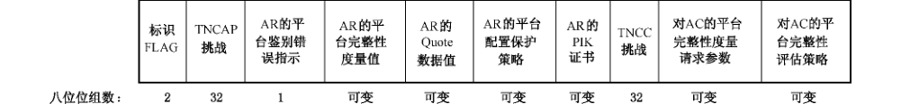

其中：一标识FLAG 字段长度为2个八位位组，定义如前。比特0、1、2、3、4、8和11 有意义。比特0的值与消息1中标识 FLAG字段中的比特。的值相同。比特4的值是 TNCC依据本轮 PAI协议中的对AC的平台鉴别需求来设置的。在一次可信网络连接过程中，当本轮 PAI 协议为首个平台鉴别过程中的首轮 PAI 协议时，本轮PAI 协议中的对AC的平台鉴别需求为TNCC 初始配置的对 AC 的平台鉴别需求；当本轮 PAI协议为非首个平台鉴别过程中的首轮 PAI 协议时，本轮 PAI 协议中的对 AC 的平台鉴别需求为上一个平台鉴别过程中 TNCC设置的用于下一个平台鉴别过程的对 AC 的平台鉴别需求；当本轮 PAI 协议非首轮 PAI 协议时，本轮PAI 协议中的对 AC 的平台鉴别需求为上一轮 PAI 协议中 TNCC设置的用于下一轮 PAI 协议的对 AC的平台鉴别需求。

TNCAP挑战字段长度为32个八位位组，其值与消息1中的TNCAP 挑战相同。当标识FLAG 字段中比特0的值0时，TNCAP 挑战字段不存在。

AR 的平台鉴别错误指示字段长度为1个八位位组。当标识 FLAG 字段中比特1的值力。

时，AR 的平台鉴别错误指示字段不存在。AR 的平台鉴别错误指示字段的值如下：1 发生不可跳过错误；

2 平台修补未完成；

其他值保留。

AR 的平台完整性度量值字段长度为可变，定义如前。若AR 和 PM之间存在安全通道，则AR 的平台完整性度量值在安全通道中传递给 PM；否则AR 的平台完整性度量值可采用数字信封（参见附录C）的方式传递给PM。AR 和PM之间的安全通道可以采取EWAI 协议和ETLS 协议来建立，具体见 6.2.1.3. 5 和 6.2.2.2.4。

AR 的 Quote 数据值字段长度为可变，定义如前。当标识 FLAG 字段中比特11 的值0时，AR 的 Quote 数据值字段不存在。

AR 的平台配置保护策略字段长度为可变，定义如前。当标识 FLAG 字段中比特2的值力0时，AR 的平台配置保护策略字段不存在。若AR 和 PM之间存在安全通道，则AR的平台配置保护策略在安全通道中传递给 PM；否则 AR 的平台配置保护策略可采用数字信封（参见附录C）的方式传递给PM。AR和PM之间的安全通道可以采取EWAI 协议和ETLS 协议来建立，具体见 6.2.1.3.5和 6.2.2.2.4。

AR的PIK 证书字段长度可变，其定义不在本标准中规定。当标识 FLAG 字段中比特3的值为0时，AR的PIK 证书字段不存在。

TNCC挑战字段长度为32个八位位组，由 TNCC 采用随机数生成算法生成。当FL.AG 标识字段的比特4的值为0时，本字段不存在。

对AC的完整性度量请求参数字段为可变长度，定义如前。当FL.AG 标识字段的比特4的值为0时，本字段不存在。对AC 的平台完整性度量请求参数字段的值是 TNCC 依据本轮 PAI协议中的对AC的平台完整性评估策略生成的，其中平台完整性评估策略的定义如前。在一次可信网络连接过程中，当本轮 PAI 协议为首个平台鉴别过程中的首轮 PAI 协议时，本轮PAI 协议中的对AC 的平台完整性评估策略为 TNCC 初始配置的对AC 的平台完整性评估策略或 TNCC初始配置的对AC 的平台完整性评估策略的第一分割部分；当本轮 PAI协议为非首个平台鉴别过程中的首轮 PAI 协议时，本轮 PAI 协议中的对AC 的平台完整性评估策略为上一个平台鉴别过程中 TNCC设置的用于下一个平台鉴别过程的对AC的平台完整性评估策略或上一个平台鉴别过程中 TNCC设置的用于下一个平台鉴别过程的对AC 的平台完整性评估策略的第一分割部分；当本轮 PAI 协议非首轮 PAI 协议时，本轮 PAI 协议中的对AC 的平台完整性评估策略为上一轮 PAI 协议中 TNCC设置的用于一轮 PAI 协议的对 AC的平台完整性评估策略。TNCC初始配置的对AC 的平台完整性评估策略的分割方法见7.2.2.1.2中的c）。

对AC的平台完整性评估策略字段长度为可变，定义如前。当FLAG 标识字段的比特4的值为0时，本字段不存在。若AR和PM之间存在安全通道，则AR 的完整性评估策略在安全通道中传递给 PM；否则 AR 的完整性评估策略可采用数字信封（参见附录C）的方式传递给PM。AR 和 PM之间的安全通道可以采取EWAI 协议和 ETLS 协议来建立，具体见6.2.1.3.5和 6.2.2.2.4。

当 TNCC 接收到 TNCAP发送的消息1,TNCC 向 TNCAP 发送消息2。

TNCAP 接收到 TNCC 发送的消息2后，进行如下处理：

a） 检查标识 FLAG 字段中比特0的值，若值为0，则执行步骤b）；否则步骤d）。

b） 检查标识 FLAG 字段中比特4的值，若值为0，则丢弃消息2；否则执行步骤c）。

c） 若本轮 PAI 协议为首个平台鉴别过程中的 PAI 协议，则首先依据 TNCAP上端的各个 IMC支持的消息类型检查对AC的平台完整性度量请求参数，若不支持对AC的平台完整性度量请求参数中不可跳过的组件类型级平台完整性度量请求参数条目（即不可跳过的组件类型级平台完整性度量请求参数条目中的消息类型不包含在 TNCAP上端的各个IMC支持的消息类型中），则设置标识 FLAG 字段中比特5的值为1和 AC的平台鉴别错误指示字段的值1，然后根据标识 FLAG、TNCC挑战和 AC 的平台鉴别错误指示构造消息5，并发送给 TNCC；

否则：依据 TNCC挑战、对AC的平台完整性度量请求参数生成AC的平台完整性度量值、AC的 Quote 数据值；若TNCAP需要对AC的平台配置进行保护，则依据对AC 的平台完整性度量请求参数和 TNCAP初始配置的 AC 的平台配置保护策略生成 AC 的平台配置保护策略，并在生成AC的平台配置保护策略后设置标识 FLAG 字段中比特6的值为1；当标识 FLAG字段中比特8的值为1时，TNCAP依据本地创建的ConnectionID 获取AC的PIK证书，并设置标识 FLAG 字段中比特7的值为1；依据标识 FLAG、TNCC挑战、AC的PIK证书、AC的平台完整性度量值、AC 的平台配置保护策略和对AC 的平台完整性评估策略构成消息3，并发送给 EPS。

d） 检查标识 FLAG 字段中的比特1 的值，若比特1的值为1，则执行步骤e）；否则执行步骤f）。

检查 TNCAP挑战字段的值，若值与消息1 中的TNCAP 挑战字段不相同，则丢弃消息 2；否则继续检查 AR 的平台鉴别错误指示字段的值，若值为2，则 TNCAP在等待一个最大平台修补时间后执行下一轮PAI 协议，并设置用于下一轮 PAI 协议的对 AR 的平台鉴别需求和对AR 的平台完整性评估策略分别为本轮 PAI 协议中的对 AR 的平台鉴别需求和对 AR的平台完整性评估策略；若值为1，则TNCAP生成 AC的访问决策禁止（将AC的访问决策发送给NAC），并设置标识 FLAG 字段中比特10的值为1，然后依据标识 FLAG、TNCAP 挑战、AC的访问决策构成消息 5，并发送给 TNCC。

f） 检查 TNCAP 挑战字段的值，若与消息1中的TNCAP挑战字段不相同，则丢弃消息2；否则检查标识 FLAG 字段中比特11的值，若值为1，则执行步骤g）；否则执行步骤h）。

g） 验证 AR 的 Quote 数据值中的各个 PIK 签名，若验证不通过，则丢弃消息 2；否则执行步骤h）。

h） 检查标识 FLAG 字段中比特4的值，若值为0，则执行步骤；）；否则执行步骤j。

i） 生成 TNCAP平台鉴别挑战；若本轮 PAI 协议为首个平台鉴别过程中的首轮PAI 协议且TNCAP需要验证 AR 的PIK证书有效性，则设置标识 FLAG 字段中比特3的值为1；依据标识 FLAG、TNCAP平台鉴别挑战、AR的PIK 证书、AR的平台完整性度量值、AR的平台配置保护策略和对 AR 的平台完整性评估策略构成消息 3，并发送给 EPS。

j 若本轮 PAI 协议是首个平台鉴别过程中的PAI 协议，则首先依据 TNCAP上端的各个 IMC 支持的消息类型检查对AC 的平台完整性度量请求参数，若不支持对AC的平台完整性度量请求参数中不可跳过的组件类型级平台完整性度量请求参数条目（即不可跳过的组件类型级平台完整性度量请求参数条目中的消息类型不包含在 TNCAP上端的各个 IMC 支持的消息类型中），则设置标识 FLAG 字段中比特5的值1和 AC的平台鉴别错误指示的值为1，然后根据标识 FLAG、TNCC 挑战和AC 的平台鉴别错误指示构造消息5，并发送给 TNCC； 否则：依据TNCC挑战、对AC 的平台完整性度量请求参数生成AC 的平台完整性度量值、AC的Quote 数据值；若 TNCAP需要对 AC 的平台配置进行保护，则依据对AC的平台完整性度量请求参数和 TNCAP 初始配置的AC 的平台配置保护策略生成AC的平台配置保护策略，并在生成AC 的平台配置保护策略后设置标识 FLAG 字段中比特6的值1；当标识 FLAG 字段中比特8的值为1时，TNCAP依据本地创建的ConnectionID 获取AC的PIK证书，并设置标识 FLAG 字段中比特7的值1；生成TNCAP平台鉴别挑战；若本轮PAI 协议为首个平台鉴别过程中的首轮 PAI 协议且 TNCAP 需要验证 AR的PIK 证书有效性，则设置标识 FLAG 字段中比特3的值为1；依据标识 FLAG、TNCAP平台鉴别挑战、TNCC 挑战、AR的PIK证书、AC的PIK 证书、AR 的平台完整性度量值、AR 的平台配置保护策略、对AR 的平台完整性评估策略、AC的平台完整性度量值、AC 的平台配置保护策略和对AC的平台完整性评估策略构成消息3，并发送给EPS。

在依据 TNCC挑战、对AC 的平台完整性度量请求参数生成 AC 的平台完整性度量值、AC的Quote 数据值的过程中，对于对AC的平台完整性度量请求参数中的一个组件类型级平台完整性度量请求参数条目，若该组件类型级平台完整性度量请求参数条目不TNCAP上端的任意一个 IMC 所支持，则生成一个组件类型级平台完整性度量值条目，其状态码的值设置2；否则利用 AC 中的 IF-IMC功能函数 TCA_IMC_RequestMeasurementInfo 将 TNCC 挑战和该组件类型级平台完整性度量请求参数条目中的各个组件属性级平台完整性度量请求参数条目发送给 TNCAP 上端的相应IMC。当TNCAP上端的一个 IMC 收到 TNCC挑战和一个组件类型级平台完整性度量请求参数条目中的各个组件属性级平台完整性度量请求参数条目时，该IMC首先依据 TNCC 挑战和各个组件属性级平台完整性度量请求参数条目中的组件属性类型厂家ID及组件属性类型执行平台完整性度量（具体度量过程不在本标准中规定），并生成一个 IF-IM 消息和一个 Quote 数据（当该 IF-IM 消息中包含 Quote 数据时该 Quote 数据才被生成），然后利用AC 中的 IF-IMC 功能函数 TCA_TNCAP_SendMessage 将该 IF- IM 消息发送给 TNCAP，并利用 AC 中的 IF-IMC 功能函数 TCA_TNCAP_ProvideQuoteData 将该Quote 数据发送给 TNCAP（不管是否生成该 IF-IM 消息对应的 Quote 数据，本功能函数都必须执行）。

当从 TNCAP上端的一个 IMC 收到一个 IF-IM 消息时，TNCAP 依据该 IF-IM 消息生成一个 IF-IM级平台完整性度量值条目，若对AC的平台完整性度量请求参数中的一个组件类型级平台完整性度量请求参数条目对应的所有IF-IM 消息都已收到，则利用该组件类型级平台完整性度量请求参数条目对应的各个IF-IM 级平台完整性度量值条目生成一个组件类型级平台完整性度量值条目，若对AC的平台完整性度量请求参数对应的所有IF-IM 消息都已收到，则利用对AC 的平台完整性度量请求参数对应的各个组件类型级平台完整性度量值条目生成 AC 的平台完整性度量值。当从 TNCAP上端的一个IMC 收到一个 Quote 数据时，TNCAP 依据该 Quote 数据生成一个 IF-IM 级 Quote 数据值条目，若对AC 的平台完整性度量请求参数中的一个组件类型级平台完整性度量请求参数条目对应的所有 Quote数据都已收到，则利用该组件类型级平台完整性度量请求参数条目对应的各个 IF-IM 级 Quote 数据值条目生成一个组件类型级 Quote 数据条目，若对 AC 的平台完整性度量请求参数对应的所有 Quote 数据都已收到，则利用对 AC 的平台完整性度量请求参数对应的各个组件类型级 Quote 数据条目生成生成AC的 Quote 数据值。

在依据对 AC的平台完整性度量请求参数和 TNCAP 初始配置的AC 的平台配置保护策略生成AC 的平台配置保护策略的过程中，对AC的平台完整性度量请求参数中的一个组件类型级平台完整性度量请求参数条目生成 AC的平台配置保护策略中的零个或一个组件类型级平台配置保护策略条目，其中该组件类型级平台配置保护策略条目中的消息类型与该组件类型级平台完整性度量请求参数条目中的消息类型相同，该组件类型级平台配置保护策略条目中的一个或多个组件属性级平台配置保护策略条目中的组件属性类型厂家 ID及组件属性类型与该组件类型级平台完整性度量请求参数条目中的一个组件属性级平台完整性度量请求参数条目中的组件属性类型厂家ID 及组件属性类型相同。

当在 TNCAP 预配置的AC 的平台配置保护策略中找不到该组件类型级平台完整性度量请求参数条目中的消息类型时，TNCAP 不能生成该组件类型级平台完整性度量请求参数条目对应的组件类型级平台配置保护策略条目。当在 TNCAP 预配置的AC的平台配置保护策略中找不到该组件类型级平台完整性度量请求参数条目中的任意组件属性类型厂家ID 及组件属性类型时，TNCAP 不能生成该组件类型级平台完整性度量请求参数条目对应的组件类型级平台配置保护策略条目。

对于一个消息类型，TNCAP上端的一个 IMC 可以支持该消息类型下的多个组件产品的平台完整性度量，但是TNCAP上端的多个 IMC 不可以支持该消息类型下的同一个组件产品的平台完整性度量。

###### 7.2.2.2.1.3 消息 3

消息3的数据字段格式如图64所示。

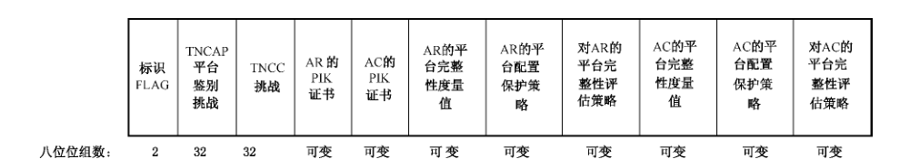

其中：标识 FL.AG 字段长度2个八位位组，定义如前。比特0、2、3、4、6和7有意义。比特0、2和4 的值分别与消息2中标识 FL.AG 字段中比特0、2和4的值相同。

TNCAP平台鉴别挑战字段长度为32个八位位组，由TNCAP采用随机数生成算法产生的，用于与 EPS进行信息交互。当标识 FLAG 字段中比特0的值为0时，本字段不存在。

TNCC 挑战字段长度32个八位位组，本字段的值与消息2中 TNCC 挑战字段的值相同。

当标识 FLAG 字段中比特4的值为0时，本字段不存在。

AR的PIK 证书字段长度为可变，本字段的值与消息2中AR的PIK 证书字段的值相同。当标识 FL.AG 字段中比特3的值0时，本字段不存在。

AC 的PIK 证书字段长度为可变，其定义不在本标准中规定。当标识 FLAG 字段中比特7的值为0时，本字段不存在。

AR的平台完整性度量值字段长度为可变，本字段的值与消息2中 AR的平台完整性度量值字段的值相同。当标识 FLAG 字段中比特0的值为0时，本字段不存在。

AR 的平台配置保护策略字段长度可变，本字段的值与消息2中 AR的平台配置保护策略字段的值相同。当标识 FLAG字段中比特2的值为0时，本字段不存在。

对AR 的平台完整性评估策略字段长度可变，定义如前。若 AC和 PM之间存在安全通道，则对AR 的平台完整性评估策略在该安全通道中传递给 PM；否则对AR的平台完整性评估策略可采用数字信封（参见附录C）的方式传递给 PM。AC 和 PM之间的安全通道可以采取EWAI 协议和 ETLS协议来建立，具体见6.2.1.3.5和6.2.2.2.4。当标识 FLAG 字段中比特0的值为0时，本字段不存在。

AC 的平台完整性度量值字段长度为可变，定义如前。若AC 和PM之间存在安全通道，则AC的平台完整性度量值在该安全通道中传递给 PM；否则 AC的平台完整性度量值可采用数字信封（参见附录C）的方式传递给PM。AC和PM之间的安全通道可以采取EWAI 协议和ETLS 协议来建立，具体见 6.2.1.3.5和 6.2.2.2.4。当标识 FLAG 字段中比特4的值为0时，本字段不存在。

-AC 的平台配置保护策略字段长度为可变，定义如前。当标识 FLAG 字段中比特6的值为。

时，本字段不存在。若AC 和 PM之间存在安全通道，则AC 的平台配置保护策略在该安全通道中传递给 PM；否则 AC的平台配置保护策略可采用数字信封（参见附录C）的方式传递给PM。AC和PM之间的安全通道可以采取 EWAI 协议和 ETLS 协议来建立，具体见6.2.1.3.5和6.2.2.2.4。当标识 FLAG 字段中比特6的值为1时，本字段存在。

对AC 的平台完整性评估策略字段长度为可变，本字段的值与消息2中对AC 的平台完整性评估策略字段的值相同。当标识 FLAG 字段中比特4的值为0时，本字段不存在。

当 TNCAP接收到 TNCC发送的消息2时，TNCAP 向 EPS发送消息3，或向 TNCC 发送消息5。

EPS接收到 TNCAP 发送的消息3后，进行如下处理：

a） 检查标识 FLAG 字段中比特0的值，若值为0，则执行步骤b）；否则执行步骤d）。

b） 检查标识 FLAG 字段中比特4的值，若值0，则丢弃消息3；否则执行步骤c）。

c） 若标识 FLAG 字段中比特7的值为1，则验证 AC的PIK 证书，并生成AC的PIK 证书验证结果；依据AC的平台完整性度量值、AC的平台配置保护策略和对AC 的平台完整性评估策略生成 AC 的平台完整性评估结果、AC的平台修补信息、AC 的错误原因信息、AC的 Quote 数据值和下一个平台鉴别过程的对AC 的平台完整性评估策略；若生成 AC的 Quote 数据值，则设置标识 FLAG 字段中比特12的值为1；生成PIK 证书验证和平台完整性评估结果；利用PM 的用户证书的私钥生成对 PIK 证书验证和平台完整性评估结果的签名；依据标识 FLAG、PIK 证书验证和平台完整性评估结果、对PIK 证书验证和平台完整性评估结果的签名构成消息4，并发送给 TNCAP。

d） 检查标识 FLAG 字段中比特4的值，若值为0，则执行步骤e）；否则执行步骤f）。

若标识 FLAG 字段中比特3的值为1，则验证 AR的PIK 证书，并生成AR的PIK 证书验证结果；依据 AR的平台完整性度量值、AR 的平台配置保护策略和对AR 的平台完整性评估策略生成 AR 的平台完整性评估结果、AR 的平台修补信息、AR 的错误原因信息、AR 的 Quote 数据值和下一个平台鉴别过程的对 AR 的平台完整性评估策略；若生成 AR 的 Quote 数据值，则设置标识 FLAG 字段中比特11 的值1；生成 PIK 证书验证和平台完整性评估结果；利用PM 的用户证书的私钥生成对 PIK 证书验证和平台完整性评估结果的签名；依据标识 FLAG、PIK 证书验证和平台完整性评估结果、对PIK 证书验证和平台完整性评估结果的签名构成消息4，并发送给 TNCAP。

f） 若标识 FLAG 字段中比特3的值为1，则验证AR的PIK 证书，并生成AR的PIK 证书验证结果；依据 AR 的平台完整性度量值、AR 的平台配置保护策略和对 AR 的平台完整性评估策略生成 AR的平台完整性评估结果、AR 的平台修补信息、AR的错误原因信息、AR 的 Quote 数据值和下一个平台鉴别过程的对 AR 的平台完整性评估策略；若生成 AR的 Quote 数据值，则设置标识FLAG 字段中比特11的值1；若标识 FLAG 字段中比特7的值为1，则验证AC的PIK 证书，并生成 AC的PIK 证书验证结果；依据AC的平台完整性度量值、AC的平台配置保护策略和对AC的平台完整性评估策略生成 AC的平台完整性评估结果、AC的平台修补信息、AC的错误原因信息、AC 的Quote 数据值和下一个平台鉴别过程的对AC的平台完整性评估策略；若生成 AC 的Quote 数据值，则设置标识 FLAG 字段中比特12的值为1；生成 PIK证书验证和平台完整性评估结果；利用PM的用户证书的私钥生成对 PIK 证书验证和平台完整性评估结果的签名；依据标识 FLAG、PIK 证书验证和平台完整性评估结果、对PIK证书验证和平台完整性评估结果的签名构成消息4，并发送给 TNCAP。

在依据 AR 的平台完整性度量值、AR的平台配置保护策略和对AR 的平台完整性评估策略生成AR 的平台完整性评估结果、AR的平台修补信息、AR 的错误原因信息、AR 的 Quote 数据值和下一个平台鉴别过程的对AR 的平台完整性评估策略的过程中，对于对AR 的平台完整性评估策略中的一个组件类型级平台完整性评估策略条目，若该组件类型级平台完整性评估策略条目中的消息类型不为EPS上端的任意一个 IMV 所支持，则生成一个组件类型级平台完整性评估结果（值设置为3）和一个组件类型级错误原因信息条目（组件类型级错误原因信息码字段的值设置为 1）；否则依据该组件类型级平台完整性评估策略条目中的消息类型从 AR 的平台完整性度量值中读取相应组件类型级平台完整性度量值条目，若该组件类型级平台完整性度量值条目中状态码字段的值为2，则生成一个组件类型级平台完整性评估结果（值设置3）和一个组件类型级错误原因信息条目（组件类型级错误原因信息码字段的值设置为 2）；否则利用 PM中的 IF-IMV 功能函数 TCA_IMV_RequestEvaluationInfo 将该组件类型级平台完整性评估策略条目中的各个组件产品级平台完整性评估策略条目、该组件类型级平台完整性度量值条目中的各个 IF-IM 级平台完整性度量值条目、AR 的平台配置保护策略中对应该组件类型级平台完整性评估策略条目的组件类型级平台配置保护策略条目中的各个组件产品级平台配置保护策略条目发送给 EPS上端的各个相应 IMV。

在依据 AR的平台完整性度量值、AR 的平台配置保护策略和对AR 的平台完整性评估策略生成AR 的平台完整性评估结果、AR 的平台修补信息、AR 的错误原因信息、AR 的 Quote 数据值和下一个平台鉴别过程的对AR 的平台完整性评估策略的过程中，当EPS上端的一个 IMV 收到一个组件产品级平台完整性评估策略条目（其组件产品序号为非0xff值）及相应条目序号、各个组件产品级平台配置保护策略条目、各个 IF-IM 级平台完整性度量值条目时，若该 IMV 不支持该组件产品级平台完整性评估策略条目所对应的组件产品序号及组件产品，则首先生成一个组件产品级平台完整性评估结果（值设置3）和一个组件产品级错误原因信息条目（组件产品级错误原因信息码字段的值设置1），然后利用 PM中的 IF-IMV 功能函数 TCA_EPS ProvideEvaluationResult 将该组件产品级平台完整性评估结果和该组件产品级错误原因信息条目发送给 EPS；否则检查各个 IF-IM级平台完整性度量值条目，若找不到该组件产品级平台完整性评估策略条目所对应的组件产品，则生成一个组件产品级平台完整性评估结果（值设置为3）和一个组件产品级错误原因信息条目（组件产品级错误原因信息码字段的值设置为3），然后利用 PM 中的IF-IMV 功能函数 TCA_EPS_ProvideEvaluationResult 将该组件产品级平台完整性评估结果和该组件产品级错误原因信息条目发送给 EPS；否则依据该组件产品级平台完整性评估策略条目中的各个组件属性级平台完整性评估策略条目及组件属性级汇聚平台完整性评估策略、该组件产品级平台完整性评估策略条目对应的IF-IM级平台完整性度量值条目和该组件产品级平台完整性评估策略条目对应的组件产品级平台配置保护策略条目执行平台完整性评估，并生成一个组件产品级平台完整性评估结果、一个 IF-IM级平台修补信息条目、一个组件产品级错误原因信息条目、一个 IF-IM级 Quote 数据值条目和一个用于下一个平台鉴别过程的组件产品级平台完整性评估策略条目，其具体过程如图65所示。

开始读取该组件产品级平台完数性评估策略条目中的组件属性级汇聚平台完 性评估策略的一个或表达式读取该或表达式中的一个条目序号及对应的组件属性级平台完盛性评估策略条目、该组件属性级平台完整性评估策略条目对应的IF-IM 属性、该组件属性级平台完整性评估策略条目对应的组件属性级平台配置保护策略条目是否已完成该组件属性级 已完成平台完整性評估策略条目对应的平台完鏊性评估，未完成生成该组件属性级平台完整性评估策略条目对应的组件展性级平台完整性评估结果。若该组件属性级平台完整性评估策略条目对应的IF-TM属性包含Quote 数据、则生成一个IF-IM 级Quote 数据值条目。

若该组件属性级平台完整性评估结果的值为 2，则生成一个IF-IM 属性封装的平台修补信息和一个用于下一个平台鉴别过程的组件属性级平台完整性评估策略条目。若该组件属性级平台完整性评估结果的值为3，则生成一个组件属性级错误原因信息条目生成该或表达式对为1 该组件属件级平台完整性应的平台完整性评估结果，其值为1 评估结果的值是否为1不为1是否已读取完该或表达式 未读取完中的各个条目序号，已读取完生成该或表达式对应的平台完整性评估结果生成该组件产品级平台完性评估策略条目对应的组件产品级平台完整性评估结果（其值 3或不为2 4） 。若该组件产品级平台完整该或表达式对盛的平台完整性性评估结果的值为3，则利用当评估结果是否为2前或表达式对应的各个组件属性级错误原因信息条目构成一个组*为2 件产品级错误原因信息条目生成该或表达式对应的、用于下一个平台签别过程的组件属性级汇聚平台完 性评估策略中的或表达式是否已读取完该组件产品级未读取完平台完整性评估策略条目中的组件属性级汇聚平台完辛性评估策略的各个或表达式已读取完生成该组件产品级平台完虀性评估略条目对应的组件产品级平台完 性评估结果（其值为1或2）。

在依据 AR 的平台完整性度量值、AR 的平台配置保护策略和对AR 的平台完整性评估策略生成AR 的平台完整性评估结果、AR的平台修补信息、AR 的错误原因信息、AR 的 Quote 数据值和下一个平台鉴别过程的对AR 的平台完整性评估策略的过程中，当EPS上端的一个 IMV 收到一个组件产品级平台完整性评估策略条目（其组件产品序号为 Oxff 值）及相应条目序号、各个组件产品级平台配置保护策略条目、各个 IF-IM 级平台完整性度量值条目时，若该IMV 不支持该组件产品级平台完整性评估策略条目所对应的组件产品序号、组件属性类型厂家 ID 及组件属性类型，则首先生成一个组件产品级平台完整性评估结果（值设置3）和一个组件产品级错误原因信息条目（组件产品级错误原因信息码字段的值设置为2），然后利用PM 中的 IF-IMV 功能函数 TCA_EPS_ProvideEvaluationResult 将该组件产品级平台完整性评估结果和该组件产品级错误原因信息条目发送给 EPS；否则检查各个 IF-IM级平台完整性度量值条目，若找不到该组件产品级平台完整性评估策略条目中的组件属性级平台完整性评估策略条目中的组件属性类型厂家ID 及组件属性类型，则生成一个组件产品级平台完整性评估结果（值设置 4）；否则检查各个 IF-IM 级平台完整性度量值条目，若只能找到该组件产品级平台完整性评估策略条目中的组件属性级平台完整性评估策略条目中的组件属性类型厂家 ID及组件属性类型对应的IF-IM错误信息，则生成一个组件产品级平台完整性评估结果（值设置3）和一个组件产品级错误原因信息条目（组件产品级错误原因信息码字段的值设置4）；否则依据该组件产品级平台完整性评估策略条目中的组件属性级平台完整性评估策略条目执行平台完整性评估，若各个 IF-IM级平台完整性度量值条目中的所有组件产品的各个包含该组件属性级平台完整性评估策略条目中的组件属性类型厂家ID及组件属性类型的IF-IM 属性都符合该组件属性级平台完整性评估策略条目对应的组件属性级平台完整性评估策略，则生成一个组件产品级平台完整性评估结果（值设置为1）；否则生成一个组件产品级平台完整性评估结果（值设置为4）。

对于一个消息类型，EPS上端的一个 IMV 可以支持该消息类型下的多个组件产品级平台完整性评估策略条目对应的平台完整性评估，但是 EPS上端的多个 IMV 不可以支持该消息类型下的同一个组件产品级平台完整性评估策略条目对应的平台完整性评估。

在依据AR 的平台完整性度量值、AR 的平台配置保护策略和对AR 的平台完整性评估策略生成AR 的平台完整性评估结果、AR 的平台修补信息、AR的错误原因信息、AR 的 Quote 数据值和下一个平台鉴别过程的对AR 的平台完整性评估策略的过程中，对于一个组件产品级平台完整性评估策略条目，EPS 从EPS上端相应的各个 IMV 接收该组件产品级平台完整性评估策略条目对应的条目序号、组件产品级平台完整性评估结果、IF-IM 级平台修补信息条目、组件产品级错误原因信息条目、IF-IM级Quote 数据值条目和用于下一个平台鉴别过程的组件产品级平台完整性评估策略条目，若从每个 IMV都接收到一个组件产品级错误原因信息条目，且该组件产品级错误原因信息条目中的组件产品级错误原因信息码字段的值为1或2，则EPS以任意一个从 IMV 接收到的该组件产品级平台完整性评估策略条目对应的条目序号、组件产品级平台完整性评估结果、IF-IM级平台修补信息条目、组件产品级错误原因信息条目、IF-IM级 Quote 数据值条目和用于下一个平台鉴别过程的组件产品级平台完整性评估策略条目作为 EPS生成的该组件产品级平台完整性评估策略条目对应的条目序号、组件产品级平台完整性评估结果、IF-IM级平台修补信息条目、组件产品级错误原因信息条目、IF-IM 级 Quote 数据值条目和用于下一个平台鉴别过程的组件产品级平台完整性评估策略条目；否则以一个从 IMV接收到的、组件产品级错误原因信息条目中的组件产品级错误原因信息码字段的值不为1或2的该组件产品级平台完整性评估策略条目对应的条目序号、组件产品级平台完整性评估结果、IF-IM 级平台修补信息条目、组件产品级错误原因信息条目、IF-IM 级 Quote 数据值条目和用于下一个平台鉴别过程的组件产品级平台完整性评估策略条目作为EPS生成的该组件产品级平台完整性评估策略条目对应的条目序号、组件产品级平台完整性评估结果、IF-IM级平台修补信息条目、组件产品级错误原因信息条目、IF-IM级 Quote 数据值条目和用于下一个平台鉴别过程的组件产品级平台完整性评估策略条目。

在依据 AR 的平台完整性度量值、AR的平台配置保护策略和对AR 的平台完整性评估策略生成AR 的平台完整性评估结果、AR 的平台修补信息、AR的错误原因信息、AR 的 Quote 数据值和下一个平台鉴别过程的对AR 的平台完整性评估策略的过程中，对于一个组件类型级平台完整性评估策略条目，EPS依据该组件类型级平台完整性评估策略条目中的组件产品级汇聚平台完整性评估策略生成该组件类型级平台完整性评估策略条目对应的条目序号、组件类型级平台完整性评估结果、组件类型级平台修补信息条目、组件类型级错误原因信息条目、组件类型级 Quote 数据值条目和用于下一个平台鉴别过程的组件类型级平台完整性评估策略条目的具体过程如图66所示。

开始 ）1 EPS生成一个组件产品级平台完轻性评估策略条目对应的条目序号、组件产品级平台完盩性评估结果、IF-IM级平台修补信息条目、组件产品级错误原因信息条目、IF-IM级Quote数据值条日和用于下一个平台鉴别过程的组件产品级平台完整性评估略条目对于组件产品级汇聚平台完整性评估策略中包含该条目序号的每一个或表达式，生成其 该组件产品级平台完整饣平估结果的值是否为对应的平台完整性評估结果，其值为1上不为1对于组件产品级汇聚平台完整性评估策略中包含该条目序号的每一 不存在个或表达式，是否存在至少一个剪表达式对应的各个组件产品级平台完整性评估结果都已生成存在生成至少一个或表达式对应的平台完整性评估结果读取其中一个或表达式对应的平台 生成该组件类型级平台完虀性评估策完整性评估结果 略条目对应的组件类型级平台完m性评估结果（其值为3或4）。若该组件类型级平台完整性评估结果的值为3，则利用当前或表达式对应的各个组件产品级错误原因信息条目构成一不为该或表达式对应的半台完整性 个组件类型级错误原因信息条目。此评估结果是否为2外，EPS利用PM中的IF-IMV功能函数TCA IMV EndEvaluation终止该组件•为2 类型级平台完整性评估策略条目对应的平台完整性评估。利用EPS所生成生成该或表达式对应的、用于下一个平台鉴别过程的 的各个IF-IM级Quote数据值条目构成组件产品级汇聚平台完整性評估策略中的或表达式 一个组件类型级Quote数据值条目未读取完 是否已读取完所生成的各个或表达式对应的平台完整性评估结果上已读取完组件产品级汇聚平台完性评估 不是都已生成策路中各个或表达式对应的平台完墪性评估结果是否都已生成「都已生成「生成该组件类型级平台完整性评估策略条目对盛的组件类型级乎合完整性评估结果（其值为1或2）。

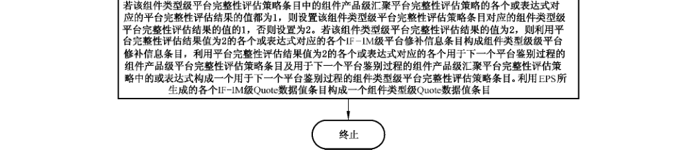

在依据 AR 的平台完整性度量值、AR 的平台配置保护策略和对AR 的平台完整性评估策略生成AR 的平台完整性评估结果、AR的平台修补信息、AR的错误原因信息、AR 的 Quote 数据值和下一个平台鉴别过程的对AR 的平台完整性评估策略的过程中，对于对 AR 的平台完整性评估策略，EPS依据对AR 的平台完整性评估策略中的组件类型级汇聚平台完整性评估策略生成对AR的平台完整性评估策略对应的AR的平台完整性评估结果、AR 的平台修补信息、AR 的错误原因信息、AR 的 Quote 数据值和下一个平台鉴别过程的对AR 的平台完整性评估策略的具体过程如图67所示。

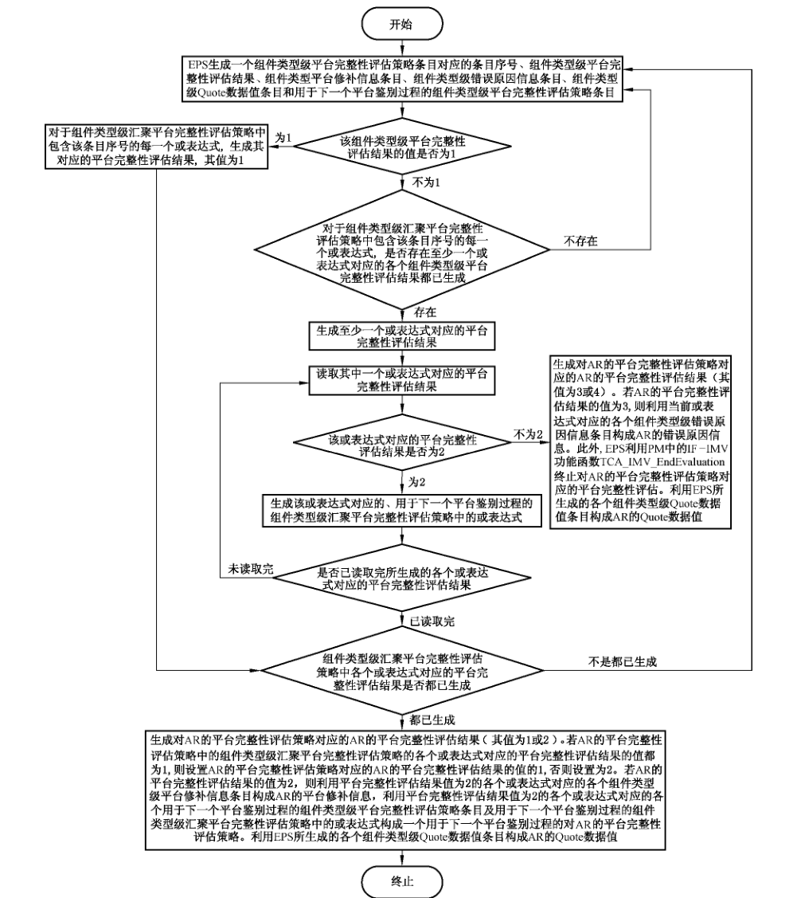

依据 AC 的平台完整性度量值、AC的平台配置保护策略和对 AC的平台完整性评估策略生成 AC的平台完整性评估结果、AC的平台修补信息、AC的错误原因信息、AC的 Quote 数据值和下一个平台鉴别过程的对AC 的平台完整性评估策略的过程与依据AR 的平台完整性度量值、AR 的平台配置保护策略和对AR的平台完整性评估策略生成AR的平台完整性评估结果、AR 的平台修补信息、AR 的错误原因信息、AR 的 Quote 数据值和下一个平台鉴别过程的对AR 的平台完整性评估策略的过程完全类同。

在或表达式对应的平台完整性评估结果、组件属性级平台完整性评估结果、组件产品级平台完整性评估结果和组件类型级平台完整性评估结果的汇聚过程中，或运算规则如表1所示。

**表1 平台完整性评估结果的或运算规则**

| 或 | 1 | 2 | ss | 4 |
| --- | --- | --- | --- | --- |
| 1 | 1 | 1 | 1 | 1 |
| 2 | 1 | 2 | 2 | 2 |
| 3 | 1 | 2 | 3 | 3 |
| 4 | 1 | 2 | 3 | 4 |

在或表达式对应的平台完整性评估结果、组件属性级平台完整性评估结果、组件产品级平台完整性评估结果和组件类型级平台完整性评估结果的汇聚过程中，与运算规则如表2所示。

**表2 平台完整性评估结果的与运算规则**

| 与 | 1 | 2 | 3 | 4 |
| --- | --- | --- | --- | --- |
| 1 | 1 | 2 | 3 | 4 |
| 2 | 2 | 2 | 3 | 4 |
| 3 | 3 | 3 | 3 |  |
| 4 | 4 | 4 | 4 | 4 |

###### 7.2.2.2.1.4 消息4

消息4的数据字段格式如图68所示。

其中：—标识 FLAG 字段长度为2个八位位组，定义如前。比特0、2、3、4、6、7、11 和12有意义。比特0、2、3、4、6 和7的值分别与消息3中比特0、2、3、4、6和7的值相同。当PIK 证书验证和平台完整性评估结果字段中包含 AR的 Quote 数据值时，设置标识 FLAG 字段中比特11 的值力1。当PIK 证书验证和平台完整性评估结果字段中包含 AC 的 Quote 数据值时，设置标识FLAG 字段中比特12的值为1。

PIK 证书验证和平台完整性评估结果字段采用 PIK 证书验证和平台完整性评估结果属性表示，其格式定义如前。一次性随机数1、PIK 证书1、PIK 证书验证结果1、平台完整性度量值1、平台配置保护策略1、平台完整性评估策略1、平台完整性评估结果1、平台修补信息1、错误原因信息 1、Quote 数据值1、用于下一个平台鉴别过程的平台完整性评估策略1、一次性随机数2、PIK 证书2、PIK 证书验证结果2、平台完整性度量值2、平台配置保护策略2、平台完整性评估策略2、平台完整性评估结果2、平台修补信息 2、错误原因信息2、Quote 数据值2、用于下一个平台鉴别过程的平台完整性评估策略2分别 TNCAP平台鉴别挑战、AR 的 PIK证书、AR的PIK 证书验证结果、AR的平台完整性度量值、AR 的平台配置保护策略、对AR的平台完整性评估策略、AR 的平台完整性评估结果、AR的平台修补信息、AR 的错误原因信息、AR的 Quote 数据值、用于下一个平台鉴别过程的对AR 的平台完整性评估策略、TNCC挑战、AC的PIK 证书、AC 的PIK 证书验证结果、AC的平台完整性度量值、AC 的平台配置保护策略、对AC的平台完整性评估策略、AC 的平台完整性评估结果、AC 的平台修补信息、AC 错误原因信息、AC 的 Quote 数据值、用于下一个平台鉴别过程的对AC的平台完整性评估策略。本字段中的TNCAP平台鉴别挑战、AR的PIK证书、AR的平台完整性度量值、AR的平台配置保护策略、对AR的平台完整性评估策略、TNCC 挑战、AC的PIK证书、AC的平台完整性度量值、AC 的平台配置保护策略、对AC的平台完整性评估策略分别与消息3中的TNCAP平台鉴别挑战、AR 的PIK 证书、AR的平台完整性度量值、AR 的平台配置保护策略、对AR 的平台完整性评估策略、TNCC挑战、AC的PIK证书、AC的平台完整性度量值、AC 的平台配置保护策略、对AC的平台完整性评估策略相同。当标识 FLAG 字段中比特◎的值为0时，TNCAP平台鉴别挑战、AR的PIK 证书、AR 的PIK 证书验证结果、AR 的平台完整性度量值、AR的平台配置保护策略、对AR 的平台完整性评估策略、AR的平台完整性评估结果、AR 的平台修补信息、AR 的错误原因信息、AR 的 Quote 数据值、用于下一个平台鉴别过程的对 AR 的平台完整性评估策略不存在。当标识 FLAG 字段中比特4的值0时，TNCC挑战、AC的PIK 证书、AC的PIK 证书验证结果、AC 的平台完整性度量值、AC的平台配置保护策略、对AC的平台完整性评估策略、AC的平台完整性评估结果、AC 的平台修补信息、AC 错误原因信息、AC 的Quote 数据值、用于下一个平台鉴别过程的对AC 的平台完整性评估策略不存在。当标识 FLAG 字段中比特2的值为0时，AR 的平台配置保护策略不存在。当标识 FLAG 字段中比特3的值都为0时，AR的PIK 证书和 AR的PIK 证书验证结果不存在。当标识 FLAG 字段中比特6的值为0时，AC的平台配置保护策略不存在。当标识FLAG 字段中比特7的值都为0时，AC的PIK 证书和AC的PIK 证书验证结果不存在。当标识 FLAG 字段中比特11的值为0时，AR 的 Quote 数据值不存在。当标识 FLAG 字段中比特12的值为0时，AC的Quote 数据值不存在。当AR 的平台完整性评估结果字段的值1时，AR 的平台修补信息、AR 的错误原因信息、用于下一个平台鉴别过程的对AR 的平台完整性评估策略不存在。当AR 的平台完整性评估结果字段的值2时，AR 的错误原因信息不存在。当AR的平台完整性评估结果字段的值为3时，AR的平台修补信息、用于下一个平台鉴别过程的对AR 的平台完整性评估策略不存在。当AR 的平台完整性评估结果字段的值为4时，AR 的平台修补信息、AR的错误原因信息、用于下一个平台鉴别过程的对 AR 的平台完整性评估策略不存在。当AC的平台完整性评估结果字段的值为1时，AC的平台修补信息、AC的错误原因信息、用于下一个平台鉴别过程的对AC的平台完整性评估策略不存在。

当AC 的平台完整性评估结果字段的值为2时，AC的错误原因信息不存在。当AC 的平台完整性评估结果字段的值为3时，AC的平台修补信息、用于下一个平台鉴别过程的对AC的平台完整性评估策略不存在。当AC 的平台完整性评估结果字段的值4时，AC的平台修补信息、AC的错误原因信息、用于下一个平台鉴别过程的对AC的平台完整性评估策略不存在。

若AR 和PM之间存在安全通道，则AR 的平台修补信息和用于下一个平台鉴别过程的对AC的平台完整性评估策略在该安全通道中传递给 AR；否则 AR 的平台修补信息和用于下一个平台鉴别过程的对AC的平台完整性评估策略可采用数字信封（参见附录C）的方式传递给AR。若AC 和PM之间存在安全通道，则AC 的平台修补信息和用于下一个平台鉴别过程的对 AR 的平台完整性评估策略在该安全通道中传递给 AC；否则 AC 的平台修补信息和用于下一个平台鉴别过程的对AR的平台完整性评估策略可采用数字信封（参见附录C）的方式传递给AC。AR 和PM之间、AC和PM之间的安全通道可以采取 EWAI 协议和 ETLS协议来建立，具体见 6.2.1.3.5和 6.2.2.2.4。

对 PIK 证书验证和平台完整性评估结果的签名采用签名属性表示，是利用PM的用户证书的私钥生成的签名，定义如前。

当 EPS接收到 TNCAP发送的消息3时，EPS 向 TNCAP发送消息4。

TNCAP 接收到 EPS发送的消息4后，进行如下处理：

a） 检查标识 FLAG 字段中比特0的值，若值为0，则执行步骤b）；否则执行步骤e）。

b） 检查标识 FLAG 字段中比特4的值，若值0，则丢弃消息 4；否则：检查PIK 证书验证和平台完整性评估结果中的 AC 的平台完整性评估结果的值，若值2；则执行步骤c），否则执行步骤d）。

c） 验证 PIK 证书验证和平台完整性评估结果及签名（PIK 证书验证和平台完整性评估结果中的AC 的 Quote 数据值是 TNCAP生成的AC 的 Quote 数据值的子集），若验证不通过，则丢弃消息4；否则利用 AC的 IF-IMC 功能函数 TCA_IMC_ReceiveMessage 将 PIK 证书验证和平台完整性评估结果中的 AC的平台修补信息发送给 TNCAP上端的相应 IMC。

d） 依据标识 FLAG、TNCC 挑战、TNCAP生成的 AC 的 Quote 数据值、AC 的PIK证书、复合PIK 证书验证和平台完整性评估结果构成消息5，并发送给 TNCC。

e） 检查标识 FLAG 字段中比特4的值，若值为0，则执行步骤f）；否则执行步骤n）。

f） 验证 PIK 证书验证和平台完整性评估结果及签名（PIK 证书验证和平台完整性评估结果中的AR 的 Quote 数据值是消息2中的AR 的 Quote 数据值的子集），若验证不通过，则丢弃消息4；否则继续检查 AR 的PIK 证书验证结果和 AR的平台完整性评估结果的值，若AR 的PIK证书验证结果的值为非0，或者AR 的平台完整性评估结果的值为3或4，则首先生成AC 的访问决策，其值为禁止（将AC 的访问决策通知 NAC），并设置标识 FLAG 字段中比特10的值力1，然后依据标识 FLAG、TNCAP挑战和 AC 的访问决策构成消息5，并发送给 TNCC；否则执行步骤gg）。

g） 验证 TNCAP 是否已读取完各个分割部分的对AR 的平台完整性评估策略，若 TNCAP未读取完各个分割部分的对 AR 的平台完整性评估策略，则执行步骤h）；否则执行k）。

h） 检查 PIK 证书验证和平台完整性评估结果中的AR 的平台完整性评估结果的值，若值为2，则执行步骤i）；否则执行步骤j）。

i 设置下一轮PAI 协议中的对AR的平台鉴别需求为1和下一轮PAI 协议中的对AR 的平台完整性评估策略为下一个分割部分的对AR的平台完整性评估策略；首先设置标识 FLAG 字段中比特13的值为1，然后依据标识 FLAG 字段、TNCAP挑战、复合PIK证书验证和平台完整性评估结果构成消息 5，并发送给 TNCC。

j） 设置下一轮 PAI 协议中的对 AR 的平台鉴别需求为1和下一轮 PAI 协议中的对AR 的平台完整性评估策略为下一个分割部分的对 AR的平台完整性评估策略，本轮 PAI 协议完成。

k）检查 PIK 证书验证和平台完整性评估结果中的AR的平台完整性评估结果的值，若值为2，则执行步骤I）；否则执行步骤 m）。

1） 依据各轮 PAI 协议中的 AR 的平台完整性评估结果生成该平台鉴别过程的AR的平台完整性评估结果（执行与运算而得，值为1或2）；若AR的PIK 证书验证结果的值为0且该平台鉴别过程的AR的平台完整性评估结果的值为1，则首先生成AC的访问决策，其值为允许；若AR的PIK 证书验证结果的值为。且该平台鉴别过程的AR 的平台完整性评估结果的值为2，则首先生成AC 的访问决策，其值隔离；将AC的访问决策通知 NAC；若AC的访问决策为隔离，则依据各轮 PAI 协议中的用于下一个平台鉴别过程的对AR 的平台完整性评估策略生成用于下一个平台鉴别过程的对AR 的平台完整性评估策略（每一轮 PAI 协议中的用于下一个平台鉴别过程的对 AR 的平台完整性评估策略为用于下一个平台鉴别过程的对AR的平台完整性评估策略中的一个分割部分），并设置对 AR 的平台鉴别需求的值1；首先设置标识FLAG 字段中比特10和 13的值为1，然后依据标识 FLAG、TNCAP 挑战、AC 的访问决策、复合 PIK 证书验证和平台完整性评估结果构成消息 5，并发送给 TNCC。

m） 依据各轮 PAI 协议中的AR的平台完整性评估结果生成该平台鉴别过程的 AR 的平台完整性评估结果（执行与运算而得，值为1或2）；若 AR的PIK 证书验证结果的值为0且该平台鉴别过程的AR 的平台完整性评估结果的值为1，则生成AC 的访问决策，其值为允许；若AR的PIK 证书验证结果的值为0且该平台鉴别过程的AR的平台完整性评估结果的值为2，则生成AC 的访问决策，其值隔离；将 AC 的访问决策通知 NAC；若AC 的访问决策隔离，则依据各轮 PAI 协议中的用于下一个平台鉴别过程的对 AR的平台完整性评估策略生成用于下一个平台鉴别过程的对 AR 的平台完整性评估策略（每一轮 PAI 协议中的用于下一个平台鉴别过程的对 AR 的平台完整性评估策略为用于下一个平台鉴别过程的对AR 的平台完整性评估策略中的一个分割部分），并设置对AR的平台鉴别需求的值为1；首先设置标识FLAG 字段中比特10的值为1，然后依据标识 FLAG、TNCAP挑战、AC的访问决策构成消息5，并发送给 TNCC。

n） 验证 PIK 证书验证和平台完整性评估结果及签名（PIK 证书验证和平台完整性评估结果中的AR的 Quote 数据值是消息2中的 AR 的 Quote 数据值的子集，PIK 证书验证和平台完整性评估结果中的 AC 的 Quote 数据值是消息2中的 AC 的 Quote 数据值的子集），若验证不通过，则丢弃消息4；否则继续检查 AR 的PIK 证书验证结果和 AR 的平台完整性评估结果的值，若AR的PIK 证书验证结果的值为非0，或者AR 的平台完整性评估结果的值为3或4，则首先生成AC 的访问决策，其值禁止（将AC的访问决策通知 NAC），并设置标识 FLAG 字段中比特10的值为1，然后依据标识 FLAG、TNCAP挑战和AC 的访问决策构成消息5，并发送给 TNCC；否则执行步骤o）。

o） 检查 PIK 证书验证和平台完整性评估结果中的AC 的平台完整性评估结果的值，若值为2，则执行步骤p）；否则执行步骤q）。

p）利用AC的IF-IMC功能函数 TCA_IMC_ReceiveMessage 将 PIK 证书验证和平台完整性评估结果中的 AC 的平台修补信息发送给 TNCAP上端的相应 IMC。

q） 验证 TNCAP是否已读取完各个分割部分的对 AR 的平台完整性评估策略，若 TNCAP 未读取完各个分割部分的对 AR 的平台完整性评估策略，则首先设置下一轮 PAI 协议中的对 AR的平台鉴别需求为1和下一轮 PAI 协议中的对 AR 的平台完整性评估策略下一个分割部分的对 AR的平台完整性评估策略，然后依据标识 FLAG、TNCC挑战、TNCAP 生成的 AC的 Quote数据值、AC的PIK证书、复合PIK 证书验证和平台完整性评估结果构成消息5，并发送给 TNCC；否则：依据各轮 PAI 协议中的AR 的平台完整性评估结果生成该平台鉴别过程的AR 的平台完整性评估结果（执行与运算而得，值为1或2）；若 AR的PIK 证书验证结果的值。且该平台鉴别过程的AR 的平台完整性评估结果的值为1，则生成AC 的访问决策，其值允许；若AR的PIK 证书验证结果的值为0且该平台鉴别过程的AR的平台完整性评估结果的值为2，则生成 AC 的访问决策，其值为隔离；将AC的访问决策通知 NAC；若 AC的访问决策为隔离，则依据各轮 PAI 协议中的用于下一个平台鉴别过程的对 AR 的平台完整性评估策略生成用于下一个平台鉴别过程的对AR 的平台完整性评估策略（每一轮 PAI 协议中的用于下一个平台鉴别过程的对AR 的平台完整性评估策略用于下一个平台鉴别过程的对AR的平台完整性评估策略中的一个分割部分），并设置对 AR 的平台鉴别需求的值为1；首先设置标识 FLAG字段中比特10的值为1，然后依据标识 FLAG、TNCAP 挑战、AC的访问决策、TNCC挑战、AC 的 Quote 数据值、AC的PIK证书、复合PIK证书验证和平台完整性评估结果构成消息5，并发送给 TNCC。

###### 7.2.2.2.1.5 消息5

消息5的数据字段格式如图69所示。

其中：标识 FLAG 字段长度为2个八位位组，定义如前。比特0、2、3、4、5、6、7、10和12有意义。比特0、2、3、4、6、7和12的值分别与消息4中比特0、2、3、4、6、7和12的值相同。

TNCAP挑战字段长度为32个八位位组，定义如前。TNCAP挑战字段的值与消息1中TNCAP 挑战字段的值相同。

AC 的访问决策字段长度为1个八位位组，其值为允许、隔离或禁止。当标识 FLAG 字段中比特10的值为1时，本字段存在。

TNCC 挑战字段长度为32个八位位组，定义如前。TNCC挑战字段的值与消息2中 TNCC挑战字段的值相同。

AC 的平台鉴别错误指示字段长度为1个八位位组。当标识 FLAG 字段中比特5的值力1时，本字段存在。AC的平台鉴别错误指示字段的值如下：1 不可跳过错误；

其他值保留。

AC 的Quote 数据值字段长度可变，其值 TNCAP生成的 AC 的 Quote 数据值。当标识FLAG 字段中比特12的值为1时，本字段存在。

AC 的PIK 证书字段长度为可变，定义如前。当标识 FLAG 字段中比特7的值的1时，本字段存在。

复合 PIK 证书验证和平台完整性评估结果字段长度可变，其内容为消息 4中除标识 FLAG字段的其他字段。

当 TNCAP 接收到 EPS发送的消息4时，TNCAP 向 TNCC 发送消息 5。

TNCC 接收到 TNCAP 发送的消息5后，进行如下处理：

a） 检查标识 FLAG 字段中比特0的值，若值为0，则执行步骤b）；否则执行步骤e）。

b） 检查标识 FLAG 字段中比特4的值，若值0，则丢弃消息5；否则检查标识 FLAG 字段中比特5的值，若值为1且 AC的平台鉴别错误指示的值为1，则 TNCC首先生成AR 的访问决策，其值为禁止（将AR 的访问决策通知 NAR），并设置标识 FLAG 字段中比特9的值为1，然后依据标识 FLAG、TNCC 挑战和AR 的访问决策构成消息6，并发送给 TNCAP；否则执行步骤c）。

验证 AC的 Quote 数据值中的各个 PIK 签名（当标识 FLAG 字段中比特12的值1时才需要验证 AC 的 Quote 数据值中的各个 PIK 签名），若验证不通过，则丢弃消息5；否则验证 PIK证书验证和平台完整性评估结果及签名（PIK 证书验证和平台完整性评估结果中的AC的Quote 数据值是消息5中的AC的 Quote 数据值的子集），若验证不通过，则丢弃消息5；否则继续检查AC 的PIK 证书验证结果和 AC的平台完整性评估结果的值，若 AC 的 PIK 证书验证结果的值为非0，或者AC的平台完整性评估结果的值为3或4，则首先生成AR的访问决策，其值为禁止（将AR 的访问决策通知 NAR），并设置标识 FLAG 字段中比特9的值为1，然后依据标识 FL.AG、TNCC挑战和 AR 的访问决策构成消息 6，并发送给 TNCAP；否则执行步骤d）。

d） 验证 TNCC是否已读取完各个分割部分的对AC 的平台完整性评估策略，若 TNCC 未读取完各个分割部分的对AC的平台完整性评估策略，则设置下一轮 PAI 协议中的对AC的平台鉴别需求为1和下一轮 PAI 协议中的对AC 的平台完整性评估策略为下一个分割部分的对AC的平台完整性评估策略，本轮 PAI 协议完成；否则：依据各轮 PAI 协议中的AC 的平台完整性评估结果生成该平台鉴别过程的 AC 的平台完整性评估结果（执行与运算而得，值1或2）；

若AC的PIK 证书验证结果的值为0且该平台鉴别过程的AC的平台完整性评估结果的值1，则生成AR 的访问决策，其值为允许；若AC的PIK 证书验证结果的值为0且该平台鉴别过程的AC 的平台完整性评估结果的值2.则首先生成 AR的访问决策，其值为隔离；将AR的访问决策通知 NAR；若 AR的访问决策为隔离，则依据各轮 PAI 协议中的用于下一个平台鉴别过程的对AC的平台完整性评估策略生成用于下一个平台鉴别过程的对AC 的平台完整性评估策略（每一轮 PAI 协议中的用于下一个平台鉴别过程的对AC的平台完整性评估策略为用于下一个平台鉴别过程的对AC 的平台完整性评估策略中的一个分割部分），并设置对AC的平台鉴别需求的值为1；首先设置标识FLAG 字段中比特9的值1，然后依据标识 FLAG、TNCC 挑战和 AR 的访问决策构成消息6，并发送给 TNCAP。

e） 检查标识 FLAG 字段中比特10的值，若值0，则执行步骤f）；否则执行步骤m）。

f）检查标识 FLAG 字段中比特4的值，若值为0，则执行步骤g）；否则执行步骤h）。

g） 检查标识 FLAG 字段比特13的值，若值为0，则丢弃消息 5；否则：验证 PIK 证书验证和平台完整性评估结果及签名（PIK 证书验证和平台完整性评估结果中的 AR的 Quote 数据值是TNCC 生成的 AR 的 Quote 数据值的子集），若验证不通过，则丢弃消息 5；否则利用AR的IF-IMC 功能函数 TCA_IMC_ReceiveMessage 将PIK 证书验证和平台完整性评估结果中的AR 的平台修补信息发送给 TNCC上端的相应IMC，本轮 PAI 协议结束。

h） 检查标识 FLAG 字段中比特5的值，若值为1且AC的平台鉴别错误指示的值为1，则 TNCC首先生成 AR 的访问决策，其值为禁止（将AR 的访问决策通知 NAR），并设置标识 FLAG 字段中比特9的值为1，然后依据标识 FLAG、TNCC挑战和AR 的访问决策构成消息6，并发送给 TNCAP；否则执行步骤i）。

1） 验证 AC 的Quote 数据值中的各个 PIK 签名（当标识 FLAG 字段中比特12的值为1时才需要验证 AC 的Quote 数据值中的各个 PIK 签名），若验证不通过，则丢弃消息5；否则验证 PIK证书验证和平台完整性评估结果及签名（PIK 证书验证和平台完整性评估结果中的AR的Quote 数据值是TNCC生成的 AR 的Quote 数据值的子集，PIK 证书验证和平台完整性评估结果中的 AC 的 Quote 数据值是消息5中的AC 的 Quote 数据值的子集），若验证不通过，则丢弃消息5；否则继续检查 AC 的 PIK 证书验证结果和 AC的平台完整性评估结果的值，若AC的PIK 证书验证结果的值为非0，或者AC 的平台完整性评估结果的值为3或4，则首先生成AR 的访问决策，其值为禁止（将AR的访问决策通知 NAR），并设置标识 FLAG 字段中比特9的值为1，然后依据标识 FLAG、TNCC 挑战和AR 的访问决策构成消息6，并发送给TNCAP；否则执行步骤j。

j） 检查 PIK 证书验证和平台完整性评估结果中的AR 的平台完整性评估结果的值，若值为2，则执行步骤k）；否则执行步骤I）。

k）利用AR的IF-IMC 功能函数 TCA_IMC_ReceiveMessage 将 PIK 证书验证和平台完整性评估结果中的 AR 的平台修补信息发送给 TNCC 上端的相应 IMC。

l） 验证 TNCC是否已读取完各个分割部分的对AC 的平台完整性评估策略，若 TNCC 未读取完各个分割部分的对AC的平台完整性评估策略，则设置下一轮 PAI 协议中的对AC的平台鉴别需求为1和下一轮 PAI 协议中的对AC 的平台完整性评估策略为下一个分割部分的对AC的平台完整性评估策略，本轮 PAI 协议结束；否则：依据各轮 PAI 协议中的AC的平台完整性评估结果生成该平台鉴别过程的AC 的平台完整性评估结果（执行与运算而得，值为1或2）；

若AC的PIK 证书验证结果的值为0且该平台鉴别过程的AC的平台完整性评估结果的值1，则生成 AR的访问决策，其值为允许；若AC的PIK 证书验证结果的值为0且该平台鉴别过程的AC 的平台完整性评估结果的值为2，则生成 AR的访问决策，其值隔离；将AR的访问决策通知 NAR；若AR 的访问决策为隔离，则依据各轮 PAI 协议中的用于下一个平台鉴别过程的对 AC的平台完整性评估策略生成用于下一个平台鉴别过程的对AC的平台完整性评估策略（每一轮 PAI 协议中的用于下一个平台鉴别过程的对 AC 的平台完整性评估策略用于下一个平台鉴别过程的对 AC的平台完整性评估策略中的一个分割部分），并设置对AC 的平台鉴别需求的值为1；首先设置标识 FLAG 字段中比特9的值为1，然后依据标识 FLAG、TNCC 挑战和 AR 的访问决策构成消息6，并发送给 TNCAP。

m） 利用AR中的IF-IMC 功能函数 TCA_IMC_NotifyConnectionChange 将 AC 的访问决策通知TNCC上端的各个IMC。若AC 的访问决策为禁止，则 TNCC 通知 NAR 断开与 AC的连接；

否则执行步骤n）。

n） 检查标识 FLAG 字段中比特4的值，若值为0，则执行步骤。）；否则执行步骤p）。

o） 检查标识 FLAG 字段比特13的值，若值为0，本轮 PAI 协议结束；否则：验证 PIK证书验证和平台完整性评估结果及签名（PIK 证书验证和平台完整性评估结果中的 AR 的 Quote 数据值是TNCC生成的 AR 的Quote 数据值的子集），若验证不通过，则丢弃消息5；否则利用AR的IF-IMC 功能函数 TCA_IMC_ReceiveMessage 将PIK 证书验证和平台完整性评估结果中的AR 的平台修补信息发送给 TNCC上端的相应IMC，本轮 PAI 协议结束。

p）验证 AC 的 Quote 数据值中的各个 PIK 签名（当标识 FLAG 字段中比特12的值为1时才需要验证 AC 的 Quote 数据值中的各个 PIK 签名），若验证不通过，则丢弃消息5；否则验证 PIK证书验证和平台完整性评估结果及签名（PIK 证书验证和平台完整性评估结果中的AR 的Quote 数据值是TNCC 生成的 AR的 Quote 数据值的子集，PIK 证书验证和平台完整性评估结果中的 AC的 Quote 数据值是消息5中的AC 的 Quote 数据值的子集），若验证不通过，则丢弃消息5；否则继续检查 AC的PIK 证书验证结果和 AC的平台完整性评估结果的值，若AC 的PIK 证书验证结果的值为非0，或者AC的平台完整性评估结果的值为3或4，则首先生成AR 的访问决策，其值为禁止（将AR 的访问决策通知 NAR），并设置标识 FLAG 字段中比特9的值为1，然后依据标识 FLAG、TNCC 挑战和 AR 的访问决策构成消息6，并发送给TNCAP；否则执行步骤q）。

q） 检查 PIK 证书验证和平台完整性评估结果中的AR的平台完整性评估结果的值，若值为2，则执行步骤r）；否则执行步骤s）。

r） 利用AR的IF-IMC 功能函数 TCA_IMC_ReceiveMessage 将 PIK 证书验证和平台完整性评估结果中的 AR 的平台修补信息发送给 TNCC上端的相应 IMC。

s） 验证 TNCC是否已读取完各个分割部分的对AC 的平台完整性评估策略，若 TNCC未读取完各个分割部分的对AC 的平台完整性评估策略，则设置下一轮 PAI 协议中的对AC 的平台鉴别需求为1和下一轮 PAI 协议中的对 AC的平台完整性评估策略为下一个分割部分的对AC的平台完整性评估策略，本轮 PAI 协议结束；否则：依据各轮 PAI 协议中的AC 的平台完整性评估结果生成该平台鉴别过程的 AC 的平台完整性评估结果（执行与运算而得，值为1或2）；

若AC的PIK 证书验证结果的值为0且该平台鉴别过程的 AC的平台完整性评估结果的值为1，则生成 AR的访问决策，其值为允许；若 AC的PIK 证书验证结果的值为0且该平台鉴别过程的AC的平台完整性评估结果的值为2，则生成AR的访问决策，其值为隔离；将AR的访问决策通知 NAR；若AR 的访问决策为隔离，则依据各轮 PAI 协议中的用于下一个平台鉴别过程的对AC的平台完整性评估策略生成用于下一个平台鉴别过程的对AC的平台完整性评估策略（每一轮 PAI 协议中的用于下一个平台鉴别过程的对AC 的平台完整性评估策略为用于下一个平台鉴别过程的对AC 的平台完整性评估策略中的一个分割部分），并设置对AC的平台鉴别需求的值为1；首先设置标识FLAG 字段中比特9的值为1，然后依据标识 FLAG、TNCC 挑战和AR 的访问决策构成消息6，并发送给 TNCAP。

###### 7.2.2.2.1.6 消息6

消息6 的数据字段格式如图70所示。

其中：标识FL.AG 字段长度为2个八位位组，定义如前。比特4和9有意义。比特4的值与消息5中比特4的值相同。

TNCC挑战字段长度为32个八位位组，定义如前。TNCC 挑战字段的值与消息2中的TNCC挑战字段的值相同。

-AR 的访问决策字段长度为1个八位位组，定义如前。

TNCAP 接收到 TNCC发送的消息6后，进行如下处理：

a） 检查标识 FLAG 字段中比特4的值，若值为0.则丢弃消息 6；否则执行步骤b）。

b） 检查标识 FLAG 字段中比特9的值，若值为0，则丢弃消息6；否则执行步骤c）。

c）利用AC 中的 IF-IMC 功能函数 TCA_IMC_NotifyConnectionChange 将 AR 的访问决策通知TNCAP上端的各个IMC。若 AR 的访问决策为禁止，则 TNCAP通知 NAC断开与 AR的连接。

###### 7.2.2.2.2 PAI-2 协议

###### 7.2.2.2.2.1 消息1

消息1的数据字段格式如图71所示。

其中：标识 FLAG 字段长度2个八位位组，定义如前，比特0有意义。比特0的值是 TNCAP依据本轮 PAI 协议中的对 AR的平台鉴别需求来设置的。在一次可信网络连接过程中，当本轮PAI 协议为首个平台鉴别过程中的首轮 PAI 协议时，本轮 PAI 协议中的对 AR 的平台鉴别需求TNCAP 初始配置的对 AR 的平台鉴别需求；当本轮 PAI 协议为非首个平台鉴别过程中的首轮 PAI 协议时，本轮 PAI 协议中的对 AR 的平台鉴别需求为上一个平台鉴别过程中TNCAP设置的用于下一个平台鉴别过程的对 AR 的平台鉴别需求；当本轮 PAI 协议为非首轮PAI 协议时，本轮 PAI 协议中的对 AR 的平台鉴别需求为上一轮 PAI 协议中 TNCAP设置的用于下一轮 PAI 协议的对 AR 的平台鉴别需求。

TNCAP 挑战字段长度为32个八位位组，其值由 TNCAP采用随机数生成算法生成。当标识FLAG 字段中比特0的值为0时，TNCAP 挑战字段不存在。

对AR 的平台完整性度量请求参数字段长度为可变，定义如前。当标识 FLAG 字段中比特0的值为0时，对AR 的平台完整性度量请求参数字段不存在。对AR 的平台完整性度量请求参数字段的值是 TNCAP依据本轮 PAI 协议中的对 AR 的平台完整性评估策略生成的，其中平台完整性评估策略的定义如前。在一次可信网络连接过程中，当本轮 PAI 协议为首个平台鉴别过程中的首轮 PAI 协议时，本轮 PAI 协议中的对 AR 的平台完整性评估策略 TNCAP初始配置的对 AR 的平台完整性评估策略或 TNCAP 初始配置的对 AR 的平台完整性评估策略的第一分割部分；当本轮 PAI 协议为非首个平台鉴别过程中的首轮 PAI 协议时，本轮 PAI协议中的对 AR 的平台完整性评估策略为上一个平台鉴别过程中TNCAP设置的用于下一个平台鉴别过程的对 AR 的平台完整性评估策略或上一个平台鉴别过程中 TNCAP设置的用于下一个平台鉴别过程的对AR的平台完整性评估策略的第一分割部分；当本轮 PAI 协议非首轮 PAI 协议时，本轮 PAI 协议中的对 AR 的平台完整性评估策略为上一轮 PAI 协议中TNCAP设置的用于下一轮 PAI 协议的对AR的平台完整性评估策略。TNCAP 初始配置的对 AR 的平台完整性评估策略的分割方法见 7.2.2.1.2中的c）。

在一次可信网络连接过程中，当本轮 PAI 协议为首个平台鉴别过程中的首轮 PAI 协议时，TNCAP收到 NAC发送的平台鉴别请求后向 TNCC发送消息1。当本轮 PAI 协议为非首个平台鉴别过程中的首轮 PAI 协议时，若本平台鉴别过程是一个双向平台鉴别过程，则TNCAP在AC 完成平台修补且等待一个最大平台修补时间后向 TNCC发送消息1；若本平台鉴别过程是一个对 AR的单向平台鉴别过程，则 TNCAP在等待一个最大平台修补时间后向 TNCC发送消息1；若本平台鉴别过程是一个对AC的平台鉴别过程，则 TNCAP在AC 完成平台修补后向 TNCC发送消息1。当本轮 PAI 协议为非首轮PAI 协议时，TNCAP在本轮 PAI 协议所在的平台鉴别过程还未完成时向 TNCC 发送消息1。值得注意的是：当本轮 PAI 协议为非首个平台鉴别过程中的一轮 PAI 协议时，若 TNCAP 收到 AR的平台鉴别错误指示为2，则 TNCAP等待一个最大平台修补时间后向 TNCC发送消息1。最大平台修补时间不在本标准中规定。消息1的生成步骤如下：

a） 若本轮 PAI 协议中的对 AR 的平台鉴别需求的值为1，即表示 TNCAP 需要对 AR进行平台鉴别，则 TNCAP设置标识 FLAG 字段中比特0的值1。若本轮 PAI 协议中的对AR的平台鉴别需求的值为0，即表示 TNCAP 不需要对AR 进行平台鉴别，则TNCAP 设置标识FLAG 字段中比特0的值为0。若标识 FLAG 字段中的比特0的值为0，则TNCAP执行步骤b>；否则执行步骤c）。

b） 根据标识 FLAG构成消息1，并发送给 TNCC。

c） 首先生成 TNCAP 挑战，然后依据本轮 PAI 协议中的对AR 的平台完整性评估策略生成对AR 的平台完整性度量请求参数，最后根据标识 FLAG、TNCAP 挑战和对 AR 的平台完整性度量请求参数构成消息1，并发送给 TNCC。

在依据本轮 PAI 协议中的对AR的平台完整性评估策略生成对AR 的平台完整性度量请求参数的过程中，本轮 PAI 协议中的对 AR 的平台完整性评估策略中的一个组件类型级平台完整性评估策略条目生成对AR 的平台完整性度量请求参数中的一个组件类型级平台完整性度量请求参数条目，其中该组件类型级平台完整性度量请求参数条目中的消息类型与该组件类型级平台完整性评估策略条目中的消息类型相同，该组件类型级平台完整性度量请求参数条目中的一个组件属性级平台完整性度量请求参数条目中的组件属性类型厂家 ID及组件属性类型与该组件类型级平台完整性评估策略条目中的一个或多个组件属性级平台完整性评估策略条目中的组件属性类型厂家 ID 及组件属性类型相同。若该组件类型级平台完整性评估策略条目所对应的条目序号在本轮 PAI 协议中的对 AR的平台完整性评估策略中的组件类型级汇聚平台完整性评估策略中是一个单元素或表达式，则该组件类型级平台完整性度量请求参数条目中的FLAG 字段中比特0的值为1，表示该组件类型级平台完整性度量请求参数条目是不可跳过的。

TNCC 接收到 TNCAP发送的消息1后，进行如下处理：

a） 检查标识 FLAG 字段中的比特0的值，若比特0的值为0，执行步骤b）；否则执行步骤c）。

b） 若本轮 PAI 协议中的对 AC 的平台鉴别需求的值为0，即表示 TNCC 不需要对AC 进行平台鉴别，则TNCC丢弃消息1；否则：设置标识FLAG 字段中的比特4的值为1；若本轮PAI协为首个平台鉴别过程中的首轮 PAI 协议且 TNCC 需要验证 AC 的PIK 证书的有效性，则设置标识 FLAG 字段中的比特8的值为1；生成TNCC 挑战；依据本轮 PAI 协议中的对AC的平台完整性评估策略生成对 AC 的平台完整性度量请求参数；根据标识 FLAG、TNCC 挑战、对 AC的平台完整性度量请求参数和本轮 PAI 协议中的对 AC的平台完整性评估策略构成消息 2，并发送给 TNCAP。

c） 若本轮 PAI 协议是非首个平台鉴别过程中的PAI 协议，且 AR 的平台修补未完成，则 TNCC首先设置标识 FLAG 字段中比特1的值为1和 AR 的平台鉴别错误指示为2，并设置本轮PAI 协议中的对 AC 的平台鉴别需求和对AC 的平台完整性评估策略分别为用于下一轮 PAI协议的对 AC 的平台鉴别需求和对 AC 的平台完整性评估策略，然后根据标识 FLAG、TNCAP 挑战和AR 的平台鉴别错误指示构造消息2，并发送给 TNCAP；否则执行步骤d）。

d） 若本轮 PAI 协议是首个平台鉴别过程中的PAI 协议，则首先依据 TNCC上端的各个 IMC 支持的消息类型检查对AR 的平台完整性度量请求参数，若不支持对AR的平台完整性度量请求参数中不可跳过的组件类型级平台完整性度量请求参数条目（即不可跳过的组件类型级平台完整性度量请求参数条目中的消息类型不包含在 TNCC上端的各个 IMC 支持的消息类型中），则设置标识 FLAG 字段中比特1的值为1和 AR 的平台鉴别错误指示为1，然后根据标识 FLAG、TNCAP挑战和 AR 的平台鉴别错误指示构造消息 2，并发送给 TNCAP；否则执行步骤e）。

e） 若本轮 PAI 协议中的对 AC 的平台鉴别需求的值1，即表示 TNCC 需要对 AC进行平台鉴别，则 TNCC设置标识 FLAG 字段中比特4的值为1。若本轮 PAI 协议中的对AC的平台鉴别需求的值0，即表示 TNCC 不需要对 AC进行平台鉴别，则 TNCC 设置标识 FLAG 字段中比特4的值为0。若标识 FLAG 字段中比特4的值为0，则执行步骤f）；否则执行步骤gg）。

f）、 依据 TNCAP挑战、对AR的平台完整性度量请求参数生成AR的平台完整性度量值、AR 的Quote 数据，并在生成 AR 的 Quote 数据时设置标识 FLAG 字段中比特11的值为1；若TNCC 需要对 AR 的平台配置进行保护，则依据对AR 的平台完整性度量请求参数和 TNCC初始配置的AR 的平台配置保护策略生成 AR的平台配置保护策略，并在生成 AR的平台配置保护策略时设置标识 FLAG 字段中比特2的值1；当本轮 PAI 协议首个平台鉴别过程中的首轮 PAI 协议时，依据本地创建的 ConnectionID 获取 AR的PIK 证书，并设置标识FLAG 字段中比特3的值为1；依据标识 FLAG、TNCAP挑战、AR的平台完整性度量值、AR的 Quote 数据、AR 的平台配置保护策略和 AR 的PIK 证书构成消息 2，并发送给 TNCAP。

0q） 依据 TNCAP挑战，对AR 的平台完整性度量请求参数生成 AR的平台完整性度量值、AR的Quote 数据，并在生成 AR 的 Quote 数据时设置标识 FLAG 字段中比特11的值1；若TNCC 需要对AR 的平台配置进行保护，则依据对AR 的平台完整性度量请求参数和 TNCC初始配置的AR 的平台配置保护策略生成 AR的平台配置保护策略，并在生成 AR的平台配置保护策略时设置标识 FLAG 字段中比特2的值1；当本轮 PAI 协议首个平台鉴别过程中的首轮 PAI 协议时，依据本地创建的ConnectionID 获取 AR的PIK 证书，并设置标识FLAG 字段中比特3的值为1；若本轮 PAI 协为首个平台鉴别过程中的首轮 PAI 协议且TNCC需要验证 AC 的PIK 证书的有效性，则设置标识 FLAG字段中的比特8的值1；生成TNCC 挑战；依据本轮 PAI 协议中的对AC的平台完整性评估策略生成对AC的平台完整性度量请求参数；依据标识 FLAG、TNCAP 挑战、AR 的平台完整性度量值、AR 的 Quote 数据、AR 的平台配置保护策略、AR的PIK证书、TNCC挑战、对AC 的平台完整性度量请求参数和本轮 PAI 协议中的对 AC 的平台完整性评估策略构成消息2，并发送给 TNCAP。

在依据本轮PAI 协议中的对 AC的平台完整性评估策略生成对AC的平台完整性度量请求参数的过程中，本轮 PAI 协议中的对 AC的平台完整性评估策略中的一个组件类型级平台完整性评估策略条目生成对AC的平台完整性度量请求参数中的一个组件类型级平台完整性度量请求参数条目，其中该组件类型级平台完整性度量请求参数条目中的消息类型与该组件类型级平台完整性评估策略条目中的消息类型相同，该组件类型级平台完整性度量请求参数条目中的一个组件属性级平台完整性度量请求参数条目中的组件属性类型厂家ID及组件属性类型与该组件类型级平台完整性评估策略条目中的一个或多个组件属性级平台完整性评估策略条目中的组件属性类型厂家 ID 及组件属性类型相同。若该组件类型级平台完整性评估策略条目所对应的条目序号在本轮 PAI 协议中的对AC的平台完整性评估策略中的组件类型级汇聚平台完整性评估策略中是一个单元素或表达式，则该组件类型级平台完整性度量请求参数条目中的FLAG 字段中比特0的值为1，表示该组件类型级平台完整性度量请求参数条目是不可跳过的。

在依据 TNCAP挑战、对AR 的平台完整性度量请求参数生成AR 的平台完整性度量值、AR 的Quote 数据的过程中，对于对 AR的平台完整性度量请求参数中的一个组件类型级平台完整性度量请求参数条目，若该组件类型级平台完整性度量请求参数条目不为 TNCC上端的任意一个 IMC所支持，则生成一个组件类型级平台完整性度量值条目，其状态码的值设置2；否则利用 AR 中的IF-IMC功能函数 TCA_IMC_RequestMeasurementnfo 将该组件类型级平台完整性度量请求参数条目中的各个组件属性级平台完整性度量请求参数条目发送给 TNCC上端的相应 IMC。当 TNCC上端的一个 IMC收到一个组件类型级平台完整性度量请求参数条目中的各个组件属性级平台完整性度量请求参数条目时，该IMC首先各个组件属性级平台完整性度量请求参数条目中的组件属性类型厂家ID 及组件属性类型执行平台完整性度量（具体度量过程不在本标准中规定），并生成一个 IF-IM 消息和一个完整性报告索引信息（当该 IF-IM 消息中包含完整性报告索引信息时该完整性报告索引信息才被生成），然后利用AR中的IF-IMC 功能函数 TCA_TNCC_SendMessage 将该 IF-IM 消息发送给 TNCC，并利用 AR中的 IF-IMC 功能函数 TCA_TNCC_ProvideReportlndex 将该完整性报告索引信息发送给 TNCC（不管是否生成该 IF-IM 消息对应的完整性报告索引信息，本功能函数都必须执行）。当从 TNCC上端的一个 IMC 收到一个完整性报告索引信息时，若对AR 的平台完整性度量请求参数对应的所有完整性报告索引信息都已收到，则利用 TNCAP 挑战和这些完整性报告索引信息生成 AR的完整性报告和该完整性报告对应的 Quote 数据（具体生成方法不在本标准中规定），其中该完整性报告对应的 Quote 数据即为AR的Quote 数据。当从 TNCC上端的一个 IMC收到一个 IF-IM 消息时，TNCC依据该 IF-IM消息生成一个 IF-IM级平台完整性度量值条目，若对 AR 的平台完整性度量请求参数中的一个组件类型级平台完整性度量请求参数条目对应的所有IF-IM消息都已收到，则利用该组件类型级平台完整性度量请求参数条目对应的各个 IF-IM级平台完整性度量值条目生成一个组件类型级平台完整性度量值条目，若对 AR的平台完整性度量请求参数对应的所有IF-IM 消息都已收到，则利用对AR的平台完整性度量请求参数对应的各个组件类型级平台完整性度量值条目和 AR 的完整性报告生成 AR的平台完整性度量值。

在依据对AR的平台完整性度量请求参数和 TNCC 初始配置的AR 的平台配置保护策略生成AR的平台配置保护策略的过程中，对AR 的平台完整性度量请求参数中的一个组件类型级平台完整性度量请求参数条目生成 AR 的平台配置保护策略中的零个或一个组件类型级平台配置保护策略条目，其中该组件类型级平台配置保护策略条目中的消息类型与该组件类型级平台完整性度量请求参数条目中的消息类型相同，该组件类型级平台配置保护策略条目中的一个或多个组件属性级平台配置保护策略条目中的组件属性类型厂家 ID 及组件属性类型与该组件类型级平台完整性度量请求参数条目中的一个组件属性级平台完整性度量请求参数条目中的组件属性类型厂家ID 及组件属性类型相同。当在TNCC 预配置的AR 的平台配置保护策略中找不到该组件类型级平台完整性度量请求参数条目中的消息类型时，TNCC不能生成该组件类型级平台完整性度量请求参数条目对应的组件类型级平台配置保护策略条目。当在 TNCC预配置的AR 的平台配置保护策略中找不到该组件类型级平台完整性度量请求参数条目中的任意组件属性类型厂家 ID 及组件属性类型时，TNCC不能生成该组件类型级平台完整性度量请求参数条目对应的组件类型级平台配置保护策略条目。

对于一个消息类型，TNCC上端的一个IMC 可以支持该消息类型下的多个组件产品的平台完整性度量，但是 TNCC上端的多个 IMC 不可以支持该消息类型下的同一个组件产品的平台完整性度量。

###### 7.2.2.2.2.2 消息 2

消息2的数据字段格式如图72所示。

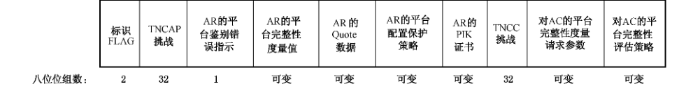

其中：—标识 FLAG 字段长度为2个八位位组，定义如前。比特0、1、2、3、4、8和11 有意义。比特0的值与消息1中标识 FLAG字段中的比特◎的值相同。比特4的值是 TNCC依据本轮 PAI协议中的对 AC 的平台鉴别需求来设置的。在一次可信网络连接过程中，当本轮 PAI 协议为首个平台鉴别过程中的首轮PAI协议时，本轮PAI协议中的对AC的平台鉴别需求为 TNCC 初始配置的对AC 的平台鉴别需求；当本轮 PAI 协议为非首个平台鉴别过程中的首轮 PAI 协议时，本轮 PAI 协议中的对AC的平台鉴别需求为上一个平台鉴别过程中 TNCC设置的用于下一个平台鉴别过程的对 AC 的平台鉴别需求；当本轮 PAI 协议非首轮 PAI 协议时，本轮PAI 协议中的对 AC 的平台鉴别需求为上一轮 PAI 协议中 TNCC设置的用于下一轮 PAI 协议的对AC的平台鉴别需求。

TNCAP 挑战字段长度为32个八位位组，其值与消息1中的 TNCAP 挑战相同。当标识FLAG 字段中比特0的值为0时，TNCAP 挑战字段不存在。

AR 的平台鉴别错误指示字段长度为1个八位位组。当标识 FLAG 字段中比特1的值为。

时，AR 的平台鉴别错误指示字段不存在。AR的平台鉴别错误指示字段的值如下：1 发生不可跳过错误；

2 平台修补未完成；

其他值保留。

AR 的平台完整性度量值字段长度为可变，定义如前。若AR 和 PM之间存在安全通道，则AR 的平台完整性度量值在安全通道中传递给 PM；否则 AR 的平台完整性度量值可采用数字信封（参见附录C）的方式传递给PM。AR 和 PM 之间的安全通道可以采取EWAI 协议和ETLS 协议来建立，具体见 6.2.1.3.5 和 6.2.2.2.4。

AR的 Quote 数据字段长度可变，定义如前。当标识 FLAG 字段中比特11 的值为0时，AR的 Quote 数据字段不存在。

AR 的平台配置保护策略字段长度可变，定义如前。当标识 FLAG 字段中比特2的值为0时，AR 的平台配置保护策略字段不存在。若AR 和PM之间存在安全通道，则AR的平台配置保护策略在安全通道中传递给 PM；否则 AR 的平台配置保护策略可采用数字信封（参见附录C）的方式传递给PM。AR 和PM之间的安全通道可以采取EWAI 协议和ETLS协议来建立，具体见 6.2.1.3.5 和 6.2.2.2.4。

AR的PIK 证书字段长度可变，其定义不在本标准中规定。当标识 FLAG 字段中比特3的值为0时，AR 的PIK 证书字段不存在。

TNCC 挑战字段长度为32个八位位组，由 TNCC 采用随机数生成算法生成。当FLAG 标识字段的比特4的值为0时，本字段不存在。

对AC 的完整性度量请求参数字段为可变长度，定义如前。当 FLAG 标识字段的比特4的值为0时，本字段不存在。对 AC 的平台完整性度量请求参数字段的值是 TNCC 依据本轮 PAI协议中的对AC的平台完整性评估策略生成的，其中平台完整性评估策略的定义如前。在一次可信网络连接过程中，当本轮 PAI 协议为首个平台鉴别过程中的首轮 PAI 协议时，本轮PAI 协议中的对AC 的平台完整性评估策略为 TNCC初始配置的对AC的平台完整性评估策略或 TNCC初始配置的对AC 的平台完整性评估策略的第一分割部分；当本轮 PAI 协议非首个平台鉴别过程中的首轮 PAI 协议时，本轮 PAI 协议中的对AC的平台完整性评估策略上一个平台鉴别过程中 TNCC设置的用于下一个平台鉴别过程的对AC 的平台完整性评估策略或上一个平台鉴别过程中 TNCC设置的用于下一个平台鉴别过程的对AC的平台完整性评估策略的第一分割部分；当本轮 PAI 协议非首轮 PAI 协议时，本轮 PAI 协议中的对AC的平台完整性评估策略为上一轮 PAI 协议中 TNCC 设置的用于一轮 PAI 协议的对 AC的平台完整性评估策略。TNCC初始配置的对AC的平台完整性评估策略的分割方法见7.2.2.1.2中的c）。

对AC的平台完整性评估策略字段长度为可变，定义如前。当FLAG 标识字段的比特4的值为0时，本字段不存在。若AR 和PM之间存在安全通道，则AR的完整性评估策略在安全通道中传递给 PM；否则 AR 的完整性评估策略可采用数字信封（参见附录C）的方式传递给PM。AR 和PM之间的安全通道可以采取EWAI 协议和 ETLS 协议来建立，具体见 6.2.1.3.5和 6.2.2.2.4。

当 TNCC 接收到 TNCAP发送的消息1,TNCC向 TNCAP发送消息2。

TNCAP 接收到 TNCC发送的消息2后，进行如下处理：

a） 检查标识 FLAG 字段中比特0的值，若值为0，则执行步骤b）；否则步骤d）。

b） 检查标识 FLAG 字段中比特4的值，若值为0，则丢弃消息2；否则执行步骤c）。

c） 若本轮 PAI 协议为首个平台鉴别过程中的 PAI 协议，则首先依据TNCAP上端的各个 IMC支持的消息类型检查对AC 的平台完整性度量请求参数，若不支持对AC 的平台完整性度量请求参数中不可跳过的组件类型级平台完整性度量请求参数条目（即不可跳过的组件类型级平台完整性度量请求参数条目中的消息类型不包含在 TNCAP上端的各个 IMC 支持的消息类型中），则设置标识 FLAG 字段中比特5的值为1和AC的平台鉴别错误指示字段的值为1，然后根据标识 FLAG、TNCC 挑战和 AC 的平台鉴别错误指示构造消息5，并发送给 TNCC，否则：依据 TNCC 挑战、对AC的平台完整性度量请求参数生成AC的平台完整性度量值、AC的 Quote 数据；若 TNCAP 需要对 AC 的平台配置进行保护，则依据对AC的平台完整性度量请求参数和 TNCAP初始配置的AC的平台配置保护策略生成AC 的平台配置保护策略，并在生成 AC的平台配置保护策略后设置标识 FLAG字段中比特6的值为1；当标识 FLAG 字段中比特8的值为1时，TNCAP 依据本地创建的 ConnectionID 获取AC 的PIK 证书，并设置标识 FLAG 字段中比特7的值为1；依据标识 FLAG、TNCC 挑战、AC的PIK证书、AC的平台完整性度量值、AC 的平台配置保护策略和对AC 的平台完整性评估策略构成消息3，并发送给 EPS。

d） 检查标识 FLAG 字段中的比特1的值，若比特1的值为1，则执行步骤e）；否则执行步骤f）。

e） 检查 TNCAP 挑战字段的值，若值与消息1中的 TNCAP 挑战字段不相同，则丢弃消息2；否则继续检查 AR 的平台鉴别错误指示字段的值，若值为2，则TNCAP 在等待一个最大平台修补时间后执行下一轮 PAI 协议，并设置用于下一轮 PAI 协议的对AR 的平台鉴别需求和对AR 的平台完整性评估策略分别为本轮 PAI 协议中的对 AR 的平台鉴别需求和对 AR的平台完整性评估策略；若值为1，则 TNCAP生成 AC的访问决策为禁止（将AC 的访问决策发送给NAC），并设置标识 FLAG 字段中比特10的值为1，然后依据标识 FLAG、TNCAP 挑战、AC的访问决策构成消息5，并发送给 TNCC。

f） 检查 TNCAP挑战字段的值，若与消息1中的TNCAP 挑战字段不相同，则丢弃消息2；否则检查标识 FLAG 字段中比特11 的值，若值1，则执行步骤g）；否则执行步骤h）。

g） 验证 AR 的 Quote 数据中的PIK 签名，若验证不通过，则丢弃消息2；否则执行步骤h）。

h）检查标识 FLAG 字段中比特4的值，若值为0，则执行步骤i）；否则执行步骤j）。

i） 生成TNCAP平台鉴别挑战；若本轮 PAI 协议首个平台鉴别过程中的首轮 PAI 协议且TNCAP需要验证 AR的PIK 证书有效性，则设置标识 FLAG 字段中比特3的值力1；依据标识 FLAG、TNCAP平台鉴别挑战、AR 的PIK 证书、AR 的平台完整性度量值、AR 的平台配置保护策略和对 AR 的平台完整性评估策略构成消息3，并发送给 EPS。

若本轮 PAI 协议是首个平台鉴别过程中的PAI 协议，则首先依据 TNCAP上端的各个IMC支持的消息类型检查对AC 的平台完整性度量请求参数，若不支持对AC 的平台完整性度量请求参数中不可跳过的组件类型级平台完整性度量请求参数条目（即不可跳过的组件类型级平台完整性度量请求参数条目中的消息类型不包含在 TNCAP上端的各个IMC 支持的消息类型中），则设置标识 FLAG 字段中比特5的值为1和 AC 的平台鉴别错误指示的值力1，然后根据标识 FLAG、TNCC 挑战和 AC 的平台鉴别错误指示构造消息 5，并发送给 TNCC；否则：依据 TNCC挑战、对AC 的平台完整性度量请求参数生成AC的平台完整性度量值、AC的Quote 数据；若 TNCAP需要对AC 的平台配置进行保护，则依据对AC的平台完整性度量请求参数和 TNCAP 初始配置的AC的平台配置保护策略生成AC 的平台配置保护策略，并在生成 AC的平台配置保护策略后设置标识 FLAG 字段中比特6的值为1；当标识 FLAG 字段中比特8的值为1时，TNCAP依据本地创建的ConnectionID 获取 AC的PIK 证书，并设置标识FLAG 字段中比特7的值为1；生成 TNCAP平台鉴别挑战；若本轮 PAI 协议为首个平台鉴别过程中的首轮 PAI 协议且 TNCAP需要验证 AR的PIK 证书有效性，则设置标识 FLAG 字段中比特3的值为1；依据标识 FLAG、TNCAP 平台鉴别挑战、TNCC挑战、AR的PIK证书、AC 的PIK 证书、AR的平台完整性度量值、AR的平台配置保护策略、对AR 的平台完整性评估策略、AC的平台完整性度量值、AC 的平台配置保护策略和对AC的平台完整性评估策略构成消息3，并发送给 EPS。

在依据 TNCC挑战、对AC 的平台完整性度量请求参数生成AC的平台完整性度量值、AC的Quote 数据的过程中，对于对AC的平台完整性度量请求参数中的一个组件类型级平台完整性度量请求参数条目，若该组件类型级平台完整性度量请求参数条目不为 TNCAP上端的任意一个 IMC 所支持，则生成一个组件类型级平台完整性度量值条目，其状态码的值设置为2；否则利用 AC中的 IF-IMC功能函数 TCA_IMC_RequestMeasurementInfo 将该组件类型级平台完整性度量请求参数条目中的各个组件属性级平台完整性度量请求参数条目发送给 TNCAP上端的相应 IMC。当 TNCAP 上端的一个 IMC 收到一个组件类型级平台完整性度量请求参数条目中的各个组件属性级平台完整性度量请求参数条目时，该IMC首先依据各个组件属性级平台完整性度量请求参数条目中的组件属性类型厂家ID 及组件属性类型执行平台完整性度量（具体度量过程不在本标准中规定），并生成一个 IF-IM 消息和一个完整性报告索引信息（当该 IF-IM 消息中包含完整性报告索引信息时该完整性报告索引信息才被生成），然后利用 AC中的 IF-IMC 功能函数 TCA_TNCAP_SendMessage 将该 IF-IM 消息发送给TNCAP，并利用AC中的 IF-IMC 功能函数 TCA_TNCC_ProvideReportIndex 将该完整性报告索引信息发送给 TNCAP（不管是否生成该 IF-IM 消息对应的完整性报告索引信息，本功能函数都必须执行）。

当从 TNCAP上端的一个 IMC 收到一个完整性报告索引信息时，若对AC 的平台完整性度量请求参数对应的所有完整性报告索引信息都已收到，则利用 TNCC 挑战和这些完整性报告索引信息生成AC 的完整性报告和该完整性报告对应的 Quote 数据（具体生成方法不在本标准中规定），其中该完整性报告对应的 Quote 数据即为 AC 的 Quote 数据。当从 TNCAP上端的一个 IMC 收到一个 IF-IM 消息时，TNCAP 依据该 IF-IM 消息生成一个 IF-IM 级平台完整性度量值条目，若对AC的平台完整性度量请求参数中的一个组件类型级平台完整性度量请求参数条目对应的所有IF-IM 消息都已收到，则利用该组件类型级平台完整性度量请求参数条目对应的各个 IF-IM 级平台完整性度量值条目生成一个组件类型级平台完整性度量值条目，若对AC 的平台完整性度量请求参数对应的所有IF-IM 消息都已收到，则利用对 AC 的平台完整性度量请求参数对应的各个组件类型级平台完整性度量值条目和 AC的完整性报告生成 AC的平台完整性度量值。

在依据对AC 的平台完整性度量请求参数和 TNCAP 初始配置的AC 的平台配置保护策略生成AC 的平台配置保护策略的过程中，对AC的平台完整性度量请求参数中的一个组件类型级平台完整性度量请求参数条目生成 AC 的平台配置保护策略中的零个或一个组件类型级平台配置保护策略条目，其中该组件类型级平台配置保护策略条目中的消息类型与该组件类型级平台完整性度量请求参数条目中的消息类型相同，该组件类型级平台配置保护策略条目中的一个或多个组件属性级平台配置保护策略条目中的组件属性类型厂家ID 及组件属性类型与该组件类型级平台完整性度量请求参数条目中的一个组件属性级平台完整性度量请求参数条目中的组件属性类型厂家ID 及组件属性类型相同。

当在 TNCAP 预配置的AC 的平台配置保护策略中找不到该组件类型级平台完整性度量请求参数条目中的消息类型时，TNCAP 不能生成该组件类型级平台完整性度量请求参数条目对应的组件类型级平台配置保护策略条目。当在 TNCAP预配置的AC的平台配置保护策略中找不到该组件类型级平台完整性度量请求参数条目中的任意组件属性类型厂家ID及组件属性类型时，TNCAP 不能生成该组件类型级平台完整性度量请求参数条目对应的组件类型级平台配置保护策略条目。

对于一个消息类型，TNCC上端的一个 IMC 可以支持该消息类型下的多个组件产品的平台完整性度量，但是 TNCC上端的多个 IMC 不可以支持该消息类型下的同一个组件产品的平台完整性度量。

###### 7.2.2.2.2.3 消息 3

消息3的数据字段格式如图73所示。

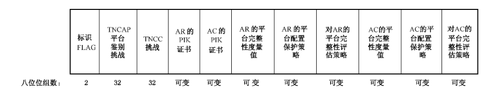

其中：一标识 FLAG 字段长度为2个八位位组，定义如前。比特0、2、3、4、6和7有意义。比特0、2和4 的值分别与消息2中标识 FLAG 字段中比特0、2和4的值相同。

TNCAP平台鉴别挑战字段长度为32个八位位组，由 TNCAP 采用随机数生成算法产生的，用于与 EPS进行信息交互。当标识 FL.AG 字段中比特0的值为◎时，本字段不存在。

TNCC 挑战字段长度为32个八位位组，本字段的值与消息2中 TNCC 挑战字段的值相同。

当标识 FLAG 字段中比特4的值为0时，本字段不存在。

AR的PIK 证书字段长度为可变，本字段的值与消息2中 AR的PIK 证书字段的值相同。当标识 FL.AG 字段中比特3的值为0时，本字段不存在。

AC 的PIK 证书字段长度为可变，其定义不在本标准中规定。当标识 FLAG 字段中比特7的值为0时，本字段不存在。

AR 的平台完整性度量值字段长度为可变，本字段的值与消息2中AR的平台完整性度量值字段的值相同。当标识 FLAG 字段中比特0的值为0时，本字段不存在。

AR的平台配置保护策略字段长度可变，本字段的值与消息2中 AR 的平台配置保护策略字段的值相同。当标识 FLAG 字段中比特2的值为0时，本字段不存在。

对AR 的平台完整性评估策略字段长度为可变，定义如前。若AC 和PM之间存在安全通道，则对 AR 的平台完整性评估策略在该安全通道中传递给 PM；否则对 AR 的平台完整性评估策略可采用数字信封（参见附录C）的方式传递给PM。AC 和 PM之间的安全通道可以采取EWAI 协议和ETLS 协议来建立，具体见 6.2.1.3.5 和6.2.2.2.4。当标识 FLAG 字段中比特0的值为0时，本字段不存在。

AC 的平台完整性度量值字段长度为可变，定义如前。若AC 和 PM之间存在安全通道，则AC 的平台完整性度量值在该安全通道中传递给 PM；否则 AC 的平台完整性度量值可采用数字信封（参见附录C）的方式传递给 PM。AC 和 PM之间的安全通道可以采取EWAI 协议和ETLS协议来建立，具体见 6.2.1.3.5和 6.2.2.2.4。当标识 FLAG 字段中比特4的值为0时，本字段不存在。

AC 的平台配置保护策略字段长度为可变，定义如前。当标识 FLAG 字段中比特6 的值力。

时，本字段不存在。若AC 和 PM之间存在安全通道，则AC 的平台配置保护策略在该安全通道中传递给 PM；否则 AC的平台配置保护策略可采用数字信封（参见附录C）的方式传递给PM。AC 和PM之间的安全通道可以采取 EWAI 协议和 ETLS 协议来建立，具体见 6.2.1.3.5和6.2.2.2.4。当标识 FL.AG 字段中比特6的值1时，本字段存在。

对AC的平台完整性评估策略字段长度为可变，本字段的值与消息2中对 AC 的平台完整性评估策略字段的值相同。当标识 FLAG 字段中比特4的值为0时，本字段不存在。

当 TNCAP 接收到 TNCC发送的消息2时，TNCAP向 EPS发送消息3，或向 TNCC 发送消息5。

EPS接收到 TNCAP发送的消息3后，进行如下处理：

a） 检查标识 FLAG 字段中比特0的值，若值为0，则执行步骤b）；否则执行步骤d）。

b） 检查标识 FLAG 字段中比特4的值，若值为0，则丢弃消息3；否则执行步骤c）。

c） 若标识 FLAG 字段中比特7的值为1，则验证 AC的PIK 证书，并生成AC的PIK 证书验证结果；依据 AC的平台完整性度量值、AC 的平台配置保护策略和对AC 的平台完整性评估策略生成AC 的平台完整性评估结果、AC的平台修补信息、AC的错误原因信息、AC 的 Quote 数据和下一个平台鉴别过程的对AC 的平台完整性评估策略；若生成 AC 的 Quote 数据，则设置标识 FLAG 字段中比特12的值为1；生成 PIK 证书验证和平台完整性评估结果；利用PM 的用户证书的私钥生成对 PIK 证书验证和平台完整性评估结果的签名；依据标识 FLAG、PIK证书验证和平台完整性评估结果、对 PIK 证书验证和平台完整性评估结果的签名构成消息4，并发送给 TNCAP d 检查标识 FLAG 字段中比特4的值，若值为0，则执行步骤e）；否则执行步骤f）。

e） 若标识FL.AG 字段中比特3的值为1，则验证 AR的PIK证书，并生成AR的PIK证书验证结果；依据 AR 的平台完整性度量值、AR 的平台配置保护策略和对AR的平台完整性评估策略生成 AR 的平台完整性评估结果、AR 的平台修补信息、AR 的错误原因信息、AR 的 Quote 数据和下一个平台鉴别过程的对 AR的平台完整性评估策略；若生成 AR的 Quote 数据，则设置标识 FLAG 字段中比特11 的值为1；生成 PIK证书验证和平台完整性评估结果；利用PM的用户证书的私钥生成对 PIK 证书验证和平台完整性评估结果的签名；依据标识 FLAG、PIK证书验证和平台完整性评估结果、对PIK 证书验证和平台完整性评估结果的签名构成消息4，并发送给 TNCAP。

f 若标识 FLAG 字段中比特3的值为1，则验证 AR的PIK 证书，并生成AR的PIK 证书验证结果；依据 AR 的平台完整性度量值、AR 的平台配置保护策略和对AR的平台完整性评估策略生成 AR的平台完整性评估结果、AR 的平台修补信息、AR 的错误原因信息、AR 的 Quote 数据和下一个平台鉴别过程的对AR 的平台完整性评估策略；若生成 AR 的 Quote 数据，则设置标识 FL.AG 字段中比特11的值为1；若标识 FLAG 字段中比特7的值为1，则验证 AC的PIK证书，并生成 AC的PIK 证书验证结果；依据 AC的平台完整性度量值、AC 的平台配置保护策略和对AC的平台完整性评估策略生成AC的平台完整性评估结果、AC的平台修补信息、AC 的错误原因信息、AC的Quote 数据和下一个平台鉴别过程的对AC 的平台完整性评估策略；若生成 AC 的Quote 数据，则设置标识FLAG 字段中比特12的值为1；生成PIK证书验证和平台完整性评估结果；利用 PM的用户证书的私钥生成对 PIK 证书验证和平台完整性评估结果的签名；依据标识 FLAG、PIK 证书验证和平台完整性评估结果，对PIK证书验证和平台完整性评估结果的签名构成消息 4，并发送给 TNCAP。

在依据 AR 的平台完整性度量值、AR的平台配置保护策略和对AR 的平台完整性评估策略生成AR 的平台完整性评估结果、AR 的平台修补信息、AR 的错误原因信息、AR 的 Quote 数据和下一个平台鉴别过程的对AR 的平台完整性评估策略的过程中，若AR 的平台完整性度量值中不包含一个完整性报告，则验证对 AR 的平台完整性评估策略中的各个组件类型级平台完整性评估策略条目；否则：验证该完整性报告（具体验证方法不在本标准中规定），若验证不通过，则丢弃消息 3；否则首先依据该完整性报告生成 AR 的 Quote 数据，然后验证对AR 的平台完整性评估策略中的各个组件类型级平台完整性评估策略条目。

在依据 AR 的平台完整性度量值、AR 的平台配置保护策略和对AR 的平台完整性评估策略生成AR 的平台完整性评估结果、AR 的平台修补信息、AR 的错误原因信息、AR 的 Quote 数据和下一个平台鉴别过程的对 AR 的平台完整性评估策略的过程中，对于对AR 的平台完整性评估策略中的一个组件类型级平台完整性评估策略条目，若该组件类型级平台完整性评估策略条目中的消息类型不为 EPS上端的任意一个 IMV 所支持，则生成一个组件类型级平台完整性评估结果（值设置为3）和一个组件类型级错误原因信息条目（组件类型级错误原因信息码字段的值设置为1）；否则依据该组件类型级平台完整性评估策略条目中的消息类型从 AR 的平台完整性度量值中读取相应组件类型级平台完整性度量值条目，若该组件类型级平台完整性度量值条目中状态码字段的值为2，则生成一个组件类型级平台完整性评估结果（值设置为3）和一个组件类型级错误原因信息条目（组件类型级错误原因信息码字段的值设置为2）；否则利用PM 中的 IF-IMV 功能函数 TCA_IMV_RequestEvaluationInfo 将该组件类型级平台完整性评估策略条目中的各个组件产品级平台完整性评估策略条目、该组件类型级平台完整性度量值条目中的各个 IF-IM级平台完整性度量值条目、AR的平台配置保护策略中对应该组件类型级平台完整性评估策略条目的组件类型级平台配置保护策略条目中的各个组件产品级平台配置保护策略条目、AR 的平台完整性度量值中的完整性报告发送给 EPS上端的各个相应 IMV。

在依据 AR 的平台完整性度量值、AR的平台配置保护策略和对AR 的平台完整性评估策略生成AR 的平台完整性评估结果、AR 的平台修补信息、AR的错误原因信息、AR 的 Quote 数据和下一个平台鉴别过程的对AR 的平台完整性评估策略的过程中，当 EPS上端的一个 IMV 收到一个组件产品级平台完整性评估策略条目（其组件产品序号为非 Oxff 值）及相应条目序号、各个组件产品级平台配置保护策略条目、各个 IF-IM 级平台完整性度量值条目、一个完整性报告时，若该IMV 不支持该组件产品级平台完整性评估策略条目所对应的组件产品序号及组件产品，则首先生成一个组件产品级平台完整性评估结果（值设置3）和一个组件产品级错误原因信息条目（组件产品级错误原因信息码字段的值设置为1），然后利用 PM 中的 IF-IMV 功能函数 TCA_EPS_ProvideEvaluationResult 将该组件产品级平台完整性评估结果和该组件产品级错误原因信息条目发送给 EPS；否则检查各个 IF-IM级平台完整性度量值条目和该完整性报告，若找不到该组件产品级平台完整性评估策略条目所对应的组件产品，则生成一个组件产品级平台完整性评估结果（值设置为3）和一个组件产品级错误原因信息条目（组件产品级错误原因信息码字段的值设置为3），然后利用 PM 中的 IF-IMV 功能函数 TCA_EPS_Provide- EvaluationResult 将该组件产品级平台完整性评估结果和该组件产品级错误原因信息条目发送给EPS；否则依据该组件产品级平台完整性评估策略条目中的各个组件属性级平台完整性评估策略条目及组件属性级汇聚平台完整性评估策略、该组件产品级平台完整性评估策略条目对应的IF-IM级平台完整性度量值条目和该完整性报告、该组件产品级平台完整性评估策略条目对应的组件产品级平台配置保护策略条目执行平台完整性评估，并生成一个组件产品级平台完整性评估结果、一个 IF-IM级平台修补信息条目、一个组件产品级错误原因信息条目和一个用于下一个平台鉴别过程的组件产品级平台完整性评估策略条目，其具体过程如图74所示。

开始1读取该组件产品级平台完鏊性评估策略条目中的组件属性级汇聚平台完盛性评估策略的一个或表达式L读取该或表达式中的一个条目序号及对应的组件属性级平台完墼性评估策略条目、该组件属性级平台完整性评估策略条目对应的IF-IM属性和AR的平台完签性度量值中的完整性报告、该组件属性级平台完整性评估策略条目对应的组件属性级平台配置保护策略条目是否已完成该纽件属性级 已完成平台完整性评估策略条目对应的平台完鏊性评估•未完成生成该组件属性级平台完整性评估策略条目对应的组件属性级平台完整性评估结果（若该组件属性级平台完整性评估策略条目对应的TF-IN属性包含一个完性报告索引信息，则需要依据该完蓥性报告索引信息从该完整性报告中获取相应的值）。若该组件属性级平台完整性评估结果的值为2，则生成一个IF-IM属性封装的平台修补信息和一个用于下一个平台鉴别过程的组件属性级平台完 性评估策略条目。若该组件属性级平台完性评估结果的值为3，则生成一个组件属性级错误原因信息条目生成该或表达式对为1 该组件属性級平台完熟性应的平台完整性评评估结果的值是否为1估结果，其值为1•不为！是否已读取完该或表达式 未读取完中的各个条目序号•已读取完生成该或表达式对应的平台完整性评估结果生成该组件产品级平台完整性评估策略条目对应的组件产品级平台完整性评估结果（其值为3或该或表达式对应的平台完整性 不为2 4）。若该组件产品级平台完评估结果是否为2 性评估结果的值为3，则利用当前或表达式对应的各个组件属性级错误原因信息条目构成一个组1为2件产品级错误原因信息条目生成该或表达式对应的、用于下一个平台鉴别过程的组件属性级汇聚平台完整性评估策略中的或表达式是否已读取完该组件产品级未读取完各个或表达式已读取完生成该组件产品级平台完整性评估馈略条目对应的组件产品级平台完整性评估结果（其值为1或2）。

在依据 AR 的平台完整性度量值、AR 的平台配置保护策略和对AR 的平台完整性评估策略生成AR 的平台完整性评估结果、AR 的平台修补信息、AR的错误原因信息、AR 的 Quote 数据和下一个平台鉴别过程的对AR的平台完整性评估策略的过程中，当 EPS上端的一个 IMV 收到一个组件产品级平台完整性评估策略条目（其组件产品序号 Oxff 值）及相应条目序号、各个组件产品级平台配置保护策略条目、各个 IF-IM级平台完整性度量值条目、一个完整性报告时，若该 IMV 不支持该组件产品级平台完整性评估策略条目所对应的组件产品序号、组件属性类型厂家 ID 及组件属性类型，则首先生成一个组件产品级平台完整性评估结果（值设置3）和一个组件产品级错误原因信息条目（组件产品级错误原因信息码字段的值设置为2），然后利用 PM 中的IF-IMV 功能函数 TCA_EPS_ProvideEvalu- ationResult 将该组件产品级平台完整性评估结果和该组件产品级错误原因信息条目发送给 EPS，否则检查各个 IF-IM级平台完整性度量值条目和该完整性报告，若找不到该组件产品级平台完整性评估策略条目中的组件属性级平台完整性评估策略条目中的组件属性类型厂家ID 及组件属性类型，则生成一个组件产品级平台完整性评估结果（值设置为4）；否则检查各个 IF-IM 级平台完整性度量值条目和该完整性报告，若只能找到该组件产品级平台完整性评估策略条目中的组件属性级平台完整性评估策略条目中的组件属性类型厂家ID及组件属性类型对应的IF-IM 错误信息，则生成一个组件产品级平台完整性评估结果（值设置3）和一个组件产品级错误原因信息条目（组件产品级错误原因信息码字段的值设置为4）；否则依据该组件产品级平台完整性评估策略条目中的组件属性级平台完整性评估策略条目执行平台完整性评估，若各个 IF-IM 级平台完整性度量值条目及该完整性报告中的所有组件产品的各个包含该组件属性级平台完整性评估策略条目中的组件属性类型厂家 ID 及组件属性类型的IF-IM属性都符合该组件属性级平台完整性评估策略条目对应的组件属性级平台完整性评估策略（若该IF- IM 属性包含一个完整性报告索引信息，则依据该完整性报告索引信息从该完整性报告中获取相应的值），则生成一个组件产品级平台完整性评估结果（值设置 1）；否则生成一个组件产品级平台完整性评估结果（值设置为4）。

对于一个消息类型，EPS上端的一个 IMV 可以支持该消息类型下的多个组件产品级平台完整性评估策略条目对应的平台完整性评估，但是 EPS上端的多个 IMV 不可以支持该消息类型下的同一个组件产品级平台完整性评估策略条目对应的平台完整性评估。

在依据 AR的平台完整性度量值、AR 的平台配置保护策略和对AR 的平台完整性评估策略生成AR 的平台完整性评估结果、AR 的平台修补信息、AR的错误原因信息、AR 的 Quote 数据和下一个平台鉴别过程的对 AR 的平台完整性评估策略的过程中，对于一个组件产品级平台完整性评估策略条目，EPS从EPS上端相应的各个 IMV 接收该组件产品级平台完整性评估策略条目对应的条目序号、组件产品级平台完整性评估结果、IF-IM 级平台修补信息条目、组件产品级错误原因信息条目和用于下一个平台鉴别过程的组件产品级平台完整性评估策略条目，若从每个 IMV 都接收到一个组件产品级错误原因信息条目，且该组件产品级错误原因信息条目中的组件产品级错误原因信息码字段的值为1或2，则EPS以任意一个从 IMV 接收到的该组件产品级平台完整性评估策略条目对应的条目序号、组件产品级平台完整性评估结果、IF-IM级平台修补信息条目、组件产品级错误原因信息条目和用于下一个平台鉴别过程的组件产品级平台完整性评估策略条目作为EPS生成的该组件产品级平台完整性评估策略条目对应的条目序号、组件产品级平台完整性评估结果、IF-IM级平台修补信息条目、组件产品级错误原因信息条目和用于下一个平台鉴别过程的组件产品级平台完整性评估策略条目；否则以一个从 IMV接收到的、组件产品级错误原因信息条目中的组件产品级错误原因信息码字段的值不1或2的该组件产品级平台完整性评估策略条目对应的条目序号、组件产品级平台完整性评估结果、IF-IM级平台修补信息条目、组件产品级错误原因信息条目和用于下一个平台鉴别过程的组件产品级平台完整性评估策略条目作为EPS生成的该组件产品级平台完整性评估策略条目对应的条目序号、组件产品级平台完整性评估结果、IF-IM级平台修补信息条目、组件产品级错误原因信息条目和用于下一个平台鉴别过程的组件产品级平台完整性评估策略条目。

在依据 AR的平台完整性度量值、AR 的平台配置保护策略和对AR 的平台完整性评估策略生成AR 的平台完整性评估结果、AR的平台修补信息、AR 的错误原因信息、AR 的 Quote 数据和下一个平台鉴别过程的对AR 的平台完整性评估策略的过程中，对于一个组件类型级平台完整性评估策略条目，EPS依据该组件类型级平台完整性评估策略条目中的组件产品级汇聚平台完整性评估策略生成该组件类型级平台完整性评估策略条目对应的条目序号、组件类型级平台完整性评估结果、组件类型级平台修补信息条目、组件类型级错误原因信息条目和用于下一个平台鉴别过程的组件类型级平台完整性评估策略条目的具体过程如图75所示。

开始 ）EPS生成一个组件产品级平台完整性评估策略条目对应的条目序号、组件产品级平台完控性评估结果、TF-IM级平台修补信息条目、组件产品级错误原因信息冬目和用于下一个平台鉴别过程的组件产品级平合完鏊性评佔策略条目对于组件产品级汇聚平台完整性评估策略中该组件产品级平台宛整性包含该条目序号的每一个或表达式，生成其评估结果的值是否为】对应的平台完整性评估结果，其值为1人不为1对于组件产品级汇聚平台完整性评估策略中包含该条目序号的每一不存在个或表达式，是否存在至少一个或表达式对应的各个组件产品级平台完藂性评估结果都已生成1存在生成至少一个或表达式对应的平合完整性评估结果读取其中一个或表达式对应的平合生成该组件类型级平台完整性评估策完 性评估结果略条目对应的组件类型级平台完整性评估结果（其值为3或4）。若该组件类型级平台完签性评估结果的值为3，则利用当前或表达式对应的各个不为2该或表达式对应的平台完整性 组件产品级错误原因信息条目构成一评估结果是否为2个组件类型级错误原因信息条目。此外，EPS利用PM中的IF-IMV功能函数•为2 TCA IMV EndEvaluation终止该组件类型级平台完茎性评估策略条目对应生成该或表达式对应的、用于下一个平台鉴别过程的的平台完整性评估组件产品级汇聚平台完性评估策略中的或表达式未谈取完是否已读取完所生成的各个或表议对应的平台完整性评估结！已读取完组件产品级汇聚平台完整性评估 不是都已生成策略中各个或表达式对应的平台完格性评估结果是否都已生成：都已生成生成该组件类型级平台完性评估策略条目对应的组件类型级平台完整性评估结果（其值为1或2）。

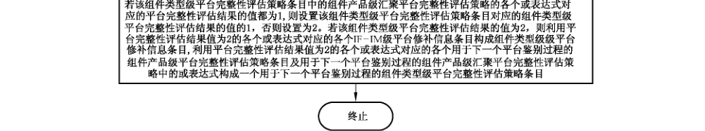

在依据 AR 的平台完整性度量值、AR 的平台配置保护策略和对AR 的平台完整性评估策略生成AR 的平台完整性评估结果、AR的平台修补信息、AR 的错误原因信息、AR 的 Quote 数据和下一个平台鉴别过程的对AR 的平台完整性评估策略的过程中，对于对 AR 的平台完整性评估策略，EPS依据对AR 的平台完整性评估策略中的组件类型级汇聚平台完整性评估策略生成对AR 的平台完整性评估策略对应的 AR 的平台完整性评估结果、AR 的平台修补信息、AR的错误原因信息和下一个平台鉴别过程的对 AR的平台完整性评估策略的具体过程如图76所示。

开始EPS生成一个组件类型级平台完整性评估策略条目对应的条目序号、组件类型级平台完整性评估结果、组件类型平台修补信息条目、组件类型级错误原因信息条目和用于下一个平台鉴别过程的组件类型级平台完整性评估策略条目对于组件类型级汇案平台完整性评估策略中包含该条目序号的每一个或表达式，生成其 该组件类型级平台完整性评估结果的值是否为1对应的平台完整性評估结果，其值为1上不为1对于组件类型级汇聚平台完整性评估策略中包含该条目序号的每一 不存在个或表达式，是否存在至少一个或表达式对应的各个组件类型级平台完整性评估结果都已生成存在生成至少一个或表达式对应的平合完签性评估结果读取其中一个或表达式对应的平台完莶性评估结果 生成对 AR 的平台完整性评估策路对应的AR的平台完整性评估结果（其值为3或4）。若 AR 的平台完鳖性评估结果的值为 3， 则利用当该或表达式对应的平台完整性 不为2前或表达式对应的各个组件类型级错误原因信息条目构成 AR的错误评估结果是否为2原因信息。此外，EPS 利用PM中的IF-IMV功能函数TCA_IMV_End•为2 Evaluation 终止对 AR 的平台完繁性生成该或表达式对应的、用于下一个平台鉴别过程的 评估策略对应的平台完整性评估绍件类型级汇聚平台宗該性评估策略中的或表达式未读取完 合已取完所生成的各个或表；

（对应的平台完整性评估结上已读取完组件类型级汇聚平台完教性评估 不是都己生成策略中各个或表达式对应的平台完整性评估结果是否都己生成都已生成生成对 AR 的平台完整性评估策略对应的 AR 的平台完性评估结果（其值为1或2）。若 AR 的平台完性评估策略中的组件类型级汇聚平台完 性评估策略的各个或表达式对应的平台完鏊性评估结果的值都为1，则设置 AR 的平台完整性评估策略对应的AR 的平台完整性评估结果的值的1，否则设置为2，若AR 的平台完整性评估结果的值为2，则利用平台完整评估结果值为2的各个或表达式对应的各个组件类型级平台修补信息条目构成 AR 的平台修补信息，利用平合完整性评估结果值为2的各个或表达式对应的各个用于下一个平台鉴别过程的组件类型级平台完整性评估策略条目及用于下一个平台鉴别过程的组件类型级汇棄平台完整性评估策略中的或表达式构成一个用于下一个平台鉴别过程的对AR 的平台完整性评估策略C 终止图 76| PAI-2协议中 EPS生成 AR 的平台完整性评估结果及其他参数的具体过程依据 AC的平台完整性度量值、AC的平台配置保护策略和对 AC的平台完整性评估策略生成AC的平台完整性评估结果、AC 的平台修补信息、AC的错误原因信息、AC的 Quote 数据和下一个平台鉴别过程的对AC的平台完整性评估策略的过程与依据 AR 的平台完整性度量值、AR 的平台配置保护策略和对AR 的平台完整性评估策略生成 AR 的平台完整性评估结果、AR 的平台修补信息、AR的错误原因信息、AR 的 Quote 数据和下一个平台鉴别过程的对AR 的平台完整性评估策略的过程完全类同。

###### 7.2.2.2.2.4 消息4

消息4的数据字段格式如图77所示。

其中：标识 FLAG 字段长度为2个八位位组，定义如前。比特0、2、3、4、6、7、11 和12有意义。比特0、2、3、4、6 和7的值分别与消息3中比特0、2、3、4、6 和7的值相同。当PIK 证书验证和平台完整性评估结果字段中包含 AR 的 Quote 数据时，设置标识 FLAG 字段中比特11 的值为1。

当 PIK 证书验证和平台完整性评估结果字段中包含 AC的 Quote 数据时，设置标识 FLAG 字段中比特12的值为1。

PIK 证书验证和平台完整性评估结果字段采用 PIK 证书验证和平台完整性评估结果属性表示，其格式定义如前。一次性随机数1、PIK 证书1、PIK 证书验证结果1、平台完整性度量值1、平台配置保护策略1、平台完整性评估策略1、平台完整性评估结果1、平台修补信息1、错误原因信息 1、Quote 数据1、用于下一个平台鉴别过程的平台完整性评估策略1、一次性随机数2、PIK 证书2、PIK 证书验证结果2、平台完整性度量值2、平台配置保护策略2、平台完整性评估策略2、平台完整性评估结果2、平台修补信息2、错误原因信息 2、Quote 数据2、用于下一个平台鉴别过程的平台完整性评估策略2分别为 TNCAP 平台鉴别挑战、AR的PIK证书、AR的 PIK 证书验证结果、AR的平台完整性度量值、AR 的平台配置保护策略、对AR 的平台完整性评估策略、AR的平台完整性评估结果、AR的平台修补信息、AR的错误原因信息、AR 的Quote 数据、用于下一个平台鉴别过程的对 AR 的平台完整性评估策略、TNCC挑战、AC 的PIK 证书、AC的PIK 证书验证结果、AC的平台完整性度量值、AC 的平台配置保护策略、对AC的平台完整性评估策略、AC的平台完整性评估结果、AC的平台修补信息、AC 错误原因信息、AC的 Quote 数据、用于下一个平台鉴别过程的对AC 的平台完整性评估策略。本字段中的 TNCAP平台鉴别挑战、AR 的PIK 证书、AR 的平台完整性度量值、AR 的平台配置保护策略、对AR 的平台完整性评估策略、TNCC挑战、AC的PIK 证书、AC 的平台完整性度量值、AC 的平台配置保护策略、对AC 的平台完整性评估策略分别与消息3中的TNCAP平台鉴别挑战、AR的PIK 证书、AR的平台完整性度量值、AR 的平台配置保护策略、对AR的平台完整性评估策略、TNCC挑战、AC的PIK证书、AC的平台完整性度量值、AC 的平台配置保护策略、对 AC的平台完整性评估策略相同。当标识 FLAG 字段中比特0的值为0时，TNCAP平台鉴别挑战、AR的PIK 证书、AR的PIK 证书验证结果、AR的平台完整性度量值、AR的平台配置保护策略、对AR的平台完整性评估策略、AR的平台完整性评估结果、AR 的平台修补信息、AR 的错误原因信息、AR 的 Quote 数据、用于下一个平台鉴别过程的对 AR 的平台完整性评估策略不存在。当标识 FLAG 字段中比特4的值0时，TNCC挑战、AC的PIK证书、AC的PIK 证书验证结果、AC的平台完整性度量值、AC 的平台配置保护策略、对AC的平台完整性评估策略、AC的平台完整性评估结果、AC的平台修补信息、AC 错误原因信息、AC 的 Quote 数据、用于下一个平台鉴别过程的对AC 的平台完整性评估策略不存在。当标识 FLAG 字段中比特2的值为0时，AR 的平台配置保护策略不存在。当标识 FLAG 字段中比特3的值都为0时，AR的PIK 证书和AR的PIK 证书验证结果不存在。当标识 FLAG 宁段中比特6的值为0时，AC的平台配置保护策略不存在。当标识 FLAG 字段中比特了的值都为0时，AC的PIK 证书和AC的PIK 证书验证结果不存在。当标识 FLAG 字段中比特11的值为0时，AR 的 Quote 数据不存在。当标识 FLAG 字段中比特12的值为0时，AC的Quote 数据不存在。当AR 的平台完整性评估结果字段的值1时，AR 的平台修补信息、AR的错误原因信息、用于下一个平台鉴别过程的对 AR 的平台完整性评估策略不存在。当AR的平台完整性评估结果字段的值为2时，AR 的错误原因信息不存在。当AR的平台完整性评估结果字段的值为3时，AR 的平台修补信息、用于下一个平台鉴别过程的对AR 的平台完整性评估策略不存在。当 AR 的平台完整性评估结果字段的值为4时，AR的平台修补信息、AR 的错误原因信息、用于下一个平台鉴别过程的对 AR 的平台完整性评估策略不存在。当AC 的平台完整性评估结果字段的值为1时，AC 的平台修补信息、AC的错误原因信息、用于下一个平台鉴别过程的对 AC的平台完整性评估策略不存在。当AC 的平台完整性评估结果字段的值为2时，AC 的错误原因信息不存在。当AC的平台完整性评估结果字段的值为3时，AC 的平台修补信息、用于下一个平台鉴别过程的对AC 的平台完整性评估策略不存在。

当AC 的平台完整性评估结果字段的值4时，AC的平台修补信息、AC的错误原因信息、用于下一个平台鉴别过程的对AC的平台完整性评估策略不存在。若AR 和 PM之间存在安全通道，则AR 的平台修补信息和用于下一个平台鉴别过程的对AC 的平台完整性评估策略在该安全通道中传递给 AR；否则 AR 的平台修补信息和用于下一个平台鉴别过程的对AC的平台完整性评估策略可采用数字信封（参见附录C）的方式传递给 AR。若AC和PM之间存在安全通道，则AC 的平台修补信息和用于下一个平台鉴别过程的对 AR的平台完整性评估策略在该安全通道中传递给 AC；否则 AC 的平台修补信息和用于下一个平台鉴别过程的对AR的平台完整性评估策略可采用数字信封（参见附录C）的方式传递给 AC。AR 和PM之间、AC 和PM之间的安全通道可以采取EWAI 协议和 ETLS 协议来建立，具体见 6.2.1.3.5 和6.2.2.2.4。

对 PIK 证书验证和平台完整性评估结果的签名采用签名属性表示，是利用PM 的用户证书的私钥生成的签名，定义如前。

当 EPS接收到 TNCAP发送的消息3时，EPS 向 TNCAP发送消息4。

TNCAP 接收到 EPS发送的消息4后，进行如下处理：

a） 检查标识 FLAG 字段中比特0的值，若值为0，则执行步骤b）；否则执行步骤e）。

b） 检查标识 FLAG 字段中比特4的值，若值为0，则丢弃消息 4；否则检查 PIK 证书验证和平台完整性评估结果中的AC 的平台完整性评估结果的值，若值2，则执行步骤c）；否则执行步骤d）。

c） 验证 PIK 证书验证和平台完整性评估结果及签名（PIK 证书验证和平台完整性评估结果中的AC 的 Quote 数据是 TNCAP生成的 AC 的Quote 数据），若验证不通过，则丢弃消息4；否则利用AC的IF-IMC 功能函数 TCA_IMC_ReceiveMessage 将 PIK 证书验证和平台完整性评估结果中的 AC 的平台修补信息发送给 TNCAP上端的相应 IMC。

d） 依据标识 FLAG、TNCC 挑战、TNCAP 生成的 AC 的 Quote 数据、AC 的PIK证书、复合 PIK证书验证和平台完整性评估结果构成消息5，并发送给 TNCC。

e） 检查标识 FLAG 字段中比特4的值，若值为0，则执行步骤f）；否则执行步骤n）。

f） 验证 PIK 证书验证和平台完整性评估结果及签名（PIK 证书验证和平台完整性评估结果中的AR 的 Quote 数据是消息2中的AR 的Quote 数据），若验证不通过，则丢弃消息4；否则继续检查 AR的PIK 证书验证结果和AR的平台完整性评估结果的值，若 AR 的PIK 证书验证结果的值为非0，或者AR的平台完整性评估结果的值为3或4，则首先生成AC 的访问决策，其值禁止（将AC的访问决策通知 NAC），并设置标识 FLAG 字段中比特10的值为1，然后依据标识 FLAG、TNCAP 挑战和AC 的访问决策构成消息5，并发送给 TNCC；否则执行步骤0q）。

g） 验证 TNCAP是否已读取完各个分割部分的对AR 的平台完整性评估策略，若 TNCAP 未读取完各个分割部分的对 AR的平台完整性评估策略，则执行步骤h）；否则执行k）。

h） 检查 PIK 证书验证和平台完整性评估结果中的AR 的平台完整性评估结果的值，若值为2，则执行步骤i）；否则执行步骤j）。

i） 设置下一轮 PAI 协议中的对 AR的平台鉴别需求1和下一轮 PAI 协议中的对 AR 的平台完整性评估策略为下一个分割部分的对AR 的平台完整性评估策略；首先设置标识 FLAG 字段中比特 13的值为1，然后依据标识 FLAG 字段、TNCAP 挑战、复合 PIK证书验证和平台完整性评估结果构成消息 5，并发送给 TNCC。

j） 设置下一轮 PAI 协议中的对 AR的平台鉴别需求为1和下一轮 PAI 协议中的对 AR 的平台完整性评估策略为下一个分割部分的对AR 的平台完整性评估策略，本轮 PAI 协议完成。

k） 检查 PIK 证书验证和平台完整性评估结果中的AR 的平台完整性评估结果的值，若值为2，则执行步骤1）；否则执行步骤 m）。

1） 依据各轮 PAI 协议中的AR的平台完整性评估结果生成该平台鉴别过程的AR的平台完整性评估结果（执行与运算而得，值为1或2）；若AR的PIK 证书验证结果的值为0且该平台鉴别过程的AR 的平台完整性评估结果的值为1，则首先生成AC的访问决策，其值为允许；若AR的PIK 证书验证结果的值为0且该平台鉴别过程的AR的平台完整性评估结果的值2，则首先生成 AC的访问决策，其值为隔离；将AC 的访问决策通知 NAC；若AC 的访问决策为隔离，则依据各轮 PAI 协议中的用于下一个平台鉴别过程的对AR 的平台完整性评估策略生成用于下一个平台鉴别过程的对 AR 的平台完整性评估策略（每一轮 PAI 协议中的用于下一个平台鉴别过程的对AR 的平台完整性评估策略为用于下一个平台鉴别过程的对AR 的平台完整性评估策略中的一个分割部分），并设置对 AR 的平台鉴别需求的值为1；首先设置标识FLAG 字段中比特10和13的值为1，然后依据标识 FLAG、TNCAP挑战、AC的访问决策、复合 PIK 证书验证和平台完整性评估结果构成消息5，并发送给 TNCC。

m） 依据各轮 PAI 协议中的 AR 的平台完整性评估结果生成该平台鉴别过程的AR 的平台完整性评估结果（执行与运算而得，值为1或2）；若AR的PIK证书验证结果的值0且该平台鉴别过程的AR的平台完整性评估结果的值为1，则生成AC的访问决策，其值为允许；若AR的PIK 证书验证结果的值为。且该平台鉴别过程的AR 的平台完整性评估结果的值为2，则生成AC 的访问决策，其值为隔离；将 AC 的访问决策通知 NAC；若AC 的访问决策隔离，则依据各轮 PAI 协议中的用于下一个平台鉴别过程的对 AR 的平台完整性评估策略生成用于下一个平台鉴别过程的对 AR 的平台完整性评估策略（每一轮 PAI 协议中的用于下一个平台鉴别过程的对AR 的平台完整性评估策略为用于下一个平台鉴别过程的对AR的平台完整性评估策略中的一个分割部分），并设置对AR 的平台鉴别需求的值为1；首先设置标识 FLAG 字段中比特10的值为1，然后依据标识 FLAG、TNCAP挑战、AC 的访问决策构成消息5，并发送给 TNCC。

n） 验证 PIK 证书验证和平台完整性评估结果及签名（PIK 证书验证和平台完整性评估结果中的AR 的 Quote 数据是消息2中的AR 的 Quote 数据，PIK 证书验证和平台完整性评估结果中的 AC的 Quote 数据是消息2中的AC的Quote 数据），若验证不通过，则丢弃消息4；否则继续检查 AR的PIK 证书验证结果和AR 的平台完整性评估结果的值，若 AR的PIK证书验证结果的值非0，或者AR的平台完整性评估结果的值为3或4，则首先生成AC 的访问决策，其值为禁止（将AC 的访问决策通知 NAC），并设置标识 FLAG 字段中比特10的值1，然后依据标识 FLAG、TNCAP 挑战和 AC的访问策构成消息5，并发送给 TNCC；否则执行步骤。）。

检查 PIK 证书验证和平台完整性评估结果中的 AC 的平台完整性评估结果的值，若值为2，则执行步骤 p）；否则执行步骤q）。

P）利用AC的IF-IMC 功能函数 TCA_IMC ReceiveMessage 将 PIK 证书验证和平台完整性评估结果中的AC 的平台修补信息发送给 TNCAP上端的相应 IMC。

q 验证 TNCAP 是否已读取完各个分割部分的对 AR 的平台完整性评估策略，若 TNCAP未读取完各个分割部分的对AR的平台完整性评估策略，则首先设置下一轮 PAI 协议中的对 AR的平台鉴别需求为1和下一轮 PAI 协议中的对AR 的平台完整性评估策略为下一个分割部分的对AR的平台完整性评估策略，然后依据标识 FLAG、TNCC挑战、TNCAP生成的AC的Quote 数据、AC的PIK证书、复合PIK证书验证和平台完整性评估结果构成消息5，并发送给 TNCC；否则：依据各轮 PAI 协议中的AR 的平台完整性评估结果生成该平台鉴别过程的AR 的平台完整性评估结果（执行与运算而得，值为1或2）；若AR的PIK证书验证结果的值为0且该平台鉴别过程的AR 的平台完整性评估结果的值为1，则生成AC的访问决策，其值为允许；若AR的PIK 证书验证结果的值。且该平台鉴别过程的AR 的平台完整性评估结果的值为2，则生成AC 的访问决策，其值为隔离；将AC的访问决策通知 NAC；若AC的访问决策为隔离，则依据各轮 PAI 协议中的用于下一个平台鉴别过程的对AR 的平台完整性评估策略生成用于下一个平台鉴别过程的对 AR的平台完整性评估策略（每一轮 PAI 协议中的用于下一个平台鉴别过程的对AR 的平台完整性评估策略为用于下一个平台鉴别过程的对AR的平台完整性评估策略中的一个分割部分），并设置对AR 的平台鉴别需求的值为1；首先设置标识 FLAG 字段中比特10的值为1，然后依据标识 FLAG、TNCAP 挑战、AC 的访问决策、TNCC挑战、AC的 Quote 数据、AC的PIK 证书、复合 PIK 证书验证和平台完整性评估结果构成消息5，并发送给 TNCC。

###### 7.2.2.2.2.5 消息 5

消息5的数据字段格式如图78所示。

其中：一标识 FLAG字段长度为2个八位位组，定义如前。比特0、2、3、4、5、6、7、10和12有意义。比特0、2、3、4、6、7和12的值分别与消息4中比特0、2、3、4、6、7和12的值相同。

TNCAP挑战字段长度为32个八位位组，定义如前。TNCAP 挑战字段的值与消息1中TNCAP 挑战字段的值相同。

AC 的访问决策字段长度为1个八位位组，其值为允许、隔离或禁止。当标识 FLAG 字段中比特10的值为1时，本字段存在。

TNCC 挑战字段长度为32个八位位组，定义如前。TNCC 挑战字段的值与消息2中 TNCC挑战字段的值相同。

AC 的平台鉴别错误指示字段长度为1个八位位组。当标识 FLAG 字段中比特5的值为1时，本字段存在。AC的平台鉴别错误指示字段的值如下：1 不可跳过错误；

其他值保留。

AC的 Quote 数据字段长度可变，其值为 TNCAP生成的AC 的 Quote 数据。当标识 FLAG字段中比特12的值为1时，本字段存在。

AC 的PIK 证书字段长度为可变，定义如前。当标识 FLAG字段中比特7的值的1时，本字段存在。

复合 PIK 证书验证和平台完整性评估结果字段长度为可变，其内容为消息4中除标识 FLAG字段的其他字段。

当 TNCAP接收到 EPS发送的消息4时，TNCAP 向 TNCC 发送消息5。

TNCC接收到 TNCAP发送的消息5后，进行如下处理：a 检查标识 FLAG 字段中比特。的值，若值为0，则执行步骤b）；否则执行步骤e）。

b） 检查标识 FLAG 字段中比特4的值，若值0，则丢弃消息5；否则检查标识 FL.AG 字段中比特5的值，若值为1且AC的平台鉴别错误指示的值为1，则TNCC首先生成AR 的访问决策，其值为禁止（将AR 的访问决策通知 NAR），并设置标识 FLAG 字段中比特9的值为1，然后依据标识 FLAG、TNCC挑战和 AR 的访问决策构成消息 6，并发送给 TNCAP；否则执行步骤c）。

验证 AC 的Quote 数据中的PIK 签名（当标识 FLAG 字段中比特12的值为1时才需要验证AC 的Quote 数据中的PIK 签名），若验证不通过，则丢弃消息 5；否则验证 PIK 证书验证和平台完整性评估结果及签名（PIK 证书验证和平台完整性评估结果中的 AC 的 Quote 数据是消息5中的 AC 的 Quote 数据），若验证不通过，则丢弃消息 5；否则继续检查 AC 的 PIK 证书验证结果和 AC的平台完整性评估结果的值，若AC的PIK 证书验证结果的值为非0，或者AC的平台完整性评估结果的值为3或4，则首先生成 AR 的访问决策，其值禁止（将AR的访问决策通知 NAR），并设置标识 FLAG 字段中比特9的值为1，然后依据标识 FLAG、TNCC挑战和 AR 的访问决策构成消息6，并发送给 TNCAP；否则执行步骤d）。

d） 验证 TNCC是否已读取完各个分割部分的对 AC 的平台完整性评估策略，若TNCC 未读取完各个分割部分的对AC的平台完整性评估策略，则设置下一轮 PAI 协议中的对AC的平台鉴别需求为1和下一轮 PAI 协议中的对 AC的平台完整性评估策略为下一个分割部分的对 AC的平台完整性评估策略，本轮 PAI 协议完成；否则依据各轮 PAI 协议中的AC 的平台完整性评估结果生成该平台鉴别过程的 AC的平台完整性评估结果（执行与运算而得，值1或2）；

若AC的PIK 证书验证结果的值为0且该平台鉴别过程的AC 的平台完整性评估结果的值为1，则生成 AR 的访问决策，其值为允许；若AC的PIK 证书验证结果的值为0且该平台鉴别过程的AC的平台完整性评估结果的值为2，则首先生成AR的访问决策，其值为隔离；将AR的访问决策通知 NAR；若 AR 的访问决策为隔离，则依据各轮 PAI 协议中的用于下一个平台鉴别过程的对 AC的平台完整性评估策略生成用于下一个平台鉴别过程的对AC 的平台完整性评估策略（每一轮 PAI 协议中的用于下一个平台鉴别过程的对AC的平台完整性评估策略为用于下一个平台鉴别过程的对AC 的平台完整性评估策略中的一个分割部分），并设置对AC的平台鉴别需求的值为1；首先设置标识FLAG 字段中比特9的值为1，然后依据标识 FLAG、TNCC 挑战和 AR 的访问决策构成消息6，并发送给 TNCAP。

检查标识 FLAG 字段中比特10的值，若值为0，则执行步骤f）；否则执行步骤m）。

f）检查标识 FLAG 字段中比特4的值，若值为0，则执行步骤g）；否则执行步骤h）。

g） 检查标识 FLAG 字段比特13 的值，若值为0，则丢弃消息5；否则验证 PIK 证书验证和平台完整性评估结果及签名（PIK 证书验证和平台完整性评估结果中的 AR 的 Quote 数据是 TNCC生成的 AR 的Quote 数据），若验证不通过，则丢弃消息5；否则利用 AR 的IF-IMC 功能函数TCA_IMC_ReceiveMessage将 PIK 证书验证和平台完整性评估结果中的 AR的平台修补信息发送给 TNCC 上端的相应 IMC，本轮 PAI 协议结束。

检查标识 FLAG 字段中比特5的值，若值为1且 AC 的平台鉴别错误指示的值为1，则 TNCC首先生成 AR 的访问决策，其值为禁止（将AR的访问决策通知 NAR），并设置标识 FLAG 字段中比特9的值为1，然后依据标识 FL.AG、TNCC挑战和 AR的访问决策构成消息6，并发送给 TNCAP，否则执行步骤i）。

验证 AC 的 Quote 数据中的 PIK 签名（当标识 FLAG 字段中比特12的值1时才需要验证AC 的Quote 数据中的PIK 签名），若验证不通过，则丢弃消息 5；否则验证 PIK 证书验证和平台完整性评估结果及签名（PIK 证书验证和平台完整性评估结果中的 AR 的 Quote 数据是TNCC生成的 AR 的 Quote 数据，PIK 证书验证和平台完整性评估结果中的 AC 的 Quote 数据是消息5中的AC 的Quote 数据），若验证不通过，则丢弃消息5；否则继续检查 AC的 PIK证书验证结果和 AC的平台完整性评估结果的值，若AC的PIK 证书验证结果的值力非0，或者AC的平台完整性评估结果的值为3或4，则首先生成 AR的访问决策，其值禁止（将AR的访问决策通知 NAR），并设置标识 FLAG 字段中比特9的值1，然后依据标识 FLAG、TNCC 挑战和 AR 的访问决策构成消息6，并发送给 TNCAP；否则执行步骤j）。

j 检查 PIK 证书验证和平台完整性评估结果中的AR 的平台完整性评估结果的值，若值2，则执行步骤k）；否则执行步骤1）。

k）利用AR的IF-IMC 功能函数 TCA_IMC_ReceiveMessage 将 PIK 证书验证和平台完整性评估结果中的 AR的平台修补信息发送给 TNCC上端的相应 IMC。

l 验证 TNCC是否已读取完各个分割部分的对AC 的平台完整性评估策略，若 TNCC 未读取完各个分割部分的对AC的平台完整性评估策略，则设置下一轮 PAI 协议中的对AC的平台鉴别需求为1和下一轮 PAI 协议中的对 AC的平台完整性评估策略为下一个分割部分的对 AC的平台完整性评估策略，本轮 PAI 协议结束；否则：依据各轮 PAI 协议中的AC 的平台完整性评估结果生成该平台鉴别过程的 AC 的平台完整性评估结果（执行与运算而得，值1或2）；

若AC的PIK 证书验证结果的值为。且该平台鉴别过程的AC的平台完整性评估结果的值为1，则生成 AR的访问决策，其值为允许；若AC的PIK 证书验证结果的值为0且该平台鉴别过程的AC 的平台完整性评估结果的值为2，则生成AR的访问决策，其值为隔离；将AR的访问决策通知 NAR；若AR 的访问决策为隔离，则依据各轮 PAI 协议中的用于下一个平台鉴别过程的对AC 的平台完整性评估策略生成用于下一个平台鉴别过程的对AC的平台完整性评估策略（每一轮 PAI 协议中的用于下一个平台鉴别过程的对 AC 的平台完整性评估策略用于下一个平台鉴别过程的对AC 的平台完整性评估策略中的一个分割部分），并设置对AC的平台鉴别需求的值为1；首先设置标识 FLAG 字段中比特9的值1，然后依据标识 FLAG、TNCC挑战和 AR 的访问决策构成消息6，并发送给 TNCAP。

m） 利用AR中的IF-IMC 功能函数 TCA_IMC_NotifyConnectionChange将AC 的访问决策通知TNCC上端的各个 IMC。若 AC 的访问决策禁止，则 TNCC通知 NAR断开与 AC 的连接；

否则执行步骤n）。

n） 检查标识 FLAG 字段中比特4的值，若值为0，则执行步骤。）；否则执行步骤p）。

o） 检查标识 FLAG 字段比特13的值，若值为0，本轮 PAI 协议结束；否则验证 PIK 证书验证和平台完整性评估结果及签名（PIK 证书验证和平台完整性评估结果中的 AR 的 Quote 数据是TNCC 生成的 AR 的 Quote 数据），若验证不通过，则丢弃消息5；否则利用AR的IF-IMC 功能函数 TCA_IMC_ReceiveMessage将 PIK 证书验证和平台完整性评估结果中的AR 的平台修补信息发送给 TNCC 上端的相应 IMC，本轮 PAI 协议结束。

p） 验证 AC 的 Quote 数据中的PIK 签名（当标识 FLAG 字段中比特12的值1时才需要验证AC 的 Quote 数据中的PIK 签名），若验证不通过，则丢弃消息5；否则验证 PIK 证书验证和平台完整性评估结果及签名（PIK 证书验证和平台完整性评估结果中的 AR 的 Quote 数据是TNCC生成的AR 的 Quote 数据，PIK 证书验证和平台完整性评估结果中的 AC 的 Quote 数据是消息5中的AC 的Quote 数据），若验证不通过，则丢弃消息5；否则继续检查 AC的 PIK证书验证结果和 AC的平台完整性评估结果的值，若AC的PIK 证书验证结果的值为非0，或者AC的平台完整性评估结果的值为3或4，则首先生成 AR的访问决策，其值禁止（将AR的访问决策通知 NAR），并设置标识 FLAG 字段中比特9的值为1，然后依据标识 FLAG、TNCC 挑战和AR 的访问决策构成消息6，并发送给 TNCAP；否则执行步骤q）。

q 检查 PIK 证书验证和平台完整性评估结果中的AR 的平台完整性评估结果的值，若值为2，则执行步骤r）；否则执行步骤s）。

r 利用 AR 的IF-IMC 功能函数 ：TCA_IMC_ReceiveMessage 将 PIK 证书验证和平台完整性评估结果中的 AR 的平台修补信息发送给 TNCC上端的相应 IMC。

验证 TNCC是否已读取完各个分割部分的对AC 的平台完整性评估策略，若TNCC 未读取完各个分割部分的对AC的平台完整性评估策略，则设置下一轮 PAI 协议中的对AC的平台鉴别需求为1和下一轮 PAI 协议中的对 AC的平台完整性评估策略为下一个分割部分的对 AC的平台完整性评估策略，本轮 PAI 协议结束；否则：依据各轮 PAI 协议中的AC的平台完整性评估结果生成该平台鉴别过程的AC 的平台完整性评估结果（执行与运算而得，值1或2）；

若AC的PIK 证书验证结果的值为0且该平台鉴别过程的AC 的平台完整性评估结果的值为1，则生成 AR的访问决策，其值允许；若AC的PIK 证书验证结果的值为0且该平台鉴别过程的AC 的平台完整性评估结果的值为2，则生成AR的访问决策，其值为隔离；将AR的访问决策通知 NAR；若AR 的访问决策为隔离，则依据各轮 PAI 协议中的用于下一个平台鉴别过程的对 AC的平台完整性评估策略生成用于下一个平台鉴别过程的对AC的平台完整性评估策略（每一轮 PAI 协议中的用于下一个平台鉴别过程的对AC 的平台完整性评估策略用于下一个平台鉴别过程的对AC的平台完整性评估策略中的一个分割部分），并设置对AC的平台鉴别需求的值为1；首先设置标识 FLAG 字段中比特9的值为1，然后依据标识 FLAG、TNCC挑战和 AR 的访问决策构成消息6，并发送给 TNCAP。

###### 7.2.2.2.2.6 消息6

消息6的数据字段格式如图79所示。

其中：一标识 FLAG 字段长度为2个八位位组，定义如前。比特4和9有意义。比特4的值与消息5中比特4的值相同。

-TNCC 挑战字段长度为32个八位位组，定义如前。TNCC挑战字段的值与消息2中的 TNCO挑战字段的值相同。

—AR 的访问决策字段长度为1个八位位组，定义如前。

TNCAP 接收到 TNCC发送的消息6后，进行如下处理：

a）检查标识 FLAG 字段中比特4的值，若值为0，则丢弃消息 6；否则执行步骤b）。

b） 检查标识 FLAG 字段中比特9的值，若值为0，则丢弃消息 6；否则执行步骤c）。

c）利用AC中的 IF-IMC 功能函数 TCA_IMC_NotifyConnectionChange 将 AR 的访问决策通知TNCAP上端的各个 IMC。若 AR 的访问决策为禁止，则 TNCAP通知 NAC 断开与 AR的连接。

## 8 完整性度量层

### 8.1 概述

完整性度量层包含两种组件：IMC和IMV。AR 中的各个 IMC负责收集AR 的平台完整性信息，AC 中的各个 IMC负责收集 AC 的平台完整性信息，而 PM 中的各个 IMV 负责校验和评估 AR 和 AC的平台完整性信息。

IF-IM 是IMC 和IMV之间的接口，它定义了IMC 和IMV之间的消息交换协议，称IF-IM 消息协议。IMC 和 IMV之间交换的消息称为IF-IM 消息。

### 8.2 IF-IM 消息协议

#### 8.2.1 IF-IM消息传递模型

IF-IM消息承载在可信平台评估层的PAI 协议中进行传递，具体见7.2.2。每一轮 PAI 协议可以传递一个或多个 IF-IM 消息。每一个 IF-IM 消息可以包含一个或多个的IF-IM 属性。

#### 8.2.2 IF-IM 与 PAI 协议的关系

IF-IM 与PAI 协议之间的重要关系就是消息类型。TNCC 和 TNCAP 利用消息类型路由 IF-IM消息至各个 IMC。EPS 利用消息类型路由 IF-IM 消息至各个 IMV。每一个 IMC 和IMV 支持各种消息类型。消息类型表明了 IF-IM 消息的组件类型。消息类型由两个部分构成：组件类型厂家 ID 和组件类型。本标准定义的组件类型如表3所示。

**表3 本标准定义的组件类型**

| 组件类型标识符 | 组件类型名称 | 描述 |
| --- | --- | --- |
| 0x00000001 | 操作系统 | 基于主机的操作系统 |
| 0x00000002 | 反病毒软件 | 基于主机的反病毒软件 |
| 0x00000003 | 反间谍软件 | 基于主机的反间谍软件 |
| 0x00000004 | 反恶意软件 | 基于主机的反恶意软件，不包括反病毒软件 和反间谍软件 |
| 0x00000005 | 防火墻 | 基于主机的防火墻 |
| 0x00000006 | 入侵检测/防御系统 | 基于主机的入侵检测和/或防御软件 |
| 0x00000007 | VPN（见 ISO/IEC 18028-5:2006 和RFC 2547） | 基于主机的 VPN软件 |
| 0x00000008 | 引导系统 | 基于主机的引导系统 |
| 0x00000009 | TCA | 基于主机的 TCA |
| Oxffffff | 任意组件类型 | 基于主机的任意组件产品 |
| 0x0000000a~Oxffffffe | 保留 |  |

对于本标准定义的组件类型，其对应的组件类型厂家 ID 的值为。

IF-IM 消息在 PAI 协议中的具体封装见7.2.2。

#### 8.2.3 IF-IM 消息的格式

IF-IM 消息的格式如图80所示。

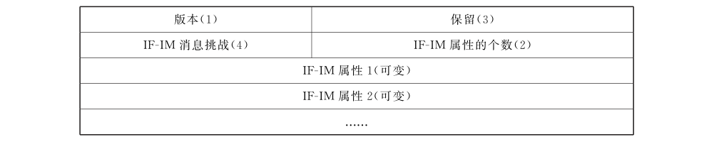

其中：-—版本字段长度为1个八位位组，表示 IF-IM 消息协议版本号。当前版本为1。

保留字段长度3个八位位组，其值默认为0。

IF-IM 消息挑战字段长度为4个八位位组，是IF-IM消息发送者随机产生的值，用于标识响应的IF-IM消息。

IF-IM 属性的个数字段长度为2个八位位组，其值IF-IM 属性的个数。

IF-IM 属性 1、IF-IM 属性2、⋯为8.2.4定义的IF-IM 属性。

#### 8.2.4 IF-IM 属性

##### 8.2.4.1 概述

IF-IM 属性的格式如图81所示。

其中：-FLAG 字段长度为1个八位位组，比特0有意义。若比特。的值为1，则组件产品关联标识存在；否则不存在。

IF-IM 属性类型厂家ID 字段长度为3个八位位组，当IF-IM 属性类型厂家ID 的值0时，IF-IM 属性为本标准定义的IF-IM 属性。当 IF-M 属性厂家 ID 的值为 Ox000001~Oxfffff时，IF-IM 属性为厂家自己定义的 IF-IM 属性。

IF-IM属性类型字段长度为4个八位位组，本标准定义的IF-IM 属性类型如表4所示。

IF-IM 属性长度字段长度为4个八位位组，表示 IF-IM 属性值的长度。

组件产品关联标识字段长度为4个八位位组，用于标识相同组件类型下的不同组件产品。例如，一个 IMC 向一个 IMV 报告一个相同组件类型下的不同组件产品时就需要设置组件产品关联标识。组件产品关联标识字段的值是 IMC本地创建的计数器数，其初始值1。当组件产品关联标识字段的值为 Oxffiiffff 时，该IF-IM 属性对应于 IF-IM消息中的所有组件产品。

-IF-IM 属性值字段长度可变，表示 IF-IM 属性值的内容。

**表4 本标准定义的 IF-IM 属性类型**

| IF-IM 属性类型标识符 | IF-IM 属性类型名称 | 描述 |
| --- | --- | --- |
| 0x00000001 | 产品信息 | 描述组件产品的产品信息 |
| 0x00000002 | 数字版本 | 描述组件产品的数字版本 |
| 0x00000003 | 字符串版本 | 描述组件产品的字符串版本 |
| 0x00000004 | 操作状态 | 描述组件产品的操作状态 |
| 0x00000005 | 完整性报告 | 描述一个或多个组件产品的完整性报告 |
| 0x00000006 | 完斃性报告索引信息 | 描述一个或多个组件产品的完整性报告索引信息 |
| 0x00000007 | 平台修补信息 | 描述组件产品的平台修补指示 |
| 0x00000008 | IF-IM 错误信息 | 描述 IF-IM 错误指示 |
| 0x00000009~Oxffffffff | 保留 |  |

在执行平台完整性度量时，IMC依据组件属性类型厂家 ID 和组件属性类型生成相应的IF-IM 属性，其中该 IF-IM 属性中的IF-IM属性类型厂家 ID 与组件属性类型厂家 ID 相同，该 IF-IM 属性中的IF-IM 属性类型与组件属性类型对应，例如：完整性报告和完整性报告索引信息的IF-IM 属性对应完整性信息的组件属性类型，具体见7.2.2.1.1中的d）。

##### 8.2.4.2 产品信息

产品信息的IF-IM属性值如图82所示。

其中：—产品厂家 ID字段长度为3个八位位组，其值为组件产品的产品厂家 ID，用于标识创建该组件产品的厂家。

-组件产品ID 字段长度为2个八位位组，其值为组件产品的产品ID，用于标识产品厂家1D字段的值对应的一个组件产品。

-产品名称字段长度为可变，其值为组件产品的产品名称。

##### 8.2.4.3 数字版本

数字版本的 IF-IM 属性值如图83所示。

其中：—主版本号字段长度为4个八位位组，其值组件产品的主版本号。

-次版本号字段长度为4个八位位组，其值为组件产品的次版本号。

编译号字段长度为4个八位位组，其值为组件产品的编译号。

服务包主版本号字段长度为2个八位位组，其值为组件产品的服务包主版本号。

服务包次版本号字段长度为2个八位位组，其值为组件产品的服务包次版本号。

##### 8.2.4.4 字符串版本

字符串版本的 IF-IM 属性值如图84所示。

其中：一组件版本号长度字段长度为1个八位位组，其值为组件版本号的八位位组数。

组件版本号字段长度为可变，其值是对应组件产品的版本号的字符串。

内部编译号字段长度为1个八位位组，其值为内部编译号的八位位组数。

内部编译号字段长度为可变，其值是对应组件产品的厂家内部工程编译号的字符串。

配置版本号字段长度1个八位位组，其值为配置版本号的八位位组数。

配置版本号字段长度为可变，其值是对应组件产品的配置版本的字符串。

##### 8.2.4.5 操作状态

操作状态的 IF-IM 属性值如图85所示。

其中：状态码字段长度为1个八位位组，其值如下：1 组件产品未安装；

2 组件产品已安装，但未正在运行；

3 组件产品正在运行；

其他值保留。

-保留字段长度为3个八位位组，其值默认为0。

-使用情况字段长度为可变，其值不在本标准中规定。

##### 8.2.4.6 完整性报告

完整性报告由快照和 Quote 数据构成，其中快照包含运行时完整性度量值，Quote 数据包含PIK签名。完整性报告、快照和 Quote 数据的具体定义不在本标准中规定。

##### 8.2.4.7 完整性报告索引信息

完整性报告索引信息用于生成完整性报告，具体定义不在本标准中规定。

##### 8.2.4.8 平台修补信息

平台修补信息的 IF-IM 属性值如图86所示。

其中：一保留字段长度为1个八位位组，其值默认为0。

平台修补信息类型厂家 ID 字段长度为3个八位位组，其值如下：◎ 本标准定义的平台修补信息；

其他值保留。

平台修补信息类型字段为4个八位位组，其值如下：1 基于 URI 的修补指示；

其他值保留。

平台修补信息长度字段长度为4个八位位组，其值为平台修补信息值的八位位组数。

平台修补信息值字段长度为可变。当平台修补信息类型字段的值1时，平台修补信息值基于 URI 的修补指示，如图87所示。

其中，URI 长度字段长度为2个八位位组，其值为修补指示的 URI 值字段的八位位组数；修补指示的URI 值字段长度为可变，其值不在本标准中规定；修补指示消息长度字段长度2个八位位组，其值为修补指示消息值字段的八位位组数：修补指示消息值字段长变为可变，其值不在本标准中规定。

##### 8.2.4.9 IF-IM 错误信息

IF-IM 错误信息的 IF-IM 属性值如图88所示。

其中：-保留字段长度为1个八位位组，其值默认为0。

IF-IM 错误信息代码厂家 ID字段长度为3个八位位组，其值如下：◎ 本标准定义的 IF-IM 错误信息；

其他值保留。

IF-IM 错误信息代码字段为4个八位位组，其值如下：1 组件属性类型厂家ID 及组件属性类型不IMC所支持；

2 组件属性类型厂家 ID及组件属性类型对应的组件属性修补失败；

其他值保留。

IF-IM 错误信息值字段长度为可变。当IF-IM 错误信息代码字段的值为1或2时，IF-IM 错误信息值由组件属性类型厂家 ID 及组件属性类型构成。

## 9 IF-IMC 和 IF-IMV

### 9.1 概述

TCA的IF-IMC 包括 AR 中的IF-IMC 和 AC 中的IF-IMC。前者是 TNCC与它上端的各个 IMC之间的接口，定义一些功能函数来交互一些平台鉴别相关信息，用于协助完成可信平台评估层的 PAI协议（见9.2）。后者是TNCAP与它上端的各个 IMC之间的接口，定义了一些功能函数来交互一些平台鉴别相关信息，用于协助完成可信平台评估层的 PAI 协议（见9.2）。

TCA 的IF-IMV是EPS与它上端的各个 IMV之间接口，定义了一些功能函数来交互一些平台鉴别相关信息，用于协助完成可信平台评估层的 PAI 协议（见9.3）。

**9.2** IF-IMC

#### 9.2.1 常量值

##### 9.2.1.1 IF-IMC的功能函数结果状态码

IF-IMC 的功能函数结果状态码如表5所示。

**表5 IF-IMC 的功能函数结果状态码**

| IF-IMC 的功能函数结果状态码 | 标识符 | 描述 |
| --- | --- | --- |
| TCA_RESULT_SUCCESS | 0x00000001 | 功能函数成功完成 |
| TCA_RESULT_NOT_INITIALIZED | 0x00000002 | TCA_IMC_Initialize 还没有被调用 |
| TCA_RESULT_ALREADY_INITIALIZED | 0x00000003 | 在调用 TCA_IMC_Terminate 之前已调用两次 TCA_IMC_Initialize |

**表5**

| IF-IMC 的功能函数结果状态码 | 标识符 | 描述 |
| --- | --- | --- |
| TCA_RESULT_NO_COMMON_VERSION | 0x00000004 | 在IMC 和 TNCC（或 TNCAP）之间不存在共同的 IF-IMC应用接口函数版本 |
| TCA_RESULT_CANT_RETRY | 0x00000005 | TNCC（或 TNCAP）不能执行下一个平台鉴别过程 |
| TCA_RESULT_WONT_RETRY | 0x00000006 | TNCC（或 TNCAP）拒绝执行下一个平台鉴别过程 |
| TCA_RESULT_INVALID_PARAMETER | 0x00000007 | 功能函数的参数无效 |
|  | 0x00000008~Oxffff | 保留 |

##### 9.2.1.2 IF-IMC 应用接口函数版本号

IF-IMC 应用接口函数版本号如下：1 TCA_IFIMC_Version_1，表示本标准规定的IF-IMC 应用接口函数版本号；

其他值保留。

##### 9.2.1.3 网络连接状态值

网络连接状态值如表6所示。

**表6 网络连接状态值**

| 网络连接状态值 | 标识符 | 描述 |
| --- | --- | --- |
| TCA_CONNECTION_STATE_CREATE | 0x00000001 | 创建网络连接 |
| TCA_CONNECTION_STATE_HANDSHAKE | Ox00000002 | 开始执行一个平台鉴别过程 |
| TCA_CONNECTION_STATE_ACCESS_ALLOWED | Ox00000003 | 网络连接状态为允许 |
| TCA_CONNECTION_STATE_ACCESS_ISOLATED | Ox00000004 | 网络连接状态为隔离 |
| TCA_CONNECTION_STATE_ACCESS_NONE | Ox00000005 | 网络连接状态为禁止 |
| TCA_CONNECTION_STATE_DELETE | 0x00000006 | 删除 ConnectionID，并断开连接 |
|  | Ox00000007~0xffff | 保留 |

##### 9.2.1.4 执行下一个平台鉴别过程的原因值

执行下一个平台鉴别过程的原因值如表7所示。

**表7 执行下一个平台鉴别过程的原因值**

| 执行下一个平台鉴别过程的原因值 | 标识符 | 描述 |
| --- | --- | --- |
| TCA_RETRY_REASON_IMC_REMEDIATION_COMPLETE | 0x00000001 | IMC 已经完成平台修补 |
|  | Ox00000002~Oxfffffff | 保留 |

#### 9.2.2 AR 中的 IF-IMC

##### 9.2.2.1 AR 中的IF-IMC 功能函数

AR 中的IF-IMC定义如下功能函数。

**9.2.2.1.1** TCA_IMC_InitializeTCA_IMC_Initialize｛imcID,minVersion,maxVersion， * pOutActualVersion），用于初始化 AR 中的一个 IMC，由该 IMC实现。

-imcID 长度为2个八位位组，整型数据，表示 TNCC为该 IMC 分配的IMC 标识。

-minVersion 长度4个八位位组，整型数据，表示 TNCC支持的应用接口函数次版本号。

maxVersion 长度为4个八位位组，整型数据，表示TNCC支持的应用接口函数主版本号。

*POutActualVersion 长度为8个八位位组，表示 TNCC 实际使用的应用接口函数版本号，包括主版本号和次版本号。

TCA_IMC_Initialize 的功能函数结果状态码为 TCA_RESULT_SUCCESS, TCA_RESULT_AL- READY_INITIALIZED, TCA_RESULT_NO_COMMON_VERSION, TCA_RESULT_INVALID- PARAMETER 或其他。

**9.2.2.1.2** TCA_TNCC_ReportMessageTypesTCA_TNCC_ReportMessageTypes｛imcID,typeCount, supportedTypes），用于 AR 中的一个 IMC向 TNCC通告它所支持的消息类型，由 TNCC 实现。

imcID 长度为2个八位位组，整型数据，表示 TNCC该 IMC分配的IMC标识。

-typeCount 长度2个八位位组，整型数据，表示该 IMC所支持的消息类型的数目。

supportedTypes 长度可变，表示该 IMC所支持的各个消息类型，每个消息类型由组件类型厂家ID 和组件类型。

TCA_TNCC_ReportMessageTypes 的功能函数结果状态码为 TCA_RESULT_SUCCESS, TCA_ RESULT_INVALID_PARAMETER 或其他。

**9.2.2.1.3** TCA_IMC_TerminateTCA_IMC_Terminate｛imcID｝，用于 TNCC终止 AR 中的一个 IMC，由该IMC 实现。

-imcID 长度为2个八位位组，整型数据，表示 TNCC该 IMC分配的IMC标识。

TCA_IMC_Terminate 的功能函数结果状态码为 TCA_RESULT_SUCCESS, TCA_RESULT- NOT_INITIALIZED,TCA_RESULT_INVALID_PARAMETER 或其他。

**9.2.2.1.4** TCA_IMC_NotifyConnectionChangeTCA_IMC_NotifyConnectionChange｛imcID, connectionID, newState｝，用于 TNCC 向 AR 中的一个 IMC通告网络连接状态，由该 IMC 实现。

—imcID 长度为2个八位位组，整型数据，表示 TNCC为该 IMC 分配的IMC 标识。

-connectionID 长度为2个八位位组，整型数据，表示 TNCC创建的网络连接标识，用于标识每一对 TNCC 和 TNCAP的网络连接。

-newState 长度2个八位位组，表示网络连接状态。

TCA_IMC_NotifyConnectionChange 的功能函数结果状态码力 TCA_RESULT_SUCCESS, TCA_ RESULT_NOT_INITIALIZED,TCA_RESULT_INVALID_PARAMETER 或其他。

**9.2.2.1.5** TCA_IMC_RequestMeasurementInfoTCA_IMC_RequestMeasurementInfo｛imcID, connectionID, messageType,yn,nonce,component-AttributeCount,componentAttributes），用于 TNCC 向 AR中的一个 IMC请求执行平台完整性度量，由该 IMC实现。

-imcID 长度为2个八位位组，整型数据，表示 TNCC为该IMC 分配的IMC标识。

connectionID 长度为2个八位位组，整型数据，表示 TNCC创建的网络连接标识，用于标识每一对 TNCC 和 TNCAP的网络连接。

-messageType 长度为7个八位位组，表示消息类型，由组件类型厂家ID 和组件类型构成。

yn 为布尔值。

nonce 长度为32个八位位组，表示随机数。

componentAttributeCount 长度2个八位位组，整型数据，表示组件属性级平台完整性度量请求参数条目数。

-componentAttributes 长度可变，表示各个组件属性级平台完整性度量请求参数条目。

当yn 的值为0时，nonce 的值为NULL。 当yn 的值为1时，nonce 的值为 TNCAP挑战。

当 TCA_IMC_RequestMeasurementInfo用于 PAI-1 协议时，yn 的值设置1。当TCA_IMC_Re- quest MeasurementInfo 用于PAI-2 协议时，yn 的值设置0。

TCA_IMC_RequestMeasurementInfo 的功能函数结果状态码力 TCA_RESULT_SUCCESS, TCA _RESULT_NOT_INITIALIZED,TCA_RESULT_INVALID_PARAMETER 或其他。

**9.2.2.1.6** TCA_TNCC_ProvideQuoteDataTCA_TNCC_ProvideQuoteData ｛imclD, connectionlD, messageType, yn, quoteData｝，用于 AR 中的一个 IMC 向 TNCC 提供一个 IF-IM 消息对应的 Quote 数据，由TNCC实现。

-imcID 长度为2个八位位组，整型数据，表示 TNCC该 IMC分配的IMC标识。

connectionID 长度为2个八位位组，整型数据，表示 TNCC创建的网络连接标识，用于标识每一对 TNCC 和 TNCAP的网络连接。

messageType 长度为7个八位位组，定义如前。

yn为布尔值。

quoteData 长度可变，表示该 IF-IM 消息对应的 Quote 数据。

当 yn的值为0时，即该 IF-IM 消息不包含 Quote 数据，quoteData 的值 NULL。

TCA_TNCC_ProvideQuoteData 功能函数用于PA1-1 协议。在本标准中，若该 IF-IM 消息中包含一个完整性报告的 IF-IM 属性，则该 IF-IM 消息包含 Quote 数据。

TCA_TNCC_ProvideQuoteData 的功能函数结果状态码为 TCA_RESULT_SUCCESS, TCA_ RESULT_INVALID_PARAMETER 或其他。

**9.2.2.1.7** TCA_TNCC_ProvideReportlndexTCA_TNCC_ProvideReportIndex｛imcID, connectionID, messageType,yn,reportlndex｝，用于 AR中的一个 IMC 向TNCC 提供一个 IF-IM 消息对应的完整性报告索引信息，由 TNCC实现。

-imcID 长度为2个八位位组，整型数据，表示 TNCC为该IMC分配的IMC标识。

-connectionID 长度为2个八位位组，整型数据，表示 TNCC创建的网络连接标识，用于标识每一对 TNCC 和 TNCAP的网络连接。

messageType 长度7个八位位组，定义如前。

yn 为布尔值。

-reportIndex 长度可变，为该 IF-IM消息对应的完整性报告索引信息。

当 yn 的值为0时，reportlndex 的值为 NULL。

TCA_TNCC_ProvideReportlndex 用于 PA1-2协议。在本标准中，若该 IF-IM 消息中包含一个完整性报告索引信息的IF-IM 属性，则该 IF-IM消息包含完整性报告索引信息。

TCA_TNCC_ProvideReportIndex 的功能函数结果状态码为 TCA_RESULT_SUCCESS, TCA_ RESULT_INVALID_PARAMETER 或其他。

**9.2.2.1.8** TCA_TNCC_SendMessageTCA_TNCC_SendMessage ｛imcID, connectionID, messageType, message｝，用于 AR 中的一个IMC 向 TNCC 发送一个IF-IM 消息，由 TNCC实现。

-imcID 长度为2个八位位组，整型数据，表示 TNCC为该IMC 分配的IMC 标识。

connectionID 长度为2个八位位组，整型数据，表示 TNCC创建的网络连接标识，用于标识每一对 TNCC 和 TNCAP的网络连接。

-messageType 长度为7个八位位组，定义如前。

messgae 长度可变，为IF-IM 消息。

TCA_ TNCC_SendMessage 的功能函数结果状态码为 TCA_RESULT_SUCCESS, TCA_ RESULT_INVALID_PARAMETER 或其他。

**9.2.2.1.9** TCA_IMC_ReceiveMessageTCA_IMC_ReceiveMlessage｛imcID,connectionID,messageType, message），用于 TNCC 向 AR 中的一个 IMC 发送已收到的 IF-IM 消息，由该 IMC实现。

-imcID 长度为2个八位位组，整型数据，表示 TNCC为该 IMC分配的IMC 标识。

-connectionlD 长度2个八位位组，整型数据，表示 TNCC创建的网络连接标识，用于标识每一对 TNCC 和 TNCAP的网络连接。

messageType 长度7个八位位组，定义如前。

messgae 长度可变，定义如前。

TCA_IMC_ReceiveMessage 的功能函数结果状态码为 TCA_RESULT_SUCCESS, TCA_ RESULT_INVALID_PARAMETER 或其他。

**9.2.2.1.10** TCA_TNCC_RequestHandshakeRetryTCA_TNCC_RequestHandshakeRetry （imcID, connectionlD,reason｝，用于AR 中的一个 IMC 向TNCC 请求执行下一个平台鉴别过程，由 TNCC实现。

-imcID 长度为2个八位位组，整型数据，表示 TNCC为该 IMC 分配的IMC标识。

connectionID 长度为2个八位位组，整型数据，表示 TNCC创建的网络连接标识，用于标识每一对 TNCC 和TNCAP的网络连接。

reason 长度2个八位位组，为请求执行下一个平台鉴别过程的原因值。

TCA_TNCC_RequestHandshakeRetry 的功能函数结果状态码为 TCA_RESULT_SUCCESS，TCA_RESULT_CANT_RETRY, TCA_RESULT_WONT_RETRY, TCA_RESULT_INVALID_PA- RAMETER 或其他。

##### 9.2.2.2 AR 中的 IF-IMC 交互示意图

AR 中的IF-IMC 交互示意图如图89所示。

在图89中，AR 中IF-IMC 的虚线功能函数调用箭头表示可选的，而实线功能函数调用箭头表示必备的，一个平台鉴别过程中的 PAI 协议可以是多轮次的。图89中的 TCA_TNCC_ProvideQuoteData函数仅用于 PAI-1 协议，而 TCA_TNCC_ProvideReportIndex 函数仅用于 PAI-2协议。

#### 9.2.3 AC 中的IF-IMC

##### 9.2.3.1 AC 中的 IF-IMC 功能函数

AC 中的IF-IMC定义如下功能函数。

**9.2.3.1.1** TCA_IMC_InitializeTCA_IMC_Initialize｛imcID,minVersion,maxVersion， * pOutActualVersion），用于初始化AC 中的一个 IMC，由该IMC 实现。

imcID 长度为2个八位位组，整型数据，表示 TNCAP为该IMC 分配的IMC标识。

minVersion 长度4个八位位组，整型数据，表示TNCAP 支持的应用接口函数次版本号。

maxVersion 长度为4个八位位组，整型数据，表示 TNCAP 支持的应用接口函数主版本号。

- * pOutActualVersion 长度8个八位位组，表示 TNCAP 实际使用的应用接口函数版本号，包括主版本号和次版本号。

TCA_IMC_Initialize 的功能函效结果状态码为 TCA_RESULT_SUCCESS,TCA_RESULT_AL- READY_INITIALIZED, TCA_RESULT_NO_COMMON_VERSION, TCA_RESULT_INVALID- PARAMETER 或其他。

**9.2.3.1.2** TCA_TNCAP_ReportMessagelypesTCA_TNCAP _ReportMessageTypes ｛imcID, typeCount, supportedTypes｝，用于 AC 中的一个IMC 向 TNCAP通告它所支持的消息类型，由TNCAP实现。

-imcID 长度为2个八位位组，整型数据，表示 TNCAP为该IMC 分配的IMC标识。

-typeCount 长度2个八位位组，整型数据，表示该 IMC所支持的消息类型的数目。

-supportedTypes 长度可变，表示该IMC 所支持的各个消息类型，每个消息类型由组件类型厂家 ID 和组件类型。

TCA_TNCAP_ReportMessageTypes 的功能函数结果状态码为 TCA_RESULT_SUCCESS, TCA _RESULT_INVALID_PARAMETER 或其他。

**99.2.3.1.3** TCA_IMC_TerminateTCA_IMC_Terminate｛imcID｝，用于 TNCAP终止AC中的一个 IMC，由该IMC实现。

-imcID 长度为2个八位位组，整型数据，表示 TNCAP该 IMC分配的IMC标识。

TCA_IMC_Terminate 的功能函数结果状态码为 TCA_RESULT_SUCCESS, TCA_RESULT- NOT_INITIALIZED,TCA_RESULT_INVALID_PARAMETER 或其他。

**9.2.3.1.4** TCA_IMC_NotifyConnectionChangeTCA_IMC_NotifyConnectionChange ｛imcID, connectionID, newState〉，用于TNCAP 向AC 中的一个 IMC 通告网络连接状态，由该 IMC 实现。

-imcID 长度2个八位位组，整型数据，表示 TNCAP该 IMC 分配的IMC 标识。

connectionID 长度为2个八位位组，整型数据，表示 TNCC创建的网络连接标识，用于标识每一对 TNCC 和TNCAP的网络连接。

-newState 长度为2个八位位组，表示网络连接状态。

TCA_IMC_NotifyConnectionChange 的功能函数结果状态码力 TCA_RESULT_SUCCESS, TCA_ RESULT_NOT_INITIALIZED,TCA_RESULT_INVALID_PARAMETER 或其他。

**9.2.3.1.5** TCA_IMC_RequestMeasurementInfoTCA_IMC_RequestMeasurementInfo｛imcID, connectionID, messageType,yn,nonce,component-AttributeCount,componentAttributes｝，用于 TNCAP 向 AC 中的一个IMC请求执行平台完整性度量，由该 IMC实现。

-imcID 长度为2个八位位组，整型数据，表示 TNCAP 为该IMC 分配的IMC标识。

connectionID 长度为2个八位位组，整型数据，表示 TNCAP 创建的网络连接标识，用于标识每一对 TNCC 和 TNCAP的网络连接。

messageType 长度为7个八位位组，表示消息类型，由组件类型厂家 ID 和组件类型构成。

yn 为布尔值。

nonce 长度为32个八位位组，表示随机数。

componentAttributeCount 长度为2个八位位组，整型数据，表示组件属性级平台完整性度量请求参数条目数。

componentAttributes 长度可变，表示各个组件属性级平台完整性度量请求参数条目。

当yn 的值为0时，nonce 的值为NULL。 当yn 的值为1时，nonce 的值为 TNCC 挑战。

当 TCA_IMC_RequestMeasurementInfo用于 PAI-1 协议时，yn 的值设置为1。当TCA_IMC_Re- questMeasurementInfo 用于PAI-2协议时，yn 的值设置为0。

TCA_IMC_RequestMeasurementInfo 的功能函数结果状态码为 TCA_RESULT_SUCCESS,TCA RESULT_NOT_INITIALIZED,TCA_RESULT_INVALID_PARAMETER 或其他。

**9.2.3.1.6** TCA_TNCAP_ProvideQuoteDataTCA_TNCAP_ProvideQuoteData ｛imcID,connectionID, messageType, yn, quoteData｝，用于 AC中的一个 IMC 向 TNCAP 提供一个 IF-IM 消息对应的 Quote 数据，由 TNCAP实现。

-imcID 长度为2个八位位组，整型数据，表示 TNCAP该 IMC分配的IMC 标识。

connectionID 长度为2个八位位组，整型数据，表示 TNCAP创建的网络连接标识，用于标识每一对 TNCC 和 TNCAP 的网络连接。

messageType 长度7个八位位组，定义如前。

yn 为布尔值。

quoteData 长度可变，表示该 IF-IM 消息对应的 Quote 数据。

当yn的值为0时，即该 IF-IM 消息不包含 Quote 数据，quoteData 的值 NULL。

TCA_TNCAP_ProvideQuoteData 功能函数用于 PAI-1 协议。在本标准中，若该 IF-IM 消息中包含一个完整性报告的 IF-IM 属性，则该 IF-IM 消息包含 Quote 数据。

TCA_TNCAP_ProvideQuoteData 的功能函数结果状态码力 TCA_RESULT_SUCCESS, TCA_ RESULT_INVALID_PARAMETER 或其他。

**9.2.3.1.7** TCA_TNCAP_ProvideReportlndexTCA_TNCAP_ProvideReportlndex ｛imcID, connectionID, messageType,yn,reportlndex｝，用于AC中的一个 IMC 向 TNCAP 提供一个 IF-IM 消息对应的完整性报告索引信息，由 TNCAP实现。

一imcID 长度为2个八位位组，整型数据，表示 TNCAP为该IMC分配的IMC标识。

-connectionID 长度为2个八位位组，整型数据，表示TNCAP 创建的网络连接标识，用于标识每一对 TNCC 和 TNCAP的网络连接。

-messageType 长度为7个八位位组，定义如前。

-yn 为布尔值。

reportlndex 长度可变，为该 IF-IM 消息对应的完整性报告索引信息。

当 yn 的值为0时，reportIndex 的值为 NULL。

TCA_TNCC_ProvideReportIndex 用于 PA1-2协议。在本标准中，若该 IF-IM 消息中包含一个完整性报告索引信息的IF-IM 属性，则该 IF-IM 消息包含完整性报告索引信息。

TCA_TNCC_ProvideReportIndex 的功能函数结果状态码为 TCA_RESULT_SUCCESS, TCA_ RESULT_INVALID_PARAMETER 或其他。

**9.2.3.1.8** TCA_TNCAP_SendMessageTCA_TNCAP_SendMessage｛imcID, connectionID, messageType, message｝，用于 AC 中的一个IMC 向 TNCAP发送一个 IF-IM 消息，由 TNCAP实现。

-imcID 长度为2个八位位组，整型数据，表示 TNCAP为该IMC 分配的IMC 标识。

-connectionID 长度为2个八位位组，整型数据，表示 TNCAP 创建的网络连接标识，用于标识每一对 TNCC 和 TNCAP的网络连接。

-messageType 长度7个八位位组，定义如前。

messgae 长度可变，为IF-IM 消息。

TCA_TNCAP_SendMessage 的功能函数结果状态码为 TCA_RESULT_SUCCESS, TCA_RE- SULT_INVALID_PARAMETER 或其他。

**9.2.3.1.9** TCA_IMC_ReceiveMessageTCA_IMC_ReceiveMessage ｛imcID, connectionID, messageType, message〉，用于 TNCAP 向 AC中的一个 IMC 发送已收到的IF-IM 消息，由该IMC实现。

-imcID 长度为2个八位位组，整型数据，表示 TNCAP为该IMC分配的IMC标识。

connectionID 长度为2个八位位组，整型数据，表示 TNCAP创建的网络连接标识，用于标识每一对 TNCC 和 TNCAP的网络连接。

messageType 长度为7个八位位组，定义如前。

messgae 长度可变，为IF-IM 消息。

TCA_IMC_ReceiveMessage 的功能函数结果状态码为 TCA_RESULT_ SUCCESS, TCA_ RESULT_INVALID_PARAMETER 或其他。

**9.2.3.1.10** TCA_TNCAP_RequestHandshakeRetryTCA_TNCAP_RequestHandshakeRetry｛imcID, connectionID,reason｝，用于 AC 中的一个 IMC 向TNCAP 请求执行下一个平台鉴别过程，由 TNCAP实现。

-imcID 长度为2个八位位组，整型数据，表示 TNCAP为该 IMC分配的IMC 标识。

connectionID 长度2个八位位组，整型数据，表示 TNCAP创建的网络连接标识，用于标识每一对 TNCC 和 TNCAP的网络连接。

reason 长度2个八位位组，为请求执行下一个平台鉴别过程的原因值。

TCA_TNCAP_RequestHandshakeRetry 的功能函数结果状态码为 TCA_RESULT_SUCCESS，TCA_RESULT_CANT_RETRY,TCA_RESULT_WONT_RETRY, TCA_RESULT_INVALID_PA- RAMETER或其他。

##### 9.2.3.2 AC 中的 IF-IMC 交互示意图

AC 中的IF-IMC 交互示意图如图90所示。

在图90中，AC中 IF-IMC的虚线功能函数调用箭头表示可选的，而实线功能函数调用箭头表示必备的，平台鉴别过程中的PAI 协议可以是多轮次的。图90中的 TCA_TNCAP_ProvideQuoteData p数仅用于 PAI-1 协议，而 TCA_TNCAP_ProvideReportIndex 函数仅用于PAI-2协议。

**9.3** IF-IMV

#### 9.3.1 常量值

##### 9.3.1.1 IF-IMV 的功能函数结果状态码

IF-IMV 的功能函数结果状态码如表8所示。

**表8**

| IF-IMV 的功能函数结果状态码 | 标识符 | 描述 |
| --- | --- | --- |
| TCA_RESULT_SUCCESS | 0x00000001 | 功能函数成功完成 |
| TCA_RESULT_NOT_INITIALIZED | Ox00000002 | TCA_IMV_Initialize 还没有被调用 |
| TCA_RESULT_ALREADY_INITIALIZED | 0x00000003 | 在调用 TCA_IMV_Terminate 之前已调用两次 TCA_IMV_Initialize |
| TCA_RESULT_NO_COMMON_VERSION | 0x00000004 | 在IMV 和 EPS之间不存在共同的 IF-IMV 应用接口函数版本 |
| TCA_RESULT_INVALID_PARAMETER | 0x00000005 | 函数参数的参数无效 |
|  | Ox00000006~OxffEEEf | 保留 |

##### 9.3.1.2 IF-IMV 应用接口函数版本号

IF-IMV 应用接口函数版本号如下：1 TCA_IFIMV_Version_1，表示本标准规定的 IF-IMV 应用接口函数版本号；

其他值保留。

#### 9.3.2 功能函数

IF-IMV 定义如下功能函数。

**9.3.2.1** TCA_IMV_InitializeTCA_IMV_Initialize （imvID, minVersion, maxVersion， * pOutActualVersion｝，用于初始化PM中的一个 IMV，由该IMV 实现。

-imvID 长度2个八位位组，整型数据，表示 EPS为该IMV 分配的IMV标识。

minVersion 长度4个八位位组，整型数据，表示 EPS 支持的应用接口函数次版本号。

maxVersion 长度为4个八位位组，整型数据，表示EPS支持的应用接口函数主版本号。

* pOutActualVersion 长度为8个八位位组，表示 EPS实际使用的应用接口函数版本号，包括主版本号和次版本号。

TCA_IMV_Initialize 的功能函数结果状态码为 TCA_RESULT_SUCCESS, TCA_RESULT_AL- READY_INITIALIZED, TCA_RESULT_NO_COMMON_VERSION, TCA_RESULT_INVALID- PARAMETER 或其他。

**9.3.2.2** TCA_EPS_ReportMessageTypesTCA_EPS _ReportMessageTypes｛imvID, typeCount, supportedTypes｝，用于 PM中的一个 IMV向EPS通告所支持的消息类型，由 EPS实现。

-imvID 长度为2个八位位组，整型数据，表示 EPS为该 IMV 分配的IMV标识。

typeCount 长度为2个八位位组，整型数据，表示该IMV 所支持的消息类型的数目。

-supportedTypes 长度可变，表示该IMV所支持的各个消息类型，每个消息类型由组件类型厂家 ID 和组件类型。

TCA_EPS_ReportMessageTypes 的功能函数结果状态码为 TCA_RESULT_SUCCESS, TCA_ RESULT_INVALID_PARAMETER或其他。

**9.3.2.3** TCA_IMV_TerminateTCA_IMV_Terminate｛imvID｝，用于EPS终止PM中的一个 IMV，由该IMV实现。

-—imvID 长度为2个八位位组，整型数据，表示 EPS为该IMV 分配的IMV 标识。

TCA_IMV_Terminate 的功能函数结果状态码为 TCA_RESULT_SUCCESS, TCA_RESULT- NOT_INITIALIZED,TCA_RESULT_INVALID_PARAMETER 或其他。

**9.3.2.4** TCA_IMV_RequestEvaluationInfoTCA_IMV_RequestEvaluationlnfo ｛imvID, paiBindingID, entityRole, messageType,yn,yn2,com-ponentEvaluationPolicyNum,componentEvaluationPolicy, componentProtectedPolicyCount,compo-nentProtectedPolicies,componentMeasurementCount, component Measurements,report》，用于 EPS 向PM中的一个 IMV 请求执行平台完整性评估，由 PM 中的IMV实现。

一imvID 长度2个八位位组，整型数据，表示EPS该 IMV 分配的IMV标识。

paiBindingID 长度2个八位位组，整型数据，表示 EPS为一轮 PAI 协议生成的PAI 协议标识。

entityRole 为布尔值，表示实体角色。

messageType 长度为7个八位位组，表示消息类型，由组件类型厂家 ID 和组件类型构成。

yn为布尔值。

yn2 为布尔值。

componentEvaluationPolicy 长度可变，为一个组件产品级平台完整性评估策略条目。

componentEvaluationPolicyNum 长度2个八位位组，整型数据， componentEvaluation- Policy 所对应的条目序号。

componentProtectedPolicyCount 长度2个八位位组，整型数据，为组件产品级平台配置保护策略条目数。

componentProtectedPolicies 长度可变，各个组件产品级平台配置保护策略条目。

componentMeasurementCount 长度2个八位位组，整型数据，IF-IM 级平台完整性度量值条目数。

-componentMeasurements 长度可变，为各个 IF-IM 级平台完整性度量值条目。

-report 长度可变，为一个完整性报告。

当 yn 的值0时，则 componentProtectedPolicyCount 和 componentProtectedPolicies 的值都NULL。当yn2 的值为0时，则 report 的值 NULL。

当 entityRole 的值为0时，表示实体角色为 AR。当 entityRole 的值为1时，表示实体角色为 AC。

当 TCA_IMV_RequestEvaluationlnfo 用于 PAI-1 协议时，yn2的值设置0。当 TCA_IMV_Re- questEvaluationInfo 用于 PAl-2协议时，yn2 的值设置为0或1。

TCA_IMV_RequestEvaluationlnfo 的功能函数结果状态码为 TCA_RESULT_SUCCESS,TCA_ RESULT_NOT_INITIALIZED,TCA_RESULT_INVALID_PARAMETER 或其他。

**9.3.2.5** TCA_EPS_ProvideEvaluation ResultTCA_EPS_ProvideEvaluationResult｛imvID,paibindingID, entityRole, messageType, yn,com-ponentEvaluationPolicyNum,componentEvaluationResult,ifimRemediationInfo, componentErrorInfo，ifim QuoteData,nextComponentEvaluationPolicy｝，用于PM 中的一个 IMV 向 EPS提供一个组件产品级平台完整性评估结果、一个 IF-IM级平台修补信息条目、一个组件产品级错误原因信息条目、一个IF-IM级 Quote 数据值条目和一个用于下一个平台鉴别过程的组件产品级平台完整性评估策略条目，由EPS实现。

-imvID 长度为2个八位位组，整型数据，表示EPS为该 IMV 分配的IMV标识。

paiBindingID 长度为2个八位位组，整型数据，表示EPS为一轮 PAI 协议生成的 PAI 协议标识。

entityRole 布尔值，表示实体角色。

messageType 长度为7个八位位组，表示消息类型，由组件类型厂家 ID 和组件类型构成。

yn为布尔值。

componentEvaluationPolicyNum 长度为2个八位位组，整型数据，为一个组件产品级平台完整性评估策略条目对应的条目序号。

componentEvaluationResult 长度为1个位位组，整型数据，为一个组件产品级平台完整性评估结果。

ifimRemediationInfo 长度可变，为一个IF-IM级平台修补信息条目。

componentErrorlnfo 长度可变，为一个组件产品级错误原因信息条目。

ifimQuoteData 长度可变，为一个 IF-IM 级 Quote 数据值条目。

nextComponentEvaluationPolicy 长度可变，为一个用于下一个平台鉴别过程的组件产品级平台完整性评估策略条目。

当 yn的值为0时，ifimQuoteData 的值 NULL。

当 componentEvaluationResult 的值为1 时，ifimRemediationInfo、componentErrorInfo 和 next- ComponentEvaluationPolicy 的值为 NULL。当componentEvaluationResult 的值为2时，componen- tErrorInfo 的值 NULL。 当 componentEvaluationResult 的值3时，ifimRemediationInfo 和 next- ComponentEvaluationPolicy 的值 NULL。当 componentEvaluationResult 的值为4时，ifimRemedi- ationInfo.componentErrorInfo 和 nextComponentEvaluationPolicy 的值力 NULL。

当 TCA_EPS_ProvideEvaluationResult 用于 PAI-1 协议时，yn 的值设置为。或1。当TCA_EPS_ ProvideEvaluationResult 用于 PAI-2 协议时，yn 的值设置0。

TCA_EPS_ProvideEvaluationResult 的功能函数结果状态码为 TCA_RESULT_SUCCESS, TCA _RESULT_INVALID_PARAMETER 或其他。

**9.3.2.6** TCA_IMV_EndEvaluationTCA_IMV_EndEvaluation｛imvID.paiBindingID, entityRole, messageType｝，用于 EPS 向 PM中的一个 IMV 请求终止平台完整性评估，由PM 中的IMV实现。

-imvID 长度为2个八位位组，整型数据，表示 EPS为该IMV 分配的IMV 标识。

-paiBindingID 长度为2个八位位组，整型数据，表示 EPS为一轮 PAI 协议生成的PAI 协议标识。

entityRole 为布尔值，表示实体角色。

messageType 长度为7个八位位组，表示消息类型，由组件类型厂家ID 和组件类型构成。

当 TCA_IMV_EndEvaluation 被用于请求终止对一个实体的平台完整性评估时，messageType 的值力 NULL。

TCA_IMV_EndEvaluation 的功能函数结果状态码为 TCA_RESULT_SUCCESS, TCA_RESULT _NOT_INITIALIZED,TCA_RESUSLT_INVALID_PARAMETER或其他。

#### 9.3.3 交互示意图

IF-IMV 交互示意图如图91所示。

在图91中，IF-IMV的虚线功能函数调用箭头表示可选的，而实线功能函数调用箭头表示必备的。

在一轮 PAI 协议中，一个 IMV 和 EPS 之间可能需要执行多次 TCA_IMV_RequestEvaluationInfo、TCA_EPS_ProvideEvaluationResult 和 TCA_IMV_EndEvaluation。

附录A（资料性附录）完整性管理框架A.1 概述在可信计算体系结构中，信任链扩展基于平台各组件的完整性：通过对平台组件自底向上逐层进行完整性度量，将度量结果与完整性参照值进行比较，以保证平台的可信性。平台各组件完整性参照值是可信度量的基准值，而管理框架抽象平台各组件完整性参照值的制作、发布、获取的过程。

A.2 完整性管理框架完整性管理包括三部分内容：完整性参照值计算、授权和分发；完整性度量；完整性报告与验证。完整性管理框架如图 A.1所示。

A.3 完整性参照值计算、授权和分发生产厂商必须根据完整性参照值的制定规则，为生产的组件进行完整性度量，并按照完整性参照值发布的格式，填写度量值、相应的度量值说明（例如，组件名称、版本、制定时间、厂商等信息）并进行签名。

完整性参照值可由单个厂商发布，也可由某组织在收集各个厂商发布的完整性参照值后进行发布，但该组织需制定统一的完整性参照值目录或数据库，并向用户提供完整性校验服务。

用户进行完整性校验时，可采用厂商取的方式或者从某组织的完整性参照值目录或数据库中获取所需的标准完整性参照值。可信计算平台安全启动过程中所需的完整性参照值必须在平台制造过程中，由各厂商或集成商取相应的完整性参照值后存储在平台内部。如，对 BIOS、IPL. 和 Option ROM的完整性基准值保存在TPCM 中，而操作系统、应用程序的完整性基准值保存在硬盘受保护区域中。

A.4 完整性度量完整性度量指利用杂凑算法对可信计算平台各组件进行度量得到杂凑值的过程。完整性度量过程必须对从开机运行到应用程序加载的整个过程中，涉及的所有可信计算平台组件进行度量，并将度量值存放在 PCR 中。鉴于 PCR数量有限，而平台组件众多，因此须将平台组件分类以对应不同的PCR；由于 PCR对完整性度量值进行迭代，为了进行完整性报告，需将度量过程中的每步度量结果存贮在SML中，以便验证者对完整性度量过程的所有细节进行验证。

A.5 完整性报告与验证过程完整性报告实现将可信计算平台自身的完整性度量结果报告给请求者，以便向请求者报告自身的完整性状态。请求者根据提供者的完整性报告，结合完整性基准值进行验证。完整性报告与验证流程如下：

a） 请求者向提供者请求完整性报告；

b） 提供者的 TPCM 将 PCR 值使用身份证书进行签名；

c） 提供者将签名的 PCR 值和 SML.发送给请求者；

d） 请求者接收到提供者的数据，完整性报告过程结束；

请求者验证提供者身份证书的有效性，如果无效，提供者平台不可信，退出；

f） 请求者根据SML计算得到PCR值，将其与提供者提供的PCR值进行比较，如果不一致，提供者平台不可信，退出；

g） 请求者根据 SML 向完整性参考服务器请求标准的完整性基准值，将 SML， 中的值和标准的完整性参照值进行比较，如果不一致，提供者平台不可信，退出；

h） 提供者平台状态为可信，完整性报告与验证流程结束。

附录B（资料性附录）安全策略管理框架B.1 概述安全策略管理包括：安全策略的制定、分发与执行等。参与安全策略管理的实体包括：策略服务器和策略执行点。策略服务器负责制定和分发安全策略，而策略执行点负责执行由策略服务器制定并分发的安全策略。安全策略的管理需要一套策略分发协议和信任机制，保证策略传输的可靠性和安全性。

安全策略管理框架如图 B.1 所示。

B.2 策略管理器的基本功能策略管理器的基本功能包括定义、编辑和管理策略。用户可以在策略管理器上通过策略管理接口和策略描述语言定义和编辑安全策略，策略管理器接口负责将这些安全策略使用策略语言进行描述，并检查策略语言的语法。在策略制定之后，按照策略分发协议将策略分发给策略执行点进行执行。

B.3 策略执行点的基本功能策略执行点的基本功能是严格执行策略管理器下发的安全策略，利用安全策略分发协议保证接受的安全策略保密性、抗抵赖性和完整性，并调用策略执行引擎执行安全策略。

B.4 安全策略分发协议的基本功能安全策略分发协议保证安全策略在策略管理器和策略执行点之间的安全传输。安全策略分发协议包括推策略和拉 策略两种。推策略由策略管理器将策略强制推行到各策略执行点，并保证策略执行点只接收来自策略管理器的策略。拉策略由策略执行点主动向策略管理器申请策略，策略管理器认证策略执行点的请求后将相应策略进行分发。安全策略分发协议必须实现策略管理器和策略执行点之间的双向认证，并保证策略分发的保密性、抗抵赖性和完整性。

B.5 策略定义语言策略定义语言是用于定义安全策略的语言。用户通过策略管理接口需对安全策略进行直观地描述，并使用策略语言编译功能将直观的安全策略转换为策略执行引擎可直接执行的安全策略。策略定义语言与认证、授权、访问控制等因素相关。

B.6 安全策略管理流程安全策略管理的处理流程如下：首先，策略管理器制定安全策略。即用户通过策略管理接口将安全策略进行直观地描述，继而利用策略语言编译功能将直观的安全策略转换为策略执行引擎可直接执行的安全策略。

其次，策略制定后，安全策略分发协议通过推策略和拉策略，保证安全策略在策略管理器和策略执行点之间的安全传输，实现策略管理器和策略执行点之间的双向认证。

最后，安全策略在策略执行点被执行。

附录C（资料性附录）数字信封数字信封是公钥密码体制在实际中的一个应用，是用加密技术来保证只有规定的特定收信人才能阅读通信的内容。

在数字信封中，信息发送方采用对称密钥来加密信息内容，然后将此对称密钥用接收方的公开密钥来加密（这部分称数字信封）之后，将它和加密后的信息一起发送给接收方，接收方先用相应的私有密钥打开数字信封，得到对称密钥，然后使用对称密钥解开加密信息。这种技术的安全性相当高。数字信封包括数字信封打包和数字信封拆解，数字信封打包是使用对方的公钥将加密密钥进行加密的过程，只有对方的私钥才能将加密后的数据（通信密钥）还原；数字信封拆解是使用私钥将加密过的数据解密的过程。数字信封的生成和解开过程如图C.1所示。

数字信封的功能类似于普通信封，普通信封在法律的约束下保证只有收信人才能阅读信的内容；数字信封则采用密码技术保证了只有规定的接收人才能阅读信息的内容。数字信封中采用了对称密码体制和公钥密码体制。信息发送者首先利用随机产生的对称密码加密信息，再利用接收方的公钥加密对称密码，被公钥加密后的对称密码被称之数字信封。在传递信息时，信息接收方若要解密信息，必须先用自己的私钥解密数字信封，得到对称密码，才能利用对称密码解密所得到的信息。这样就保证了数据传输的保密性、抗抵赖性和完鏊性。

在一些重要的电子商务交易中密钥必须经常更换，为了解决每次更换密钥的问题，结合对称加密技术和公开密钥技术的优点，它克服了秘密密钥加密中秘密密钥分发困难和公开密钥加密中加密时间长的问题，使用两个层次的加密来获得公开密钥技术的灵活性和秘密密钥技术高效性。信息发送方使用密码对信息进行加密，从而保证只有规定的收信人才能阅读信的内容。采用数字信封技术后，即使加密文件被他人非法截获，因为截获者无法得到发送方的通信密钥，故不可能对文件进行解密。

GB/T 29828—2013中华人民共和国国家标准信息安全技术 可信计算规范可信连接架构GB/T 29828—2013 *中国标准出版社出版发行北京市朝阳区和平里西街甲2号（100013）北京市西城区三里河北街 16号（100045）网址：www.gb168.cn服务热线：400-168-0010 010-68522006 2014年4月第一版*书号：155066•1-48211版权专有 侵权必究GB/T 29828-2013
