# GB/T 29829-2022 信息安全技术 可信计算密码支撑平台功能与接口规范

> 来源：[GB/T 29829-2022 国家标准详情](https://openstd.samr.gov.cn/bzgk/std/newGbInfo?hcno=6A704C5A5267BD3D1A281700E6B36AF8)。
> 官方在线预览截图 SHA-256：9a7513f47adeeb1820519434f5d892f17f13e11760759eb32de852f1b809ef3e。
> 转写说明：将官方在线预览的全部 258 页逐页截图并用图像识别核对文字、标题、列表、图示和表格；省略页眉页脚及页码，合并跨页内容。正式引用请核对原页面图像。

## 前言

本文件按照GB/T1.1—2020《标准化工作导则 第1部分：标准化文件的结构和起草规则》的规定起草。

本文件代替 GB/T 29829—2013《信息安全技术 可信计算密码支撑平台功能与接口规范》，与GB/T 29829—2013相比，除结构调整和编辑性改动外，主要技术内容变化如下：

a） 更改了“术语、定义和缩略语”，且增加和更改了术语和定义的内容（见第3章，2013年版的3.1）；

b>增加了第4章“缩略语”且增加和更改了部分内容（见第4章，2013年版的3.2）；

c） 更改了“平台体系架构”和“功能原理”的内容，并将其调整6.1 和6.2，对部分内容进行了更改（见6.1 和6.2,2013年版的4.1 和 4.3）；

d） 删除了“密码算法要求”的内容（见2013年版的4.2）；

增加了“可信计算密码支撑平台概述”的内容（见第5章）；

删除了“可信计算密码支撑平台功能服务接口”的内容（2013年版的第5章）；

09）， 增加了“可信密码模块接口”的内容（见第7章）；

h）： 增加了关于 SM2 非对称加解密的指令的实现要求（见7.7）；

i） 增加了“证实方法”的内容（见第8章）；

j） 更改了附录 A（规范性）“数据结构”（见附录 A）。

请注意本文件的某些内容可能涉及专利。本文件的发布机构不承担识别专利的责任。

本文件由全国信息安全标准化技术委员会（SAC/TC 260）提出并归口。

本文件起草单位：联想（北京）有限公司、国民技术股份有限公司、中国科学院软件研究所、北京信息科技大学、中国电子技术标准化研究院、武汉大学、北京大学、北京奇虎科技有限公司、大唐高鸿信安（浙江）信息科技有限公司、中电科技（北京）股份有限公司、神州网信技术有限公司、浪潮电子信息产业股份有限公司、兴唐通信科技有限公司、阿里云计算有限公司、深圳数字电视国家工程实验室股份有限公司、国家计算机网络与信息安全管理中心、公安部第三研究所、国民认证科技（北京）有限公司、北京蚂蚁云金融信息服务有限公司、华为技术有限公司、北京卓识网安技术股份有限公司、同方股份有限公司、山谷网安科技股份有限公司、联想（北京）信息技术有限公司、全球能源互联网研究院有限公司、深圳市腾讯计算机系统有限公司、新华三技术有限公司。

本文件主要起草人：韦卫、李汝盔、秦宇、刘鑫、宁晓魁、付月明、柴海新、吴秋新、张屹、玉惠莅、张严、孙彦、王鹃、严飞、沈晴霓、张晓磊、郑驰、张佳建、陈小春、孙亮、王强、杨尚欣、吴保锡、白欣璐、王悦、付颖芳、肖鹏、李新国、王晖、陶源、李俊、初晓博、张小虎、张梦良、许东阳、刘韧、刘锋、姚金龙、吴会军、杜克宏、卢卫疆、赵保华、刘大遒、黄超、蒋增增、万晓兰、冯伟、李、张立强、余发江、赵波、李业旺、秦文杰、罗武。

本文件及其所代替文件的历次版本发布情况为：—2013年首次发布为 GB/T 29829—2013；

-本次为第一次修订。

W

## 引言

为满足可信计算产业不断发展的新需求。本文件以商用密码算法应用为核心，以可信计算技术应用需求为基础，描述了可信计算密码支撑平台的功能；参考了我国商用密码算法、可信计算技术在IS0国际标准中采纳和应用的成果，定义了可信计算密码支撑平台接口形式。本文件符合不同应用场景下可信计算密码支撑平台设计需求，兼容各种硬件平台、宿主机软件系统、应用系统，确保产业界产品的统一性和兼容性，用于指导我国可信计算相关产品开发和应用。

X

## 1 范围

本文件给出可信计算密码支撑平台的体系框架和功能原理，规定了可信密码模块的接口规范，描述了对应的证实方法。

本文件适用于可信计算密码支撑平台相关产品的研制、生产、测评与应用开发。

## 2 规范性引用文件

下列文件中的内容通过文中的规范性引用而构成本文件必不可少的条款。其中，注日期的引用文件，仅该日期对应的版本适用于本文件；不注日期的引用文件，其最新版本（包括所有的修改单）适用于本文件。

- GB/T 20518 信息安全技术 公钥基础设施 数字证书格式

- GB/T 25069 信息安全技术 术语

GB/T32905 信息安全技术 SM3 密码杂凑算法

- GB/T 32907 信息安全技术 SM4分组密码算法

- GB/T 32915 信息安全技术， 二元序列随机性检测方法

- GB/T 32918.2 信息安全技术 SM2 椭圆曲线公钥密码算法 第2部分：数字签名算法

- GB/T 32918.3| 信息安全技术 SM2 椭圆曲线公钥密码算法 第3部分：密钥交换协议

- GB/T 32918.4 信息安全技术 SM2椭圆曲线公钥密码算法 第4部分：公钥加密算法

- GB/T 35276 信息安全技术 SM2密码算法使用规范

## 3 术语和定义

GB/T 25069 界定的以及下列术语和定义适用于本文件。

### 3.1 存储主密钥 storage master key

用于保护操作系统密钥和用户密钥的主密钥。

### 3.2 可信计算平台 trusted computing platform

构建在计算系统中，用于实现可信计算功能的支撑系统。

### 3.3 可信计算密码支撑平台 cryptographic support platform for trusted computing

可信计算平台的重要组成部分，包括密码算法、密钥管理、证书管理、密码协议、密码服务等内容，为可信计算平台自身的完整性、身份真实性和数据保密性提供密码支持。

］

### 3.4 可信度量根 root of trust for measurement

一个可信的完整性度量单元，是可信计算平台内进行可信度量的基础。

> 注：可信度量根由硬件、固件、软件等方式实现或组合构成。

### 3.5 可信存储根 root of trust for storage

存储主密钥，是可信计算平台内进行可信存储的基础。

### 3.6 可信报告根 root of trust for reporting

可信计算密码模块密钥，是可信计算平台内进行可信报告的基础。

### 3.7 可信密码模块 trusted cryptography module

可信计算平台中，提供密码运算功能，具有受保护存储空间的密码模块。

### 3.8 TCM 服务模块 tcm service module

可信计算密码支撑平台外部的软件模块，提供访问可信密码模块的软件服务接口。

### 3.9 背书密钥 endorsement key

一个 TCM 不可迁移的解密密钥，它是一个非对称密钥对。它生成于 TCM的生产过程中，代表着每个 TCM的真实身份，每个 TCM 都拥有唯一的一个。

### 3.10 平台配置寄存器 platform configuration register

可信密码模块内部用于存储平台完整性度量值的存储单元。

### 3.11 完整性度量 integrity measurement

采用密码杂凑算法对被度量对象计算其杂凑值的过程。

### 3.12 完整性度量值 integrity measurement value

组件被度量后得到的杂凑值。

### 3.13 信任链 trusted chain

在计算系统启动和运行过程中，使用完整性度量方法在组件之间所建立的信任传递关系。

### 3.14 授权值 auth value

用于访问授权的八位位组串，用作口令或者派生出一个用于 HMAC计算的密钥。

［来源：ISO/IEC 11889-1:2015,3.2］

### 3.15 授权策略 auth policy

执行策略命令所生成的、并用于访问授权的杂凑值。

［来源：ISO/IEC 11889-1:2015,3.3］

### 3.16 上下文 context

提供有关数据对象访问信息的数据集合，用来将数据对象与同一类型的其他数据区分开或将数据对象的不同版本区分开。

［来源：ISO/IEC 11889-1:2015,3.9］

### 3.17 背书授权 endorsement authorization

使用背书策略的授权过程。

［来源：ISO/IEC 11889-1:2015,3.20］

### 3.18 平台固件 platform firmware

系统引导和平台初始化操作所需的代码，由平台制造商添加到平台中。

> 注：通常但不完全特指 BIOS或 UEFI 代码。

［来源：ISO/IEC 11889-1:2015,3.48］

### 3.19 主密钥 primary key

从与内部层次结构关联的主种子创建的保护密钥。

［来源：ISO/IEC 11889-1:2015,3.49，有修改］

### 3.20 主对象 primary object

主密钥或具有敏感区域的数据区，该数据区使用从对象的公共区域和主种子创建的对称密钥加密。

［来源：ISO/IEC 11889-1:2015,3.50］

### 3.21 主种子 primary seed

包含在从中派生主密钥和主对象的TCM 中的大随机值。

［来源：ISO/IEC 11889-1:2015,3.52］

### 3.22 可信根 root of trust

始终以预期方式运行的单元。是系统的可信基点，也是实施安全控制的基点。

> 注：完整的可信根集至少具有一组最小的功能，以便能够描述影响平台可信度量的平台特性。

［来源：ISO/IEC 11889-1:2015,3.59，有修改］

### 3.23 存储密钥 storage key

用于保护存储在TCM 外部对象的密钥。

［来源：ISO/IEC 11889-1:2015,3.72，有修改］

## 4 缩略语

下列缩略语适用于本文件。

AK：证明密钥（Attestation Key）BIOS：基础输入输出系统（Basic Input Output System）CCTC：商用密码测评认证（Commercial Cryptography Testing Certification）CFB：密码反馈工作模式（Cipher FeedBack Operation Mode）CPU：中央处理器（Central Processing Unit）CRTM：可信度量根核（Core Root of Trust for Measurement）CV：凭据值（Credential Value）DA：字典攻击（Dictionary Attack）DRTM：动态可信度量根（Dynamic Root of Trust Measurement）ECC：椭圆曲线加密算法（Ellipse Curve Cryptography）ECDH：椭圆曲线 DH 密钥协商协议（Elliptic Curve Diffie-Hellman Key Agreement）EK：背书密钥（Endorsement Key）EPS：背书密钥主种子（Endorsement Primary Seed）GPIO：通用输入输出（General Purpose I/0）HMAC：带密钥的杂凑算法（Keyed-Hash Message Authentication Code）HSM：硬件安全模块（Hardware Security Modules）IMC：完整性度量收集器（Integrity Measurement Collectors）IMV：完整性度量验证程序（Integrity Measurement Verifiers）IPL.：初始化程序加载器（Initial Program Loader）IV：初始化向量（Initialization Vector）KDF：密钥导出函数（Key Derivation Function）MBR：主引导分区（Master Boot Record）NV：非易失性（Non-Volatility）OS：操作系统（Operating System）PCR：平台配置寄存器（Platform Configuration Register）PP：物理存在（Physical Presence）PPS：平台密钥主种子（Platform Primary Seed）RNG：随机数发生器（Random Numeral Generator）RTM：可信度量根（Root of Trust for Measurement）RTR：可信报告根（Root of Trust for Reporting）RTS：可信存储根（Root of Trust for Storage）SPS：存储主种子（Storage Primary Seed）SRTM：静态可信度量根（Static Root of Trust Measurement）TBB：可信构件（Trusted Building Block）TCB：可信计算基（Trusted Computing Base）TCM：可信密码模块（Trusted Cryptography Module）TM：可信模块（Trusted Module）TSM:TCM 服务模块（TCM Service Module）UEFI：统一可扩展固件接口（Unified Extensible Firmware Interface）VMM：虚拟机管理（Virtual Machine Manager）

## 5 可信计算密码支撑平台概述

### 5.1 可信计算概述

可信计算是一种旨在增强计算机系统可信性的综合性信息安全技术。

可信技术在计算机系统中，建立一个可信根，从可信根开始到硬件平台、到操作系统、再到应用，一级度量认证一级，一级信任一级，把这种信任扩展到整个计算机系统，并采取防护措施，确保计算资源的完整性和计算行为的可预期性，从而提高计算机系统的可信性。

### 5.2 可信构件

一个可信构件是由一个或一组可完成可信根实例化的部件组成。

### 5.3 可信计算基

TCB 是负责维持系统安全策略的系统软硬件资源。TCB 的一个重要属性是它应防止自身被任何不属于 TCB的硬件或软件所破坏。

### 5.4 可信边界

TBB 和可信根组成了可信边界，在其中包括了可对计算机的最小配置进行完整性度量、存储和报告的相关实体。在更复杂的系统里，还需要基于 CRTM，对其他代码进行可信度量，并且在 PCR记录度量结果，将信任扩展到其他代码。

### 5.5 可信传递

可信传递是基于可信根逐个对相关模块进行可信度量并扩展信任链的过程。

可信传递应通过TCM支持以下两种方法之一来实现：

a） 按照安全策略执行的一个操作，以允许后续的操作应获得 TCB的控制权；

b）对于后续操作的度量，建立独立评估的信任关系。

### 5.6 可信授权

当 RTM开始执行 CRTM 时，由可信构件的生产者来保证其正确性。

当该系统执行可信度量根核之外的代码时，该信任链可通过对该代码进行可信度量的方式来进行维护。如果代码的执行取决于它的可信度量，则该代码的执行授权将仍然保持不变。

以下是两种允许评估平台的信任权限的不同方法。

a） 对代码进行度量（杂计算），并将度量值记录在 RTS中。如果代码运行时不考虑其度量值，则其信任授权来自 RTR提供的摘要值。

b）对代码进行签名，通过验证签名判断该代码是否可信。如果其身份被记录在 RTS中，那么这个评估可被修改。

## 6 可信计算密码支撑平台功能

### 6.1 平台体系结构

#### 6.1.1 平台功能与密码算法的关系

密码对平台功能的支撑关系如图1所示。

a） 平台完整性：利用密码机制，通过对系统平台组件的完整性度量，获取系统平台完整性信息，并向外部实体可信地报告平台完整性。

b）平台身份可信：利用密码机制，标识系统平台身份，实现系统平台身份管理功能，并向外部实体提供系统平台身份证明。

c） 平台数据安全保护：利用密码机制，保护系统平台敏感数据。其中数据安全保护包括平台自身敏感数据的保护和用户敏感数据的保护。另外也可用户数据保护提供服务接口。

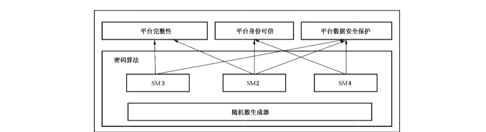

#### 6.1.2 平台组成结构

可信计算密码支撑平台的技术结构如图2所示。

> 注：图2中 TCM 服务模块和应用软件以灰色图绘制，表示非本文件重点内容。

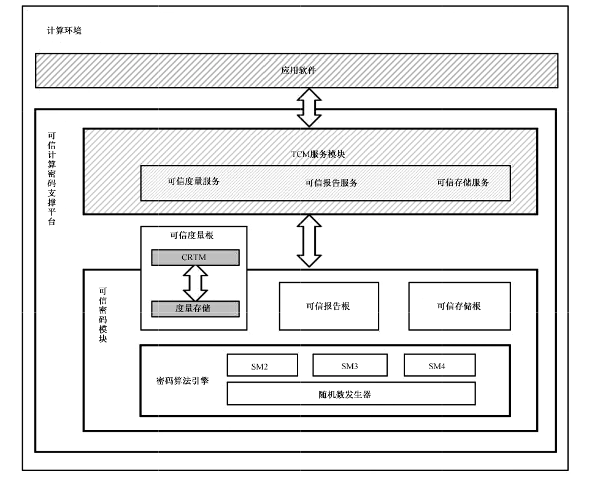

可信计算密码支撑平台以可信密码模块为可信根，通过如下三类机制及平台自身安全管理功能，实现平台安全功能：

a） 以可信度量根起点，计算系统平台完整性度量值，建立计算机系统平台信任链，确保系统平台可信；

b） 可信报告根标识平台身份的可信，可信报告根基于报告根凭证派生，报告根凭证具有唯一性，以可信报告根为基础，实现平台身份证明和完整性报告；

c） 基于可信存储根，实现密钥管理、平台数据安全保护功能，提供相应的密码服务。

#### 6.1.3 可信密码模块

可信密码模块定义了一个具有存储保护和执行保护的子系统，该子系统将为计算平台建立可信根基，并且其独立的计算资源将建立严格隔离的安全保护机制。TCM 是一个系统组件，它的状态独立于该系统并向其报告。TCM 和系统之间的唯一交互是通过本文件中定义的接口进行的。

#### 6.1.4 TCM服务模块

可信密码模块定义了一个具有存储保护和执行保护的子系统，该子系统将计算平台建立信任根基，并且其独立的计算资源将建立严格隔离的安全保护机制。将子系统中需执行保护的功能与无需执行保护的功能划分开，将无需执行保护的功能由计算平台主处理器执行，而这些支持功能构成了 TCM服务模块，简记为 TSM。

注；本文件只说明TSM 的功能原理，不涉及具体接口规范。

TSM主要为用户使用TCM 基础资源提供支持，由多个部分组成，每个部分间的接口定义应具有互操作性。TSM 应提供规范化的函数接口。

TSM的设计目标如下：

a） 为应用程序调用TCM安全保护功能提供入口点；

b） 提供对 TCM 的同步访问；

c） 向应用程序隐藏TCM 功能命令的复杂度；

d）管理TCM 资源。

### 6.2 平台接口功能

#### 6.2.1 可信根

可信根是可信计算机的可信基点，也是实施安全控制的基点。可信根提供了描述平台可信度的特征所需的最小功能。

可信计算密码支撑平台中需要三个可信根：RTM、RTS和 RTR。

a） RTM是对平台进行可信度量的基点。RTM 将完整性相关信息发送给 RTS。当一条新的信任链建立时，第一组被执行的指令就是CRTM。当系统复位时，CPU 开始执行 CRTM。然后，CRTM 向 RTS发送表明其身份的度量值。这样就建立了信任链的起点。

b） RTS是对可信度量值进行安全存储的基点。TCM内部存储不能被外部实体非授权访问，TCM 可作为RTS。TCM 可阻止对敏感信息的非授权访问，TCM 也可存储一些不敏感的信息。

c） RTR是平台向访问客体提供平台可信性状态报告的基点。RTR 是对于 RTS 内容进行报告，RTR报告是TCM 内选择内容签名后的报告。

TCM包含了 RTR 可验证的加密标识。这个标识采用背书密钥或背书证书的形式表现，背书密钥生成的种子与每个芯片绑定，因此两个 TCM 不会具有相同的背书密钥。

可信计算平台至少提供前面描述的三个可信根。这三个根都使用认证和证明来提供信息的证据。

可信计算平台还将为受托的密钥和数据对象提供受保护的存储。可信计算平台可提供完整性度量以确保平台的可信。

#### 6.2.2 证明和认证

##### 6.2.2.1 证明方式

可信计算平台提供以下证明方式。

a） 第一类，外部实体对 TCM进行证明，TCM应遵循本文件。这种证明依据TCM 中的背书密钥。

b） 第二类，外部实体对平台进行认证，以确保平台包含 RTM、真实的TCM。

c） 第三类，“认证 CA”对TCM 中的非对称密钥对进行证明，以确保密钥受到 TCM 的保护，并且具有特定的自身属性。这种证明采用证书的形式，为包括密钥对的公钥在内的信息提供担保。

d） 第四类，可信计算平台对非对称密钥对进行证明，以保证密钥对受到TCM 保护，并且具有特定的自身属性。该认证方式采用在平台的TCM 对描述密钥对的信息签名的形式，使用 TCM保护的认证密钥，以及为该认证密钥提供担保的类型认证。

e） 第五类，可信计算平台对度量进行证明，以保证平台中存在特定的软件/固件状态。这种证明方式使用 TCM 保护的认证密钥对 PCR 中软件/固件测量上签名的形式认证。

f） 第六类，外部实体对软件/固件测量进行证明。这种认证采用凭证的形式，为测量值和状态在内的信息提供签名。

第三类和第四类的认证要求使用密钥对 TCM 屏蔽位置的内容进行签名。

a） 证明密钥（AK）即平台身份密钥。AK是一种特妹类型的签名密钥，其使用受到限制，以防止伪造（外部数据的签名具有与真实认证数据相同的格式）。当TCM 要创建一个需要签名的消息时，从TCM 内部使用一个特值作消息头。当使用 AK 对摘要进行签名时，调用者提供票据，以便TCM 应确定用于创建摘要的消息不可能是伪造的TCM 认证数据。由AK 签名的值可保证反映 TCM状态，但是 AK 也可用于一般的签名目的。

证明密钥身份证书。TCM 用户可基于 TCM 创建受限使用的签名密钥，并且可要求第三方CA为其提供密钥身份证书。该CA 可要求调用者提供一些证据，证明被认证的密钥是 TCM驻留密钥，才给予提供身份证书。

##### 6.2.2.2 平台身份标识

可信计算密码支撑平台采用背书密钥（EK）标识其身份，在EK授权下，在TCM 内部生成一个非对称密钥对，作AK，用于对TCM内部的信息进行数字签名，实现平台身份认证和平台完整性报告，从而向外部证实平台内部数据的可信性。

EK 应被保存在TCM 内，仅仅在获取背书密钥授权操作及申请平台身份证书时使用，且不得被导出到 TCM外部。

背书密钥证书在平台使用前由一个可信方签署，用于建立 EK 与可信密码模块实例的一一对应关系。

一个可信计算密码支撑平台可产生多个 AK，每个AK 均与EK绑定，对外代表平台身份。

#### 6.2.3 受保护的位置

##### 6.2.3.1 概述

受保护位置的保护加密使用的多个种子和密钥，这些种子和密钥永不会离开TCM。其中之一是上下文密钥。它是一个对称密钥，用于在数据临时交换出 TCM 时加密数据，以便可加载一组不同的工作对象。其他永不离开 TCM 的敏感值是主种子，这些种子是保护应用程序保留的对象的存储层次结构的根。主种子用于为其他对象生成保护密钥的随机数：这些对象可能是包含保护密钥的存储密钥。主种子可能会被更改，当它们被更改时，它们派生的对象将不再可用。

##### 6.2.3.2 密钥管理功能

密钥管理功能包括如下内容。

a） 密钥生成：密钥生成是指由应用层软件设置所需生成密钥的密钥属性、密钥使用授权、密钥迁移授权、密钥的保护操作密钥，并发送给 TCM 生成指定的密钥。在TCM 内，由保护操作密钥加密所生成的密钥私钥部分，然后将生成的密钥数据结构返回给应用层软件。对于TCM内各类密钥，生成方法包括：

1） EK 由厂商生成，为非对称密钥；

2） 平台所有者生成存储主密钥时，应在可信密码模块内部生成；

3） 平台身份密钥为非对称密钥，应在TCM 内部生成，需向可信方申请相应平台身份证书并激活该密钥；

4） 用户密钥可在可信密码模块内部生成，也可在可信密码模块外部生成后导人。用户密钥可以是对称密钥或非对称密钥。

b） 密钥加载：密钥生成后，在应用层软件使用该密钥进行数据安全保护操作时，如果需要使用该密钥的私钥，需要将密钥数据加载到 TCM 内部，由保护操作密钥解密后才能使用。如果使用该密钥的公钥，则在应用层软件直接使用。可信密码模块内各类密钥的加载方法包括：

1） 使用TCM 密钥公钥在设置平台所有者之前不需要验证授权，设置平台所有者之后，应验证所有者授权；密码算法运算过程应在 TCM内部进行；

2） 使用存储主密钥应验证存储主密钥授权；密码算法运算过程应在TCM内部进行；

3） 使用平台身份密钥 AK 应验证平台身份密钥授权、存储主密钥授权；平台身份密钥的私钥应被加载到 TCM 内部进行密码算法运算，公钥的密码算法运算过程在 TCM外部进行；

4） 使用平台加密密钥应验证平台加密密钥授权、存储主密钥授权；平台加密密钥的私钥应被加载到可信密码模块内部进行密码运算，公钥的密码运算过程在模块外部进行；

5） 使用用户密钥应验证用户密钥授权；用户密钥的私钥应被加载到TCM 内部进行密码运算。

c） 密钥销毁：密钥生成后，应用层软件可销毁指定的密钥。对于 TCM 内各类密钥，销毁方法如下：

1）销毁EK 是通过撤销可撤销的EK证书完成的。对于不可撤销的 EK，不能销毁；

2） 销毁存储主密钥应验证存储主密钥授权后在TCM 内执行；

3）销毁平台身份密钥应验证平台身份密钥授权、存储主密钥授权后，在可信密码模块内执行；

4） 销毁平台加密密钥应验证平台加密密钥授权、存储主密钥授权后，在可信密码模块内执行；

5） 销毁用户密钥需验证其保护操作密钥授权后，在TCM服务模块内执行。

d） 密钥导人：应用层软件可采用密钥导人方式，对TCM 外部创建的非对称、对称密钥进行保护，并纳入可信密码模块的密钥保护体系中。密钥导人方法：外部密钥需按照指定格式设定密钥属性，并使用指定的保护操作密钥对被导入密钥的私钥部分加密。

e） 密钥协商：密钥协商是在两个用户 A和B之间建立一个共享秘密密钥的过程，通过这种方式确定一个共享秘密密钥的值，用来提供用户 A与用户 B之间传输数据的安全。

##### 6.2.3.3 数据安全保护方式

数据加解密：数据加解密可采用对称密码算法或非对称密码算法实现。非对称加解密和对称加解密应在 TCM 内部执行。在TCM 内部进行加解密操作时，需要先加载密钥。

#### 6.2.4 完整性度量、存储和报告

##### 6.2.4.1 完整性度量

完整性度量以 CRTM 作为度量起点，对平台进行逐步的度量，并在TCM 中扩展到 PCR。

完整性度量的结果是一个值，它表示平台的信任状态可能发生的变化。被度量对象通常是：

a） 数据值；

b） 代码或数据的杂凑；

c） 用户的策略配置信息或某些代码或数据的签名者的指示。

RTM（通常是运行在CPU上的代码）进行这些度量，并使用扩展命令在 RTS中记录它们。该过程允许 TCM 在相对较小的内存中保存不确定数量的度量结果。用户可凭借度量结果 PCR 值和日志来确定平台的可信状态。

完整性报告是对PCR记录的完整性度量进行验证的过程，体现平台的完整性状态。

##### 6.2.4.2 完整性度量与存储

完整性度量与存储是指计算组件的度量值，记录该事件到事件日志中，并把度量值扩展到可信密码模块内相应的平台配置寄存器（PCR）中。图3为依次度量两个组件的过程说明。

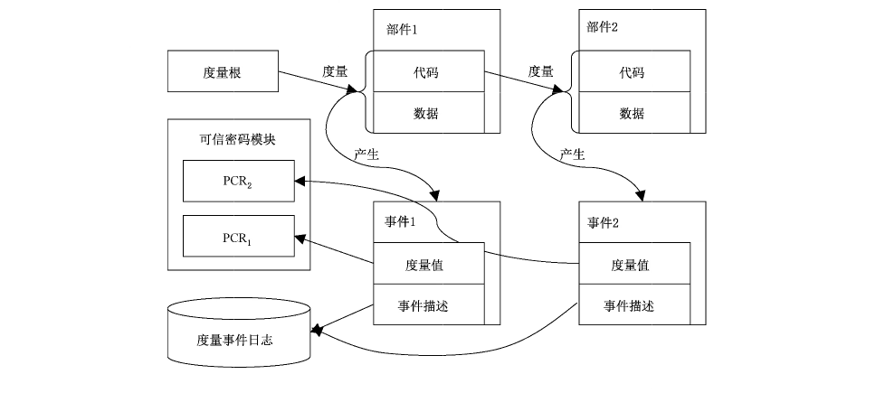

完整性度量与存储应满足如下要求。

a） 计算度量值的过程应是执行杂凑运算的过程。

b） 杂凑运算输入的数据应为度量者指定的可表征被度量者特性的数据。

c） 被度量者的完整性度量值应为杂凑运算输出的杂凑值。

d） 度量者应把度量值扩展到指定的PCR 中。扩展的办法是：新 PCR 值=密码杂湊算法（原PCR 值||度量值）。

e） 应把度量过程信息记录到平台事件日志中。至少应记录：PCR 索引、度量者信息、被度量者信息、度量值等。

如果一个组件序列中的各组件完整性度量值存储在同一个 PCR 中，则采用一种专门的压缩存储方式，即从第一个组件开始，将该组件完整性度量值与目标 PCR 的已有存储值拼接，进行杂凑运算，然后将所得结果再存储于该 PCR 中，依次类推，最后一个组件的完整性度量值存储操作完成后，所得值即为该组件序列存储到 PCR 中的完整性度量值。

##### 6.2.4.3 完整性报告

完整性报告是指平台向验证者提供平台或部分组件的完整性度量值的过程。完整性报告应满足如下要求。

a） 平台应向验证者提供指定PCR值，无需任何授权。

b）平台应向验证者提供指定 PCR 值以及对PCR值的签名。签名使用平台身份密钥。

c） 平台可向验证者提供指定 PCR的相关事件日志信息。

d） 验证者可通过分析完整性度量事件日志信息判断该 PCR 值是否来自正确的度量过程。

e）验证者应使用平台身份密钥验证PCR 值签名，获得平台完整性报告结果。

##### 6.2.4.4 信任链

信任链用于保障平台完整性。

平台信任链的建立是以可信度量根为起点。

首先对 BIOS的其他组件进行完整性度量，并将度量值存储于可信密码模块的PCR 中，按照选择的判断机制判断 BIOS的完整性，若完整性未被破坏，则运行 BIOS；并度量初始化程序加载器（IPL）/主引导分区（MBR）的完整性，亦可基于判断机制判断 IPL/MBR 完整性，若IPL/MBR完整性没有被破坏，则运行 MBR；然后由IPL/MBR度量OS内核的完整性；OS 内核启动后基于同样机制检测OS服务完整性。通过信任关系传递，可确保所启动的系统是可信的。

若上述过程中，发现某一组件的完整性受到破坏，则报告问题并按照指定策略执行相关操作。

## 7 可信密码模块接口

### 7.1 通用要求

本章规定了可信密码模块接口的具体命令。

本文件所定义的可信密码模块接口应满足本章所有的命令接口。

本文件的所有接口涉及的命令码、返回码和常用的数据结构应符合附录A 的要求。

> 注：附录A中规定了本章所要求的具体数据结构。

### 7.2 启动命令

**7.2.1** TCM2_Startup该命令用于 TCM 的初始化，当该命令执行成功之后，不再允许成功执行该命令。该命令接口输入和输出具体参数要求见表1和表2。

当 TCM 需要执行 TCM2_Startup 命令时，收到了其他命令，或者当不需要执行 TCM2_Startup 命令时收到了该命令，TCM 将返回 TCM2_RC_INITIALIZE。

以下是关闭/启动流程，定义了 TCM 收到 TCM2_Startup（）命令后的操作方法。

a） TCM 重置-发送 TCM2_Shutdown（CLEAR）或者没有发送TCM2_Shutdown（）命令关闭，启动时发送 Startup（CL.EAR）。当TCM 重置时，所有的变量恢复到初始状态启动。

b） TCM 重启-发送 TCM_Shutdown（STATE）命令关闭，启动时发送 Startup（CLEAR）。以下状态值会恢复到初始状态启动：PCR 与平台域的控制开关状态；其余 TCM状态值将会被保存。

c） TCM 唤醒-发送 TCM2_Shutdown （STATE）命令关闭，启动时发送 TCM2_Startup（STATE）。以下状态值会以休眠保存的状态值恢复启动：

1） SRTM；

2） PCR；

3） 除 phEnable、phEnableNV 外的平台控制开关。

**表1 TCM2_Startup（）接口输入参数**

|  | 类型 | 名称 | 描述 |  |
| --- | --- | --- | --- | --- |
|  | TCMI_ST_COMMAND_TAG | Tag | TCM2_ST_NO_SESSIONS |  |
|  | UINT32 | commandSize | 命令长度 |  |
|  | TCM2.CC | commandCode | TCM2_CC_Startup NV） |  |
|  | TCM2_SU | startupType | TCM2_SU_CLEAR 或 TCM2_SU_STATE |  |

**表2 TCM2_Startup（）接口输出参数**

|  | 类型 | 名称 | 描述 |  |
| --- | --- | --- | --- | --- |
|  | TCM2_ST | Tag | TCM2_ST_NO_SESSIONS |  |
|  | UINT32 | responseSize | 返回数据大小 |  |
|  | TCM2_RC | responseCode | 返回码 |  |

**7.2.2** TCM2_Shutdown该命令用于为下一个新的上电周期准备TCM。shutdownType 参数用于指明下一次 TCM2_Startup（）处理过程。该命令接口输入和输出具体参数要求见表3和表4。

**表3 TCM2_Shutdown（）接口输入参数**

|  | 类型 | 名称 | 描述 |  |
| --- | --- | --- | --- | --- |
|  | TCMI_ST_COMMAND_TAG | tag | TCM2_ST_NO_SESSIONS |  |
|  | UINT32 | commandSize | 命令长度 |  |
|  | TCM2_CC | commandCode | TCM2_CC_Shutdown〈NV｝ |  |
|  | TCM2_SU | shutdownType | TCM2_SU_CLEAR 或 TCM2_SU_STATE |  |

**表4 TCM2_Shutdown（）接口输出参数**

|  | 类型 | 名称 | 描述 |  |
| --- | --- | --- | --- | --- |
|  | TCM2_ST | tag | TCM2_ST_NO_SESSIONS |  |
|  | UINT32 | responseSize | 返回数据大小 |  |
|  | TCM2_RC | responseCode | 返回码 |  |

### 7.3 检测命令

**7.3.1** TCM2_SelfTest该命令触发 TCM 执行自检功能。该命令接口输入和输出具体参数要求见表5和表6。

当 fullTest= YES,TCM 将执行全功能自检；当fullTest=NO，TCM 将只对未执行自检的功能进行自检。

如果需要自检，TCM将：

a） 返回 TCM2_RC_TESTING，执行需要进行的功能自检；

b 或已执行完成自检，然后返回自检成功与否。

**表 5 TCM2_SelfTest（）接口输入参数**

|  | 类型 | 名称 | 描述 |  |
| --- | --- | --- | --- | --- |
|  | TCMIL_ST_COMMAND_TAG | 1ag | TCM2_ST_NO_SESSIONS |  |
|  | UINT32 | commandSize | 命令长度 |  |
|  | TCM2_CC | commandCode | TCM2_CC_SelfTest ｛NV） |  |
|  | TCMI_YES_NO | fullTest | YES：执行全功能自检NO：对未执行自检功能执行自检 |  |

**表6 TCM2_SelfTest（）接口输出参数**

|  | 类型 | 名称 | 描述 |  |
| --- | --- | --- | --- | --- |
|  | TCM2_ST | 1ag | TCM2_ST_NO_SESSIONS |  |
|  | UINT32 | responseSize | 返回数据大小 |  |
|  | TCM2_RC | responseCode | 返回码 |  |

**7.3.2** TCM2_IncrementalSelrTest该命令对被选中的算法执行自检。该命令接口输入和输出具体参数要求见表？和表8。

如果 toTest 参数中包含一个已被自检过的算法，该算法将不会被再次自检。toDoList 参数中将包含仍需被自检的算法。

**表 7 TCM2_IncrementalSelfTest（）接口输入参数**

|  | 类型 | 名称 | 描述 |  |
| --- | --- | --- | --- | --- |
|  | TCML_ST_COMMAND_TAG | tag | TCM2_ST_NO_SESSIONS |  |
|  | UINT32 | commandSize | 命令长度 |  |
|  | TCM2_CC | commandCode | TCM2_CC_IncrementalSelfTest ｛NV） |  |
|  | TCML_ALG | toTest | 将被自检的算法列表 |  |

**表8 TCM2_IncrementalSelfTest（）接口输出参数**

|  | 类型 | 名称 | 描述 |  |
| --- | --- | --- | --- | --- |
|  | TCM2_ST | tag | TCM2_ST_NO_SESSIONS |  |
|  | UINT32 | responseSize | 返回数据大小 |  |
|  | TCM2_RC | responseCode | 返回码 |  |
|  | TCML_ALG | toDolist | 需要被测试算法列表 |  |

**7.3.3** TCM2_GetTestResult该命令返回 TCM 自检结果，outData 的结构由厂商自定义。该命令接口输入和输出具体参数要求见表9和表10。

**表9 TCM2_GetTestResult（）接口输入参数**

|  | 类型 | 名称 | 描述 |  |
| --- | --- | --- | --- | --- |
|  | TCMLST_COMMAND_TAG | tag | TCM2_ST_NO_SESSIONS |  |
|  | UINT32 | commandSize | 命令长度 |  |
|  | TCM2_CC | commandCode | TCM2_CC_GetTestRusult |  |

**表10**

|  | 类型 | 名称 | 描述 |  |
| --- | --- | --- | --- | --- |
|  | TCM2_ST | tag | TCM2_ST_NO_SESSIONS |  |
|  | UINT32 | responseSize | 返回数据大小 |  |
|  | TCM2_RC | responseCode | 返回码 |  |
|  | TCM2B_MAX_BUFFER | OutData | 厂商自行定义 |  |
|  | TCM2_RC | testResult | 将被自检的算法列表 |  |

### 7.4 会话命令

**7.4.1** TCM2_StartAuthSession该命令用于启动一个授权会话，返回会话句柄及TCM 初始的nonce 值。该命令提供了两种方式建立会话密钥（sessionKey），会话密钥被用于授权操作和加密参数。该命令接口的输入和输出具体参数要求见表11 和表12。

该命令允许用对称或者非对称保护的方式往TCM 中注入秘密信息。tcmKey 的类型决定如何加密 encryptedSalt 中的值。从 encryptedSalt 中解密出来的值用于计算会话密钥（sessionKey）。

> 注：当 tcmKey 等于 TCM2_RH_NULL,encryptedSalt 为空值。

当tcmKey 和 bind 都为TCM2_ALG_NULL，会话密钥设置为空值，当tcmKey 不为TCM2_ALG- NULL, encryptedSalt 参数用于计算会话密钥。当bind 不是TCM2_ALG_NULL,bind 参数的授权值参与会话密钥的计算。

**表 11 TCM2_StartAuthSession（）接口输入参数**

|  | 类型 | 名称 | 描述 |  |
| --- | --- | --- | --- | --- |
|  | TCMI_ST_COMMAND_TAG | tag | 如果当前是加密/解密会话，则为 TCM2_ST-SESSIONS， 否则为 TCM2_ST-NO_SES-SIONS |  |
|  | UINT32 | commandSize | 命令长度 |  |
|  | TCM2_CC | commandCode | TCM2_CC_StartAuthSession |  |
|  | TCMI_DH_OBIECT+ | TCMIKey | 被加载的解密密钥句柄，salt 使用该密钥进行加密可以是 TCM2_RH_NULL授权索引；None |  |
|  | TCML_DHL_ENTITY+ | bind | 实体提供授权值可以是 TCM2_RH_NULL授权索引：None |  |
|  | TCM2B_NONCE | nonceCaller | 初始的暂时调用，设置会话 nonce 的大小不少于16字节 |  |
|  | TCM2B_ENCRYPTED_SECRET | encryptedSalt | 使用 TCMKey 加密后的值如果 TCMKey 是 TCM2_RH_NULL.，该值将内空 |  |
|  | TCM2_SE | sessionType | 指明会话的类型，简单的 HMAC 或策略（包括试用策略） |  |
|  | TCMT_SYM_DEF+ | symmetric | 参数加密的算法及密钥长度，可为TCM2-ALG_NULL |  |
|  | TCMI_ALG_HASH | authHash | 会话使用的 SM3杂凑算法，不能是 TCM2-ALG_NULL |  |

**表12 TCM2_StartAuthSession（）接口输出参数**

|  | 类型 | 名称 | 描述 |  |
| --- | --- | --- | --- | --- |
|  | TCM2_ST | tag | 如果命令执行成功，输出标记应与输入标记相同，如果命令执行失败，则输出 tag 应是TCM2-ST_NO_SESSIONS |  |
|  | UINT32 | responseSize | 返回数据大小 |  |
|  | TCM2_RC | responseCode | 返回码 |  |
|  | TCMI_SH_AUTH_SESSION | sessionHandle | 新创建的会话句柄 |  |
|  | TCM2B_NONCE | nonceTCM | 来自 TCM 的初始 nonce 值，用于计算会话密钥 sessionKey |  |

**7.4.2** TCM2_Policy Restart该命令使增强授权会话返回到初始状态。当 TCM返回 TCM2_RC_PCR_CHANGED 时该命令将会被使用。该命令不会重置 policyID 或策略开始的时间。该命令接口输入和输出具体参数要求见表13 和表14。

**表13 TCM2_PolicyRestart（）接口输入参数**

|  | 类型 | 名称 | 描述 |  |
| --- | --- | --- | --- | --- |
|  | TCMI_ST_COMMAND_TAG | tag | TCM2_ST_NO_SESSIONS |  |
|  | UINT32 | commandSize | 命令长度 |  |
|  | TCM2_CC | commandCode | TCM2_CC_Policy Restart |  |
|  | TCMI_SH_POLICY | sessionHandle | 策略会话句柄 |  |

**表14 TCM2_PolicyRestart（）接口输出参数**

|  | 类型 | 名称 | 描述 |  |
| --- | --- | --- | --- | --- |
|  | TCM2_ST | tag | TCM2_ST_NO_SESSIONS |  |
|  | UINT32 | responseSize | 返回数据大小 |  |
|  | TCM2_RC | responseCode | 返回码 |  |

### 7.5 对象命令

**7.5.1** TCM2_Create该命令用于创建一个可被 TCM2_Load 命令载入 TCM 内部的对象，如果命令执行成功，TCM将创建新对象，并返回对象的创建数据（creationData）、公开部分（outPublic）和加密敏感区域（outPrivate），返回的数据由调用者负责保存。

该对象使用之前需要调用 TCM2_Load命令载入 TCM。

该命令接口输入和输出具体参数要求见表15 和表16。

**表15 TCM2_Create（）接口输入参数**

|  | 类型 | 名称 | 描述 |  |
| --- | --- | --- | --- | --- |
|  | TCMI_ST_COMMAND_TAG | tag | TCM2_ST_SESSIONS |  |
|  | UINT32 | commandSize | 命令长度 |  |
|  | TCM2_CC | commandCode | TCM2_CC_Create |  |
|  | TCMI_DH_OBJECT | @parentHandle | 新对象的父句柄，父句柄应指向一个已载人TCM 的解密密钥授权索引：1授权角色：USER |  |
|  | TCM2B_SENSITIVE_CREATE | inSensitive | 隐私数据 |  |
|  | TCM2B_PUBLIC | inPublic | 公开数据 |  |
|  | TCM2B_DATA | outsideInfo | 包含在此对象的创建数据中的数据，用于提供对象与对象拥有者数据之间永久可认证的联系 |  |
|  | TCMI._PCR_SEL.ECTION | creationPCR | 指定在创建数据（creationData）中使用的 PCR寄存器 |  |

**表16 TCM2_Create（）接口输出参数**

|  | 类型 | 名称 | 描述 |  |
| --- | --- | --- | --- | --- |
|  | TCM2_ST | tag | 如果命令执行成功，输出标记应与输入标记相同，如果命令执行失败，则输出 tag 应是 TCM2_ST_NO_SESSIONS |  |
|  | UINT32 | responscSize | 返回数据大小 |  |
|  | TCM2_RC | responscCode | 返回码 |  |
|  | TCM2B_PRIVATE | outPrivate | 对象的隐私数据部分 |  |
|  | TCM2B_PUBLIC | outPublic | 对象的公开数据部分 |  |
|  | TCM2B_CREATION_DATA | creationData | 创建数据，包含一个 TCMS_CREATION-DATA 结构 |  |
|  | TCM2B_DIGEST | creationHash | 使用公开数据中的杂凑算法（nameAlg）对 cre-ationData 计算的摘要值 |  |
|  | TCMT_TK_CREATION | creationTicket | TCM2_CertifyCreation （）命令使用的票据，用来验证由 TCM 产生的创建数据（creationData） |  |

**7.5.2** TCM2_Load该命令用于将一个对象载入 TCM 中，只有当对象的公开部分（TCM2B_PUBLIC）和隐私部分（TCM2B_PRIVATE）都需要被载人 TCM 时该命令才被使用。

如果只有公开部分被载入 TCM,TCM2_LoadExternal 命令将被使用。

该命令接口输入和输出具体参数要求见表17和表18。

该命令将返回被载入对象的句柄和名字，名字是由TCM 计算的 inPublic 结构的 TCMT_PUBL.IC成员的摘要值。如果对象的隐私数据部分 inPrivate.size 为0，加载将失败。

**表17 TCM2_Load（）接口输入参数**

|  | 类型 | 名称 | 描述 |  |
| --- | --- | --- | --- | --- |
|  | TCMIST_COMMAND_TAG | tag | TCM2_ST_SESSIONS |  |
|  | UINT32 | commandSize | 命令长度 |  |
|  | TCM2_CC | commandCode | TCM2_CC_Load |  |
|  | TCMI_DH_OBIECT | @parentHandle | 父密钥的句柄，不应是一个被保留的句柄授权索引：1授权角色：USER |  |
|  | TCM2B_PRIVATE | inPrivate | 对象的隐私数据部分 |  |
|  | TCM2B_PUBLIC | inPublic | 对象的公开数据部分 |  |

**表18 TCM2_Load（）接口输出参数**

|  | 类型 | 名称 | 描述 |  |
| --- | --- | --- | --- | --- |
|  | TCM2_ST | tag | 如果命令执行成功，输出标记应与输入标记相同，如果命令执行失败，则输出 tag 应是 TCM2_ST_NO_SESSIONS |  |
|  | UINT32 | responseSize | 返回数据大小 |  |
|  | TCM2_RC | responseCode | 返回码 |  |
|  | TCM2_HANDLE | objectHandle | 载人对象的句柄 |  |
|  | TCM2B_NAME | name | 载人对象的名字 |  |

**7.5.3** TCM2_LoadExternal该命令用于将一个非保护性的对象载人 TCM。该命令允许载入对象的公开部分，用于验证签名，或者既载入对象的公开部分又载入隐私部分，用于加密操作。该命令将返回载入对象的句柄和名字，名字是摘要算法 nameAlg 和对象公开数据部分摘要值的级联。

该命令接口输入和输出具体参数要求见表19和表20。

当只载人一个外部对象的公开部分时，允许制定一个对象关联的层级，这样创建票据时可使用正确的算法，hierarchy 参数指定了这个层级，如果对象的公开部分和隐私部分都被载人，hierarchy 参数被要求是 TCM2_RH_NULL。

**表 19 TCM2_LoadExternal（）接口输入参数**

|  | 类型 | 名称 | 描述 |  |
| --- | --- | --- | --- | --- |
|  | TCMIST_COMMAND_TAG | tag | 如果是加密/解密操作，tag 为 TCM2_ST_SES-SIONS， 否则为 TCM2_ST_NO_SESSIONS |  |
|  | UINT32 | commandSize | 命令长度 |  |
|  | TCM2_CC | commandCode | TCM2_CC_LoadExternal |  |
|  | TCM2B_SENSITIVE | inPrivate | 对象的隐私数据部分（可选） |  |
|  | TCM2B_PUBLIC+ | inPublic | 对象的公开数据部分 |  |
|  | TCMI_RH_HIERARCHY+ | hierarchy | 对象关联的层级 |  |

**表20 TCM2_LoadExternal（）接口输出参数**

|  | 类型 | 名称 | 描述 |  |
| --- | --- | --- | --- | --- |
|  | TCM2_ST | 1ag | 如果命令执行成功，输出标记应与输入标记相同，如果命令执行失败，则输出 tag 是TCM2-ST_NO_SESSIONS |  |
|  | UINT32 | responseSize | 返回数据大小 |  |
|  | TCM2_RC | responseCode | 返回码 |  |
|  | TCM2_HANDLE | objectHandle | 被载入对象的句柄 |  |
|  | TCM2B_NAME | name | 被载入对象的名字 |  |

**7.5.4** TCM2_ReadPublic该命令返回一个已载人对象的公开数据部分，该对象句柄的使用不需要授权信息。如果ob-jectHandle 引用序列对象，则TCM 应返回TCM2_RC_sequence。该命令接口输入和输出具体参数要求见表21 和表22。

**表 21 TCM2_ReadPublic（）接口输入参数**

|  | 类型 | 名称 | 描述 |  |
| --- | --- | --- | --- | --- |
|  | TCMI_ST_COMMAND_TAG | 1ag | 如果是加密会话，tag 为 TCM2- ST-SESSIONS，否则为 TCM2_ST-NO_ SES-SIONS |  |
|  | UINT32 | commandSize | 命令长度 |  |

**表21 TCM2_ReadPublic（）接口输入参数**

|  | 类型 | 名称 | 描述 |  |
| --- | --- | --- | --- | --- |
|  | TCM2_CC | commandCode | TCM2_CC_ReadPublic |  |
|  | TCMI_DH_OBIECT | obiectHandle | 对象的句柄授权索引：None |  |

**表22 TCM2_RcadPublic（）接口输出参数**

|  | 类型 | 名称 | 描述 |  |
| --- | --- | --- | --- | --- |
|  | TCM2_ST | 1ag | 如果命令执行成功，输出标记应与输入标记相同，如果命令执行失败，则输出 tag 是TCM2_ST_NO_SESSIONS |  |
|  | UINT32 | responseSize | 返回数据大小 |  |
|  | TCM2_RC | responseCode | 返回码 |  |
|  | TCM2B_PUBLIC | outPublic | 包含对象公开数据的结构体 |  |
|  | TCM2B_NAME | name | 对象的名字 |  |
|  | TCM2B_NAME | qualifiedName | 对象的限定名称 |  |

**7.5.5** TCM2_ActivateCredential该命令给指定的对象关联一个凭证，确保 TCM 已经认证了该对象的参数。

该命令接口输入和输出具体参数要求见表23 和表24。

a） 如果参数 activateHandle 和 KeyHandle 的公开部分和隐私部分都没有被加载，则TCM返回TCM2_RC_AUTH_UNAVAILABLE.

b） KeyHandle 应是一个存储密钥，否则 TCM返回 TCM2_RC_TYPE.

c） 对 ActivateHandle 的授权要求管理员身份。

d） 与 keyHandle 关联的密钥用于从 secret 恢复种子，即加密种子。

e） 与 activateHandle 关联的对象的名称和恢复的种子用于恢复对称密钥，恢复的种子（而不是名称）用于恢复hmac密钥。

f） HMAC 被用来认证输入参数 credentialBlob 与 activateHandle 相关联，且.credentialBlob 中的数据没有被改变。

g） 如果 credentialBlob 数据的完整性检查成功，credentialBlob 被解密，作为输出参数 certInfo返回。

**表 23 TCM2_ActivateCredential（）接口输入参数**

|  | 类型 | 名称 | 描述 |  |
| --- | --- | --- | --- | --- |
|  | TCMIST_COMMAND_TAG | 1ag | TCM2_ST_SESSIONS |  |
|  | UINT32 | commandSize | 命令长度 |  |
|  | TCM2_CC | commandCode | TCM2_CC_ActivateCredential |  |
|  | TCMIL_DH_OBJECT | @activateHandle | 与 credentialBlob 中的证书相关联的对象句柄授权索引：1授权身份：ADMIN |  |
|  | TCMI_DH_OBIECT | @keyHandle | 加载的密钥，用来解密在 credentialBlob 中的TCMS_SENSITIVE授权索引：2授权身份：USER |  |
|  | TCM2B_ID_OBIECT | credentialBlob | 对象凭证 |  |
|  | TCM2B_ENCRYPTED_SECRET | secret | 依赖于密钥算法的种子，用来保护凭证信息 |  |

**表 24 TCM2_ActivateCredential（）接口输出参数**

|  | 类型 | 名称 | 描述 |  |
| --- | --- | --- | --- | --- |
|  | TCM2_ST | 1ag | 如果命令执行成功，输出标记应与输入标记相同，如果命令执行失败，则输出tag 是 TCM2-ST_NO_SESSIONS |  |
|  | UINT32 | responseSize | 返回数据大小 |  |
|  | TCM2_RC | responseCode | 返回码 |  |
|  | TCM2B_DIGEST | certlnfo | 解密后的证书信息该数据长度不应大于 keyHandle 密钥关联的nameAlg 指定的摘要算法产生的摘要长度 |  |

**7.5.6** TCM2_MakeCredential该命令允许 TCM执行证书颁发机构（CA）在创建包含激活凭据的 TCM2B_ID_OBJECT 时所需的操作。输入参数 handle 的公开区域要求是存储密钥类型，否则凭证不能被正确的绑定。

该命令接口输入和输出具体参数要求见表25和表26。

**表25 TCM2_MakeCredential（）接口输入参数**

|  | 类型 | 名称 | 描述 |  |
| --- | --- | --- | --- | --- |
|  | TCMI_ST_COMMAND_TAG | tag | 如果是加密/解密会话，tag 为 TCM2_ST_SES-SIONS，否认则为 TCM2_ST_NO_SESSIONS |  |
|  | UINT32 | commandSize | 命令长度 |  |
|  | TCM2_CC | commandCode | TCM2_CC_MakeCredential |  |
|  | TCML_DH_OBJECT | handle | handle 指向的对象的载人公开区域，用来加密包含凭证密钥的敏感数据认证索引：None |  |
|  | TCM2B_DIGEST | credential | 凭证信息 |  |
|  | TCM2B_NAME | objectName | 此凭证关联的对象名称 |  |

**表26 TCM2_MakeCredential（）接口输出参数**

|  | 类型 | 名称 | 描述 |  |
| --- | --- | --- | --- | --- |
|  | TCM2_ST | tag | 如果命令执行成功，输出标记应与输入标记相同，如果命令执行失败，则输出tag 是TCM2-ST_NO_SESSIONS |  |
|  | UINT32 | responseSize | 返回数据大小 |  |
|  | TCM2_RC | responseCode | 返回码 |  |
|  | TCM2B_ID_OBIECT | credentialBlob | 凭证信息 |  |
|  | TCM2B_ENCRYPTED_SECRET | secret | 包含用来加密凭证信息的密钥的秘密数据 |  |

**7.5.7** TCM2_Unseal该命令返回一个被载入TCM 的封装数据对象的相关数据。这个封装数据对象可能是TCM 自己产生的，但更有可能是外部创建，通过TCM2_Import 导人TCM 的。该命令的返回值可能通过授权会话加密。

该命令接口输入和输出具体参数要求见表27 和表28。

如果封装数据对象属性中的 restricted、decrypt 或 sign 位被设置为1，则 TCM返回 TCM2_RC- ATTIBUTES.如果 itemHandle 的类型不是 TCM2_ALG_KEYEDHASH，则TCM返回 TCM2_RC_TYPE。

**表 27 TCM2_Unseal（）接口输入参数**

|  | 类型 | 名称 | 描述 |  |
| --- | --- | --- | --- | --- |
|  | TCMIST_COMMAND_TAG | Tag | TCM2_ST_SESSIONS |  |

**表 27 TCM2_Unscal（）接口输入参数**

|  | 类型 | 名称 | 描述 |  |
| --- | --- | --- | --- | --- |
|  | UINT32 | commandSize | 命令长度 |  |
|  | TCM2_CC | commandCode | TCM2_CC_Unseal |  |
|  | TCMI_DH_OBJECT | @item Handle | 被加载的封装数据对象的句柄授权索引：1授权身份：USER |  |

**表 28 TCM2_Unseal（）接口输出参数**

|  | 类型 | 名称 | 描述 |  |
| --- | --- | --- | --- | --- |
|  | TCM2_ST | tag | 如果命令执行成功，输出标记应与输入标记相同，如果命令执行失败，则输出 tag 是TCM2-ST_NO_SESSIONS |  |
|  | UINT32 | responscSize | 返回数据大小 |  |
|  | TCM2_RC | responseCode | 返回码 |  |
|  | TCM2B_SENSITIVE_DATA | outbata | 解封装得到的数据解封数据的大小不能超过128字节 |  |

**7.5.8** TCM2_ObjectChangeAuth该命令用来改变已载入TCM 对象的授权信息。如果命令执行成功，将返回该对象新的授权值，该命令不改变该对象操作的其他已载人TCM的对象的授权值。该命令不能改变一个 NV 索引对象的授权值。

如果 NV索引要有新的授权，则使用 TCM2_NV_ChangeAuth（）完成。

如果要改变一个主要对象的授权值需要调用 TCM2_CreatePrimary 命令重新创建该对象。

该命令接口输入和输出具体参数要求见表29 和表30。

**表 29 TCM2_ObjectChangeAuth（）接口输入参数**

|  | 类型 | 名称 | 描述 |  |
| --- | --- | --- | --- | --- |
|  | TCML_ST_COMMAND_TAG | tag | TCM2_ST_SESSIONS |  |
|  | UINT32 | commandSize | 命令长度 |  |
|  | TCM2_CC | commandCode | TCM2_CC_ObjectChangeAuth |  |
|  | TCMIL_DH_OBIECT | @objectHandle | 对象句柄授权索引：1授权身份：ADMIN |  |

**表 29 TCM2_ObjcctChangeAuth（）接口输入参数**

|  | 类型 | 名称 | 描述 |  |
| --- | --- | --- | --- | --- |
|  | TCMI_DH_OBIECT | parentHandle | 父密钥句柄授权索引：None |  |
|  | TCM2B_AUTH | newAuth | 新的授权信息 |  |

**表 30 TCM2_ObjectChangeAuth（）接口输出参数**

|  | 类型 | 名称 | 描述 |  |
| --- | --- | --- | --- | --- |
|  | TCM2_ST | tag | 如果命令执行成功，输出标记应与输入标记相同，如果命令执行失败，则输出 tag 是TCM2-ST_NO_SESSIONS |  |
|  | UINT32 | responseSize | 返回数据大小 |  |
|  | TCM2_RC | responseCode | 返回码 |  |
|  | TCM2B_PRIVATE | outPrivate | 包含新授权信息的对象隐私数据部分 |  |

### 7.6 复制命令

**7.6.1** TCM2_Duplicate该命令复制一个已加载的对象使得该对象可被用在不同的层次上。新的父密钥可能在相同的TCM 中，也可能在不同的TCM 中，也可能是 TCM2_RH_NULL。该命令只要求新的父密钥的公开部分被加载。

该命令需要一个策略会话的授权。如果 TCM2_PolicyCpHash 作为策略的一部分已经被执行，则策略会话的 cpHash 值应与命令的cpHash 值相等，否则 TCM返回 TCM2_RC_POLICY_FAIL。

该命令接口输入和输出具体参数要求见表31 和表32。

**表31 TCM2_Duplicate（）接口输入参数**

|  | 类型 | 名称 | 描述 |  |
| --- | --- | --- | --- | --- |
|  | TCML_ST_COMMAND_TAG | tag | TCM2_ST_SESSIONS |  |
|  | UINT32 | commandSize | 命令长度 |  |
|  | TCM2_CC | commandCode | TCM2_CC_Duplicate |  |
|  | TCMI_DH_OBIECT | @objectHandle | 将被复制的已加载对象授权索引：1授权身份：DUP |  |
|  | TCML_DH_OBJECT+ | newParentHandle | 父密钥的公开区域授权索引：None |  |

**表 31 TCM2_Duplicate（）接口输入参数**

|  | 类型 | 名称 | 描述 |  |
| --- | --- | --- | --- | --- |
|  | TCM2B_DATA | encryptionKeyIn | 可选的对称加密密钥如果该密钥由 TCM生成，密钥长度被设置为◎该参数可能是被加密的 |  |
|  | TCMT_SYM_DEF_OBIECT+ | symmetricAlg | 内部加密使用的对称加密算法如果不存在内部加密，则该参数应是 TCM2-ALG_NULL |  |

**表 32 TCM2_Duplicate（）接口输出参数**

|  | 类型 | 名称 | 描述 |  |
| --- | --- | --- | --- | --- |
|  | TCM2_ST | tag | 如果命令执行成功，输出标记应与输入标记相同，如果命令执行失败，则输出 tag 是 TCM2-ST_NO_SESSIONS |  |
|  | UINT32 | responseSize | 返回数据大小 |  |
|  | TCM2_RC | responseCode | 返回码 |  |
|  | TCM2B_DATA | encryptionKeyOut | 如果调用者提供一个加密密钥或者加密算法是 TCM2_ALG_NULL，该参数将返回 Empty Buffer，否则返回一个 TCM 生成的用于内部加密的对称密钥 |  |
|  | TCM2B_PRIVATE | duplicate | 可通过 encryptionKeyIn 加密的私有区域；可能是双重加密的 |  |
|  | TCM2B_ENCRYPTED_SECRET | outSymSeed | 新父密钥的种子，由新父密钥加密保护 |  |

**7.6.2** TCM2_Rewrap该命令允许 TCM 履行一个迁移授权的角色。如果使用父密钥的授权信息被提供，则可从参数 in-SymKey 中获得一个对称密钥，用来进行完整性检查和解密迁移对象的私钥部分。根据新的父密钥算法，一个新的保护种子被生成，迁移对象的私钥部分被重新加密，并产生一个新的完整性值。重新加密后的私钥部分和新的对称密钥在参数 outDuplicate 和 outSymKey 中返回。

该命令接口输入和输出具体参数要求见表33和表34。

**表33 TCM2_Rewrap（）接口输入参数**

|  | 类型 | 名称 | 描述 |  |
| --- | --- | --- | --- | --- |
|  | TCMI_ST_COMMAND_TAG | tag | TCM2_ST_SESSIONS |  |
|  | UINT32 | commandSize | 命令长度 |  |
|  | TCM2_CC | commandCode | TCM2_CC_Rewrap |  |
|  | TCML_DH_OBJECT+ | @oldParcnt | 对象的父密钥句柄授权索引：1授权身份：User |  |
|  | TCML_DH_OBJECT+ | newParent | 对象的新父密钥句柄授权索引：None |  |
|  | TCM2B_PRIVATE | inDuplicate | inSymSeed生成的对称密钥加密后的隐私部分 |  |
|  | TCM2B_NAME | name | 被迁移的对象名字 |  |
|  | TCM2B_ENCRYPTED_SECRET | inSymSeed | 对称密钥的种子需要旧父密钥的私钥部分恢复种子以产生对称密钥 |  |

**表34 TCM2_Rewrap（）接口输出参数**

|  | 类型 | 名称 | 描述 |  |
| --- | --- | --- | --- | --- |
|  | TCM2_ST | tag | 如果命令执行成功，输出标记应与输入标记相同，如果命令执行失败，则输出tag 是TCM2-ST_NO_SESSIONS |  |
|  | UINT32 | responseSize | 返回数据大小 |  |
|  | TCM2_RC | responseCode | 返回码 |  |
|  | TCM2B_PRIVATE | outDuplicate | 新种子生成的对称密钥加密后的迁移密钥隐私部分 |  |
|  | TCM2B_ENCRYPTED_SECRET | outSymSeed | 由新父密钥加密过的对称密钥的种子 |  |

**7.6.3** TCM2_Import该命令允许一个对象被一个存储密钥的对称加密值加密。加密之后，该对象可被载人，并在一个新的等级上使用。被导入的对象可能被一次或多次加密，也可能没有加密。该命令接口输入和输出具体参数要求见表35 和表36。

被导入对象隐私部分的恢复分为三步。

a） 如果外层对称加密存在，则进行外层解密：用于产生 HMAC密钥和加密密钥的种子用父密钥的私钥恢复，这些密钥之后被用来保护被导入数据的隐私部分。

b） 如果内层加密存在，则进行内层解密。使用 encryptionKey 和 symmetricAlg 指定的加密算法解密被导人数据的隐私部分。

c） 如果隐私数据的完整性值存在，则进行完整性检查，完整性值用导入数据的公开部分的名字进行验证。

解密操作和完整性检查完成之后，TCM 将创建一个新的被父密钥的加密密钥加密过的隐私区域。

**表 35 TCM2_Import（）接口输入参数**

|  | 类型 | 名称 | 描述 |  |
| --- | --- | --- | --- | --- |
|  | TCMI_ST_COMMAND_TAG | 1ag | TCM2_ST_SESSIONS |  |
|  | UINT32 | commandSize | 命令长度 |  |
|  | TCM2_CC | commandCode | TCM2_CC_Import |  |
|  | TCMI_DH_OBIECT | @ parentHandle | 对象的父密钥句柄授权紫引：1授权身份：USER |  |
|  | TCM2B_DATA | encryptionKey | 可选的用于内部加密的对称加密密钥如果加密算法参数为 TCM2_ALG_NULL，那么该参数应为 Empty Buffer |  |
|  | TCM2B_PUBLIC | objectPublic | 被导入对象的公开区域为了检查 duplicate 和 object属性的完鳖性 |  |
|  | TCM2B_PRIVATE | duplicate | 对称加密的 duplicate 对象，可能包含内部对称封装 |  |
|  | TCM2B_ENCRYPTED_SECRET | inSymSeed | 用于加密 duplicate 的对称密钥使用父密钥的算法加密/编码 |  |
|  | TCMT_SYM_DEF_OBIECT+ | symmetricAlg | 指定用来进行内层加密的加密算法如果该参数力 TCM2_ALG_NULL，表明不存在内层加密，且 encryptionKey Empty Buffer |  |

**表36 TCM2_Import（）接口输出参数**

|  | 类型 | 名称 | 描述 |  |
| --- | --- | --- | --- | --- |
|  | TCM2_ST | tag | 如果命令执行成功，输出标记应与输入标记相同，如果命令执行失败，则输出 tag 是 TCM2-ST_NO_SESSIONS |  |
|  | UINT32 | responseSize | 返回数据大小 |  |
|  | TCM2_RC | responseCode | 返回码 |  |
|  | TCM2B_PRIVATE | outPrivate | 用 parentHandle 的对称密钥加密的敏感区域 |  |

### 7.7 非对称算法命令

**7.7.1** TCM2_ZGen_2Phase该命令用于 SM2密钥的密钥协商操作。该命令接口输入和输出具体参数要求见表37 和表38。

SM2密钥协商有两个阶段，该命令需要与 TCM2_EC_Ephemal（）命令配合使用。SM2密钥交换协议遵循GB/T 32918.3，使用规范遵循GB/T 35276。

TCM2_EC_Ephemeral（）命令用于生成短暂生命周期的密钥（短暂密钥）并返回该密钥的公钥及一些数据值，使用这些数据值 TCM 可重新生成该密钥对应的私钥部分。

该命令的输入参数为来自 B方的静态公钥（inQsU），短暂密钥（inQeU），以及 TCM2_EC- Ephemeral（）命令返回的参数 commitCounter.TCM 使用计数器值重新计算短暂私钥（de, V）以及对应的公钥（Qe, V），keyA 提供静态短暂元素（ds,V）和（Qs,V），TCM将计算出 Zs 和 Ze 的值。

**表37 TCM2_ZGen_2Phase（）接口输入参数**

|  | 类型 | 名称 | 描述 |  |
| --- | --- | --- | --- | --- |
|  | TCMI_ST_COMMAND_TAG | tag | TCM2_ST_SESSIONS |  |
|  | UINT32 | commandSize | 命令长度 |  |
|  | TCM2_CC | commandCode | TCM2_CC_ZGen_2Phase |  |
|  | TCMI_DH_OBJECT | @keyA | 非限制 ECC解密密钥句柄该句柄的私钥为 dS,A授权索引：1授权角色：USER |  |
|  | TCM2B_ECC_POINT | inQsB | 第三方静态密钥公钥（Qs,B = （Xs,B, Ys,B）） |  |
|  | TCM2B_ECC_POINT | inQeB | 第三方短暂密钥公钥（Qe,B = （Xe,B, Ye,B）） |  |
|  | TCMI_ECC_KEY_EXCHANGE | inScheme | 密钥交换策略 |  |
|  | UINT16 | counter | TCM2_EC_Ephemeral（）返回的值 |  |

**表38 TCM2_ZGen_2Phase（）接口输出参数**

|  | 类型 | 名称 | 描述 |  |
| --- | --- | --- | --- | --- |
|  | TCM2_ST | tag | 如果命令执行成功，输出标记应与输入标记相同，如果命令执行失败，则输出 tag 是TCM2-ST_NO_SESSIONS |  |
|  | UINT32 | responseSize | 返回数据大小 |  |
|  | TCM2_RC | responseCode | 返回码 |  |
|  | TCM2B_ECC_POINT | outZ］ | 计算值的X和Y轴坐标 |  |
|  | TCM2B_ECC_POINT | outZ2 | 第二次计算值得 X 和Y轴坐标 |  |

**7.7.2** TCM2_ECC_Encrypt该命令用于完成 SM2密钥的非对称加密操作。keyHandle 参数指向用于非对称加密操作的密钥。

根据加密方案，返回临时协商公钥（CI）、加密数据（C2）和杂凑值（C3）。其中，SM2加密算法遵循GB/T 32918.4，使用规范遵循 GB/T 35276。

该命令接口输入和输出具体参数要求见表39和表40。

**表 39 TCM2_ECC_Encrypt（）接口输入参数**

|  | 类型 | 名称 | 描述 |  |
| --- | --- | --- | --- | --- |
|  | TCMI_ST_COMMAND_TAG | 1ag | TCM2-ST_SESSIONS |  |
|  | UINT32 | commandSize | 命令长度 |  |
|  | TCM2_CC | commandCode | TCM2_CC_ECC_Encrypt |  |
|  | TCMI_DH_OBJECT | keyHandle | 用于执行加密密钥的公钥部分授权索引：None |  |
|  | TCM2B_MAX_BUFFER | plainText | 待加密数据 |  |
|  | TCMT_KDF_SCHEME+ | inScheme | 如果与 keyHandle 关联的 scheme 为 TCM2-ALG_NULL.则要使用 KDF |  |

**表 40 TCM2_ECC_Encrypt（）接口输出参数**

|  | 类型 | 名称 | 描述 |  |
| --- | --- | --- | --- | --- |
|  | TCM2_ST | tag | 如果命令执行成功，输出标记应与输入标记相同，如果命令执行失败，则输出tag 是TCM2-ST_NO_SESSIONS |  |
|  | UINT32 | responseSize | 返回数据大小 |  |
|  | TCM2_RC | responseCode | 返回码 |  |
|  | TCM2BECC_POINT | CI | 临时协商公钥 |  |
|  | TCM2B_MAX_BUFFER | C2 | 加密数据，通过 XOR处理 |  |
|  | TCM2B_DIGEST | C3 | 杂淡值 |  |

**7.7.3** TCM2._FCC_Decrypt该命令用于完成SM2密钥的非对称解密操作。keyHandle 参数指向用于非对称解密操作的密钥。

该命令接口输入和输出具体参数要求见表41 和表42。

**表41 TCM2_ECC_Decrypt（）接口输入参数**

|  | 类型 | 名称 | 描述 |  |
| --- | --- | --- | --- | --- |
|  | TCMI_ST_COMMAND_TAG | 1ag | TCM2_ST_SESSIONS |  |
|  | UINT32 | commandSize | 命令长度 |  |
|  | TCM2_CC | commandCode | TCM2_CC_ECC_Decrypt |  |
|  | TCMI_DH_OBJECT | @keyHandle | 用于执行解密密钥的公钥部分授权索引：1 |  |
|  | TCMT_KDP_SCHEME+ | inScheme | 如果与 key Handle 关联的 scheme 为 TCM2-ALG_NULL，则要使用KDF |  |
|  | TCM2B_ECC_POINT | C］ | 临时协商公钥 |  |
|  | TCM2B_MAX_BUFFER | C2 | 加密数据，通过XOR 处理 |  |
|  | TCM2B_DIGEST | C3 | 杂湊值 |  |

**表42 TCM2_ECC_Decrypt（）接口输出参数**

|  | 类型 | 名称 | 描述 |  |
| --- | --- | --- | --- | --- |
|  | TCM2_ST | tag | 如果命令执行成功，输出标记应与输入标记相同，如果命令执行失败，则输出 tag 应是TCM2_ST_NO_SESSIONS |  |
|  | UINT32 | responseSize | 返回数据大小 |  |
|  | TCM2_RC | responseCode | 返回码 |  |
|  | TCM2B_MAX_BUFFER | plainTest | 已解密的数据输出 |  |

**7.7.4** TCM2_ECDH_ZGen该命令使用 TCM 从一个公共的点（Qn）公钥部分和私钥（d.）来恢复Z的值。它将执行提供的in-Point（Qn）与私钥（d.）的乘法，并返回 point（Z （ ，yz）： ［hd、］Q ；其中 是曲线的余因子）坐标的结果。

keyHandle 为已加载的受限属性 CLEAR 和解密属性集（TCM_RC_ATTRIBUTES）的ECC密钥（TCM_RC_KEY）。

> 注：当属性为 TCM_RC_ATTRIBUTE 时，TCM_RC_KEY 是可接受的。

inPoint 应位于 keyHandle 引用的密钥的曲线上（TCM_RC_ECC_POINT）。

被keyHandle 引用的密钥参数用于执行点乘。

该命令接口输入和输出具体参数要求见表43 和表44。

GB/I 29829-2022

**表43 TCM2_ECDH_ZGen（）接口输入参数**

|  | 类型 | 名称 | 描述 |  |
| --- | --- | --- | --- | --- |
|  | TCMI_ST_COMMAND_TAG | tag | TCM2_ST_SESSIONS |  |
|  | UINT32 | commandSize | 命令长度 |  |
|  | TCM2_CC | commandCode | TCM2_CC_ECDH_ZGien |  |
|  | TCML_DH_OBJECT | @keyHandle | 加载的 ECC 密钥句柄授权索引：1授权角色；USER |  |
|  | TCM2B_ECC_POINT | inPoint | 公钥 |  |

**表 44 TCM2_ECDH_ZGen（）接口输出参数**

|  | 类型 | 名称 | 描述 |  |
| --- | --- | --- | --- | --- |
|  | TCM2.ST | tag | 如果命令执行成功，输出标记应与输入标记相同，如果命令执行失败，则输出 tag是TCM2-ST_NO_SESSIONS |  |
|  | UINT32 | responscSize | 返回数据大小 |  |
|  | TCM2_RC | responseCode | 返回码 |  |
|  | TCM2B_ECC_POINT | outPoint | =（zz,yz）：X与Y坐标乘积，Z［hd.JQ. |  |

**7.7.5** TCM2_ECDHL_KeyGen这个命令使用 TCM 生成一个临时密钥对（d。，Q.where Q.：=［d.JG），它使用私有临时密钥和加载的公钥（Qs）来计算共享密钥值（P：=［hd.JQs）。

该命令接口输入和输出具体参数要求见表45 和表46。

KeyHandle 是加载的ECC 密钥（TCM 密钥）。keyHandle 不需要加载此密钥的敏感部分。利用加载的ECC密钥的曲线参数生成临时密钥。

> 注：此函数相当于将数据加密到另一个对象的公钥。种子的值在 KDF 中用于生成对称密钥，该密钥用于加密数据。一旦数据被加密并且对称密钥被丢弃，只有具有密钥句柄私有部分的对象才能对其进行解密。

zPoint 的返回值可使用参数加密进行加密。

**表45 TCM2_ECDHL_KeyGen（）接口输入参数**

|  | 类型 | 名称 | 描述 |  |
| --- | --- | --- | --- | --- |
|  | TCMIL_ST_COMMAND_TAG | 1ag | 如果是加密会话，tag= TCM2_ST_SESSIONS，否则，tag= TCM2_ST_NO_SESSIONS |  |

**表 45 TCM2_FCDH_KeyGen（）接口输入参数**

|  | 类型 | 名称 | 描述 |  |
| --- | --- | --- | --- | --- |
|  | UINT32 | commandSize | 命令长度 |  |
|  | TCM2_CC | commandCode | TCM2_CC_ECDH_KeyGien |  |
|  | TCML_DHLOBECT | @keyHandle | 已加载的 ECC公钥的句柄授权索引：None |  |

**表46 TCM2_FCDH_KeyGen（）接口输出参数**

|  | 类型 | 名称 | 描述 |  |
| --- | --- | --- | --- | --- |
|  | TCM2_ST | tag | 如果命令执行成功，输出标记应与输入标记相同，如果命令执行失败，则输出 tag 是TCM2_ST_NO_SESSIONS |  |
|  | UINT32 | responseSize | 返回数据大小 |  |
|  | TCM2_RC | responseCode | 返回码 |  |
|  | TCM2B_ECC_POINT | zPoint | P：=h［d.］Q.的结果 |  |
|  | TCM2B_ECC_POINT | pubPoint | 产生临时的公共 point（Q.） |  |

### 7.8 对称算法命令

TCM2_EncryptDecrypt 命令用于执行对称加解密操作。SM4 对称密码算法遵循GB/T 32907。

该命令接口输入和输出具体参数要求见表47 和表48。

keyHandle 参数指向对称密钥对象（TCM2_RC_KEY）。对于受限密钥，mode 参数需要与密钥的模式相同，或为 TCM2_ALG-NULL；对于非受限密钥，mode 参数可与密钥的模式相同或者不同但是不能同为 TCM2_ALG_NULL（TCM2_RC_VALUE）。

**表47 TCM2_EncryptDecrypt（）接口输入参数**

|  | 类型 | 名称 | 描述 |  |
| --- | --- | --- | --- | --- |
|  | TCMI_ST_COMMAND_TAG | tag | TCM_ST_SESSIONS |  |
|  | UINT32 | commandSize | 命令长度 |  |
|  | TCM2_CC | commandCode | TCM2_CC_EncryptDecrypt |  |
|  | TCMLDH_OBJECT | @keyHandle | 用于操作的对称密钥授权索引；1授权角色；USER |  |
|  | TCM2B_MAX_BUFFER | inData | 待加密/解密的数据 |  |

**表 47 TCM2_FncryptDecrypt（）接口输入参数**

|  | 类型 | 名称 | 描述 |  |
| --- | --- | --- | --- | --- |
|  | TCMI_YES_NO | decrypt | 如果是 YES，当前为解密操作如果是 NO，当前为加密操作 |  |
|  | TCMI_AL.G_CIPHER_MODE+ | mode | 对称榄式该字段应与密钥的默认模式匹配或为 TCM2_ALG_NULL |  |
|  | TCM2B_IV | ivIn | 算法要求的初始值 |  |

**表48 TCM2_EncryptDecrypt（）接口输出参数**

|  | 类型 | 名称 | 描述 |  |
| --- | --- | --- | --- | --- |
|  | TCM2_ST | tag | 如果命令执行成功，输出标记应与输入标记相同，如果命令执行失败，则输出标记应是TCM2_ST_NO_SESSIONS |  |
|  | UINT32 | responseSize | 返回数据大小 |  |
|  | TCM2_RC | responseCode | 返回码 |  |
|  | TCM2B_MAX_BUFFER | outData | 加密或者解密输出 |  |
|  | TCM2B_IV | ivOut | 下一循环需要使用的IV值 |  |

### 7.9 随机数发生器命令

**7.9.1** TCM2_GetRandom该命令将返回 RNG 发生器中的下一个 bytesRequested 字节长度的随机数。当 bytesRequested 的长度大于 TCM2B_DIGEST结构中的摘要长度，TCM不会发生错误，返回的随机数的长度与TCM2B_DIGEST 中摘要长度一致。产生的随机数遵循GB/T32915。

该命令接口输入和输出具体参数要求见表49 和表50。

**表 49 TCM2_GetRandom（）接口输入参数**

|  | 类型 | 名称 | 描述 |  |
| --- | --- | --- | --- | --- |
|  | TCMLST_COMMAND-TAG | tag | 如果是加密会话，则是 TCM2_ST_SESSIONS，否则为 TCM2_ST_NO_SESSIONS |  |
|  | UINT32 | commandSize | 命令长度 |  |
|  | TCM2_CC | commandCode | TCM2_CC_GctRandom |  |
|  | UINT16 | bytesRequested | 需要生成的随机数的长度 |  |

**表50 TCM2_GetRandom（）接口输出参数**

|  | 类型 | 名称 | 描述 |  |
| --- | --- | --- | --- | --- |
|  | TCM2_ST | tagg | 如果命令执行成功，输出标记应与输入标记相同；如果命令执行失败，则输出标记为 TCM2_ST_NO_SESSIONS |  |
|  | UINT32 | responseSize | 返回数据大小 |  |
|  | TCM2_RC | responseCode | 返回码 |  |
|  | TCM2B_DIGEST | randomBytes | 随机数 |  |

**7.9.2** TCM2_StirRandom该命令被用于往随机数发生器中添加“附加信息”。该命令接口输入和输出具体参数要求见表51和表 52。

> 注：inData 参数的长度不能大于128字节。

**表 51 TCM2_StirRandom（）接口输入参数**

|  | 类型 | 名称 | 描述 |  |
| --- | --- | --- | --- | --- |
|  | TCMI_ST_COMMAND_TAG | tag | 如果是解密会话，则是 TCM2_ST_SESSIONS，否则为 TCM2_ST_NO_SESSIONS |  |
|  | UINT32 | commandSize | 命令长度 |  |
|  | TCM2_CC | commandCode | TCM2_CC_StirRandom ｛NV｝ |  |
|  | TCM2B_SENSITIVE_DATA | inData | 附加信息 |  |

**表 52 TCM2_StirRandom（）接口输出参数**

|  | 类型 | 名称 | 描述 |  |
| --- | --- | --- | --- | --- |
|  | TCM2_ST | tag | 如果命令执行成功，输出标记应与输入标记相同，如果命令执行失败，则输出标记应是TCM2_ST_NO_SESSIONS |  |
|  | UINT32 | responseSize | 返回数据大小 |  |
|  | TCM2_RC | responseCode | 返回码 |  |

### 7.10 杂凑/HIMAC命令

**7.10.1** TCM2_Hash该命令基于数据缓存区执行杂凑运算 SM3并返回运算结果。SM3 杂凑算法遵循 GB/T 32905。

> 注：如果数据缓存区中待计算的数据长度大于 TCM 的数据输入缓存区，需要使用杂湊序列命令。

当杂凑运算的结果需要被使用受限签名密钥进行签名操作时，该命令返回的票据信息表明该杂湊值是安全的，可被签名。

当返回的杂凑结果不安全时，TCM将返回 TCMT_TK_HASHCHECK, hierarchy 设置力TCM2- RH_NULL,digest 设置为空。

当 hierarchy 等于 TCM2_RH_NULL，票据中的摘要 digest 设置为空。

该命令接口输入和输出具体参数要求见表 53 和表54。

**表 53 TCM2_Hash（）接口输入参数**

|  | 类型 | 名称 | 描述 |  |
| --- | --- | --- | --- | --- |
|  | TCMI_ST_COMMAND_TAG | tag | 如果是加密/解密会话，则是 TCM2_ST_SES-SIONS，否则为 TCM2_ST_NO_SESSIONS |  |
|  | UINT32 | commandSize | 命令长度 |  |
|  | TCM2_CC | commandCode | TCM2_CC_Hash |  |
|  | TCM2B_MAX_BUFFER | data | 参与杂凑运算的数据 |  |
|  | TCMI_ALG_HASH | hashAlg | 杂凑运算中用到的算法：不能为TCM2-ALG_NULL |  |
|  | TCMI_RH_HIERARCHY+ | hicrarchy | 分层使用的票据（允许为 TCM2_RH_NULL） |  |

**表 54 TCM2_Hash（）接口输出参数**

|  | 类型 | 名称 | 描述 |  |
| --- | --- | --- | --- | --- |
|  | TCM2_ST | 1ag | 如果命令执行成功，输出标记应与输入标记相同；如果命令执行失败，则输出标记应是TCM2_ST_NO_SESSIONS |  |
|  | UINT32 | responseSize | 返回数据大小 |  |
|  | TCM2_RC | responseCode | 返回码 |  |
|  | TCM2B_DIGEST | outHash | 杂凑运算结果 |  |
|  | TCMT_TK_HASHCHECK | validation | 用于指明被用于计算 outDigest 的数据序列不是以 TCM2_GENERATED_VALUE 开头，如果该摘要不需要使用受限密钥进行签名，该值可为空 |  |

**7.10.2** TCM2_HMAC该命令使用提供的数据集指明的SM3 杂凑算法执行 HMAC运算。该命令接口输入和输出具体参数要求见表55 和表 56。

执行者使用 handle 时需要提供恰当的授权信息。

当bandle 密钥的 handle 指向的密钥的签名属性没有设置，TCM 将返回 TCM2_RC- ATTRIBUTES.如果密钥的类型不是 TCM2_ALG_KEYEDHASH TCM 将返回 TCM2_RC_TYPE。

**表 55 TCM2_HMAC（）接口输入参数**

|  | 类型 | 名称 | 描述 |  |
| --- | --- | --- | --- | --- |
|  | TCML_ST_COMMAND_TAG | tag | TCM2_ST_SESSIONS |  |
|  | UINT32 | commandSize | 命令长度 |  |
|  | TCM2_CC | commandCode | TCM2._CC_HMAC |  |
|  | TCML_DH_OBJECT | @handle | HAMC 计算使用的对称密钥句柄授权索引：1授权角色：USER |  |
|  | TCM2B_MAX_BUFFER | buffer | HMAC数据 |  |
|  | TCMI_ALG_HASH+ | hashAlg | HMAC使用的杂凑算法 |  |

**表 56 TCM2_HMAC（）接口输出参数**

|  | 类型 | 名称 | 描述 |  |
| --- | --- | --- | --- | --- |
|  | TCM2_ST | tag | 如果命令执行成功，输出标记应与输入标记相同，如果命令执行失败，则输出 tag 是TCM2-ST_NO_SESSIONS |  |
|  | UINT32 | responseSize | 返回数据大小 |  |
|  | TCM2_RC | responseCode | 返回码 |  |
|  | TCM2B_DIGEST | OutHMAC | 返回的 HMAC计算值 |  |

**7.10.3** TCM2_HMAC_Start该命令启动一个 HMAC序列，TCM 将会创建并初始化一个 HMAC序列结构，分配一个句柄给该序列，并设置序列对象的授权值为auth。

该命令接口输入和输出具体参数要求见表 57 和表 58。

调用者使用 handle 时需要提供恰当的授权值。当handle 指向的密钥的签名属性没有设置时，TCM 将返回 TCM2_RC_ATTRIBUTES，如果密钥的类型不是 TCM2_ALG_KEYEDHASH,TCM 将返回 TCM2_RC_TYPE.

**表 57 TCM2_HMAC_Start（）接口输入参数**

|  | 类型 | 名称 | 描述 |  |
| --- | --- | --- | --- | --- |
|  | TCMI_ST_COMMAND_TAG | tag | TCM2_ST_SESSIONS |  |
|  | UINT32 | commandSize | 俞令长度 |  |
|  | TCM2_CC | commandCode | TCM2_CC_HMAC_Start |  |
|  | TCMI_DH_OBIECT | @handle | HMAC密钥句柄授权索引：1授权角色：USER |  |
|  | TCM2B_AUTH | auth | 子序列使用该序列的授权值 |  |
|  | TCMI_ALG_HASH+ | hashAlg | 该 HMAC 使用的杂凑算法 |  |

**表 58 TCM2_HIMAC_Start（）接口输出参数**

|  | 类型 | 名称 | 描述 |  |
| --- | --- | --- | --- | --- |
|  | TCM2_ST | tag | 如果命令执行成功，输出标记应与输入标记相同，如果命令执行失败，则输出 tag 是TCM2-ST_NO_SESSIONS |  |
|  | UINT32 | responseSize | 返回数据大小 |  |
|  | TCM2_RC | responseCode | 返回码 |  |
|  | TCML_DH_OBJECT | sequenceHandle | 指向该序列的句柄 |  |

**7.10.4** TCM2_HashSequenceStart该命令启动一个杂淡或者事件序列。该命令接口输入和输出具体参数要求见表59和表60。

如果 hashAlg 是一个可被执行的 SM3杂算法，杂凑序列将被执行。如果 hashAlg 是 TCM2_ ALG_NULL，将会启动一个事件序列。如果 hashAlg 即不是可执行杂凑算法又不是 TCM2_ALG- NULL,TCM 将会返回 TCM2_RC_HASH。

根据 hashAlg 的不同，TCM 将会创建和初始化杂凑序列结构或者事件序列结构。例如，TCM 将会分配一个具备给序列并设置序列的授权值为 auth。一个事件序列的结构包含 TCM 中每个 PCR执行的上下文信息。

**表 59 TCM2_HashSequenceStart（）接口输入参数**

|  | 类型 | 名称 | 描述 |  |
| --- | --- | --- | --- | --- |
|  | TCMI_ST_COMMAND_TAG | tag | TCM2_ST_SESSIONS |  |
|  | UINT32 | commandSize | 命令长度 |  |
|  | TCM2_CC | commandCode | TCM2_CC_HashSequenceStart |  |
|  | TCM2B_AUTH | auth | 子序列使用该序列的授权值 |  |
|  | TCMI_ALG_HASH+ | hashAlg | 杂淡序列用的杂淡算法，如果是 TCM2_AL.G-NULL，则为事件序列 |  |

**表 60 TCM2_HashSequenceStart（）接口输出参数**

|  | 类型 | 名称 | 描述 |  |
| --- | --- | --- | --- | --- |
|  | TCM2_ST | tag | 如果命令执行成功，输出标记应与输入标记相同，如果命令执行失败，则输出ta8 是TCM2-ST_NO_SESSIONS |  |
|  | UINT32 | responseSize | 返回数据大小 |  |
|  | TCM2_RC | responseCode | 返回码 |  |
|  | TCMI_DH_OBIECT | sequenceHandle | 指向序列的句柄 |  |

**7.10.5** TCM2_SequenceUpdate该命令被用于给杂凑或者 HMAC序列增加数据。

Buffer 中的数据可为小于TCM 允许值的任何值。

sequenceHandle 参数相关的序列对象的使用需要恰当的授权。

如果与该命令关联的授权需要计算 cpHash 和 rpHash 值，与 sequenceHandle 关联的 Name 参数将会力空。

该命令接口输入和输出具体参数要求见表61 和表62。

**表 61 TCM2_SequenceUpdate（）接口输入参数**

|  | 类型 | 名称 | 描述 |  |
| --- | --- | --- | --- | --- |
|  | TCMLST_COMMAND_TAG | tag | TCM2_ST_SESSIONS |  |
|  | UINT32 | commandSize | 命令长度 |  |
|  | TCM2_CC | commandCode | TCM2_CC_SequenceUpdate |  |
|  | TCMI_DH_OBIECT | @sequenceHandle | 指向序列对象的句柄授权索引：1授权角色：USER |  |
|  | TCM2B_MAX_BUFFER | buffer | 参加杂凑计算的数据 |  |

**表 62 TCM2_SequenceUpdate（）接口输出参数**

|  | 类型 | 名称 | 描述 |  |
| --- | --- | --- | --- | --- |
|  | TCM2_ST | tag | 如果命令执行成功，输出标记应与输入标记相同，如果命令执行失败，则输出 tag 是TCM2-ST_NO_SESSIONS |  |
|  | UINT32 | responseSize | 返回数据大小 |  |
|  | TCM2_RC | responseCode | 返回码 |  |

**7.10.6** TCM2_SequenceComplete该命令增加杂姿/HMAC序列需要数据的最后部分，并返回计算结果。该命令接口输入和输出具体参数要求见表63 和表64。

对于杂凑序列，如果该命令计算结果将被用于受限密钥执行的签名操作，那么该命令返回的票据信息可表明该杂凑值是安全的，可用于签名操作。

如果 digest 不是安全的，validation 将会次 TCMT_TK_HASHCHECK，该结构中 hierarchy 值为TCM2_RH_NULL,digest 值为空。

当 sequenceHandle 指向事件序列，TCM将返回 TCM2_RC_MODE。sequenceHandle 参数相关的序列对象的使用需要恰当的授权。如果与该命令关联的授权需要计算cpHash 和 rpHash 值，与 se- quenceHandle 关联的 Name参数将会为空。

当命令成功执行，sequenceHandle 对象将被释放。

**表 63 TCM2_SequenceComplete（）接口输入参数**

|  | 类型 | 名称 | 描述 |  |
| --- | --- | --- | --- | --- |
|  | TCML_ST_COMMAND_TAG | 1ag | TCM2_ST_SESSIONS |  |
|  | UINT32 | commandSize | 命令长度 |  |
|  | TCM2_CC | commandCode | TCM2_CC_SequenceComplete |  |
|  | TCML_DH_OBJECT | @sequenceHandle | 序列使用的授权索引：1授权角色：USER |  |
|  | TCM2B_MAX_BUFFER | buffer | 参加杂淡/HMAC 运算的数据 |  |
|  | TCMI_RH_HIERARCHY+ | hierarchy | 杂淡操作的分层票据 |  |

**表 64 TCM2_SequenceComplete（）接口输出参数**

|  | 类型 | 名称 | 描述 |  |
| --- | --- | --- | --- | --- |
|  | TCM2_ST | tag | 如果命令执行成功，输出标记应与输入标记相同，如果命令执行失败，则输出 tag 是TCM2-ST_NO_SESSIONS |  |
|  | UINT32 | responscSize | 返回数据大小 |  |
|  | TCM2_RC | responseCode | 返回码 |  |
|  | TCM2B_DIGEST | result | HMAC返回值或是级存区的摘要值 |  |
|  | TCMT_TK_HASHCHECK | validation | 票据表明参与 outDigest 计算的数据序列不是以 TCM2_GENERATED_VALUE 开头，当为HMAC会话时，该值为 NULI. |  |

**7.10.7** TCM2_EventSequcnceComplete该命令将数据的最后一部分（如果有）添加到事件序列中，并在摘要列表中返回结果。如果pcrHandle 引用一个 PCR 而不是 TCM2_RH_NULL，那么返回的摘要列表将以与 TCM2_PCR-Extend（）的摘要列表输入参数相同的方式进行处理，每个 bank 中的pcrHandle 将用相关摘要值进行扩展。

如果 sequenceHandle 引用杂凑或 HMAC 序列，则TM 应返回 TCM2_RC_MODE模式。

需要对与 sequenceHandle 关联的 sequence 对象进行适当的授权。如果该命令的授权需要计算cpHash 和 rpHash，则与 sequenceHandle 关联的名称将是空缓冲区。

如果该命令成功完成，将刷新 sequenceHandle 对象。

该命令接口输入和输出具体参数要求见表65 和表66。

**表 65 TCM2_ EventSequenceComplete（）接口输入参数**

|  | 类型 | 名称 | 描述 |  |
| --- | --- | --- | --- | --- |
|  | TCML_ST_COMMAND_TAG | tag | TCM2_ST_SESSIONS |  |
|  | UINT32 | commandSize |  |  |
|  | TCM_CC | commandCode | TCM2_CC_EventSequenceComplete （NV F｝ |  |
|  | TCML_DH_PCR+ | @pcrHandle | 扩展到 PCR的事件数据授权索引：1授权角色：USER |  |
|  | TCMILDH_OBJECT | @sequenceHandle | 序列的授权授权索引 2授权角色：USER |  |
|  | TCM2B_MAX_BUFFER | buffer | 加到事件的数据 |  |

**表 66 TCM2_ EventSequenceComplete（）接口输出参数**

|  | 类型 | 名称 | 描述 |  |
| --- | --- | --- | --- | --- |
|  | TCM2_ST | tag | 如果命令执行成功，输出标记应与输入标记相同，如果命令执行失败，则输出 tag 是TCM2_ST_NO_SESSIONS |  |
|  | UINT32 | responseSize | 返回数据大小 |  |
|  | TCM2_RC | responseCode | 返回码 |  |
|  | TCMI_DIGEST_VALUES | results | 为PCR 计算的摘要列表 |  |

### 7.11 证明命令

**7.11.1** TCM2_Certify该命令的目的是证明某特定命名的对象被加载到 TCM 中。通过证明被加载的对象，TCM 保证一个公共区域与一个给定名字是一致，且与一个有效敏感区联系。当依赖方有一个公共区，该公共区的名字与使用该命令进行了认证的名字相同，那么它的公共区的值也是正确的。

本文件中证书格式遵循 GB/T 20518。

objectHandle 的授权需要 ADMIN 角色的授权值。如果使用了策略会话，那么 policySession- commandCode设置力 TCM2_CC_Certify。这表明该增强会话认证使用，不能用于其他用途。

objectHandle 可为 TCM2_Load（）或 TCM2_CreatePrimary（）任意对象。不能对只加载公共区域的对象。该命令接口输入和输出具体参数要求见表67 和表 68。

**表 67 TCM2_Certify（）接口输入参数**

|  | 类型 | 名称 | 描述 |  |
| --- | --- | --- | --- | --- |
|  | TCMI_ST_COMMAND_TAG | tag | TCM2_ST_SESSIONS |  |
|  | UINT32 | commandSize | 命令长度 |  |
|  | TCM2_CC | commandCode | TCM2_CC_Certify |  |
|  | TCMI_DH_OBIECT | @objectHandle | 被证明对象的句柄授权索引：1授权角色：ADMIN |  |
|  | TCMI_DH_OBIECT+ | @signHandle | 用于签名证明结构的密钥句柄授权索引：2授权角色：USER |  |
|  | TCM2B_DATA | qualifyingData | 用户提供的资格数据 |  |
|  | TCMT_SIG-SCHEME+ | inScheme | 如果 sigHanlde 的签名策略为 TCM2_AL.G-NUIL，使用该数据作为签名策略 |  |

**表68 TCM2_Certify（）接口输出参数**

|  | 类型 | 名称 | 描述 |  |
| --- | --- | --- | --- | --- |
|  | TCM2_ST | tag | 如果命令执行成功，输出标记应与输入标记相同，如果命令执行失败，则输出 tag 是TCM2-ST_NO_SESSIONS |  |
|  | UINT32 | responseSize | 返回数据大小 |  |
|  | TCM2_RC | responseCode | 返回码 |  |
|  | TCM2B_ATTEST | certifyInfo | 签名后的结构 |  |
|  | TCMT_SIGNATURE | signature | 使用 signHandle 密钥对 certifyInfo 进行非对称签名后的结构 |  |

**7.11.2** TCM2_CertityCreation该命令用于为一个对象及其产生的数据提供证明。TCM 将会验证票据是由 TCM 生成，并且该票据将验证加载的公共区域和提供的 creation 数据的杂凑值（creationHash）之间的关联。

该命令接口输入和输出具体参数要求见表69 和表70。

TCM 将使用对象名、objectHandle 及 creationHash 计算一个测试票据。

HMAC（proof， （TCM2_ST_CREATION objectHandle ~Name|Creationllash））TCM 将使用生成的票据与输入时提供的票据进行比较，如果不同，TCM 返回TCM2_RC_TICK- ET。

如果输入的票据是有效的，TCM 将创建一个 TCMS_ATTEST 结构，把 creationHash 的值填充在该结构的 creation Hash 域中。

名称以及 objectHandle 将被包含在证明数据中，使用signHandle 参数指向的密钥对该证明数据进行签名操作。

ObjectHandle 可 TCM2_Load（或者 TCM2_CreatePrimary（）加载的任意对象。

**表 69 TCM2_CertifyCreation（）接口输入参数**

|  | 类型 | 名称 | 描述 |  |
| --- | --- | --- | --- | --- |
|  | TCMI_ST_COMMAND_TAG | tag | TCM2_ST_SESSIONS |  |
|  | UINT32 | commandSize | 命令长度 |  |
|  | TCM2_CC | commandCode | TCM2_CC_CertifyCreation |  |
|  | TCML_DH_OBJECT+ | @signHandle | 对证明数据块进行签名的密钥句柄授权索引：1授权角色：USER |  |
|  | TCMLDH_OBJECT | objectHandle | 与产生的数据关联的对象授权索引：None |  |
|  | TCM2BDATA | qualifyingData | 用户提供的资格数据 |  |
|  | TCM2B_DIGEST | creationHash | TCM2_Create（） 或 TCM2_CreatePrimary（）命令生成的杂凑值 |  |
|  | TCMT_SIG-SCHEME+ | inScheme | 如果 signHandle 密钥的签名策略为 TCM2_ALG_NULL，使用该值作为签名策略 |  |
|  | TCMT_TK_CREATION | creationTicket | TCM2_Create（）或 TCM2_CreatePrimary（）创建的票据 |  |

**表70 TCM2_CertifyCreation（）接口输出参数**

|  | 类型 | 名称 | 描述 |  |
| --- | --- | --- | --- | --- |
|  | TCM2_ST | tag | 如果命令执行成功，输出标记应与输入标记相同，如果命令执行失败，则输出 tag 是TCM2-ST_NO_SESSIONS |  |
|  | UINT32 | responseSize | 返回数据大小 |  |
|  | TCM2_RC | responseCode | 返回码 |  |
|  | TCM2B_ATTEST | certilyinfo | 被签名的结构 |  |
|  | TCMT_SIGNATURE | signature | 基于 certifyInfo 的签名值 |  |

**7.11.3** TCM2_Quote该命令被用于引用 PCR值。

该命令接口输入和输出具体参数要求见表7I 和表72。

TCM 将对 PCRSelect 参数选择的PCR并使用 signHandle 指向的密钥关联的杂凑算法 SM3进行杂淡运算。

**表71 TCM2_Quote（）接口输入参数**

|  | 类型 | 名称 | 描述 |  |
| --- | --- | --- | --- | --- |
|  | TCMI_ST_COMMAND_TAG | tag | TCM2_ST_SESSIONS |  |
|  | UINT32 | commandSize | 命令长度 |  |
|  | TCM2_CC | commandCode | TCM2_CC-Quote |  |
|  | TCMI_DH_OBIECT | @signHandle | 执行签名操作的密钥句柄授权索引：1授权角色：USER |  |
|  | TCM2B_DATA | qualifyingData | 调用者提供的资格数据 |  |
|  | TCMT_SIG_SCHEME+ | inScheme | signHanle 为TCM2_ALG_NULL. 的使用的签名方式，如果 signHandle 的签名策略为 TCM2_AL.G_NULL，使用该值作为签名策略 |  |
|  | TCML_PCR_SELECTION | PCRsclect | quote 操作使用的 PCR |  |

**表 72 TCM2_Quote（）接口输出参数**

|  | 类型 | 名称 | 描述 |  |
| --- | --- | --- | --- | --- |
|  | TCM2_ST | tag | 如果命令执行成功，输出标记应与输入标记相同，如果命令执行失败，则输出 tag 是 TCM2-ST_NO_SESSIONS |  |
|  | UINT32 | responseSize | 返回数据大小 |  |
|  | TCM2_RC | responseCode | 返回码 |  |
|  | TCM2B_ATTEST | quoted | 被引用的信息 |  |
|  | TCMT_SIGNATURE | signature | 基于 quoted 的签名值 |  |

**7.11.4** TCM2_GetTime该命令表示返回当前的时间。该命令接口输入和输出具体参数要求见表73 和表74。

**表73 TCM2_GetTime（）接口输入参数**

|  | 类型 | 名称 | 描述 |  |
| --- | --- | --- | --- | --- |
|  | TCMI_ST_COMMAND_TAG | 1ag | TCM2_ST_SESSIONS |  |
|  | UINT32 | commandSize | 命令长度 |  |
|  | TCM2_CC | commandCode | TCM2_CC_GetTime |  |
|  | TCMI_RH_ENDORSEMENT | @ privacyAdminHandle | 私有所有者句柄（TCM2_RH_ENDORSE-MENT）授权索引：1授权角色：USER |  |
|  | TCML_DH_OBJECT+ | @signHandle | 能执行签名操作的密钥句柄授权索引：2授权角色：USER |  |
|  | TCM2B_DATA | qualifyingData | 资格数据 |  |
|  | TCMT_SIG-SCHEME+ | inScheme | 如果 signHandle 中的签名策略为 TCM2_ALG-NULL，使用该值作为签名策略 |  |

**表74 TCM2_GetTime（）接口输出参数**

|  | 类型 | 名称 | 描述 |  |
| --- | --- | --- | --- | --- |
|  | TCM2_ST | Tag | 如果命令执行成功，输出标记应与输入标记相同，如果命令执行失败，则输出 tag 是 TCM2_ST_NO_SESSIONS |  |
|  | UINT32 | responseSize | 返回数据大小 |  |
|  | TCM2_RC | responseCode | 返回码 |  |
|  | TCM2B_ATTEST | timeInfo | 标准 TCM 创建的证明 |  |
|  | TCMT_SIGNATURE | signature | 基于 timelnfo 的签名 |  |

### 7.12 临时 EC密钥命令

**7.12.1** TCM2_EC_EphemeralTCM2_EC_Ephemeral 命令用于为密钥协商过程创建临时密钥。该命令接口输入和输出具体参数要求见表75 和表76。

**表 75 TCM2_EC_Ephemeral（）接口输入参数**

|  | 类型 | 名称 | 描述 |  |
| --- | --- | --- | --- | --- |
|  | TCMI_ST_COMMAND_TAG | 1ag | TCM2_ST_SESSIONS |  |
|  | UINT32 | commandSize | 命令长度 |  |
|  | TCM2_CC | commandCode | TCM2_CC_EC_Ephemeral |  |
|  | TCMI_ECC_CURVE | curvelD | 用于计算短暂密钥的曲线 |  |

**表 76 TCM2_EC_Ephemeral（）接口输出参数**

|  | 类型 | 名称 | 描述 |  |
| --- | --- | --- | --- | --- |
|  | TCM2_ST | tag | 如果命令执行成功，输出标记应与输入标记相同，如果命令执行失败，则输出 tag 是TCM2-ST_NO_SESSIONS |  |
|  | UINT32 | responseSize | 返回数据大小 |  |
|  | TCM2_RC | responseCode | 返回码 |  |
|  | TCM2B_ECC_POINT | Q | 短暂公钥 Q： ［r］G |  |
|  | UINT16 | counter | commitCount 的低 16 位 |  |

**7.12.2** ICM2_CommitTCM2_Commit（）执行ECC匿名签名操作的第一部分。TCM 将对提供的点执行点乘法，并返回中间签名值。signHandle 参数应引用 ECC密钥，签名方案应是匿名的（TCM_RC_scheme）。

> 注：该命令不能与 sign+decrypt 密钥一起使用，因为该类型的密钥具有 TCM_ALG_ NULI. 的方案。

对于该命令，Pl、$2 和y2是可选参数。如果s2是空缓冲区，在y2不是空缓冲区的情况下，TCM应返回 TCM_RC_SIZE。

该命令接口输入和输出具体参数要求见表77和表78。

**表 77 TCM2_Commit（）接口输入参数**

|  | 类型 | 名称 | 描述 |  |
| --- | --- | --- | --- | --- |
|  | TCMI_ST_COMMAND_TAG | tag | TCM2_ST_SESSIONS |  |
|  | UINT32 | commandSize | 命令长度 |  |
|  | TCM2_CC | commandCode | TCM2_CC_Commit |  |
|  | TCML_DH_OBIECT | @signHandle | 用于签名操作的密钥句柄授权索引：1授权角色；USER |  |

**表77 TCM2_Commit（）接口输入参数**

|  | 类型 | 名称 | 描述 |  |
| --- | --- | --- | --- | --- |
|  | TCM2B_ECC_POINT | pl | 在曲线上被 signHandle 使用的一个点（M） |  |
|  | TCM2BSENSITIVE_DATA | ZS | 用于导出基点x坐标的八进制数组 |  |
|  | TCM2B_ECC_PARAMETER | y2 | 与$2 相关点的y坐标 |  |

**表78 TCM2_Commit（）接口输出参数**

|  | 类型 | 名称 | 描述 |  |
| --- | --- | --- | --- | --- |
|  | TCM2_ST | 1ag | 如果命令执行成功，输出标记应与输入标记相同，如果命令执行失败，则输出 tag 是 TCM2-ST_NO_SESSIONS |  |
|  | UINT32 | responseSize | 返回数据大小 |  |
|  | TCML_RC | responseCode | 返回码 |  |
|  | TCM2B_ECC_POINT | K | ECC上的点 K：=［ds］（z2,y2） |  |
|  | TCM2B_ECC_POINT | L | ECC上的点L：=［r］（z2,y2） |  |
|  | TCM2B_ECC_POINT | E | ECC上的点E：=［r］P1 |  |
|  | UINT16 | counter | 计数器的最低有效16位 |  |

### 7.13 签名及签名验证命令

**7.13.1** TCM2_VerifySignature该命令使用一个已加载的密钥来验证一个消息的签名，该消息与其摘要一起传给 TCM。如果签名验证成功，则 TCM返回 TCMT_TK_VERIFIED，否则 TCM返回 TCM2_RC_SIGNATURE。

SM2 签名及签名验证遵循 GB/T 32918.2，使用规范遵循 GB/T 35276。

该命令接口输入和输出具体参数要求见表T9和表80。

**表79 TCM2_VerifySignature（）接口输入参数**

|  | 类型 | 名称 | 描述 |  |
| --- | --- | --- | --- | --- |
|  | TCMI_ST_COMMAND_TAG | tag | 如果是加密会话，应为 TCM2_ST_SESSIONS；否则为 TCM2_ST_NO_SESSIONS |  |
|  | UINT32 | commandSize | 命令长度 |  |
|  | TCM2_CC | commandCode | TCM2_CC_VerifySignature |  |
|  | TCMILDH_OBJECT | key Handle | 用来验证签名的密钥的公开部分授权索引：None |  |

**表 79 TCM2_VerifySignature（）接口输入参数**

|  | 类型 | 名称 | 描述 |  |
| --- | --- | --- | --- | --- |
|  | TCM2BDIGEST | digest | 被签名消息的摘要 |  |
|  | TCMI_SIGNATURE | signature | 将要被验证的签名 |  |

**表80 TCM2_VerifySignature（）接口输出参数**

|  | 类型 | 名称 | 描述 |  |
| --- | --- | --- | --- | --- |
|  | TCM2_ST | 1ag | 如果命令执行成功，输出标记应与输入标记相同；如果命令执行失败，则输出标记是 TCM2-ST_NO_SESSIONS |  |
|  | UINT32 | responseSize | 返回数据大小 |  |
|  | TCM2_RC | responseCode | 返回码 |  |
|  | TCMT_TK_VERIFIED | validation | 验证结果 |  |

**7.13.2** TCM2_Sign该命令使TCM 对一个外部提供的杂凑值用特定的非对称签名密钥进行签名。SM2签名及签名验证遵循 GB/T32918.2，使用规范遵循GB/T 35276。该命令接口输入和输出具体参数要求见表81 和

**表82。**

[

a） 如果签名密钥是受限的，那么有效的验证需要被提供来表明待签名的数据杂凑值时由TCM产生且被计算杂姿的数据不是由 TCM2_GENERATED_VALUE 开始的。

b）如果签名密钥的签名方案不是 TCM2_ALG_NULL，那么inScheme 参数指定的签名方案或者与密钥签名方案相同或者是 TCM2_AIG_NULL。

如果密钥使用匿名签名方案，那么inScheme 应指定同样的签名算法，且应包含一个计数器，将在签名过程中使用。

d） 如果验证参数 validation 不是Empty buffer，那么即使签名密钥不是受限的，验证信息也将被检查。

**表81 TCM2_Sign（）接口输入参数**

|  | 类型 | 名称 | 描述 |  |
| --- | --- | --- | --- | --- |
|  | TCMI_ST_COMMAND_TAG | tag | TCM2_ST_SESSIONS |  |
|  | UINT32 | commandSize | 命令长度 |  |
|  | TCM2_CC | commandCode | TCM2_CC_Sign |  |
|  | TCMI_DH_OBJECT | @keyHandle | 签名密钥句柄授权索引：1授权角色：USER |  |

**表 81 TCM2_Sign（）接口输入参数**

|  | 类型 | 名称 | 描述 |  |
| --- | --- | --- | --- | --- |
|  | TCM2B_DIGEST | digest | 要被签名的摘要值 |  |
|  | TCMT_SIG-SCHEME+ | inScheme | 如果密钥的签名方案是 TCM2_AIG_NULL则此参数指定签名方案 |  |
|  | TCMT_TK_HASHCHECK | validation | 证明杂凑值是由TCM创建的 |  |

**表82 TCM2_Sign（）接口输出参数**

|  | 类型 | 名称 | 描述 |  |
| --- | --- | --- | --- | --- |
|  | TCM2_ST | tag | 如果命令执行成功，输出标记应与输入标记相同；如果命令执行失败，则输出标记是 TCM2-ST_NO_SESSIONS |  |
|  | UINT32 | responseSize | 返回数据大小 |  |
|  | TCM2_RC | responseCode | 返回码 |  |
|  | TCMT_SIGNATURE | signature | 签名结果 |  |

### 7.14 度量命令

**7.14.1** TCM2_PCR_Extend该命令用于更新指定的 PCR值。digests 参数中包含一个或多个通过算法ID 绑定的杂凑值。对每个杂凑值，扩展到 pcrHandle 指向的PCR中。

对每一个入口，TCM 将会检测pcrNum 是否实现了指定的算法。如果实现了，TCM将会执行下面的操作：PCR.digestnew ［pcrNum］［alg］：= Hale （PCR.digestold ［pcrNum］［alg］ || data［alg］.buff- er））如果指定的 PCR没有提供摘要值，那么该PCR 的值将不会改变。

该命令接口输入和输出具体参数要求见表83和表84。

**表 83 TCM2_PCR_Extend（）接口输入参数**

|  | 类型 | 名称 | 描述 |  |
| --- | --- | --- | --- | --- |
|  | TCML_ST_COMMAND_TAG | tag | TCM2_ST_SESSIONS |  |
|  | UINT32 | commandSize | 命令长度 |  |
|  | TCM2_CC | commandCode | TCM2_CC_PCR_Extend ｛NV） |  |
|  | TCMI_DH_PCR+ | @pcrHandle | PCR 句柄授权句柄：1授权角色；USER |  |
|  | TCML_DIGEST_VALUES | digests | 待扩展的摘要值列表 |  |

GB/I 29829-2022

**表 84 TCM2_PCR_Extend（）接口输出参数**

|  | 类型 | 名称 | 描述 |  |
| --- | --- | --- | --- | --- |
|  | TCM2_ST | tag | 如果命令执行成功，输出标记应与输入标记相同；如果命令执行失败，则输出标记是 TCM2-ST_NO_SESSIONS |  |
|  | UINT32 | responseSize | 返回数据大小 |  |
|  | TCM2_RC | responseCode | 返回码 |  |

**7.14.2** TCM2_PCR_Rcad该命令返回 pcrSelect 中指定的所有PCR 的值。该命令接口输入和输出具体参数要求见表85 和

**表86。**

[

a） TCM 将按序处理 pcrSelectionln 中的TCMS_PCR_SELECTION列表。TCM 将会按照 PCR升序按位处理 pcrSelect 数组。如果位被设置，且当前指定的 PCR 存在，TCM 将会增加 PCR摘要值到pcrValue 中并且返回该值。

b） TCM将依序处理每一位表示的 PCR，当 pcrValues 指定的位处理完全或者 pcrValues 中没有足够的空间填充输出数据。

**表85 TCM2_PCR_Read（）接口输入参数**

|  | 类型 | 名称 | 描述 |  |
| --- | --- | --- | --- | --- |
|  | TCML_ST_COMMAND_TAG | tag | TCM2_ST_NO_SESSIONS |  |
|  | UINT32 | commandSize | 命令长度 |  |
|  | TCM2_CC | commandCode | TCM2_CC_PCR_Read |  |
|  | TCMI._PCR_SELECTION | perSelectionln | 被选择执行读操作的 PCR |  |

**表86**

|  | 类型 | 名称 | 描述 |  |
| --- | --- | --- | --- | --- |
|  | TCM2_ST | tag | TCM2_ST_NO_SESSIONS |  |
|  | UINT32 | responseSize | 返回数据大小 |  |
|  | TCM2_RC | responseCode | 返回码 |  |
|  | UINT32 | perUpdlateCounter | PCR 更新计数器中的当前值 |  |
|  | TCML_PCR_SELECTION | perSelectionOut | 返回列表中的 PCR |  |
|  | TCMI_DIGEST | pcrValucs | perSelect 中指定 PCR的摘要值 |  |

**7.14.3** TCM2_PCK_Reset如果一个 PCR 的属性允许该 PCR使用恰当的授权值进行重置操作，那么该命令可被用于设置PCR 的值零。PCR 的属性可能会限制执行重置操作的位置（locality）。

该命令接口输入和输出具体参数要求见表87 和表 88。

如果 perHandle 参数指向的PCR 不能执行重置，那么 TCM 将会返回 TCM2_RC_LOCALITY。

**表 87 TCM2_PCR_Reset（）接口输入参数**

|  | 类型 | 名称 | 描述 |  |
| --- | --- | --- | --- | --- |
|  | TCML_ST_COMMAND_TAG | tag | TCM2_ST_SESSIONS |  |
|  | UINT32 | commandSize | 命令长度 |  |
|  | TCM2-CC | commandCode | TCM2_CC_PCR_Reset （NV） |  |
|  | TCMI_DH_PCR | @pcrHandle | 被重置的 PCR 句柄授权索引：1授权角色：USER |  |

**表88 TCM2_PCR_Reset（）接口输出参数**

|  | 类型 | 名称 | 描述 |  |
| --- | --- | --- | --- | --- |
|  | TCM2_ST | tag | 如果命令执行成功，输出标记应与输入标记相同，如果命令执行失败，则输出 tag 是TCM2-ST_NO_SESSIONS |  |
|  | UINT32 | responseSize | 返回数据大小 |  |
|  | TCM2_RC | responseCode | 返回码 |  |

### 7.15 增强授权命令

**7.15.1** TCM2_PolicySigned该命令是在增强策略中包含一个签名授权。该命令是通过在 policyDigest 中包含签名密钥的名称的方式来实现增强策略与签名密钥的绑定。该命令接口输入和输出具体参数要求见表89和表90。

如果 policySession 是一个试用会话（trial session），TCM 将不会检测签名值；如果收到正确的签名授权值，TCM将会更新 policySession-*policyDigest 的值。

如果 policySession 不是试用会话，TCM 将会验证授权；如果是一个有效签名，TCM只会执行更新操作。授权对象将会对如下授权限定词的摘要值进行签名：nonceTCM、expiration、cpllashA以及 poli- cyRef。摘要计算公式如下：a Hash：=HauhAlg （nonceTCM||expiration| |cpHashA|lpolicyRef）GB/I 29829—2022

**表89 TCM2_PolicySigned（）接口输入参数**

|  | 类型 | 名称 | 描述 |  |
| --- | --- | --- | --- | --- |
|  | TCMI_ST_COMMAND_TAG | tag | 如果是加密或者解密，则是 TCM2_ST_SES SIONS， 否则为 TCM2_ST_NO_SESSIONS |  |
|  | UINT32 | commandSize | 命令长度 |  |
|  | TCM2_CC | commandCode | TCM2_CC_PolicySigned |  |
|  | TCMIDH_OBJECT | authObject | 验证签名的公钥句柄授权索引：None |  |
|  | TCMISH_POLICY | policySession | 扩展的策略会话句柄授权索引：None |  |
|  | TCM2B_NONCE | nonceTCM | 会话的策略 nonce 值如果该 nonce 值不包含在授权资格中，该字段力空 |  |
|  | TCM2B_DIGEST | cpHashA | 该授权限制的命令参数摘要该值不是命令需要的cpHash，而是策略会话被应用的命令的 cpHash 值，如果没有限制，该参数可为空 |  |
|  | TCM2B_NONCE | policyRef | 指向于授权相关的策略-可为空大小不能大于 TCM 支持的 nonce的尺寸大小 |  |
|  | UINT32 | expiration | 授权将过期的时间，从 nonceTCM 创建开始以秒为单位进行计时；如果 expiration 是零，没有票据返回 |  |
|  | TCMT_SIGNATURE | auth | 签名的授权（非可选） |  |

**表 90 TCM2_PolicySigned（）接口输出参数**

|  | 类型 | 名称 | 描述 |  |
| --- | --- | --- | --- | --- |
|  | TCM2_ST | tag | 如果命令执行成功，输出标记应与输入标记相同：如果命令执行失败，则输出标记是TCM2-ST_NO_SESSIONS |  |
|  | UINT32 | responscSize | 返回数据大小 |  |
|  | TCM2_RC | responseCode | 返回码 |  |
|  | TCM2B_TIMEOUT | timeout | 执行特定时间值，当票据过期时用于指向 TCM如果策略票据是空票据，该项为空 |  |
|  | TCMT_TK_AUTH | policyTicket | 命令操作成功且命令中的 expiration 值是非零，该票据使用 TCMT_ST_AUTH_SIGNED结构的标签 |  |

**7.15.2** TCM2_PolicySecret该命令包含基于秘密授权的增强策略。该命令接口输入和输出具体参数要求见表91 和表92。

调用方使用与authhandle 关联的 authvalue，通过授权会话来证明对秘密值的了解。授权会话使用与 authHandle 关联的 authValue。不管是 password 会话，HMAC 会话或者是包含TCM2_PolicyhAu- thValue（）或者 TCM2_PolicyPassword（）命令的增强策略会话需要满足该需求。

如果使用了策略会话，但是 authHandle 的 authValue 不是需要的，TCM 将会返回 TCM2_RC- MODE。

**表 91 TCM2_PolicySecret（）接口输入参数**

|  | 类型 | 名称 | 描述 |  |
| --- | --- | --- | --- | --- |
|  | TCMI_ST_COMMAND_TAG | tag | TCM2_ST_SESSIONS |  |
|  | UINT32 | commandSize | 命令长度 |  |
|  | TCM2_CC | commandCode | TCM2_CC_Policy Secret |  |
|  | TCML_DH_ENTITY+ | @authHandle | 提供授权实体的句柄授权句柄：1授权角色；USER |  |
|  | TCML_SH_POLICY | policySession | 被扩展策略会话的句柄授权索引：None |  |
|  | TCM2B_NONCE | nonceTCM | 会话的策略 nonce如果 nonce 没有包含在授权资格中，该域空 |  |
|  | TCM2B_DIGEST | cpHashA | 该授权限制的命令参数摘要该值不是命令需要的cpHash，而是策略会话被应用的命令的cpHash 值，如果没有限制，该参数可为空 |  |
|  | TCMZB_NONCE | policyRef | 指向与授权相关的策略-可为空 |  |
|  | UINT32 | expiration | 授权将过期的时间，从 nonceTCM 创建开始以秒为单位进行计时如果 expiration 是零，没有票据返回 |  |

**表92 TCM2_PolicySecret（）接口输出参数**

|  | 类型 | 名称 | 描述 |  |
| --- | --- | --- | --- | --- |
|  | TCM2_ST | tag | 如果命令执行成功，输出标记应与输入标记相同，如果命令执行失败，则输出 tag 是TCM2-ST_NO_SESSIONS |  |
|  | UINT32 | responseSize | 返回数据大小 |  |
|  | TCM2_RC | responseCode | 返回码 |  |

GB/I 29829—2022

**表 92 TCM2_PolicySecret（）接口输出参数**

|  | 类型 | 名称 | 描述 |  |
| --- | --- | --- | --- | --- |
|  | TCM2B_TIMEOUT | timeout | 执行特定时间值，当票据过期时用于指向 TCM如果策略票据是空票据，该项为空 |  |
|  | TCMT_TK_AUTH | policy Ticket | 命令操作成功且命令中的expiration 值是非零，该票据使用 TCMT_ST_AUTH_SIGNED结构的标签 |  |

**7.15.3** TCM2_Policy Ticket该命令与 TCM2_PolicySigned（类似，使用了票据替换了签名授权。票据代表一个有有效期的经过验证的授权。该命令接口输入和输出具体参数要求见表93和表94。

如果检测成功，TCM 使用 timeout、cpHashA、policyRef 以及 keyName 创建一个票据信息，与输入的票据信息进行比较，如果匹配，TCM 将使用 authName 以及使用 PolicyUpdate（）更新的policySession 的上下文创建一个 TCM2B_NAME（objectName）。

Policy Update（commandCode,authName,policyRef）如果票据的结构 tag 是 TCM2_ST-AUTH_SECRET, commandCode 将是 TCM2_CC- PolicySecret。如果票据的结构 tag 是 TCM2_ST_AUTH_SIGNED,commandCode 将是 TCM2_CC- PolicySigned。

如果 cpHashA 参数不空，这个值将会复制到cpHash 中。

**表 93 TCM2_Policy Ticket（）接口输入参数**

|  | 类型 | 名称 | 描述 |  |
| --- | --- | --- | --- | --- |
|  | TCMI_ST_COMMAND_TAG | tag | 如果是是解密会话，则是 TCM2- ST-SESSIONS，否则为 TCM2_ST_NO_ SES SIONS |  |
|  | UINT32 | commandSize | 命令长度 |  |
|  | TCM2_CC | commandCode | TCM2_CC_Policy Ticket |  |
|  | TCMI_SH_POLICY | policy Session | 扩展的策略会话句柄授权索引：None |  |
|  | TCM2B_TIMEOUT | timcout | 授权将要过期的时间内容由 TCM指定，可以是票据产生时返回的值 |  |
|  | TCM2B_DIGEST | cpHashA | 该授权限制的命令参数摘要该值不是命令需要的cpHash，而是策略会话被应用的命令的cpHash 值，如果没有限制，该参数可为空 |  |

**表93 TCM2_PolicyTicket（）接口输入参数**

|  | 类型 | 名称 | 描述 |  |
| --- | --- | --- | --- | --- |
|  | TCM2B_NONCE | policyRef | 指向于授权相关的策略-可为空大小不能大于 TCM 支持的 nonce 的尺寸大小 |  |
|  | TCM2B_NAME | authName | 提供授权对象的名称 |  |
|  | TCMT_TK_AUTH | ticket | TCM2_PolicySigned （）或 TCM2_Policy Secret（）返回的TCM 授权票据 |  |

**表94 TCM2_PolicyTicket（）接口输出参数**

|  | 类型 | 名称 | 描述 |  |
| --- | --- | --- | --- | --- |
|  | TCM2_ST | tag | 如果命令执行成功，输出标记应与输入标记相同，如果命令执行失败，则输出 tag 是TCM2-ST_NO_SESSIONS |  |
|  | UINT32 | responseSize | 返回数据大小 |  |
|  | TCM2_RC | responseCode | 返回码 |  |

**7.15.4** TCM2_PolicyOR该命令是TCM不需要对所有的选项进行评估，就选择授权选项。如果一个策略可能通过不同条件集满足，TCM 只需要评估一个集合是满足该策略的即可。该命令将会显示出其中一个被需要的条件集合已经满足。该命令接口输入和输出具体参数要求见表95 和表96。

PolicySession->policyDigest 与被提供的值进行比较。如果当前 policySession--policyDigest 与列表中的任意值都不匹配，TCM 将返回 TCM2_RC_VALUE。否则，会串联所有的摘要值进行摘要运算，用该计算的摘要值替换 policy Session->policyDigest 的值并返回 TCM2_RC_SUCCESS。

如果 policySession 是一个试用会话，TCM 将会假设 policySession policyDigest 与列表中任意一个值匹配，并计算出新的 policyDigest。

**表95 TCM2_PolicyOR（）接口输入参数**

|  | 类型 | 名称 | 描述 |  |
| --- | --- | --- | --- | --- |
|  | TCMI_ST_COMMAND_TAG | tag | TCM2_ST_NO_SESSIONS |  |
|  | UINT32 | commandSize | 命令长度 |  |
|  | TCM2.CC | commandCode | TCM2_CC_PolicyOR |  |
|  | TCMI_SH_POLICY | policySession | 待扩展策略会话句柄授权索引：None |  |
|  | TCMI_DIGEST | pHashlist | 匹配检测的杂凑列表 |  |

**表 96 TCM2_PolicyOR（）接口输出参数**

|  | 类型 | 名称 | 描述 |  |
| --- | --- | --- | --- | --- |
|  | TCM2_ST | 1ag | TCM2_ST_NO_SESSIONS |  |
|  | UINT32 | responseSize | 返回数据大小 |  |
|  | TCM2_RC | responseCode | 返回码 |  |

**7.15.5** TCM2_PolicyPCR该命令被用于触发基于 PCR的条件策略。

该命令接口输入和输出具体参数要求见表97 和表98。

当 PCR 处于一种状态时，允许一组授权的发生。当PCR处于不同状态时，允许不同集合的授权。

如果命令被用于试用策略会话，policy Session--policyDigest 将使用命令中使用的值进行更新，而不是TCM PCR 的摘要值。

TCM 将会改变 pcrs 参数的值，与未实现的PCR 相对应的位将会被清空。如果 policySession 不是试用策略会话，TCM将会根据已改变的pcrs 的值去选择 PCR对应的值进行杂凑计算。使用策略会话指定的 SM3杂凑算法对选择的 PCR 进行摘要计算（digestTCM）。如果 pcrDigest 的长度不为零，需要比较 digestTCM 与 pcrDigest 的值，如果不匹配，TCM 将返回 TCM2_RC_VALUE，同时不改变 policy- Session-policyDigest 的值。如果匹配，或者 pcrDigest 的长度为零，policySession-policyDigest 将被扩展：policyDigestnew：=H polics.Nls （policyDigestold || TCM2_CC_PolicyPCR || pcrs || digestTCM）

**表 97 TCM2_PolicyPCR（）接口输入参数**

|  | 类型 | 名称 | 描述 |  |
| --- | --- | --- | --- | --- |
|  | TCMI_ST_COMMAND_TAG | 1ag | 如果解密，则是 TCM2_ST_SESSIONS，否则为TCM2_ST_NO_SESSIONS |  |
|  | UINT32 | commandSize | 命令长度 |  |
|  | TCM2 CC | commandCode | TCM2_CC_PolicyPCR |  |
|  | TCMI_SH_POLICY | policySession | 被扩展策略会话的句柄授权索引：None |  |
|  | TCM2B_DIGEST | pcrDigest | 选择的PCR 使用会话中的杂凑算法得到期望的杂淡值可能为零长度 |  |
|  | TCML_PCR_SELECTION | pcrs | 包含在检测摘要中的 PCR |  |

**表 98 TCM2_PolicyPCR（）接口输出参数**

|  | 类型 | 名称 | 描述 |  |
| --- | --- | --- | --- | --- |
|  | TCM2_ST | tag | 如果命令执行成功，输出标记应与输入标记相同，如果命令执行失败，则输出 tag 是 TCM2_ST_NO_SESSIONS |  |
|  | UINT32 | responseSize | 返回数据大小 |  |
|  | TCM2_RC | responseCode | 返回码 |  |

**7.15.6** TCM2_PolicyCommandCode该命令表明授权被限制于特定命令。该命令接口输入和输出具体参数要求见表99和表100。

如果 policySession->commandCode 有默认值，那么它将会被设置 code 值，如果 policySession-> commandCode 没有默认值，如果两者值不同时，TCM 将会返回 TCM2_RC_VALUE。

如果 code 没有实现，TCM将会返回 TCM2_RC_POLICY_CC。如果 TCM 没有返回错误，policy- Session-policyDigest 将会采用如下值被更新：policyDigestnew ： = H poliey Ale （policyDigestoa || TCM2_CC_PolicyCommandCode || code）当策略会话被用于授权命令，如果 commandCode 与 policySession >commandCode 不匹配，该命令将会失败。

**表99**

|  | 类型 | 名称 | 描述 |  |
| --- | --- | --- | --- | --- |
|  | TCMI_ST_COMMAND_TAG | tag | TCM2_ST_NO_SESSIONS |  |
|  | UINT32 | commandSize | 命令长度 |  |
|  | TCM2_CC | commandCode | TCM2_CC_PolicyCommandCode |  |
|  | TCMLSH_POLICY | policySession | 被扩展策略会话的句柄授权索引：None |  |
|  | TCM2_CC | code | 允许的命令代码 |  |

**表 100**

|  | 类型 | 名称 | 描述 |  |
| --- | --- | --- | --- | --- |
|  | TCM2_ST | 1ag | TCM2_ST_NO_SESSIONS |  |
|  | UINT32 | responseSize | 返回数据大小 |  |
|  | TCM2_RC | responseCode | 返回码 |  |

**7.15.7** TCM2_PolicyPhysicalPresence该命令表明在执行授权时需要声明物理存在。该命令接口输入和输出具体参数要求见表101 和

**表102。**

[

如果该命令成功，policySession-isPPRequired 将会被设置，这表明该策略被用于授权时应被检测。另外，policySession--policyDigest 使用如下值进行打展：policyDigestmow ： = H wlicAl （policyDigestou | | TCM2_CC_PolicyPhysicalPresence）

**表101 TCM2_Policy PhysicalPresence（）接口输入参数**

|  | 类型 | 名称 | 描述 |  |
| --- | --- | --- | --- | --- |
|  | TCMIL_ST_COMMAND_TAG | 1ag | TCM2_ST_NO_SESSIONS |  |
|  | UINT32 | commandSize | 命令长度 |  |
|  | TCM2_CC | commandCode | TCM2_CC_PolicyPhysicalPresence |  |
|  | TCMI_SH_POLICY | policySession | 被扩展策略会话的句柄授权索引；None |  |

**表 102 TCM2_PolicyPhysicalPresence（）接口输出参数**

|  | 类型 | 名称 | 描述 |  |
| --- | --- | --- | --- | --- |
|  | TCM2_ST | Tag | TCM2_ST_NO_SESSIONS |  |
|  | UINT32 | responseSize | 返回数据大小 |  |
|  | TCM2_RC | responseCode | 返回码 |  |

**7.15.8** TCM2_PolicyCpHlash该命令被用于允许策略与特定的命令及命令参数绑定。该命令接口输入和输出具体参数要求见表103 和表104。

当该命令的 cpHashA 参数没有被包含在 policy Session-~ PolicyDigest 中，TCM2_PolicySigned（）、TCM2_PolicySecret（）及 TCM2_Policy Ticket 被设计于可允许授权实体执行任意命令。TCM2_Policy- CommandCode（）允许策略与特定的命令代码绑定，所以只有特定的实体可授权特定命令代码。

如果 policy Session - cpHash 已经设置且与 cpHashA 不一样，TCM 将会返回 TCM2_RC- VALUE。如果 cpHashA 与 policySession- policyDigest 大小不一样，TCM 将会返回 TCM2_RC- SIZE。如果 cpHahsA 检测成功，policy Session-~cpHash 设置力 cpHashA 值，且. policy Session-poli- cyDigest 采用如下值进行更新：policyDigestnow ：= Hpolicy Alg（policyDigesto | |TCM2_CC_PolicyCpHash| l cpHashA）

**表 103 TCM2_Ploicy Hash（）接口输入参数**

|  | 类型 | 名称 | 描述 |  |
| --- | --- | --- | --- | --- |
|  | TCMI_ST_COMMAND_TAG | tag | 如果是解密，则是 TCM2_ST_SESSIONS，否则为 TCM2_ST_NO_SESSIONS |  |
|  | UINT32 | commandSize | 命令长度 |  |

**表 103 TCM2_PloicyHash（）接口输入参数**

|  | 类型 | 名称 | 描述 |  |
| --- | --- | --- | --- | --- |
|  | TCM2_CC | commandCode | TCM2._CC_PolicyCpHlash |  |
|  | TCMI_SHL_POLICY | policySession | 被扩展策略会话的句柄授权索引：None |  |
|  | TCM2B_DIGEST | cpHashA | 加到策略的 cpHash |  |

**表 104 TCM2_PloicyHash（）接口输出参数**

|  | 类型 | 名称 | 描述 |  |
| --- | --- | --- | --- | --- |
|  | TCM2_ST | tag | 如果命令执行成功，输出标记应与输入标记相同，如果命令执行失败，则输出 tag 是TCM2_ST_NO_SESSIONS |  |
|  | UINT32 | responseSize | 返回数据大小 |  |
|  | TCM2_RC | responseCode | 返回码 |  |

**7.15.9** TCM2_PolicyAuthValue该命令允许将策略绑定到授权对象的授权值。该命令接口输入和输出具体参数要求见表105 和

**表 106。**

[

如果该命令成功完成，policySession->isAuthValueNeeded 将会被设置，用于表明当计算会话的授权 HMAC值，authValue 值将被包含在 hmacKey 中。另外，policySession-isPasswordNeeded 值将被清除。

如果操作成功，policy Session ~policyDigest 会使用如下值进行更新：policyDigestnew：= H policyAls （policyDigestou || TCM2_CC_Policy AuthValue）

**表 105 TCM2_PolicyAuthValue（）接口输入参数**

|  | 类型 | 名称 | 描述 |  |
| --- | --- | --- | --- | --- |
|  | TCMI_ST_COMMAND_TAG | tag | TCM2_ST_NO_SESSIONS |  |
|  | UINT32 | commandSize | 命令长度 |  |
|  | TCM2_CC | commandCode | TCM2_CC_PolicyAuthValue |  |
|  | TCMLSH_POLICY | policySession | 被扩展策略会话的句柄授权索引：None |  |

**表 106 TCM2_PolicyAuthValue（）接口输出参数**

|  | 类型 | 名称 | 描述 |  |
| --- | --- | --- | --- | --- |
|  | TCM2_ST | 1ag | TCM2_ST_NO_SESSIONS |  |
|  | UINT32 | responseSize | 返回数据大小 |  |
|  | TCM2_RC | responseCode | 返回码 |  |

**7.15.10** TCM2_PolicyPassword该命令允许策略与已授权对象的授权值绑定。该命令接口输入和输出具体参数要求见表107和

**表108。**

[

当命令成功完成，policySession-~isPasswordNeeded 被设置，用于表明当授权会话被使用时，已授权对象的 authvalue 将被检测。调用者将在授权的 HMAC 参数中提供 authValue。当授权方式是口令（password）方式时，将比较 HMAC与 authValue的值。

**表 107 TCM2_PloicyPassword（）接口输入参数**

|  | 类型 | 名称 | 描述 |  |
| --- | --- | --- | --- | --- |
|  | TCMI_ST_COMMAND_TAG | tag | TCM2_ST_NO_SESSIONS |  |
|  | UINT32 | commandSize | 命令长度 |  |
|  | TCM2_CC | commandCode | TCM2_CC_PolicyPassword |  |
|  | TCMISH_POLICY | policySession | 被扩展策略会话的句柄授权紫引：None |  |

**表 108 TCM2_PloicyPassword（）接口输出参数**

|  | 类型 | 名称 | 描述 |  |
| --- | --- | --- | --- | --- |
|  | TCM2_ST | tag | TCM2_ST_NO_SESSIONS |  |
|  | UINT32 | responscSize | 返回数据大小 |  |
|  | TCM2_RC | responseCode | 返回码 |  |

**7.15.11** TCM2_PolicyGetDigest该命令返回当前会话的 policyDigest 的值。该命令接口输入和输出具体参数要求见表109 和

**表110。**

[

该命令允许 TCM 被用于提前为对象计算 authPolicy 值。

**表 109**

|  | 类型 | 名称 | 描述 |  |
| --- | --- | --- | --- | --- |
|  | TCMIL_ST_COMMAND_TAG | tag | 如果是加密，则是 TCM2_ST_SESSIONS，否则为 TCM2_ST_NO_SESSIONS |  |
|  | UINT32 | commandSize | 命令长度 |  |
|  | TCM2_CC | commandCode | TCM2_CC_PolicyGetDigest |  |
|  | TCML_SH_POLICY | policy Session | 被扩展策略会话的句柄授权索引：None |  |

**表 110 TCM2_PloicyGetDigest （）接口输出参数**

|  | 类型 | 名称 | 描述 |  |
| --- | --- | --- | --- | --- |
|  | TCM2_ST | tag | 如果命令执行成功，输出标记应与输入标记相同，如果命令执行失败，则输出 tag 是TCM2_ST_NO_SESSIONS |  |
|  | UINT32 | responseSize | 返回数据大小 |  |
|  | TCM2_RC | responseCode | 返回码 |  |
|  | TCM2B_DIGEST | policyDigest | policySession-~policyDigest 的当前值 |  |

### 7.16 分层命令

**7.16.1** TCM2_CreatePrimary该命令被用来在一个主种子下创建主要对象，或者 TCM2_RH_NUII. 的临时对象，该命令使用输入参数 TCM2B_PUBLIC作为创建对象的模板。该命令将创建并加载一个主要对象，对象的敏感数据不会被返回。

该命令可以创建 TCM2_Create（）允许的任何类型的对象和属性组合，对模板和参数的约束与限制与 TCM2_CREATE 相同，只是主存储密钥和临时存储密钥不受约束以使用其父密钥算法。

该命令要求相应的授权信息，与 PPS相关联的主对象要求提供 platformAuth 或 platformPolicy 授权信息，与 SPS相关联的主要对象要求调用者提供ownerAuth 或 ownerPolicy 授权信息，与EPS相关联的主要对象要求调用者提供 endorsement 或 endorsementPolicy 授权信息。

该命令接口输入和输出具体参数要求见表111 和表112。

**表 111 TCM2_CreatePrimary（）接口输入参数**

|  | 类型 | 名称 | 描述 |  |
| --- | --- | --- | --- | --- |
|  | TCMI_ST_COMMAND_TAG | tag | TCM2_ST_SESSIONS |  |
|  | UINT32 | commandSize | 命令长度 |  |

**表 111 TCM2_CrcatePrimary（）接口输入参数**

|  | 类型 | 名称 | 描述 |  |
| --- | --- | --- | --- | --- |
|  | TCM2_CC | commandCode | TCM2._CC_CreatePrimary |  |

TCM2_RH_ENDORSEMENT，TCM2_RH_OWNER，TCM2_RH_PLATFORM+《PP）或者TCMI_RH_HIERARCHY+ @primaryHandle TCM2_RH_NULL授权索引：1授权角色：USER TCM2B_SENSITIVE_CREATE inSensitive 隐私数据部分TCM2B_PUBL.IC inPublic 公开区域模板该参数将被包含到输出参数 creationData中，TCM2B_DATA outsidelnfo 提供被创建对象与创建者之间永久可验证的联系TCMI_PCR_SELECTION creationPCR 指定被使用的PCR 寄存器

**表112 TCM2_CreatePrimary（）接口输出参数**

|  | 类型 | 名称 | 描述 |  |
| --- | --- | --- | --- | --- |
|  | TCM2_ST | tag | 如果命令执行成功，输出标记应与输入标记相同，如果命令执行失败，则输出 tag 是TCM2-ST_NO_SESSIONS |  |
|  | UINT32 | responseSize | 返回数据大小 |  |
|  | TCM2_RC | responscCode | 返回码 |  |
|  | TCM2_HANDLE | objcctHandle | 创建的主对象句柄 |  |
|  | TCM2B_PUBLIC | outPublic | 创建对象的公开区域 |  |
|  | TCM2B_CREATION_DATA | creationData | 返回的创建数据 |  |
|  | TCM2B_DIGEST | creationHash | 创建数据的摘要值 |  |
|  | TCMT_TK_CREATION | creationTicket | 验证创建数据确实是由 TCM产生的票据凭证 |  |
|  | TCM2B_NAME | name | 被创建对象的名字 |  |

**7.16.2** TCM2_HierarchyControl该命令开启或禁止对一个 hierarchy 等级的使用，当合适的授权信息被提供时，phEnable、shEnable、ehEnable 将允许被改变。当该命令用来禁用一个 hierarchy 等级时，TCM 将禁用所有与该等级相关联的永久实体，且将清除所有与该等级相关联的临时对象。

该命令接口输入和输出具体参数要求见表113 和表114。

**表 113 TCM2_HierarchyControl（）接口输入参数**

|  | 类型 | 名称 | 描述 |  |
| --- | --- | --- | --- | --- |
|  | TCML_ST_COMMAND_TAG | tag | TCM2_ST_SESSIONS |  |
|  | UINT32 | commandSize | 命令长度 |  |
|  | TCM2.CC | commandCode | TCM2_CC_HierarchyControl｛NV E） |  |

TCM2_RH_ENDORSEMENT，TCM2_RH_OWNER 或者TCMI_RH_HIERARCHY @authHandle TCM2_RH_PL.ATFORM+｛PP》授权索引：1授权身份：USER将被改变的 hierarchy 等级TCMI_RH_HIERARCHY hierarchy TCM2_RH_ENDORSEMENT、 TCM2_RH_ OWNER 或 TCM2_RH_PLATFORM TCMI_YES_NO state 指定此次调用时启用还是禁用命令

**表114 TCM2_HierarchyControl（）接口输出参数**

|  | 类型 | 名称 | 描述 |  |
| --- | --- | --- | --- | --- |
|  | TCM2_ST | tag | 如果命令执行成功，输出标记应与输入标记相同，如果命令执行失败，则输出 tag 是TCM2_ST_NO_SESSIONS |  |
|  | UINT32 | responseSize | 返回数据大小 |  |
|  | TCM2_RC | responseCode | 返回码 |  |

**7.16.3** TCM2_SetPrimaryPolicy该命令允许设置 platform、storage、endorsement等级的授权策略。该命令要求一个授权会话，该会话应使用当前的授权值，或者满足当前的授权策略。参数 authHandle 指定了将要改变授权策略的hierarchy 等级。如果 authHandle 指定的 hierarchy 没有被启用，那么相关联的授权信息将不被使用。

该命令接口输入和输出具体参数要求见表115 和表116。

**表 115 TCM2_SetPrimaryPolicy（）接口输入参数**

|  | 类型 | 名称 | 描述 |  |
| --- | --- | --- | --- | --- |
|  | TCMI_ST_COMMAND_TAG | tag | TCM2_ST_SESSIONS |  |
|  | UINT32 | commandSize | 命令长度 |  |
|  | TCM2_CC | commandCode | TCM2_CC_SetPrimaryPolicy（NV） |  |

TCM2_RH_ENDORSEMENT, TCM2_RH- OWNER 或者 TCM2_RH_PLATFORM + TCMI_RH_HIERARCHY @authHandle 〈PP｝授权索引：1授权身份：USER授权策略的摘要值，如果 hashAlg 参数力空，则TCM2B_DIGEST authPolicy此参数应为 EmptyBuffer计算摘要使用的 hash 算法，如果参数 authPolicy TCMIL_AIG_HASH+ hashAlg为空，则此参数应为 TCM2_AL.G_NULL

**表 116 TCM2_SetPrimaryPolicy（）接口输出参数**

|  | 类型 | 名称 | 描述 |  |
| --- | --- | --- | --- | --- |
|  | TCM2_ST | tag | 如果命令执行成功，输出标记应与输入标记相同，如果命令执行失败，则输出tag 是TCM2-ST_NO_SESSIONS |  |
|  | UINT32 | responseSize | 返回数据长度 |  |
|  | TCM2_RC | responseCode | 返回码 |  |

**7.16.4** TCM2_Clear该命令移除与指定所有者相关联的所有TCM 上下文。该命令接口输入和输出具体参数要求见

**表117和表118。**

[

该命令要求 platformAuth 和 lockoutAuth 授权信息。

如果 TCM2_ClearControl 已经禁用了该命令，则 TCM 返回 TCM2_RC_DISABL.ED。

如果使用 lockoutAuth 授权信息，则响应 HMAC 将使用新的lockoutAuth 授权值（Empty Buffer）计算。

**表117 TCM2_Clear（）接口输入参数**

|  | 类型 | 名称 | 描述 |  |
| --- | --- | --- | --- | --- |
|  | TCMI_ST_COMMAND_TAG | tag | TCM2_ST_SESSIONS |  |
|  | UINT32 | commandSize | 命令长度 |  |
|  | TCM2_CC | commandCode | TCM2_CC_Clear｛NV E） |  |
|  | TCML_RHL_CL.EAR | @authHandle | TCM2_RH_LOCKOUT 或者 TCM2_RH—PLATFORM+｛PPY授权索引：1授权身份：USER |  |

**表118 TCM2_Clear（）接口输出参数**

|  | 类型 | 名称 | 描述 |  |
| --- | --- | --- | --- | --- |
|  | TCM2_ST | tag | 如果命令执行成功，输出标记应与输入标记相同，如果命令执行失败，则输出 tag 是TCM2-ST_NO_SESSIONS |  |
|  | UINT32 | responseSize | 返回数据大小 |  |
|  | TCM2_RC | responseCode | 返回码 |  |

**7.16.5** TCM2_ClearControl该命令启用或禁用 TCM2_Clear 命令的执行。

参数 disable 指定此次调用是启用还是禁用TCM2_Clear 命令。使用 LockoutAuth授权用于设置disableClear，但不能清除。使用 PlatformAuth 授权信息可禁用或启用 TCM2_Clear 命令。

该命令接口输入和输出具体参数要求见表119和表120。

**表119 TCM2_ClearControl（）接口输入参数**

|  | 类型 | 名称 | 描述 |  |
| --- | --- | --- | --- | --- |
|  | TCMI_ST_COMMAND_TAG | tag | TCM2_ST_SESSIONS |  |
|  | UINT32 | commandSize | 命令长度 |  |
|  | TCM2_CC | commandCode | TCM2_CC_ClearControl |  |
|  | TCML_RH_CLEAR | @auth | TCM2_ RH_ LOCKOUT or TCM2_RH_PLATFORM+｛PP｝授权索引：1授权身份：USER |  |
|  | TCML_YES_NO | disable | YES：设置 disableO wnerClear 标志NO：清除 disableOwnerClear 标志 |  |

GB/I 29829—2022

**表 120 TCM2_ClcarControl（）接口输出参数**

|  | 类型 | 名称 | 描述 |  |
| --- | --- | --- | --- | --- |
|  | TCM2_ST | 1ag | 如果命令执行成功，输出标记应与输入标记相同，如果命令执行失败，则输出tag 是TCM2-ST_NO_SESSIONS |  |
|  | UINT32 | responseSize | 返回数据长度 |  |
|  | TCM2_RC | responseCode | 返回码 |  |

**7.16.6** TCM2_HierarchyChangeAuth该命令将改变一个 hierarchy 等级或lockout 的授权秘密值，需要使用当前的授权值作为命令授权。新的授权值长度不能大于用于计算上下文完整性的SM3杂凑算法产生的摘要值长度。该命令接口输入和输出具体参数要求见表121 和表122。

**表 121 TCM2_HicrachyChangeAuth（）接口输入参数**

|  | 类型 | 名称 | 描述 |  |
| --- | --- | --- | --- | --- |
|  | TCML_ST_COMMAND_TAG | tag | TCM2_ST_SESSIONS |  |
|  | UINT32 | commandSize | 命令长度 |  |
|  | TCM2_CC | commandCode | TCM2_CC_HierarchyChangeAuth｛NV） |  |

TCM2_RH_LOCKOUT, TCM2_RH_EN- DORSEMENT,TCM2_RH_OWNER 或 M- TCMI_RH_HIERARCHY_AUTH @authHandle RH_PLATFORM+｛PP｝授权索引：1授权身份：USER TCM2B_AUTH newAuth 新的授权值

**表 122 TCM2_HierachyChangeAuth（）接口输出参数**

|  | 类型 | 名称 | 描述 |  |
| --- | --- | --- | --- | --- |
|  | TCM2_ST | tag | 如果命令执行成功，输出标记应与输入标记相同，如果命令执行失败，则输出 tag 是 TCM2-ST_NO_SESSIONS |  |
|  | UINT32 | responseSize | 返回数据长度 |  |
|  | TCM2_RC | responseCode | 返回码 |  |

### 7.17 字典攻击命令

**7.17.1** TCM2_DictionaryAttackLockReset当一定数量的连续授权失败，TCM 将会被锁定，该命令用于退出该锁定模式。如果该命令被正确授权，锁定计数器（lockout counter）设置零。该命令接口输入和输出具体参数要求见表123 和表124。

在一个 lockoutRecovery 间隔，仅允许一次授权失败。

**表 123**

|  | 类型 | 名称 | 描述 |  |
| --- | --- | --- | --- | --- |
|  | TCMI_ST_COMMAND_TAG | tag | TCM2_ST_SESSIONS |  |
|  | UINT32 | commandSize | 命令长度 |  |
|  | TCM2_CC | commandCode | TCM2_CC_DictionaryAttackl.ockReset ｛NV） |  |
|  | TCMI_RH_LOCKOUT | @lockHandle | TCM2_RHLLOCKOUT授权索引；1授权角色：USER |  |

**表 124 TCM2_DictionaryAttackLockReset（）接口输出参数**

|  | 类型 | 名称 | 描述 |  |
| --- | --- | --- | --- | --- |
|  | TCM2_ST | tag | 如果命令执行成功，输出标记应与输入标记相同，如果命令执行失败，则输出 tag 是TCM2-ST_NO_SESSIONS |  |
|  | UINT32 | responseSize | 返回数据大小 |  |
|  | TCM2_RC | responseCode | 返回码 |  |

**7.17.2** TCM2_DictionaryAttackParameters该命令用于改变锁定参数。该命令接口输入和输出具体参数要求见表 125 和表126。

a） 该命令需要lockoutAuth。

b）超时参数（newRecoveryTime 和 lockoutRecovery）表明测量的值需考虑时间而非时钟。

c） 该命令设置授权失败计数器（failedTries）为零。在lockoutRecovery 期间，该命令只允许一次授权失败。

**表 125 TCM2_DictionaryAttackParameters（）接口输入参数**

|  | 类型 | 名称 | 描述 |  |
| --- | --- | --- | --- | --- |
|  | TCMI_ST_COMMAND_TAG | tag | TCM2_ST_SESSIONS |  |
|  | UINT32 | commandSize | 命令长度 |  |
|  | TCM2_CC | commandCode | TCM2_CC_DictionaryAttackParameters ｛NV｝ |  |
|  | TCMI_RH_LOCKOUT | @lock Handle | TCM2_RH_LOCKOUT授权索引：1授权角色：USER |  |
|  | UINT32 | newMaxTries | 被锁定之前支持的最大失败次数 |  |
|  | UINT32 | newRecovery Time | 失败计数器自动减少前的秒数 |  |
|  | UINT32 | lockoutRecovery | 允许使用lockoutAuth 之前，lockoutAuth失败之后的时间秒数零值表示需要重启 |  |

**表 126 TCM2_DictionaryAttackParameters（）接口输出参数**

|  | 类型 | 名称 | 描述 |  |
| --- | --- | --- | --- | --- |
|  | TCM2_ST | tag | 如果命令执行成功，输出标记应与输入标记相同，如果命令执行失败，则输出 tag 是TCM2-ST_NO_SESSIONS |  |
|  | UINT32 | responseSize | 返回数据大小 |  |
|  | TCM2_RC | responseCode | 返回码 |  |

### 7.18 管理功能命令

TCM2_PP_Commands 命令被用于定义作 对 platformAuth/platformPolicy 的补充，哪些命令需要声明物理存在。

该命令需要 auth 是 TCM2_RH_PLATFORM，且声明物理存在。

该命令执行成功，出现在 setlist 中的命令将被添加到当与句柄关联的授权是 TCM2_RH_PLAT- FORM 时需要声明物理存在的命令列表中。clearList 列表中的命令不再需要声明物理存在。

如果一个命令没有出现在任意一个列表中，其状态不会被改变。如果一个命令出现在两个列表中，它将不在需要声明物理存在。

TCM2_PP_Command（）命令总是需要声明物理存在。

该命令接口输入和输出具体参数要求见表127 和表128。

**表127 TCM2_PP_Commands（）接口输入参数**

|  | 类型 | 名称 | 描述 |  |
| --- | --- | --- | --- | --- |
|  | TCMIL_ST_COMMAND_TAG | 1ag | TCM2_ST_SESSIONS |  |
|  | UINT32 | commandSize | 命令长度 |  |
|  | TCM2_CC | commandCode | TCM2_CC_PP-Commands ｛NV） |  |
|  | TCMI_RH_PLATFORM | @auth | TCM2_RH_PL.ATFORM+PP授权索引：1授权角色：USER + Physical Presence |  |
|  | TCMI_CC | setl.ist | 增加需要物理存在声明的命令列表 |  |
|  | TCMI_CC | clearL.ist | 不再需要物理存在声明的命令列表 |  |

**表128 TCM2_PP_Commands（接口输出参数**

|  | 类型 | 名称 | 描述 |  |
| --- | --- | --- | --- | --- |
|  | TCM2_ST | tag | 如果命令执行成功，输出标记应与输入标记相同，如果命令执行失败，则输出 tag 是TCM2_ST_NO_SESSIONS |  |
|  | UINT32 | responseSize | 返回数据大小 |  |
|  | TCM2_RC | responseCode | 返回码 |  |

### 7.19 上下文管理命令

**7.19.1** TCM2_ContextSave该命令用于保存会话上下文或序列对象上下文。

该命令不需要任何需要授权的会话，tag 应是TCM2_ST_NO_SESSIONS。TCM 将会加密及完整性保护上下文。

该命令接口输入和输出具体参数要求见表 129 和表130。

**表129 TCM2_ContextSave（）接口输入参数**

|  | 类型 | 名称 | 描述 |  |
| --- | --- | --- | --- | --- |
|  | TCMI_ST_COMMAND_TAG | tag | TCM2_ST_NO_SESSIONS |  |
|  | UINT32 | commandSize | 命令长度 |  |
|  | TCM2_CC | commandCode | TCM2_CC_ContextSave |  |
|  | TCML_DHL_CONTEXT | saveHandle | 需要保存资源的句柄授权索引：None |  |

**表 130 TCM2_ContextSave（）接口输出参数**

|  | 类型 | 名称 | 描述 |  |
| --- | --- | --- | --- | --- |
|  | TCM2_ST | 1ag | TCM2_ST_NO_SESSIONS |  |
|  | UINT32 | responseSize | 返回数据大小 |  |
|  | TCM2_RC | responseCode | 返回码 |  |
|  | TCMS_CONTEXT | context | 上下文数据块 |  |

**7.19.2** TCM2_Contextl.oad该命令用于重新加载使用 TCM2_ContextSave（）命令保存的上下文。

a） 该命令不需要任何需要授权的会话，tag 应是 TCM2_ST_NO_SESSIONS。

b） 当与上下文关联的分层管理是作废的，TCM 将会返回 TCM2_RC_HIERARCHY。

具体参数要求见表 131 和表132。

**表131 TCM2_ContextLoad（）接口输入参数**

|  | 类型 | 名称 | 描述 |  |
| --- | --- | --- | --- | --- |
|  | TCMI_ST_COMMAND_TAG | 1ag | TCM2_ST_NO_SESSIONS |  |
|  | UINT32 | commandSize | 命令长度 |  |
|  | TCM2_CC | commandCode | TCM2_CC_ContextLoad |  |
|  | TCMS_CONTEXT | context | 上下文数据块 |  |

**表 132 TCM2_ContextLoad（）接口输出参数**

|  | 类型 | 名称 | 描述 |  |
| --- | --- | --- | --- | --- |
|  | TCM2_ST | tag | TCM2_ST_NO_SESSIONS |  |
|  | UINT32 | responseSize | 返回数据大小 |  |
|  | TCM2_RC | responseCode | 返回码 |  |
|  | TCMI_DH_CONTEXT | loadedHandle | 成功加载后指向资源的句柄 |  |

**7.19.3** TCM2_FlushContext该命令把与导入对象或者会话关联的上下文都从 TCM 内存中清除。该命令接口输入和输出具体参数要求见表133 和表134。

a） 该命令不能用于从 TCM 中清除持久存储对象。

b） 该命令不需要任何需要授权的会话，tag 应是 TCM2_ST_NO_SESSIONS。

c） 如果句柄为临时对象，且句柄没有与加载的对象关联，TCM 将返回 TCM2_RC_HANDLE。

d） 如果句柄指向的是授权会话，且该句柄没有与加载或者激活的会话关联，TCM 将返回 TCM2- RC_HANDLE。

**表133 TCM2_FlushContext（）接口输入参数**

|  | 类型 | 名称 | 描述 |  |
| --- | --- | --- | --- | --- |
|  | TCMIST_COMMAND_TAG | tag | TCM2_ST_NO_SESSIONS |  |
|  | UINT32 | commandSize | 命令长度 |  |
|  | TCM2_CC | commandCode | TCM2_CC_FlushContext |  |
|  | TCMI_DH_CONTEXT | flushHandle | 待释放的句柄 |  |

**表134 TCM2_FlushContext（）接口输出参数**

|  | 类型 | 名称 | 描述 |  |
| --- | --- | --- | --- | --- |
|  | TCM2_ST | tag | TCM2_ST_NO_SESSIONS |  |
|  | UINT32 | responseSize | 返回数据大小 |  |
|  | TCM2_RC | responseCode | 返回码 |  |

**7.19.4** TCM2_EvictControl该命令允许临时对象变为持久对象，或者一个持久对象被驱赶出TCM。该命令接口输入和输出具体参数要求见表135 和表136。

如果 objectHandle 是临时对象，该调用使对象持久存储且分配一个持久句柄。如果 objectHandle是一个持久对象，该调用将驱赶出该持久对象。

**表135 TCM2_EvictControl（）接口输入参数**

|  | 类型 | 名称 | 描述 |  |
| --- | --- | --- | --- | --- |
|  | TCMLST_COMMAND_TAG | tag | TCM2_ST_SESSIONS |  |
|  | UINT32 | commandSize | 命令长度 |  |
|  | TCM2_CC | commandCode | TCM2_CC_EvictControl （NV） |  |
|  | TCMI_RH_PROVISION | @auth | TCM2_RH_OWNER Or TCM2_RH_PLAT-FORM+｛PP｝授权句柄：1授权角色：USER |  |
|  | TCMI_DH_OBJECT | objectHandle | 被加载对象句柄授权索引：None |  |
|  | TCMI_DH_PERSISTENT | persistentHandle | 如果 objectHandle 是一个短暂对象句柄，那么这是一个为该对象指定的持久句柄如果 objectHandle 是持久对象句柄，那么该值与 objectHandle 值一致 |  |

**表 136 TCM2_EvictControl（）接口输出参数**

|  | 类型 | 名称 | 描述 |  |
| --- | --- | --- | --- | --- |
|  | TCM2_ST | 1ag | 如果命令执行成功，输出标记应与输入标记相同，如果命令执行失败，则输出 tag 是TCM2-ST_NO_SESSIONS |  |
|  | UINT32 | responseSize | 返回数据大小 |  |
|  | TCM2_RC | responseCode | 返回码 |  |

### 7.20 属性命令

**7.20.1** TCM2_GetCapability该命令根据TCM及其当前状态返回不同的信息。

该命令接口输入和输出具体参数要求见表137 和表 138。

Capability 参数定义了返回数据的类型。Property参数选择被选择返回类的第一个值。如果没有与 property 值相关的特性值，但如果存在下一个高值则返回该值。

propertyCount 参数表明在指定的组中需要的功能数量。TCM 将会返回需要数量的被请求的值（propertyCount） 或者返回被需要类型的所有的特性。

当被需要所有特性已被返回，moreData 参数设置为 NO，否则设置为 YES。

**表 137 TCM2_GetCapability（）接口输入参数**

|  | 类型 | 名称 | 描述 |  |
| --- | --- | --- | --- | --- |
|  | TCMI_ST_COMMAND_TAG | tag | TCM2_ST_NO_SESSIONS |  |
|  | UINT32 | commandSize | 命令长度 |  |
|  | TCM2_CC | commandCode | TCM2_CC_GetCapability |  |
|  | TCM2_CAP | capability | 分组选择，确定了返回值的格式 |  |
|  | UINT32 | property | 信息的更深定义 |  |
|  | UINT32 | propertyCount | 指明类型返回的属性数量 |  |

**表 138**

|  | 类型 | 名称 | 描述 |  |
| --- | --- | --- | --- | --- |
|  | TCM2_ST | 1ag | TCM2_ST_NO_SESSIONS |  |
|  | UINT32 | responseSize | 返回数据大小 |  |
|  | TCM2_RC | responseCode | 返回码 |  |
|  | TCML_YES_NO | moreData | 表示是否还有更多的该类型的属性值 |  |
|  | TCMS_CAPABILITY_DATA | capabilityData | 能力数据 |  |

**7.20.2** TCM2_TestParms该命令用于检测特定配合的算法参数是否被支持。

TCM将会对提供的TCMT_PUBLIC_PARAMS 参数进行解析。如果参数解析成功，TCM 将会返回 TCM2_RC_SUCCESS，表明对TCM来说该参数是有效的。如果参数无效，TCM将会返回恰当的解析错误。

该命令接口输入和输出具体参数要求见表 139和表 140。

**表139 TCM2_TestParms（）接口输入参数**

|  | 类型 | 名称 | 描述 |  |
| --- | --- | --- | --- | --- |
|  | TCMI_ST_COMMAND_TAG | tag | TCM2_ST_NO_SESSIONS |  |
|  | UINT32 | commandSize | 命令长度 |  |
|  | TCM2_CC | commandCode | TCM2_CC_TestParms |  |
|  | TCMT_PUBLIC_PARMS | parameters | 待验证的算法参数 |  |

**表140TCM2_TestParms（）接口输出参数**

|  | 类型 | 姓名 | 搆述 |  |
| --- | --- | --- | --- | --- |
|  | TCM2_ST | tag | TCM2_ST_NO_SESSIONS |  |
|  | UINT32 | responseSize | 返回数据大小 |  |
|  | TCM2_RC | responseCode | 返回码 |  |

### 7.21 NV 操作命令

**7.21.1** TCM2_NV_DefineSpace该命令为NV索引定义属性，TCM 预留用于保留与NV索引相关数据的空间。如果对一个已经存在的索引执行定义操作，TCM 将返回 TCM2_RC_DEFINED。

该命令接口输入和输出具体参数要求见表141 和表142。

a） 如果 publicInfo 中有多余一个 TCMA_NV_COUNTER、TCMA_NV_BITS 或者TCMA_NV- EXTEND 被设置，TCM 将会返回 TCM2_RC_ATTRIBUTES。

b） 如果TCMA_NV_COUNTER 或TCMA_NV_BITS 被设置，Publiclnfo-dataSize 将被设置8，否则 TCM 将返回 TCM2_RC_SIZE。

c） 如果 TCMA_NV_EXTEND被设置，publicInfo->dataSize 需匹配 publicInfo.nameAlg 的摘要大小，否则 TCM 返回 TCM2_RC_SIZE。

d） 如果 NV索引是普通索引，publiclnfo-dataSize 大于 TCM 支持的最大值，TCM 将返回TCM2_RC_SIZE.

e） auth 的值被保存在创建的结构中。auth 的长度不能大于 NV 索引的 nameAlg（TCM2_RC- SIZE）产生的摘要值。

**表141 TCM2_NY_DefincSpace（）接口输入参数**

|  | 类型 | 名称 | 描述 |  |
| --- | --- | --- | --- | --- |
|  | TCMIST_COMMAND_TAG | 1ag | TCM2_ST_SESSIONS |  |
|  | UINT32 | commandSize | 命令长度 |  |
|  | TCM2_CC | commandCode | TCM2_CC_NV_DefineSpace 〈NV｝ |  |
|  | TCMLRH_PROVISION | @authHandle | TCM2_RH_OWNER or TCM2_RH_PLAT-FORM+｛PP）授权紫引：1授权角色：USER |  |
|  | TCM2B_AUTH | auth | 授权值 |  |
|  | TCM2B_NV_PUBLIC | publiclnfo | NV区的公共参数 |  |

**表142 TCM2_NV_DefineSpac（）接口输出参数**

|  | 类型 | 名称 | 描述 |  |
| --- | --- | --- | --- | --- |
|  | TCM2_ST | tag | 如果命令执行成功，输出标记应与输入标记相同，如果命令执行失败，则输出 tag 是 TCM2-ST_NO_SESSIONS |  |
|  | UINT32 | responseSize | 返回数据大小 |  |
|  | TCM2_RC | responseCode | 返回码 |  |

**7.21.2** TCM2_NV_UndefineSpace该命令从 TCM 中移除索引。

该命令接口输入和输出具体参数要求见表143 和表144。

如果 nvlndex 没有定义，TCM 将会返回 TCM2_RC_HANDLE。

如果 nvIndex 指向的索引的 TCMA_NV_PLATFORMCREATE 属性被设置，如果没有提供 plat- formAuth,TCM 将返回 TCM2_RC_NV_AUTHORITY。

**表 143 TCM2_UndefineSpace（）接口输入参数**

|  | 类型 | 名称 | 描述 |  |
| --- | --- | --- | --- | --- |
|  | TCMI_ST_COMMAND_TAG | tag | TCM2_ST_SESSIONS |  |
|  | UINT32 | commandSize | 命令长度 |  |
|  | TCM2_CC | commandCode | TCM2_CC_NV_UndefineSpace （NV｝ |  |
|  | TCMI_RH_PROVISION | @authHandle | TCM2_RH_OWNER or TCM2_RH_PLAT-FORM+｛PP｝授权索引：1授权角色：USER |  |
|  | TCMI_RH_NV_INDEX | nvIndex | 从 NV 空间移除的 NV 索引授权索引：None |  |

**表 144 TCM2_UndefieSpace（）接口输出参数**

|  | 类型 | 名称 | 描述 |  |
| --- | --- | --- | --- | --- |
|  | TCM2_ST | tag | 如果命令执行成功，输出标记应与输入标记相同，如果命令执行失败，则输出 tag 是TCM2-ST_NO_SESSIONS |  |
|  | UINT32 | responseSize | 返回数据大小 |  |
|  | TCM2_RC | responseCode | 返回码 |  |

**7.21.3** TCM2_NV_ReadPublic该命令被用于读取给定 NV 索引的公共区及 NV索引的名字。索引的公共区不是私有敏感区，所以读取这些数据时不需要授权。

该命令接口输入和输出具体参数要求见表145和表146。

**表145 ICM2_NV_ReadPublic（）接口输入参数**

|  | 类型 | 名称 | 描述 |  |
| --- | --- | --- | --- | --- |
|  | TCMI_ST_COMMAND_TAG | tag | TCM2_ST_NO_ESSIONS |  |
|  | UINT32 | commandSize | 命令长度 |  |
|  | TCM2_CC | commandCode | TCM2_CC_NV_ReadPublic |  |
|  | TCMLRH_NV_INDEX | nvIndex. | NV 索引授权索引：None |  |

**表 146 TCM2_NV_ReadPublic（）接口输出参数**

|  | 类型 | 名称 | 描述 |  |
| --- | --- | --- | --- | --- |
|  | TCM2_ST | tag | TCM2_ST_NO_SESSIONS |  |
|  | UINT32 | responseSize | 返回数据大小 |  |

**表 146 TCM2_NV_RcadPublic（）接口输出参数**

|  | 类型 | 名称 | 描述 |  |
| --- | --- | --- | --- | --- |
|  | TCM2_RC | responseCode | 返回码 |  |
|  | TCM2B_NV_PUBLIC | nvPublic | 指定 NV 紫引的 NV公共区 |  |
|  | TCM2B_NAME | nvName | nvIndex 的名称 |  |

**7.21.4** TCM2_NV_Write该命令用于往使用 TCM2_NV_DefineSpace（）命令定义的NV空间写入值。该命令的使用需要使用正确的授权，如：TCMA_NV_PPWRITE、 TCMA_NV_OWNERWRITE、TCMA_NV-AUTH-WRITE.该命令接口输入和输出具体参数要求见表147 和表 148。

如果 NV 索引的 TCMA_NV_WRITELOCKED 属性设置，TCM 将会返回 TCM2_RC_NV- LOCKED。

**表 147 TCM2_NV_Write（）接口输入参数**

|  | 类型 | 名称 | 描述 |  |
| --- | --- | --- | --- | --- |
|  | TCMI_ST_COMMAND_TAG | Tag | TCM2_ST_SESSIONS |  |
|  | UINT32 | commandSize | 命令长度 |  |
|  | TCM2_CC | commandCode | TCM2_CC_NV_Write |  |
|  | TCMI_RHLNV-AUTH | @authHandle | 指向授权值源的句柄授权索引：1授权角色：USER |  |
|  | TCMI_RH_NV_INDEX | nvIndex | 待写 NV区的索引授权索引：None |  |
|  | TCM2B_MAX_NV_BUFFER | Data | 待写入 NV 区的数据 |  |
|  | UINT16 | Offset | NV 区的偏移量 |  |

**表148 TCM2_NV_Write（）接口输出参数**

|  | 类型 | 名称 | 描述 |  |
| --- | --- | --- | --- | --- |
|  | TCM2_ST | Tag | 如果命令执行成功，输出标记应与输入标记相同，如果命令执行失败，则输出 tag 是TCM2-ST_NO_SESSIONS |  |
|  | UINT32 | responscSize | 返回数据大小 |  |
|  | TCM2_RC | responseCode | 返回码 |  |

**7.21.5** TCM2_NV_Increment该命令被用于 NV 索引中增加值，该 NV 索引应满足 TCMA_NV_COUNTER属性被设置。

NV索引增加1。

如果指定的NV 索引的 TCMA_NV_COUNTER 没有设置，TCM 将返回 TCM2_RC_AT- TRIBUTES.如果 TCMA_NV_WRITELOCKED 被设置，TCM 将返回 TCM2_RC_NY_LOCKED。

该命令接口输入和输出具体参数要求见表149 和表150。

**表149 TCM2_NV_Increment（）接口输入参数**

|  | 类型 | 名称 | 描述 |  |
| --- | --- | --- | --- | --- |
|  | TCML_ST_COMMAND_TAG | tag | TCM2_ST_SESSIONS |  |
|  | UINT32 | commandSize | 命令长度 |  |
|  | TCM2_CC | commandCode | TCM2_CC_NV_Increment |  |
|  | TCMI_RH_NV-AUTH | @authHandle | 指向授权值源的句柄授权索引：1授权角色：USER |  |
|  | TCMI_RH_NV_INDEX | nvIndex | 待增加的 NV 索引授权索引：None |  |

**表150 TCM2_NV_Increment（）接口输出参数**

|  | 类型 | 名称 | 描述 |  |
| --- | --- | --- | --- | --- |
|  | TCM2_ST | tag | 如果命令执行成功，输出标记应与输入标记相同，如果命令执行失败，则输出 tag 是TCM2-ST_NO_SESSIONS |  |
|  | UINT32 | responseSize | 返回数据大小 |  |
|  | TCM2_RC | responseCode | 返回码 |  |

**7.21.6** TCM2_NV_Extend该命令往使用 TCM2_NV_DefineSpace 命令定义的NV 区域扩展值。该命令接口输入和输出具体参数要求见表151 和表152。

如果 TCMA_NV_EXTEND 没有设置，TCM 将会返回 TCM2_RC_ATTRIBUTES。

该命令使用正确的授权，命令成功完成后，NV 索引的 TCMA_NV_WRITEN 将被设置。

如果 NV 索引的 TCMA_NV_WRITELOCKED 属性被设置，TCM 将会返回 TCM2_RC_NV- L.OCKED。data.buffer 参数可大于 NV 索引定义的NV空间大小。

**表 151 TCM2_NV_Extend（）接口输入参数**

|  | 类型 | 名称 | 描述 |  |
| --- | --- | --- | --- | --- |
|  | TCML_ST_COMMAND_TAG | tag | TCM2_ST_SESSIONS |  |
|  | UINT32 | commandSize | 命令长度 |  |
|  | TCM2_CC | commandCode | TCM2_CC_NV_Extend （NV） |  |
|  | TCMI_RH_NV-AUTH | @authHandle | 指向授权值源的句柄授权索引：1授权角色：USER |  |
|  | TCMI_RH_NV_INDEX | nvIndex | 待扩展的 NV 索引授权索引：None |  |
|  | TCM2B_MAX_NV_BUFFER | data | 待扩展到 NV 区的数据 |  |

**表 152 TCM2_NV_Extend（）接口输出参数**

|  | 类型 | 名称 | 描述 |  |
| --- | --- | --- | --- | --- |
|  | TCM2_ST | 1ag | 如果命令执行成功，输出标记应与输入标记相同，如果命令执行失败，则输出 tag 是 TCM2-ST_NO_SESSIONS |  |
|  | UINT32 | responseSize | 返回数据大小 |  |
|  | TCM2_RC | responseCode | 返回码 |  |

**7.21.7** TCM2_NV_SetBits该命令用于设置 NV索引中的比特位。任意数量从。到64的比特位可被设置。NV索引的内容从偏移量（offset）开始与 data 进行或运算。对 data 和 offset 的验证同 TCM2_NV_Write。

如果 TCMA_NV_WRITTEN没有设置，NV 索引被认为是包含所有零比特位，data 与该值进行或运算。

如果 TCMA_NV_BITS 没有设置，TCM 将会返回 TCM2_RC_ATTRIBUTES。

该命令成功完成后，NV 索引的 TCMA_NV_WRITTEN 属性将被设置。

该命令接口输入和输出具体参数要求见表 153 和表 154。

**表 153 TCM2_NV_SetBits（）接口输入参数**

|  | 类型 | 名称 | 描述 |  |
| --- | --- | --- | --- | --- |
|  | TCMI_ST_COMMAND_TAG | 1ag | TCM2_ST_SESSIONS |  |
|  | UINT32 | commandSize | 命令长度 |  |
|  | TCM2_CC | commandCode | TCM2_CC_NV_SetBits 〈NV｝ |  |
|  | TCMLRH_NV-AUTH | @authHandle | 指向授权值源的句柄授权索引：1授权角色：USER |  |
|  | TCMI_RH_NV_INDEX | nvIndex | 需设置比特位 NV 区的 NV索引授权索引：None |  |
|  | UINT64 | bits | 与当前内容进行或操作的数据 |  |

**表154 TCM2_NY _SetBits（）接口输出参数**

|  | 类型 | 名称 | 描述 |  |
| --- | --- | --- | --- | --- |
|  | TCM2_ST | tag | 如果命令执行成功，输出标记应与输入标记相同，如果命令执行失败，则输出tag 是TCM2-ST_NO_SESSIONS |  |
|  | UINT32 | responseSize | 返回数据大小 |  |
|  | TCM2_RC | responseCode | 返回码 |  |

**7.21.8** TCM2_NV_Writel.ock如果 NV 索引的 TCMA_NV_WRITEDEFINE或 TCMA_NV_WRITE_STCLEAR 属性被设置，该命令用于抑制 NV 索引被再写。该命令接口输入和输出具体参数要求见表155和表156。

该命令需要使用正确的写授权。如果 NV索引的 TCMA_NV_WRITELOCKED 属性已经被设置，该命令不会出错。

如果 NV 索引的 TCMA_NV_WRITEDEFINE 或 TCMA_NV_WRITE_STCLEAR 都没有设置，TCM 将会返回 TCM2_RC_ATTRIBUTES.当命令使用了正确的授权，且 TCMA_NV_WRITE_STCLEAR 或 TCMA_NV_WRITEDEFINE被设置，TCM 将设置 NV 索引的 TCMA_NV_WRITELOCKED. 下一次 TCM2_Startup（TCM2_SU_ CLEAR）命令后 TCMA_NV_WRITELOCKED 将会被清除。

**表 155 TCM2_WriteLock（）接口输入参数**

|  | 类型 | 名称 | 描述 |  |
| --- | --- | --- | --- | --- |
|  | TCMI_ST_COMMAND_TAG | tag | TCM2_ST_SESSIONS |  |
|  | UINT32 | commandSize | 命令长度 |  |
|  | TCM2-CC | commandCode | TCM2_CC_NV_WriteLock （NV） |  |
|  | TCMIRH_NV-AUTH | @authHandle | 指向授权值源的句柄授权索引：1授权角色：USER |  |
|  | TCML_RH_NV_INDEX | nvIndex | 待锁定 NV 区的 NV 索引授权索引：None |  |

GB/I 29829-2022

**表 156 TCM2_WriteLock（）接口输出参数**

|  | 类型 | 名称 | 描述 |  |
| --- | --- | --- | --- | --- |
|  | TCM2_ST | tag | 如果命令执行成功，输出标记应与输入标记相同，如果命令执行失败，则输出tag 是 TCM2-ST_NO_SESSIONS |  |
|  | UINT32 | responseSize | 返回数据大小 |  |
|  | TCM2_RC | responseCode | 返回码 |  |

**7.21.9** ICM2_NV_Clobal Writel.ock该命令为所有具有 TCMA_NV_GLOBALLOCK 属性的索引设置 TCMA_NV-WRITELOCKED属性值。该命令接口输入和输出具体参数要求见表157 和表 158。

如果索引具有 TCMA_NV_WRITELOCKED 和 TCMA_NV_WRITEDEFINE 属性，除了 TCMA_NV- WRITTEN 设置了 CLEAR，该命令将永久锁定该 NV 索引的写操作。该命令需要 platformAuth/platform- Policy 或者 ownerAuth/ownerPolicy 授权。

**表157 TCM2_NV_Global WriteL.ock（）接口输入参数**

|  | 类型 | 名称 | 描述 |  |
| --- | --- | --- | --- | --- |
|  | TCMI_ST_COMMAND_TAG | tag | TCM2.ST_SESSIONS |  |
|  | UINT32 | commandSize | 命令长度 |  |
|  | TCM2_CC | commandCode | TCM2_CC_NV_GlobalWriteLock |  |
|  | TCMI_RH_PROVISION | @authHandle | TCM2_RH_OWNER or TCM2_RH_PLAT-FORM+｛PP）授权索引：1授权角色：USER |  |

**表158 TCM2_NV_GlobalWriteLock（）接口输出参数**

|  | 类型 | 名称 | 描述 |  |
| --- | --- | --- | --- | --- |
|  | TCM2_ST | tag | 如果命令执行成功，输出标记应与输入标记相同，如果命令执行失败，则输出 tag 是TCM2-ST_NO_SESSIONS |  |
|  | UINT32 | responseSize | 返回数据大小 |  |
|  | TCM2_RC | responscCode | 返回码 |  |

**7.21.10** TCM2_NV_Read该命令用于往使用 TCM2_NV_DefineSpace（）命令定义的NV空间读出值。该命令接口输入和输出具体参数要求见表 159和表 160。

a） 该命令的使用需要使用正确的授权，如 TCMA_NV_PPREAD、TCMA_NV_OWNERREAD、TCMA_NV_AUTHREAD.

b） 如果 NV 索引的 TCMA_NV_READLOCKE 属性设置，TCM 将会返回 TCM2_RC_NV- LOCKED。

**表159 TCM2_NV_Read（）接口输入参数**

|  | 类型 | 名称 | 描述 |  |
| --- | --- | --- | --- | --- |
|  | TCMIST_COMMAND_TAG | tag | TCM2_ST_SESSIONS |  |
|  | UINT32 | commandSize | 命令长度 |  |
|  | TCM2_CC | commandCode | TCM2_CC_NV_Read |  |
|  | TCML_RH_NV_AUTH | @authHandle | 指向授权值源的句柄授权索引：1授权角色：USER |  |
|  | TCMI_RH_NV_INDEX | nvIndex | 执行读操作的 NV 索引授权索引：None |  |
|  | UINT16 | size | 准备读的字节数 |  |
|  | UINT16 | offset | NV区的偏移量该值可小于或等于 nvIndex 的数据大小 |  |

**表 160 TCM2_NV_Read（）接口输出参数**

|  | 类型 | 名称 | 描述 |  |
| --- | --- | --- | --- | --- |
|  | TCM2_ST | tag | 如果命令执行成功，输出标记应与输入标记相同，如果命令执行失败，则输出 tag 是 TCM2_ST_NO_SESSIONS |  |
|  | UINT32 | responseSize | 返回数据大小 |  |
|  | TCM2_RC | responseCode | 返回码 |  |
|  | TCM2B_MAX_NV_BUFFER | data | 读出的数据 |  |

**7.21.11** TCM2_NV_Readlock如果索引的 TCMA_NV_READ_STCLEAR 属性设置，该命令用于抑制 NV 索引被再读，操作有效期到下一次 TCM2_Startup（TCM2_SU_CLEAR）。该命令接口输入和输出具体参数要求见表161和表162。

该命令需要正确的授权。如定义的 TCMA_NV_PPREAD、TCMA_NV_OWNERREAD、TCMA- NV-AUTHREAD。

当命令使用了正确的授权，且 TCMA_NV__READ_STCLEAR 被设置，TCM将设置 NV 索引的TCMA_NV_READLOCKED。如果该NV索引的 TCMA_NV_READ_STCLEAR 被清除，TCM 将返回 TCM2_RC_NV_ATTRIBUTE。下一次 TCM2_Startup（TCM2_SU_CI.EAR）命令后 TCMA_NV- READLOCKED 将会被清除。

**表 161 TCM2_NV_ReadLock（）接口输入参数**

|  | 类型 | 名称 | 描述 |  |
| --- | --- | --- | --- | --- |
|  | TCMI_ST_COMMAND_TAG | tag | TCM2_ST_SESSIONS |  |
|  | UINT32 | commandSize | 命令长度 |  |
|  | TCM2_CC | commandCode | TCM2_CC_NV_Readlock |  |
|  | TCMI_RH_NV-AUTH | @authHandle | 指向授权值源的句柄授权索引：1授权角色：USER |  |
|  | TCMI_RH_NV_INDEX | nvIndex | 待锁定的 NV 区的 NV 紫引授权紫引：None |  |

**表 162 TCM2_NV_Rcadl.ock（）接口输出参数**

|  | 类型 | 名称 | 描述 |  |
| --- | --- | --- | --- | --- |
|  | TCM2_ST | tag | 如果命令执行成功，输出标记应与输入标记相同，如果命令执行失败，则输出 tag 是TCM2-ST_NO_SESSIONS |  |
|  | UINT32 | responseSize | 返回数据大小 |  |
|  | TCM2_RC | responscCode | 返回码 |  |

**7.21.12** TCM2_NV_ChangeAuth该命令允许 NV索引的授权秘密被改变。

如果成功，与 nvIndex 关联的授权秘密（authValue）会被改变。该命令接口输入和输出具体参数要求见表163 和表164。

**表163 TCM2_ChangAuth（）接口输入参数**

|  | 类型 | 名称 | 描述 |  |
| --- | --- | --- | --- | --- |
|  | TCMI_ST_COMMAND_TAG | 1ag | TCM2_ST_SESSIONS |  |
|  | UINT32 | commandSize | 命令长度 |  |
|  | TCM2_CC | commandCode | TCM2_CC_NV_ChangeAuth |  |
|  | TCMI_RH_NV_INDEX | @nvindex | 对象句柄授权索引：1授权角色：ADMIN |  |
|  | TCM2B_AUTH | newAuth | 新的授权值 |  |

**表 164 TCM2_ChangAuth（）接口输出参数**

|  | 类型 | 名称 | 描述 |  |
| --- | --- | --- | --- | --- |
|  | TCM2_ST | tag | 如果命令执行成功，输出标记应与输入标记相同，如果命令执行失败，则输出 tag 是 TCM2_ST_NO_SESSIONS |  |
|  | UINT32 | responseSize | 返回数据大小 |  |
|  | TCM2_RC | responseCode | 返回码 |  |

## 8 证实方法

8.1概述本文件的使用人员在应用和检测可信密码模块时应验证其是否符合第7章的要求，第8章是符合性实现的原理说明，更多关键元素的具体证实示例见附录 B。

下述证实方法原理性描述以及附录B中的输入输出描述均采用了十六进制数字表示方法。

注1：可信密码模块的体系架构和具体功能说明见附录C。

注2：本文件具体功能说明的部分内容与 ISO/IEC 11889:2015的章条编号对照一览表见附录 D。

注3：基于本文件实现可信计算平台应用案例见附录 E。

### 8.2 符合性实现原理说明

**8.2.1** TCM2_Startup本命令依赖于：复位命令的成功执行。具体接口参数见表 165 和表 166。

**表 165 TCM2_Startup（）接口输入参数**

|  | 类型 | 名称 | 描述 |  |
| --- | --- | --- | --- | --- |
|  | TCMLST_COMMAND_TAG | Tag | 80 01 |  |
|  | UINT32 | commandSize | 00 0000oc |  |
|  | TCM2_CC | commandCode | 00 00 01 44 |  |
|  | TCM2_SU | startupType | 00 00 |  |

**表 166 TCM2_Startup（）接口输出参数**

|  | 类型 | 名称 | 描述 |  |
| --- | --- | --- | --- | --- |
|  | TCM2_ST | Tag | 80 01 |  |
|  | UINT32 | responseSize | 00 00 00 0a |  |
|  | TCM2_RC | responseCode | 00 00 0000 |  |

输入：80010000000c000001440000输出：80010000000a00000000

**8.2.2** ICM2_PCK_Extend本命令依赖于：TCM2_Startup 命令的成功执行。具体接口参数见表167 和表168。

**表167 TCM2_PCR_Extend（）接口输入参数**

|  | 类型 | 名称 | 描述 |  |
| --- | --- | --- | --- | --- |
|  | TCMI_ST_COMMAND_TAG | tag | 80 02 |  |
|  | UINT32 | commandSize | 00 000041 |  |
|  | TCM2_CC | commandCode | 00 00 0182 |  |
|  | TCMI_DH_PCR+ | @pcrHandle | 00 00 0000 |  |

00 00 00 01 00 12 30 31 32 33 34 35 3637 TCML_DIGEST_VALUES digests 38 39 41 42 43 44 45 46 30 31 32 33 34 35 36 37 38 39 41 42 43 44 45 46

**表 168 TCM2_PCR_Extend（）接口输出参数**

|  | 类型 | 名称 | 描述 |  |
| --- | --- | --- | --- | --- |
|  | TCM2_ST | tag | 80 02 |  |
|  | UINT32 | responseSize | 00 00 00 13 |  |
|  | TCM2_RC | responseCode | 00 00 0000 |  |

输入：800200000041000001820000000000000009400000090000000000000000010012303132333435363738 3941424344454630313233343536373839414243444546输出：80020000001300000000000000000000010000

**8.2.3** TCM2_PCK_Read具体接口参数见表169 和表170。

**表 169 TCM2_PCR_Read（）接口输入参数**

|  | 类型 | 名称 | 描述 |  |
| --- | --- | --- | --- | --- |
|  | TCMLST_COMMAND_TAG | tag | 80 01 |  |
|  | UINT32 | commandSize | 0000 00 14 |  |
|  | TCM2_CC | commandCode | 00 00 01 7e |  |
|  | TCML_PCR_SELECTION | pcrSelectionIn | 00 000001 00 12 03 01 00 00 |  |

**表 170 TCM2_PCR_Read（）接口输出参数**

|  | 类型 | 名称 | 描述 |  |
| --- | --- | --- | --- | --- |
|  | TCM2_ST | tag | 80 01 |  |
|  | UINT32 | responseSize | 00 00 00 3e |  |
|  | TCM2_RC | responseCode | 00 000000 |  |
|  | UINT32 | pcrUpdateCounter | 00 00 00 15 |  |
|  | TCML_PCR_SELECTION | pcrSelectionOut | 00 00 00 01 00 12 03 01 00 00 |  |

GB/I 29829—2022

**表 170 TCM2_PCR_Rcad（）接口输出参数**

|  | 类型 | 名称 | 描述 |  |
| --- | --- | --- | --- | --- |

00 00 00 01 00 20 09 29 el b5 6b 23 66 c9 TCMI_DIGEST pcrValues 79 00 01 04 96 de 51 98 ce 00 40 01 e2 e6 dc ca F9 bb 98 cc Te 50 24 56输入：8001000000140000017e00000001001203010000输出：80010000003e0000000000000015000000010012030100000000000100200929elb56b2366c979000104 96dc5198cc004001e2e6dccaf9bb98cc7e502456附录A（规范性）数据结构A.1 命令码TCM2_CC 命令码的名称和值见表 A.1。

**表A.1 命令码**

|  | 名称 | 命令码 |  |
| --- | --- | --- | --- |
|  | Reserved | 0x0000011F |  |
|  | TCM2_CC_EvictControl | 0x00000120 |  |
|  | TCM2_CC_HierarchyControl | 0x00000121 |  |
|  | TCM2_CC_NV_UndefineSpace | 0x00000122 |  |
|  | Reserved | 0x00000124 |  |
|  | Reserved | 0x00000125 |  |
|  | TCM2_CC_Clear | 0x00000126 |  |
|  | TCM2_CC_ClearControl | 0x00000127 |  |
|  | Reserved | 0x00000128 |  |
|  | TCM2_CC_HierarchyChangeAuth | 0x00000129 |  |
|  | TCM2_CC_NV_DefineSpace | 0x0000012A |  |
|  | Reserved | 0x0000012B |  |
|  | Reserved | 0x0000012C |  |
|  | TCM2_CC_PP_Commands | 0x0000012D |  |
|  | TCM2_CC_SetPrimaryPolicy | 0x0000012E |  |
|  | Reserved | 0x0000012F |  |
|  | Reserved | 0x00000130 |  |
|  | TCM2_CC_CreatePrimary | 0x00000131 |  |
|  | TCM2_CC_NV_GlobalWriteLock | 0x00000132 |  |
|  | Reserved | 0x00000133 |  |
|  | TCM2_CC_NV_Increment | 0x00000134 |  |
|  | TCM2_CC_NV_SetBits | 0x00000135 |  |
|  | TCM2_CC_NV_Extend | 0x00000136 |  |
|  | TCM2_CC_NV_Write | 0x00000137 |  |
|  | TCM2_CC_NV_Writel.ock | Ox00000138 |  |
|  | TCM2_CC_DictionaryAttackLockReset | 0x00000139 |  |
|  | TCM2_CC_DictionaryAttackParameters | 0x0000013A |  |
|  | TCM2_CC_NV_ChangeAuth | 0x0000013B |  |
|  | Reserved | 0x0000013C |  |
|  | TCM2_CC_PCR_Reset | 0x0000013D |  |
|  | TCM2_SequenceComplete | 0x0000013E |  |
|  | Reserved | 0x0000013F |  |
|  | Reserved | 0x00000140 |  |
|  | Reserved | 0×00000141 |  |
|  | TCM2_CC_IncrementalSelfTest | 0×00000142 |  |
|  | TCM2_CC_SelfTest | 0x00000143 |  |
|  | TCM2_CC_Startup | 0×00000144 |  |
|  | TCM2_CC_Shutdown | 0×00000145 |  |
|  | TCM2_CC_StirRandom | 0×00000146 |  |
|  | TCM2_CC_ActivateCredential | 0x00000147 |  |
|  | TCM2_CC_Certify | 0x00000148 |  |
|  | Reserved | 0x00000149 |  |
|  | TCM2_CC_CertifyCreation | 0x0000014A |  |
|  | TCM2_CC_Duplicate | 0x0000014B |  |
|  | TCM2_CC_GetTime | 0x0000014C |  |
|  | Reserved | （IV100000×0 |  |
|  | TCM2_CC_NV_Read | 0×0000014E |  |
|  | TCM2_CC_NV_ReadLock | 0x0000014F |  |
|  | TCM2_CC_ObjectChangeAuth | 0x00000150 |  |
|  | TCM2_CC_PolicySecret | 0×00000151 |  |
|  | TCM2_CC_Rewrap | 0x00000152 |  |
|  | TCM2_CC_Create | &9100000×0\| |  |
|  | TCM2_CC_VerifySignature | 0x00000177 |  |
|  | Reserved | Ox00000178 |  |
|  | Reserved | 0x00000179 |  |
|  | TCM2_CC_GetCapability | 0x0000017A |  |
|  | TCM2_CC_GetRandom | 0x0000017B |  |
|  | TCM2_CC_GetTestResult | 0x0000017C |  |
|  | TCM2_CC_Hash | 0x0000017D |  |
|  | TCM2_CC_PCR_Read | 0×0000017E |  |
|  | TCM2_CC_PolicyPCR | 0x0000017F |  |
|  | TCM2_CC_PolicyRestart | 0x00000180 |  |
|  | Reserved | 0x00000181 |  |
|  | TCM2_CC_PCR_Extend | 0x00000182 |  |
|  | Reserved | 0x00000183 |  |
|  | Reserved | 0x00000184 |  |
|  | TCM2_CC_EventSequenceComplete | 0×00000185 |  |
|  | TCM2_CC_HashSequenceStart | 98100000×0 |  |
|  | TCM2_CC_PolicyPhysicalPresence | 0x00000187 |  |
|  | Reserved | 0x00000188 |  |
|  | TCM2_CC_PolicyGetDigest | 0x00000189 |  |
|  | TCM2_CC_TestParms | 0x0000018A |  |
|  | TCM2_CC_Commit | 0x0000018B |  |
|  | TCM2_CC_PolicyPassword | 0x0000018C |  |
|  | TCM2_CC_ZGen_2Phase | 0x0000018D |  |
|  | TCM2_CC_EC_Ephemeral | 0×0000018E |  |
|  | Reserved | 0x0000018F |  |
|  | Reserved | 0x00000190 |  |
|  | Reserved | 0×00000191 |  |
|  | Reserved | 0x00000192 |  |
|  | TCM2_CC_EncryptDecrypt | 0x00000193 |  |
|  | Reserved | 0x00000194 |  |
|  | Reserved | 0x00000195 |  |
|  | Reserved | 0x00000196 |  |
|  | Reserved | 0x00000197 |  |
|  | Reserved | 0x00000198 |  |
|  | TCM2_CC_ECC_Encrypt | 0x00000199 |  |
|  | TCM2_CC_ECC_Decrypt | 0x0000019A |  |
|  | TCM2_CC_LAST | 0x0000019A |  |
|  | CC_VEND | 0x20000000 |  |
|  | 注：文中“Reserved”指用于标准兼容性而保留使用的数据字段或操作。 |  |  |

**表 A.1**

|  | 名称 | 命令码 |  |
| --- | --- | --- | --- |
|  | TCM2_CC_ECDH_ZGen | 0x00000154 |  |
|  | TCM2_CC_HMAC | 0x00000155 |  |
|  | TCM2_CC_Import | 0x00000156 |  |
|  | TCM2_CC_Load | 0x00000157 |  |
|  | TCM2_CC_Quote | 0x00000158 |  |
|  | Reserved | 0x00000159 |  |
|  | TCM2_CC_HMAC_Start | 0x0000015B |  |
|  | TCM2_CC_SequenceUpdate | 0x0000015C |  |
|  | TCM2_CC_Sign | 0x0000015D |  |
|  | TCM2_CC_Unseal | 0x0000015E |  |
|  | TCM2_CC_PolicySigned | 0x00000160 |  |
|  | TCM2_CC_ContextLoad | 0x00000161 |  |
|  | TCM2_CC_ContextSave | 0x00000162 |  |
|  | TCM2_CC_ECDH_KeyGen | 0x00000163 |  |
|  | Reserved | 0x00000164 |  |
|  | TCM2_CC_FlushContext | 0×00000165 |  |
|  | TCM2_CC_LoadExternal | 0×00000167 |  |
|  | TCM2_CC_MakeCredential | 0x00000168 |  |
|  | TCM2_CC_NV_ReadPublic | 0x00000169 |  |
|  | Reserved | 0x0000016A |  |
|  | TCM2_CC_PolicyAuthValue | 0x0000016B |  |
|  | TCM2_CC_PolicyCommandCode | 0x00000160 |  |
|  | TCM2_CC_PolicyCpHash | 0x0000016E |  |
|  | Reserved | 0x0000016E |  |
|  | TCM2_CC_PolicyOR | 0x00000171 |  |
|  | TCM2_CC_PolicyTicket | 0x00000172 |  |
|  | TCM2_CC_ReadPublic | 0x00000173 |  |
|  | Reserved | 0x00000174 |  |
|  | TCM2_CC_StartAuthSession | 0x00000176 |  |

A.2 返回码TCM2_RC返回码的名称和值见表A.2。

**表 A.2 返回码**

|  | 名称 | 值 |  |
| --- | --- | --- | --- |
|  | TCM2_RC_SUCCESS | 0x000 |  |
|  | TCM2_RC_BAD_TAG | OxOIE |  |
|  | RC_VERI | 0x100 |  |
|  | TCM2_RC_INITIALIZE | RC_VER1 + 0x000 |  |
|  | TCM2_RC_FAILURE | RC_VER1 + 0x001 |  |
|  | TCM2_RC_SEQUENCE | RC_VER1 + 0x003 |  |
|  | TCM2_RC_PRIVATE | RC_VER1 + 0x00B |  |
|  | TCM2_RC_HMAC | RC_VER1 + 0x019 |  |
|  | TCM2_RC_DISABLED | RC_VER1 + 0x020 |  |
|  | TCM2_RC_EXCLUSIVE | RC_VER1 + 0x021 |  |
|  | TCM2_RC_AUTH_TYPE | RC_VER1 + 0x024 |  |
|  | TCM2_RC_AUTH_MISSING | RC_VER1 + 0x025 |  |
|  | TCM2_RC_POLICY | RC_VER1 + 0x026 |  |

GB/I 29829—2022

**表A.2 返回码**

|  | 名称 | 值 |  |
| --- | --- | --- | --- |
|  | TCM2_RC_PCR | RC_VERI + 0x027 |  |
|  | TCM2_RC_PCR_CHANGED | RC_VERI + Ox028 |  |
|  | TCM2_RC_UPGRADE | RC_VER1 + 0x02D |  |
|  | TCM2_RC_TOO_MANY_CONTEXTS | RC_VERI + Ox02E |  |
|  | TCM2_RC_AUTH_UNAVAILABLE | RC_VERI + Ox02F |  |
|  | TCM2_RC_REBOOT | RC_VERI + 0x030 |  |
|  | TCM2_RC_UNBAIANCED | RC_VERI + 0x031 |  |
|  | TCM2_RC_COMMAND_SIZE | RC_VERI + 0x042 |  |
|  | TCM2_RC_COMMAND_CODE | RC_VERI + 0x043 |  |
|  | TCM2_RC_AUTHSIZE | RC_VERI + 0x044 |  |
|  | TCM2_RC_AUTH_CONTEXT | RC_VERI + 0x045 |  |
|  | TCM2_RC_NV_RANGE | RC_VERI + 0x046 |  |
|  | TCM2_RC_NV_SIZE | RC_VERI + 0x047 |  |
|  | TCM2_RC_NV_LOCKED | RC_VER1 + 0x048 |  |
|  | TCM2_RC_NV_AUTHORIZATION | RC_VER1 + 0x049 |  |
|  | TCM2_RC_NV_UNINITIALIZED | RC_VER1 + 0x04A |  |
|  | TCM2_RC_NV_SPACE | RC_VER1 + 0x04B |  |
|  | TCM2_RC_NV_DEFINED | RC_VER1 + 0x04C |  |
|  | TCM2_RC_BAD_CONTEXT | RC_VERI + 0x050 |  |
|  | TCM2_RC_CPHASH | RC_VER1 + 0x051 |  |
|  | TCM2_RC_PARENT | RC_VER1 + 0x052 |  |
|  | TCM2_RC_NEEDS_TEST | RC_VER1 + 0x053 |  |
|  | TCM2_RC_NO_RESULT | RC_VER1 + 0x054 |  |
|  | TCM2_RC_SENSITIVE | RC_VER1 + 0x055 |  |
|  | RC_MAX_FMO | RC_VERI + Ox07F |  |
|  | RC_FMT1 | 0×080 |  |
|  | TCM2_RC_ASYMMETRIC | RC_FMT1 + 0x001 |  |
|  | TCM2_RC_ATTRIBUTES | RC_FMT1 + 0x002 |  |
|  | TCM2_RC_HASH | RC_FMT1 + 0x003 |  |
|  | TCM2_RC_VALUE | RC_FMT1 + 0x004 |  |
|  | TCM2_RC_HIERARCHY | RC_FMT1 + 0x005 |  |
|  | TCM2_RC_KEY_SIZE | RC_FMT1 + 0x007 |  |
|  | TCM2_RC_MGF | RC_FMT1 + 0x008 |  |
|  | TCM2_RC_MODE | RC_FMT1 + 0x009 |  |
|  | TCM2_RC_TYPE | RC_FMT1 + 0x00A |  |
|  | TCM2_RC_HANDLE | RC_FMT1 + 0x00B |  |
|  | TCM2_RC_KDF | RC_FMT1 + 0x00C |  |
|  | TCM2_RC_RANGE | RC_FMTI + 0x00D |  |
|  | TCM2_RC_AUTH_FAIL | RC_FMTI + 0x00E |  |
|  | TCM2_RC_NONCE | RC_FMTI + Ox00F |  |
|  | TCM2_RC_PP | RC_FMT1 + 0x010 |  |
|  | TCM2_RC_SCHEME | RC_FMT1 + 0x012 |  |
|  | TCM2_RC_SIZE | RC_FMT1 + 0x015 |  |
|  | TCM2_RC_SYMMETRIC | RC_FMT1 + 0x016 |  |
|  | TCM2_RC_TAG | RC_FMT1 + 0x017 |  |
|  | TCM2_RC_SELECTOR | RC_FMT1 + 0x018 |  |
|  | TCM2_RC_INSUFFICIENT | RC_FMT1 + 0x01A |  |
|  | TCM2_RC_SIGNATURE | RC_FMT1 + 0x01B |  |
|  | TCM2_RC_KEY | RC-FMTI + OxO1C |  |
|  | TCM2_RC_POLICY_FAIL | RC_FMTI + OxO1D |  |
|  | TCM2_RC_INTTEGRITY | RC_FMT1 + 0x01F |  |
|  | TCM2_RC_TICKET | RC_FMT1 + 0x020 |  |
|  | TCM2_RC_RESERVED_BITS | RC_FMT1 + 0x021 |  |
|  | TCM2_RC_BAD_AUTH | RC_FMT1 + 0x022 |  |
|  | TCM2_RC_EXPIRED | RC_FMTI + 0x023 |  |
|  | TCM2_RC_POLICY_CC | RC_FMT1 + 0x024 |  |
|  | TCM2_RC_BINDING | RC_FMT1 + 0x025 |  |
|  | TCM2_RC_CURVE | RC_FMT1 + 0x026 |  |
|  | TCM2_RC_ECC_POINT | RC_FMT1 + 0x027 |  |
|  | RC_WARN | 0×900 |  |
|  | TCM2_RC_CONTEXT_GAP | RC_WARN + 0x001 |  |
|  | TCM2_RC_OBIECT_MEMORY | RC_WARN + 0x002 |  |
|  | TCM2_RC_SESSION_MEMORY | RC_WARN + Ox003 |  |
|  | TCM2_RC_MEMORY | RC_WARN + Ox004 |  |
|  | TCM2_RC_SESSION_HANDLES | RC_WARN + 0x005 |  |
|  | TCM2_RC_OBJECT_HANDLES | RC_WARN + 0x006 |  |
|  | TCM2_RC_LOCALITY | RC_WARN + 0x007 |  |
|  | TCM2_RC_YIELDED | RC_WARN + 0x008 |  |
|  | TCM2_RC_CANCELED | RC_WARN + 0x009 |  |
|  | TCM2_RC_TESTING | RC_WARN + 0x00A |  |
|  | TCM2_RC_REFERENCE_HO | RC_WARN + 0x010 |  |
|  | TCM2_RC_REFERENCE_H1 | RC_WARN + 0x011 |  |
|  | TCM2_RC_REFERENCE_H2 | RC_WARN +0x012 |  |
|  | TCM2_RC_REFERENCE_H3 | RC_WARN + 0x013 |  |
|  | TCM2_RC_REFERENCE_H4 | RC_WARN + 0x014 |  |
|  | TCM2_RC_REFERENCE_HS | RC_WARN + 0x015 |  |
|  | TCM2_RC_REFERENCE_H6 | RC_WARN +0x016 |  |
|  | TCM2_RC_REFERENCE_S0 | RC_WARN + 0x018 |  |
|  | TCM2_RC_REFERENCE_S1 | RC_WARN +0x019 |  |
|  | TCM2_RC_REFERENCE_S2 | RC_WARN + 0x01A |  |
|  | TCM2_RC_REFERENCE_S3 | RC_WARN +0x01B |  |
|  | TCM2_RC_REFERENCE_S4 | RC_WARN +0x01C |  |
|  | TCM2_RC_REFERENCE_S5 | RC_WARN + Ox01D |  |
|  | TCM2_RC_REFERENCE_S6 | RC_WARN +0x01E |  |
|  | TCM2_RC_NV_RATE | RC_WARN +0x020 |  |
|  | TCM2_RC_LOCKOUT | RC_WARN + 0x021 |  |
|  | TCM2_RC_RETRY | RC_WARN + 0x022 |  |
|  | TCM2_RC_NV_UNAVAILABLE | RC_WARN + 0x023 |  |
|  | TCM2_RC_NOT_USED | RC_WARN + Ox7F |  |
|  | TCM2_RC_H | 0x000 |  |
|  | TCM2_RC_P | 0x040 |  |
|  | TCM2_RC_S | 0x800 |  |
|  | TCM2_RC_1 | 0x100 |  |
|  | TCM2_RC_2 | 0x200 |  |
|  | TCM2_RC_3 | 0x300 |  |
|  | ICM2_RC_4 | 0x400 |  |
|  | TCM2_RC_5 | 0x500 |  |
|  | TCM2_RC_6 | 0x600 |  |
|  | TCM2_RC_7 | 0x700 |  |
|  | TCM2_RC_8 | 0x800 |  |
|  | TCM2_RC_9 | 0x900 |  |
|  | TCM2_RC_A | 0xA00 |  |
|  | TCM2_RC_B | 0xBO0 |  |
|  | TCM2_RC_C | 0xC00 |  |
|  | TCM2_RC_D | 0xD00 |  |
|  | TCM2_RC_E | O×E0O |  |
|  | TCM2_RC_F | 0xF00 |  |
|  | TCM2_RC_N_MASK | 0xFOO |  |

A.3 基本常量A.3.1 基本类型

**表A.3定义了基本类型。**

[

**表A.3 基本类型定义**

|  | 类型 | 名称 | 描述 |  |
| --- | --- | --- | --- | --- |
|  | uint8_t | UINT8 | 无符号，8比特整型 |  |
|  | uint8_t | BYTE | 无符号，8比特整型 |  |
|  | int8_t | INT8 | 有符号，8比特整型 |  |
|  | int | BO0L | 1比特整型 |  |
|  | uint16_t | UINT16 | 无符号，16 比特整型 |  |
|  | intl6_t | INT16 | 有符号，16 比特整型 |  |
|  | uint32-1 | UINT32 | 无符号，32比特整型 |  |
|  | int32-t | INT32 | 有符号，32 比特整型 |  |
|  | uint64-1 | UINT64 | 无符号，64 比特整型 |  |
|  | int64_t | INT64 | 有符号，64 比特整型 |  |

A.3.2 逻辑数值常量

**表A.4定义了逻辑数值常量。**

[

**表 A.4 逻辑数值定义**

|  | 名称 | 值 | 描述 |  |
| --- | --- | --- | --- | --- |
|  | TRUE | 1 |  |  |
|  | FALSE | 0 |  |  |
|  | YES | 1 |  |  |
|  | NO | 0 |  |  |
|  | SET | 1 |  |  |
|  | CLEAR | 0 |  |  |

A.3.3 其他类型定义

**表A.5对其他类型进行了定义。**

[

**表A.5 其他类型定义**

|  | 类型 | 名称 | 描述 |  |
| --- | --- | --- | --- | --- |
|  | UINT32 | TCM2_ALGORITHM_ID | 非容上一版本 |  |
|  | UINT32 | TCM2_MODIFIER_INDICATOR |  |  |
|  | UINT32 | TCM2_AUTHORIZATION_SIZE | 命令中的 authorizationSize 参数 |  |
|  | UINT32 | TCM2_PARAMETER_SIZE | 命令中的 parameterSize 参数 |  |
|  | UINT16 | TCM2_KEY_SIZE | 密钥大小（10进制） |  |
|  | UINT16 | TCM2_KEY_BITS | 密钥大小（2进制） |  |

A.3.4 常量A.3.4.1 TCM2_SPEC（标准版本值）

**表A.6 为 TCM2_SPEC 常量定义，定义的值由 TCM2_GetCapability（）读出。**

[

注1：在类型列中名称前面用“十”表示扩展值，表示这是在某些情况下允许的条件值。

注2：验证代码确定输入参数的类型错误，则可能包含一个以“＃”字符为前缀的条目，以指示响应代码。

注3：“Reserved”指用于标准兼容性而保留使用的数据字段或操作。

注4：附录 A表中出现“十”“#”“Reserved”内容均参照注1～注3解释内容而定。

**表A.6 TCM2_SPEC 常量定义**

|  | 类型 | 值 | 描述 |  |
| --- | --- | --- | --- | --- |
|  | TCM2_SPEC_FAMILY | 0x322E3000 | ASCII"2.0”，NULL 结尾 |  |
|  | Reserved |  |  |  |
|  | Reserved |  |  |  |
|  | TCM2_SPEC_YEAR | 2020 | 年份版本 |  |
|  | Reserved |  |  |  |

A.3.4.2 TCM2_ALG_ID

**表A.7～表A.9对 TCM2_ALG_ID 图例及 ID 进行了定义。**

[

**表A.7 TCM2_ALG_ID 表图例**

|  | 列名称 | 描述 |  |
| --- | --- | --- | --- |
|  | 算法名称 | 分配给算法的助记名称 |  |
|  | 值 | 分配给算法的值 |  |

允许的值如下：A——含有公钥和私钥的非对称密码算法S——仅有一个私钥的对称密码算法H—将输入数据压缩成摘要值的杂凑密码算法类型 X签名密码算法N——一个圈名签名算法E—一个加密算法M——一个如Mask 产生功能的方法一一个对象类型依赖 如果这个算法被声明，表明还需要其他算法需要被声明参考 定义算法参考的文档描述 说明

**表 A.8 TCM2_ALG_ID（UINT16）定义**

|  | 算法名称 | 值 | 类型 | 依赖 | 描述 |  |
| --- | --- | --- | --- | --- | --- | --- |
|  | TCM2_ALG_ERROR | 0x0000 |  |  | 不应发生 |  |
|  | reserved | 0x0001 |  |  |  |  |
|  | reserved | 0x0004 |  |  |  |  |
|  | TCM2_AIG_HMAC | 0x0005 | HX |  | HMAC算法 |  |
|  | reserved | 0x0006、0x0007 |  |  |  |  |
|  | reserved | 0x0008 |  |  |  |  |
|  | reserved | 0x0009～ |  |  |  |  |
|  | reserved | 0x000A |  |  |  |  |
|  | reserved | 0x000B~0X000F |  |  |  |  |
|  | TCM2_ALG_NULI | 0x0010 |  |  |  |  |
|  | TCM2_ALG_SM3_256 | 0x0012 | H |  | SM3 杂凑算法 |  |
|  | TCM2_ALG_SM4 | 0x0013 | S |  | SM4 对称算法 |  |
|  | reserved | 0x0014～0x0019 |  |  |  |  |
|  | TCM2_ALG_ECDAA | 0x001A | AXN | ECC |  |  |
|  | TCM2_ALG_SM2 | 0x001B | A XE | ECC | SM2 非对称算法 |  |
|  | Reserved | 0x001C~0x001F |  |  |  |  |

**表 A.8 TCM2_AL.G_ID（UINT16）定义**

|  | 算法名称 | 值 | 类型 | 依赖 | 描述 |  |
| --- | --- | --- | --- | --- | --- | --- |
|  | Reserved | Ox001C~0x001F |  |  |  |  |
|  | TCM2_ALG_KDF1_SP800_56A | 0x0020 | HM | ECC |  |  |
|  | TCM2_AL.G_KDF2 | 0×0021 | HM |  |  |  |
|  | TCM2_ALG_KDF1_SP800_108 | 0x0022 | HM |  |  |  |
|  | TCM2_AL.G_ECC | 0x0023 | AO |  |  |  |
|  | Reserved | 0X0024 |  |  |  |  |
|  | TCM2_ALG_SYMCIPHER | 0x0025 | 0S |  |  |  |
|  | Reserved | 0x0026~0x0042 |  |  |  |  |
|  | TCM2_ALG_CFB | 0x0043 | SE |  |  |  |
|  | Reserved | 0x0044 |  |  |  |  |
|  | reserved | 0x00C1~0x00C6 |  |  | 保留 |  |
|  | Reserved | 0x8000~0xFFFF |  |  | 保留 |  |

**表 A.9 TCM2_ECC_CURVE（UINT16）定义**

|  | 名称 | 值 | 描述 |  |
| --- | --- | --- | --- | --- |
|  | Reserved | 0x0000 |  |  |
|  | Reserved | 0x0003 |  |  |
|  | Reserved | 0x0004 |  |  |
|  | TCM2_ECC_SM2_P256 | 0x0020 |  |  |
|  | # TCM2_RC_CURVE |  |  |  |

A.3.4.3 TCM2_CC（命令码）一个命令是一个 32位结构，其字段被分配，如表A.10 和表A.11所示。

**表 A.10 TCM 命令32位结构**

|  | 30 31 | 29 | 16 15 |  |  |
| --- | --- | --- | --- | --- | --- |
|  | Res |  | Reserved | 命令索引 |  |

**表A.11 TCM 命令格式字段描述**

|  | 比特位 | 名称 | 定义 |  |
| --- | --- | --- | --- | --- |
|  | 15:0 | Command Index | 命令索引 |  |
|  | 28:16 | Reserved | 应为0 |  |
|  | 29 | V | SET（1）：厂商自定义命令CLEAR（O）：非厂商自定义的命令 |  |
|  | 31:30 | Res | 应为0 |  |

A.3.4.4 TCM2_ST（会话类型）

**表 A.12对TCM2_ST 进行了定义。**

[

**表 A.12 TCM2_ST（UINT16）定义**

|  | 名称 | 值 | 描述 |  |
| --- | --- | --- | --- | --- |
|  | TCM2_ST_RSP_COMMAND | Ox00C4 | 返回值的标识用于早期版本 TCM 规范的命令的返回码 |  |
|  | TCM2_ST_NULL | 0X8000 | 保留，未定义具体含义 |  |
|  | TCM2_ST_ATTEST_CREATION | 0x801A | 标识用于认证的结构体 |  |
|  | reserved | 0x801B | 保留 |  |
|  | TCM2_ST_CREATION | 0×8021 | 标识用于 ticket 类型 |  |
|  | TCM2_ST_VERIFIED | 0×8022 | 标识用于 ticket 类型 |  |
|  | TCM2_ST_AUTH_SECRET | 0x8023 | 标识用于 ticket 类型 |  |
|  | TCM2_ST_HASHCHECK | 0x8024 | 标识用于 ticket 类型 |  |
|  | TCM2_ST_AUTH_SIGNED | 0x8025 | 标识用于 ticket 类型 |  |

命令/返回的标识的值应用的命令/返回值不涉及会话，无授权大小/參数TCM2_ST_NO_SESSIONS 0x8001如果 TCM 的返回码（responseCode） 不是TCM2_RC_SUCCESS，输出参数的tag 应是该值命令/返回的标识的值TCM2_ST_SESSIONS 0x8002 表明命令/返回有一个或者多个会话，授权值/参数大小值reserved 0x8003 保留reserved 0x8004 保留TCM2_ST_ATTEST_NV 0x8014 标识用于认证的结构体TCM2_ST_ATTEST_COMMAND_AUDII 0×8015. 标识用于认证的结构体TCM2_ST_ATTEST_SESSION_AUDIT 0x8016 标识用于认证的结构体TCM2_ST_ATTEST_CERTIFY 0x8017 标识用于认证的结构体TCM2_ST_ATTEST_QUOTE ox8018 标识用于认证的结构体TCM2_ST_ATTEST_TIME 0x8019 标识用于认证的结构体

A.3.4.5 TCM2_Cap （Capilities）

**表 A.13对 TCM2_Cap 进行了定义。**

[

**表A.13 TCM2_Cap 值**

|  | 名称 | 值 | 属性 | 返回类型 |  |
| --- | --- | --- | --- | --- | --- |
|  | TCM2_CAP_FIRST | 0x00000000 |  |  |  |
|  | TCM2_CAP_ALGS | 0x00000000 | TCM2_ALG_ID（1） | TCMI._ALG_PROPERTY |  |
|  | TCM2_CAP_HANDLES | 0x00000001 | TCM2_HANDLE | TCML_HANDLE |  |
|  | TCM2_CAP_COMMANDS | 0x00000002 | TCM2_CC | TCMI_CC |  |
|  | TCM2_CAP_PP_COMMANDS | 0x00000003 | TCM2_CC | TCMI_CC |  |
|  | Reserved | 0x00000004 | TCM2_CC | TCMI_CC |  |
|  | TCM2_CAP_PCRS | 0x00000005 | reserved | TCML_PCR_SELECTION |  |
|  | TCM2_CAP_TCM2_PROPERTIES | 0x00000006 | TCM2_PT |  |  |
|  | TCM2_CAP_PCR_PROPERTIES | 0x00000007 | TCM2_PT_PCR | TCML_TAGGED_PCR_PROPERTY |  |
|  | TCM2_CAP_ECC_CURVES | 0x00000008 |  | TCML_ECC_CURVE |  |
|  | TCM2_CAP_LAST | 0x00000008 |  |  |  |
|  |  | 0×00000100 | 厂商自定义 | 厂商自定义的值 |  |
|  | # TCM2_RC_VALUE |  |  |  |  |
|  | 注：TCM2_ALG_ID 或者 TCM2_ECC_CURVE 为 UINT32类型。 |  |  |  |  |

A.3.4.6 TCM2_PT（属性标识）

**表A.14 对TCM2_PT 进行了定义。**

[

**表 A.14 TCM2_PT 值**

|  | 名称 | 值 | 描述 |  |
| --- | --- | --- | --- | --- |
|  | TCM2_PT_NONE | 0x00000000 | 表明无属性类型 |  |
|  | PT_GROUP | 0x00000100 | 每一个组的屈性个数 |  |
|  | PT_FIXED | PT_GROUP*1 | 组中固定属性返回 TCMS_ TAGGED_PROPERTY仅在 TCM 固件更改时，组中的这个值才会改变 |  |
|  | TCM2_PT_FAMILY_INDICATOR | PT_FIXED +0 | 一个含有 TCM 族的4字节字符串 |  |
|  | TCM2_PT_LEVEL | PT_FIXED + 1 | 本文件的level 为0 |  |
|  | TCM2_PT_REVISION | PT_FIXED + 2 | 规范修订的版本号乘以 100例如，修订版本号位 01.01，结果会是101 |  |
|  | TCM2_PT_DAY_OF_YEAR | PT_FIXED + 3 | 规范的日期，例如：11/15/2010为一年中的第319天，值为319（00 00 013F） |  |
|  | TCM2_PT_YEAR | PT_FIXED + 4 | 规范使用的年份，例如：2010年为0000 07 DA |  |
|  | TCM2_PT_MANUFACTURER | PT_FIXED +5 | 每个厂商的统一ID |  |
|  | TCM2_PT_VENDOR_STRING_1 | PT_FIXED + 6 | 厂商ID 的前四个字符 |  |
|  | TCM2_PT_VENDOR_STRING-2 | PT_FIXED + 7 | 厂商 ID 的第二个四字符 |  |
|  | TCM2_PT_VENDOR_STRING_3 | PT_FIXED +8 | 厂商ID 的第三个四字符 |  |
|  | TCM2_PT_VENDOR_STRING-4 | PT_FIXED +9 | 厂商ID 的第四个四字符 |  |
|  | TCM2_PT_VENDOR_TCM2_TYPE | PT_FIXED + 10 | 厂商自定义的表明 TCM模式的 |  |
|  | TCM2_PT_FIRMWARE_VERSION_1 | PT_FIXED + 11 | 高位32 比特，用于定义厂商固件版本号 |  |
|  | TCM2_PT_FIRMWARE_VERSION_2 | PT_FIXED + 12 | 低位32 比特，用于定义厂商固件版本号 |  |
|  | TCM2_PT_INPUT_BUFFER | PT_FIXED + 13 | 参数的最大值（典型的为 TCM2B_MAX-BUFFER=1024） |  |
|  | TCM2_PT_HR_TRANSIENT_MIN | PT_FIXED + 14 | 在 TCM RAM 中可容纳临时对象的最小值 |  |
|  | TCM2_PT_HR_PERSISTENT_MIN | PT_FIXED + 15 | 在 TCM NV 内存中可容纳永久对象的最小值 |  |
|  | TCM2_PT_HR_LOADED_MIN | PT_FIXED + 16 | 在TCM RAM 中可容纳授权会话的最小值 |  |
|  | TCM2_PT_ACTIVE_SESSIONS_MAX | PT_FIXED + 17 | 一次可激活的授权会话的数量 |  |

**表A.14 TCM2_PT 值**

|  | 名称 | 值 | 描述 |  |
| --- | --- | --- | --- | --- |
|  | TCM2_PT_PCR_COUNT | PT_FIXED + 18 | PCR 声明的个数 |  |
|  | TCM2_PT_PCR_SELECT_MIN | PT_FIXED + 19 | 在 TCMS_PCR_SELECT.sizeOfSelect 中的8字节最小值 |  |
|  | TCM2_PT_CONTEXT_GAP_MAX | PT_FIXED + 20 | 两个最大保存的上下文会话ID的允许最大值至少为 21-1（65535） |  |
|  |  | PT_FIXED + 21 | 放弃 |  |
|  | TCM2_PT_NV_COUNTERS_MAX | PT_FIXED + 22 | 被允许设置 TCMA_NV_COUNTER 的最大NV 索引值 |  |
|  | TCM2_PT_NV_INDEX_MAX | PT_FIXED + 23 | 最大 NV 索引数据区域 |  |
|  | TCM2_PT_MEMORY | PT_FIXED +24 | 用于 TCM 管理方法的内存 |  |
|  | TCM2_PT_CLOCK_UPDATE | PT_FIXED + 25 | 内部的，毫秒（ms） |  |
|  | TCM2_PT_CONTEXT_HASH | PT_FIXED + 26 | 该算法在上下文保存用完整的 HMAC |  |
|  | TCM2_PT_CONTEXT_SYM | PT_FIXED + 27 | 算法用于保存上下文的加密 |  |
|  | TCM2_PT_CONTEXT_SYM_SIZE | PT_FIXED + 28 | 用于上下文加密的密钥的大小 |  |
|  | TCM2_PT_ORDERLY_COUNT | PT_FIXED + 29 | NV 有序计数器的大小 |  |
|  | TCM2_PT_MAX_COMMAND_SIZE | PT_FIXED + 30 | 命令发送 TCM 最大长度值 |  |
|  | TCM2_PT_MAX_RESPONSE_SIZE | PT_FIXED + 31 | 命令 TCM返回数据最大长度值 |  |
|  | TCM2_PT_MAX_DIGEST | PT_FIXED + 32 | 生成摘要的最大长度 |  |
|  | TCM2_PT_MAX_OBJECT_CONTEXT | PT_FIXED + 33 | 上下文对象占用的最大空间 |  |
|  | TCM2_PT_MAX_SESSION_CONTEXT | PT_FIXED + 34 | 上下文会话占用的最大空间 |  |
|  | TCM2_PT_PS_FAMILY_INDICATOR | PT_FIXED + 35 | 标准版本号 |  |
|  | TCM2_PT_PS_LEVEL | PT_FIXED + 36 | 标准层次 |  |
|  | TCM2_PT_PS_REVISION | PT_FIXED + 37 | 标准平台号 |  |
|  | TCM2_PT_PS_DAY_OF_YEAR | PT_FIXED + 38 | 标准发布日期 |  |
|  | TCM2_PT_PS_YEAR | PT_FIXED + 39 | 标准发布年份 |  |
|  | TCM2_PT_SPLIT_MAX | PT_FIXED + 40 | 支持的最大拆分签名值 |  |
|  | TCM2_PT_TOTAL_COMMANDS | PT_FIXED + 41 | 支持的全部命令个数 |  |
|  | TCM2_PT_LIBRARY_COMMANDS | PT_FIXED + 42 | 已实现的支持命令个数 |  |
|  | TCM2_PT_VENDOR_COMMANDS | PT_FIXED + 43 | 厂商自定义命令个数 |  |
|  | TCM2_PT_NV_BUFFER_MAX | PT_FIXED + 44 | 非易失性存储是最大空间 |  |
|  | TCM2_PT_MODES | PT_FIXED + 45 | 运行模式 |  |
|  | TCM2_PT_MAX_CAP_BUFFER | PT_FIXED + 46 | 可查询属性最大空间 |  |

A.3.4.7 TCM2_PT_PCR（PCR 属性标识）

**表 A.15 对 TCM2_PT_PCR 进行了定义。**

[

**表 A.15 TCM2_PT_PCR（UINT32）定义**

|  | 名称 | 值 | 描述 |  |
| --- | --- | --- | --- | --- |
|  | TCM2_PT_PCR_FIRST | 0x00000000 | TCM2_PT_PCR 属性范围的最底部 |  |
|  | TCM2_PT_PCR_SAVE | 0x00000000 | TCMS_PCR_SELECT 一个比特位被设置，用于表明 PCR被 TCM2_SU-STATE 保存和谈复 |  |
|  | TCM2_PT_PCR_EXTEND_LO | 0x00000001 | TCMS_PCR_SELECT 一个比特位被设置，表明 PCR 从 locality 0 扩展 |  |
|  | TCM2_PT_PCR_RESET_LO | 0x00000002 | TCMS_PCR_SELECT 一个比特位设置，表明 PCR 是被 TCM2_PCR-Reset（）从 locality 0 被重置 |  |
|  | TCM2_PT_PCR_EXTEND_LI | 0x00000003 | TCMS_PCR_SELECT 一个比特位设置，表明 PCR 是从 locality 1被打展仅当 locality 1 被声明时这个属性才出现 |  |

TCMS_PCR_SELECT 一个比特位设置，表明 PCR 是被 TCM2_PCR- TCM2_PT_PCR_RESET_LI 0x00000004 Reset（）从 locality 1 被重置仅当 locality 1被声明时这个属性才出现TCMS_PCR_SELECT 一个比特位设置，表明 PCR 是从 locality 2 被扩展TCM2_PT_PCR_EXTEND_1.2 0x00000005仅当 locality 1 和2被声明时这个属性才出现TCMS_PCR_SELECT 一个比特位设置，表明 PCR 是被 TCM2_PCR- TCM2_PT_PCR_RESET_L2 0x00000006 Reset（）从 locality 2 被重置仅当 locality 1和2被声明时这个属性才出现

**表A.15 TCM2_PT_PCR（UINT32）定义**

|  | 名称 | 值 | 描述 |  |
| --- | --- | --- | --- | --- |
|  | TCM2_PT_PCR_EXTEND_L3 | 0x00000007 | TCMS_PCR_SELECT 一个比特位设置，表明 PCR 是从 locality 3被扩展仅当 locality 1、2 和 3被声明时这个属性才出现 |  |

TCMS_PCR_SELECT 一个比特位设置，表明 PCR 是被 TCM2_PCR_ TCM2_PT_PCR_RESET_L3 0x00000008 Reset（）从 locality 3 被重置仅当locality 1、2 和3被声明时这个属性才出现TCMS_PCR_SELECT 一个比特位设置，表明 PCR 是从 locality 4 被扩展TCM2_PT_PCR_EXTEND_LA 0x00000009仅当locality 1、2、3 和4被声明时这个属性才出现TCMS_PCR_SELECT 一个比特位设置，表明 PCR 是被 TCM2_PCR- TCM2_PT_PCR_RESET_L4 0x0000000A Reset（）从 locality 4 被重置仅当 locality 1、2、3 和4被声明时这个属性才出现reserved 0x0000000B～0x00000010 保留TCMS_PCR_SELECT 一个比特位设TCM2_PT_PCR_NO_INCREMENT Ox00000011 置，表明修改 PCR（重置或者扩展）将不会使 pcrUpdateCounter 增加TCMS_PCR_SELECT 一个比特位设TCM2_PT_PCR_DRTM_RESET 0x00000012 置，表明 PCR 是被 DRTM 事件重置的TCMS_PCR_SEL.ECT 一个比特位设TCM2_PT_PCR_POLICY 0x00000013置，表明 PCR 是被策略控制的TCMS_PCR_SELECT 一个比特位设TCM2_PT_PCR_AUTH 0x00000014置，表明 PCR 是被授权值控制的reserved 0x00000015 保留reserved 0x00000016 保留reserved 0x00000017~0x00000210 保留reserved 0x00000211 保留reserved 0x00000212 保留reserved 0x00000213 被分配的 PCR的属性值的初始值声明的TCM2_PT_PCR 属性范围的TCM2_PT_PCR_LAST 0x00000014最大值A.3.5 句柄A.3.5.1 TCM2_HT（旬柄类型）

**表A.16对句柄进行了定义，表A.17对常量进行了定义。**

[

**表 A.16 句柄定义**

|  | 类型 | 名称 | 描述 |  |
| --- | --- | --- | --- | --- |
|  | UINT32 | TCM2_HANDLE |  |  |

**表 A.17 TCM2_HT（UINT8）常量定义**

|  | 名称 | 值 | 描述 |  |
| --- | --- | --- | --- | --- |
|  | TCM2_HT_PCR | 0x00 | PCR——连续的数字，从0开始，涉及PCR 寄存器一个平台需要设置一个最小的 PCR数量，可声明更多 |  |
|  | TCM2_HT_NV_INDEX | 0x01 | NV Index——分配给调用者 |  |
|  | TCM2_HT_HMAC_SESSION | 0x02 | HMAC 授权会话——当创建了会话后分配给 TCM |  |
|  | TCM2_HT_LOADED_SESSION | 0x02 | 加载授权会话——仅在TCM2_Get-Capability 上下文中使用涉及加载 HMAC 和加载粗略授权会话 |  |
|  | TCM2_HT_POLICY_SESSION | 0x03 | 策略授权会话——当创建了会话后分配给 TCM |  |
|  | TCM2_HT_ACTIVE_SESSION | 0x03 | 激活授权会话——仅在 TCM2_Ciet-Capability 上下文中使用这个涉及为 TCM 正在维持追踪信息的时候保存授权会话上下文 |  |
|  | TCM2_HT_PERMANENT | 0x40 | 永久值 |  |
|  | TCM2_HT_TRANSIENT | 0x80 | 临时对象：当一个对象被加载到临时对象内存中或者持续对象被转换成一个临时对象的时候由 TCM 分配 |  |
|  | TCM2_HT_PERSISTENT | 0×81 | 持续对象——当加载临时对象持久化时由 TCM 分配 |  |

A.3.5.2 TCM2_RH（永久句柄）

**表A.18对永久句柄进行了定义。**

[

**表 A.18 TCM2_RH（TCM2_HANDI.E）定义**

|  | 名称 | 值 | 类型 | 描述 |  |
| --- | --- | --- | --- | --- | --- |
|  | TCM2_RH_FIRST | 0x40000000 | R |  |  |
|  | TCM2_RH_SRK | 0x40000000 | R | 保留 |  |
|  | TCM2_RH_OWNER | 0x40000001 | K.A,P | 用于 SPS、ownerAuth 和 ownerPolicy的handle |  |
|  | TCM2_RH_REVOKE | Ox40000002 | R | 保留 |  |
|  | TCM2_RH_TRANSPORT | Ox40000003 | R | 保留 |  |
|  | TCM2_RH_OPERATOR | 0x40000004 | R | 保留 |  |
|  | TCM2_RH_ADMIN | 0x40000005 | R | 保留 |  |
|  | TCM2_RH_EK | Ox40000006 | R | 保留 |  |
|  | TCM2_RH_NULL | 0x40000007 | K,A,P | 一个关联空层级的句柄 |  |
|  | TCM2_RH_UNASSIGNED | 0x40000008 | R | 保留 |  |
|  | TCM2_RS_PW | Ox40000009 | S | 用于声明密码授权会话的授权值 |  |
|  | TCM2_RH_LOCKOUT | Ox4000000A | A | 用于字典攻击的lockout 的重置授权 |  |
|  | TCM2_RH_ENDORSEMENT | 0x4000000B | K,A,P | 用于背书原始种（Endorsement Primary Seed, EPS）、背书授权（en-dorsementAuth） 和背书策略（en-dorsementPolicy） |  |
|  | TCM2_RH_PLATFORM | 0x4000000C | K,A,P | 用于平台原始种子（Platform Primary Seed,PPS）、平台授权（platformAuth）和平台策略（platformPolicy） |  |
|  | TCM2_RH_PLATFORM_NV | 0x4000000D | C | 用于 phEnableNV |  |
|  | TCM2_RHLAUTH_00 | 0x40000010 | A | 厂商自定义的一个授权范围值的起始值 |  |
|  | TCM2_RHLAUTHLFF | 0x4000010F | A | 厂商自定义的一个授权范围值的最大值 |  |
|  | TCM2_RH_LAST | 0x4000010F | R | 保留 |  |

> 注：类型定义：R——保留值；

K——原始种子；

A——授权值；

P策略值；

S会话 handle；

C- 一控制。

A.3.5.3 TCM2_HC（Handle 值常量）

**表 A.19对 TCM2_HC（TCM2_HANDLE）的值进行了定义。**

[

**表 A.19 TCM2_HC（TCM2_HANDLE）类型定义**

|  | 名称 | 值 | 说明 |  |
| --- | --- | --- | --- | --- |
|  | HR_HANDLE_MASK | OxOOFFFFFF |  |  |
|  | HR_RANGE_MASK | OxFF000000 |  |  |
|  | HR_SHIFT | 24 |  |  |
|  | HR_PCR | （TCM2_HT_PCR << HR_SHIFT） |  |  |
|  | HR_HMAC_SESSION | （TCM2_HT_HMAC_SESSION ＜＜ HR_SHIFT） |  |  |
|  | HR_POLICY_SESSION | （TCM2_HT_POLICY_SESSION << HR_SHIFT） |  |  |
|  | HR_TRANSIENT | （TCM2_HT_TRANSIENT << HR_SHIFT） |  |  |
|  | HR_PERSISTENT | （TCM2_HT_PERSISTENT << HR_SHIFT） |  |  |
|  | HR_NV_INDEX | （TCM2_HT_NV_INDEX << HR_SHIFT |  |  |
|  | HR_PERMANENT | （TCM2_HT_PERMANENT << HR_SHIFT） |  |  |
|  | PCR_FIRST | （HR_PCR + 0） | 第一PCR |  |
|  | PCR_LAST | （PCR_FIRST + IMPLEMENTATION_PCR-1） | 最后一个 PCR |  |
|  | HMAC_SESSION_FIRST | （HR_HMAC_SESSION +0） | 第一个 HMAC session |  |
|  | HMAC_SESSION_LAST | （HMAC_SESSION_FIRST+ MAX_ACTIVE_SESSIONS-1） | 最后一个 HMAC session |  |
|  | LOADED_SESSION_FIRST | HMAC_SESSION_FIRST | 在GetCapability 中使用 |  |
|  | LOADED_SESSION_LAST | HMAC_SESSION_LAST | 在 GetCapability 中使用 |  |
|  | POLICY_SESSION_FIRST | （HR_POLICY_SESSION + 0） | 第一个 policy session |  |
|  | POLICY_SESSION_LAST《POLICY_SESSION_FIRST + MAX_ACTIVE_SESSIONS-1）最后一个 policy session |  |  |  |
|  | TRANSIENT_FIRST | （HR_TRANSIENT +0） | 第一个 transient 对象 |  |
|  | ACTIVE_SESSION_FIRST | POLICY_SESSION_FIRST | GetCapability 中使用 |  |
|  | ACTIVE_SESSION_LAST | POLICY_SESSION_LAST | GetCapability 中使用 |  |
|  | TRANSIENT_LAST | （TRANSIENT_FIRST+MAX_LOADED_OBJECTS-1） | 最后一个 transient 对象 |  |
|  | PERSISTENT_FIRST | （HR_PERSISTENT +0） | 第一个 persistent 对象 |  |
|  | PERSISTENT_LAST | （PERSISTENT_FIRST + OxOOFFFFFF） | 最后一个 persistent 对象 |  |
|  | PLATFORM_PERSISTENT | （PERSISTENT_FIRST + 0x00800000） | 第一个 platform persistent 对象 |  |
|  | NV_INDEX_FIRST | （HR_NV_INDEX + O） | 第一个允许的 NV 索引 |  |

**表 A.19 TCM2_HC（TCM2_HANDIE）类型定义**

|  | 名称 | 值 | 说明 |  |
| --- | --- | --- | --- | --- |
|  | NV_INDEX_LAST | （NV_INDEX_FIRST + Ox0OFFFFFF） | 最后一个 NV 索引 |  |
|  | PERMANENT_FIRST | TCM2_RH_FIRST |  |  |
|  | PERMANENT_LAST | TCM2_RH_LAST |  |  |

A.3.6 接口类型A.3.6.1 TCMI_YES_NO TCMI_YES_NO（BYTE）接口类型定义，见表 A.20。

**表 A.20 TCMI_YES_NO（BYTE）类型定义**

|  | 类型 | 名称 |  |
| --- | --- | --- | --- |
|  | NO |  |  |
|  | YES | 1 |  |
|  | #TCM2_RC_VALUE |  |  |

A.3.6.2 TCML_DHL_OBJECT TCML_DH_OBJECT 对象接口类型是引用加载对象的句柄。这里的句柄用于引用临时对象或持久对象，见表 A.21。

**表 A.21 TCML_DH_OBJECT 定义**

|  | 类型 | 名称 |  |
| --- | --- | --- | --- |
|  | （TRANSIENT_FIRST: TRANSIENT_LAST｝ | 临时对象的允许范围 |  |
|  | 《PERSISTENT_FIRST:PERSISTENT_LAST｝ | 持久对象的允许范围 |  |
|  | +TCM_RH_NULL |  |  |
|  | # TCM_RC_VALUE |  |  |

A.3.6.3 ICML_DH_PARENT TCMI_DH_PARENT接口类型是一个句柄，该句柄引用可以是另一个对象的父对象。此集合中的句柄可引用临时对象或持久对象，也可引用主种子，见表 A.22。

**表 A.22 TCMI_DH_PARENT 定义**

|  | 类型 | 名称 |  |
| --- | --- | --- | --- |
|  | 〈TRANSIENT_FIRST:TRANSIENT_LAST》 | 临时对象的允许范围 |  |
|  | 〈PERSISTENT_FIRST: PERSISTENT_I.AST》 | 持久对象的允许范围 |  |
|  | TCML_RH_OWNER | 存储的层次结构 |  |
|  | TCM_RH_PLATFORM | 平台的层次结构 |  |
|  | TCM_RH_ENDORSEMENT | 背书的层次结构 |  |
|  | +TCM_RH_NULL |  |  |
|  | #TCM_RC_VALUE |  |  |

A.3.6.4 TCMI_DH_PERSISTENT TCMI_DH_PERSISTENT 接口类型定义，见表 A.23。

**表 A.23 TCMI_DHL_PERSISTENT 定义**

|  | 值 | 描述 |  |
| --- | --- | --- | --- |
|  | 〈PERSISTENT_FIRST: PERSISTENT_LAST》 | 持续对象允许的范围 |  |
|  | # TCM2_RC_VALUE |  |  |

A.3.6.5 TCMI_DH_ENTIIY TCML_DH_ENTITY 接口类型定义，见表 A.24。

**表 A.24 TCMI_DH_ENTITY 定义**

|  | 值 | 描述 |  |
| --- | --- | --- | --- |
|  | TCM2_RH_OWNER |  |  |
|  | TCM2_RH_ENDORSEMENT |  |  |
|  | TCM2_RH_PLATFORM |  |  |
|  | TCM2_RH_LOCKOUT |  |  |
|  | ｛TRANSIENT_FIRST : TRANSIENT_LAST｝ | 对象句柄的范围 |  |
|  | ｛PERSISTENT_FIRST : PERSISTENT_LAST｝ |  |  |
|  | ｛NV_INDEX_FIRST : NV_INDEX_LAST｝ |  |  |
|  | ｛PCR_FIRST : PCR_LAST｝ |  |  |

**表A.24 TCMI_DH_ENTITY定义**

|  | 值 | 描述 |  |
| --- | --- | --- | --- |
|  | 〈TCM2_RH_AUTHL_00 : TCM2_RH_AUTH_FF） | 用户自定义授权值的范围 |  |
|  | +TCM2_RH_NULL | 条件值 |  |
|  | # TCM2_RC_VALUE |  |  |

A.3.6.6 TCMI_DH_PCR TCML_DH_PCR接口类型定义，见表A.25。

**表A.25 TCMI_DHL_PCR 定义**

|  | 值 | 描述 |  |
| --- | --- | --- | --- |
|  | 《PCR_FIRST:PCR_LAST｝ |  |  |
|  | +TCM2_RH_NULL | 条件值 |  |
|  | #TCM2_RC_VALUE |  |  |
|  | ｛PCR_FIRST:PCR_LAST｝ |  |  |

A.3.6.7 TCML_SH_AUTHL_SESSION TCMI_SH_AUTH_SESSION 接口类型定义，见表A.26。

**表 A.26 TCMI_SH_AUTH_SESSION 定义**

|  | 值 | 描述 |  |
| --- | --- | --- | --- |
|  | 《HMAC_SESSION_FIRST : HMAC_SESSION_LAST｝ | HMAC授权会话句柄范围 |  |
|  |  | 策略授权会话句柄范围 |  |
|  | +TCM2_RS_PW | 密码授权 |  |
|  | #TCM2_RC_VALUE | 句柄超出范围的错误返回值 |  |

A.3.6.8 TCML_SHL_HMAC TCMI_SH_HMAC接口类型定义，见表 A.27。

**表 A.27 TCMI_SH_HMAC定义**

|  | 值 | 描述 |  |
| --- | --- | --- | --- |
|  | ｛HMAC_SESSION_FIRST: HMAC_SESSION_L.AST｝ | HMAC授权会话句柄范围 |  |
|  | #TCM2_RC_VALUE | 句柄超出范围的错误返回值 |  |

A.3.6.9 TCMI_SH_POLICY TCMI_SH_POLICY 接口类型定义，见表 A.28。

**表A.28 TCMISH_POLICY 定义**

|  | 值 | 描述 |  |
| --- | --- | --- | --- |
|  | 〈POLICY_SESSION_FIRST: POLICY_SESSION_LASTY | 策略授权会话句柄范围 |  |
|  | #TCM2_RC_VALUE | 句柄超出范围的锴误返回值 |  |

A.3.6.10 TCMI_DH_CONTEXT TCMI_DH_CONTEXT 接口类型定义，见表A.29。

**表 A.29 TCML_DHL_CONTEXI 定义**

|  | 值 | 描述 |  |
| --- | --- | --- | --- |
|  | 〈HMAC_SESSION_FIRST : HMAC_SESSION_LAST〉 | HMAC SESSION 范围 |  |
|  | 〈POLICY_SESSION_FIRST: POLICY_SESSION_LAST》 | POLICY SESSION 范围 |  |
|  | ｛TRANSIENT_FIRST:TRANSIENT_LAST》 | TRANSIENT 范围 |  |
|  | # TCM2_RC_VALUE |  |  |

A.3.6.11 TCMI_RH_HIERARCHY TCML_RH_HIERARCHY接口类型定义，见表 A.30。

**表A.30 TCMI_RH_HIERARCH定义**

|  | 值 | 描述 |  |
| --- | --- | --- | --- |
|  | TCM2_RH_OWNER | 存储等级 |  |
|  | TCM2_RH_PLATFORM | 平台等级 |  |
|  | TCM2_RH_ENDORSEMENT | 背书等级 |  |
|  | +TCM2_RH_NULL. | 空 |  |
|  | #TCM2_RC_VALUE | 解析这个类型错误时候的返回码 |  |

A.3.6.12 TCMI_SH_ENABLES TCMI_SH_ENABLES 接口类型定义，见表 A.31。

**表 A.31**

|  | 值 | 描述 |  |
| --- | --- | --- | --- |
|  | TCM2_RH_OWNER | 存储等级 |  |
|  | TCM2_RH_PLATFORM | 平台等级 |  |
|  | TCM2_RH_ENDORSEMENT | 背书等级 |  |
|  | TCM2_RH_PLATFORM_NV | 平台 NV |  |
|  | +TCM2_RH_NULL. | 空 |  |
|  | # TCM2_RC_VALUE | 解析这个类型错误时候的返回码 |  |

A.3.6.13 TCMI_HIERARCHY_AUTH TCML_HIERARCHY_AUTH 接口类型定义，见表 A.32。

**表 A.32 TCML_HIERARCHY_AUTII定义**

|  | 值 | 描述 |  |
| --- | --- | --- | --- |
|  | TCM2_RH_OWNER | 存储等级 |  |
|  | TCM2_RH_PLATFORM | 平台等级 |  |
|  | TCM2_RH_ENDORSEMENT | 背书等级 |  |
|  | TCM2_RH_LOCKOUT | 锁定授权 |  |
|  | #TCM2_RC_VALUE | 解析这个类型错误时候的返回码 |  |

A.3.6.14 TCMI_RH_PLATFORM TCMI_RH_PLATFORM 接口类型定义，见表 A.33。

**表 A.33 TCMI_RH_PLATFORM 定义**

|  | 值 | 描述 |  |
| --- | --- | --- | --- |
|  | TCM2_RHLPIATFORM | 平台等级 |  |
|  | #TCM2_RC_VALUE | 解析这个类型错误时候的返回码 |  |

A.3.6.15 TCM2_RHL_OWNER TCM2_RH_OWNER接口类型定义，见表 A.34。

**表A.34 TCM2_RHLOWNER定义**

|  | 值 | 描述 |  |
| --- | --- | --- | --- |
|  | TCM2_RH_OWNER | 所有者等级 |  |
|  | +TCM2_RHL_NULI | 可为空的句柄 |  |
|  | # TCM2_RC_VALUE | 解析这个类型错误时候的返回码 |  |

A.3.6.16 TCMI_RH_ENDORSEMENT TCML_RH_ENDORSEMENT 接口类型定义，见表 A.35。

**表 A.35 TCM2_RH_ENDORSEMENT（TCM2_HANDLE）定义**

|  | 值 | 描述 |  |
| --- | --- | --- | --- |
|  | TCM2_RH_ENDORSEMENT | 背书等级 |  |
|  | +TCM2_RH_NULL | 可空的句柄 |  |
|  | #TCM2_RC_VALUE | 解析这个类型错误时候的返回码 |  |

A.3.6.17 TCMI_RH_PROVISION TCMI_RH_PROVISION 接口类型定义，见表A.36。

**表 A.36 TCMI_RH_PROVISION（TCM2_HANDLE）类型定义**

|  | 值 | 描述 |  |
| --- | --- | --- | --- |
|  | TCM2_RH_OWNER | 所有者授权句柄 |  |
|  | TCM2_RH_PLATFORM | 平台授权句柄 |  |
|  | # TCM2_RC_VALUE | 解析错误时的返回码 |  |

A.3.6.18 TCMI_RH_CLEAR TCMI_RH_CL.EAR接口类型定义，见表A.37。

**表 A.37 TCMI_RH_CLEAR（TCM2_HANDLE）定义**

|  | 值 | 描述 |  |
| --- | --- | --- | --- |
|  | TCM2_RHL_LOCKOUT | 锁定授权的句柄 |  |
|  | TCM2_RH_PLATFORM | 应用于平台授权的句柄 |  |
|  | # TCM2_RC_VALUE | 解析这个类型错误时候的返回码 |  |

A.3.6.19 TCMI_RHL_NY AUTH TCMI_RH_NV_AUTH 接口类型定义，见表 A.38。

**表 A.38 TCMI_RH_NV_AUTH（TCM2_HANDLE） 定义**

|  | 值 | 描述 |  |
| --- | --- | --- | --- |
|  | TCM2_RH_PLATFORM | 允许平台授权 |  |
|  | TCM2_RHLOWNER | 允许所有者授权 |  |
|  | 〈NV_INDEX_FIRST:NV_INDEX_LAST） | NV 位置范围 |  |
|  | #TCM2_RC_VALUE | 解析这个类型错误时候的返回码 |  |

A.3.6.20 TCMI_RHL_LOCKOUT TCMI_RH_LOCKOUT接口类型定义，见表A.39。

**表 A.39 TCML_RH_LOCKOUT（TCM2_HANDLE） 定义**

|  | 值 | 描述 |  |
| --- | --- | --- | --- |
|  | TCM2_RH_LOCKOUT | 用于锁定授权的句柄 |  |
|  | #TCM2_RC_VALUE | 解析这个类型错误时候的返回码 |  |

A.3.6.21 TCMI_RH_NV_INDEX TCMI_RH_NV_INDEX 接口类型定义，见表 A.40。

**表 A.40 TCMI_RH_NV_INDEX（TCM2_HANDLE）定义**

|  | 值 | 描述 |  |
| --- | --- | --- | --- |
|  | ｛NV_INDEX_FIRST:NV_INDEX_LAST） | NV 索引的范围 |  |
|  | #TCM2_RC_VALUE | 句柄超出范围时的错误返回值 |  |

A.3.6.22 TCMIL_ALG_HASHI TCMI_ALG_HASH 接口类型定义，见表A.41。

**表 A.41 TCMI_ALG_HASH（TCM2_AL.G_ID）定义**

|  | 值 | 描述 |  |
| --- | --- | --- | --- |
|  | TCM2_ALG_！ ALG.H | 杂凑算法 |  |
|  | +TCM2_ALG_NULL |  |  |
|  | # TCM2_RC_HASH |  |  |

GB/I 29829-2022 A.3.6.23 TCMI_ALG_ASYM（非对称算法）TCMI_ALG-ASYM接口类型定义，见表A.42。

**表A.42 TCMI_ALG_ASYM（TCM2_ALG_ID）定义**

|  | 值 | 描述 |  |
| --- | --- | --- | --- |
|  | TCM2_ALG_！ ALG.AO | 所有的非对称对象类型 |  |
|  | +TCM2_ALG_NULL |  |  |
|  | #TCM2_RC_ASYMMETRIC |  |  |

A.3.6.24 TCMI_ALG_SYM（对称算法）TCMI_ALG_SYM 接口类型定义，见表 A.43。

**表 A.43 TCMI_ALG_SYM （TCM2_ALG_ID）定义**

|  | 值 | 描述 |  |
| --- | --- | --- | --- |
|  | TCM2_ALG_！ ALG.S | 对称算法密码块 |  |
|  | TCM2_ALG-XOR |  |  |
|  | +TCM2-ALG-NULL |  |  |
|  | # TCM2_RC_SYMMETRIC |  |  |

A.3.6.25 TCMI_ALG_SYM_OBJECT TCMI_ALG_SYM_OBJECT 接口类型定义，见表 A.44。

**表 A.44 TCMI_ALG_SYM_OBJECT（TCM2_AL.G_ID）定义**

|  | 值 | 描述 |  |
| --- | --- | --- | --- |
|  | TCM2_ALG_！ ALG.S | 对称算法密码块 |  |
|  | +TCM2_ALG_NULL |  |  |
|  | # TCM2_RC_SYMMETRIC |  |  |

A.3.6.26 TCMI_ALG_SYM_MODE TCMI_ALG_SYM_MODE 接口类型定义，见表 A.45。

**表 A.45 TCML_ALG_SYM_MODE （TCM2_AL.G_ID）定义**

|  | 值 | 描述 |  |
| --- | --- | --- | --- |
|  | TCM2_ALG_！ ALG.SE | 对称算法密码加密、解密模式 |  |
|  | +TCM2_ALG_NULL |  |  |
|  | # TCM2_RC_MODE. |  |  |

A.3.6.27 TCMIL_ALG_SIG_SCHEME TCMI_ALG_SIG-SCHEME 接口类型定义，见表 A.46。

**表 A.46 TCMII_ALG_SIG_SCHEME（TCM2_AL.G_ID）定义**

|  | 值 | 描述 |  |
| --- | --- | --- | --- |
|  | TCM2_ALG_！ ALG.ax | 所有非对称签名方法，包含匿名方法 |  |
|  | TCM2_ALG_HMAC |  |  |
|  | +TCM2_ALG_NULL |  |  |

A.3.6.28 TCMI_ECC_KEY_EXCHANGE TCML_ECC_KEY_EXCHANGE 接口类型定义，见表 A.47。

**表 A.47 TCMI_ECC_KEY_EXCHANGE （TCM2_ALG_ID）定义**

|  | 值 | 描述 |  |
| --- | --- | --- | --- |
|  | TCM2_ALG_！ ALG.AM | 任何一个 ECC密钥的交换方法 |  |
|  | TCM2_ALG_SM2 | SM2 用于签名，但不可用于密钥交换协议 |  |
|  | +TCM2_ALG_NULI |  |  |
|  | #TCM2_RC_SCHEME | 当密钥交换方法不正确的时候的返回值 |  |

A.3.6.29 TCMI_ST_COMMAND_TAG TCMI_ST_COMMAND_TAG 接口类型定义，见表 A.48。

**表 A.48 TCMLST_COMMAND_TAG （TCM2_ST）定义**

|  | 值 | 描述 |  |
| --- | --- | --- | --- |
|  | TCM2_ST_NO_SESSIONS | 非授权标识 |  |
|  | TCM2_ST_SESSIONS | 授权标识 |  |
|  | #TCM2_RC_BAD_TAG |  |  |
|  | 注：结构定义（TCM2_ST）标记用于消除结构的歧义。它们是16 位值。 |  |  |

A.4 结构定义A.4.1 TCMS_EMPTY TCMS_EMPTY结构用作占位符。

A.4.2 TCMS_ALGORITHM_DESCRIPTION TCMS_ALGORITHM_DESCRIPTION 结构用于 TCM2_GetCapability（）返回预装的算法，见表A.49。

**表 A.49 TCMS_ALGORIIHM_DESCRIPTION 结构体定义**

|  | 参数 | 类型 | 描述 |  |
| --- | --- | --- | --- | --- |
|  | alg | TCM_ALG_ID | 密码算法 |  |
|  | attributes | TCMA_ALGORITHM | 密码算法属性 |  |

A.4.3 摘要结构A.4.3.1 TCMIU_HA（Hash）TCMU_HA 是TCM 内部计算摘要的杂凑算法联合体，见表 A.50。

**表A.50 TCMU_HA 结构体定义**

|  | 参数 | 类型 | 选择 | 描述 |  |
| --- | --- | --- | --- | --- | --- |
|  | ！ALG.H C！ALG.HLDIGEST_SUZE］ | BYTE | TCM_ALG! ALG.H | all hashes |  |
|  | null |  | TCM2_ALG_NULL |  |  |

A.4.3.2 TCMT_HA TCMT_HA结构是为了处理杂凑灵活性，用 hashAlg参数来指示用于计算摘要的算法，并指示摘要的大小，见表A.5l。

**表 A.51 TCMT_HA 结构体定义**

|  | 参数 | 类型 | 描述 |  |
| --- | --- | --- | --- | --- |
|  | hashAlg | +TCML_ALG_HASH | 摘要选择的算法，包涵了摘要的长度大小 |  |
|  | ChashAlg］ digest | TCMU_HA | 摘要数据 |  |

A.4.4 定义的缓存区A.4.4.1 TCM2B_DIGEST此结构不能大于 TCM上实现的杂凑算法生成的最大摘要的缓冲区，见表A.52。与所有大小的缓冲区一样，检查大小是否在指定范围内。如果不是，则响应代码 TCM_RC_SIZE。

**表 A.52 TCM2B_DIGEST 结构体定义**

|  | 参数 | 类型 | 描述 |  |
| --- | --- | --- | --- | --- |
|  | size | UINT16 | 摘要缓存区大小，可为0 |  |
|  | buffer［size］：sizeof（TCMU_HA）｝ | BYTE | 保持摘要的缓存区 |  |

A.4.4.2 TCM2B_DATA此结构用于对象名称大小的数据缓冲区，见表 A.53。

**表 A.53 TCM2B_DATA 结构体定义**

|  | 参数 | 类型 | 描述 |  |
| --- | --- | --- | --- | --- |
|  | size | UINT16 | 摘要缓存区大小，可为。 |  |
|  | buffer size］（： sizeof（TCMT_HA）｝ | BYTE |  |  |

A.4.4.3 ICM2B_NONCE TCM2B_NONCE 结构体定义见表 A.54。

**表 A.54 TCM2B_ NONCE 结构体定义**

|  | 参数 | 类型 | 描述 |  |
| --- | --- | --- | --- | --- |
|  | TCM2BDIGEST | TCM2B_NONCE | 限制为与摘要结构相同 |  |

A.4.4.4 TCM2B_AUTH此结构用于授权值，并将 authValue设置 TCM 生成的最大摘要，见表 A.55。为了确保对象内的一致性，authValue 不能大于对象 nameAlg生成的摘要的大小。

**表 A.55 TCM2B_AUTH 结构体定义**

|  | 参数 | 类型 | 描述 |  |
| --- | --- | --- | --- | --- |
|  | TCM2B_DIGEST | TCM2BLAUTH | 限制为与摘要结构相同 |  |

A.4.4.5 TCM2B_OPERAND此结构保存操作数以便与NV 索引位置进行比较，见表 A.56。

**表 A.56 TCM2B_OPERAND 结构体定义**

|  | 参数 | 类型 | 描述 |  |
| --- | --- | --- | --- | --- |
|  | TCM2B_DIGEST | TCM2BOPERAND | 限制为与摘要结构相同 |  |

A.4.4.6 TCM2B_EVENT此结构是事件数据的大小缓冲区，见表A.57。

**表 A.57 TCM2B_EVENT 结构体定义**

|  | 参数 | 类型 | 描述 |  |
| --- | --- | --- | --- | --- |
|  | size | UINT16 | 事件数据大小 |  |
|  | buffer ［size］（：1024｝ | BYTE | 事件数据 |  |

A.4.4.7 TCM2B_MAX_BUFFER此结构可为使用大数据缓冲区［如 TCM2_Hash（）、TCM2_SequenceUpdate（）］的命令保留最大的缓冲区，见表 A.58。

**表 A.58 TCM2B_MAX_BUFFER 结构体定义**

|  | 参数 | 类型 | 描述 |  |
| --- | --- | --- | --- | --- |
|  | size | UINT16 | 数据大小 |  |
|  | buffer ［size］<：MAX_DIGEST_BUFFER） | BYTE | 数据 |  |

A.4.4.8 TCM2B_MAX_NV_BUFFER此结构应用于 NV 的最大缓冲区，见表 A.59。

**表 A.59 TCM2B_MAX_NV_BUFFER 结构体定义**

|  | 参数 | 类型 | 描述 |  |
| --- | --- | --- | --- | --- |
|  | size | UINT16 | Buffer 的大小 |  |
|  | buffer ［size］｛：MAX_NV_BUFFER SIZE） | BYTE | 操作数MAX_NV_BUFFER_SIZE 依赖 TCM |  |

A.4.4.9 TCM2B_TIMEOUT此结构用于提供授权的超时值，见表 A.60。

**表 A.60 TCM2B_TIMEOUT结构体定义**

|  | 参数 | 类型 | 描述 |  |
| --- | --- | --- | --- | --- |
|  | size | UINTI6 | 超时值大小 |  |
|  | buffer［size］：sizeof（UINT64）｝ | BYTE | 超时值 |  |

A.4.4.10 TCM2B_IV此结构用于传递对称分组密码的IV 初始值，见表 A.61。

**表 A.61 TCM2B_IV 结构体定义**

|  | 参数 | 类型 | 描述 |  |
| --- | --- | --- | --- | --- |
|  | size | UINT16 | IV 值大小，固定值 |  |
|  | buffer［size］｛：MAX SYM_BLOCK_SIZE） | BYTE | IV值 |  |

A.4.5 实体名称A.4.5.1 TCMU_NAME TCMU_NAME结构体定义见表 A.62。

**表 A.62 TCMU_NAME 结构体定义**

|  | 参数 | 类型 | 描述 |  |
| --- | --- | --- | --- | --- |
|  | digest | TCMT_HA | 当名称是摘要 |  |
|  | handle | TCM_HANDLE | 当名称是句柄 |  |

A.4.5.2 TCM2B_NAME此缓冲区保存任何实体类型的名称，见表A.63。结构中的名称类型由上下文和大小参数决定。如果大小为4，则名称为句柄。如果大小为零，则不存在名称。

**表 A.63 TCM2B_NAME结构体定义**

|  | 参数 | 类型 | 描述 |  |
| --- | --- | --- | --- | --- |
|  | size | UINT16 | 名称结构大小 |  |
|  | name［size］｛：sizeof（TCMU_NAME）｝ | BYTE | 名称结构数据 |  |

A.4.6 PCR 结构A.4.6.1 TCMS_PCR SELECT该结构提供了一种标准方法来指定 PCR列表，见表A.64。PCR编号从零开始。

pcrSelect 是一个八位字节数组。通过将 PCR数除以8，可找到包含与特定 PCR 对应的位的八位字节。

最小：PCR_SELECT_MIN：= （PLATFORM_PCR + 7） /8 PLATFORM_PCR：平台特定规范要求的PCR数量，最小为24。

最大：PCR_SELECT_MAX：= （IMPLEMENTATION_PCR + 7） /8 IMPLEMENTATION_PCR:TCM 声明的最大的 PCR数，由厂商自行定义。

**表 A.64 TCMS_PCR_SEL.ECT 结构体定义**

|  | 参数 | 类型 | 描述 |  |
| --- | --- | --- | --- | --- |
|  | sizeofSelect （PCR_SELECT_MIN：｝ | UINT8 | PCR 数组大小 |  |
|  | perSelect ［sizeofSelect］｛：PCR_SELECT_MAX） | BYTE | 所选 PCR 的数据 |  |
|  | #TCM_RC_VALUE |  |  |  |

A.4.6.2 TCMS_PCR_SELECTION TCMS_PCR_SELECTION 结构体定义见表 A.65。

**表 A.65 TCMS_PCR_SELECTION 结构体定义**

|  | 参数 | 类型 | 描述 |  |
| --- | --- | --- | --- | --- |
|  | hash | TCML_ALG_HASH | 选择关联的杂凑算法 |  |
|  | sizeofSelect ｛PCR_SEL.ECT_MIN：｝ | UINT8 | pcrSelect 数组的大小 |  |
|  | perSelect ［sizeofSelect］<：PCRSELECT_MAX） | BYTE | 所选 PCR的数据 |  |
|  | #TCM2_RC_VALUE |  |  |  |

A.4.7 Tickets 结构A.4.7.1 概述票证是 TCM以前处理过一些信息的证据；票证是使用只有TCM知道的密钥对数据进行 HMAC；

票证是一种扩展 TCM状态内存的方法；票证仅由生成它的TCM 使用。

符合本文件的TCM 将使用本条中所示的票据配方，见表 A.66。

创建票证数据的方法是：HMACcomexA （proof， （ticketType || param ｛ || param ｛.｝））式中：HMACcOntexAk（） 一个使用杂凑 HMAC，用于上下文完整性；

proof TCM 的秘密值（取决于层次结构）；

ticketType 区分票证的值；

param -由TCM 检查的一个或者多个值。

**表 A.66 Tickets 中 Proof 的值**

|  | 层次 | 证明 | 描述 |  |
| --- | --- | --- | --- | --- |
|  | Null | nullProof | 随每次 TCM 重置而更改的值 |  |
|  | Platform | phProof | 随 PPS的每次变化而变化的值 |  |
|  | Owner | shProof | 随SPS的每次变化而变化的值 |  |
|  | Endorsement | ehProof | 随 EPS或SPS的每次变化而变化的值 |  |

A.4.7.2 TCMT_TK_CREATION此票证由 TCM2_Create（）或TCM2_CreatePrimary（）生成。它用于将创建数据绑定到应用它的对象，见表 A.67。

**表 A.67 TCMS_TK_CREATION 结构体定义**

|  | 参数 | 类型 | 描述 |  |
| --- | --- | --- | --- | --- |
|  | tag ｛TCMLST_CREATIONY | TCMLST | 票据标签 |  |
|  | #TCML_RC_TAG |  | 标记未创建 TCM 存储时返回错误 |  |
|  | hierarchy | TCML_RH_HIERARCHY+ | 包含名称的层次结构 |  |
|  | digest | TCM2B_DIGEST | 使用层次证明值生成的 HMAC值 |  |

A.4.7.3 ICMT_TK_VERIFIED此票证由 TCM2 验证签名的函数生成。此公式用于多种票据用途，见表 A.68。

**表 A.68 TCMS_TK_ VERIFIED 结构体定义**

|  | 参数 | 类型 | 描述 |  |
| --- | --- | --- | --- | --- |
|  | tag 〈TCMLST_VERIFIED｝ | TCM_ST | 票据标签 |  |
|  | #TCML_RC_TAG |  | 未验证标记时返回错误 |  |
|  | hierarchy | TCMI_RH_HIERARCHY+ | 密钥名称层次结构 |  |
|  | digest | TCM2B_DIGEST | 使用层次证明值生成的 HMAC值 |  |

A.4.7.4 TCMIT_TK_AUTHI当授权有过期时间时，此票证由 TCM2_PolicySigned（）和 TCM2_PolicySecret（）生成，见表 A.69。

**表 A.69 TCMS_TK_AUTH 结构体定义**

|  | 参数 | 类型 | 描述 |  |
| --- | --- | --- | --- | --- |
|  | tag TCMLST_AUTH_SIGNED，TCM_ST_AUTH_SECRET〉 | TCML_ST | 票据标签 |  |
|  | #TCML_RC_TAG |  | 未验证标记时返回错误 |  |
|  | hierarchy | TCMI_RH_HIERARCHY+ | 生成票证的对象的层次结构 |  |
|  | digest | TCM2B_DIGEST | 使用层次证明值生成的 HMAC值 |  |

A.4.7.5 TCMT_TK_HASHCHECK TCMS_TK_HASHCHECK 结构体定义见表 A.70。

**表 A.70 TCMS_TK_ HASHCHIECK 结构体定义**

|  | 参数 | 类型 | 描述 |  |
| --- | --- | --- | --- | --- |
|  | tag 《TCM_ST_HASHCHECK｝ | TCMLST | 票据标签 |  |
|  | #TCM_RC_TAG |  | 不是 TCM ST_HASHCHECK 时返回错误 |  |
|  | hierarchy | TCMI_RH_HIERARCHY+ | 层次结构 |  |
|  | digest | TCM2B_DIGEST | 使用层次证明值生成的 HMAC 值 |  |

A.4.8 属性A.4.8.1 TCMS_ALG_PROPERTY此结构用于报告算法标识符的属性，见表A.71。

**表 A.71 TCMS_ALG_PROPERTY 结构体定义**

|  | 参数 | 类型 | 描述 |  |
| --- | --- | --- | --- | --- |
|  | alg | TCMLALG_ID | 算法标识符 |  |
|  | algProperties | TCMA_ALGORITHM | 算法的属性 |  |

A.4.8.2 TCMS_TAGGED_PROPERTY此结构用于报告 UINT32值的属性，见表 A.72。它是响应 TCM2_GetCapability（）返回的。

**表 A.72 TCMS_TAGGED_PROPERTY 结构体定义**

|  | 参数 | 类型 | 描述 |  |
| --- | --- | --- | --- | --- |
|  | property | TCMLPT | 属性标识符 |  |
|  | value | UINT32 | 属性值 |  |

A.4.8.3 TCMIS_TAGGED_PCR SBL.ECT此结构在 TCM2_GetCapability（）中用于返回 PCR 的属性，见表 A.73。

**表 A.73 TCMS_TAGGED_PCR_SELECT 结构体定义**

|  | 参数 | 类型 | 描述 |  |
| --- | --- | --- | --- | --- |
|  | tag | TCM_PT_PCR | 属性标识符 |  |
|  | sizeofSelect ｛PCR_SEL.ECT_ MIN：） | UINT8 | perSelect 数组的大小 |  |
|  | perSelect ［sizeofSelect］｛：PCR_SEI.ECT_MAX｝ | BYTE | 具有识别特性的 PCR值 |  |

A.4.8.4 TCMS_TAGGED_POLICY此结构在 TCM2_GetCapability（）中用于返回与永久句柄关联的策略，见表 A.74。

**表 A.74 TCMS_TAGGED_ POLICY 结构体定义**

|  | 参数 | 类型 | 描述 |  |
| --- | --- | --- | --- | --- |
|  | handle | TCM_HANDLE | 永久句柄 |  |
|  | policyHash | TCMT_HA | 策略算法与杂湊 |  |

A.4.8.5 TCMA_MODES此结构定义了 TCM 遵循设计的模式，见表 A.75。该结构可以通过 TCM2_GetCapability（capability=TCM_CAP_TCM_PROPERTIES; property=TCM_PT_MODES） 读取内容。

**表 A.75 TCMA_MODES 结构体定义**

|  | 位 | 名称 | 定义 |  |
| --- | --- | --- | --- | --- |
|  | 15:0 | 保留 |  |  |
|  | 24:16 | ccTc | TCM 实例体现其检测认证的结果 |  |
|  | 31:25 | 保留 | 。 |  |

A.4.9 列表A.4.9.1 TCML_CC TCMI_CC 接口类型定义，见表 A.76。

**表 A.76 TCMI_CC结构体定义**

|  | 参数 | 类型 | 描述 |  |
| --- | --- | --- | --- | --- |
|  | count | UINT32 | 在命令列表里面命令的个数，可为。 |  |
|  | commandCodes［count］｛：MAX_CAP_CC｝ | TCM2.CC | 命令码列表最大值仅应用于在一个命令的命令列表里，返回的大小被限定于 buffer参数的大小 |  |
|  | #TCM2_RCLSIZE |  | 当个数大于列表允许的最大值时的返回值 |  |

A.4.9.2 TCML_CCA TCMI_CCA 接口类型定义，见表A.77。

**表 A.77 TCMI._CCA 结构体定义**

|  | 参数 | 类型 | 描述 |  |
| --- | --- | --- | --- | --- |
|  | Count | UINT32 | 命令属性列表的值的大小，可为。 |  |
|  | commandAttributes［count］｛：MAX_CAP.CC） | TCMALCC | 命令码属性列表 |  |

A.4.9.3 TCML_ALG TCMI_ALG接口类型定义，见表A.78。

**表 A.78 TCML_ALG 结构体定义**

|  | 参数 | 类型 | 描述 |  |
| --- | --- | --- | --- | --- |
|  | Count | UINT32 | 在算法列表里面的算法个数，可为0 |  |
|  | algorithms［count］｛：MAX_ALG_LIST_SIZE｝ | TCM2_AL.GID | 算法 ID列表最大值仅应用于在一个命令的命令列表里，返回的大小被限定于 buffer参数的大小 |  |
|  | #TCM2_RC_SIZE |  | 当个数大于列表允许的最大值时的返回值 |  |

A.4.9.4 TCMI_HANDLE TCMI_HANDLE 接口类型定义，见表 A.79。

**表 A.79 TCML_HANDLE结构体定义**

|  | 参数 | 类型 | 描述 |  |
| --- | --- | --- | --- | --- |
|  | Count | UINT32 | 列表里句柄的个数可为。 |  |
|  | handlel［count］｛：MAX_CAP_HANDLES） | TCM2_HANDLE | 句柄数组 |  |
|  | #TCM2_RC_SIZE |  | 当个数大于列表允许的最大值时的返回值 |  |

A.4.9.5 TCMI _DIGEST TCMI DIGEST接口类型定义，见表 A.80。

**表 A.80 TCMI_DIGEST 结构体定义**

|  | 参数 | 类型 | 描述 |  |
| --- | --- | --- | --- | --- |
|  | count ｛2：｝ | UINT32 | 列表里摘要的个数，最小为2或者 TCM2_PolicyOR（） |  |
|  | digests［count］｛：8｝ | TCM2B_DIGEST | 摘要列表 |  |
|  | #TCM2_RC_SIZE |  | 当个数大于列表允许的最大值时的返回值 |  |

A.4.9.6 TCML_DIGEST_VALUES TCMI_DIGEST_VALUES 接口类型定义，见表A.81。

**表 A.81 TCML_DIGEST_VALUES 结构体定义**

|  | 参数 | 类型 | 描述 |  |
| --- | --- | --- | --- | --- |
|  | Count | UINT32 | 列表里的摘要个数 |  |
|  | digests［count］｛：HASH_COUNT｝ | TCMT_HA | 被标识摘要的列表 |  |
|  | # TCM2_RC_SIZE |  | 当个数大于可能的bank 的个数的返回值 |  |

A.4.9.7 TCM2B_DIGEST_VALUES TCM2B_DIGEST_VALUES 接口类型定义，见表A.82。

**表 A.82 TCM2B_DIGEST_VALUES 结构体定义**

[

参数 类型 描述size UINT16 运算的大小buffer ［size］BYTE 运算｛：sizeof（TCMI_DIGEST_VALUES）｝A.4.9.8 TCML_PCR_SELECTION TCML_PCR_SELCETION 接口类型定义，见表 A.83。

**表 A.83 TCML_PCR_SBLECTION 结构体定义**

|  | 参数 | 类型 | 描述 |  |
| --- | --- | --- | --- | --- |
|  | Count | UINT32 | 选择的结构体个数可为。 |  |
|  | perSelections［count］｛：HASH_COUNT） | TCMS_PCRSELECTION | 选择的列表 |  |
|  | #TCM2_RC_SIZE |  | 当个数大于可能的bank 的个数的返回值 |  |

A.4.9.9 TCMI_ALG_PROPERTY TCMI_ALG_PROPERTY接口类型定义，见表A.84。

**表A.84 TCMI_ALG_PROPERTY 结构体定义**

|  | 参数 | 类型 | 描述 |  |
| --- | --- | --- | --- | --- |
|  | Count | UINT32 | 算法属性结构体个数可为0 |  |
|  | algProperties［count］｛：MAX_CAP_ALGS） | TCMS_ALG_PROPERTY | 属性列表 |  |

A.4.9.10 TCML_TAGGED_TCM2_PROPERTY TCMI_TAGGED_TCM2_PROPERTY 接口类型定义，见表 A.85。

**表 A.85 TCML_TAGGED_TCM2_PROPERTY 结构体定义**

|  | 参数 | 类型 | 描述 |  |
| --- | --- | --- | --- | --- |
|  | count | UINT32 | 属性个数可为0 |  |

**表 A.85 TCMI_TAGGED_TCM2_PROPERTY 结构体定义**

[

参数 类型 描述TCMProperty［count］TCMS_TAGGED_PROPERTY 被标识属性的数组｛：MAX_TCM2_PROPERTIES）A.4.9.11 TCML_TAGGED_PCR_PROPERTY TCMI_TAGGED_PCR_PROPERTY接口类型定义，见表 A.86。

**表 A.86 TCMI_TAGGED_PCR_PROPERTY 结构体定义**

|  | 参数 | 类型 | 描述 |  |
| --- | --- | --- | --- | --- |
|  | Count | UINT32 | 属性个数属性为0 |  |
|  | pcrProperty［count］（：MAX_ PCR_PROPERTIES） | TCMS_TAGGBD_PCR SELECT | 被标识的PCR选择 |  |

A.4.9.12 TCMIL_ECC_CURVE TCMI_ECC_CURVE 接口类型定义，见表 A.87。

**表 A.87 TCMI_ECC_CURVE 结构体定义**

|  | 参数 | 类型 | 描述 |  |
| --- | --- | --- | --- | --- |
|  | count | UINT32 | 曲线个数可为。 |  |
|  | eccCurves［.count］（：MAX_ECC_CURVES） | TCM2_ECC_CURVE | 确定的 ECC曲线数组 |  |

A.4.10 CAPABILITIES 结构A.4.10.1 TCMU_CAPABILITIES TCMU_CAPABILITIES 接口类型定义，见表 A.88。

**表 A.88 TCMU_CAPABILITIES 结构体定义**

|  | 参数 | 类型 | 选择器 | 描述 |  |
| --- | --- | --- | --- | --- | --- |
|  | algorithms | TCMI._ALG_PROPERTY | TCM2_CAP_ALGS |  |  |
|  | handles | TCMI_HANDLE | TCM2_CAP_HANDLES |  |  |

**表 A.88 TCMU_CAPABILITIES 结构体定义**

|  | 参数 | 类型 | 选择器 | 描述 |  |
| --- | --- | --- | --- | --- | --- |
|  | algorithms | TCMI._ALG_PROPERTY | TCM2_CAP_ALGS |  |  |
|  | handles | TCMI_HANDLE | TCM2_CAP_HANDLES |  |  |

参数 类型 选择器 描述command TCML_CCA TCM2_CAP_COMMANDS ppCommands TCML_CC TCM2_CAP_PP_COMMANDS audiCommands TCML_CC TCM2_CAP_AUDIT_COMMANDS assignedPCR TCML_PCR_SELECTION TCM2_CAP_PCRS TCMProperties TCMI._TAGGED_TCM2_PROPERTY TCM2_CAP_TCM2_PROPERTIES pcrProperties TCMI_TAGGED_PCR_PROPERTY TCM2_CAP_PCR_PROPERTIES eccCurves TCML_ECC_CURVE TCM2_CAP_ECC_CURVES TCM2_ALG_ECC A.4.10.2 TCMS_CAPABILITY_DATA TCMS_CAPABILITY_DATA 接口类型定义，见表 A.89。

**表 A.89 TCMS_CAPABILITY_DATA 结构体定义**

|  | 参数 | 类型 | 描述 |  |
| --- | --- | --- | --- | --- |
|  | Capability | TCM2_CAP |  |  |
|  | ［capability］data | TCMU_CAPABILITIES | capability 数据 |  |

A.4.11 Clock/Counter 结构A.4.11.1 TCMS_CLOCK_INFO TCMS_CLOCK_INFO 结构体定义见表 A.90。

**表 A.90 ICMS_CLOCK_INFO 结构体定义**

|  | 参数 | 类型 | 描述 |  |
| --- | --- | --- | --- | --- |
|  | clock | UINT64 | TCM 通电时前进的时间值（ms） |  |
|  | resetCount | UINT32 | 自上次 TCM2_Clear（）以来TCM 重置的次数 |  |
|  | restartCount | UINT32 | 自上次重置或 TCM2_Clear（）之后，TCM2_Shutdown（）已发生的次数 |  |
|  | safe | TCMI_YES_NO | TCM以前没有报告过大于当前时钟值的时钟值 |  |

A.4.11.2 TCMS_TIME_INFO该结构用于 TCM2_GetTime（），见表 A.91。每当重新建立时间电路的电源时，此结构中报告的时间值将被重置。如果需要，实现可在 TCM2_Startup（）之后 TCM 返回之前的任何时间重置时间值。当TCM 通电时，时间值应持续增加。

**表 A.91 TCMS_TIMF_INFO 结构体定义**

|  | 参数 | 类型 | 描述 |  |
| --- | --- | --- | --- | --- |
|  | Time | UINT64 | 电路上次复位后的时间（ms） |  |
|  | clockinfo | TCMS_CLOCK_INFO | 包含时钟信息的结构 |  |

A.4.12 证明结构A.4.12.1 TCMS_TIME_ATTEST_INFO当执行 TCM2_GetTime（）时使用此结构，见表 A.92。

**表 A.92 TCMS_TIME_ATTEST_INFO 结构体定义**

|  | 参数 | 类型 | 描述 |  |
| --- | --- | --- | --- | --- |
|  | Time | TCMS_TIME_INFO | 时间、时钟、重置计数、重新启动计数和安全指示器 |  |
|  | firmwareVersion | UINT64 | TCM 供应商设置的固件版本号 |  |

A.4.12.2 TCMS_CERTIFY_INFO这是 TCM2_Certify（）的证明数据，见表 A.93。

**表 A.93 TCMS_CERTIFY _INFO 结构体定义**

|  | 参数 | 类型 | 描述 |  |
| --- | --- | --- | --- | --- |
|  | Name | TCM2B_NAME | 证明对象名称 |  |
|  | qualifiedName | TCM2B_NAME | 证明对象的限定名称 |  |

A.4.12.3 TCMS_QUOTE_INFO这是 TCM2_Quote（）的证明数据，见表 A.94。

**表 A.94 TCMS_ QUOTE_INFO 结构体定义**

|  | 参数 | 类型 | 描述 |  |
| --- | --- | --- | --- | --- |
|  | pcrSelect | TCMI._PCR_SBL.ECTION | 算法、PCR 和摘要等数据信息 |  |
|  | pcrDigest | TCM2B_DIGEST | 所选 PCR的摘要签名密钥的杂凑计算 |  |

A.4.12.4 ICMS_CREATION_INFO这是 TCM2_CertifyCreation（）的证明数据，见表 A.95。

**表 A.95 TCMS_CREATION_INFO 结构体定义**

[

参数 类型 描述objectName TCM2B_NAME 对象名称creationHlash TCM2B_DIGEST Creation 的摘要值A.4.12.5 TCMI_ST_ATTEST TCML_ST_ATTEST 结构体定义见表 A.96。

**表 A.96 TCMI_ST_ATTEST 结构体定义**

|  | 值 | 描述 | 值 |  |
| --- | --- | --- | --- | --- |
|  | TCM_ST_ATTEST_CERTIFY | TCM2_Certify（）产生 | TCM_ST_ATTEST_CERTIFY |  |
|  | TCM_ST_ATTEST_QUOTE | TCM2-Quote（）产生 | TCML_ST_ATTEST_QUOTE |  |
|  | TCMLST_ATTEST-COMMAND_AUDIT | TCM2_GetCommand AuditDigest（）产生 | TCMLST_ATTEST-COMMAND-AUDIT |  |
|  | TCM_ST_ATTEST_TIME | TCM2_GetTime（）产生 | TCM_ST_ATTEST_TIME |  |
|  | TCM_ST_ATTEST_CREATION | TCM2_CertifyCreation（）产生 | TCM_ST_ATTEST_CREATION |  |

A.4.12.6 TCMU_ATTEST TCMU_ATTEST 结构体定义见表 A.97。

**表 A.97 TCMU_ATTEST结构体定义**

|  | 参数 | 类型 | 值 |  |
| --- | --- | --- | --- | --- |
|  | Certify | TCMS_CERTIFY_INFO | TCML_ST_ATTEST_CERTIFY |  |
|  | Creation | TCMS_CREATION_INFO | TCM_ST_ATTEST_CREATION |  |
|  | Quote | TCMS_QUOTE_INFO | TCML_ST_ATTEST_QUOTE |  |
|  | commandAudit | TCMS_COMMAND_AUDIT_INFO | TCM_ST_ATTEST_COMMAND_AUDIT |  |
|  | sessionAudit | TCMS_SESSION_AUDIT_INFO | TCMLST_ATTEST_SESSION_AUDIT |  |
|  | Time | TCMS_TIME_ATTEST_INFO | TCM_ST_ATTEST_TIME |  |
|  | nvDigest | TCMS_NV_DIGEST_CERTIFY_INFO | TCM_ST_ATTEST_NV_DIGEST |  |

A.4.12.7 TCMIS_ATTEST TCMS_ATTEST 结构体定义见表 A.98。

**表 A.98 TCMS_ATTEST 结构体定义**

[

参数 类型 描述Magic TCM_CONSTANTS32 表示由TCM创建的结构Type TCMI_ST_ATTEST 证明结构类型qualifiedSigner TCM2B_NAME 签名密钥的名称extraData TCM2B_DATA 调用者提供的外部信息clockinfo TCMS_CLOCK_INFO 时钟、重置计数、重新启动计数和安全firmwareVersion UINT64 TCM 供应商提供的固件版本号［typeJattested TCMU_ATTEST 特定类型的证明信息A.4.12.8 TCM2B_ATTEST此缓冲区可包含签名结构。证明数据是结构的签名部分，见表 A.99。

**表 A.99 TCM2B_ATTEST 结构体定义**

|  | 参数 | 类型 | 描述 |  |
| --- | --- | --- | --- | --- |
|  | Size | UINT16 | 证明数据结构的大小 |  |
|  | attestationData［size］〈：sizeof（TCMS_ATTEST）｝ | BYTE | 签名数据结构 |  |

A.4.13 授权结构A.4.13.1 TCMS_AUTHL_COMMAND这是用于命令会话区域中每个授权的结构，见表 A.100。

**表 A.100 TCMS_AUTH_COMMAND结构体定义**

|  | 参数 | 类型 | 描述 |  |
| --- | --- | --- | --- | --- |
|  | sessionHandle | TCMI_SH_AUTH_SESSION+ | 会话句柄 |  |
|  | Nonce | TCM2B_NONCE | 会话 nonce，可以是空缓冲区 |  |
|  | sessionAttributes | TCMA_SESSION | 会话属性 |  |
|  | Hmac | TCM2B_AUTH | HMAC、密码或空授权 |  |

A.4.13.2 TCMS_AUTHL_RESPONSE这是响应会话区域中每个授权的结构，见表 A.101。如果 TCM 返回 TCM2_RC_SUCCESS，则响应的会话区域包含与命令相同数量的授权，并且授权的顺序相同。

**表 A.101 TCMS_AUTH_RESPONSE 结构体定义**

[

参数 类型 描述GB/I29829—2022 Nonce TCM2B_NONCE 会话 nonce，可以是空缓冲区sessionAttributes TCMA_SESSION 会话属性Hmac TCM2B_AUTH 一个 HMAC或一个空授权A.5 密码参数和结构A.5.1 对称算法A.5.1.1 TCMI_！ ALG.S_KEY BITS

**表A.102 为TCMI! ALG.S_KEY_BITS类型定义，密钥大小以位（bit）表示。**

[

**表 A.102 TCMI_！ ALG.S_KEY_BITS 类型定义**

|  | 参数 | 描述 |  |
| --- | --- | --- | --- |
|  | MYM! AL.G.S_KEY_SIZES_BITS | 密钥长度（单位为 bit） |  |
|  | # TCM2_RC_VALUE | 当密钥长度不支持的时候返回的错误 |  |

A.5.1.2 TCMU_SYM_KEY_BITS

**表A.103为 TCMU_SYSM_KEY_BITS联合体定义。**

[

**表 A.103 TCMU_SYSM_KEY_BITS 联合体定义**

|  | 参数 | 类型 | 选择器 | 描述 |  |
| --- | --- | --- | --- | --- | --- |
|  | ！ALGS | TCML! ALG.S_KEY_BITS | TCM2_ALG_！ ALGS | 对称算法 |  |
|  | sym | TCM2_KEY_BITS |  | 当选择器可以是任何对称分组密码时 |  |
|  | XOr | TCMI_ALG_HASH | TCM2_ALG_XOR | 使用异或的重载不准许 TCM2_ALG_NULL |  |
|  | null |  | TCM2_ALG_NULL |  |  |

A.5.1.3 TCMU_SYM_MODE

**表A.104 TCMU_SYM_MODE 联合体定义。**

[

**表 A.104 TCMU_SYM_MODE 联合体定义**

|  | 参数 | 类型 | 选择器 | 描述 |  |
| --- | --- | --- | --- | --- | --- |
|  | ！ALG.S | TCMI_ ALG_SYM_MODE | TCM2_ALG-！ ALG.S |  |  |
|  | sym | TCML_ALG_SYM_MODE |  | 当选择器可以是任何对称分组密码时 |  |

XOr TCM2_ALG_XOR 无模式选择器null TCM2_ALG_NULL 元模式选择器A.5.1.4 TCMT_SYM_DEF_OBJECT

**表 A.105为 TCMT_SYM_DEF_OBIECT 结构体定义。**

[

**表 A.105 TCMT_SYM_DEF_OBJECT 结构体定义**

|  | 参数 | 类型 | 描述 |  |
| --- | --- | --- | --- | --- |
|  | algorithm | +TCMI_AL.G_SYMLOBIECT | 选择对称分组密码 |  |
|  | ［algorithm］keyBits | TCMU_SYMLKEY_BITS | 密钥大小 |  |
|  | ［algorithm］mode | TCMU_SYM_MODE | 默认模式 |  |
|  | //［algorithm］details | TCMU_SYMLDETAILS | 包含其他算法详细信息（如果有） |  |

A.5.1.5 TCMU_SYM_DETAILS

**表A.106为 TCMU_SYM_DETAILS联合体定义。**

[

**表 A.106 TCMU_SYM_DETAILS 联合体定义**

|  | 参数 | 类型 | 选择器 | 描述 |  |
| --- | --- | --- | --- | --- | --- |
|  | ！ ALG.S |  | TCM2_ALG! ALG |  |  |
|  | sym |  |  |  |  |
|  | XOr |  | TCM2_ALG_XOR |  |  |
|  | null |  | TCM2_ALG_NULL |  |  |

A.5.1.6 TCM2B_SYM_KEY此结构用于在非对称对象的敏感区域中保存对称密钥，见表A.107。密钥中的位数以公共区域中的密钥位数为单位。当密钥位数不是8位的偶数倍时，缓冲区的未使用位将是缓冲区的有效位。

GB/I 29829—2022

**表 A.107 TCM2B_SYM_KEY 结构体定义**

|  | 參数 | 类型 | 描述 |  |
| --- | --- | --- | --- | --- |
|  | size | UINT16 | 包含密钥的缓冲区的大小（八位字节），可为零 |  |
|  | buffer ［size］<：MAX_SYM_KEY_BYTES） | BYTE | 密钥 |  |

A.5.1.7 TCM2B_DERIVE TCM2B_DERIVE 结构体定义，见表 A.108。

**表 A.108 ICM2B_DERIVE结构体定义**

|  | 参数 | 类型 | 描述 |  |
| --- | --- | --- | --- | --- |
|  | size | UINT16 |  |  |
|  | buffer［size］｛：sizeof（TCMS_DERIVE）｝ | BYTE | 已创建对象的对称数据或派生对象的标签和上下文 |  |

A.5.1.8 TCM2B_SENSITIVE_CREATE此结构在大小合适的缓冲区中包含敏感的创建数据，见表 A.109。

定义此结构是为了使 TCMS_SENSITIVE_CREATE 的 userAuth 和数据值都可作为参数加密的单个参数传递。

**表 A.109 TCM2B_SENSITIVE_CREATE 结构体定义**

|  | 参数 | 类型 | 描述 |  |
| --- | --- | --- | --- | --- |

敏感字节的大小（不能为零）“=”表示需要 TCM 来验证结构体的size= UINT16 其余部分的长度，也就是缓冲区中用于成功解组结构体的字节数应与 size相同sensitive TCMS_SENSITIVE_CREATE 要密封的数据或对称密钥值A.5.1.9 TCM2B_SENSITIVE_DATA

**表A.110次 TCM2B_SENSITIVE_DATA 结构体定义。**

[

缓冲区保存数据对象的秘密数据。它可以保存多达128个八位字节的数据，MAX_SYM_DATA值应为128。

**表A.110 TCM2B_SENSITIVE_DATA 结构体定义**

|  | 参数 | 类型 | 描述 |  |
| --- | --- | --- | --- | --- |
|  | size | UINT16 |  |  |
|  | buffer ［ size］（： MAX_SYM_DATA｝ | BYTE | 键控杂凑私有数据结构 |  |

A.5.2 非对称算法A.5.2.1 TCM2_ECC_PARAMETER

**表A.111 为TCM2B_ECC_PARAMETER结构体定义。此大小的缓冲区包含TCM 支持的最大**

[

ECC 参数（坐标）。

**表 A.111 TCM2B_ECC_PARAMETER 结构体定义**

|  | 参数 | 类型 | 描述 |  |
| --- | --- | --- | --- | --- |
|  | size | UINT16 | Buffer 的大小 |  |
|  | buffer［ size］ 〈：MAX_ECC_KEY_BYTES） | BYTE | 数据 |  |

A.5.2.2 TCMS_ECC_POINT

**表A.112 为 TCMS_ECC_POINT 结构体定义。**

[

这个结构包含两个 ECC坐标，它们一起构成一个 ECC点。

**表 A.112 ITCMS_RCC_POINT 结构体定义**

|  | 参数 | 类型 | 描述 |  |
| --- | --- | --- | --- | --- |
|  | x | TCM2B_ECC_PARAMETER | ×坐标 |  |
|  | y | TCM2B_ECC_PARAMETER | y坐标 |  |

A.5.2.3 TCM2B_ECC_POINT此大小的缓冲区包含 TCM 支持的最大 ECC参数（坐标），见表 A.113。

**表 A.113 TCM2B_ECC_POINT 结构体定义**

|  | 参数 | 类型 | 描述 |  |
| --- | --- | --- | --- | --- |
|  | size | UINT16 | 数据区大小 |  |
|  | buffer［size］ 〈：MAX_ECC_KEY_BYTES） | BYTE | 参数数据 |  |

GB/I 29829—2022 A.5.3 签名A.5.3.1 TCMU_SIGNATURE TCMU_SIGNATURE_COMPOSITE 是特定 TCM 实现所支持的各种签名的联合，见表A.114。

**表 A.114 TCMU_SIGNATURE 结构体定义**

|  | 参数 | 类型 | 选择值 | 描述 |  |
| --- | --- | --- | --- | --- | --- |
|  | ！AL.G.ax | TCMS_SIGNATURE_！ ALG.ax | TCM_ALG_！ ALG.ax | 所有非对称签名 |  |
|  | hmac | TCMT_HA | TCM_ALG_HMAC | HMAC 签名（需要支持） |  |
|  | any | TCMS_SCHEME_HASH |  | 用于访问杂凑算法 |  |
|  | null |  | TCM2_ALG-NULI | 空签名 |  |

A.5.3.2 TCMT_SIGNATURE显示了表示对称或非对称签名时的基本算法灵活结构，见表A.115。sigAlg参数表示用于签名的算法。

**表A.115 TCMT_SIGNATURE 结构体定义**

|  | 参数 | 类型 | 描述 |  |
| --- | --- | --- | --- | --- |
|  | sigAlg | +TCMI_ ALG_SIG_SCHEME | 用于构造签名的算法的选择算法 |  |
|  | ［sigAlg］signature | TCMU_SIGNATURE | 应为实际的签名信息 |  |

A.5.4 秘密交换A.5.4.1 TCMU_ENCRYPTED_SECRET TCMU_ENCRYPTED_SECRET联合体定义，见表 A.116。

**表 A.116 TCMU_ENCRYPTED_SECRET 联合体定义**

|  | 参数 | 类型 | 选择值 | 描述 |  |
| --- | --- | --- | --- | --- | --- |
|  | ecc［ sizeof（TCMS_ECC_POINT）］ | BYTE | TCMLALG_ECC |  |  |
|  | symmetric［sizeof（TCM2B_DIGEST）］ | BYTE | TCM_ALG_SYMCIPHER |  |  |
|  | keyedHash［sizeof（TCM2B_DIGEST）］ | BYTE | TCML_ALG_KEYEDHASH | 任何对称加密的秘密值将被限制为不大于摘要 |  |

A.5.4.2 TCM2B_ENCRYPTED_SECRET TCM2B_ENCRYPTED_SECRET 结构体定义，见表 A.117。

**表 A.117 TCM2B_ENCRYPTED_SECRET 结构体定义**

|  | 参数 | 类型 | 描述 |  |
| --- | --- | --- | --- | --- |
|  | size | UNIT16 | 秘密值的大小 |  |
|  | secret［sizeJ｛：sizeof（TCMU_ENCRYPTED_SECRET）｝ | BYTE | 秘密 |  |

A.6 密钥/对象结构A.6.1 公钥数据结构A.6.1.1 TCMI_ALG_PUBLIC TCMI_ALG_PUBLIC 结构体定义，见表 A.118。

**表 A.118 TCMI_ALG_PUBLIC结构体定义**

|  | 值 | 描述 |  |
| --- | --- | --- | --- |
|  | TCMLALG_！ ALG.O | 所有对象类型 |  |
|  | #TCMLRC_TYPE | 不支持公共类型时的响应代码 |  |

A.6.1.2 TCMU_PUBLIC_ID这是 TCMT_PUBL.IC的字段中允许的所有值的并集，见表A.119。

**表A.119 TCMU_PUBLIC_ID 结构体定义**

|  | 参数 | 类型 | 值 | 描述 |  |
| --- | --- | --- | --- | --- | --- |
|  | keyedHash | TCM2B_DIGEST | TCMLALG_KEYEDHASH |  |  |
|  | sym | TCM2B_DIGEST | TCM_ALG_SYMCIPHER |  |  |
|  | ecc | TCMS_ECC_POINT | TCM_ALG_ECC |  |  |
|  | derive | TCMS_DERIVE |  | 仅当 parentHandle 是派生父级时，才允许 TCM2_Create-Loaded |  |

A.6.1.3 TCMS_ASYM_PARMS此结构包含非对称密钥的公共区域参数，见表 A.120。

**表 A.120 TCMS_ASYM_PARMS结构体定义**

|  | 參数 | 类型 | 描述 |  |
| --- | --- | --- | --- | --- |
|  | symmetric | TCMT_SYM_DEF_OBJECT+ | 限制解密密钥的伴随对称算法，并应设置为支持的对称算法 |  |
|  | scheme | TCMT_ASYM_SCHEME+ | 对于具有签名属性的密钥，该密钥类型的有效签名方案。对于具有加密属性的密钥，有效的密钥交换协议 |  |

A.6.1.4 TCMS_ECC_PARMS该结构包含 SM2 和ECC 非对称密码算法的参数，见表A.121。

**表 A.121 TCMS_ECC_PARMS 结构体定义**

|  | 参数 | 类型 | 描述 |  |
| --- | --- | --- | --- | --- |
|  | symmetric | TCMT_SYM_DEF_OBJECT+ | 对于用途受限解密密钥，应设置为支持的对称算法，密钥大小和模式。如果密钥不是受限解密密钥，则此字段应设置为 TCM2_ALG_NULL |  |

如果设置了密钥的签名属性，则这将是一个有效的签名方案。

如果设置了密钥的加密属性，则这应scheme TCMT_ECC_SCHEME+ 是有效的密钥交换方案或 TCM2- ALG_NULL。

如果密钥是存储密钥，则此字段应为TCM2_AL.G_NUL.L. curveID TCMI_ECC_CURVE 非对称算法曲线 ID从Z值生成对称密钥的可选密钥派生方案。

kdf TCMT_KDF_SCHEME+ 如果与 curveID 关联的kdf 参数不是TCM2_ALG_NULL， 则此参数应汐 NULL A.6.1.5 TCMU_PUBLIC_PARMS定义了可能包含在密钥的公共部分中的参数定义结构，见表 A.122。

**表 A.122 TCMU_PUBLIC_PARMS 结构体定义**

|  | 参数 | 类型 | 选择符 | 描述 |  |
| --- | --- | --- | --- | --- | --- |
|  | keyedHlashDetail | TCMS_KEYEDHASH_PARMS | TCM_ALG_KEYEDHASH | 签名\|解密\|全不（2） |  |
|  | symDetail | TCMS_SYMCIPHER_PARMS | TCM_ALG_SYMCIPHER | 签名\|解密\|全不（2） |  |
|  | eccDetail | TCMS_ECC_PARMS | TCM_ALG_ECC | 解密＋ 签名（2） |  |
|  | asymDetail | TCMS_ASYM_PARMS |  | ECC密钥的通用方案结构 |  |
|  | 注1：描述的列指明 TCMA_OBIECT.decrypt 或 TCMA_OBIECT.sign哪个可以设置。注2：“+”表示两个都可以设置，但应设置一个。“\|”表示可选设置。 |  |  |  |  |

A.6.1.6 TCMIT_PUBLIC定义公共区域结构，见表 A.123。使用算法名称将其与此结构的摘要连接起来。

**表 A.123 TCMT_PUBLIC 结构体定义**

|  | 参数 | 类型 | 描述 |  |
| --- | --- | --- | --- | --- |
|  | type | TCML_ALG_PUBLIC | 与此对象关联的“算法” |  |
|  | nameAlg | +TCML_ALG_HASH | 用于计算对象名称的算法 |  |
|  | objectAttributes | TCMA_OBIECT | 连同类型一起的属性信息，決定这个对象的操作 |  |
|  | authPolicy | TCM2B_DIGEST | 使用此密钥的可选策略 |  |
|  | ［type］parameters | TCMU_PUBLIC_PARMS | 算法或结构细节 |  |
|  | ［typeJunique | TCMU_PUBL.IC_ID | 结构的唯一标识符。对于非对称密钥，将是公钥 |  |

A.6.1.7 TCM2B_PUBLIC此大小的缓冲区用于在加载命令和返回公共区域的任何响应中嵌入 TCMT_PUBLIC，见表A.124。

**表 A.124 TCM2B_PUBLIC结构体定义**

|  | 参数 | 类型 | 描述 |  |
| --- | --- | --- | --- | --- |
|  | publicArea | +TCMT_PUBLIC | 公共结构数据注：“+”表示调用方可指定允许对 nameAlg 使用TCM2_ALG-NULL。 |  |

publicArea 大小如果 TCMT_PUBLIC 的所有必需字段都不存在，则在尝试解开size= UINT16 TCMT_PUBLIC 时，TCM 将返回一个错误（通常 TCM_RC_SIZE）“=”表示需要 TCM 来验证结构体的其余部分的长度，也就是缓冲区中用于成功解组结构体的字节数应与 size 相同

A.6.1.8 TCM2B_TEMPLATE此大小的缓冲区用于为 TCM2_CreateLoaded（）嵌入 TCMT_TEMPL.ATE，见表 A.125。

由于对向后兼容性的要求，此结构的解组相当复杂。与 TCM2B_PUBL.IC 不同，此结构以传递给操作代码的字节数组的形式解析。

**表A.125 TCM2B_TBMPLATE 结构体定义**

|  | 参数 | 类型 | 描述 |  |
| --- | --- | --- | --- | --- |
|  | size | UINT16 | publicArea 大小 |  |
|  |  | BYTE | 公共结构数据 |  |

A.6.2 私钥数据结构A.6.2.1 TCMU_SENSITIVE_COMPOSITE TCMU_SENSITIVE_COMPOSITE 结构体定义，见表 A.126。

**表 A.126 TCMU_SENSITIVE_COMPOSITE 结构体定义**

|  | 参数 | 类型 | 选择位 | 描述 |  |
| --- | --- | --- | --- | --- | --- |
|  | ecc | TCM2B_ECC_PARAMETER | TCM_ALG_ECC | 私钥参数 |  |
|  | bits | TCM2B_SENSITIVE_DATA | TCM_ALG_KEYEDHASH | 私钥数据 |  |
|  | sym | TCM2B_SYM_KEY | TCM_ALG_SYMCIPHER | 对称密钥 |  |
|  | any | TCM2B_PRIVATE_VENDOR_SPECIFIC |  | 密钥存储的供应商特定大小 |  |

A.6.2.2 TCMI_SENSITIVE授权值不应大于由对象的算法名称生成的摘要的大小，见表A.127。种子值应对象算法名称生成的摘要的大小。

**表A.127 TCMT_SENSITIVE 结构体定义**

|  | 参数 | 类型 | 描述 |  |
| --- | --- | --- | --- | --- |
|  | sensitiveType | TCMIL_ALG_PUBLIC | 保密区域的标识符。这应与相关公共区域的类型参数相同 |  |
|  | authValue | TCM2B-AUTH | 用户授权数据。授权值可以是零长度字符串 |  |
|  | seedValue | TCM2B_DIGEST | 对于父对象，可选的保护种子；对于其他对象，混淆值 |  |
|  | ［sensitiveType］sensitive | TCMU_SENSITIVE_COMPOSITE特定于类型的私有数据 |  |  |

A.6.2.3 TCM2B_SENSITIVE TCM2B_SENSITIVE 结构用作 TCM2_LoadExternal（）中的参数，见表 A.128。它是未加密的敏感区域，但可使用参数加密对其进行加密。

**表 A.128 TCM2B_SENSITIVE结构体定义**

|  | 参数 | 类型 | 描述 |  |
| --- | --- | --- | --- | --- |
|  | size | UINT16 | 保密数据大小 |  |
|  | sensitiveArea | TCMT_SENSITIVE | 未加密的保密区域 |  |

A.6.2.4 TCM2B_PRIVATE在创建、加载和修改对象敏感区域的多个命令中，本结构用作参数，见表 A.129。

**表 A.129 TCM2B_PRIVATE 结构体定义**

|  | 参数 | 类型 | 描述 |  |
| --- | --- | --- | --- | --- |
|  | size | UINT16 | 私钥结构大小 |  |
|  | buffer［size］ ｛：sizeof（_PRIVATE）｝ | BYTE | 加密的私钥区域 |  |

A.6.3 标识对象A.6.3.1 TCMS_ID_OBJECT TCMS_ID_OBJECT结构体定义，见表A.130。

**表 A.130 TCMS_ID_OBJECT 结构体定义**

|  | 参数 | 类型 | 描述 |  |
| --- | --- | --- | --- | --- |
|  | integrityHMAC | TCM2B_DIGEST | 使用目标 TCM 上存储密钥的算法的HMAC |  |
|  | encldentity | TCM2B_DIGEST | 如果名称与引用的对象匹配，则返回保护信息。所有的加密，包括大小字段 |  |

A.6.3.2 TCM2B_ID_OBJECT TCM2B_ID_OBJIECT结构体定义，见表 A.131。

**表A.131 TCM2B_ID_OBJECT 结构体定义**

|  | 参数 | 类型 | 描述 |  |
| --- | --- | --- | --- | --- |
|  | size | UINT16 | 凭证结构的大小 |  |
|  |  | BYTE | 加密的凭证区域 |  |

A.7 NV 存储结构A.7.1 TCM_NV_INDEX TCM_NV_INDEX 用于引用 NV 内存中定义的位置，见表A.132。

**表 A.132 TCM_NV_INDEX 结构体定义**

|  | 位 | 名称 | 描述 |  |
| --- | --- | --- | --- | --- |
|  | 23:00 | index | NV 位置的索引 |  |
|  | 31:24 | RHLNV | 指示 NV索引范围的TCM_HT_NV-INDEX 的常量值 |  |

A.7.2 TCMA_NY此结构允许 TCM 跟踪数据和操作 NV索引的权限，见表 A.133。

平台物理控制（TCMA_NV_PPWRITE 和 TCMA_NV_PPREAD）和所有者控制（TCMA_NV- OWNERWRITE 和 TCMA_NV_OWNERREAD） 使平台和所有者可使用平台授权或所有者授权访问NV 索引，而不是使用索引的 authValue 或 authPolicy。

如果设置了 TCMA_NV_AUTHREAD，若提供了索引 authValue，则可读取索引。如果设置了TCMA_NV_POLICYREAD，则可在满足索引 authPolicy 的情况下读取索引。

应至少设置一个 TCMA_NV_PPREAD、TCMA_NV_OWNERREAD、TCMA_NV_AUTHREAD或 TCMA_NV_POLICYREAD。

如果设置了 TCMA_NV_AUTHWRITE，若提供了索引 authValue，则可写人索引。如果设置了TCMA_NV_POLICYWRITE，则可在满足索引 authPolicy 的情况下写人索引。

应至少设置一个 TCMA_NV_PPWRITE、TCMA_NV_OWNERWRITE、TCMA_NV_AUTH- WRITE 或 TCMA_NV_POLICYWRITE。

**表 A.133 TCMA_NV结构体定义**

|  | 位 | 名称 | 描述 |  |
| --- | --- | --- | --- | --- |
|  | 0 | TCMA_NV_PPWRITE | SET（1）：如果提供平台授权，则可写人索引数据。CI.EAR（O）：不能通过平台授权来授权索引数据的写入 |  |
|  | 1 | TCMA_NV_OWNERWRITE | SET（1）：如果提供了所有者授权，则可写人索引数据。CL.EAR（O）：在拥有所有者授权的情况下，无法授权索引数据的写人 |  |
|  | 2 | TCMA_NV_AUTHWRITE | SET（1）：如果提供了索引授权值，则可写人索引数据。CLEAR（O） ：无法使用索引授权值，授权索引数据的写人 |  |
|  | 3 | TCMA_NV_POLICYWRITE | SET（L）：策略会话提供更改需要用户角色的索引内容的授权。CLEAR（O）：更改需要用户角色的索引内容的授权不能与策略会话一起提供 |  |
|  | 4 | TCMA_NV_COUNTER | SET（O）：索引包含一个8位字节的值，该值将用作计数器，并且只能用TCM2_NV_Increment（）修改CL.EAR（O）：索引不是计数器 |  |
|  | 5 | TCMA_NV_BITS | SET（1）：索引包含一个8字节的值，用作位字段，只能用 TCM2_NV-Setits（）修改。CLEAR（O）：索引不是位字段 |  |
|  | 6 | TCMA_NV_EXTEND | SET（1）：索引包含一个像PCR一样使用的摘要大小的值。只能使用TCM2_NV_ Extend 修改索引。extend 将使用素引的 nameAlg。SETO）：索引不是 PCR |  |
|  | 9：7 | Reserved |  |  |
|  | 10 | TCMA_NV_POLICY_DELETE | SET（1）：除非使用 TCM2 NV_UndefineSpaceSpecial（）满足身份验证策略，否则不能删除索引。CLEAR（O）：可使用 TCM2 NV_UndefineSpace（）使用正确的平台或所有者授权删除索引 |  |
|  | 11 | TCMA_NV_WRITELOCKED | SET（1）：无法写人索引。CI.EAR（O）：可写人素引 |  |
|  | 12 | TCMA_NV_WRITEALL | SET（1）：不准许部分写人索引数据。写人大小应与定义的空间大小匹配。CL.EAR（O）：允许部分写入。如果索引的 dataSize 大于实现的NV-MAX_BUFFER_SIZE，则需要此设置 |  |
|  | 13 | TCMA_NV_WRITEDEFINE | SET（1）：TCM2_NV_Writelock（）可用于防止进一步写人此位置。CLEAR（O）：如果 TCMA NV_WRITE_STCLEAR 也是 CL.EAR，则TCM2_NV_Writel.ock（）不会阻止后续写入 |  |

**表 A.133 TCMA_NY结构体定义**

|  | 位 | 名称 | 描述 |  |
| --- | --- | --- | --- | --- |
|  |  | TCMA_NV_WRITE_STCIEAR | SET（1）：TCM2_NV_Writelock（）可用于在下次 TCM 重置或 TCM重新启动之前阻止进一步写人此位置。CL.EAR（O）：如果 TCMA_NV_WRITEDEFINE 也是 CIEAR，则TCM2-NV-Writelock（）不会阻止后续写人 |  |
|  | 15 | TCMA_NV_GLOBALIOCK | SET（1）：如果 TCM2_NV-Global WriteLock（）设置成功，TCMA_NV-WRITELOCKED 被设置。CLEAR（O）：TCM2_NV_Gilobal WriteLock（）不影响在此索引处写人数据 |  |
|  | 16 | TCMA_NV_PPREAD | SET（1）：如果提供平台授权，则可读取索引数据。CLEAR（O）：平台授权无法授权读取索引数据 |  |
|  | 17 | TCMA_NV_OWNERREAD | SET（1）：如果提供了所有者授权，则可读取索引数据。CLEAR（O）：无法使用所有者授权读取索引数据 |  |
|  |  | TCMA_NV-AUTHREAD | SET（1）：如果提供了索引授权值，则可读取索引数据。CL.EAR（O）：无法使用索引授权值，读取索引数据 |  |
|  | 19 | TCMA_NV_POLICYREAD | SET（1）：如果满足授权策略，则可读取索引数据。CL.EAR（O）：不能使用索引身份验证策略，读取索引数据 |  |
|  | 24:20 | Reserved | 0 |  |
|  | 25 | TCMA_NV_NO_DA | SET（1）：索引的授权失败不会影响 DA逻辑，并且当TCM处于锁定模式时，索引的授权不会被阻止。CLEAR（O）：索引的授权失败将增加授权失败计数器，当 TCM 处于锁定模式时，不准许对此索引进行授权 |  |
|  | 26 | TCMA_NV_ORDERLY | SET（1）：仅当 TCM 执行断电［TCM2_shutdown（）］时，才需要保存NV 索引状态.CLEAR（O）：在更新索引的命令成功完成之后，要求 NV Index state 是持久的（NV update 与 update 命令是同步的） |  |
|  | 27 | TCMA_NV_CL.EAR_STCI.EAR | SET（1）：为索引写人的 TCMA_NV_WRITTEN 为 CLEAR，通过CLEAR（O）：写入的 TCMA_NV_WRITTEN 未被 TCM 重新启动更改 |  |
|  |  | TCMA_NV_READLOCKED | SET（1）：在下次 TCM 重置或 TCM 重新启动之前，将阻止对索引的读取。CLEAR（O）：如果提供了适当的授权，则允许读取索引 |  |
|  | 29 | TCMA_NV_WRITTEN | SET（1）：索引已写人。CLEAR（O）：索引未写人 |  |
|  | 30 |  | SET（1）：此索引可能未经平台授权定义，但未经所有者授权。CL.EAR（O）：此索引可使用所有者授权未定义，但不能使用平台授权 |  |

**表 A.133 TCMA_NY 结构体定义**

|  | 位 | 名称 | 描述 |  |
| --- | --- | --- | --- | --- |
|  | 31 | TCMA_NV_READ_STCLEAR | SET（1） ：TCM2_NV_Readl.ock（）可用于为此索引设置 TCMA_NV-READLOCKED。CL.EAR（O）：TCM2_NV_ReadL.ock（）对该索引没有影响 |  |

A.7.3 TCMS_NV_PUBLIC此结构描述一个 NV 索引，见表 A.134。

**表 A.134 TCMS_NV_PUBLIC结构体定义**

|  | 名称 | 类型 | 描述 |  |
| --- | --- | --- | --- | --- |
|  | nvIndex | TCMI_RH_NV_INDEX | 数据区的句柄 |  |
|  | nameAlg | TCMI_ALG_HASH | 用于计算索引名称并用于授权策略的杂凑算法 |  |
|  | attributes | TCMA_NY | 索引属性 |  |
|  | authPolicy | TCM2B_DIGEST | 索引的可选访问策略。如果不存在授权策略，则注释应为空策略 |  |
|  | dataSize｛：MAX_NV_INDEX_SIZE） | UINT16 | 数据区域的大小 |  |
|  | #TCM_RC_SIZE |  | 当请求的大小对于实现来说太大时，返回的响应代码 |  |

A.7.4 TCM2B_NV_PUBLIC在 TCM 接口上发送 TCMS_NV_PUBLIC 时使用此结构，见表 A.135。

**表 A.135 TCM2B_NV _PUBLIC结构体定义**

|  | 名称 | 类型 | 描述 |  |
| --- | --- | --- | --- | --- |

nvPublic 大小“=”表示需要 TCM来验证结构体的size UINTI6 其余部分的长度，也就是缓冲区中用于成功解组结构体的字节数应与 size相同nvPublic TCMS_NV_PUBLIC 公共区域A.8 上下文数据A.8.1 TCM2B_CONTEXT_SENSITIVE TCM2B_CONTEXT_SENSITIVE 接口类型定义，见表A.136。

**表 A.136 ICM2B_CONTEXI_SBNSITIVE结构体定义**

|  | 参数 | 类型 | 描述 |  |
| --- | --- | --- | --- | --- |
|  | size | UINT16 | 大小 |  |
|  |  | BYTE | 镦感数据 |  |

A.8.2 TCMS_CONTEXT_DATA TCMS_CONTEXT_DATA 接口类型定义，见表 A.137。

**表 A.137 ICMS_CONTEXT_DATA 结构体定义**

|  | 参数 | 类型 | 描述 |  |
| --- | --- | --- | --- | --- |
|  | Integrity | TCM2B_DIGEST | 统一值 |  |
|  | Encrypted | TCM2B_CONTEXT_SENSITIVE | 敏慼数据 |  |

A.8.3 TCM2B_CONTEXT_DATA TCM2B_CONTEXT_DATA 接口类型定义，见表 A.138。

**表A.138 TCM2B_CONTEXT_DATA 结构体定义**

|  | 参数 | 类型 | 描述 |  |
| --- | --- | --- | --- | --- |
|  | size | UINT16 | 大小 |  |
|  | buffer［size］｛：sizeof（TCMIS_CONTEXT_DATA）｝ | BYTE | 数据 |  |

A.8.4 TCMS_CONTEXT TCMS_CONTEXT 接口类型定义，见表 A.139。

**表 A.139 TCMS_CONTEXT 结构体定义**

|  | 名称 | 类型 | 描述 |  |
| --- | --- | --- | --- | --- |
|  | sequence | UINT64 | 上下文的序号永久对象上下文和会话上下文使用不同的计数器 |  |
|  | savedHandle | TCMIDH_CONTEXT | 会话、对象或序列的句柄 |  |
|  | hierarcby | TCMI_RH_HIERARCHY+ | 上下文等级 |  |
|  | contextBlob | TCM2B_CONTEXT_DATA | 上下文数据和完整 HMAC |  |

A.8.5 TCMS_CONTEXT值Context Handle 的值见表 A.140。

**表A.140 Context Handle 值**

|  | 值 | 描述 |  |
| --- | --- | --- | --- |
|  | 0x02xxxXXX | 一个 HMAC 会话上下文 |  |
|  | 0x03xxxxxX | 一个策略会话上下文 |  |
|  | 0x80000000 | 一个普通的 transient 对象 |  |
|  | 0x80000001 | 一个序列对象 |  |
|  | 0x80000002 | 一个设置了 stClear 属性的 transient 对象 |  |

A.8.6 TCMT_TK_CREATION TCMT_TK_CREATION 接口类型定义，见表A.141。

**表 A.141 TCMIT_TK_CREATION 结构体定义**

|  | 参数 | 类型 | 描述 |  |
| --- | --- | --- | --- | --- |
|  | tag 〈TCM2_ST_CREATION〉 | TCM2_ST | ticket 结构标识 |  |
|  | #TCM2_RC_TAG |  | 如果 tag 不是 TCM2_ST_CREATION的错误返回值 |  |
|  | hierarchy | TCMI_RH_HIERARCHY+ | 等级包含的名字 |  |
|  | digest | TCM2B_DIGEST | 可以是使用等级证明值 HMAC产生 |  |

A.8.7 TCMT_TK_VERIFIED TCMT_TK_VERIFIED 接口类型定义，见表 A.142。

GB/I29829—2022

**表 A.142 TCMT_TK_VERIFIED 结构体定义**

|  | 參数 | 类型 | 描述 |  |
| --- | --- | --- | --- | --- |
|  | tag 〈TCM2_ST_VERIFIED） | TCM2_ST | ticket 结构标识 |  |
|  | #TCM2_RC_TAG |  | 如果 tag 不是 TCM2_ST_VERIFIED的错误返回值 |  |
|  | hierarchy | TCMI_RH_HIERARCHY+ | 等级包含的密钥名字 |  |
|  | digest | TCM2B_DIGEST | 可以是使用等级证明值 HMAC产生 |  |

A.8.8 TCMT_TK_AUTH TCMT_TK_AUTH 接口类型定义，见表 A.143。

**表 A.143 TCMT_TK_AUTH结构体定义**

|  | 参数 | 类型 | 描述 |  |
| --- | --- | --- | --- | --- |
|  | tag （TCM2_ST_AUTH_SIGNED，TCM2_ST_AUTH_SECRET｝ | TCM2_ST | ticket 结构标识 |  |
|  | #TCM2_RC_TAG |  | 如果 1ag 不是 TCM2_ST_AUTH 的错误返回值 |  |
|  | Hierarchy | TCML_RH_HIERARCHY+ | 等级对象，用于产生 ticket |  |
|  | Digest | TCM2B_DIGEST | 可以是使用等级证明值 HMAC产生 |  |

A.8.9 TCMT_TK_HASHCHECK TCMT_TK_HASHCHECK 接口类型定义，见表A.144。

**表 A.144 TCMT_TK_HASHCHECK 结构体定义**

|  | 参数 | 类型 | 描述 |  |
| --- | --- | --- | --- | --- |
|  | tag ｛TCM2_ST_HASHCHECKY | TCM2_ST | ticket 结构标识 |  |
|  | # TCM2_RC_TAG |  | 当不是 TCM2_ST_HASHCHECK的时候返回码 |  |
|  | hierarchy | TCMI_RH_HIERARCHY+ | 等级 |  |
|  | digest | TCM2B_DIGEST | 可以是使用等级证明值 HMAC产生 |  |

A.8.10 TCMI_ALG_PUBLIC TCMI_ALG_PUBLIC接口类型定义，见表 A.145。

**表 A.145 TCMI_ALG_PUBLIC （TCM2_ALG_ID）类型定义**

|  | 值 | 描述 |  |
| --- | --- | --- | --- |
|  | TCM2_ALG_！ ALG.o | 所有对象类型 |  |
|  | #TCM2_RC_TYPE | 当公共类型不支持的时候的返回值 |  |

A.8.11 TCMT_PUBLIC TCMT_PUBLIC接口类型定义，见表A.146。

**表 A.146 TCMT_PUBLIC 结构体定义**

|  | 参数 | 类型 | 描述 |  |
| --- | --- | --- | --- | --- |
|  | type | TCML_ALG_PUBLIC | 对象分配的算法 |  |
|  | nameAlg | +TCMIALG HASH | 用于计算名称对象的算法 |  |
|  | objectAttributes | TCMA_OBJECT | 属性与类型一起决定此对象的操作 |  |
|  | authPolicy | TCM2B_DIGEST | 使用密钥的可选策略使用对象的 nameAlg 来计算策略如果没有授权策略，可空的 buffer |  |
|  | ［type］parameters | TCMU_PUBLIC_PARMS | 详细算法或者结构体 |  |
|  | ［typeJunique | TCMU_PUBLIC_ID | 结构体的统一标识一个非对称密钥，这个应是公钥 |  |
|  | 注：“+”表明实例可有 TCMT_PUBLIC，一个“十”表明 nameAlg 可为 TCM2_ALG_NULL。 |  |  |  |

A.8.12 TCM2B_PUBLIC TCM2B_PUBLIC接口类型定义，见表 A.147。

**表 A.147 TCM2B_PUBLIC结构体定义**

|  | 参数 | 类型 | 描述 |  |
| --- | --- | --- | --- | --- |
|  | size= | UINTI6 | publicArea 大小“=”会强制 TCM 尝试解析 TCMIT-PUBLIC 和检查，解析的大小与值大小的匹配 |  |
|  | publicArea | +TCMT_PUBLIC | 公共区域“+”表明调用者可指定 nameAlg使用 TCM2_AL.G_NULL |  |

附录B（资料性）可信密码模块证实实例B.1 概述可信密码模块协议可行性证实主要是证明本协议描述的相关协议和机制是可实现的。本附录内容仅用于评估TCM 实现实例与第7章接口要求的符合性。本附录给出的数据都是示例，实际中接口的输入是上层根据业务需求编排输入内容，平台按输入的内容操作返回相应的输出。

**8.2** 是符合性实现原理说明。B.2~B.20使用与8.2相同的测试方法获得的实测结果。因为某些命令接口的输入输出内容具有随机性，所以基于不同的TCM实现实例，会导致最终测试结果不同。

> 注：更多与接口符合性测试规范的测试方法可参考GM/T 0013来执行。可信密码模块实证验证主要是测试不同厂商生产的可信密码模块实现的功能和接口正确性，确保这些可信密码模块产品都以相同的方式接收和运行命令，与厂商无关的命令可直接通过示例命令向量进行测试，验证每条命令的参数格式、结构解析以及操作执行输入输出的正确性。

B.2 启动命令输入输出实例B.2.1 TCM2_Startup输入：80010000000c000001440000输出：80010000000a00000000 B.2.2 TCM2_ShutDown输入：80010000000c000001450000输出：80010000000a00000000 B.3 检测命令输入输出实例B.3.1 TCM2_SelfTest输入：80010000000B0000014301输出：80010000000A00000000 B.3.2 TCM2_IncrementalSelfTest输入：80010000001000000142000000010005输出：8001000000380000000000000015000b0012001300230006001b000a000800100014001500160017018 0019001a001c0020002200250043 B.3.3 TCM2_GetTestResult输入：80010000000A0000017C输出：80010000000A00000000

> 注：基于不同厂商的自定义输出可出现不同的结果。

B.4 会话命令输入输出实例B.4.1 TCM2_StartAuthSession输入：80010000002b00000176400000074000000700102bf97efa884faac35cde84886cclcd190000000010000c输出：80010000002000000000020000000010f88173a0e4f8811ef6c9b3a49900bc42 B.4.2 TCM2_PolicyRestart输入：80010000000e0000018003000001输出：80010000000a00000000 B.5 对象命令输入输出实例B.5.1 TCM2_Create输入：8002000000a1000001538100000000000049020000000010a0133e2adb0717d9dcb76d32cf073c6801003 02315b59f3d6797063083c42b96213572f6641c60f31c56134faa2e806a34504eb3da96fc59c22bc657eca3 7d210be9a10010000ca5ec60e239a4fc71436d1e8f000000180001000400040060000000100014000b080 0000000000000000eaab31225be51e9bd0a77f58538c900000001000bo3ef6900输出：8002000002e8000000000000029500c60014da7e7f9fboa6c4b3b23aalc2533181c01025efad0010b222b a3090650e6dea8a10a6ecf95ff8c7c32ac463bd2a047fe90cb5e257b7e719b87abdbae9748879d229cf01 f3d7466c8f8e4f3065705a9d34aaf696e8ee04e5c84af678db34f78b172cb00d7d190911a6a6a7c63eb10 cb9dc851a283228045952bf1bd455eb5db5ac59f1bda098c10677674957b84cd36cfbb605df78bf157923 fec5dd8b2f1f835996elf55dfab8cbb79d58575347c0ae6e84379c6d79195f3f5cbbeed98392db673b4b3 e4001180001000400040060000000100014000b0800000000000100c64bceae6a45e56eaded014dbed504 7516f2704af15e3176f29f4ae476236e90b8fdf14f4e642373f30ff3b257ca00a3e9f75fee18779f9fbd4 6cd307b6aef33597e55e26e3eeb8e34ced1ad297aa037798193e962b27a9725297ce3afcf73d9fa0ca74c cdb5bef56f128c74c561547d8alf28d9ed56d31683a1977a61fd941ad5855a0edf62150a20c149a969e28 855ab7fe5b971931fd46de7082f429923e0ace4ecc2b5427e7336e3449c67b85983973fcec53f975926fa ae92d55128498d320e75d54296a9676a62c9248d6875bbed316bf9fad67673375ce96beble2045db67a0e ed82f6bbd7f45dcoblcba7ela3d6b98a57eff45ef3ale970f7289e5e1006300000001000bo3ef69000014 64079c7c6el3b180b8b7b9a3b45aa3985063b8f2010004001600041f692a4845383d32bfd28c9c30818e5 7ea00f3ec001600040f807511c9b4abcb23f3f14b6d0641caf12f63d3000eaab31225be51e9bd0a77f585 38c9001476ac096dclfe4b29lee5f172aa3c0747eab28c2c802140000001003061300154e7d9e90136e8a 1751c5bd7ea50773b6d6fccae30e2ae700c6d2087635656c6c5d14758f7703e69343bdbbafa001042f4a9 2dd18bed5335aac7156707e0ab010030dbad2cl7fe68ac029e8b83cda652f9fd4069113442e92812cflaa e3541f79dd1f539714f46f5043758c54d8be3el46e3 B.5.2 TCM2_Load输入：80020000023d0000015781000000000000490200000000108e0482e4adfOde8b999b28f193aadaf20100 30469d97bce4ed6936aea51723bdclb67325ea96f05062737175b5f2eb20a36623b9779d63e32a5d53bf 15ba3aea00320c00c60014da7e7f9fb0a6c4b3b23aalc2533181c01025efad0010b222ba3090650e6dea 8a10a6ecf95ff8c7c32ac463bd2a047fe90cb5e257b7e719b87abdbae9748879d229cf01f3d7466c8f8e4f3 065705a9d34aaf696e8ee04e5c84af678db34f78b172cb00d7d190911a6a6a7c63eb10cb9dc851a28322 8045952bf1bd455eb5db5ac59f1bda098c10677674957b84cd36cfbb605df78bf157923fec5dd8b2f1f835 996elf55dfab8cbb79d58575347c0ae6e84379c6d79195f3f5cbbeed98392db673b4b3e40011800010004 00040060000000100014000b0800000000000100c64bceae6a45e56eaded014dbed5047516f2704af15e3 176f29f4ae476236e90b8fdf14f4e642373f30ff3b257ca00a3e9f75fee18779f9fbd46cd307b6aef33597e55 e26e3eeb8e34cedlad297aa037798193e962b27a9725297ce3afcf73d9fa0ca74ccdb5bef56f128c74c5615 47d8alf28d9ed56d31683a1977a61fd941ad5855a0edf62150a20cl49a969e28855ab7fe5b971931fd46de 7082f429923e0ace4ecc2b5427e7336e3449c67b85983973fcec53f975926faae92d55128498d320e75d5 4296a9676a62c9248d6875bbed316bf9fad67673375ce96beble2045db67a0eed82f6bbd7f45dcoblcba7 ela3d6b98a57eff45ef3ale970f7289e5el输出：80020000006f0000000080000002000000180016000465a9a8b1b79a7f99f3ba88d900f34e2167de2cc60 0109d50ad05613551a4ed463aabcfd1d759010030d3ba529d18d0d3aobb0440d62dded81f6f9d301e4e9 7124c355adbff752417606533c9le3el3e5lel28efel07490c6d3 B.5.3 TCM2_LoadExternal输入：80010000012a00000167000001180001000b0002000000000010001700040800000000000100c95a4b3 838571ecd36dd09ed129b4b9a0226d21271fc440efb1b416633c2b2beab9a379cf1302bde445fce48b63e dfe51121a93992e157e61clc25f578b965cc3dobba423498592ea27cd6599e4064566077b286a003cbe3 d28eb63f807022edc4d303f5d8f2a5b51cl77ec7847f4544d18e3c6d171ced34ca431d17bd897d1f2e27b4 013551877e51f220d673339df9025ed16d3b3b153f518818360a9f6225c4818b0dfdo3edd5bfebe05a09d0 d0485874ba56dd754a6a3fld3f5e90e8911890602db38f8f37133c721d97e6fdc9ef6df9e0c8ecl3b5ece70 cTef51767e595ab3f4999df68ade554899931c5898ba5b399b9le6b8e7e5a9d0d7a5e3fae9bad40000001输出：80010000003200000000800000000022000b6a86132428bdf042e4aelf94215597a2c5872b011d0bld11 0807b3dacc620d6d B.5.4 TCM2_ReadPublic输入：80010000000e0000017381000000输出：80010000016a00000000012e00010004000300720014000000000000000000000000000000000000000 000060080004300100800000000000100cb7c986e5c434ea20161439529337ba76eca95f1f34ab644b74 25cde20946b5f6249e4d805922212a3448d2553714e4017d814288b7fbb7e51834834b7bbcd323f69732 ee8f6cac5a47bd999d09310f9b743d983382cd760e376085227669fd27d0e69aa017786d14c370e390bfe 7b70281f305e186d9b5775424ab7382423348a2b739c3838b45acdf7fcf6e86e3ffff08c9d3318746b3294d 78df945404c7laa0d6a404d4b06d97cd2135d6e74fbf65ddf65c8ca551b4defd837d8afe338d07bbcl85ce cc26d8a7bb83aa306759a2cac3019435702809d45fca2e481f9726387c4ed84788f743368f958d641280b ea40fdc44a6b30fb1ff551e575b36fd55b001600041f692a4845383d32bfd28c9c30818e57ea00f3ec00160 0040f807511c9b4abcb23f3f14b6d0641caf12f63d3 B.5.5 TCM2_ActivateCredential输入：8002000001120000014780000001800000000000007a03000000001470e720083515b2d24edc2f1cf6c09 e3574ec9d1a0100140e69f47c074f3d2a6a2aba55270a2b502056ff86020000010010583377ff3910db6708 8b5d5b51a6bca2010030e334cb7bdae866652b2b6226ac4bfflced5ef55f1aa10246182f88f2665711b5cf4 1b983d55f1798d817c0cl704c5c8f003a0020f130ca05061c034dce714d2ba98f080743b515c8306567eea 6c75cclc06d8b7f4220eac68c2d0d247f23d86024108c4a5ff94d5adfabfb3900440020a3bdOef7a4e0b233 0ebb483edabac31644e32caf49bc80fae02c0122db0f80a50020bfld456d775ecobded9963825fae16743d c8c4d2d16c9759ef99dce3a296b1f1输出：80020000009800000000000000180016ce02abb50fc64bf012b8bb34f46b7550ed22c86ab6920014985ef4 63f9855f7495f52ce4fc35a55337f79aa20100148e80d533a6e36e633a14c36f6803981f0ff3fef40010632da6 573c4a696681a84c213c0d414e01003014038e5b50a15ba0c33b24514ea8573bd5b86921b0c06df04cf0a 3e029763a420ee5a3212b5bfe36a5914467f2b52346 B.5.6 TCM2_MakeCredential输入：80010000003e00000168800000000016ce02abb50fc64bf012b8bb34f46b7550ed22c86ab69200160004a 091c1963d4933ae7c428eclead33922c3137a6e输出：80010000008c00000000003a002015bf21e556e963f613739af89c3734a09bd169319925f5d4edf80dc390 49671fc0348f1301f3e30c5acea821640b2e235b0494cb16eb11600044002077afo6c47d17e3aee5643f36 e2d4c61ff61ba6298edOe76601ce2fecf1d4e0f900208ccdf0110242d2d276c0096912bec6f9795e1256b09 513de22311cd4b4a609dO B.5.7 TCM2_Unseal输入：8002000000410000015e800000020000002f020000000012514a2da8083bc185boffc302bc288470b54do 100148934392dblc3f180ecb320c417b92a14c4dce698输出：80020000005c0000000000000023002152a0853b718cc6a40291ddbbbd644466aef5489c9a974e4adab3 530758dcfad9d10012d535db476113843d9f612ddaba99b53772f401001450a90acc42242ce4ce6a8e4ld 3e7e20bc587d24e B.5.8 TCM2_ObjectChangeAuth输入：800200000081000001508000000081000000000000490200000100102d8974298b76c8c6c479e6e6aca 0dc2f010030e91ca487c20d53d20c7b519da7f13elee39f6c8d106e3clb08de95d60f6bfb4a9f23a74d6ae 2113ebc66563c008ce9300020ee0cbc70bdbb59088bdd27588681ecffe9e8ced270f633e557b60000000 00000输出：80020000010600000000000000b300b1001453757966907a7579a91df4fbb967a9579c001fa90010365ef 4f1bf1b27620636cc2c323fc0f445779272e544fc95b15048e43c95220a3c5b54ee8ac3e88a45cdd8cd5daf b3a8aa41f15b2f4c8ece0c2102ddcalcal0b189e862156f8cd7b300f67ee8d036edfc6ac51b147671b3e87 30e80e88f53e8b7dfc79a72fcf72889c4cl7eceac597d66f84e0lcc5be45418f609137e8a30a6f610d8396c e9321d3a813850a2c017408a2cd89a542eb62cf120010cae61b8015dbe2adf181b21e2b3bf51a01003057 c52d3f78d27eaeacbb355386636b81a538ac262c220a20c3a8a5bdc2caf86bfbd8762cdca245e9c3b94c7 cdbf800cb B.6 复制命令输入输出实例B.6.1 TCM2_Duplicate输入：80020000004b0000014b800000004000000700000031030000000014db51a06603da2527c9e4944b3e9 del72a6f32a570100149c0c11339317963fbb5bfbe0le5067a86346c05600000010输出：80020000009300000000000000580000005200500025001427000000000000000000000000000000000 00000001488530553281871833c833f4335469636a96lebd000206245febe4e72fb997dc3e31f95e04flcc 4a48a728cc3e8dc6c73fb0690a4147900000014b9186cdead30fc03b97a81e54582dc5e5d74ee86010014 4fff9645c4ca30d45bf30eafe64c9367e82cfcf6 B.6.2 TCM2_Rewrap输入：800200000275000001528000000080000001000000490200000000102347519658498b66f99a3f610a8f9 0470100305e0da0606c5b805be41d7971c59bc2aa4d7el5f7ce24309d825f53019a11a90faa057535d28c 76dea461db2fafeec54c00ee00201b4148c5e189297dd2c198cc4a0f866ef4671fe3bd2df7811c6e324866d 709719cld4d1018d9331f2a5da4c2d04e88fa5b51281e699e2b5a665a30a47746d5cc4e7dc9efe3a73d9e0 503259b1820a90fb34b59a0c41b97d5bf614007939f4a6fabdf9aldofd2ccl44210e901c77cfe9ff978ad77 998fele67415247e8b592b487fb835a1945462e4el118cc50e0e07f54646ade734898103a9c5a8a89f6050 b725f8ad8fc4f8ce0ed0227b82a8d7a3e330f40841813elfc6891261d526fa3f9d8d4dd888eeafe574753e8 8393c7a66989b77cd583a0lc7ce5ca6125e4d66325ef5b70c721079c0605e18f5130022000b09d610211ffb 91480b5142df09758786a4800c6d3bble7f987ae64943a4b2208010090a28b0345d11c307c8fd2844aec2f ec7450a7c088a863cde2764c693e670e008ad8d7ce246eela8fff88c26c7e5750f2cle607c73858d424002 59362dd9be03f70277620c8708abb21b04331c6b3f3e84edead5917b16ab1955clf64c06f02ac31872255a 01977b2dcfb207c38f6e4998f0725871bb040ef124291213d9950f8f1669e20387bdf375ffe337a64fe3cb7 690a7499fcc479f306d34b15ab222el7f469bcbfld5ac4dda7b5b200d96d29dde04f16d3bbe53153c7e2d9 46e67258ae74a5dc9e579c02256e2b295aldb23ced4c57ea2cb95d767394c7c050667eebc38elca07bdb 69391fb5a85d603d543cf416b65b23clbfcf38fa225b9fla6ea52输出：80020000024500000000000001f200ee0020d835f6ea54976ed9d77el99512e7b0a9f25b4bcab2f3a049cb 7908c0826261864f913d4c2d625e8966c7190e4e44d7421e201145a913e4c42e6615d8e7ef02dc752f31f0 457b793ce86425f893b5ce0f13f44b3d9221b3959310c8d024b6b8f64627e23ce74b36c8e7af749032a9034 acc62a61e493e7404ad1708f3587787693c7d80d4437e2572aac306592f1bcafae404d89632afe20a47232 d8442076e3407del40clcdf0c949136554e0eb2611b121aed5e22feb36d64e5cc0263747elf9fcdee57f471 4cd73c0e00b64583e6af9e08fae7delfal9bda3c4d24fe0b9647647720912d095d4ba85f465d01006b49a4b ddc20e34826147de0f889dbf050bc43bb767054218aa791913el412c42e00a02ee7676f315c2275670b2b8 26b3777837da91c69f70a7411a5ec4e7f0b390bc33f21f1f20c087f453df944d0b375dda50d4f7e9c9f2923e8c 8123a2ledc3d7e4b8bcdald40df953f5d6f16163a7d8265c8c0185d9e7a171ad145eb5c75c9018473edbfb 4belcc4e71d77a3972b9d37f3609e3205aa9a90d9df16513de56e48140312a7849b4fc2dd8c0c294a7d95d 5cbfeaa553bb3ba4db701b3441654cc22fb32092ad4ec43aa728cc6531ed34539588c1230bab91f130972a 1e274194204d7e37b74bea7e67ded708700f068aldf8d1365a9a3b29el88c4e39c0e6150010e3bb840b6b 90879d956a7alff09155b301003093bbc4347f57a1649f1f4b00d251a0d70e38af92ac60e4edb24675b25ef7 b93d75eb8cel79d64363a7e803213908819e B.6.3 TCM2_Import输入：8002000002670000015680000002000000490200000100102778a2c887651b2082e49910caaa5a770100 301a725641835b9e548ba4f68ea7c223558d027339842c5e06e76087362da6c10845ba52c6eaaf5a81f643 d231d559da8b000001480001000c000400e00030faaa97a96648cf3028b4c29e62587317ed03d3bef5f509 58523c21593b020a2fa177964893ca758b26f0a5f16d0d0c1c0010001400040800000000000100c828365b c63945eab09d795088d6425d7ac452e01159f9f8ef3e3c24d123d354d3803d1f2f2c53539954f51824b5d9f6 8a97bb54c44d3f643527dbca7ba840f105532414848bd6821b5d1d525ebc464526307f2ab71a03586d4ed 1a91614425eeb2feaeb6742e8f257d348eb7f5a3264e28da39642559clclee871a73fec30b3eebb6ed8db8 b158ce775cb3b430fb1a19a85747c2c424a69829b17b394504430872edob63d53286c6109c5ce54ba87adb 0698ee5f9ffdaf7f9bd55b3d001859e7bbcca0591667c0659a97756372d5c69c7fc698d8df6322e5cc0b260 2a5785e25d5eb0b89499dd23900967494301612b6eb1967af43213b84f054647491cd32f00ba00b8000100 308ea62a646e6e15e59a4c0fc9938095684ca85b48546aa4000000000000000000000000000000000000 0000000000000000000080d65c9bdf9d9f72fdebfd60318bdd356057c0b731f7b008f749c056c49a2cb712 c8cf3a281472blaf40ee82bd30el450b62bedd46a710e9cd67dfb601clfaa2bb92f64a9093b7fe06c6fcf36 d90a5d60a29beb377d45flcd5f0e2d3fe8ec775590601c3bfb60baa3ecf7e33a9799c495fbc7f50f0590fa72 3526b3462ecb7283300000010输出：800200000153000000000000010000fe00305ab5d2e6b2cd8244b5a564277bf6a0ed8f761a69619d010e4 a88a95443da3fb593eb250f66e93ae0le2c03b0304f40eb0010375e07101610c28f9f0ed6a40ba3b247a22 f265cd020dd6f8a7b08a4blca8b2077f610118eaba4566fe75fe6bf920df12ae80b57a77914c518c1515dcl 85383bbc4bcffe575d7lef9e5f8c5a97db25694b51019ba0b41bb10767d3205329a7f679a42e0d9471f7a6 2eda2d1d4f272d321ce5e2527ef46a5423c44a138e579239elb35a0ce3d84cb144f2880e4254e0c417b92 4c305e831ce9fab398e07440e71243710f8bb1f1703af6171c8673deb833bcf84b355fe20f194d72c928a6d 82d9b70b55d0ac9a4e061a6300101f0a267b2c323d5076fcd9d49d98ab45010030d680d0allea29d1b94 802c88al3c42ddb7173040ff6b600e95bb6a06f2b7c7ee55b5fd3eaf96c9f0b0433cab92c49dae B.7 非对称算法命令输入输出实例B.7.1 TCM2_ZGen_2Phase输入：8002000000eb0000018d8000000100000049020000000010758e69aa590599672292efldedd723570100 306d15a29a89c9d9e9396814cc2adf592572cb6fa24f576f63d90fe3efd02ce3b37e591acf4bfd1bf8c0181f5 8b3d7b197004400206729d6cb4da45e6f7712e9d17accc257cl3fd7f954bccfffb9dd3f3ce9b828f50020cf7 1a71f57e4f284decflae380fbaa9a2ee63b5b5a6d46e10095fe99c28a57760044002058903ce4033f67f859 d8153de59f0737985ad6d73d9d610c21255f7353ff8cba002009866974050003935ceb21aaa9e4857344b 0119426657e4783c3ed3c468c88b900190048输出：8002000000df000000000000008c00440020c793c0380be5003df97c6578ee8d6bef191ba92167a9edd91 6a8ab1fc60d6c1700202c994a56cb3664c840a512c5abf37701f348df9d4ca55591c7bd55d9890c236d004 4002051cbbf77e0716ba6543e6017259866c45067b49ad4bb125f0d3703b1921b7826002046e6ab46clb ca8ab6393eec789f619b5fe4b3a63478d0783ae5d6c64aed27e7e0010311a695687ca3697e5088f72c064 2159010030b0804d7e63891d70b261aac8e685efec9c2788faf0c813341888a4466e40033c7e6080cd828 84446fa3c0f0021fb3c01 B.7.2 TCM2_ECC_Encrypt输入：8001000000170000019980000001000361616100210012输出：8001000000770000000000440020f20589eele993cdfb878b4a0545262088b69d6c63cc9e98165c49lee3 e513e9100206e3368a8a24e945d8ee636el34515e78ee72f86c99bb611e33caf56cf6de043700039b45d6 002011f4507d5c6d47c3843de7c3add54b46ec290854896287062bbac3eb46ed7d8e B.7.3 TCM2_ECC_Decrypt输入：8002000000cc0000019a80000001000000490200000000203f1488207clb9da88bae88e6230eba6f62b5 6c64685f3ab6a69116be7f110606010020fdfafd7ac65b33fbd5b4b8f3c265c0795b037e8bf2e888cef64f7d 70e884039200440020f20589eele993cdfb878b4a0545262088b69d6c63cc9e98165c491ee3e513e91002 06e3368a8a24e945d8ee636e134515e78ee72f86c99bb61le33caf56cf6de043700039b45d6002011f450 7d5c6d47c3843de7c3add54b46ec290854896287062bbac3eb46ed7d8e00210012输出：800200000058000000000000000500036161610020d72a4c8958de150396e02b5daaea8fa208145ae365 08ab8b9beddac003b428d60100208321df439b90898f9ac4f205d6fc9aeba3b9154d6cb737a437f4e447bc 13ae5a B.8 对称算法命令输入输出实例B.8.1 TCM2_EncryptDecrypt输入：80020000004500000164800000010000000c40000009000000000361657300001000100000000000000 0000000000000000000001031323334353637383930313233343536输出：800200000037000000000000002400109de48aalcd091b461b6e2c76a4elcdd800109de48aalcd091b4 61b6e2c76a4elcdd80000010000 B.8.2 TCM2_GetRandom输入：80010000000c0000017b0001输出：80010000000d00000000000142 B.8.3 TCM2_StirRandom输入：80010000000f0000014600031ca7cc输出：80010000000a00000000 B.9 HASH/HMAC/Event 命令输入输出实例B.9.1 TCM2_Hash输入：8001000000200000017d000e994af6b3a57d4d85d6cle8fdbacf000c40000001输出：80010000007400000000003015ab37960c94853cdfd785e9b9b1e75f2c1b8300f389ea01a9788ed502ebc 67acafc6f28296d57597e999edbe5bd40008024400000010030c6869e3a8f13faldeafc2008a6324224202 ac442489d70e53721a25a34a92f969eb3029a7c66c0ed3cb2b11bbcb38f56 B.9.2 TCM2_HMAC输入：800200000063000001558000000000000049020000040010daefl1d9d4810a3ddobcdddf3f2ef9ab01003 02bf38e51cb625d0eeaablcbf0eld4e3f3cbdc80aeff1102457351961d67a120e5eb80c8f0ea0a96e9d581c afc6b4f049000401020304000c输出：80010000000a0000018a B.9.3 TCM2_HMAC_Start输入：8002000000620000015b80000002000000490200000300100262093f525e208fc9eaeff157c7bb0a01003 0ed38ee07f844866ac46224b4d6b16f23554c44faaae378316a08d44136fbcd344b4fc97804709f68a75691 300bd6473a00039930d30004输出：80010000000a0000018a B.9.4 TCM2_HashSequenceStart输入：80010000002100000186001356a917cd6c80aec84b280ee3509ab6149113a40004输出：80010000000e0000000080000002 B.9.5 TCM2_SequenceUpdate输入：8002000001a70000015c800000010000004902000001001074bd6fe6le474b3ab30c78dd298dffa901003 0c252ac38c9bdda0b5439a915299eeab74c097d9daca2d74c41d534a29977eded4da9d4fd7af5b60f25e3 b3198d054883014alec2295850a2b1d5b4d9745ee283e499dc383aaf5c3c0e5c4d6bc650e42d87eda8cc 385c822c07d5c8fc4edf5d8331b7bae890a52b23ed7646fc5f97434d0ae0d01b246f9c4cfd070f0c9013e6a ce8b30571187f34ccfeec40879f6509affd10cfald1d9ce21a38e38d8de0dea5c00a97add055bbf5adb5736 c7fac573fbe36elc45d9a72096659846a73c957f7c0f1360816040f731f8e40a94ffal1764e502ee582b7c94 579bd6d08926e53d5b140e11833053773e790cbed9046b19828c964eaa50492d68fff48ecfd9a701b5272 d096c29a0e394cf6b370dflee4f35fda9b24bcf53d833692733259af92edaaf86cbad102a24244c038372f4 a8d335b64alc4dcee6a2db4d645f15e604d145da6782263f8e0e0200cdfdc34b62e4505ae5185ca8a91a6d 7c04b36cc46109803e095452bledaa0a5e0b4dfe24de00ac0ff1a480c2a508ab351eb046输出：80020000005300000000000000000010e65915996ef3e6b844d70974db127b9e01003010feefccc93984b 46a9270102e4f85fe60648396d7fcad04407df771e4blcb44ef7c23a32ba93el4d7d65019626007c7 B.9.6 TCM2_SequenceComplete输入：80020000008f0000013e8000000200000049020000010010b064el98bbfca8fladb85401fbb4bf7101003 0affl4c420al41dbf5ff5965eeda9ab2b2276c86ca94619715f217513fd97cfb4d1b82beaa63a7c6ddb7375 ba4a7080ea002e6aca9e330add15d81f521afdb7d5c27ab8obda19d167080487061cea9a4e22880b0572 9lebc7bel9c96e4864560240000001输出：8002000000a1000000000000004e001402b5b8e313149bb2dlel0a0a9a47c1468384316280244000000 10030e45b1f2caf72c154bb5c23ae072c28432f1b96e564db5636be739cffb5eb0111551f95fde83f5d5eb9 b6dlda298275dc00105b72b777487b84aa5774f4cac3c71343010030ea4ec7357b2bbafc7dcd167383f6e 40cecf415cf7917c712ff0217da0fc0668e46768390915blbcbbc8734dd71e567b5 B.10 证书命令输入输出实例B.10.1 TCM2_Certify输入：8002000000db00000148800000028000000100000092030000030020ec81dd91f6a97260d835356e93e9 31f89b48ee4b75bedc945ce50ec64fbbff4d010020e6c045a4087aldb7dd205al4ced21d2495b350026412 4f13dc7b175117c5d705020000000010184322f3ba4ed8cf906c5clbb0da33a1010030bde0alb15f2bde44 95b2f7b795984381cfa3e5cea782afecf54e9164c63f10d6ab5ac5ade6e0b9a600ad2af8343f377a002d9db 6el16586a92ad981546639496ea9a79f7d2954ebdf9f09f2739c75b4e95162adcb6263132833fe5dOe76b3 c0014000b输出：8002000001da000000000000014200baff54434780170022000b3a9465703f924ca4be2bc03d3dd1ae608 7814c5e7ce4c0aca710d9bc969d2698002d9db6e116586a92ad981546639496ea9a79f7d2954ebdf9f09f2 739c75b4e95162adcb6263132833fe5d0e76b3c0000000000b9e2d36efe38c31098d8a90090elf9c0bc30f 7a10022000b657665d54000218df07a6727f87370bab66017ff8dd48d06af6e0ae4ac01839b0022000b76c 7bc0d87eb8e2e66da6b45d7a53dc821d350b60aee71896aa25a98a08802380014000b008022efb788bdb 07067b2481d6ed3754e31334c94a3340f1aa19513d71f4412511ae0398f362bb0620bf5e90f3f092elf31bc ad550cfcb4fafl218a9546ec8b3df6cecff222c8957a4663d829d54edd55a35581ad2dc660cd8f8f63149a0f 723263a5cl54d6b4c835b0d3e3481143497583da0e41624aeb8d6b4e372a50db25ce360020bdc81c048 25a452919cf7bd3c0803d61ba610c2a08be987842afe371388a51930100203548835cl7a95ec0d6b9c51c 17d1c5da4fdb16bcfe5f8307bc2dd4c346e82c5a0010dfob1f742c7d5c9118042919d12718520100304ale 1004cde4e7a026a1505a839c0b8e635d5e4f8a8569do7102b9afef51b650930a4f66b50db642a0ff6eab4ce 7cb98 B.10.2 TCM2_CertifyCreation输入：8002000001050000014a8000000280000001000000690300000000302f9f9003e442c20704548de0ab40 457048676e978a87e4ccc427a56468cf90f2842143ede4f9195d1d72f691b40b72c30100306cf24d3b9991 895244b5d2bfbd0253a43cb47b3179bfbboa6b670b4cfd321e0196d22de76878f7f81dfd66cc68f1195e00 32fddc9c20b19cc25db1012c73b446791ac6b27e6676aee21a699fb23a166252bb33d80a42091da795c98 5871c43e50ccf6f9c00142af40b07777912220cd958f2546311d11c0508620014000c80214000000100305 39ecd427d8f8fa83af566c60196ef2a7e0d9d38a6fa89a4ee204el2d77e77e57c861ce6454458cfe58054ef ee3f015a输出：80020000023000000000000001bdoob5ff544347801a0032000c3b4a99bfd6d43bcac49f6bb454ee33f41 b2ad77beca50fac6le19be967b3948969ddf2fb8ff5ace7daea87232a31eae90032fddc9c20b19cc25db101 2c73b446791ac6b27e6676aee21a699fb23a166252bb33d80a42091da795c985871c43e50ccf6f9c00000 00001631092114c9191249646fa00a515253b0ac40edd0016000485db98bb7a56e0bf33a47c6748d240al 41cel3e800142af40b07777912220cd958f2546311d11c0508620014000c0100bf7b5eefc6d5a69b0a82al 92d5427b64calf40fa8e8lc2d8dd98ad65f3252eccc947ale4f2904b6ca3leec687d457f349b6c48274724 01398e43a24a19187709707bfodcdeelce77a5446f4b04e9b458503e3ea705bac027914043a0a38edb43 cf4e575514120c92611e5c7c31ce3769d59cledd2667f16c452df0el84b13f5bb924d4510ccd9flcb37314 6b18eb04b2f6effd0261940f10087687562ecf7a1419b8fa92c00ab3b475710445085befccf887e56a62692 7deadc14fc644b5e06702dde2e073430139534cfee882e985386db19127f76fd19764247908128d2a0db6a 9e6b76bc5318f3414e226bd4b805cd214257ce0fadb9lef823el281d28bf600301c825124e425dalda616f 37601215e913168e8a9045cc639e22be26769042db7e2dd424d48fbec94085021319455ace6010030366 6cb2c0e78cl7b977ad474c44f2873a4396c3218d70b41d8673d6359af059640d94dee6d306dadee82af39 88639e9b B.10.3 TCM2_Quote输入：80020000008b0000015880000002000000490200000200106f5dfd203dalfe3b55b2b939febd11af01003 0el2d5a88acl8ed6e67f18489d5978dc3d08a04ddd5a03a2d033348eb323c8082cff2c0c0cl42a53183825 ad35018539d00203a9344b2dc8cc4bc97024d905cc38f9fdc96484bfldcb21a3a124b46db3a5a4d001400 0b000000010004036b8900输出：80020000017c000000000000012900a1ff54434780180032000c9c39359b37b1e6014389e5d60ee5f7b5fc caba2fb8cfd4287clc9cb20304a241d4921cd092fc9dc872cee048d042757800203a9344b2dc8cc4bc9702 4d905cc38f9fdc96484bfldeb21a3al24b46db3a5a4d000000000009ed4f6a6f795dd366f46f00fc0ab31612 32da9a000000010004036b89000020b393978842a0fa3d3e1470196f098f473f9678e72463cb65ec4ab55 81856c2e40014000b00801787d7ff3fc4018120e52784721clb247abde4e5d7bbdb8b03c46a4c825aecTd a5d606dcf5f33c7d126eae330aa783af14c9610776149feca471fe4db9388145127c0229d84755b184cec2 ec09bd036d06fefdbc62467243f2ec7b8bd7d1344de5efa355a3cbec3ffb65428e7ff976f9c4bd0d4a914147 052ca864433aed9d200010abe3827aede9563f3fa432f85e5b9b3c0100306011038fbf707094a714ba848b eeb435fef8b5acf71229134f4b27b61cf245c46aaabdf2d621078dlcf7a37090fc6621 B.10.4 TCM2_GetSessionAuditDigest输入：8002000000c60000014d4000000b800000020200000000000092020000040010dadba7b0a8f391897343 ce2a54e4d721010030f7ebf3f806f2e040d20540f94f3f11bff553321d311bd150c2e482e262523f8b767eef3 1b366d58e93a21590ab52eab1020000010010faaf6809c34537084f45ad3656bdee0601003083acc62283 5c52570efef2efel68722a8d72799da34eebb5dad2c8d5096b221115f2375735clc7e72e3f4c58ad8089efO 01225c84cd6427alb7d53e0bbe9d95b3c9871f7001a00040021输出：80020000011c0000000000000084003aff5443478016000000000000000000b8c39380202d5dlc8868bfo 035963a5a6908ce55000014d47eaa4042e7af6c4b2787efe3306c8791176b83001a00040020eeb63193ef bf089dab048e2df4d6d36065660045b69325ca04492dc8a352b3ef00209a4478237f51332e08b02910518 0ab9e30fdofc737a6e7cac470c0af0c8c08520010f5adddc27d9efb6452ed9bc61ddb291b010030e4f2cad9 d31e8562c35808fce449d402764bab2e7fd11a29920963642312249ca43745fba515390f387a7e0d459c80 91001029f5d94270094ce24223bfbd8fabe5370100304f7aac98fd938247c8eef0986cdebb6b9528117dc5 6df38fb1628335f947af3c404a2ff2b8fcaf6ec4c5a05cd6703c07 B.10.5 TCM2_GetTime输入：8002000000340000014c4000000b8000000100000015400000090000000000400000090000000003736 967000361616100140004输出：80020000018900000000000001710069ff54434780190022000b56c0ef8298e762b04711ba240a23a9fcc 692b87a2f36dacd0ce2900ddc82fa9d00036161610000000000148db2000000030000000000000700331 90514100000000000148db20000000000148db200000003000000000000070033190514100014000401 00b7b41e5923c7b65f86049b5a778abe91be05e342555a9bb370a2d8abdfd6706e0b79dob63fcedc678df 3e55646894caf4cb1330eal16528eb93d2dadc849c80c7c8a99a35750a7078dlc27aa9f6ce5ee54826268 a2e8231f66bdc94f8139a5fd01b6654536df106906636e0db2bb7a57ad96bb4360dfedf06c0d34db43fd73 8el84f2a7565a619e5526fac950ea12472dd50f3fe7c754b07fb6d988c05a13766ad38a677fd470a52068db 9ebde49a3b5bdc8062b0a3f41dlf6bba37e0c0351c3d8b6a5b5fdd66f58cef32b0d0c28ee732155a69f32ce 5dc41baa6108052ff1537774f679799c4fbde48466d21ef6b10f7121f3b35f63990bc8fb13e04328745a000 00100000000010000 B.11 临时 EC 命令输入输出实例TCM2_EC_Ephemeral（）输入：80010000000c0000018e0003输出：8001000000520000000000440020eb8e0do9bo2fb7a45dc9814322e158e7d30743022e4e213b57652adc 75e716a600202304badf4f4c52d05f393eeddeb78455126866a0a7139bd7416b169ca3d459760046 B.12 签名及签名验证命令输入输出实例B.12.1 TCM2_VerifySIgnature输入：80010000012a00000177800000010014000000000000000000000000000000000000000000140004010 0190dlel51d8fb001a072814cb102f41al0celbc0134d8f714221df7cb82646fc91ac8d0493d4a2901e513 632a77641467ae5fbdd2d487376ad54663446d92a584fb3e3ae7c618a2c7919e215e79e52660a4a99e35 39f2300484101af5106991204258e0568cd67f4061b393f054f19e044bee852179b9f71f68c647131693220 2eelf8818c51d886e4752b761c541e607123ce433bf3b1d95c80dcbc05c45lefcfob184bfa651830339b9d 14cf6df70edf50e31a0dddbf64a33026b25332bac208410cf79067034a6ba50e8693c8c02220639d5becb9 dc45c186812977c8900ff7ce5a03738dd7a6fa84124d10cc5083942dobb0cd35f3e9a38f206e5c7528e3输出：800100000042000000008022400000010030d2bb3459c08b012d382711ccea6cafdd63cdd2aae5e376cl 56a75ab912d273cb5ae44618616c8b20f18909ae835671fe B.12.2 TCM2_Sign输入；

8002000000b70000015d8000000000000049020000020010519cbd723bbb97c865bccee9b86ed75e010 030def807b6e29a85f420e0a4d51e456700f00a4334756e561b88d964e868cd7fdf510571f4b6ba5d219cce b42ada7b34030020b5dccb452773e73140adff5bd426cb99977515f6004daedfla7dd65bc68df481001080 244000000100302dcdea9d4af9cded7a508c92eb637b65aal4ecfb0d65b41855aa67eb89807649f2acdob 2d9275f9b30f331f6872213e3输出：80020000015900000000000001060014000b0100alabc4b614ee0ab430fc96fae755a9b30c9f6085df372 de0cal7f8bcd63bbb6c73b98dca5b7c67a102cf91a8d4602c977116acbc6f5ef793afcf9aed5cad81fdd7205 19aefa32340d926af1f01518976f5clfefd3af951296fe8823d3elaba642581f0cl8cce7bca00f04e0244adad a68bac487021c9192296c43d96b8839dc62b703ede8201bc751959f8fa4e6bb16cce892dab453bd2bf837 35e36027d7d59f20548a80826eab1948b2291fe8568bf882elcdb532483966a1920e713f148034ac95ba5 b047eal736229610e59fb71d945c74b0a784e8b3f6a9b5b7cd36106d0626b96a4df7e712869fd3eb86cc93 03dleb247a3d398a102d179b3ed52359bb00100458bed32f75390645f19a118ef9c3490100303e7db3ba4 623dd316cd8e2e6f67187c4495843be4b4ccf45813e462a29627bcdc4afff6c5640be8b26bb67fe7585a9be B.13 完整命令输入输出实例B.13.1 TCM2_PCR_Extend输入：80020000004100000182000000100000000940000009000000000000000001000b61616100000000000 00000000000000000000000000000000000000000000000输出：80020000001300000000000000000000010000 B.13.2 TCM2_PCR_Event输入：8002000000200000013c00000010000000094000000900000000000003616161输出：800200000071000000000000005e0000000300047e240de74fbled08fa08d38063f6a6a91462a815000b9 834876dcfb05cb167a5c24953eba58c4ac89bladf57f28f2f9d09af107ee8f000128d83c7af17f544dffb989f 53cd6aafdc2eda6ca5ea7fef3dd7b2f0ee8230660d0000010000 B.13.3 TCM2_PCR_Read输入：8001000000140000017e00000001000403040000输出：80010000003200000000000000140000000100040304000000000001001400000000000000000000000 00000000000000000 B.13.4 TCM2_PCR_Reset输入：80020000001b0000013d0000001000000009400000090000000000输出：80020000001300000000000000000000010000 B.14 增强授权命令输入输出实例B.14.1 TCM2_PolicySigned输入：800100000122000001608000000103000000000000000000000000000014000401008e06ecd084b8cad 3d4335d30768c8e970cd27f4e71a189da283ablal899acb828833a92efd355b7929f921a479e6fc890d6ee e02c47eb434070b328ecc2723a618c8613569ec0168456e923f4ff3a2f160938ccl6al7587f2b76fee5605f 9de0c707d8a2ac84b2b4c2c90aeb46254ee425b601c65702e56d3ab823c5e4f2ecd95def8b9bd2bff72b73 5202c754c206dcbalf9e56ca8bc8ecel26c4868be368959daa7flad842463e63e7f167db8f60467cefff04cf 4052c00135bec0715044bff03097403ea78a6dalfd9c894d6ef55372fcfe3791035c8d85a7c63a66021b7c3 c852a307108lefe02a22f54251358a181e9cb7b987eb91678632e57ae395b95输出：8001000000140000000000008025400000070000 B.14.2 TCM2_PolicySecret输入：800200000089000001514000000103000002000000490200000300106c21a3dc58f952867f3fa8a8948af e730100301cf4640d16777c8722cb87bfla60bff807ece3d5c93b964981e0a8966ba81f8684afe54be77dlc ad1734d1da003438d0000000203261c44fee97e7f395d232e92dd2fbbc2dae55305c318285add64f8cd02d c4e4000000000000输出：80020000005d000000000000000a000080234000000700000010a38f368c4e0758e449201fa03d4f18400 100307404722f57453da9089fb46bdoa1759da3304184felf39471bda2c31178fdf9ed32cf0241fdcblea3e 981f402e2ca294 B.14.3 TCM2_PolicyTicket输入：80010000005c00000172030000000008000000000003c53900000000001600044234c24fclb9de6693a6 2453417d2734d7538f6f8025400000070020cab2d84b6838485c04f9cboocb2deb28828c055b7338173c6 1clf08dfd1290a6输出：80010000000a00000000 B.14.4 TCM2_PolicyOR输入：8001000000a800000171030000010000000300304fa865b8a85bcdc27397dc80bd08aef78f4975721a097 6d31cd9d1bbea40f35b742f298b24525fdbe39bd8cdf7b1d11d0030f9c67b78472d952993324e82a29e25 025c5b322d81b445fb52a9accb5fc2faba8b9f075ef8fdf41438df6b36f619fff700304cc44e380dea754cde7 b5f011872bcb36e8a8ff9886706e45c3ec0ab7ffd4875b251317dd82a7c6adcd61ae0a60649a9输入：8001000000540000017103000001000000030014cb8del653e7f215b677ffeeb4913d00leaf6edfd001415 e362d5ad0abc4773aed541c0a3a947bf8508b70014035be2e6d116a4cb97eb28c480fb03018ff5002e输出：80010000000a00000000输出：80010000000a00000000 B. 14.5 TCM2_PolicyPCR输入：80010000001a000001703000000000000000001000403000000输出：80010000000a00000000 B.14.6 TCM2_PolicyCommandCode输入：8001000000120000016c0300000000000147输出：80010000000a00000000 B.14.7 TCM2_PolicyPhysicalPresence输入：80010000000e0000018703000000输出：80010000000a00000000 B.14.8 TCM2_PolicyCpHash输入：8001000000240000016e030000000014b5f919bbco1foebad02010169a67a8c158ecl2f3输出：80010000000a00000000 B.14.9 TCM2_PolicyAuthValue输入：80010000000e0000016b03000001输出：80010000000a00000000 B.14.10 TCM2_PolicyGetDigest输入：80010000000e0000018903000001输出：80010000002c000000000020b6db9d60583fble996f8060fa0534495af3a55d3e0110fba978b7309aa6b3 8b4 B.15 分层命令输入输出实例B.15.1 TCM2_CreatePrimary输入：800200000081000001314000000b00000049020000020010fbb9708f4ae39lcddf397d01218ca7d101003 098071ae66ab05bfd82013b43a4a3351863db63829f1741b33b93f6f4e04e71c9b7d2df556c477f71b0073 69ef28ae73200040000000000180023000c0004007200000010001800040020001000000000000000000 000输出：80020000019800000000800000020000014100580023000c00040072000000100018000400200010002 0el27e208bba6deb1d7ef235a2b8b4fef6b46729fafaleala4bf9fa368e6809e80020e036c502bd0c27d673 cldel29d53f62612ef389e844601ff79156d84ab64dbbd004700000000003038b060a751ac96384cd9327 eblble36a21fdb71114be07434c0cc7bf63f6elda274edebfe76f65fbd51ad2f14898b95b0100100004400 0000b00044000000b00000030476558f7d9cflbfc16355c066a0f70d234e830f706ba19e44fe472ecf1159 56cc140c2734f1f139cal7079482f1a26c180214000000b00300ae455fcdf6563a82307f94d862ab55428a9 0e7d24e388e25d3b60df14eed0674fe625f2fd30a4d001048f5705380d7d0032000cffdf86f5a3475f7ff543 75b798800161218f4d3b802ala7dd4f9d3dd8c5092a64ddb56f000ac468ef2c6f8831064a9cf0010f51d87f 8089b2e39a60a38a4278d38ba0100304e2146f80ac5fbc7dbdc4ef3aca36d394d9691c4123f5d7cb67c98d b264cabdb119365f942ad2ec253296a276a0e53al B.15.2 TCM2_HierarchyControl输入：800200000020000001214000000c000000094000000900000000004000000101输出：80020000001300000000000000000000010000 B.15.3 TCM2_SetPrimaryPolicy输入：80020000001f0000012e4000000c0000000940000009000000000000000010输出：80020000001300000000000000000000010000 B. 15.4 TCM2_Clear输入：80020000001b000001264000000c0000000940000009000000输出：80020000001300000000000000000000010000 B.15.5 TCM2_ClearControl输入：80020000001c000001274000000c0000000940000009000000000001输出：80020000001300000000000000000000010000 B.15.6 TCM2_HierarchyChangeAuth输入：800200000020000001294000000c000000094000000900000000000003707070输出：80020000001300000000000000000000010000 B.16 字典攻击命令输入输出实例B.16.1 TCM2_DictionaryAttackLockReset输入：80020000001b000001394000000a00000009400000090000010000输出：80020000001300000000000000000000010000 B.16.2 TCM2_DictionaryAttackParameters输入：8002000000670000013a4000000a00000049020000000010fd7d1221bfl0dofddb1301edfba9le7c01003 0b7d7eb8f8cb1b3cfe73f754bd19d7b12802ceebd4e35872aed126bd898971d3dfd48ac55bfc0c076937ec 6086d37600c000027100000000100000001输出：800200000053000000000000000000103ad2358b5567f67a413b920d19521ed3010030cabb040e78e3e7 56c84c2a0f811cdf76d3bcf96ce2ed2858ac7b3d37cec0617bcf993c6e6b456beedf18304b36ee4ec6 B.17 管理功能命令输入输出实例TCM2_PP_Commands输入：8002000000530000012d4000000c00000029020000000020D1B308C513801200C14E9095484EC8B5C EIE62C8D19E8498DE39656DB9A884E80100000000000200000143000001440000000100000145输出：8002000000530000000000000000002075346CA0E70B02D3F76F8CD1FEC759600C498E61D4C3AA C622BF9EE5EE5F06CC0100206D017910643FA7BA3B3CC4A28FCD9415B5E41D43A3B169D08A E20DE4188679DD B.18 上下文管理命令输入输出实例B.18.1 TCM2_ContextSave输入：80010000000e0000016280000000输出：800100000456000000000000000000000001800000004000000b043a00305cc18518ef47835b885ef519 4a840aa491df0170446326614a424b6e74a5782248led86c6d657e4f7c228a4eal6f66cl7al19a24a4c9e 02885a4e035d43cdle9614ff9be5105c674573b3fe4ed066c2827d605095100ccb8d7a9d187fd5419a2f2f9 84fe8cd19c7d6582747e7f0a5155a50009bf5678bof23a2bb63abefld6babd0592fcc44924f524e9654ff32 c58cab03d133181078f1b7ed2ec17077131084156ff9ece96c0b92681451928607d63b71d38dbe6679d08 f65d4347cfd10c8d5232ff7b4b9555f9742b35e850eed308fe4b06669cf2096ac298b28a04d45c0f44e5fa3f 88dalb4a188988d0le709b9483c531ad96d84ed4b4c46f3bcdbbdf37a76f830b5716984365c2787efla61 163fa328470ff03b03848746ad8925ae005521eddb082f15a2d9cf94092a438841446a3e3bc00c7c42le5c8 1b48b5d8b37a1f1370b7064f9b8603677f1dd6426321a9ffec4590aad76f68bldfd2c73094be9cafbe737e7 d234424c06af151662e48af24569b9cb93771ab6227039a453534ad034d23dlefefad8487b43abe4ble7la 4d4265e2a4b093406634a0e8e24bblcc4024ada401b4f3660b271443981c914dbf7a06369a727da3faae8 4799d2cc0fc5f16f110f98d9fb2531b9c2ae53c96689092919d8be80e8ddaaa5bad2dedaa4db7378bf5fef6 8af6df5ffd5736b0284685dc56fd06bclb25312e4a9d0a57d62da93be67656a35fbo2d3abaclcdd4bflc56 4d813951105843cf6c207f8f2b3a466ffecbb2cc3dc633blaea231505b4b3a7314cf197bdd1388e94fcld18 6ad44410fcf1833949474cf62ca432a970bfecdfe9382409da64ae308dadfe300f7deffe908023f30ccf35b0d 185c4af4f25362654feeaea9ed5616b2d8ebae7462c39f363be41b686c31f9el377bac296365379d614d87 dd487985fdae96e6ca82a5d9afda89b5b58dd3d4f1c078a6e785f43043dlabea6030b140df986f4ef74fb9d 7a77d30e34bdf14ec3998dbb8669c70dcefd49040dd6a6aa814bf01911a578d60956b2426e14245aabeb6 e05cd6cf237b8bf78b59e68436cd2cfffaae69f2b7b753972dc24233108e2f00c8ab47b87d4e8d681219707 59cedf721ba93f0d753e47da27f126af895d73481922d7b52el765db06e78fdf4ffc935eedc36d3e27b389f 9c87f77314a953a45aaa9cd62efccdaee5cl0c8db6d063c80b8542a0588614700f7d2b1062515d68a7339 c0846e73fa4e832745b3d750c68553375e5fafeeca31b803e28b134178ac7bda7dfc2fle171a6978c5dd6d 03aeb38eed9ec08ecb3559d62602fb04927f9b16c5al9ea81d430c05dle57b4067afb63e47e27e9da105b 2f700643c297cb23c442be0e76b2a67c5d7492388915fb401efafec290ab2304dc75490844e2d98b34b393 affbodc8dd5d731fdeac759a5abbe894555d693010766a0485b6aada7c59a544bcdld6e5539dd2954f8499 cbb591a851917f3claeeba233c6fc5277b31c42456el879e23acdfofef5fd928d B.18.2 TCM2_ContextLoad输入：800100000456000001610000000000000001800000004000000b043a00305cc18518ef47835b885ef519 4a840aa491df0170446326614a424b6e74a5782248led86c6d657e4f7c228a4eal6f66cl7al19a24a4c9e0 2885a4e035d43cdle9614ff9be5105c674573b3fe4ed066c2827d605095100ccb8d7a9d187fd5419a2f2f98 4fe8cd19c7d6582747e7f0a5155a50009bf5678b0f23a2bb63abefld6babd0592tcc44924f524e9654ff32c 58cab03d133181078flb7ed2ecl7077131084156ff9ece96c0b92681451928607d63b71d38dbe6679do8f6 5d4347cfd10c8d5232ff7b4b9555f9742b35e850eed308fe4b06669cf2096ac298b28a04d45c0f44e5fa3f88 dalb4a188988d0le709b9483c531ad96d84ed4b4c46f3bcdbbdf37a76f830b5716984365c2787efla6116 3fa328470ff03b03848746ad8925ae005521eddb082f15a2d9cf94092a438841446a3e3bc00c7c42le5c81 b48b5d8b37alf1370b7064f9b8603677f1dd6426321a9ffec4590aad76f68bldfd2c73094be9cafbe737e7d 234424c06af151662e48af24569b9cb93771ab6227039a453534ad034d23dlefefad8487b43abe4ble71 a4d4265e2a4b093406634a0e8e24bblcc4024ada401b4f3660b271443981c914dbf7a06369a727da3faa e84799d2cc0fc5fl6f110f98d9fb2531b9c2ae53c96689092919d8be80e8ddaaa5bad2dedaa4db7378bf5fe f68af6df5ffd5736b0284685dc56fdo6bclb25312e4a9d0a57d62da93be67656a35fbo2d3abaclcdd4bflc5 64d813951105843cf6c207f8f2b3a466ffecbb2cc3dc633blaea231505b4b3a7314cf197bdd1388e94fcld 186ad44410fcf1833949474cf62ca432a970bfecdfe9382409da64ae308dadfe300f7deffe908023f30ccf35 b0d185c4af4f25362654feeaea9ed5616b2d8ebae7462c39f363be41b686c31f9el377bac296365379d61 4d87dd487985fdae96e6ca82a5d9afda89b5b58dd3d4f1c078a6e785f43043d1abea6030b140df986f4ef74 fb9d7a77d30e34bdf14ec3998dbb8669c70dcefd49040dd6a6aa814bf01911a578d60956b2426el4245a abeb6e05cd6cf237b8bf78b59e68436cd2cfffaae69f2b7b753972dc24233108e2f00c8ab47b87d4e8d681 21970759cedf721ba93f0d753e47da27f126af895d73481922d7b52e1765db06e78fdf4ffc935eedc36d3e 27b389f9c87f77314a953a45aaa9cd62efccdaee5c10c8db6d063c80b8542a0588614700f7d2b1062515 d68a7339c0846e73fa4e832745b3d750c68553375e5fafeeca31b803e28b134178ac7bda7dfc2fle171a6 978c5dd6d03aeb38eed9ec08ecb3559d62602fb04927f9b16c5a19ea81d430c05dle57b4067afb63e47e 27e9da105b2f700643c297cb23c442be0e76b2a67c5d7492388915fb401efafec290ab2304dc75490844e 2d98b34b393affbodc8dd5d731fdeac759a5abbe894555d693010766a0485b6aada7c59a544bcdld6e55 39dd2954f8499cbb591a851917f3claeeba233c6fc5277b31c42456el879e23acdfofef5fd928d输出：80010000000e0000000080000000 B.18.3 TCM2_FlushContext输入：80010000000e0000016502000000输出：80010000000a00000000 B.18.4 TCM2_EvictControl输入：80020000006300000120400000018100000000000049020000000010341ff734c2ae8394e698cb7ffcc310 5c010030de8bce697fbf0ca3909b00e5102773cd0be05e233d6208e7986f2el9a2ffa004f64b69f07cla80b ec505846cb9cade3d81000000输出：80020000005300000000000000000010bc72eb69955a2b79143e77d41157517d010030ebe8b44cea716f 6b3ffdb0330fa5defe3635172093fd8d07e78fcl46d7b473bd9e83ed9aeb01415cd29c33b643607676 B.19 性能命令输入输出实例B.19.1 TCM2_GetCapability输入：8001000000160000017a00000008000000000000ffff输出：80010000001b000000000000000008000000040003000400100020 B.19.2 TCM2_TestParms输入；

80010000001a0000018a0001000600800043001004000000000输出：80010000000a00000000 B.20 NV 操作命令输入输出实例B.20.1 TCM2_NV_DefineSpace输入：80020000006d0000012a40000001000000490200000000103c55138567a6ac9142c63497f9fa4e7e0100 30d4102c56522417226b3f65b0b298132d8e5c88e901e8f6a567bd92bb115f1d87f8fb228e052a231a9104 57fb541d6eaa0000000e0100100100040004000400000800输出：80020000005300000000000000000010f2cdcOce746b0a60843cadc2e456fb7c0100307c113d9f54a033e acb125de41307a0482fa41219a824c33131aa9523df3d94604d8f7f30ba99dd6670b8c40912e9fa08 B.20.2 TCM2_NV_UndefineSpace输入：80020000005f00000122400000010100100200000049020000000010e58bad5ebd59c6a5c813a65826f1 224e010030ae854a76ec3df363e57cc2f64aeb684aa257c9bel8bd0950fc550a4d1d4620bd5ee9e9f0314b 9e73c2bc09c860c0b856输出：80020000005300000000000000000010b3d1a4866d91cle288d8417d27c1f09f010030974a7b61a8b030 76bb369991cf593149a97050d5768dd4bde305cbe215c6121a79d16bfda9c97c921227c2d6a30be598 B.20.3 TCM2_NV_ReadPublic输入：80010000000e0000016901000f3e输出：80010000004e00000000000e01000f3e000c20040004000000000032000c47642e6a0f92bcf33487bcbcl 2dc6aeff732945cc0439c950239add55edd62abfa87bd5dad9b7dad93c47fe52995e0ee B.20.4 TCM2_NV_Write输入；

8002000001120000013701000088010000880000003e020000020015200f77391c635742435bcd720dec d760clf3ae4386010020dc29085d021023c7359e5f4f142d37f076e8bca2aa308a3339b752a2612a4c7300 ba76le5d40b6df958c13f05ad7f7cebec87171e3b934e138ecf23a037f82c3541ef003c19d55593198fel4b 0d2b11406al0dd2f042e2484d9d831abd46501aec6d1a3e0b5a2a8eb1bad39c83d51da29dbe24b1a26f3 0b41b60640f7bd9448ca572c795f3faed4b779ce550leaa50fe2edda044d1d4ed96144df6c3be83f9a89b5b 6368da6cf07d0714e7d127fe65alce35e93b236730b9e641cdf7da7f14f59cd3c797ac90307b9e694d714d 74292d5ee089f9d905470bfa9e43280000输出：80020000004800000000000000000015593d69d6fb53b52dab9221dfd9290f230bd1ff425a010020b7dd6 a18226c2ef656c9ff46955304a53a846cdlcd982a9bd771739a15537562 B.20.5 TCM2_NV_Increment输入：80020000005f00000134010005950100059500000049020000040010f06ae9b94a2f1442519d0a36f0ef87 0c01003092ab9215b716f19692b153bfe92de37f6c03793e6b2ef4f5aec3le9ef4454f295fc9c29a6c974744 6523801bb666f69d输出：8002000000530000000000000000001052f93b0e9f284d6alb4a2c30ab5e244701003053e253c5cae7ab 50b086ba0365e6b453521415d0c282f48cfc3f803a2fbf54a409ed948613e3199fc391a41d80d2c67d B.20.6 TCM2_NV_Extend输入：80020000016b000001364000000101000c080000004902000000001046939cfda41246953cb967e5f045 12800100308b92ab68c72ala68b24f2fc60a748259f91d8404573c4527fe0al12f3b6786338b3ec919d182 da0a7dc6978546660b0d010ad543e122bd2a7e20c0091c907847727c2bdcd66526a7345eb64b0d2aa5al 3af8baf1682b3flab1849280d0cfd7d618d78621bfdb907d7e8376064944e69ac05b81368393afl9b48b9c flc9df6le15f3b4773051f6d493c800fe2a31212767812ad4c828812ab8d124b5d8532749543c9874ccf6b6 80ed01b053f055986a9e3e78630e88c5dc00369dd6785470a13977c48135557e24fc4eedlecd643aab936 68a977c881389b019e248567f4934ce34e0e85842c7delb8bffcdca96f9458cd74c85fa398a56e67921375 9248702aaa0946ee463448872472d50bd109f5dbec2ecd3207098e0f7670d84c523adc2b0bb8f5960dfd8f 9b529d2e9b5919edcdd4dfa80e846bbb36e0a3fd39输出：8002000000530000000000000000001040ab042287325edaf8144deb2dad71d60100302b9b1f5d325904 dd031679f196ca239958dea3554dedd4024d2941bc8524d5a2e90587e89b31386bbc304b18b3fb8579 B.20.7 TCM2_NV_SetBits输入：8002000000670000013501000f4801000f4800000049020000030010f3a96211673606f616939865f9efb8 7b010030f96f12e6378b26cedc6bel492c22aa3ad31df21fa4d6bb555354f80eed76d0652defa544fe46821 3bbe3dcb7818a33cef44e919a5lee5b49输出：80020000005300000000000000000010d9a3e9e593564b2e69f9c8a1797964ef01003009189ab48132a7 234d054f29e3f873a03e751fe9279bf42ab916346blcff5ealc101693c715a51ca403f898658913e12 B.20.8 TCM2_NV_WriteLock输入：8002000000220000013801000000010000000000000c4000000900000000036e6e6e输出：80020000001300000000000000000000010000 B.20.9 TCM2_NV_GlobalWriteLock输入：800200000016000001324000000c00000009400000090000000000输出：80020000001300000000000000000000010000 B.20.10 TCM2_NV_Read输入：8002000000630000014e0100026a0100026a0000004902000000001041c5cb12346db58373cddb627cd 7ddb80100300615430a0f4f216fbc919eef80e8c052b3e9e4b5d370db29a8e0f504ec2544768e75d8f60dcl 70797686c5f765b49c2000020005输出：80020000005700000000000000040002ca0e001089d18d582e9070642a5e0bd91d2ef6a0010030464456 68ec0ca2f1a6c4cad31267186c120bd3171e5a7edc852fbc06c6e7bb1f5277d680573455961210949f5fa6 0d2a B.20.11 TCM2_NV_ReadLock输入：8002000000220000014f01000000010000000000000c4000000900000000036e6e6e输出：80020000001300000000000000000000010000 B.20.12 TCM2_NV_ChangeAuth输入：80020000006e0000013b0008e6ef000000490300000000205cf05b63f28cfb792a54e57f407e98bba8ed93 0b82d884547348c6da301f9cfa010020049396c55722ffb2159454ce192176d67389422f5541da579390d2 068f0630860011644456bf2c666a8a01227c44c07f43b84f输出：80010000000a000000000附录C（资料性）可信密码模块体系架构和功能原理C.1 TCM 的架构C.1.1 TCM 架构功能单元TCM 是系统的一个安全组件，它的状态独立于该系统并向其报告。TCM 和系统之间唯一的交互通道是通过本文件中定义的接口进行的。本条的主要目标是描述了如何通过特定命令使TCM 对其保存的数据进行指定的操作，并定义了系统和 TCM 之间的交互。

TCM 是可信计算密码支撑平台必备的关键基础组件，提供独立的密码算法支撑。TCM 是硬件和固件的集合，可采用独立的封装形式，也可采用IP核的方式和其他类型芯片集成在一起，提供TCM功能。其基本组成架构的主要元素如图C.1所示。

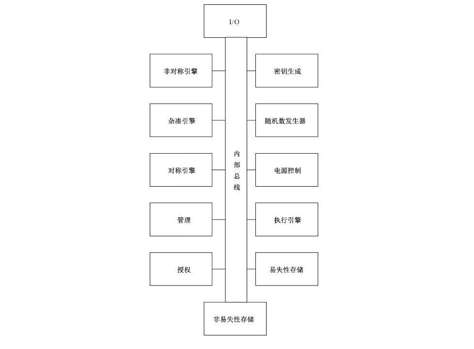

图C.1中各部件的说明如下：• 内部总线：可信密码模块内部数据传输总线；

• 1/O:TCM 的输入输出硬件接口；

• 对称引擎：执行对称密码运算的单元；

• 非对称引擎：产生非对称密钥对和执行非对称加/解密、签名运算的单元；

• 杂凑引擎：执行杂凑运算的单元；

• 随机数发生器：生成随机数的单元；

• HMAC 引擎：基于杂凑引擎的计算消息认证码单元；

• 执行引擎：TCM 的运算执行单元；

• 非易失性存储器：存储永久数据的存储单元；

• 易失性存储器：TCM 运行时临时数据的存储单元；

• 密钥生成：生成密钥的模块；

• 电源控制：电源控制模块；

• 管理：管理 TCM 的执行状态和控制域；

• 授权：TCM 授权子系统。

C.1.2 TCM 命令处理简介图C.2是TCM指令的顶层流程图。该图仅显示了成功执行命令的正常流程，图上文字标识了执行操作的模块名称。本条及这些模块的对应章条将提供图3中各模块的其他详细信息。图中的功能划分是说明性描述，而非规范性要求。该流程假定已将所述命令置于执行指令模块可访问的输入缓冲区中。

命令结构包括一个用于执行命令验证的标准包头，继而确定该命令是否需要访问由句柄标识的特定的安全模块。如果需要访问，它将调用 Handle 模块来验证该句柄是否为该命令引用了正确的资源类型，以及该资源当前是否已加载到 TCM上。当控制进程返回到执行指令时，它会检查命令包头中的tag 参数，以确定是否提供了授权值。如果提供了授权值，则验证每个授权是否正确。

验证授权后，执行指令调用命令分发将对后续的命令参数进行解析，并验证该参数对应的数据是否存在。

在解析参数后，命令分发调用相应库函数以执行特定命令，在操作过程中可能需要检查其他参数。

构建命令处理过程，使得在 TCM 验证命令参数是否正确以及完成命令所需的资源可用之前，不会更改TCM的状态。只有满足上述条件后，才可对TCM 状态做出不可逆转的改变。这种过程构建可确保当TCM返回错误时，TCM 将处于与修改任何存储保护位置中的数据的命令执行之前相同的状态。

命令操作完成后，命令分发将封装响应参数并送到输出缓冲区中。如果命令具有授权，则调用“确认”命令以构造响应的确认会话值。

如果该命令发生错误，则响应数据包将包含一个错误特征代码，在可能的情况下，指示错误是否与句柄、授权会话或命令参数相关联。在大多数情况下，错误代码和参数位置值足以隔离问题。

在构造响应（包括确认会话）之后，TCM 将指示接口，响应已准备好返回。

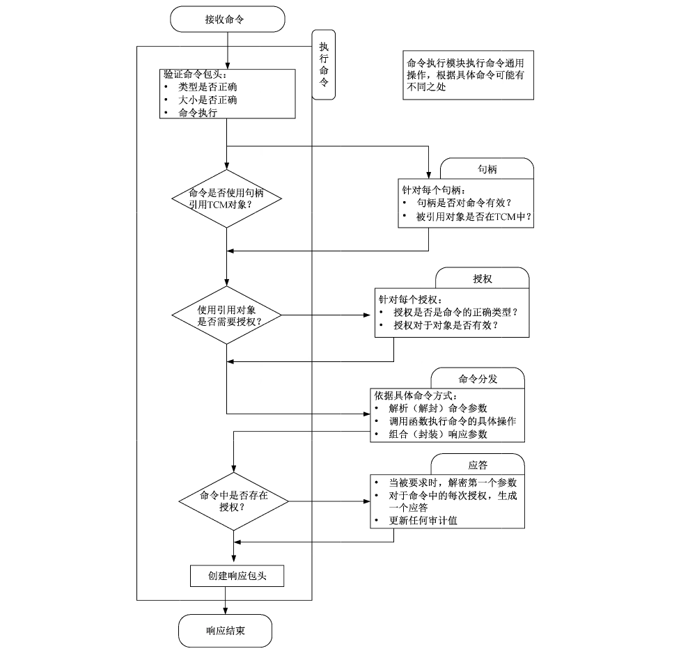

C.1.3 1/0缓冲区1/O缓冲区是 TCM 和主机系统之间的通信区域。主机系统将命令数据放在1 /0缓冲区中，并从缓冲区中检索响应数据。

C.1.4 密码算法子系统密码算法子系统实现了TCM 的密码运算功能，可被命令解析模块、授权子系统或命令执行模块调用。包括：

a） 杂凑运算；

b） 非对称加密和解密；

c） 非对称签名和签名验证；

d） 对称加密和解密；

e） 对称签名（HMAC）和签名验证；

f） 密钥生成；

g） 密钥交换。

C.1.5 授权子系统命令分发模块在命令执行的开始和结束时调用授权子系统。在执行命令之前，授权子系统检查是否已提供使用每个屏蔽位置的适当授权。

C.1.6 易失性存储器易失性存储器是使用TCM 的内容（RAM）保存TCM的瞬态数据。当TCM 的电源停止供电时，TCM 中 RAM数据可能丟失。

C.1.7 平台配置寄存器平台配置寄存器（PCR）：PCR 是保证度量结果有效的受保护存储。在建立TCB 时记录可信度量事件的日志记录，用户记录影响平台安全状态的事件。

当对日志进行补充操作时，TCM接收日志条目的副本或日志描述的数据摘要。发送到TCM 的数据包含在PCR 中的累积杂凑中。然后，TCM可提供对 PCR中的值的证明，进而验证日志的内容。

一个 TCM 可维持多个 PCR 库。PCR 库是 PCR的集合，这些 PCR 使用相同的杂凑算法进行扩展。通过识别用于扩展该库中的PCR的杂凑算法，可识别 PCR库。

对象存储：TCM RAM保存从外部存储器加载到 TCM 的密钥和数据。

会话存储：TCM 使用会话来控制一系列操作。通过会话可审核操作，提供操作授权或对命令中传递的参数进行加密处理。

空间要求：随机存取存储器（RAM）应足够大，以处理完成任何已实现命令所需的瞬态、会话和对象。

非易失性（NV）存储器：NV存储器模块存储与TCM 相关联的持久状态。TCM NV 存储器包含屏蔽位置，屏蔽位置只能通过受保护功能进行访问。

C.2 TCM自身安全TCM 的自身安全是由保护能力和保护对象组成的。保护能力是指执行正确的操作；保护对象是指应保护存储于隔离区域的数据。在隔离区域之外的受保护对象的完整性和保密性受到加密保护。

保护能力只能被同一 TCM中的其他保护能力修改。

访问TCM上的任何数据都需要基于保护能力。因此，TCM内屏蔽位置的信息不会被公开，除非使用保护能力进行导出。

C.3 TCM执行状态C.3.1 基本执行状态断电状态：当TCM 在进行复位或没有电源供电时，TCM处于断电状态。TCM通过检测低功率在内部产生复位信号，或者由外部电源提供复位信号。

初始化状态：TCM在接收到复位指令时，进入初始化状态。复位可通过发送指令，也可通过接口或配置方式执行，复位执行时，RTM 需要执行可信根进行度量，重置可信根的度量结果，TCM也应执行预期命令所需的TCM 固件验证。

完成初始化后，TCM 将等待下一个命令，预期命令则执行，非预期命令则返回错误，继续等待预期命令。

当 TCM 接收到 TCM2_Startup（）时，将开始运行并处理。

有时，某些 TCM 状态可能需要在电源转换期间保留，如在平台进入暂停状态时。TCM 要反映这种情况，系统软件需向 TCM 发出 TCM2_Shutdown（TCM_SU_STATE）。

TCM2_ShutdownO执行后，TCM 的顺序关闭，命令的 startupType 参数说明预期遵循的启动类型和要保存的数据类型。在执行TCM2_ Shutdown（TCM_SU_CLEAR）时，保存到 NV 存储器的数据量相对较小；执行 TCM_SU_STATE 时保存的信息会更多。

启动状态：TCM2_Startup（）将 TCM 从初始化状态转换为命令执行状态。该命令通知 TCM平台的操作状态，有两个选项：TCM_SU_CLEAR 和 TCM_SU_STATE。在 TCM2_Startup（）之后，TCM的执行状态取决于关闭 TCM 的方式和选定的启动参数。

以下参数用于不同的启动和关闭操作：

a） Startup（CLEAR）是指 TCM2_Startup（startupType == TCM2_SU_CLEAR）；

b） Startup（STATE）是指 TCM2_Startup（startupType == TCM2_SU_STATE）；

c） Shutdown（STATE）是指 TCM2_Shutdown（startupType == TCM2_SU_STATE）；

d） Shutdown（CLEAR）是指 TCM2_Shutdown（startupType == TCM2_SU_CLEAR）。

Shutdown（）和 Startup（）的组合提供了三种 TCM 启动方式：TCM 复位、TCM 重新启动、TCM恢复。

关闭状态：TCM2_Shutdown（）指令 TCM 准备断电，该指令有两个选项：TCM_SU_CLEAR 和 TCM_SU- STATE。

TCM2_Shutdown（TCM_SU_STATE）保留了大部分的TCM 执行状态，以便在 TCM2_Startup（）中恢复。TCM2_Shutdown（TCM_SU_CLEAR）保存最小状态数据，只为了确保TCM定时功能的连续性。

TCM 将状态数据保存在 NV 存储中。数据从 RAM复制到 NV存储中，以便在从 TCM断电时不会丢失。此状态数据在随后的 TCM2_Startup（）中恢复。启动类型决定了保存的状态数据的哪些部分被还原，哪些部分被丢弃。

如果 TCM 在断电前接收到 TCM2_shutdown（），并且在下一个复位之前状态没有修改，则关机是“有序的”。

以下命令会导致保存的TCM 状态无效：TCM2_Clear（）、TCM2_ ContextSave（）、TCM2_Context- Load（、TCM2_PolicyPCR（），以及除 TCM2_GetCapability（）之外的任何修改时钟或获取时钟的命令。

启动备选方案：上面对启动过程的描述是以命令接口的形式给出的。在某些系统中，TCM 代码是在特殊的处理器模式下运行的，该模式保证TCM 状态和其他程序状态提供隔离：即平台初始化可引导、验证 TCM代码，并在TCM 功能上实现 TCM2_Startup（）的运行状态。

C.3.2 自检模式如果命令需要使用未经自检的算法或功能模块，TCM 应使用 TCM2_SelfTest （）或 TCM2_Incre- mentalSelfTest （）命令对所需的算法进行测试后，才执行命令。

发送 TCM2_Startup（）后，系统可使用 TCM2_SelfTest （）或 TCM2_IncrementalSelfTest （）对未经测试的算法执行测试。

任何自检失败，则TCM 将进入错误模式，并且不准许执行除 TCM2_GetTestResult （）和 TCM2- GetCapability（）之外的任何受保护功能。TCM在接收到复位时退出错误模式。

C.3.3 错误模式如果TCM未通过自检，则进入错误模式。在错误模式下，TCM 响应除 TCM2_Get TestResult （）或 TCM2 GetCapability（）之外的任何命令，返回 TCM_RC_Failure。在错误模式下，TCM 只需要提供有限数量的属性值。

C.4 TCM 控制域C.4.1 概述TCM 受三个实体控制：平台固件、平台所有者和隐私管理员。实体通过各自的授权值控制其控制域中的资源。

C.4.2 控制平台固件、平台拥有者和隐私管理员都有各自的授权值、授权策略和特定的基本种子值用于控制TCM 的部分资源，对应关系如下：-平台固件：platformAuth/platformPolicy/PPS；

-平台拥有者：ownerAuth/ownerPolicy/SPS；

-隐私管理员：endorsementAuth/endorsementPolicy/EPS。

每个层级的使能都有一个逻辑开关控制，分别是 phEnable、shEnable 和 ehEnable。表C.1给出各种开关控制的组合形式。

TCM2_HierarchyChangeAuth（）命令可变更某个层级的授权值，但只有在该层级状态为使能的情况下才可以，此时可通过授权策略或者授权值进行授权来变更授权值。

**表 C.1 层级控制的配置组合**

|  | 使能状态 | 授权值 | 授权策略 | 描述 |  |
| --- | --- | --- | --- | --- | --- |
|  | SET | 已知 | Set | 该层级已使能，可使用授权值或者授权策略来管理该层级的相关资源 |  |
|  | SET | 未知 | Set | 将授权值设置为一个随机值接着删除这个随机值，就可将该授权值变为“未知”，此时授权值被禁用。这种配置方法主要用于在保持层级使能的状态下使用基于策略的委托方案来管理该层级的相关资源 |  |
|  | SET | 已知 | Empty | 授权策略为空时，无法与任何摘要值匹配，此时授权策略被禁用 |  |
|  | CI.EAR | N/A | N/A | 层级未使能时，相应的授权值和授权策略都不能用于授权任何 TCM 动作 |  |

C.4.3 平台控制平台固件拥有对TCM 的所有控制权。下列操作可由平台固件执行，但对一般TCM 用户是不可用的：分配 TCM NV 存储区；

-PCR 配置；

对所有密钥层级可用性的控制；

更改 PPS、SPS和 EPS，重设相关的授权值以及授权策略。

每次执行复位，phEnable 都会被设置力 SET。

C.4.4 所有者控制平台所有者的TCM 控制权是平台固件控制权的子集，包括：-分配 TCM NV 存储区；

-对所有存储层级可用性的控制。

每次的 TCM Reset、TCM Restart 或者当 SPS 改变时，shEnable 都会被设置为SET。当 shEnable取值 CLEAR 时，只能在提供平台授权的前提下通过TCM2_HierarchyControl（）命令将其设置为 SET。

C.4.5 隐私管理员控制隐私管理员有对背书层级和报告隐私敏感数据的控制权。隐私管理员使用背书授权和背书策略实施控制。需要背书授权或背书策略的场景包括：—在背书层级中创建 Primary Object 时；

-在控制背书层级的可用性时。

当SPS改变时，EPS层级中的对象将被从 TCM 中清除，应创建新的 EPS对象。每次执行 TCM2_ Startup（TCM_SU_CLEAR），ehEnable 将被设置为 SET。

C.4.6 主种子授权使用主种子创建 Primary Object 应使用与主种子相关的授权：PPS应使用平台授权，SPS需要拥有者授权，EPS需要背书授权。

C.4.7 锁定控制TCM 应实现防字典攻击的锁定机制。当TCM 因字典攻击而锁定时，可使用lockoutAuth 进行重置，也可使用 lockoutPolicy 进行重置。

C.4.8 TCM 拥有者设置所有者：对TCM 中的 ownerAuth、endorsementAuth 和 lockoutAuth 三个值进行赋值的过程称为设置拥有者。TCM 可通过TCM2_Clear（）命令清空，此后，平台所有者可通过操作系统更改和控制相应的授权值和授权策略。

解除所有者：使用 TCM2_Clear（）命令应释放TCM 当前的拥有者，但受制于 TCM永久性控制位TCMA_PERMANENT.disableClear，如果控制位CLEAR，则TCM2_Clear（）命令可通过平台授权或者锁定授权的方式执行。如果控制位为 SET，执行 TCM2_Clear（）命令将不产生任何作用。

C.5 主种子C.5.1 概述主种子是一个持久存储在TCM中的随机值。主种子使用公共域创建中描述的方法生成主对象。

主对象可像任何其他对象一样保存和加载。主对象可永久存储在TCM的NV存储器中。TCM 主种子包括 EPS、PPS.SPS 和Null 种子。每个种子值具有不同的生命周期。

主种子的位数至少是在TCM上实现的对称或非对称算法的安全强度的两倍。不同的权限控制每个主种子。

a） 背书主种子：

1） EPS用于生成EK，是RTR 标识的基础。可使用背书授权（endorsementAuth）或背书策略（endorsementPolicy）。

2） TCM 制造商可注入 EPS。TCM 在打开电源且没有 EPS时会创建 EPS。

b） 平台主种子：

1） PPS用于生成仅由平台固件控制的平台层次结构的主要对象，需要平台授权。

2） TCM在打开电源且没有 PPS时会创建 PPS。

3） PPS可注人，但仅由TCM 制造商注人。

4） PPS层次结构中对象的使用授权应使用包含对平台授权（platformAuth）引用的策略，可通过 TCM2_PolicySecret（）引用平台授权（platformAuth）来创建该策略。

c） 存储主种子：

1） SPS用于生成由平台所有者控制的存储根密钥。

2） TCM 在打开电源且没有SPS时会创建SPS。TCM2_Clear（）可用于更改SPS。更改 SPS会使存储层次结构中的所有对象无效，并且无法重新创建它们。更改 SPS还会使背书层次结构中的所有对象无效，并且只能重新创建背书层次结构中的主要对象。

d） Null 种子：每次 TCM重置时，Null 种子都设置为随机值。Null 种子可用于生成仅在下一次TCM 重置之前可用的层次结构。Null层次结构中的对象不能成为持久对象。

C.5.2 层次结构证明TCM 使用证明值来证明它创建或检查了一个外部提供的值。证明值与层次结构相关联，并且在统计上是唯一的。证明值用于票据。禁用其关联的层次结构时，票据可能将不能使用。

平台层次结构证明（phProof），用于与平台层次结构关联的对象，PPS改变时，phProof 会改变。

shProof 用于存储和背书层次结构，SPS 改变时，shProof 会改变。

证明值可保留在TCM上永久存储，也可在每次启动时根据需要从 PPS或SPS重新生成。证明值永远不会以任何形式存储在TCM 之外。如果计算结果存储在 TCM 之外，则层次结构证明值仅用作HMAC密钥。只要计算结果不离开 TCM，就可在其他计算中使用层次结构证明值。

TCM 应生成以下两个值中较大的证明值：

a）在TCM上实现的杂凑算法产生的摘要的大小；

b） TCM 支持的对称密钥大小的两倍。

C.6 TCM 句柄C.6.1 概述TCM 资源由句柄引用，这些句柄唯一地标识占用 TCM 的存储资源（RAM或NV）。句柄是32位值。其最高8位字节（MSO）标识引用资源的类型，其低24位标识该类型的唯一资源，实际资源可能随时间变化。

特定句柄值可只引用一个 TCM驻留资源。

C.6.2 PCR 句柄为了减少混淆，PCR 句柄（MSO=0016）是 PCR 数组的索引。

C.6.3 NV索引句柄NV 索引（MSO=0016）与 TCM2_NV_DefineSpace（）创建的持久性TCM 资源相关联。

C.6.4 会话句柄使用 TCM2_StartA uthSession（）创建授权会话时，TCM 分配会话句柄（MSO=02jcand031s）。

HMAC会话被分配一个 MSO为021。的句柄，策略会话被分配一个 MSO 0316的句柄。每个授权会话句柄都与一个唯一的上下文相关联。只要会话存在，句柄就与会话保持关联，在保存和重新加载会话时不会更改。

用 TCM2_GetCapability（）获取当前加载到 TCM 里的会话列表时，调用者输入MSO为02j的句柄，TCM返回包含HMAC 和策略会话的列表。用TCM2_GetCapability（）用于获取不在TCM 里但活动的会话列表时，调用者输入 MSO为03的句柄。

TCM 需要维护所有当前分配的会话句柄的列表以及任何已保存会话上下文的正确“版本号”。

当不再需要授权会话时，可使用 TCM2_FlushContext（）从TCM 内存中删除与会话关联的所有上下文。

TCM2_Startup（）会清除TCM 存储中的所有会话上下文。保存的会话上下文在TCM 重置之前保持有效。

C.6.5 固定资源句柄固定资源句柄（MSO=401）指的是始终与同一句柄关联的屏蔽位置。

C.6.6 临时对象句柄当加载对象时，TCM 将分配对象句柄。TCM RAM中的临时对象具有MSO为801的句柄；每次使用对象时，其三个 L.SO 具有不同的值。

执行 TCM2_Startup（）时，所有临时对象都从 TCM存储中清除。通过加载的上下文句柄，可使用TCM2_FlushContext（）从TCM 存储中清除加载的临时对象上下文。

C.6.7 持久对象句柄TCM2_EvictControl（）可使一个临时对象成为持久对象，调用方要指定一个未被使用的持久对象的句柄，MSO 应为81u，需要平台授权或所有者授权。如果使用所有者授权，接下来的最高比特位需设置成 CLEAR；如果使用平台授权，接下来的最高比特位需设置成 SET。放置在TCM 的NV 存储中的持久对象不会被 TCM2_Startup（）清除。

C.7 TCM 对象名称一个实体的名称就是它的唯一标识，对象关联的句柄可能由于上下文管理而更改，但是对象的名称保持不变。与 NV 索引关联的名称将根据索引属性的变化而改变。

创建对象时，使用一种公共区域的“模板”定义新对象的属性。该模板定义了对象公共区域的结构。

公共区域模板名称的计算方法与瞬态对象名称的相同。

C.8 PCR 操作C.8.1 初始化 PCR在TCM 重置和 TCM 重启时，所有平台配置寄存器（PCR）都被重置为默认初始状态。部分 PCR可指定为 TCM Resume保存。保留的那些将恢复到上次 TCM2_Shutdown（state）操作时的状态。当TCM2_Startup（）成功完成时，TCM Resume 中没有指定保留的PCR将处于默认初始状态。

除了 PCRLO］，任何 PCR的默认初始条件，要么是所有位CLEAR，要么是所有位SET。对于 PCR［O］来说，默认的初始条件可能是所有位 CLEAR、所有位 SET、接受 TCM2_Startup（）的locality、或者一个指示值表明来自 CRTM 的度量值。其他平台可使用其他方法来标识访问的locality。

C.8.2 PCR 的扩展除了上面描述的重置外，改变 PCR 值的唯一方法是扩展它。PCR 的打展操作定义：PCRnew ：=Halk （PCRouddigest）每次扩展后，PCR值对于被扩展的摘要值的特定顺序和组合是唯一的。

除了 DRTM外，扩展 PCR 需要授权。

C.8.3 PCR Bank 的扩展TCM2_PCR_Extend（）有一个句柄，表示要扩展的PCR 和要扩展的数据。扩展数据是一个结构体，它包含一个或多个摘要以及摘要的算法标识符。每个摘要被扩展到具有相同算法的 PCR库（PCR bank）。如果没有为其中一个 PCR库提供摘要数据，则不会对该库的PCR进行更改。

对于定义 pcrNum 的每个算法，TCM 应执行以下操作：PCR.digest［pcrNum］［alg］now ：= Hale（PCR.digest［pcrNum］［alg］old | ldigest）式中：Halx 使用 PCR 示例携带的算法的杂凑函数；

PCR.digest -PCR 中的摘要值；

pcrNum PCR 数字选择子；

alg PCR算法选择子；

digest 摘要列表条目中与PCR库具有相同算法标识符的部分。

C.8.4 记录事件记录日志条目的另一种方法是将完整的日志条目输入到TCM，而不是在TCM之外执行摘要。这将对与 PCR关联的每个杂凑算法的日志条目执行杂湊。

C.8.5 PCR 报告读取 PCR：TCM2_PCR_Read（）读取选择的PCR的当前值。对于该命令，调用者使用PCR选择结构指明要读取的PCR列表。这个 PCR选择结构是一个列表数组。每个数组条目都有一个杂凑标识符和一个比特字段。杂凑标识符表示 PCR库，比特字段表示在该库中选择的 PCR。

在响应中，TCM提供PCR选择结构和 PCR 值列表。PCR 选择结构表示在返回结构中存在的 PCR.对 PCR 的证实：在某些情况下，选择的PCR 应处于特定的状态。当指示这种状态时，最好不要列出每个 PCR的内容。相反，PCR连接后的摘要（一个组合 PCR 摘要）将显示所有相关 PCR的当前内容。

组合摘要中包含的PCR是由用于TCM2_PCR_Read（）的相同类型的结构选择的。选择结构首先被过滤，这样未实现的PCR 就不在选择结构中。然后，创建所有选定 PCR的复合摘要。最后，对筛选后的选择结构和组合摘要进行杂凑以创建最终摘要值。该摘要可与所需的摘要［TCM2_PolicyPCR（）］进行比较，也可在证实中返回［TCM2_Quote（）］。

C.8.6 PCR 授权TCM2_PCR_Reset（）和 TCM2_PCR_Extend（）需要经过授权才能修改PCR。根据修改的PCR，授权的类型可能有所不同。PCR可定义为具有固定的EmptyAuth、一个可变的 authValue、或者一个可变的 authPolicy。

PCR 的授权（authValue 或 authPolicy）可应用于一个 PCR集合。几个 PCR可能指定为使用相同的授权值以便改变授权值（authValue 或 authPolicy）的PCR设置将改变这一集合中的所有PCR。一组使用同一个 authValue 授权的PCR 称为授权集合。一组使用同一个 authVPolicy 授权的PCR 称策略集合。

a） 不在集合中的PCR• 如果 PCR 不在集合中，则授权只有 EmptyAuth 值。

b） 授权集合• 如果PCR 在授权集合中，则PCR 的 authValue 要么由 HMAC 会话提供，要么由密码提供。当PCR 具有一个固定的EmptyAuth 值时，仍然需要一个授权会话。

• 当PCR有一个可变的 authValue 时，该 authValue 将在每次 STARTUP（CLEAR）时重置为EmptyAuth。它在经过 STARTUP（STATE）时被保留。

c） 策略集合• 策略集合的authPolicy 具有杂凑算法和摘要值。

d） 校验顺序• 在PCR 确定正确的授权类型时，TCM 将使用该授权类型。如果授权是密码或 HMAC会话，TCM 将检查 PCR是否在授权集中。

C.8.7 PCR 变更追踪为了支持在策略中使用 PCR，TCM 维护一个 pcrUpdateCounter。一般来说，每次PCR 修改（扩展或重置）时，这个计数器都会增加。当策略要求 PCR 具有特定值时，可使用此计数器。

平台特定的规范可指定所选 PCR 的更新不会导致对 pcrUpdateCounter 的更改。

C.9 TCM 命令/响应结构C.9.1 概述命令是指受 TCM 保护功能，指示 TCM 要执行的操作。包含五个部分，按以下顺序排列：

a） 命令头，包括指示命令的总体大小、命令代码和标记以及指示是否存在授权区域；

b）一个与命令相关的数字，它的句柄标识（保护功能）指示保护授权数据的位置；

c） 表示授权数据大小的32位值；

d） 包含一到三个会话结构的授权数据；

e） 与命令相关的参数区域，包含该命令的限定信息。

响应包含：

a） 响应头，指示响应的总大小，响应代码以及指示授权区域是否存在的标记；

b） 一个与命令相关的数字（0或1），它的句柄标识命令（保护功能）操作的屏蔽位置；

c） 表示参数数据大小的32位值；

d） 与命令相关的参数数据，包含TCM 生成的值；

e） 包含一到三个会话结构的授权区域。

> 注：与命令一样，响应其余区域的格式取决于相关命令代码的值。会话和参数区域顺序在响应中颠倒。

C.9.2 命令/响应头字段命令或响应标头总是包含三个值，如图C.3所示。

a） 标记• 在发送到 TCM 的所有命令中以及从 TCM接收到的响应中都存在一个标记。

**表C.2列出了用于本文件中定义的命令和响应的标记值。**

[

**表C.2 标记值**

|  | 值 | 描述 |  |
| --- | --- | --- | --- |
|  | TCML_ST_NO_SESSIONS | 此值表示命令或响应授权区域为空 |  |
|  | TCMLST_SESSIONS | 此值表示命令或响应授权区域包含一个或多个授权。表示存在授权大小值 |  |

b） 命令/响应大小• 命令大小/响应大小值指示该命令/响应的八位字节总数，从标记的第一个八位字节开始。

c） 指令码• 命令代码仅出现在 TCM 的命令中。它指示 TCM 应执行的操作以及命令和响应的句柄和参数区域的格式。命令码参数包含在命令参数杂凑（cpHash）和响应参数杂凑（rpHash）中。

d） 响应码• 响应代码仅出现在 TCM 的响应中。响应代码 TCM2_RC_SUCCESS（O）表示 TCM 已成功完成命令，并且根据命令格式，存在句柄、参数和授权组件。

• 非零响应代码表示错误或故障。在这种情况下，将标记力 TCM_ST_NO_SESSIONS，响应大小为10，表示没有八位字节跟随响应代码。不存在句柄、参数或会话响应组件。

C.9.3 句柄句柄是 TCM分配的值，允许调用者指示命令要操作的TCM驻留结构。句柄能识别受保护能力操作的屏蔽位置。某些 TCM 命令［如，TCM2_Startup（）］不需要句柄。

命令和响应中句柄的数量由命令代码表示。它还指示具有关联授权会话的命令句柄。需要在关联授权会话中进行授权的句柄列在没有关联授权会话的句柄之前。

只有当响应代码为 TCM2_RC_SUCCESS 时，响应才能有句柄。

句柄区域中句柄数量的体系结构限制为七个。此限制由错误报告方案确定。

C.9.4 参数命令代码指示可选句柄和参数区域的结构。这些参数区域的内容因命令和响应而异。一些 TCM命令，如：TCM2_Clear（），不需要任何参数。

所有参数值和命令代码都包含在cphash 或 rphash中。cphash 中不包括 authorizationSize,rphash中不包括参数化。

只有当响应代码为 TCM2_RC_SUCCESS 时，响应才可有参数。

C.9.5 授权大小/参数大小只有当命令/响应的标记为 TCM_ST_SESSIONS 时，才会出现这些值。

在命令中，authorizationSize 指示命令授权区域中所有授权结构中的八位字节数。

authorizationSize 不包含 authorizationSize 值的四个八位字节数。授权大小的最小值是？。

在响应中，参数化表示响应的参数区域中的八位字节数，不包括参数化值的四个八位字节数。参数化的值可能为零。

授权大小不包含在cpHash 中，而参数大小不包含在 rpHash 中。

C.9.6 授权数据C.9.6.1 概述只有当命令的标记力 TCM_ST_SESSIONS 时，授权区域才出现在命令中。如有，授权区域将包括：

a） 0、1或2次授权（会话或密码）；

b） 用于解密发送到 TCM 的数据的可选会话；

c） 用于加密TCM 发送的数据的可选会话。

如果标记是 TCM_ST_SESSIONS，那么授权区域将至少有一个但不超过三个授权/会话块。如果标记是 TCM_ST_NO_SESSIONS，则没有授权区域。

其他会话可添加到授权区域。这些会话可被指定为加密或解密；以任何组合、任何顺序。但是，在单个命令中，只允许一个会话具有加密属性，允许一个会话具有解密属性。

一个会话可同时用于授权、加密和解密。如果一个会话有一个“@”装饰处理，相关授权会话可能是加密、解密属性。密码授权只能用于授权，如果在密码授权中设置了加密、解密或审计，则TCM将返回一个错误（TCM_RC_ATTRIBUTES）。

**表C.3总结了每个会话允许的属性组合。**

[

**表C.3 授权/会话块的使用**

|  | 位置 | 密码授权（1）（6） | 授权会话（2）（6） | 加密会话（3） | 解密会话（4） |  |
| --- | --- | --- | --- | --- | --- | --- |
|  | 1 | 人 | 人 |  | 人 |  |
|  | 2 | 人 | 人 | 人 | 人 |  |
|  | 3 |  |  | 人 |  |  |

GB/I 29829—2022

注1：密码授权不能用于加密、解密。

注2:HMAC授权会话也可用于加密、解密，策略授权会话也可用于加密和解密。

注3：只能指定一个会话用于加密。

注4：只能指定一个会话用于解密。

注5：授权会话位于仅用于加密、解密的会话之前。

如果命令需要授权，那么这些授权将首先出现在授权/会话列表中。然后，它们可能后面跟着用于加密或解密的其他会话。

如果响应代码是 TCM2_RC_SUCCESS，则响应具有与请求相同的会话数量，且会话的顺序相同。

否则，不存在授权。

C.9.6.2 授权结构在命令中，每个授权结构的格式如图C.4所示。

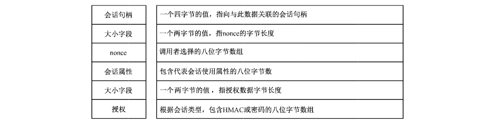

C.9.6.3 响应在响应中，每个会话结构的格式如图C.5所示。

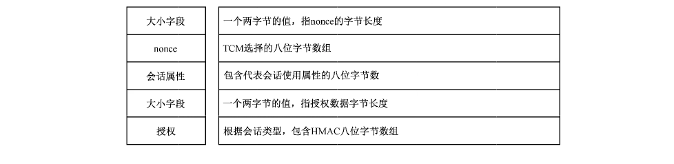

C.9.6.4 会话句柄会话句柄在C.6.4中描述。它们标识由特定会话结构引用的会话。

对于给定的命令，与特定 HMAC或策略会话关联的句柄可能只在授权区域中出现一次。表示密码授权的句柄（TCM_RS_PW）可出现多次。

C.9.6.5 会话属性每个会话都有一个会话属性 sessionAttributes octet 来指示如何应用会话。表C.4解释了这个八位字节数的含义。

如果会话不用于授权，则应设置至少一个解密或加密。

**表 C.4 sessionAttributes 描述**

|  | 属性 | 含义 |  |
| --- | --- | --- | --- |

此属性用于指示TCM.，当命令完成时，会话是否保持“活动”。如果该属性在命令中是清晰的，并且命令成功完成（TCM2_RC_SUCCESS），则会话将从 TCM 内存中刷新，并将关联的会话句柄分配给新会话。当 TCM响应时，它将回显此属性，以指示会话仍然打开。

> 注：在这个上下文中，“echo”意味着会话属性的值在响应中与在命令中相同。

continueSession此属性的主要目的是消除不再使用会话时应显式刷新（TCM2_FlushContext（））的情况。在最后一次使用会话时明确这一点，就可结束会话并收回分配给该会话的TCM 资源。

对于密码授权，此属性没有作用，因为没有与密码授权关联的TCM 资源。此属性将始终在与密码授权关联的响应中设置此属性用于向 TCM表明，与会话关联的秘密将用于解密命令的第一个参数。该参数将在HMAC 计算成功完成后解密。

此属性只能在将大小缓冲区作为第一个参数的命令中设置。

在密码会话中需要清除此属性。如果在密码会话中设置，那么TCM 将返回一个错误，因为没解密 有用于解密操作的会话密钥。

此属性由响应中相应会话中的TCM 回显。

每个命令只能在一个会话中设置此属性。具有此属性的会话不需要与句柄区域中标识的实体关联。添加会话只是为了使用会话的 secret 进行参数解密。

此属性可与任何其他会话属性和任何会话类型（包括 TCM_SE_TRIAL.）组合设置此属性用于向 TCM 表明，与会话关联的秘密将用于加密响应的第一个参数。在TCM为任何会话执行 HMAC 计算之前，将对参数进行加密。

此属性只能在将大小缓冲区作为第一个参数的命令中设置。

在密码会话中需要清除此属性。如果在密码会话中设置，那么TCM 将返回一个错误，因为没加密 有用于加密操作的会话密钥。

此属性由响应中相应会话中的TCM 回显。

每个命令只能在一个会话中设置此属性。具有此属性的会话不需要与句柄区域中标识的实体关联。添加会话只是为了使用会话的 secret 进行参数解密。

此属性可与任何其他会话属性和任何会话类型（包括 TCM_SE_TRIAL）组合设置C.9.7 命令参数杂凑计算（杂凑值）命令参数杂凑（杂凑值）用于计算命令授权 HMAC，并包含在会话的摘要中（根据策略，杂凑值也可用于授权）。杂凑值 cpHash 是根据命令的参数计算的，如下所示：cpHash：=HsessionAlg（commandCode〈I|Namel ｛||Name2〈||Name3｝〉｝｛|| parameters｝）式中：Hscssion.Alg 使用初始化时为会话选择的算法的杂凑函数；

commandCode- 命令中的命令代码；

Namel -与第一个句柄关联的实体的唯一标识；

Name2 -与第二个句柄关联的实体的唯一标识；

Name3 与第三个句柄关联的实体的唯一标识；

Parameters -剩余命令参数。

C.9.8 响应参数杂凑 （rpHash）rpHash：=HsessionAlg （responseCode|commandCode｛||parameters〉）式中：H scsion Ais -使用初始化时为会话选择的算法的杂凑函数；

responseCode 命令结果代码；

commandCode -命令中的命令代码；

parameters 响应参数。

响应句柄区域的内容不包括在 rpHash中。

命令和响应中句柄的数量由命令代码表示。它还指示具有关联授权会话的命令句柄。需要在关联授权会话中进行授权的句柄列在没有关联授权会话的句柄之前。

只有当响应代码为 TCM2_RC_SUCCESS 时，响应才能有句柄。

句柄区域中句柄数量的体系结构限制为七个。此限制由错误报告方案确定。

C.10 授权C.10.1 概述TCM 的命令使用存储的数据结构，这些结构的使用可能需要授权。

本文件定义了三种授权类型：口令、HMAC、策略。根据命令的不同，可能需要零个、一个或两个授权。在命令中，命令参数定义指示需要多少授权。

C.10.2 授权角色对于每个对象和NV索引，都有一些特定操作执行，可将操作划分组。要使用或操作组中对象，应提供该组的授权，调用者就是该对象的角色。

TCM 支持三种授权角色。

a） 用户——用于密钥的正常使用（例如：使用签名密钥签名或加载密钥）。用户可通过授权值（authValue）或策略授权。如果 userWithAuth 为 SET，用户提供口令授权或HMAC 会话授权。如果 user WithAuth 为CL.EAR，则可能不会使用。

b） 管理员——管理员控制对象的认证［通过 TCM2_Certify（）和 TCM2_ActivateCredential（）］和控制授权值的更改［通过 TCM2_ObjectChangeAuth（）］。当操作需要管理员任务授权时，如果对象的 adminWithPolicy 属性 CLEAR，则可使用对象的授权值提供授权。

c） 副本——此授权角色仅用于 TCM2_Duplicate（）。如果允许重复，应始终由策略会话提供授权，并且对象的授权策略等式应包含将策略命令代码设置为 TCM_CC_Duplicate 的命令。

C.10.3 物理存在授权某些命令的授权应提供平台授权。其他一些命令允许使用平台授权或所有者授权，可使用带外方法增强授权。

对于需要平台授权的命令和需要层次结构授权的命令，可要求带外授权。这可采取任何形式，例如TCM 中的专用 pin、通过TCM硬件信号方法或替代方法，本文件中称为物理存在。

TCM 维护一个命令列表，其中包含需要 PP声明来授权的命令。当授权句柄为 TCM_RH_PLAT- FORM 时，TCM 检查列表，以检查命令是否需要通过PP确认。

TCM2_PP_Commands（）用于更改需要使用 PP授权进行确认的命令表的内容，但不能删除列表内容。

可使用 TCM2_GetCapability（capability == TCM_CAP_PP_COMMANDS）读取表的内容。

C.10.4 口令授权当使用 authValue 时，可使用明文密码值授权。口令可能适用于调用者和TCM之间的路径是可信的，或者授权值是已知的情况。

调用者可发送比授权字段更多或更少的八比特数据。在比较之前，TCM 截断任意一个为零的八比特数据。

口令授权总是与需要授权的命令句柄相关联，没有与允许口令用于加密的会话上下文相关联的密码。

与其他会话类型的其他句柄不同，TCM_RS_PW 会话句柄可用于多个授权。

发送到 TCM 的口令授权数据的格式如表C.5所示。

**表C.5 命令的口令授权**

|  | 类型 | 名称 | 描述 |  |
| --- | --- | --- | --- | --- |
|  | TCMISH_AUTH_SESSION | authHandle | 应是保留授权会话句柄 TCM_RS_PW |  |
|  | TCM2B_NONCE | nonce | 要求为空缓冲区 |  |
|  | TCMA_SESSION | sessionAttributes | 只能设置 ContinueSession |  |
|  | TCM2B_AUTH | password | 与 TCM 实体的 authValue 进行比较 |  |

**表C.6说明响应时口令授权的格式。提供此结构是为了确保命令和响应中的会话之间保持一对一**

[

的对应关系。

**表C.6 回应密码确认**

|  | 类型 | 名称 | 描述 |  |
| --- | --- | --- | --- | --- |
|  | TCM2B_NONCE | nonceTCM | 零长度的密码授权 |  |
|  | TCMA_SESSION | sessionAttributes | 从命令中的密码授权复制标志 |  |
|  | TCM2B_AUTH | hmac | 用于密码授权的零长度缓冲区 |  |

C.10.5 会话会话是 TCM状态的集合，该状态在每次使用后都会改变。当一个对象上下文加载到 TCM中，对象上下文的多个副本可能同时存在于TCM 和保存的上下文中。当创建会话上下文时，该上下文只有一个副本可能存在于TCM 中，也可能作为保存的上下文存在。

会话在TCM 在创建会话时分配句柄。在会话关闭之前，该句柄将始终指向同一会话。如果将句柄重新分配给后续创建的会话，则会话上下文数据将包含TCM生成的nonce，该 nonce 使得会话的新实例是唯一的，即使该句柄可能在以前使用过。每次使用会话时，nonce 都会发生变化。

会话有两种用途。

• 授权——与句柄关联的会话用于授权使用与句柄关联的对象。如果不是口令授权，它还可用于提供用于加密参数的密钥；

• 加密——为了加密命令或响应参数，可能存在未用于授权的会话。如果存在仅加密会话，则该会话将遵循授权会话。

一个命令可有三个授权。口令只能用于授权，因此口令的最大数目等于命令所需的授权数目。

C.10.6 基于会话的授权C.10.6.1 授权会话基于会话的授权用于要求对授权值保密的协议。授权会话还提供了会话链接的方法。

有两种类型的基于会话的授权：HMAC 和 policy。

这两种类型的会话都是使用 TCM2_StartAuthSession（）启动的。该命令建立将用于授权的参数。

sessiontype 参数确定会话是 HMAC会话还是策略会话。会话启动时，会话中使用的杂凑算法和TCM nonce 大小由调用方指定。该命令可包括初始调用方 nonce 和 salt 值以生成会话密钥。每个会话的参数独立于任何其他会话的参数，并且仅受 TCM 功能的限制。当 TCM2_StartAuthSession（）成功完成时，TCM返回会话的句柄以及初始 TCM nonce 值。

一旦建立了授权会话，就可使用它来授权多个命令中的操作。在关闭或刷新之前，会话不会结束。

会话的机密值由会话启动时使用的句柄确定。启动会话的命令最多允许选择两个对象句柄。一个句柄表示用于加密会话启动时发送的 salt 值的TCM 对象。第二个句柄表示包含共享机密的对象。

Salt 值和共享密钥与调用者提供的 nonce 结合起来创建会话密钥。

C.10.6.2 授权会话格式对于基于会话的授权会话，命令的授权结构如表C.7所示。

**表 C.7 基于会话的命令授权**

|  | 类型 | 名称 | 描述 |  |
| --- | --- | --- | --- | --- |
|  | TCMI_SH_AUTH_SESSION | authHandle | 授权会话的句柄 |  |
|  | TCM2B_NONCE | nonceCaller | 调用方提供的会话 nonce；大小可为零 |  |
|  | TCMA_SESSION | sessionAttributes | 与会话关联的标志 |  |
|  | TCM2B_AUTH | hmac | 会话 HMAC摘要值 |  |

在响应中，确认的格式如表C.8所示。

**表C.8基于会话的应答**

|  | 类型 | 名称 | 描述 |  |
| --- | --- | --- | --- | --- |
|  | TCM2B_NONCE | nonceTCM | TCM 提供了会话 nonce。大小与会话启动时指定的大小相同 |  |
|  | TCMA_SESSION | sessionAttributes | 与会话关联的标志。此属性应与命令中的值相同，但 ContinueSession 可能已清除 |  |
|  | TCM2B_AUTH | hmac | 会话 HMAC摘要值 |  |

C.10.6.3 会话随机参数随机参数：

a） 随机参数（nonce）在会话中的主要用途是防止授权被重用。当会话由 TCM2_ StartA uthSession（）启动时，调用者除其他外，指示要在授权 HMAC 中使用的nonce 的大小和初始 nonce 值（nonceCaller）。建立会话后，TCM返回一个用来标识会话的句柄和一个TCM 生成的 nonce。

每次使用会话进行授权时，调用者都会使用会话的最后一个 TCMnonce 和其他参数来执行HMAC。然后，TCM 使用接收到的非调用方和保存的非设置方来验证 HMAC。对于响应，TCM 使用 HMAC中最后一个非协调调用方和一个新生成的非集合TCM。然后，调用方使用接收到的tcmnonce 和保存的 nonceCaller 来验证响应中的HMAC。

c） nonce 有一个 size 字段，指示 nonce 中的八位字节数，后跟 nonce 数据。nonce 大小不包括在HMAC 计算中。

会话 nonce 大小：

a） 当创建授权会话时，调用方提供一个初始 nonce （nonceCaller）。nonceCaller 的 size 字段由TCM保留，用于确定在会话的后续使用中由 TCM 生成的所有 nonces 的大小。TCM2_Star- tAuthSession（）中的nonceCaller 的最小大小是16个字节。

b 在初始会话设置之后，调用者可在会话的每次使用中使用任意大小的 nonceCaller。

nonceCaller 的大小可从零（0）到 TCMnonce 的大小（初始 nonceCaller 的大小）不等。

c） 可为 nonceTCM 请求的最大大小是由授权会话杂凑生成的摘要的大小。

d） 当在授权会话 HMAC中使用会话 nonce 时，授权计算中不包括 nonce 的 size 字段。如果 size字段为零（0），则nonce 不影响授权HMAC值。

Nonce 大小选择指南：

a） 应选择 nonce 的大小，以提供一个合理的保证，即 TCM 生成的 nonce 值不会与同一sessionkey 一起使用两次。nonce 大小的选择与特定授权会话的使用次数无关，但与sessionkey 的使用次数有关。

b） HMAC sessionkey 是从保存在对象中的 authValue 派生的，该 authValue 可能具有较长的生存期。为了防止对长寿命 authValue 的重播攻击，宜使用大长度 nonce。

Nonce 绑定：命令可能具有授权所需会话以外的会话。额外会话的一个用途是加密命令或响应参数。如果攻击者删除了额外的加密会话，则TCM 将无法正确加密/解密数据，因此可能无法加密响应参数。为了防止删除额外的加密会话，每个会话的 nonce 都包含在命令的第一个授权会话的 HMAC计算。

C.10.6.4 授权值对象可具有一个值，用于授权对象的操作。授权会话是一种机制，调用者可证明允许操作所需的授权值（authValue）的知识。

C.10.6.5 授权值大小AuthValue 可能小到零字节，但不会大于用于计算对象名称的算法的摘要大小。

C.10.6.6 授权值大小约定当授权值基于密码或密码短语时，只要口令/文本不大于对象 namealg生成的摘要，授权应是口令/短语。

在将任何字符串用作 authValue之前，都要从字符串中删除末尾为零的八位字节数。

C.10.6.7 HMAC 计算所有会话类型的 HMAC 计算都是相同的。sessionKey 值连接到 authValue，创建在命令或响应中计算 HMAC时使用的值。

authHMAC：=HMACsesionAk （（sessionKey | |authVaule），（pHash || noceNewer || noceOlder｛I|nonce TCMdeerypt ｝l nonce TCMencrypt ｝||sessionAttributes））式中：HMACsesionNE 使用会话启动时指定的杂凑算法。

sessionKey 使用 KDFa（）以依赖于协议的方式计算的值。在HMAC或 KDF 中使用时，不包含此值的 size 字段。

authValue 在实体的机密数据的值。如果计算 HMAC授权会话绑定到的对象上的操作，则此值为EmptyAuth。该值的 size 字段不包含在任何 KDF 或杂凑函数中。

pHash 使用会话杂凑算法对命令（cpHash）或响应参数（rpHash）进行摘要。

nonceNewer 使用会话的实体生成的值。每次使用会话时都会生成一个新的 nonce。对于命令，这将是 noncecaller，对于响应，这将是 noncetcm。nonce 大小字段不包括在HMAC中。

nonceOlder -在上次使用会话时收到的值。对于命令，这将是 noncetcm，对于响应，这将是 noncecaller。nonce 大小字段不包括在HMAC中。

nonce TCMcergpn 在命令的第一个授权会话的HMAC 计算中，如果使用另一个会话进行参数解密，则该会话的 nonceTCM 包含在第一个授权会话的HMAC 中。nonce大小字段不包括在HMAC中。

nonce TCMencrypt 在命令的第一个授权会话的 HMAC 计算中，如果使用不同的会话进行参数加密，则该会话的 nonceTCM 包含在第一个授权会话的 HMAC中。

sessionAttributes 表示与会话的特定用途相关联的属性的八位字节。

C.10.6.8 创建 session Key HMAC 计算中使用 sessionKey 值，如下式所示。如果 TCMKey 和 bind 都是 TCM_RH_NULL，则将 sessionKey 设置为空缓冲区。否则，创建的 sessionKey 如下：sessionKey：=KDFa（sessionAlg， （authVaule I| salt ），"ATH"， nonceTCM, nonceCaller, bits）式中：sessionAlg 一个 TCM_ALG_ID，用于调用者在会话启动时选择的杂凑算法。

authValue 如果 bind 不是TCM_RH_NULL.则使用 TCM2B_AUTH。在TCM 实体的机密数据；否则，就是一个空缓冲区。

salt 如果 TCMKey 不是 TCM_RH_NULL，则从 encryptedSalt 中恢复 salt 值；否则，就是一个空缓冲区。

ATH 四字节的标签值。

nonceTCM 会话启动时由 TCM 生成的 TCM2B_NONCE。

nonceCaller 会话启动时调用方提供的 TCM2B_NONCE。

bits 返回的比特数是 sessionAlg生成的摘要的大小。

Unbound 和 Unsalted 的会话密钥生成：

a） 在 TCM2_StartAuthSession（）使用的这个会话密钥生成方法中，TCMKey 和 bind 都是 TCM_ RH_NULL。这导致会话没有 sessionKey（它是一个空缓冲区）。会话不绑定到任何对象。

b） 使用这种格式启动的会话可在执行 TCM 命令时用于参数加密。但是，在这些命令期间，用于加密参数的密钥将只使用密钥生成命令访问的对象的 authValue，因此加密的强度不会比对象 authValue 中的熵好。

计算 HMAC时，使用被引用实体的 authValue：authHM AC：=HMACsesionAlg （authValuecntie. buffer_，（pHashl|nonceOlder* .buffer| |sessionAttributes））如果 authValue 的大小为零，那么调用者可从授权中省略 HMAC。

绑定会话密钥生成：在 TCM2_StartAuthSession（）使用的这个会话密钥生成方法中，tcmKey 是TCM_RH_NULL，表示不存在salt 值，但是绑定引用了一些带有 authValue 的TCM实体。

sessionKey 使用来自 bind 的 authValue 和一个空缓冲区代替 salt 值来计算。

sessionKey ：=KDFa（sessionAlg,authValuenind."ATH" ，nonceTCM,nonceCaller, bits）在执行 HMAC进行授权时，HMAC 密钥通常是实体的 authValue 与会话 sessionKey 的连接［在TCM2_StartAuthSession（）中创建］。但是，如果授权是针对会话绑定到的实体，则 authValue 不包含在 HMAC密钥中。见如下公式第二条。当策略要求计算HMAC时，它总是按照下列第一条公式来执行。

authHMAC：=HMACsessionAlg （sessionKey |lauth Valueentiy），（pHash || nonceNewer || nonceOlder* || sessionAttributes））authHMAC：=HMACscsionAle （sessionKey，（pHash || nonceNewer || nonceOlder* | | sessionAttributes））TCM 需要跟踪会话绑定到的实体，通过在会话上下文中记录绑定实体的名称来实现。对于 NV索引或持久句柄，还需要 TCM 记录与实体关联的授权值。

对于命令，TCM将检查授权是否用于其绑定到的实体。如果是，则在 HMAC 计算中不使用绑定实体的 authValue。TCM 将记录 authValue 在授权的HMAC 计算中没有使用，并且在响应的HMAC计算中没有包含它。

对于持久对象，包含授权值，以便可撒消授权。如果持久性对象的管理员更改授权，则绑定到旧授权的会话将不再有效。绑定对象的 noDA属性记录在会话上下文中。

创建加盐会话密钥：在 TCM2_StartAuthSession（）使用的这个会话密钥生成方法中，bind 是 TCM_RH_NULL，表示没有引用任何实体来提供 authValue，但是 TCMKey 是存在的，并表示一个密钥用于加密salt值。ses- sionKey 是用一个空缓冲区代替 authValue 计算的。

sessionKey：=KDFa（sessionAlg,salt ，"ATH"， nonceTCM, nonceCaller, bits）因为bind 是TCM_RH_NULL，所以会话不绑定到任何实体。当会话用于访问任何实体时，HMAC 将使用 sessionKey 和该实体的 authValue。

authHMAC：=HMACsessionAle （（sessionKey |lauthVauleanit），（pHash|| nonceNewer || noceOlder* ||sessionAttributes））Salted 和绑定会话密钥生成：TCM2_StartAuthSession（）创建了一个会话，bind 用于提供一个 authValue,TCMKey 加密 salt值，sessionKey 同时使用这两种方法计算。

sessionKey ：=KDFa（sessionAlg， （authValuesind | | salt），"ATH"，nonceTCM, nonceCaller, bits）如果会话是 HMAC 会话：因为bind 存在，所以会话被绑定到该实体。当会话用于授权使用绑定实体时，HMAC 将使用 sessionKey 而不是 authValue。

authHMAC：=HMACsesionAlg （sessionKey，（pHash || nonceNewer || noceOlder* || sessionAttributes））如果这个会话是策略会话：会话不绑定到该实体。当会话用于授权使用任何实体时，HMAC（如果需要）将使用 sessionKey 和 authValue。

authHMAC：=HMACsessionAls（（sessionKey || authVauleentity），（pHash || nonceNewer || noceOlder* ||sessionAttributes））加密 Salt：TCM2_StartAuthSession（）的 salt 参数可使用本子句中描述的方法进行对称或非对称加密.使用salt 的秘密交换过程生成的值应是会话 authHash 生成的摘要的大小。对于 ECC，种子的大小是有限的，因为它是一个 ECC 点；但是对于 XOR,salt 的大小可能不同。

非对称加密：不同的非对称算法加密 salt 和生成会话秘密的方法不同。这些方法在本文件的特定于算法的附件中进行了描述。

异或混淆：XOR（encryptedSalt,hashAlg,key, nonceCaller,nullNoce）式中：encryptedSalt -TCM2_StartAuthSession（） 中的参数；

hashAlg 杂凑算法用于计算 tcmKey 的名称；

key TCM2_StartAuthSession（）中 TCMKey 引用的对象中的对称秘密 HMAC 值；

nonceCaller 来自 TCM2_StartAuthSession（）的参数；

nullNonce 空缓冲区。

对称数据加密：如果 TCMKey 是对称块加密密钥，则使用CFB 模式加密。种子值是CFB加密的，使用nonceCaller 作初始化向量（IV）。如果 nonceCaller 大于密码的块大小，则截断它。如果它小于块大小，则将它填充到右边（最不重要的结束），八位元为零。所有解密的八位元都用作 sessionKey。

a 没有 HMAC 授权对于基于会话的授权（HMAC 和 policy），authHMAC值的计算如公式所示，该值分别用于表C.7和表C.8所示的授权或确认中作为 HMAC。如果一个授权会话开始时 bind 和 TCMKey 都设置为TCM_RH_NULL，那么等式（HMAC计算公式）中的 sessionKey 将是一个空字符串。如果 HMAC计算公式中的 authValue 也是一个空字符串，那么 HMAC键将是一个空缓冲区。当这种情况存在时，调用者可选择提供 authHMAC 计算的结果，也可以不提供。

如果提供 authHMAC，则如 HMAC 计算公式所示，以空缓冲区作为HMAC 键，TCM 将验证HMAC中的值是否与内部计算值匹配。

如果不提供 authHMAC，则hmac 的大小（见表C.8）将零，TCM 将接受hmac 的这个值作对象的有效授权。

对于 HMAC 会话，只有当授权对象的 authValue 力 EmptyAuth 时，HMAC 计算公式中的 auth- Value 才为空字符串。

对于策略会话，有两种情况会导致 authValue 为空字符串：• 被授权对象的 authValue 內 EmptyAuth；或• 策略不使用对象的 authValue［即被评估的策略不包含 TCM2_PolicyAuthValue（）］。

对于这两种情况，hmac 可是有效的authHMAC，也可是空字符串。

TCM将在响应中使用与命令中相同的公式。如果 hmac 在命令中为非零，TCM 将计算 authH- MAC，如HMAC 计算公式所示，并将结果用作hmac。如果 hmac 是命令中的空缓冲区，那么它将是响应中的空缓冲区。

b） 对象的授权选择逻辑每个对象在其公共结构中都有两个属性，以指示如何授权使用该对象。

• userWithAuth——如果设置了此属性，则可为对象提供 HMAC 会话或密码的用户角色授权。如果该属性为CLEAR，则 authValue 可能不用于用户角色授权，这意味着不能使用HMAC 会话或密码进行授权。无论该属性的设置如何，始终允许使用策略进行用户角色授权。

• adminWithPolicy—如果设置了此属性，则只能通过策略会话为对象提供ADMIN 角色授权。如果该属性是明确的，则可使用策略会话、HMAC 会话或密码来提供授权。

当使用策略会话进行授权并提供管理角色授权时，策略会话的命令代码值应与被授权命令的命令代码匹配。

c） 授权会话终止在下列情况下，TCM 将终止一个会话（授权）并清除所有相关上下文：• 当 TCM2_FlushContext（）选择会话时；

• 如果 sessionAttributes.continueSession 在命令中是 CLEAR 的，TCM 将在响应中清除continueSession 标志，并执行 TCM2_FlushContext（）操作；

• 当TCM执行 TCM2_Startup（TCM_SU_CLEAR）时，终止所有授权会话；

• 当TCM执行 TCM2_Startup（TCM_SU_STATE）时，TCM内存中的授权会话将终止，但存储在TCM之外的会话将保持活动状态。

C.10.7 增强授权增强授权是一种 TCM功能，它允许实体创建者或管理员在完成操作之前要求执行特定的测试或操作。特定策略封装在一个名为 authPolicy 的值中，该值与一个实体相关联。

当 HMAC 会话用于授权时，实体的 authValue 用于确定授权是否有效。当策略会话用于授权时，将使用实体的 authPolicy。

在创建对象或NV索引时，表示特定策略的摘要可包含在对象或NV索引中（表示策略的摘要使用本子句后面部分描述的方法创建）。为了使用对象或索引，创建一个策略会话，然后向 TCM 提供一系列策略命令，这些命令修改策略会话中的摘要。在执行策略的所有命令之后，TCM 将计算出策略特有的摘要值。然后将策略会话用作授权会话。如果策略会话中积累的摘要与实体的 policyDigest 匹配（某些其他可选条件力 true），则授权该命令。

策略会话用于授权后，policySession->nonceTCM 被更改为一个新的随机值；

policySession >startTime 为设置成当前时间；

策略会话上下文的其他值初始化为 TCM2_StartAuthSession（）首次创建会话时的状态。

a） 策略断言（Policy Assertion）断言是一种声明，说明事件是真实的。在授权策略中，断言是在满足策略之前应为true 的内容的声明。例如，断言可能是一组 PCR应具有特定的值，以允许对象被授权用于特定的命令。

• AND 策略策略可用等式表示为一组断言，在策略有效之前应满足所有这些断言。例如，要求4个断言为 true的策略可写成：a &b&c8d策略逻辑的一个可能实现是同时评估所有断言，以确定策略是否满足要求。这种方法将要求 TCM资源与需要为策略评估的断言的数量进行伸缩。

• OR策略如果策略断言的唯一类型是AND，那么可由TCM 评估的策略的价值将是有限的。为了使策略更加灵活，定义了 OR策略断言。与逻辑或门一样，如果任何输入是有效的，OR策略断言将是有效的。

使用 OR的简单策略可写成：（a &. b） | （x &.y）或者（（（0.0） &.a） &. b） |（（（0.0）&.x）&.y）分别对 AND 分支进行计算，左边的计算结果为：Dete ：=H（H（0..0|| a） |1 b）右边为：Digh ：= H（H（0…0||x）||y）然后，2-input 策略或操作的输出将被定义为：policyDigest,ew ：=H（Dlefe| Drighs ）

> 注：OR 操作用一个新值替换 policyDigest，而不是像在 AND操作中那样扩展它。

评估的顺序：因为TCM 使用摘要，所以策略评估的顺序很重要。对于策略评估，（A&.B）与（B&.A）是不一样的。

b） 策略声明（策略命令）策略声明是具有 TCM2_Policyxxx（）形式名称的命令，其中“xxx”是策略声明类型的指示符。例如，TCM2_PolicySigned（）是一个策略声明，表示授权是由特定实体签名的；TCM2_PolicyPCR（）断言所选的PCR集具有特定的值。

通常，每个策略命令都会以不同的方式更改 policyDigest，这就是为什么它们是不同的命令。在某些情况下，策略命令还将导致策略会话上下文的其他更改。例如，TCM2_PolicyLocality（）修改策略状态，该状态指示策略会话用于授权时允许的位置。TCM2_PolicyCommandCode（）更改策略状态，使策略只能用于授权特定的命令。

声明分为三种不同的方式：即时、延迟和组合。

a） 即时声明 Immediate Assertions：对于即时声明，将验证输入值，如果声明无效，TCM 将返回一个错误，而不会更新 policyDigest：

1） 延迟声明 Deferred Assertions：对于延迟声明，TCM 将根据输入值更新 policyDigest，并在策略会话的上下文中记录一些参数。当策略用于授权时，将检查这些参数。

2） 组合声明 Combined Assertions：对于组合声明，TCM 将验证输入的某些条件，并记录或修改策略会话上下文中的一些参数。

3） 重复声明 Repetition of Assertions：通常，只要声明与之前的声明兼容，任何策略声明都可能在策略中多次出现。

如果断言与前一个断言不兼容，则TCM将返回一个错误。失败的断言可能与另一种类型的断言不兼容。

b） 声明列表：如果满足条件，列出的声明将更新正在操作的策略会话的 policyDigest。

• TCM2_PolicyAuthValue（）——当策略会话用于授权时，如果提供了被授权实体的 auth- Value，则有效。这个延迟的断言将设置 policySession-risAuthValueNeeded。当策略用于授权时，TCM 将检查 policy Session->isAuthValueNeeded。如果设置了它，那么TCM将对会话执行 HMAC 检查。只有当调用者通过重新计算正确的HMAC 来证明实体 auth- Value 的正确时，这个 HMAC验证才会成功。

• TCM2_PolicyCommandCode（）——当授权的命令具有指定的命令代码时有效。这个延迟断言设置 policySession->commandCode。

• TCM2_PolicyCounterTimer（）——当 TCM 的 TCMS_TIME_INFO 结构的一部分与另一个值具有所需的数值关系时有效。这是一个直接的断言。如果 TCM 的 TCMS_TIME_ INFO 结构的选定子集与输入数据没有指定的关系，那么 TCM 将返回一个错误，而不会更改 policyDigest。

• TCM2_PolicyCpHash（）—如果授权命令的cpHash 具有特定值，则有效。这个延迟的断言修改 policySession->cpHash。

• TCM2_PolicyLocality（）——如果被授权的命令在一个允许的位置执行，则该命令有效。

这是一个修改 policySession-~locality 的延迟断言。对于 locality 0-4，输入 locality 参数是一个 bit 字段，表示允许的位置。如果执行此断言将导致不准许任何位置，那么TCM 将返回一个错误。对于扩展的位置，如果之前没有设置 policySession->locality，则将 policy- Session > locality 设置为命令的 locality 参数，否则要求 locality 参数与当前的policySession-locality 值相同。

• TCM2_PolicyNameHash（）——如果授权命令的句柄引用特定对象，则有效。这个延迟的断言修改 policySession-cpHash。

• TCM2_PolicyNV（）—如果 NV的内容与另一个值具有期望的关系，则为有效。这是一个直接的断言。如果 NV索引的选定部分与输入数据没有指定的关系，那么TCM 将返回一个错误，而不会更改 policyDigest。

• TCM2_PolicyOR（）—如果 policySession--policyDigest 在摘要列表中，则有效。这是一个直接的断言。如果 policySession-policyDigest 不在摘要列表中，则TCM返回一个错误。否则，将 policySession-~policyDigest 替换力列表的摘要。

• TCM2_PolicyPassword（）—如果在使用会话进行授权时提供了被授权实体的authValue，则有效。这个延迟的断言将设置 policySession->ispasswordrequired。当策略用于授权时，TCM 将检查 policySession-ispasswordrequired。如果设置了密码，那么TCM 将对会话执行密码检查，就好像它是一个密码会话一样。只有当调用者通过提供正确的值作为密码来证明知道实体的 authValue 时，此密码验证才会成功。

• TCM2_PolicyPCR（）——如果选择的PCR值为所需值，则有效。此断言可是组合断言，也可是延迟断言。如果调用者提供摘要，则TCM 验证 PCR 的当前值是否与输入值匹配，如果不匹配，则返回一个错误（TCM_RC_VALUE）。如果这个命令成功完成，policyDigest将使用所选 PCR 的摘要进行更新。TCM 还将记录 PCR 已被检查。如果 PCR 在检查后但在策略用于授权之前更改，则策略将失败。

> 注：参考实现通过维护 PCR更新计数器提供了这种保证，该计数器在每次修改PCR时递增。更新计数器保存在策略 session 上下文中。如果更新计数器在 PCR 检查和使用策略会话进行授权之间没有变化，则PCR 是相同的。

• TCM2_PolicyPhysicalPresence（）——如果在执行授权命令时声明了物理存在，则有效。

这个延迟断言设置 policySession-ispprerequired。

• TCM2_PolicySecret（）——如果提供了一个秘密值的知识，则有效。这个断言是一个即时的，也可能是一个延迟的断言。根据输入参数，该命令可修改 policySession->cpHash 和policySession-timeout。

• TCM2_PolicySigned（）——如果参数正确签名，则有效。这个断言是一个即时的，也可能是一个延迟的断言。根据输入参数，该命令可修改 policySession- cpHash 和policySession-timeout。

• TCM2_Policy Ticket（）——如果 ticket 有效，则为有效。这个断言是一个即时的，也可能是一个延迟的断言。根据输入参数，该命令可修改 policySession-> cpHash 和policySession-timeout。

c） 策略会话上下文取值：策略会话上下文包含用于评估策略的状态和跟踪信息。在创建会话时将上下文值设置为默认值，并且每次成功使用会话授权命令时都将再次设置该值。可通过策略断言更改值。策略断言在上文中列出，并指示它们所修改的策略会话上下文值。这里将进一步描述策略会话上下文值。

• policyDigest—由每个断言更新的摘要。policyDigest 的默认值是零摘要（长度等于杂凑算法的摘要大小的缓冲区，所有八位字节数的值都为零）。

• nonce TCM—从 RNG 中设置，大小根据 TCM2_StartAuthSession（）中的 nonceCaller 的大小确定。此值在策略评估期间不会更改。但是，当策略会话用于授权时，它会发生变化。

• cpHash—通过一个断言设置，该断言将授权限制为一组特定的命令参数。如果一个断言将把 policySession-cpHash 设置为不同的值，并且前面的一个断言已经将policySession-~cpHash 设置为不同的值，那么该断言将失败。policySession->cpHash 的默认值是空缓冲区。

• nameHash—由 TCM2_PolicyNameHash（）设置，并指示命令的名称值的组合。此上下文参数占用与 policySession->cpHash 相同的位置。如果断言将 policySession-cpHash，而前面的断言将 cpHash 设置为不同的值，则断言将失败。policySession-nameHash 的默认值是空缓冲区。

• startTime设置力 TCMS_TIME_INFO.clockInfo。政策执行一nonceTCM 变更时的时钟。没有任何断言更改此值。它由 TCM2_StartAuthSession（）更新到时钟的当前值，并在会话用于授权时更新。

• timeout- 策略会话过期的时间。它的默认设置是一个特定于实现的值，对应于“never expires”。如果断言的过期时间不为零，且比当前的 policySession-timeOut 设置的时间快，则更新此值。断言可能只会降低 policySession->timeout 的值。

• commandCode——由一个断言设置，该断言将策略限制为特定的命令，但不限制命令参数［TCM2_PolicyCpHash（）限制命令及其参数。如果一个断言将 policySession-com- mandCode 设置为不同的值，并且前面的一个断言将 policySession->commandCode 设置为不同的值，那么 TCM 将返回一个错误。policy Session->commandCode 的默认值是一个特定于实现的值，表示没有设置该值。

• pcrUpdateCounter—由 TCM2_PolicyPCR（）设置。TCM 维护一个 pcrUpdateCounter，每当 PCR 发生变化时，这个 pcrUpdateCounter 都会增加。当执行 TCM2_PolicyPCR（）时，TCM 将复制 pcrUpdateCounter 到 policySessionpcrUpdateCounter。当策略会话用于授权时，TCM 将验证 policySession-pcrUpdateCounter 匹配 pcrUpdateCounter。匹配确保 PCR 值仍然匹配 TCM2_PolicyPCR（）所评估的值。

• commandLocality- 一指示策略授权的命令所需的位置。policySession->commandLocality 的默认值是任何位置。TCM2_PolicyLocality （locality）中未启用的每个位置在 policySession-> commandLocality 中禁用。如果这个操作的结果导致没有策略有效的位置，那么TCM将返回一个错误，而不会更改 policySession->commandlocality。如果 commandLocality 被设置一个扩展的局部（大于 31），那么后续的 TCM2_PolicyLocality（）将不能更改局部。

• isPPRequired——由 TCM2_PolicyPhysicalPresence（）设置，表示在执行授权命令时需要声明存在。默认值是 CLEAR。

• isAuthValueNeeded—由 TCM2_PolicyAuthValue（）设置，表示在使用策略会话进行授权时，需要提供被授权实体的 authValue。authValue 应包含在HMAC 中。默认值是CLEAR。通过 TCM2_PolicyPassword（）也可清楚地看到。

• isPasswordNeeded 一由 TCM2_PolicyPassword（）设置，以指示在使用策略会话进行授权时，需要提供被授权实体的 authValue。需要提供 authValue 作为密码。默认值是CLEAR。TCM2_PolicyAuthValue（）也可清楚地看到这一点。

• isTrialPolicy——设置指示 policySession-policyDigest 将被更新，即使断言无效。会话不能用于授权。

• checkNvWritten- 设置为指示授权 NV索引的 TCMa_nv_writing 属性应与 nvWritten- State 进行比较。

• nvWrittenState——当需要在被授权的NV 索引中设置 TCMa_nv_writing 时设置。当没有设置 checknvwrite 时，此属性没有任何意义。

d） 试用策略：确定 authPolicy 值的策略评估可在与TCM进行相同的 policyDigest 计算的软件中进行。或者，可使用试用策略会话。与普通策略会话一样，将创建一个试用策略会话，并在一系列策略命令中使用它。不同之处在于，在试用策略中，策略断言总是假定为 TRUE，并更新相应的 policyDigest。在试用策略中计算的 policyDigest 可从TCM 中读取，并将其用作对象的authPolicy。由于试用策略中的断言不需要有效，因此试用会话可能不会用于授权。

e） 策略更改：一些策略，例如与层次结构相关的策略，可通过更改 authPolicy 值直接更改。与对象和 NV 索引关联的策略不能直接更改。这些策略不能更改的原因是，策略会影响某人对使用该实体的信任。TCM2_PolicySigned（）、TCM2_PolicySecret（）和 TCM2_Policy Ticket（）通过代表授权性质的策略参数来指定授权。对于 TCM2_PolicySigned（），签名使用键值（对称或非对称），对于 TCM2_PolicySecret（），签名使用 HMAC键中的一个 authValue。这些命令使用一组公共参数。

• nonceTCM—如果调用方选择将授权限制为单个策略会话，那么它们将在签名数据结构中包含此值。如果这不是已签名授权的一部分，则应将该参数设置为空缓冲区。

• cpHashA——如果调用者选择将授权限制为特定的命令和命令参数，它们将在签名数据结构中包含此值。使用此参数允许调用者提供类似于 HMAC授权的授权。这种类型的授权仅对特定命令和一组命令参数有效。如果该参数不是已签名授权的一部分，则应将该参数设置为空缓冲区。

• policyRef- 一在某些情况下，授权应传递与授权实体相关的一些信息。

expiration—此参数用于对授权设置时间限制。如果该值不为零，则expires 是授权过期前的秒数。过期时间是从为策略会话创建 nonceTCM 的时间开始计算的。

如果过期时间为正数，则只有在具有指定的nonceTCM 的策略会话时才可使用授权。如果过期是负数，则表示授权不是特定于 policy ->nonceTCM 的，并且可与其他策略一起使用，直到授权过期。

TCM2_Policy Ticket（）用于在不同的策略中包含授权。只要票据没有过期，它对 policySession- policDigest 的影响将与生成票据的命令相同（TCM2_PolicySigned（）或 TCM2_PolicySecret（））。

只有当 TCM2_PolicySigned（）或 TCM2_PolicySecret（）中的过期参数为负数时，TCM 才会生成票据。票据中的超时将为 policySession->startTime 加上过期的绝对值。

为了防止不连续时钟计数票据越界，票据的计算中使用的超时值结构（一个特定于实现的值表示当授权到期）应包含足够的信息，TCM可区分（丢弃）票据时使用的时钟票据经历了不连续的测量时间。

这可通过几种方式实现。例如，每次时钟通电时，TCM可能会创建一个随机数 nonce，而该“clock nonce”可包含在超时值中。或者可将单调计数器包含在超时值中，该超时值在时钟每次通电时递增。

或者可创建一个系统实现，如果 TCM 中的时钟没有与外部可信时钟同步，则该系统实现可防止使用票据。

• 该票据可用于具有相同参数的 TCM2_PolicySecret（）或 TCM2_PolicySigned（）的策略中。例如，当授权使用套接字加密密钥1h时，授权将包含3600s的过期时间，第一次使用授权将在TCM2_PolicySigned（）中。该命令将返回一张罚单。在接下来的1h中，可使用TCM2_Poli- cy Ticket（）代替等效的 TCM2_PolicySigned（）断言。

总之：如果 nonceTCM 空，过期时间应为零。使用不限于策略会话或时间限制。如果包括nonceTCM：如果过期为零，则在此策略会话中使用不受时间限制。

如果过期为负，则使用是有时间限制的，但是会创建一个票据，因此可在另一个策略会话中使用它。

如果过期为正，则在此会话中使用时间有限。

f） 策略会话创建TCM2_StartAuthSession（sessionType = TCM_SE_POLICY）用于启动授权会话。授权会话可使用 TCMKey 和 bind 的四个选项中的任何一个。

策略会话最典型的用法是使用 TCMKey 并将两者绑定到TCM_RH_NULL。当选择此选项时，可能不会在使用策略会话时执行 HMAC 计算，并且会话 nonce 和 auth 值可能是空缓冲区。当授权会话用于授权具有加密命令或响应参数的命令时，应在启动会话的 TCM2_CreateAuthSession（）中使用TCM2_CreateAuthSession（）或 bind，以便创建安全的 sessionKey。

g） 使用 TCM进行 authPolicy 计算要使用策略对对象或 NV 索引进行授权，需要对象或 NV 索引的创建者在创建对象或 NV 索引时知道策略的摘要。此策略的计算需要重复 TCM 在评估策略并更新会话的累积策略摘要时将执行的步骤。

这种计算可由软件完成，但需要软件复制每个命令的策略更新过程。作为一种替代方法，可使用TCM 来执行计算。

要使用 TCM，将创建一个策略会话，并将各种策略命令发送给TCM，就像正在评估策略以授权操作一样。然后可使用 TCM2_PolicyGetDigest（）从 TCM 中读取最终的策略摘要。然后，policyDigest值可用作新对象/NV索引中的 authPolicy 参数。

如果策略很复杂并且使用TCM2_PolicyOR（），则需要计算多个 policyDigest 值。在计算分支的policyDigest 之后，可使用 TCM2_PolicyRestart（）对所有计算使用相同的策略会话。当计算最后一个分支时，可在 TCM2_PolicyOR 中使用它，或者使用前面计算值构造的 TCM2_PolicyOR。

还可使用 TCM2_PolicyGetDigest（）来帮助验证正在实现摘要计算的软件。TCM 计算的值可与软件库计算的值进行比较，以确保它们是相同的。如果需要，可在每个策略命令之后调用 TCM2_Policy- GetDigest（）。

C.10.8 防御字典攻击C.10.8.1 锁定授权TCM 包含了一些机制，可防止猜测或彻底搜索存储在 TCM 中的授权值。

当授权失败率过高时，将触发字典攻击（DA）保护逻辑。如果发生这种情况，TCM 将进入锁定模式，其中 TCM 将返回 TCM_RC_LOCKOUT，用于需要使用 DA保护 authValue 的操作。根据下面描述的可配置参数的设置，TCM 可在指定的时间之后“自愈”，也可使用对授权值的知识证明或策略满意度的编程重置。

对象的 authValue 接受 DA 保护，除非设置了对象的noDA属性。NV 索引的 authValue 接受 DA保护，除非设置了索引的TCMA_NV_NO_DA 属性。由 TCM2_HMAC_Start（）和 TCM2_HashSe- quenceStart（）创建的序列对象不接受 DA 保护。

将实体排除在 DA保护之外的原因是，所有TCM 使用的锁定可能会使系统不稳定。操作系统对TCM 的使用不应因为与用户模式应用程序关联的密钥的授权问题而被阻止。预期OS将其管理的任何实体使用一个众所周知的或高熵的 authValue，而这两种类型的 authValue 都不需要DA保护。

authValue 可以三种方式用于授权：

a） 一个口令；

b） HMAC计算中的 authValue 参数；

c） 计算绑定会话的 sessionKey 中的 authValue 参数。

所有使用DA 保护的 authValue 都会收到 DA 保护。

锁定模式配置参数：TCM 使用4个32位的非易失性状态变量来控制 DA-lockout 模式的启动和恢复。

a） 失败尝试（NV）：当TCM返回TCM_RC_AUTH_FAIL 时，此计数器将增加。TCM2_Clear（将把这个计数器重置为零。当成功调用 TCM2_DictionaryAttackLockReset（）时，该计数器也被设置为零。如果：• TCM不会记录受保护的实体的授权失败；

• 没有电力中断；

• 失败次数不是零。

b） maxTries（NV）：只要 failedTries 等于这个值，TCM 就处于锁定模式。安装新所有者时，max- Tries 被设置为其默认值，如相关平台特定规范中指定的那样。

c） recoveryTime（NV）：这个值以秒（s）为单位表示失败尝试减少的速度。这可设置为一个大的值（23-1），这基本上阻止自动退出锁定模式。安装新所有者时，将该值设置为其默认值，如相关平台特定规范中指定的那样。

d） lockoutRecovery（NV）：这个值表示两次尝试使用lockoutAuth 之间的延迟（以s为单位）。时间延迟只适用于使用lockoutAuth 的授权失败之后。值为0表示在锁定尝试之间需要重新启动系统［TCM2_Startup（TCM_SU_CLEAR）］。

使用 TCM2_DictionaryAttackParameters（）设置参数 maxtrics、recoverytime 和 lockoutrecovery。

该命令需要锁定授权。

C.10.8.2 锁定模式TCM 处于锁定模式，而 failedtries 等于 maxtries。在锁定模式下，任何使用DA保护的authValue都会返回 TCM_RC_LOCKOUT。

使用密码或HMAC可能会发生授权失败。对于策略授权，在计算 HMAC之前验证策略。如果策略失败，TCM 将返回 TCM_RC_POLICY，以指示没有涉及字典攻击保护。

C.10.8.3 从锁定模式中恢复TCM 可通过三种方式从锁定模式中恢复。

a） TCM2_DictionaryAttacklockReset（）将失败尝试设置为零。该命令需要锁定授权。要使用该命令，TCM 不必处于锁定模式。

b） 如果在恢复期间没有记录TCM 重置，则TCM将失败尝试減少1。

c） 如果所有者更改，则将 failedTries 设置零。

字典攻击逻辑的配置和编程恢复需要锁定授权知识的证明。当通过更改SPS更改TCM所有者时，lockoutAuth 被设置为EmptyAuth, lockoutPolicy 被设置空缓冲区。

TCM2_DictionaryAttackLockReset（）允许外部软件通过提供锁定授权来重置字典攻击保护逻辑。

当 TCM 处于锁定模式时可使用该命令。

C.10.8.4 涉及 lockoutAuth 的授权失败当在授权中使用lockoutAuth 而该授权失败时，TCM将进人锁定状态，以便为 lockoutAuth 值提供特殊保护。与lockoutAuth 关联的授权失败会导致TCM 进入这种特殊的锁定状态，而不管设置了failedtry 和 maxtry。

当处于这种特殊锁定状态时，TCM将不准许使用 lockoutAuth。当TCM 2_DictionaryTackLock- Reset（）与成功的 lockoutPolicy 一起使用时，或者在TCM通电一段可配置的时间段（锁定恢复）后，TCM 将退出此状态。如果 lockoutRecovery 设置为零，则在下一次 TCM 重置或使用 lockoutPolicy 之前，TCM 不会退出此状态。

C.10.8.5 Non-orderly 关闭可实现TCM 使命令执行单元不能总是访问 NV内存。对于这样的实现，在发生授权失败时，不可能增加失败尝试的 NV副本。当发生故障时，TCM 将返回 TCM_RC_AUTH_FAIL，并且在更新失败尝试的NV版本之前，TCM将处于锁定状态。

当写入失败尝试的NV版本的操作挂起时，可能会重置 TCM。如果TCM 没有处理这种特殊情况，那么当 NV无法写人时，攻击者可尝试对受 DA 保护的对象进行授权。当TCM 重新启动时，失败的尝试将不会被记录，攻击者可再次尝试。

为了防止这种类型的攻击，在TCM2_Startup（）上，TCM 检查它是否在有序关闭之后启动。如果没有，并且失败尝试不等于 maxtry，那么 TCM 将把失败尝试增加1。

C.10.8.6 会话绑定导致锁定的理由创建绑定会话时，调用者不必证明对绑定对象 authValue 的了解。authValue 用于创建sessionKey，如果调用者不知道 authValue，他们将无法计算正确的 sessionKey 并使用授权会话。

绑定授权会话可用于授权对另一个对象的操作。如果该对象没有 DA 保护，则攻击者可使用绑定绕过绑定对象上的DA保护。

攻击内容如下：

a） 攻击者创建一个对象（D），该对象没有攻击者知道的 DA 保护和 authValue；

b） 攻击者猜测 DA 保护对象（对象 A）的可能 authValue；

c） 攻击者使用对象 A作TCM2_StartAuthSession（）中的绑定对象来创建会话；

d） 攻击者使用会话S授权对象 D上的操作。

如果授权失败，则攻击者转到步骤b）并尝试一个新值。

通过将对象 A的DA状态保留在会话状态，可防止攻击。当会话用于授权时，如果被授权的实体受DA保护，或者会话绑定到具有 DA 保护的实体，则授权失败计数器（failedTries）将增加。

C.11 会话加密C.11.1 概述TCM 收发的若干个命令的参数或需加密，可使用基于会话的加密来确保这些参数的机密性。

并不是所有命令都支持参数加密，如果允许基于会话的加密，则只能加密请求或响应的参数区域中的第一个参数。该参数应具有明确的大小。只有参数的数据部分被加密。

如果对称算法标记 TCM2_ALG_NULL. 并指定了加密或解密，则 TCM返回 TCM_RC_SYM- METRIC。只要第一个参数包含 size 域都可加密。当会话启动后基于会话加密的参数值来源于session-specific 的会话密钥，加密值的创建方式取决于会话类型和会话加密参数。

在一个会话中某一个命令的会话属性设置解密且命令的第一个参数是一个定长的缓冲区，那么第一个参数是用会话密钥已经加过密的。如果在一个会话中某一个命令的会话属性设置为加密且应答的第一个参数为一个定长的缓冲区，那么 TCM 会使用会话密钥对第一个参数进行解密。

在计算任何cpHash 之前，命令中的参数将被加密。在计算任何rpHash 之前，响应中的参数将被加密。

参数数据缓冲区使用异或混淆或CFB 模式加密进行保护。

当接收到带有加密参数的命令/响应时，在解密参数之前，将根据会话的需要计算cpHash/ rpHash。

本文件中使用的两种基于会话的加密方法本身是可扩展的。攻击者可对加密数据进行受控更改（位反转），从而导致解密数据发生相同的更改。当加密使用与 HMAC授权会话相关联的密钥时，这种攻击会得到缓解。

C.11.2 基于 XOR 的参数混淆使用表C.9XOR实现基于会话的参数混淆，具体操作方式如下。

XOR（parameter,hashAlg, sessionValue, nonceNewer, nonceOlder）

**表C.9 XOR 参数**

|  | Parameter | 包含要模糊处理的参数的可变大小缓冲区 |  |
| --- | --- | --- | --- |
|  | hashAlg | 与会话关联的杂凑算法 |  |
|  | session Value | 会话特定的 HMAC 密钥 |  |
|  | nonceNewer | 对于命令，这是临时调用方；对于响应，它是临时 TCM |  |
|  | nonceOlder | 对于命令，这是临时 TCM；对于回答，它是临时调用者 |  |

C.11.3 CFB模式的参数加密当基于会话的加密使用对称密钥时，加密密钥和IV将产生于下式，见表C.10。

KDFa （hashAlg, sessionKey，"CFB"， nonceNewer, nonceOlder, bits）

**表 C.10**

|  | hashAlg | 与会话关联的杂凑算法 |  |
| --- | --- | --- | --- |
|  | sessionKey | 与会话关联的会话密钥 |  |
|  | CFB | 用于区分使用 KDFa（）的标签 |  |
|  | nonceNewer | 临时的命令调用方和应答的临时 TCM |  |
|  | nonceOlder | 命令的临时 TCM 和应答的临时调用方 |  |
|  | bits | 对称密钥所需的位数加上一个 IV |  |

返回值中的前八位最重要的作用是被当做加密密钥，其余的八位字节用作IV。用于加密密钥和IV 的取决于会话的算法参数。然后使用与会话相关联的对称密钥和对称分组密码算法对参数的数据部分进行加密。

C.12 受保护的存储C.12.1 概述当受保护对象位于 TCM 中时，它位于一个隔离的位置，因对该对象上下文的唯一访问是使用受保护的功能。TCM 内存的大小通常是有限的，如果受保护对象的唯一存储是 TCM隔离的位置，那么TCM的可用性就会降低。当受保护对象不在隔离位置时，使用加密方法扩展 TCM 的有效内存。

C.12.2 对象的保护受保护对象的密码保护包括防止机密内容泄露的加密和允许检测外部存储的受保护对象的修改的完整性检查。完整性检查检测对受保护对象的机密部分或非机密部分的修改。

完整性值是在加密的数据上计算的。如果完整性检查失败，则不会发生对称解密。因为完整性值包含相关公共区域（其名称）的摘要，所以如果受保护对象的机密内容没有正确地与公共区域配对，则不会被解密。

C.12.3 保护值对敏感区域的保护使用两个密钥。这些密钥是由与父类关联的秘密值创建的。其中一个密钥用作HMAC 密钥，另一个密钥用作对称加密密钥。

种子值用于生成对称加密密钥和 HMAC密钥。种子的来源取决于具体情况。如果保护对象是层次结构中的对象，则种子值是父对象敏感区域中的 seedValue。如果保护对象是复制大对象（duplication blob），则种子派生自使用新父节点的非对称方法保护的共享秘密。特定算法的附加物包含了在使用非对称保护时派生种子的公式。

为了生成对称密钥，在 KDFa（）中使用了种子值和对象名，如下列公式所示。此方法用于生成对称密钥以保护附加到层次结构或复制大对象中的敏感数据的敏感区域。

encSensitive ：=CFB,symAlg（symKey,symlv,sensitive）为了生成 HMAC 密钥，如下列公式所示在 KDFa（）中使用种子。当HMAC用于保护附加到层次结构的敏感区域的完整性或复制大对象中的敏感数据时，将使用此方法。

outerHMAC：=HMACJNameAlg（HMACkey, symlv || encSensitive || name.buffer）在执行对称加密时，除非多次使用相同的对称密钥，否则将使用零的IV。每次由于 TCM2_0b- jectChangeAuth（）导致子对象的敏感区域发生更改时，都使用相同的对称密钥。对于子对象的加密，TCM 每次执行加密时都会生成一个随机IV。

C.12.4 对称加密对称密钥用于加密由 TCM2_Create（）创建或由 TCM2_Import（）导人的对象的敏感区域。当更改授权值［TCM2_ObjectChangeAuth（）］时，还可使用它对敏感区域重新加密。对称密钥派生自父敏感区域中包含的种子值和受保护对象的名称。

用于加密对象敏感区域的分组密码是父对象加密的对称密码。

加密的对称密钥计算如下：symKey：=KDFa（pNameAlg, seedValue，"STORAGE"，name, NULL,bits）其中，pNameAlg为对象的存储父节点的 nameAlg;seedValue 对象父对象敏感区域的对称种子值；“STORAGE”是用于区分 KDF 用途的值；name 为被加密/解密的对象的名称；bits 为对称密钥所需的比特数。

当一个 symkey 被用来保护子对象的敏感区域时，TCM将创建一个随机的IV 值（symlv），该值与对称算法的加密块大小相同。这个 symIV 包含在私有区域和敏感区域的HMAC 计算中。当加密TCM2_ActivateCredential（）中使用的复制敏感区域或凭据时，使用零的symIV。

symKey 和 symlv 用来对敏感数据进行加密。

encSensitive：=CFB,symAlg（symKey,symlv, sensitive）其中，CFBpsymA表明在CFB 模式下使用父对象的对称算法进行对称加密；symKey 为公式计算得到的对称密钥；symlv 来自 RNG 的IV 或者O;sensitive 是一个包含受保护的敏感区域结构的 TCM2B_ SENSITIVE.数据加密后，将包含随机symlv的TCM2B_IV放在加密数据的前面，为完整性计算做准备。如果symIV 为零，则不会向加密的数据添加任何值。

C.12.5 完整性完整性的 HMAC 密钥（HMACkey）计算如下：HMACKey：=KDFa（pNameAlg,seedValue，"INTEGRITY"，NULL,NULL, bits）其中，PNameAlg对象的存储父节点的 nameAlg;seedValue 为对象父对象敏感区域的对称种子值；“INTEGRITY”是用于区分 KDF用途的值；bits 为pNameAlg产生的摘要的比特数。

然后使用 HMACkey 进行完整性计算。HMAC 是在symIV 和公式中产生的 encSensitive 上执行的。

outer HMA：=HMACpNameAls （HMACkey,symlvencSensitive|name.buffer）其中，HMACpNameAke表明使用对象父对象的 nameAlg 的 HMAC 函数；HMACkey、symlv 与 enc- Sensitive是之前步骤产生的值；name.buffer 为被保护对象的名称（不包括大小字段）。

完整性值放在对称IV之前。

C.13 受保护的存储层次结构C.13.1 概述TCM 支持受保护位置层次结构的创建。借助存储密钥构建的层次结构作为一个连接器，其他类型的对象（密钥、数据和其他连接器）可连接（附加）到该连接器。

对象的层次关系允许基于系统操作环境（通过PCR或授权建立）分离对象，并简化相关对象组的管理。

C.13.2 对象之间的层次关系层次结构以保存在TCM 中的秘密种子密钥为根。为了创建密钥层次结构，种子密钥用于生成使用一组特定算法的非对称密钥。

当一个对象存储在 TCM 外部时，存储密钥为该对象中的敏感区域提供保护。保护是通过敏感区域的对称加密来提供的。用于加密的密钥是由存储密钥中的种子值派生的，或者是一个复制对称密钥。

当对象连接到层次结构时，应用种子派生的对称密钥；当对象已被加密以“附加”到另外的父对象时，使用复制对称密钥。

层次结构中的对象具有父子关系。保护其他对象的存储密钥是父对象，它保护的对象是其子对象。

对象的祖先是将该对象连接到TCM 主种子的父密钥。密钥的后代是所有将该密钥作为祖先的对象。

除非打算用作父对象，否则子对象可是任何类型的。只有存储密钥可是父密钥。

虽然可使用对称密钥对象而不是非对称密钥对象创建存储密钥的层次结构，但这会破坏存储密钥的主要用途之一，即为导入其他密钥提供一个连接点。存储密钥是具有非对称标识（非对称公钥）的对称保护密钥。非对称标识用于明确标识层次结构中可导人密钥的点。因此，进行密钥复制的实体可知道，复制的密钥只能导人到由公钥标识的特定位置的另一个层次结构中。

C.13.3 复制复制是允许对象成为其他父密钥的子对象的过程。这个新的父对象（NP）和子对象可在同一个TCM 或者不同 TCM 的层次结构中。

一个对象的创建者可通过选择对象的复制策略来控制复制过程。

授权复制需要一个策略会话。策略序列需要具有一个命令，该命令将策略上下文的 commandCode值设置力TCM2_CC_Duplicate。这是按照复制的要求启用了策略的DUP角色。

复制发生在加载的对象上，并生成使用 NP 方法加密的新的敏感数据结构。在执行 TCM2_Import（）方法以将对象从“外部”转换“内部”保护之前，此新的敏感数据结构可能不能被使用。

a） 保护在 TCM2_Duplicate（）方法中，调用者可指定应使用内部对称加密来保护对象。

如果在要复制的对象中 EncryptedDuplication 属性是 SET 的，则需要该对象具有内部包装，并且新的父对象不是 TCM_RH_NULL。

一个复制对象的创建过程使用两个阶段的加密。第一个阶段经常是内部封装，第二个阶段是使用NP的算法来加密。

复制组中所有对象的 encryptedDuplication 属性应具有相同的设置。

b） 内部复制包装对于第一阶段，TCM 计算敏感数据的完整性杂凑。这个杂凑值包含与此对象相关联的公共区域的名称。

innerIntegrity：=HnameAlg （sensitive || name）式中：H armeAlg 使用对象的 nameAlg的杂凑函数；

sensitive 一个 TCM2B_SENSITIVE 值；

name -被保护对象的名称。

包含完整性摘要值的 TCM2B_DIGEST 前置于敏感区域，缓冲区（完整性摘要值加敏感值）使用CFB加密。

encSensitive：=CFB,symAlg （symKey,0,innerIntegrity || sensitive ）式中：CFB,symAlk -使用命令中指定的算法在CFB 模式下进行对称加密；

symKey 如果没有提供密钥，则是 TCM2_Duplicate（）方法中的 encryptionKeyIn 参数或 RNG 中的值；

innerIntegrity 来自 b）中第1个公式的值；

sensitive 在b）中第1个公式中使用的 sensitive 的值。

encSensitive：=sensitive

c） 外部复制包装在第二阶段，对阶段1产生的 encSensitive 进行加密和完整性检查。但是，保护密钥所来自的种子受 NP 的非对称算法保护。生成种子的方法由 NP 的非对称算法确定。在附录 A 中描述了不同的方法。在完整性生成之前选择种子用于 encSensitive 或 encSensitive 的加密。

给定种子的值，对称加密密钥（symKey）通过下列的方式创建：symKey ：=KDFa（npNameAlg, seed， "STORAGE"，Name,NULL,bits）式中：symKey -用于加密 encSensitive；

npNameAlg -NP的nameAlg；

seed 对称种子值；

“STORAGE” 用于区分 KDF 用途的值；

Name -被加解密的对象的名称；

bits -对称密钥要求的位数。

dupSensitive ：=CFBnpsymAlg （symKey,0, encSensitive ）式中：CFB,SmAR 一在 CFB 模式下使用父对象算法对称加密；

symKey -c）中第1个公式的对称密钥；

encSensitive 来自b）中第2个和第3个公式的值。

接下来，生成一个来自种子的 HMAC密钥：HMACKey：=KDFa（npNameAlg,seed，"INTEGRITY"，NULL,NULL, bits）式中：npNameAlg -对象 NP的nameAlg；

seed -在c）中第一个公式中使用的对称种子的值；

“INTEGRITY” -用于区分 KDF 用途的值；

bits 一由 npNameAlg生成的摘要中的位数。

然后在 dupSensitive 数据上生成 HMAC。相关公共区域的名称包含在HMAC计算中，以确保只有在 TCM2_Import（）函数中使用适当的公共和私有区域时才会解密敏感区域。

outerHMAC：=HMACnpNameAig （HMACKey,dupSensitive| |Name）式中：HIMACapNamcAlg- -使用 NP的 nameAlg 的HMAC 函数；

HMACkey 由父对称保护值导出的值，如c）中第3个公式所示；

dupSensitive - 产生于 c）中第2个公式的对称加密敏感区域；

Name 复制对象的名称。

为了完成复制过程，TCM2_Duplicate（）方法生成的 TCM2B_PUBLIC 和 TCM2B_ENCRYPTED- SECRET 用于包含NP的公共和私有部分的TCM 中的TCM2_Import（）方法。如果私有区域被双重加密，则用于内部封装的对称密钥也被给予 TCM。

TCM2_Import（）方法将根据 NP 的算法恢复对称密钥。TCM2B_PRIVATE 被解密。如果存在内部封装器，则使用提供的对称密钥解密TCM2B_PRIVATE。在对称解密之后，检查完整性的值。

图C.6～图C.8说明了在敏感区域中没有使用内部封装时复制 blob 的处理。

T）将敏感区域转换成TPM2B SENSITIVE 大小敏感类型验证值对称密钥值域［敏感类型］敏感

2） 没有内部包装，设置 encSensitive：=sensitive

3）使用不对称的新父方法，创建种子值

4）为加密创建一个对称密钥（symKey）：symKey=KDFa（npNameAlg.seed，"STORAGE"，Name,NULL,bits）

5） 通过加密encSensitive米创建dupSensitive dupScnsitive： -CFB-anymaesym Key O.scnsitive）

6） 根据第3步创建的种子计算HMAC密钥HMACkey：=KDFa（npNameAlg,seed，"INTEGRITY"，NULL,NULL,bits）

7） 在dupSensitive上计算HMAC 大小 外部HMAC OuterHMAC：=HN.ACapamee （HMA Ckey, dupSensitivel Name）

> 注：将添加整体大小字段以生成结果TPM2B_PRIVATE结构。

1） 将敏感区域转换成TPM2B_SENSITIVE 大小敏 敏感炎型感 验证值区 对称密钥值域［敏感类型］敏感

2） 计算innerintegrity（内部完整性）值完貉性摘要innerIntegrity：=Eumene（sensitive| name）大小敏 破感炎型感 验证值区 对称密钥值域［敏感炎型］敏感

3）为encryptionKeyIn设置加密密钥（symkey）或由TPM成生的随机值NEEEEEEEEEEEN

l） 通过加密innerIntegrity值和TPM2B_SENSITIVE生成encSensitive encSensitive.-CFB mue（symKey, O,innerlntegritlIsensitive）

> 注：将添加整体大小字段以生成结果TPM2B PRIVATE结构。

GB/I 29829—2022

1） 将敏感区域转换成TPM2B_SENSITIVE 大小

> 注：将添加整体大小字段以生成结果TPM2B PRIVATE 敏感类型緻结构。这将导致TPM2B_SENSITIVE成为感 验证值TPM2B PRIVATE缓冲区的唯一内容。

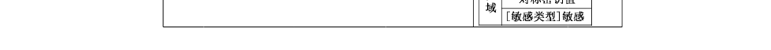

C.13.4 复制组复制过程允许复制层次结构的对象或段以在另一个层次结构中使用。此功能有助于密钥分发和备份。复制组是复制根下的层次结构中的一组对象。可通过复制一个复制根来将整个复制组移动到另一个层次结构。

创建对象时，将选中其复制属性（fixedParent）。如果 fixedParent 为CLEAR，则可通过TCM2_Du- plicate（）方法操作该对象。该命令允许在新父对象下加密对象的敏感区域，以便可在不同的TCM 层次结构中使用它。复制存储密钥的行为具有复制其所有后代的副作用，无论其 fixedParent 属性的设置如何。

如果对象具有 fixedParent CLEAR，则它是复制组的根。如果对象不是存储密钥，则该组将具有单个成员。对于存储密钥，复制组由复制的所有对象组成，这是复制组根的直接后果。

具有 fixedParent SET 的对象不能直接复制。但是，如果祖先具有 fixedParent CLEAR 并且祖先是复制的，则可隐式复制它们。

具有 fixedParent SET 并且没有具有 fixedParent CLEAR 的祖先的对象是不属于复制组的单独的对象。通过使用其 fixedTCM 属性值为SET来标识这些对象。复制组中的所有对象都具有fixedTCM属性值力 CLEAR。

对象可是多个复制组的成员。如果其多个祖先存储密钥具有 fixedParent CL.EAR，或者如果某个对象及其祖先之一具有 fixedParent CL.EAR，则会发生这种情况。

C.13.5 保护组用于保护子密钥的算法（非对称、对称和杂凑）和密钥大小在保护组内是一致的。保护组是复制根的所有后代，不包括其他复制根或其后代。

通过要求所有不可复制的存储密钥使用相同的算法，可更轻松地确定层次结构的安全属性。如果对象的fixedTCM 属性 SET，则该对象的所有祖先密钥都使用相同的算法集。如果对象的fixedTCM不是SET，则保护是由对象层次结构中每个复制根的复制权限确定的。

保护由复制权限而不是密钥算法确定的原因是复制权限可将复制根附加到软件生成的新父对象。

检查对象存在的层次结构不保证对象的保护，除非对象的fixedTCM 是SET。图C.9显示了在复制根上设置的算法的更改。

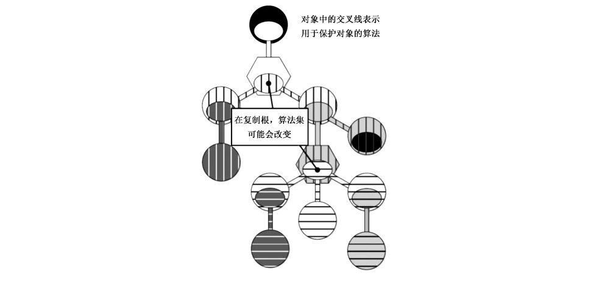

C.13.6 层次属性摘要对象的层次结构属性指示对象如何连接到层次结构。它们指示对象是否可存在于其他层次结构中，以及对象是否可由 TCM2_Duplicate（）方法直接复制。

**表C.11 列出了对象的层次结构属性的可能组合以及每种组合的解释。**

[

**表 C.11 层次结构属性的映射**

|  | fixedParent | fixedTCM | 描述 |  |
| --- | --- | --- | --- | --- |
|  | 。 |  | 这个组合表示一个复制根 |  |
|  | 0 | 1 | 这种组合是不准许的 |  |
|  |  |  | 此组合指示永久位于其父保护组中的对象。它不能是 TCM2_Duplicate（） 中的 objectHandle 引用 |  |
|  | 1 | 1 | 此组合指示在特定 TCM上创建的对象，并且不可能复制该对象 |  |

C.13.7 主种子层次结构主对象是从主种子值派生的对象。主对象是使用从主种子和主对象的名称派生的对称密钥来保护对象的敏感区域。相反，其他对象使用其父对称密钥加密。

一旦创建，主对象可像任何其他可加载对象一样进行管理，包括保存/恢复上下文。

主对象可具有 fixedParent 的值 SET或 CLEAR。如果主对象具有 fixedParent 的值为SET，则需要置 fixedTCM 的值为 SET。

C.13.8 层次结构属性设置矩阵

**表C.12显示了对象允许的层次结构设置的组合，复选标记（“/”）表示允许组合。**

[

**表 C.12 允许的层次结构设置**

|  | fixedTCM 设置于object parent | 对象的 fixedParent CLEAR SET | 注解 |  |
| --- | --- | --- | --- | --- |
|  | CLEAR CLEAR CLEAR SET | 人人 | 如果父对象的fixedTCM属性为CIEAR，则子对象的fixedTCM 要求为 CLEAR |  |
|  | SET SET SET CLEAR | 人人 | 如果对象的父对象的 fixedTCM 为 SET，则 fixedParent 和fixedTCM 应在子对象中具有相同的设置 |  |
|  | 注1：出于本表的目的，主对象（Primary Object）的父对象被认为具有一个总是为 SET 的 fixedTCM属性。注2：如果父对象有 fixedTCM SET，则子对象是可复制的（fixedParent == CLEAR）或不可复制（fixedParent== SET）。如果子对象是不可复制的，则需要具有与其父对象相同的 fixedTCM设置。 |  |  |  |

在对象模板［TCM2_Create（）方法和 TCM2_CreatePrimary（）方法］中以及在加载对象［TCM2_ Load（）方法］或复制对象［TCM2_Import（）方法］的公共区域中检查层次结构设置的一致性。

在使用 TCM2_LoadExternal（）方法加载的对象上不检查对象的层次结构设置的一致性。这是因为外部对象不是层次结构的一部分，并且其设置不重要。此外，TCM2_LoadExternal（）方法用于加载可能存在于另一个 TCM上的密钥的公共区域。使用TCM 检查签名或在复制期间加载新父项的公共区域时会发生这种情况。这些密钥具有与使用这些密钥的 TCM 无关的层次结构属性，因此不检查层次结构属性。

C.14 凭据保护C.14.1 概述TCM支持用于在TCM上分发密钥凭据的隐私保护协议。该过程允许凭据提供者将凭据分配给TCM 对象，使得凭据提供者无法证明该对象驻留在特定的TCM中。但是除非凭据提供者认为是在真正的TCM 设备上加载使用该凭证对象，否则该凭据是不可用的。

C.14.2 协议凭据过程的发起者将向凭据提供者提供需要其凭据的 TCM 对象的公共区域以及 TCM 背书密钥（通常为 EK）的凭据。凭据提供者将检查“EK”的凭据和公共区域中指示的属性，以确定对象是否应接收凭据。如果是这样，则凭据提供者将为公共区域颁发凭据。

凭据提供者可能要求，仅当公共区域是与“EK”位于同一 TCM 中的有效对象时，凭据才可使用。

为了确保这一点，凭据提供者对凭据进行加密，然后使用“EK”的公钥“包装”（wrap）凭据加密密钥。

然后，加密的凭证和包装的加密密钥将传递给发起者。发起者可通过加载“EK”和对象到 TCM中并要求 TCM返回凭据加密密钥来解密凭据。TCM 将使用私有“EK”解密凭据加密密钥，并验证凭据对象（公有和私有）是否已加载到TCM 中。若是，则TCM已验证对象的属性与凭据提供者所需的属性匹配，同时 TCM将返回凭据加密密钥。

此过程通过允许TCM 对象具有不依赖于特定 TCM 的凭据提供者提供的凭据来保护隐私。若对象是签名密钥，则该密钥可用于签名证明，并且凭据可断言签名密钥在有效的TCM上，而无需透露确切的 TCM。

该协议的第二个特性是，它阻止凭据提供者证明有关为其提供凭据的对象的任何信息。凭据提供者可在没有来自TCM 的任何信息的情况下生成凭据，因为TCM 不需要为凭证提供者创建凭证而提供任何私钥的所有权证明。凭据提供者可知道对象的凭据无法使用，除非对象与“EK”处于相同的TCM中，但是凭据提供者无法证明这一点。

C.14.3 保护凭据凭据提供者的凭据数据包包含在 TCM2_ActivateCredential（）成功时TCM返回的值。该值可以是凭据提供者希望放置在凭据数据包中的任何内容，但预期是用于解密包含对象实际凭据的数据包的值。

凭据提供者通过完整性 HMAC 保护凭据值（CV），加密方式与凭据数据包大致相同。区别在于，在生成种子时，标签为“IDENTITY”而不是“DUPLICATE”。

C.14.4 对称加密种子是从受“EK”非对称算法保护的值中派生出来的。生成种子的方法由“EK”的非对称算法确定。在创建种子的过程中，标签应为“INTEGRITY”。

给定种子值，密钥由此生成：symKey：=KDFa（ckNameAlg,seed，"STORAGE"，name,NULL,bits）式中：ekNameAlg 一用作“EK”密钥的 nameAlg；

seed 一使用特定于“EK”的非对称算法类型的方法生成的对称种子值；

"STORAGE"— —用于区分 KDF 使用的值；

name 一与凭据关联的对象的名称；

bits ——对称密钥所需的位数；

symKey 可用于加密CV。IV设为0。

encIdentity：=CFBaksymAls （symKey,0,CV）式中：CFBoksymAIg -CFB模式下的对称加密，使用作为“EK”密钥的对称算法；

symKey -对称密钥；

CV 凭据值 （TCM2B_DIGEST）。

C.14.5 HMAC最后的 HMAC操作将应用于 encldentity 值。这是为了确保TCM 可正确地将凭据与加载的对象相关联，并防止滥用或篡改CV。

HMAC 密钥（HMACkey）完整性由此计算得出。

HMAKey：=KDFa（ckNameAlg, seed，"INTEGRITY"，NULL,NULL,bits）式中：ekNameAlg -目标“EK”的 nameAlg；

seed 对称种子值；使用特定于“EK”非对称算法类型的方法生成；

"INTEGRITY" 一用于区分 KDF 使用的值；

bits -ekNameAlg 生成的摘要中的位数。

然后，HMACkey 用于完整性计算。

identityHMAC：=HMACokNameAle （HMACKey,encIdentity || Name ）式中：HIMACokNameNg -使用“EK”的 nameAlg 的 HMAC 函数；

HMACkey 从“EK”对称保护值派生的值；

encldentity -生成的对称加密敏感区域；

Name -被保护的对象的名称。

完整性结构是通过将 identityHMAC（大小和杂凑值）放在encldentity 之前的缓冲区中来构造的。

C.15 对象属性C.15.1 基本属性对象属性中的基本属性有如下三种。

a） Restricted 属性：当密钥设置此属性时，密钥不能用在所有使用密钥的命令中。

b） Sign 属性：当密钥设置此属性时，TCM 使用敏感区密钥来签名数据。

c） Decrypt 属性：当密钥设置此属性时，若为非对称解密密钥，TCM利用敏感区域的私钥来解密数据。若对称解密密钥，TCM 利用敏感区域的密钥来解密数据。

C.15.2 其他属性对象属性中的其他属性有以下六种。

a） stClear：当对象设置此属性时，表明此对象在 Startup（CLEAR）操作后应重新加载至 TCM。

b） sensitiveDataOrigin：当对称对象设置此属性时，由TCM 生成秘密数据。否则，由调用方提供秘密数据。

userWithAuth：当对象设置此属性时，表明再次访问对象时需使用授权值提供用户角色授权。

否则，只能通过在策略会话中的策略授权来提供用户角色授权。

d） adminWithPolicy：当对象设置此属性时，表明再次访问此对象时需要以管理员角色来满足对象的策略授权。否则，需要在 HMAC会话中使用授权值来访问。

e） noDA：当对象设置此属性时，表明访问对象如果授权失败，不会调用字典攻击保护，也不会使对象锁定。

encryptedDuplication：当对象设置此属性时，表明对象在复制时，需指定 newParentHandle。

没有设置此属性，需将 newParentHandle 设置次TCM_RH_NULL，对象在复制时没有外部封装。

C.16 对象结构元素C.16.1 公共区域公共区域包含对象标识和属性信息，在表C.13 中详细说明。

**表 C.13 公共区域参数**

|  | 参数 | 描述 |  |
| --- | --- | --- | --- |
|  | type | 标识对象的类型 |  |
|  | nameAlg | 标识对象名称的杂凑算法 |  |

对象属性：

a） 用法（sign、encrypt、restricted）；

b） 授权（user WithAuth、admin WithPolicy,noDA）；

objectAttributes

c） 复制（fixedParent、fixedTCM）；

d） 创建（sensitiveDataOrigin）；

e） 持久化（stClear）authPolicy 授杈策略值取决于对象类型。

［type］parameters 对于对称对象，将指定密钥的大小和默认加密模式。

对于非对称对象，将指定密钥大小、签名方案和对称加密方法取决于对象类型。

［type］unique 对于非对称对象，此值是公钥。

对于对称对象，此值是对敏感区域进行杂凑计算的值C.16.2 敏感区域敏感区域与公共区域有关，包含不在 TCM 隔离位置时需要加密的数据，它包括授权值和特定项信息。敏感区域的结构如表C.14 所示。

**表 C.14 敏感区域参数**

|  | 参数 | 描述 |  |
| --- | --- | --- | --- |
|  | sensitiveType | 标识对象类型 |  |
|  | authValue | 对象的授权值 |  |
|  | seedValue | 对于非对称存储密钥，需采用此值作为种子来生成子对象的保护值。对于其他非对称密钥，这是可选的。对于所有其他对象类型，这是一个混淆值。它与敏感区域数据进行杂凑计算，并将结果存放到公共区域的 unique 字段 |  |
|  | ［sensitiveT ype］ sensitive | 取决于 sensitiveType。对于非对称密钥，此参数包含私钥。对于 HMAC或对称密钥，此参数是密钥。对于数据对象，此参数是敏感数据 |  |

C.16.3 私有区域不在 TCM 隔离位置的敏感区域需要对称加密和完整性保护。用TCM2_Load（）加载的受保护敏感区域称为私有区域。

C.16.4 限定名对象的限定名 QN 是当前对象名称和父密钥限定名杂凑计算的结果。

C.16.5 敏感区域加密当采用私有区域时，对称加密密钥是由父密钥的秘密种子派生得到。

当复制敏感区域时，对称加密密钥是由新的父密钥派生得到。

C.16.6 敏感区域完整性基于 HMAC 的完整性方案可确保敏感区域的完整性。

C.17 对象创建C.17.1 概述TCM2_Create（）和 TCM2_CreatePrimary（）用于创建作 TCM Storage Hierarchy 一部分的对象（密钥和数据）。TCM2_CreatePrimary（）使用主种子派生创建主对象，TCM2_Create（）用于创建由TCM 随机数生成器（RNG）产生的随机数生成的其他对象。主对象的父密钥是主种子的值，普通对象的父密钥是存储密钥。

这些参数包括：

a） 公共域模板；

b） 敏感参数值；

c） 创建时选定的 PCR；

d） 公共域创建；

e） 敏感区域创建；

f） 创建数据和票证；

g） 创建资源。

C.17.2 公共域模板公共域模板描述了要创建对象的所需属性。TCM 使用此模板来指导新对象的创建。

模板的格式应与所有要创建对象的所需格式相匹配。在创建过程中，唯一标识信息（unique）将由TCM 代替。

C.17.3 敏感参数值创建对象时提供的敏感参数值允许对对象的authValue 进行初始设置，并可提供其他一些对象敏感参数值。敏感参数值可以是加密密钥或密封数据。

提供给 TCM 的敏感参数值（inSensitive 参数）可选择使用标准的基于会话的加密技术在 TCM2_ Create（）和 TCM2_CreatePrimary（）进行加密。由于基于会话的加密允许使用不同的会话进行授权和加密，因此用于加密授权和其他敏感数据的会话不必与新创建对象的父密钥的授权会话相同。这样可确保控制父密钥的实体不会自动获取对自密钥机密值的访问权限。

C.17.4 创建选定的PCR TCM2_Create（）或 TCM2_CreatePrimary（）参数中存在的PCR选择是用于选择最能代表创建对象的环境的PCR 值。根据创建数据算法对选择和 PCR 进行杂凑处理，并将其包含在命令响应返回的创建数据（TCM2B_CREATION_DATA）中。

C.17.5 公共域创建本条描述了 TCM 如何使用 TCM2_Create（）和 TCM2_CreatePrimary（）的参数来设置创建对象的公共域中的值。

如果参数不正确，本条不描述错误情况。

C.17.6 加密区域创建计算敏感区域内容的过程取决于对象的类型，该类型在模板的类型字段中指示。

某些敏感区域字段可包含调用者提供的数据。某些字段始终由TCM 提供。当TCM 提供的字段位于“主对象”中时，TCM 提供的数据总是以某种方式从关联的主密钥种子中派生出来，只要关联的“主密钥种子”保持不变，就可复制相同的主对象。对于普通对象，实现可从 RNG 获取 TCM提供的数据，也可将对象的字段视为主对象来计算，但要使用随机数代替主密钥种子。

a） 对象类型（type）对象敏感区域的 type 参数是对象公共域模板中类型参数的副本。

b） 授权值（authValue）对象的 authValue 是从 TCM2_Create （）或 TCM2_CreatePrimary（）的 inSensitive 参数的userAuth 字段复制而来。

c） seedValue seedValue字段用于对称密钥，HMAC密钥和数据对象的混淆值。它还用于保存非对称存储密钥的对称密钥种子值。对于所有对象类型（如果存在），seedValue 是对象的nameAlg生成的摘要值的大小。

仅当非对称密钥是存储密钥时才需要 seedValue。该值用作密钥种子来生成完整性和机密性的值，以保护密钥的子对象。seedValue 的大小和对象 nameAlg指定算法产生的摘要值大小一致。

对于普通对象，seedValue 能通过从 RNG 中获取位来创建，也能使用与主对象相同的方法生成。

该方法使用 KDFa（），如下所示。

seedValue：=KDFa（hashAlg,seed，"seedValue"，tName,proof, bits）式中：hashAlg 在 TCM2_Create（）中，是指父密钥的 nameAlg；在 TCM2_CreatePrimary（）中，是指上下文完整性杂凑算法；

seed -对于主对象是指主密钥种子；对于其他对象是指与主密钥种子具有相同大小的随机数；

"'seedValue" 与 KDFa（）使用的任何标签不同的空终止的、厂商特定的字符串；

tName -使用模板中的 nameAlg 计算的创建模板的名称；

proof -如果要创建的对象是签注层次中不可复制的主对象，则为 ehProof；对于所有其他对象，力空缓冲区；

bits -创建模板中 nameAlg 生成的摘要值中的位数。

d） 敏感参数值（sensitive）对称对象：对称对象的 type 为 TCM_ALG_SYMCIPHER或TCML_ALG_KEYEDHASH。对于对称对象，敏感对象数据可由调用者提供或由 TCM 生成。

如果对象模板中的 sensitiveDataOrigin 属性为CLEAR，则敏感数据由调用者提供。由调用者提供的敏感数据将位于 TCM2_Create（）或 TCM2_CreatePrimary（）的 inSensitive 参数的数据字段中。

如果将 sensitiveDataOrigin 属性 SET，则表明 TCM 是敏感数据的源，并且 inSensitive 参数的数据字段应沩空缓冲区。

用户提供的对称密钥应模板中 parameter.symDetail.keyBits.sym 指示的大小。它是保持所示位数所需的八位字节数。

用户提供的HMAC 密钥不准许大于杂凑算法的块大小或128个八位字节中的较小者。将大小限制 128个八位字节是为了使TCM之间的结构兼容。

如果调用者未提供，则通过TCM 生成 sensitive。对于 TCM_ALG_KEYEDHASH 对象，其大小是该对象的 nameAlg 的摘要值大小。对于 TCM_ALG_SYMCIPHER 对象，其大小等于（parameters. symDetail.keyBits.sym + 7）/ 8。

对于普通对象，可通过从 RNG 中获取位来创建 sensitive。sensitive 也可使用与主对象相同的方法生成。该方法使用 KDFa（），如下所示。

sensitive ：=KDFa（hashAlg,seed，"sensitive"，tName,NULL,bits）式中：hashAlg 在 TCM2_Create（）中，是指父对象的 nameAlg；在 TCM2_CreatePrimary（）中，是指上下文完整性杂凑算法；

seed 对于主对象是指主密钥种子；对于其他对象是指与主密钥种子具有相同大小的随机数；

"sensitive"- 与 KDFa（）使用的任何标签不同的空终止的、厂商特定的字符串；

tName 使用模板中的nameAlg 计算的创建模板的名称；

bits 对于 TCM_ALG_SYMCIPHER 对象，是指 parameters.symDdtail.keyBits.sym 的值；对于其他对象，是指创建模板中 namealg生成的摘要值中的位数。

非对称对象：非对称密钥对象中的 sensitive 是私钥。

C.17.7 创建数据和票证当创建对象时，TCM还将创建一个数据结构，该数据结构描述创建对象的环境。这些数据包括：对象创建时选择的 PCR 的摘要值和指示列表中包括的 PCR 的位图。PCR 选择是在 TCM2_ Create（）和 TCM2_CreatePrimary（）调用中指示的PCR。

a） 创建对象的位置；

b）父密钥的 nameAlg。如果父密钥是“主密钥种子”，则算法将为 TCM2_ALG_NULL；

c）父密钥的名称。如果父密钥是“主密钥种子”，则名称将作为密钥种子的句柄；

d）父密钥的限定名称。如果父密钥是“主密钥种子”，则限定名将作为密钥种子的句柄；

e） 调用者提供的一些与新对象关联的其他数据。

除了这些值之外，TCM将创建票证，该票证将允许 TCM验证创建数据是否由 TCM生成。

C.17.8 创建资源创建主对象时，它也会同时被加载到 TCM 对象插槽中并返回句柄。如果没有可用的对象插槽，则TCM 将返回 TCM_RC_OBJECT_MEMORY. C.18 对象加载C.18.1 概述对象是可加载到 TCM 中使用的密钥或数据。TCM 使用或修改对象之前，应加载对象。加载可能需要提供父级的用户角色授权。

可只将对象的公共部分加载到 TCM［TCM2_LoadExternal（）］中，也可同时加载公共部分和私有部分［TCM2_load（）］。如果要操作或使用敏感区域，则需要加载这两个部分。

当加载对象时，将执行多个一致性检查。这些检查包括以下内容。

a） 加密私有区域的HMAC是否正确—这确保了敏感区域没有被修改，敏感区域和提供的公有区域匹配，并且对象是父对象派生的。

b） 是否是以加密方式绑定到敏感数据的公共区域的唯一参数——这是防止公共区域与敏感区域不正确关联所必需的。如果未执行此检查，则击者可使用名称与其他对象相同的公共区域，并将其他敏感区域与公共区域关联。如果在 TCM2_PolicySecret（）中使用了该对象，则攻击者可让 TCM 创建具有任何所需杂凑值的 policysdigest。

c） 属性是否一致——这些值需要检查，即使完整性检查表明这些值没有修改。这是因为对象可能是由软件使用不一致的值创建的。完整性可能是好的，但值可能是错误的。

• 如果设置了 fixedTCM，那么父一级的 fixedTCM 也应设置；

• 如果 fixedParent 是 CLEAR，那么 fixedTCM 也应是 CLEAR；

• 如果 restricted是 SET，仅有一个签名或者解密可设置成 SET。

C.18.2 只加载对象公共部分当只加载非对称密钥的公共部分时，这里有几种情况，例如复制或者签名验证。一个仅加载公共部分的对象要求调用方关联该对象到其中的一个层次。当密钥被用来验证签名时需要此关联，以便使TCM 可决定在标签中使用哪一个证明值。

当 TCM2_LoadExternal（）的 inPrivate 参数的大小为零时，仅加载 public-only。

C.18.3 加载外部对象外部对象允许在不属于 TCM 层次结构的密钥上使用TCM 的加密过程。可加载非对称密钥的公共部分，以便可使用TCM验证签名。可加载对称密钥，以便可使用TCM 的对称密码引擎来加密或解密数据。

TCM2_LoadExternal（）用于加载外部对象。仅加载公共部分时，对象的属性是任意的，但结构应与类型一致。如果加载了签名密钥，则签名方案应是有效方案或者该签名密钥。

加载对象的敏感部分（例如，对称密钥）时，敏感区域不由父级加密，但可使用参数加密进行加密。

加载两个部分时，需要设置 fixedParent 和 fixedTCM成CL.EAR。此检查允许对象在任何包含证书的类型有效的命令中使用。

加载外部对象时，它可与层次结构相关联。这允许在命令如 TCM2_VerifySignature（）中创建特定层次结构的标签。

如果与外部对象关联的层次结构被禁用，则将刷新该对象。如果调用 TCM2_LoadExternal（）时禁用了关联的层次结构，则不会加载该对象。

C.19 对象创建参考实现主种子用于创建主对象。当对象中需要 TCM 生成的值时，使用主种子的 KDF 的附加迭代将生成附加的伪随机值。这确保只要主种子保持相同，就可重新创建特定主对象的所有TCM 生成的值。

为了简化实现，将相同的方法用于主要对象和普通对象。区别在于，不是使用主要种子，而是从TCM 的 RNG 生成随机种子。

不需要使用 seed 和KDF 方法来实现生成对象。使用不同方法的最可能的地方之一是生成用于非对称密钥的素数。对于大多数其他对象类型，使用不同的方法生成主对象和普通对象几乎没有优势。

如果使用 seed-and-KDF 的方法创建密钥，则用于对象创建的种子值应是对象安全强度的两倍。

对于一个 symCipher 对象，它的安全强度通常是对称密钥的大小。对于 keyedHash 对象，安全强度通常与 keyedHash 对象中使用的摘要相同。对于非对称密钥，其安全强度随算法的不同而变化。对于数据对象，安全强度假定为 nameAlg的摘要大小。

C.20 上下文管理C.20.1 概述为了允许在许多应用程序之间共享TCM，TCM支持上下文管理。应用程序使用的对象和会话可在需要时加载到TCM中，并在其他应用程序正在使用TCM 时保存。TCM 资源管理器（TRM）负责交换上下文，以便在需要时在TCM 中提供必要的资源。

有两种类型的上下文：与临时对象关联的上下文和与授权会话关联的上下文。

用于管理上下文的四个命令是：

a） TCM2_ContextSave（） -TCM 完整性保护、加密并返回与句柄关联的上下文；

b） TCM2_ContextLoad（） 允许将先前保存的上下文加载到 TCM RAM 并分配一个句柄；

c） TCM2 FlushContext（） 从 TCM RAM 中删除与指定句柄相关的上下文信息；

d） TCM2_EvictControl（） -允许所有者或平台固件指定要在 TCM2_Startup（）事件上保持TCM 驻留的对象。该命令将返回一个新句柄。

保存的上下文以加密方式绑定到特定的TCM。通过在生成上下文的保护值时使用统计上唯一的证明值来提供此绑定。当层次结构的证明值更改时，不能再将属于该上下文的已保存对象上下文加载到TCM中。上下文的证明值将在其主种子更改时更改。此外，当 SPS或EPS发生变化时，TCM的非易失性证明值 ehProof 也会发生变化。

所有对象和会话的已保存上下文在TCM 重置时无效。在厂商具体实现中，当 TCM 重置时，用于上下文的加密密钥将会被改变，因此以前已保存的上下文不会再被加载。已保存的会话上下文在会话关闭或TCM 重置之前保持有效。如果设置了一个对象的 stClear 属性，然后这个对象已保存的上下文在 TCM 重置或者重启［例如，在TCM执行 Startup（CL.EAR）时］后失效。如果某个对象的 stClear 属性是 CLEAR，在下一次 TCM 重置前，该对象的保存上下文是有效的，并且可加载到 TCM中。

在 TCM2_Startup（）之后，对象和会话不会保留在TCM 内存中，TCM资源管理器（TRM）需要力任何的会话或者句柄保存上下文，以便在TCM 重启或者恢复后使用。

保存的上下文的结构体可由供应商定义，但保存的上下文需要通过加密的方式保护其完整性和机密性。

C.20.2 上下文数据当上下文被保存，已保存的上下文数据的结构体包含：

a） 序列号；

b） 句柄 savedHandle；

c） 层次选择器；

d） 完整性的 HMAC；

e） 已加密的数据块。

加密的数据块包含在 TCM 中重建完整对象或会话上下文所需的数据。

上下文的结构是供应商定义的，可能包含机密和非机密数据。应对整个上下文进行加密。

序列号每次保存上下文时都会生成新的保护值。保护值是HMAC 密钥、对称密钥和初始值。这些值通过在生成过程中包含一个计数器值而变得唯一。用于上下文的计数器值存储在上下文结构的序列号字段中。两个计数器用于生成序列号。一个计数器用于瞬态和序列对象上下文。第二个计数器用于会话上下文。

有两个计数器用于提供序列号。计数器（objectContextID）为瞬态对象和序列对象提供序列号。每次保存对象上下文时，此计数器都会递增。计数器（contextCounter）用于为会话提供序列号，并在创建或加载会话上下文时递增。创建上下文结构时，TCM将序列参数设置为生成上下文保护值时使用的计数器值。

加载上下文时，TCM 在开始操作之前检查序列参数是否在可行范围内。对于一个对象，可行范围是小于对象序列计数器当前值的任何数字。对于会话，序列号也应小于会话序列号，但也应大于序列号减去允许范围会话号。

在厂商具体实现中，objectContextIl 是一个64位计数器，在启动时初始化零且永远不会溢出。

大小取决于平台。

句柄上下文的 savedHandle 号表示上下文的类型（对象或授权会话）。上下文的类型用于确定如何重新构造用于验证上下文的保护值。如果上下文中的 savedHandle 值被软件更改，则不会加载上下文。

对于会话，无论上下文是在TCM 中加载还是在已保存的上下文中，都会为上下文分配相同的句柄。savedHandle 与TCM用来引用会话的句柄相同。会话句柄将具有 TCM_HT_HMAC_SESSION（0216）或者 TCM_HT_POLICY_SESSION（0316）句柄的最高字节（MSO）。句柄索引中的值范围（句柄的低阶位三个八位字节）依赖于 TCM。在厂商具体实现中，会话上下文句柄的低阶位在0到MAX_ ACTIVE_SESSIONS-1 的范围内，如果句柄超出此范围，则TCM将生成错误并不再对上下文进行进一步处理。

一个 TCM_HT_TRANSIENT （80）6）savedHandle 的句柄的最高字节（MSO）表示上下文是一个对象。对于一个对象，上下文结构的 savedHandle 参数并不表示TCM 用来引用该对象的句柄值（当临时对象上下文不在TCM 上时，TCM 不保留该上下文的任何信息）。因此，savedHandle 值用于临时对象上下文的方式与用于会话上下文的方式不同。相反，savedHandle 用于指示瞬态对象上下文的类型。

三个 savedHandle 的值被定义成瞬态对象上下文对象：

a） 00 00 0016 用于表示一个瞬态对象不包含 stateClear 属性；

b） 0000 01z6 表示一个序列对象；

c） 00 00 0216 用于表示一个瞬态对象包含 stateClear 属性。

如果 savedHandle 类型是 TCM_HT_TRANSIENT，则TCM 将不会生成或加载除上述用于句柄索引的三个值之外的任何其他值的上下文。

具有 stateClear 属性的对象将在Startup（CL.EAR）时失效。为了实现这一点，TCM将在对象的完整性值中包含 clearCount。

对 savedHandle 值为80 00 00 00或8000 00 01o的上下文的TCM 处理是相同的。区分序列对象的原因是为了方便 TCM 资源管理器（TRM）而标识上下文。TRM 需要以不同于其他瞬态对象的方式管理序列对象。因为序列对象的上下文在每次序列更新时都会更改，所以每次使用上下文时都需要保存上下文。临时对象的上下文在使用时不会更改。

上下文层次 Hierarchy上下文的层次参数 hierarchy 指示在为上下文创建保护值时使用哪个验证值。对于对象，此值由对象的层次结构确定，对于临时对象，可能为 TCM_RH_NULL。序列对象和会话位于空上下文层次结构参数中。

C.20.3 上下文保护上下文保密保护对称分组密码用于保护保存的上下文的机密性。该算法由TCM 供应商选择，但要求在TCM上实现的任何对称分组密码都为最高安全强度。

当上下文由 TCM2_ContextSave（）创建时，序列的值在加密之前存储在 TCM2B_CONTEXT- SENSITIVE上下文中。加载上下文时，序列的值将与加载的TCM2B_CONTEXT_SENSITIVE 相关上下文中的值解密后进行比较。如果值不相同，则TCM 将进入失效模式，因为这是特定类型的功率分析攻击的症状。

加载上下文时将重新生成对称密钥和IV。要求在验证上下文完整性之前不生成对称密钥和IV。

KDFa（）用于生成对称加密密钥，IV 用于上下文加密。调用的参数力：（symKey,symlv）：=KDFa（hashAlg, hProof ,vendorString,sequence,handle, bits）式中：hashAlg ——厂商选择的杂凑算法；

hProof 与上下文关联的层次结构关联的证明值；

vendorString 一用于区分 KDF 用途的值；

sequence -TCMS_CONTEXT 的序列参数；

handle| -TCMS_CONTEXT 的句柄参数；

bits 一对称密钥和上下文加密所需的位数。

第一个公式中生成的密钥和 IV 用于加密对象或会话上下文：encContext ：=CFBsymAg（symKey,symlv,context ）式中：CFBeymAk -TCM厂商选择的对称算法使用CFB模式进行对称加密；

symKey 第一个公式的对称密钥；

symlv 第一个公式的IV；

context 被保护的上下文（TCM2B_CONTEXT_DATA）。

上下文完整性保护保存的上下文的完整性由 TCM厂商选择的杂凑算法进行 HMAC 保护。所选杂凑算法应具有TCM上实现的任何杂凑算法的最高安全强度。

HMAC是使用与对象所属的层次结构相关联的证明值构造的。由于验证值在关联的主种子更改时更改，因此当关联的主种子更改时，先前保存的上下文的HMAC验证将失败；并且该上下文可能不再加载。HMAC 计算中的其他值用于使其他上下文子集失效，而不必使它们全部失效。

唯一使所有保存的上下文无效的TCM状态更改是重置TCM。

会话、序列和临时对象处于“空”层次结构中。

一个已保存上下文的 HIMAC完整性计算为：conte xtHMAC： =HMACrendorNle （hProof, resetValue ｛ ||ClearCount ｝I sequence|handle|encContext ）式中：HMACvendorAig -HMAC 使用厂商定义的杂凑算法。

bProof -—TCMS_CONTEXT 上下文的层次结构参数选择的层次结构证明。

resetValue 一个计数器值，在每次TCM 重置时递增，并且在整个 TCM 生命周期内不会重置；或者一个随机值，在每次 TCM重置时更改，并且具有 vendorAlg生成的摘要大小。

clearCount 一种计数器值，在每次 TCM 恢复时递增，在TCM复位时可递增或设为零。仅当句柄值为80 0000021s时才包含此值。

sequence TCMS_CONTEXT 的序列参数。

handle TCMS_CONTEXT 的句柄参数。

encContext 已加密的上下文块。

C.20.4 对象上下文管理保存对象的上下文时，将对对象上下文的副本进行完整性检查、加密并返回给调用方。原始上下文保留在TCM 中，TCM保留其句柄。保存的对象上下文可用 TCM2_ContextLoad（）重新加载到 TCM中。如果TCM 有足够的可用内存，它将加载对象并分配一个句柄。如果同一对象的其他副本位于TCM 内存中，则它们不受影响。对象上下文仅通过 TCM2_FlushContext（）或者 TCM2_Startup（）从内存中被删除，删除相关联的层次种子。

加载对象时分配给该对象的句柄不能分配给任何其他TCM 的资源、对象或会话。从TCM 内存刷新对象时，可在加载或创建该对象时将其句柄分配给另一个 TCM 资源。

软件可根据需要创建任意多个对象上下文副本。当对象不在 TCM 内存中时，它没有关联的句柄。

如果保存对象上下文并随后重新加载，则很可能会为该对象分配不同的句柄。

当与对象关联的层次结构更改主种子时，将从TCM 内存中刷新与该层次结构关联的所有对象。

TCM 将不再加载与上一个主种子关联的已保存上下文。

当试图加载对象或对象上下文［TCM2_load（）、TCM2_CreatePrimary（）、TCM2_LoadExternal（）或 TCM2_ContextLoad（）］并且 TCM 没有足够的RAM 来容纳对象时，TCM将返回 TCM_RC_object_ MEMORY或TCM_RC_MEMORY。此警告代码通常由 TRM处理。它指示在命令完成之前需要从TCM 内存中卸载对象或会话。如果 TCM返回 TCM RC_OBJECT_MEMORY，则表示应从 TCM 内存刷新对象。如果 TCM 返回 TCM_RC_MEMORY，则从 TCM RAM中删除对象或允许命令完成的会话。

当命令引用一个持久化（persistent）对象时，TCM 可将该对象从 NV 移动到一个对象槽中。如果没有可用的插槽，TCM 将返回 TCM_RC_OBJECT_MEMORY。

允许实现在执行 TCM2_Import（）时使用对象插槽作为临时内存，如果插槽不可用，则返回 TCM_ RC_object_ MEMORY.如果TCM 使用对象插槽作为临时内存，则在分配插槽的命令结束时将释放该插槽。

如果TCM 在复位前收到 Shutdown（STATE），则保存的对象上下文将在 TCM重新启动或 TCM恢复后继续可用。例外情况是，可使用 stClear 属性创建对象。如果在对象或对象的祖先中设置了此属性，则保存的上下文将在 TCM重新启动时失效。所有保存的对象上下文在重置TCM 重置后无效。

C.20.5 会话上下文管理会话上下文由TCM2_StartAuthSession（）创建。与会话关联的上下文是唯一的。描述会话状态的数据可在TCM 上，也可保存在TCM 上，但不能同时保存。此外，会话上下文只能加载一次。对会话上下文的这些限制旨在防止基于授权重放的可能攻击。

只要会话处于活动状态，与会话关联的句柄就不会更改。会话处于活动状态，直到 continueSession标志为 FALSE 而关闭，或者由 TCM2_FlushContext（）刷新 TCM 会话的上下文。

厂商具体实现时使用一个易失性上下文计数器（context counter），该计数器在每次创建会话或加载上下文时递增。此计数值分配给已创建或加载的会话上下文，并用作会话上下文的版本号。如果保存并重新加载会话上下文，则会为其分配新的版本号。contextCounter 通过 Shutdown（STATE）保存，并在 TCM 重置时重置。

TCM 维护并发会话的数据库，以便它可验证重新加载的会话上下文是最新版本。要求 TCM 应确保还原的上下文是正确的上下文，而不管创建的上下文数量如何。

上下文计数器 contextCounter 的大小影响跟踪每个上下文所需的内存大小。因此，计数器只对大多数应用程序是够大，这意味着它不会对所有应用程序都是够大。在这些应用程序中，需要一个方法来处理计数器翻转。

TCM并没有自动刷新旧会话，而是提供一个指示，表明它已达到其限制，并且一个或多个保存的会话上下文需要将其序列号更新到当前间隔，以准备上下文计数器滚动更新。

创建或加载授权会话时，将提供上下文计数器接近其限制的指示。如果会话的创建或加载将使TCM 无法将所有上下文带人当前时间间隔，则它将返回一个错误（TCM_RC_CONTEXT_GAP），而不会创建或加载新会话。收到此错误时，管理软件要么显式刷新旧会话上下文，要么加载旧会话上下文以更新其关联的计数器值。

当TCM返回 TCM_RC_CONTEXT_GAP 时，它将不准许创建授权会话，并且只允许加载最旧的授权会话。加载最早的会话时，将更新其序列号。它可与其新序列号一起使用或保存。

在任何TCM2_Startup（）后刷新 TCM RAM中的会话上下文。保存的会话上下文不会无效，并且可在启动保存后重新加载。保存的会话上下文在 ST_CLEAR 时无效。

C.20.6 上下文逐出逐出是从 TCM RAM 中删除与对象或会话关联的上下文以允许加载或创建其他会话或对象的过程。保存会话上下文将从 TCM RAM 中删除大部分会话上下文。保存对象上下文不会将其从 TCM内存中删除。当应用于某个对象时，TCM2_FlushContext（）会将其从 TCM RAM 中移除，但不会使该对象的已保存上下文无效。应用于会话时，无论会话的上下文是在 TCM RAM 中还是保存的，TCM2_ FlushContext（）都将使会话无效。

可使用 TCM2_EvictControl（）使对象在 TCM NV 内存中保持不变。当设置为持久时，TCM2_ FlushContext（）和 ST_CLEAR对对象没有影响。

C.20.7 对象槽的其他使用方法大多数情况下，TCM 资源管理器 TRM将显式地从 TCM 的对象内存加载和卸载（刷新）对象。对以下两种情况，TCM 利用对象槽作为其他用途，TCM资源管理器需要处理可能出现的潜在资源问题。

这两种情况是：TCM2_Import（）和使用持久对象。

TCM2_Import（）允许实现在导入数据包上操作时使用对象插槽作为其“暂存“内存。命令完成后，插槽将可用。如果所需的插槽不可用，则使用此选项的实现可能会返回 TCM_RC_OBJECT- MEMORY。此返回代码位于预期由资源管理器处理的响应代码组中。

当句柄引用持久对象时，如果对象槽不可用，则允许 TCM 实现返回 TCM RC_OBIECT_MEMO- RY。这使得TCM 可将对象的持久化镜像保持为压缩形式，并将其解压缩到对象槽中以进行有效的处理。命令完成后，将删除对象槽中保存的持久对象的版本。

C.21 证明C.21.1 概述证明是让 TCM 对内部数据进行签名的操作。

C.21.2 标准证明结构标准证明结构的内容见表C.15。

**表C.15 标准证明结构**

|  | 参数 | 类型 | 描述 |  |
| --- | --- | --- | --- | --- |
|  | magic | TCM_GENERATED | 证明结构唯一值 |  |
|  | type | TCML_ST_ATTEST | 标识证明结构的类型 |  |
|  | qualifiedSigner | TCM2B_NAME | 签名密钥的限定名称 |  |
|  | extraData | TCMZB_DATA | 调用方提供的外部信息 |  |
|  | clockInfo | TCMS_CL.OCK_INFO | Clock、 resetCount、restartCount、Safe 值 |  |
|  | firmwareVersion | UINT64 | TCM 的固件版本 |  |
|  | ［typeJattested | TCMU_ATTEST | 特定的证明信息 |  |

C.21.3 隐私TCM 需要在非 Endorsement 层次的 resetCount、restartCount 和 firmwareVersion 的字段中添加混淆值来防止活动跟踪。

C.21.4 符合条件的数据每个证明命令都有一个名为 qualifyingData 的参数，该参数由调用方设置，一般为随机数，以确保证明的“新鲜度”。

C.22 密码支持函数C.22.1 杂凑TCM2_Hash（）使用指定的杂凑算法创建数据块摘要，如果被杂凑的数据超过TCM 的输入缓冲区的大小，则使用杂凑序列命令。

C.22.2 HMAC TCM2_HMAC（）将使用 TCM 内部的HMAC密钥计算数据块的HMAC。

C.22.3 杂凑，HMAC杂凑计算序列在杂凑序列中，TCM将使用所选算法对序列中的所有数据计算其杂凑值。

TCM2_SequenceComplete（）完成杂凑序列并返回数据摘要。另外，如果用于创建摘要的数据不是以 TCM_GENERATED_VALUE 开头，则生成一个票证，表明可使用受限密钥对摘要进行签名。

杂凑序列为：

a） TCM2_HashSequenceStart（）（hashAlg 是支持的杂凑算法）；随后是

b） TCM2_SequenceUpdate（）（零或多个）；随后是

c） TCM2_SequenceComplete（）。

HMAC序列对于 HMAC序列，TCM 将使用指定的密钥作为HMAC密钥，并使用指定的杂凑算法对序列的数据执行 HMAC计算。

TCM2_SequenceComplete（）完成 HMAC序列并返回HMAC值。

HMAC 序列 ：

a） TCM2_HMAC_Start（）（hashAlg 是支持的杂凑算法）；随后是

b） TCM2_SequenceUpdate（）（零或多个）；随后是

c） TCM2_SequenceComplete（）。

序列上下文序列涉及数据杂凑，并且.TCM 应将中间杂凑状态保留在受保护的位置。

序列上下文被分配一个句柄，以便它可像任何临时对象一样被保存和恢复，它的属性与临时对象不同，因为序列上下文在每次使用时都会更新。除此之外，TCM2_ReadPublic（）无法读取序列的公共部分。

当 TCM2_SequenceComplete（）成功完成时，序列上下文将从 TCM 中刷新。

序列不受字典攻击保护，授权失败不会导致 TCM 进入锁定。

对称加密TCM2_EncryptDecrypt（）定义用于数据块的对称加密和解密。

非对称加密和签名操作

**7.7** 和7.13 中详细介绍了非对称加密和签名算法的接口。

C.23 硬件可信度量根的核心时间序列将系统置于运行已知代码的已知状态的过程将创建可信链的起点。计算机系统重置会将处理器和芯片组置于已知状态，并且处理器（用于度量的可信根）开始执行平台制造商提供的代码。此初始代码是CRTM。通常CRTM 的一个作用是使用表示CRTM身份的值扩展PCR。这个引导过程可用两个不同的根启动信任链。

C.24 时间组件C.24.1 概述TCM 具有用于认证时间戳和门控策略的时间组件。当TCM供电的时候，时钟是向前计时的，并提供校准功能。

时间组件通过以下命令被公开使用：

a） 读取 Clock、Time、resetCount 和 restartCount 的值［TCM2_GetTime（）］；

b） 时间戳提供外部的数据签名密钥和 Clock、resetCount 和 restartCount ［TCM2_GetTime（）、TCM2_Quote（）、TCM2_Certify（）和其他受限制的签名操作］；

c） 通过使用引用安全、时钟、时间、resetCount 和 restartCount［TCM2_PolicyCounter Timer（）］的授权策略，允许对象具有生命周期限制。

C.24.2 时间值Time 是一个64位的值，它包含最后一个复位或TCM2_Startup（）（厂商选择）之后的时间［以毫秒（ms）为单位］。

C.24.3 重启计数值除了 TCM复位外，其他事件可能导致TCM记录时间或 RTR 中的不连续。暂停-恢复周期将导致时间中断。

在TCM复位时，复位计数值增加，重启计数值重置O。这不会导致动态 RTR 信息的丢失，因力对复位计数值的更改也意味着对动态 RTR 的更改。

C.24.4 关于时钟的可靠性和精确性的注意事项时钟被设计成允许一个被管理的环境（如企业）在时钟和实时之间保持一个小的偏差。如果平台没有被管理的，或者平台落人敌手，或者平台被恶意软件控制，那么时钟的准确性就会降低。这说明影响时钟在时间戳和有时间限制的对象上的适用性的因素。

记录时间间隔大于1 ms 的事件的正确顺序（除了与 resetCount 和 restartCount 中的不连续相关联时），以及时间戳永远不能伪造来表示过去的某个时间。如果 Clock 的值可能是“过时的”，Safe 标志也会给出同样的指示。

C.24.5 时钟的隐私方面时针认证结构返回几个值，当这些值和在一起时可标识特定的平台。所有的认证都包含一个TCMS_CLOCK_INFO 结构。该结构包含时钟、resetCount、restartCount 和Safe。认证结构还包含指示固件版本号的64位值。每个认证密钥都有一个不同的128位混淆值，该值在密钥的生命周期内是常量。

C.25 非易失性存储器C.25.1 概述每个 TCM 都具有非易失存储器。非易失存储器用于保存：

a） NV 索引值；

b） 由 TCM2_EvictControl 持久化的对象；

c） 由 TCM2_Shutdown（）保存的状态；

d）持久化的 NV数据。

C.25.2 NV 索引NV索引是由TCM用户定义的空间。NV 索引由唯一的句柄值标识。

NV 索引结构具有：

a） 标识句柄：该句柄由调用者定义 NV 索引时分配，用于引用索引；

b） nameAlg：该参数指示在索引名称的计算中使用的杂凑算法；

c） 授权策略：该参数是可选的，是 NV索引策略的摘要值；

d） NV 索引属性：该参数确定了索引的性质以及操作或读取 NV 索引的对象；

e） 授权值，该值长度不大于 NV 索引的 nameAlg生成的摘要值的长度；

f） 指示索引数据大小的值：该参数指示保存 NV 数据所需的八位字节数；

g） 可根据 NV索引类型修改 NV 索引数据。

NV 索引的公共部分由 NV 索引结构的所有部分（除了 authValue 和索引数据外）构成，并使用nameAlg 对其进行杂湊处理以生成索引的名称。

NV 索引能被指定为是一个混合索引（设置 TCMA_NV_ORDERY）。混合索引适用于需要频繁更新的应用程序。TCM 对于普通索引的写操作会即刻写入 NV内存，但是对混合索引的写操作只会更新 RAM 中索引数据的副本。混合 NV 索引的非易失性副本在TCM2_Shutdown（）上更新。

TCM 四种索引类型（普通索引、计数器索引、位字段索引和扩展索引）中的任何一种索引类型都能定义为混合索引，但写人 NV 内存的条件有所不同，下面将进行描述。

分配 NV 索引通过 TCM2_NV_DcfineSpace（）对 NV 索引进行分配。分配索引需平台授权或所有者授权。调用者在定义NV 索引时指定了分配给 NV 索引的位置、索引的访问控制策略和应保留写人数据缓冲区的类型和/或大小。在 NV 索引写人元数据前读取 NV 将返回错误值（TCM_RC_NV_UNINITIAL- IZED）。

当NV 索引被定义后，它的TCMA_NV_WRITTEN属性将为CLEAR。NV 索引被定义后但无数据时，不准许基于该 NV 索引执行 TCM2_PolicyNV（）和 TCM2_NV_Read（）操作。

首次写人索引时，TCMA_NV_WRITTEN 熟悉设置为 SET。

TCM 支持四种不同的NV索引类型：

a） 普通索引—此索引类型包含了使用 TCM2_NV_Write（）进行修改的TCM 不透明的数据；

b） 计数器索引——此索引类型包含了使用TCM2_NV_Increment（）进行修改的一个64 位计数器；

c） 位字段索引——此索引类型包含了初始化为0的64位，并使用 TCM2_NV_SetBits（）进行修改；

d） 扩展索引- -此索引类型包含了一个具有与PCR类似行为的值，并使用 TCM2_NV_Extend（）进行修改。

TCM 如果要创建的索引具有其 TCMA_NV_POLICY_DELETE 属性SET，则需平台授权才能进行分配。该属性仅当在TCM 上实现了 TCM2_NV_UndefineSpaceSpecial（）时，才允许被选择。

删除 NV 索引通过 TCM2_NV_UndefineSpace（）或 TCM2_NV_UndefineSpaceSpecial（）移除已被定义的NV索引。

TCM2_NV_UndefineSpace 用于删除 NV的索引。删除索引的授权应与分配索引的授权相同。

TCM2_Clear（）将删除任何使用所有者授权定义的 NV索引。TCM2_Clear（）使用 TCM_RH_ LOCKOUT 或 TCM_RH_PLATFORM。

更新索引更新索引的命令由 NV 索引的类型确定，所有更新索引命令均需写授权。TCM2_NV_Write（）用于修改普通索引，TCM2_NV_Increment（）用于修改计数器索引，TCM2_NV_SetBits（）用于修改位字段索引，TCM2_NV_Extend（）用于修改打展索引。

更新 NV 普通索引TCM2_NV_Write（）用于修改普通索引的内容。

当允许部分写人时，TCM2_NV_Write（）的 offset 参数可能不零，并且 data 参数的大小可能小于索引的大小。

如果 TCM2_NV_Write（）中 data 参数和 offset 参数的大小之和大于索引的大小，则TCM 将不执行写操作并返回一个错误。

在任何 TCM2_NV_Write（）（包括零大小）上，如果修政成功，则索引的 TCMA_NV_WRITTEN 属性将为SET。首次写入未初始化的任何八位位组都将具有零值。

如果普通索引具有 TCMA_NV_ORDERLY属性，则仅写入索引的RAM版本。如果无序关闭，所有更新将丢失。否则，将保留数据。

NV 计数器索引当索引具有 TCMA_NV_COUNTER 属性为SET 时，它表现为单调计数器，并且只能使用TCM2_ NV_Increment（）进行修改。

创建 NV 计数器时不具有值，并且 TCMA_NV_WRITTEN 属性将 CLEAR。

在每个 TCM2_NV_Increment（）上，TCM 检查索引的 TCMA_NV_WRITTEN 属性。如果CLEAR，则TCM 将使用TCM 的最大 NV 计数器索引值初始化8个字节的计数器值。此值应是TCM生命周期内任何 NV 计数器拥有的最大计数。TCMA_NV_WRITTEN属性将为 SET。

在检查 TCMA_NV_WRITTEN 并执行任何所需的初始化操作之后，TCM 将递增计数器。

如果 TCMA_NV_ORDERLY属性为CLEAR，则该递增将在计数器的 NV版本上发生（不存在RAM版本）。如果 TCMA_NV_ORDERLY属性为SET，则该递增将在计数器的RAM 版本上发生，并且如果引起翻转，则将更新该计数器的 NV版本。

可使用 TCMA_NV_ORDERLY属性定义一个索引来指示用较高的频率修改索引，并且仅当TCM经历有序关闭过程时才需保留数据。对于计数器，即表示当计数器达到某个阈值时，它将被写人 NV。

计数器的阈值（MAX_ORDERLY_COUNT）与实现有关，可使用 TCM2_GetCapability （capability = TCM_CAP_PT,property = TCM_PT_ORDERLY_COUNT） 读取。此属性具有32个值之一，可表示为（2 1），其中 N在1～32之间。

读取 NV 计数器时，其值不小于该计数器先前报告的值。

定义为计数器的 NV 索引只需指定数量的RAM 副本的低序位变为全零，就将更新数据的 NV副本。可使用 TCM2_GetCapability （TCM_CAP_TCM_PROPERTIES, TCM_PT-ORDERLY- COUNT）找到TCM 的设置。该功能为 MAX_ORDERLY_COUNT。

定义为位字段或扩展类型的NV 索引、未定义定期更新间隔。仅当TCM 收到有序关闭时才会保留到 NV。

NV 位字段索引当索引 TCMA_NV_BITS 属性 SET 时，只能通过 TCM2_NV_SetBits（）进行修改。

创建 NV 位字段索引时，它没有值，并且 TCMA_NV_WRITTEN 属性将为 CLEAR。

在每个 TCM2_NV_SetBits（）上，TCM 将检查索引的 TCMA_NV_WRITTEN属性。如果力CLEAR，则 TCM 会将索引的64位设置为零，TCM 将索引的 TCMA_NV_WRITTEN 属性设置为SET。

完成 TCMA_NV_Written 检测及必要的初始化之后，TCM 将对 NV 索引中的 bits 参数进行 OR操作。

如果 TCMA_NV_ORDERLY属性不为SET，则索引的NV值写人修改后的值。如果没有 bits 是SET，则只有在开始执行命令时 TCMA_NV_WRITTEN为 CLEAR，才会更新 NV索引数据。

如果 TCMA_NV_ORDERLY SET，则将更新位字段数据的RAM版本，但不会将其写人 NV。

数据仅保留在 Shutdown（STATE）上。

NV 扩展索引当索引具有 TCMA_NV_EXTEND 属性 SET 时，只可通过 TCM2_NV_SetBits（）进行修改。

创建 NV扩展索引时，它没有值，并且 TCMA_NV_WRITTEN 属性将力 CLEAR。

在每个 TCM2_NV_Extend（）上，TCM 将检查索引的TCMA_NV_WRITTEN 属性。如果为CLEAR，则 TCM 会将索引初始化零摘要，该摘要值的大小是索引的nameAlg生成的摘要值的大小。

TCM 将索引的 TCMA_NV_WRITTEN 属性设置 SET。

在检查 TCMA_NV_WRITTEN 并进行了必要的初始化后，TCM 将使用以下方法扩展索引：nvIndex-datanew ：=HnameAlg （nvlndex-dataod|| data.buffer）式中：HnameAlg -nvIndex >nameAlg 中的指示的杂凑算法；

nvIndexdata -索引中数据字段的值；

data.buffer -命令参数的数据缓冲区。

如果 TCMA_NV_ORDERLY 属性为 SET，则将索引的 NV 值写人修改后的值。

如果 TCMA_NV_ORDERLY SET，则会更新索引的RAM版本，但不会将其写人NV。数据仅保留在 Shutdown（CLEAR）上。

策略中的 NV 索引TCM2_PolicyNV（）可用于在策略命令中包括 NV索引的内容。TCM2_PolicyNV（）允许将 NV 数据的值与参考值进行各种比较。

TCM2_PolicyNVO是即时断言。如果比较成功，则TCM 将使用比较值和对引用索引（包括 auth- Policy）的访问控制来更新 policyDigest。包含索引的更新策略提供了一种识别索引的更新属性的方法。为了有效地使用该命令，索引的写入应取决于 authPolicy。如果应满足该策略才能写入索引，则可确保只有正确的实体才能重新创建索引。如果允许其他写入授权，则无法判断索引是否由已知实体写入。

如果在定义后但首次写人之前在 TCM2_PolicyNV（）中使用了NV 索引，则TCM将返回错误。

C.25.3 所有者和平台清除对象TCM2_EvictControl（）用于通过将已加载的对象保存到TCM 的NV 存储器中来使其持久化。该命令还用于移除持久对象。

为了保持持久性，对象需要同时加载公共部分和私有部分。该对象不能处于 NULL. 层次结构中，该对象不能具有 stClear 属性SET，并且该对象不能是具有stClear 属性SET的键的后代。

TCM2_EvictControl（）的 objectHandle 参数的类型确定了对象是要持久化还是要从持久性存储器中移除。如果 objectHandle 是一个瞬态对象，则将其持久化；如果 objectHandle 是一个持久性对象，则将其删除。

当使瞬态对象持久化时，TCM2_EvictControl（））的 persistentHandle 参数指示要将句柄分配给该对象的持久版本。如果该句柄已分配给持久对象，则TCM将不准许该持久句柄的分配。

持久句柄空间在平台和所有者之间平均分配。删除持久对象时，需要用于持久化对象的授权才能删除它。

C.25.4 由TCM2_Shutdown（）保存的状态NV 有序数据此结构中的数据会以任何“关闭”类型保存到NV，并在任何“启动”时恢复。如果启动不正常，它可能会执行特的初始化。此数据被收集到一个特殊的数据结构（ORDERLY_DATA）中，其内容如表C.16 所示。

**表C.16 ORDERLY_DATA 结构的内容**

|  | 参数 | 描述 | 更改者 |  |
| --- | --- | --- | --- | --- |
|  | clock | Clock版本，在任何关闭和 RAM 版本的 Clock 的任何翻转时更新 | TCM2_Clear（），TCM2_Startup（），passage of time |  |
|  | clockSafe | 用于确定 TCMS_CLOCK_INFO 结构中报告的安全值。当启动不规则时该值是 CI.EAR，并且一旦 Clock 的RAM 值翻转，就不会设置 CL.EAR值 | TCM2_Clear（），TCM2_Startup（），passage of time |  |

NV清除数据此结构中的数据在任何 Shutdown（STATE）上均保存到 NV，但如果后续的 Startup 是TCM Reset或TCM Restart，则将其设置为其默认初始化值。此类型的数据被收集到单个数据结构（STATE—CLEAR_DATA）中，如表C.17所示。

**表 C.17 STATE_CLEAR_DATA 结构的内容**

|  | 参数 | 描述 | 更改者 |  |
| --- | --- | --- | --- | --- |
|  | shEnable | 存储层次结构的启用。默认初始化值为 SET | TCM2_HierarchyControl（） |  |
|  | ehEnable | 签名层次结构的启用。默认初始化值为 SET | TCM2_HierarchyControl（） |  |
|  | platformAlg | 用于 platformPolicy 的杂凑算法。默认初始化值为TCM2_ALG_NULL | TCM2_SetPrimaryPolicy（） |  |
|  | platformPolicy | 如果授权会话是策略会话并且授权句柄是 TCM_RH_PLATFORM.则使用策略。默认初始化值为空缓冲区 | TCM2_SetPrimaryPolicy（） |  |
|  | platformAuth | 如果授权句柄是 TCM_RH_PLATFORM 并且通过密码或 HMAC会话提供授权，则使用授权值。默认初始化值沩空缓冲区 | TCM2_HierarchyChangeAuth（） |  |
|  | perSave | 这是保存在 Startup（STATE）中保留的 PCR的数据结构。此结构中的PCR由平台特定的 TCM 规范确定 | TCM2_PCR_Extend（） |  |

NV 重置数据此结构中的数据会在任何 Shutdown（STATE）上保存到 NV，并通过后续的任何类型的 Startup 进行恢复。如果是TCM 复位，则将这些值设置为其指定的初始化值。此类型的数据被收集到单个数据结构（STATE_RESET_DATA）中，如表C.18所示。

**表 C.18 STATE_RESET_DATA 结构的内容**

|  | 参数 | 描述 | 更改者 |  |
| --- | --- | --- | --- | --- |
|  | nullProof | 与和 TCM_RH_NULL层次结构关联的实体（包括所有会话上下文、序列和临时对象）一起使用的证明值；初始化值来自 RNG |  |  |
|  | nullSeed | 种子值，用于创建以 TCM_RH_NULL. 作为父对象的临时对象；初始化值来自 RNG |  |  |
|  | clearCount | TCM执行 TCM 恢复时增加的值；用于标记 stClear 对象的上下文，以便在TCM 恢复后可不重新加载；初始化值 零 | TCM2_Startup（CLEAR） |  |
|  | objectContextID | 每次上下文保存对象时增加的计数器；用于确保每个保存对象的加密密钥和 IV都是唯一的；初始化值为零 | TCM2_ContextSave（） |  |
|  | contextArray | 用于保持关联的已保存会话上下文的版本号的数组；用于\| TCM2_ContextL oad（），ContextSave（），防止重放授权会话；每个元素都初始化为零，表示未分配 | StartAuthSession（） |  |
|  | contextCount | 用于为每个保存的上下文设置版本号的值；初始化值为零 | StartAuthSession（） |  |
|  | restartCount | 计算 TCM恢复，TCM重新启动或 DRTM事件的数量。初始化值为零 | TCM2_Startup（） |  |
|  | pcrUpdateCounter | 统计 PCR的改变次数。因为此值在策略会话中使用，所以直到被保存的上下文会话保护状态改变前，该值不会重置。初始化值为零 | TCM2_PCR_Extcnd（），TCM2_PCR_Reset（） |  |
|  | commitCounter | TCM2_Commit（）的执行次数；初始化值为零 | TCM2_Commit（） |  |
|  | commitNonce | 用于创建两阶段签名操作中使用的伪随机值的值；初始化值来自随机数生成器 |  |  |
|  | commitArray | 位向量，用于指示两阶段签名操作中只有一个阶段已经 sign-phase of two-phase sign，发生；初始化值为全部 CLEAR | TCM2_Commit（） |  |
|  | 注：默认重置值应用于每个 TCM重置。此更改条件未在“更改者”列中列出。 |  |  |  |

C.25.5 持久化的NV数据此类数据是TCM 中始终存在的数据。持久性 NV 数据位于 PERSISTENT_DATA 结构中，表C.19中列出了 PERSISTENT_DATA 结构的内容。

**表C.19 PERSISTENT_DATA 结构的内容**

|  | 参数 | 描述 | 更改者 |  |
| --- | --- | --- | --- | --- |
|  | disableClear | 如果允许 TCM_RH_OWNER 进行 TCM2_Clear（）的授权，则此值为 CI.EAR | TCM2_ClearControl（），TCM2_Clear（） |  |
|  | ownerAlg | 用于 OwnerPolicy 的杂凑算法 | TCM2_SetPrimaryPolicy （），TCM2-Clear（） |  |

**表 C.19 PERSISTENT_DATA 结构的内容**

|  | 参数 | 描述 | 更改者 |  |
| --- | --- | --- | --- | --- |
|  | ownerPolicy | 如果授权会话是策略会话并且授权句柄是 TCM_RH_OWNER，则使用策略 | Clear（） |  |
|  | endorsementAlg | 用于 endorsementPolicy 的杂凑算法 | TCM2_ SetPrimaryPolicy （），TCM2 -Clear（） |  |
|  | endorsementPolicy | 如果授权会话是策略会话，且授权句柄是TCM_RH_ENDORSEMENT，则使用策略 | Clear（） |  |
|  | ownerAuth | 如果授权句柄是 TCM_RH_OWNER，且授权是通TCM2 - HierarchyChangeAuth （），过密码或 HMAC 会话提供的，则使用授权值 | TCM2_Clear（） |  |
|  | endorsementAuth | 如果授权句柄是 TCML_RH_ENDORSEMENT，且通过密码或 HMAC会话提供授权，则使用授权值 | TCM2- HierarchyChangeAuth（）•TCM2_Clear（） |  |
|  | lockoutAuth | 如果授权句柄为 TCM_RH_LOCKOUT，且通过密\|TCM2 - HierarchyChangeAuth （），码或 HMAC 会话提供授权，则使用授权值 | TCM2_Clear（） |  |
|  | lockoutAlg | 用于 lockoutPolicy 的杂凑算法 | TCM2_SetPrimaryPolicy （），TCM2-Clear（） |  |
|  | lockoutPolicy | TCM2_ SetPrimaryPolicy （），TCM2_如果授权会话是策略会话，且授权句柄是 TCM_RH_LOCKOUT，则使用策略 | Clear（） |  |
|  | spSeed | 存储层次结构的种子值 | TCM2_Clear（） |  |
|  | shProof | 存储层次结构的证明值。用于为存储层次结构中的对象标记 tickets和已保存的对象上下文 | TCM2_Clear（） |  |
|  | resetCount | 每次 TCM 复位时递增的计数器 | TCM Reset, TCM2_Clear（） |  |
|  | totalResetCount | 每次 TCM 重置时递增的值。该值用作 resetValue来标记保存的上下文 | TCMReset |  |
|  | Pplist | 在参考实现中，这是一个位数组，用于指示在使用TCM_RH_PLATFORM 进行授权时要求声明物理存在的命令 | TCM2_PP_Commands（） |  |
|  | failedTries | 受字典攻击保护的对象的授权失败次数的计数。TCM2_DictionaryAttackl.ockReset（）授如果在 lockoutRecovery 时间内未发生授权失败，则此值可递減 | 权失败，passage of time （recovery-Time） |  |
|  | maxTries | TCM 进入锁定之前，failedTries 的最大值 | TCM2_Dictionary AttackParameters（） |  |
|  | recovery Time | 递减 failedTries 之前应经过的时间 | TCM2_DictionaryAttackParameters（） |  |
|  | lockoutRecovery | 使用 TCML_RH_LOCKOUT 授权失败后应经过的时间 | TCM2_DictionaryAttackParameters（） |  |
|  | lockoutAuthEnabled | CLEAR,TCM_RH_LOCKOUT 不能用于授权 | TCM_RH-LOCKOUT auth failure，passage of time （lockoutRecovery） |  |
|  | orderlyState | 在 TCM2_Shutdown（）和复位之间，没有TCM 命令引起 TCM状态的更改，以使 NV中的状态与TCM RAM 中的状态不一致 | 多个命令 |  |

C.26 错误和返回码C.26.1 错误报告当一个命令执行失败，TCM 将返回一个10字节长的指明响应代码的数据包。除了可从错误上下文推断出的内容外，一次错误不会提供任何辅助信息。

C.26.2 错误后TCM 的状态当TCM返回与命令执行相关的错误时，需要 TCM 来保持TCM 状态。除了可能对字典攻击逻辑造成影响外，TCM 应表现的像是没有收到该命令一样。

当命令修改 NV RAM时，如果 TCM不能从 NV写失败中恢复，它应禁用NV。

C.26.3 资源枯竭告警资源枯竭告警描述了 TCM 在无法创建下述两种资源类型时的预期行为。

a） 瞬态资源当 TCM 的对象插槽耗尽时，它将返回 TCM_RC_OBJECT_MEMORY。当会话上下文插槽耗尽时，它返回 TCM_RC_SESSION_MEMORY。当TCM 中会话使用的句柄槽耗尽时，响应代码是 TCM_RC_SESSION_HANDLES。

b） 临时资源

1） 如果 TCM返回一个错误，则需要将 TCM的状态恢复到命令开始执行之前的状态。

2） 如果删除一个或多个临时资源将允许命令完成，则 TCM 将返回 TCM_RC_MEMORY。

3） 如果在创建新会话之前应清除一个会话，则TCM 将返回 TCM_RC_SESSION_HAN- DLES。

C.26.4 返回码细节来自 TCM的响应代码是一个32位的值，但是TCM只使用低位的12位来传达它的警告或错误，其余的 20 位留给软件使用。

C.27 通用输入输出TCM 有一个或多个输入输出的引脚，每个引脚输入或输出一个基于 NV RAM 位置值的逻辑状态。NV访问机制控制对通用输入输出 GPIO 的访问。一种特定于平台的规范定义 NV索引到单个GPIO的映射。该规范不需要预先分配与 GPIO引脚相关的NV索引。当一个 GPIO 引脚相关的索引被定义，它会自动的与对应的GPIO引脚相关联。NV的读写属性让GPIO 的引脚被用于输入或者输出。此外，TCM为指定的GPIO 保留任何 NV 存储都是特定于平台的。

附录D（资料性）章条编号对照一览表本文件部分内容参考了 ISO/IEC 11889系列标准，标准间的章条编号对照一览表如下：

a） 第5章和附录C中参考内容见表 D.1；

b） 第7章中参考内容见表 D.2；

c） 附录 A 中参考内容见表 D.3。

**表D.1 第5章和附录C与ISO/IEC 11889-1:2015 章条编号对照情况**

|  | 本文件章条编号 | ISO 标准章条编号 |  |
| --- | --- | --- | --- |
|  | 5.2~5.6 可信计算平台的概述 | 9 Tursted Platforms |  |
|  | C.1 TCM 的架构 | 11 TPM Architecture |  |
|  | C.2 TCM自身安全 | 10 TPM Protections |  |
|  | C.3 TCM执行状态 | 12 TPM Operational States |  |
|  | C.4 TCM控制域 | 13 TPM Control Domains |  |
|  | C.5 主种子 | 14 Primary Seeds |  |
|  | C.6 TCM句柄 | 15 TPM handles |  |
|  | C.7 TCM 对象名称 | 16 Names |  |
|  | C.8 PCR 操作 | 17 PCR Operations |  |
|  | C.9 TCM命令/响应结构 | 18 TPM Command/Response Structure |  |
|  | C.10 授权 | 19 Authorizations and Acknowledgements |  |
|  | C.11 会话加密 | 21 Session-based encryption |  |
|  | C.12 受保护的存储 | 22 Protected Storage |  |
|  | C.13 受保护的存储层次结构 | 23 Portected Storage Hierarchy |  |
|  | C.14 凭据保护 | 24 Credential Protection |  |
|  | C.15 对象属性 | 25 Object Attributes |  |
|  | C.16 对象结构元素 | 26 Obiect Structure Elements |  |
|  | C.17 对象创建 | 27 Objiect Creation |  |
|  | C.18 对象加载 | 28 Object Loading |  |
|  | C.19 对象创建参考实现 | 29 Object Creation in Reference Implementation |  |
|  | C.20 上下文管理 | 30 Context management |  |
|  | C.21 证明 | 31 Attestation |  |

**表D.1 第5 章和附录C与IS0/IEC 11889-1:2015章条编号对照情况**

|  | 本文件章条编号 | ISO 标准章条编号 |  |
| --- | --- | --- | --- |
|  | C.22 密码支持函数 | 32 Cryptographic Support Functions |  |
|  | C.23 硬件可信度量根的核心时间序列 | 34 Hardware Core Root of Trust Measurement Event Se-quence |  |
|  | C.24 时间组件 | 36 Timing components |  |
|  | C.25 非易失性存储器 | 37 NV Memory |  |
|  | C.26 错误和返回码 | 39 Erros and Response Codes |  |
|  | C.27通用输入输出 | 40 General Purpose 1/O |  |

**表 D.2 第7章与 ISO/IEC 11889-3:2015 章条编号对照情况**

|  | 本文件章条编号 | ISO标准章条编号 |  |
| --- | --- | --- | --- |
|  | 7.2 启动命令 | 10 Start-up |  |
|  | 7.3 检测命令 | 11 Testing |  |
|  | 7.4 会话命令 | 12 Session Commands |  |
|  | 7.5 对象命令 | 13 Object Commands |  |
|  | 7.6 复制命令 | 14 Duplication Commands |  |
|  | 7.7 对称算法命令（增加7.7.2 和 7.7.3,2015年版国际标准章条中无对应内容） | 15 Asymmetric Primitives |  |
|  | 7.8 对称算法命令 | 16 Symmetric Primitives |  |
|  | 7.9 随机数发生器命令 | 17 Random Number Gencrator |  |
|  | 7.10 杂凑/HMAC命令 | 18 Hash/HMAC/Event Sequences |  |
|  | 7.11 证明命令 | 19 Attestation Commands |  |
|  | 7.12 临时 EC密钥命令 | 20 Ephemeral EC Keys |  |
|  | 7.13 签名及签名验证命令 | 21 Signing and Signature Verification |  |
|  | 7.14 度量命令 | 23 Integrity Collection（PCR） |  |
|  | 7.15 增强授权命令 | 24 Enhanced Authorization（EA）Commands |  |
|  | 7.16 分层命令 | 25 Hierarchy Commands |  |
|  | 7.17 字典攻击命令 | 26 Dictionary Attack Functions |  |
|  | 7.18 管理功能命令 | 27 Miscellaneous Management Functions |  |
|  | 7.19 上下文管理命令 | 29 Context Management |  |

**表D.2第7章与 ISO/IEC 11889-3:2015 章条编号对照情况**

|  | 本文件章条编号 | ISO 标准章条编号 |  |
| --- | --- | --- | --- |
|  | 7.20 属性命令 | 31 Capability Commands |  |
|  | 7.21 NV操作命令 | 32 Non-volatile Storage |  |

**表D.3 附录 A 与 ISO/IEC 11889-2:2015 章条编号对照情况**

|  | 本文件章条编号 | ISO 标准章条编号 |  |
| --- | --- | --- | --- |
|  | A.1 命令码 | 7.5 TPM_CC（Command Codes） |  |
|  | A.2返回码 | 7.6 TPM_RC（Response Codes） |  |
|  | A.3 基本常量 | 5 Base Types 6 Constants 7 Handles 9 Interface Types |  |
|  | A.4 结构定义 | 10 Structure Definitions |  |
|  | A.5密码参数和结构 | 11 Algorithm Parameters and Structures |  |
|  | A.6 密钥/对象结构 | 12 Key/Objects Complex |  |
|  | A.7 NV 存储结构 | 13 NV Storage Structures |  |
|  | A.8 上下文数据 | 14 Context Data |  |

附录E（资料性）可信密码模块应用案例E.1 基于 TCM的信任链传递ISO/IEC 27070定义了统一的可信模块，具体实现形式包括TCM等不同的可信密码模块，该标准描述的可信计算活动流程基于 TCM 去实现，是典型的信任链传递流程，见图 E.1。

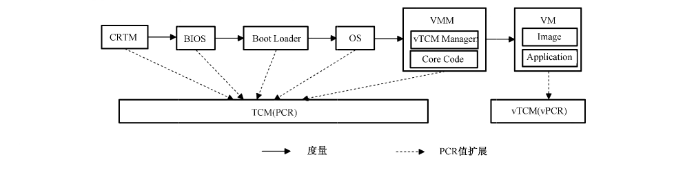

该活动主要包含以下三个阶段。

a） 在主机层的信任链传递：

1） 系统上电后，CRTM 度量 BIOS，并将度量结果扩展到 TCM 中的PCR里；

2） BIOS度量 Boot Loader，并将度量结果扩展到 TCM 中的PCR里；

3） Boot Loader 度量 OS，并将度量结果扩展到 TCM 中的PCR里。

b） 在 VMM层的信任链传递：

1） OS度量 VMM，并将度量结果扩展到 TCM 的PCR里；

VMM 度量部署在VMM 层的vTCM 管理器以及相关的核心代码，并将度量结果扩展到TCM 的PCR里。

c） 在VM层的信任链传递：

1） vTCM 管理器作为虚拟的可信度量根，将其度量值映射到vTCM实例中的vPCR［O］里；

2） vTCM度量VM启动过程涉及的组件和加载程序等，其流程和在主机可信启动过程类似，这里不做赘述。

E.2 增强型 TCM 的可信启动增强型TCM通过硬件连接到平台所在的芯片，即通过增强型 TCM的GPIO 硬件连线控制CPU的复位信号，在主板上电之后，增强型 TCM持续复位CPU 芯片，并读取主板 Flash上的部分或所有内容，与芯片内的预期值进行对比，确保 Flash 的数据是经过度量的，如果度量一致则继续运行，如果不一致则终止启动。

> 注：增强型 TCM是把CRTM 和 TCM 整合在一起的安全密码模块。

E.3 基于TCM建立设备与服务的可信连接ISO/IEC27071 将主要规范从设备到服务的可信连接安全要求，可信连接框架与组件包括：硬件安全模块、可信根（物理信任根、虚拟信任根）、身份证书、鉴别与密钥协商、完整性度量、远程证明、数据完整及抗抵赖，见图 E.2。

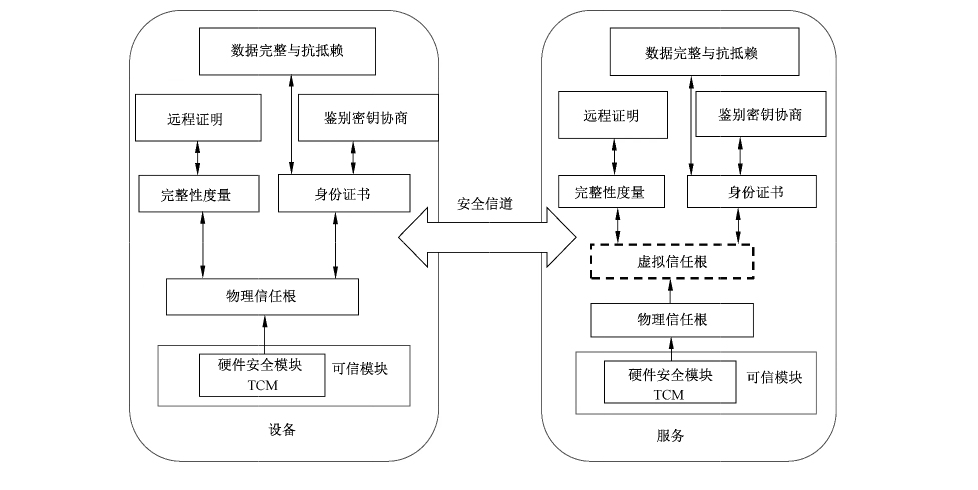

该标准中硬件安全模块（Hardware Security Modules, HSM）是一种防篡改的物理形式的安全模块，用于保护和管理密钥并提供密码计算功能。这种硬件安全模块可由可信密码模块（Trusted Cryp- tography Module,TCM）充当。

可信模块（Trusted Module, TM）在本应用案例中是一个抽象的概念，它由防篡改硬件安全模块（一个或多个）充当可信根，提供加密计算、随机数产生、安全存储等功能。

可信根（Root of Trust, ROT）是执行一项或多项安全特定功能（例如测量、存储、报告、验证和/或更新）的组件。可信根包括物理可信根和虚拟可信根。在实际环境中，物理可信根的不同功能可能由多个可信模块执行。本应用中，物理可信根基于固有信任的硬件安全模块组件，并且可提供以下功能：启动固件保护、安全测量固件、安全存储、设备身份鉴别、应用程序和数据隔离、环境远程证明、数据完整性和不可伪造性等。

虚拟可信根由物理可信根导出，其安全要求由正在制定过程中的ISO/IEC 27070给出。虚拟可信根提供与可信根相似的功能。在实际环境中，可同时存在多个基于一个物理可信根的虚拟可信根。

根据可信根提供的功能，可分RTM、RTR 和 RTS，可通过单个或多个模块。然而，其可信环境的构建、密钥库的安全性和加密算法应依赖于硬件安全模块。

身份证书是由可信方（特别是可信第三方）颁发给可信根的X.509证书。设备与服务的身份都应与可信根绑定。可信方（包括可信第三方）应向每个物理可信根和每个虚拟化可信根颁发证书。每个可信根（包括虚拟化可信根）都有一个身份。

鉴别密钥协商负责通过身份相关的密钥执行相互鉴别和密钥协商协议在设备和服务间建立安全信道。

完整性度量由完整性度量收集器（Integrity Measurement Collectors, IMC）和完整性度量验证程序（Integrity Measurement Verifiers, IMV）组成，其中IMC负责在远程证明的评估阶段收集完整性数据，IMV负责验证 IMC发送数据的完整性。

远程证明是设备（或服务）向远程设备（或服务）验证其硬件和软件配置的一种方法。远程证明的目标是使远程系统（挑战者）确定对另一个系统（证明者）平台完整性的信任程度。在可信连接中，应在设备和服务之间执行双向远程证明，以确保硬件和软件设置应满足对方的安全要求。远程证明有多种解决方案，包括直接匿名证明、基于属性的远程证明等。

为保护从传感器收集到的数据的完整性和不可伪造性，数据应有一个标签并由设备的身份相关私钥进行签名，验证者可验证数据的完整性和不可伪造性。传感器设备服务的参数应打包在数据对象中［即，数据对象应包含一个标签来标识该数据由谁（可信根绑定的身份）创建，并且设备的相关参数应存储在标识相关的数据对象中］，这将有助于服务处理数据。

可信连接标准将适用于移动设备、物联网设备等与服务（特别是云服务）之间建立安全可信的连接，防止恶意数据篡改（如换脸攻击）、防止用户被钓鱼攻击等。

## 参考文献

- ［1］ GB/T 18336（所有部分）信息技术 安全技术 信息技术安全评估准则

- ［2］ GB/T 22239 信息安全技术 网络安全等级保护基本要求

- ［3］ GB/T 29827 信息安全技术 可信计算规范 可信平台主板功能接口

- ［4］ GB/T 29828 信息安全技术 可信计算规范 可信连接架构

- ［5］ GB/T 30847.1 系统与软件工程 可信计算平台可信性度量 第1部分：概述与词汇

- ［6］ GB/T 30847.2 系统与软件工程 可信计算平台可信性度量 第2部分：信任链

- ［7］ GB/T 36639 信息安全技术 可信计算规范 服务器可信支撑平台

- ［8］ GB/T 37935 信息安全技术 可信计算规范 可信软件基

- ［9］ GB/T 38638 信息安全技术 可信计算 可信计算体系结构

- ［10］ GB/T 38644 信息安全技术 可信计算 可信连接测试方法

- ［11］ GM/T 0011 可信计算 可信密码支撑平台功能与接口规范

- ［12］ GM/T 0012 可信计算 可信密码模块接口规范

- ［13］ GM/T 0013 可信计算 可信密码模块接口符合性测试规范

- ［14］ ISO/IEC 11889-1 Information technology—Trusted Platform Module Library

Part 1:Architecture

- ［15］ ISO/IEC 11889-2 Information technology—Trusted Platform Module Library

Part 2:Structures

- ［16］ ISO/IEC 11889-3 Information technology—Trusted Platform Module Library

Part 3:Commands

- ［17］ ISO/IEC 27070 Information technology—Security techniques—Requirements for estab-

lishing virtualized roots of trust

- ［18］ ISO/IEC 27071 Information technologySecurity techniques—Security recommendations for

establishing trusted connections between devices and services
