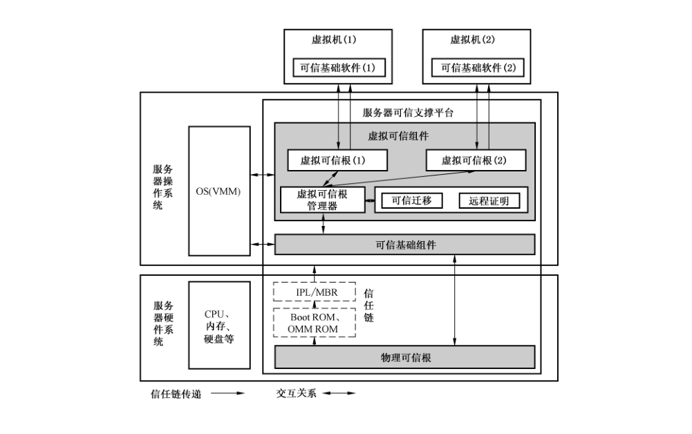
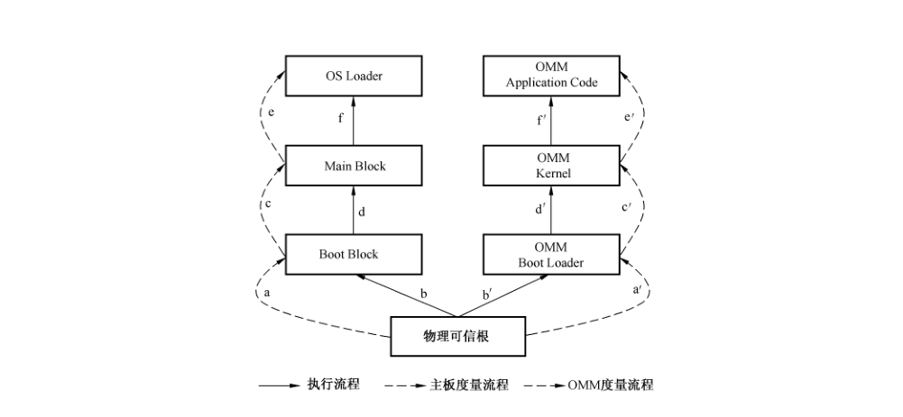
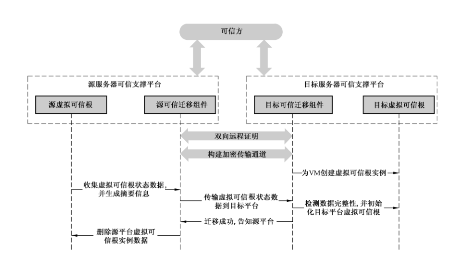
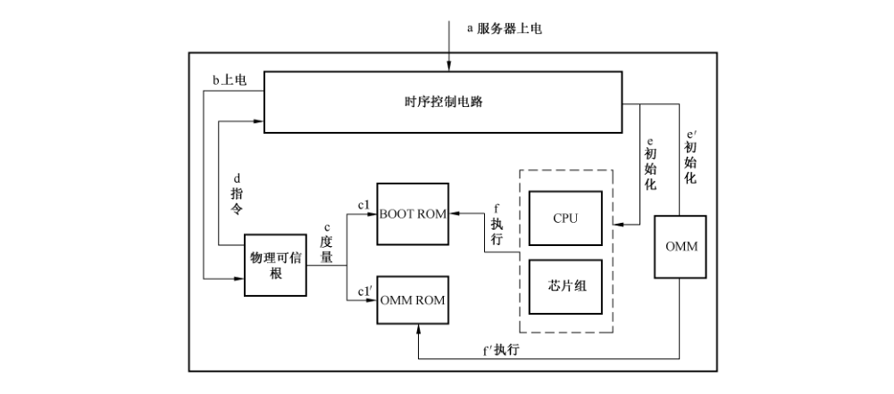

# GB/T 36639-2018 信息安全技术 可信计算规范 服务器可信支撑平台

> 来源：[GB/T 36639-2018 国家标准详情](https://openstd.samr.gov.cn/bzgk/std/newGbInfo?hcno=5131685F69DFEE21178675AF223B49E2)；发布日期：2018-09-17；实施日期：2019-04-01。
> PDF SHA-256：101212c1bdf920134981de30eedcdd11ac42130b142ca606f1e3bff9f1cc65a3。
> 转写说明：将官方 PDF 逐页渲染为图像并进行识别，对照全部 17 页原图校正文字、条款和 5 张图；省略封面、目录及页眉页脚。正式引用请核对原 PDF。

## 前言

本标准按照 GB/T 1.1—2009 给出的规则起草。

请注意本文件的某些内容可能涉及专利。本文件的发布机构不承担识别这些专利的责任。

本标准由全国信息安全标准化技术委员会（SAC/TC 260）提出并归口。

本标准主要起草单位：浪潮电子信息产业股份有限公司、曙光信息产业（北京）有限公司、中电科技（北京）有限公司、联想（北京）有限公司、中国船舶重工集团公司第七〇九研究所、华为技术有限公司、北京工业大学、阿里云计算有限公司、上海兆芯集成电路有限公司、南京百敖软件有限公司、武汉大学、大唐高鸿信安（浙江）信息科技有限公司、北京新云东方系统科技有限责任公司、北京可信华泰信息技术有限公司、华大半导体有限公司、中国电子技术标准化研究院、全球能源互联网研究院有限公司。

本标准主要起草人：刘刚、吴保锡、黄家明、张考华、肖思莹、杜克宏、徐明迪、申峰、付颖芳、李凯、赵江、张东、公维锋、孙永博、王冠、石源、于昇、宁振虎、沈楚楚、王惠莅、赵保华、刘冰、曹永超、陈小春、高瞻、张建标、胡俊、孙瑜、徐瑞雪、赵波、余发江、黄坚会、王志皓、安宁钰、薛刚汝、李业旺、赵祯龙、刘广庆、郝庄严、王涛、孙亮、肖鹏、周斌奇。

## 1 范围

本标准规定了服务器可信支撑平台的功能和安全性要求，并描述了服务器可信支撑平台的组成结构。

本标准适用于可信计算体系下服务器可信支撑平台的设计、生产、集成、管理和测试。

## 2 规范性引用文件

下列文件对于本文件的应用是必不可少的。凡是注日期的引用文件，仅注日期的版本适用于本文件。凡是不注日期的引用文件，其最新版本（包括所有的修改单）适用于本文件。

- GB/T 29827—2013 信息安全技术 可信计算规范 可信平台主板功能接口

- GB/T 29829—2013 信息安全技术 可信计算密码支撑平台功能与接口规范

## 3 术语和定义、缩略语

### 3.1 术语和定义

GB/T 29827—2013、GB/T 29829—2013 界定的以及下列术语和定义适用于本文件。

#### 3.1.1 服务器可信支撑平台 trusted support platform for server

构建在服务器硬件系统或者服务器硬件系统和操作系统的组合中，用于实现可信计算功能的支撑系统。

> 注：在虚拟化环境中，操作系统中还应包含虚拟机监控器。

#### 3.1.2 物理可信根 physical root of trust

用于为服务器可信支撑平台提供完整性度量、安全存储、可信报告以及密码服务等功能的模块，通常由硬件或硬件和固件组成。

#### 3.1.3 虚拟可信根 virtual root of trust

服务器可信支撑平台中为虚拟机提供的符合物理可信根功能要求、并具备迁移特性的组件。

#### 3.1.4 虚拟可信组件 virtual trusted component

操作系统中为虚拟机提供可信功能支撑的所有程序和数据的集合，包括虚拟可信根、虚拟可信根管理器和可信迁移组件等。

#### 3.1.5 可信基础组件 trusted basic component

为虚拟可信组件及服务器可信支撑平台外部实体提供访问和管理物理可信根能力的软件模块统称。

> 注：例如，TCM服务模块等。

#### 3.1.6 虚拟可信根管理器 manager for virtual root of trust

位于虚拟可信组件中，用于管理虚拟可信根生命周期，并保证虚拟可信根实例与虚拟机一一对应关系的组件。

> 注：虚拟可信根实例是虚拟机生命周期内，虚拟可信根为该虚拟机提供可信服务的实体。

#### 3.1.7 虚拟可信度量根 virtual root of trust for measurement

位于虚拟可信根中，用于可靠进行完整性度量的模块，是虚拟机完整性度量的起始点。

#### 3.1.8 带外管理模块 out-of-band management module

是服务器硬件系统上用于监控主板各功能部件状态的独立管理单元。

> 注：例如，x86 平台的 BMC、POWER 平台的 FSP 等。

#### 3.1.9 虚拟机监控器 virtual machine monitor

一种管理和虚拟化下层服务器硬件系统的软件，允许多个操作系统在隔离的环境中同时运行，并共享服务器硬件系统资源。

> 注：也可使用 Hypervisor，是相同概念。

### 3.2 缩略语

下列缩略语适用于本文件。

- BMC：基板管理控制器（baseboard management controller）
- EK：背书密钥（endorsement key）
- FSP：弹性服务处理器（flexible service processor）
- NVRAM：非易失性存储空间（nonvolatile RAM）
- OMM：带外管理模块（out-of-band management module）
- OMM ROM：带外管理模块非易失存储空间（out-of-band management module read only memory）
- TCM：可信密码模块（trusted cryptography module）
- TSM：可信服务模块（TCM service module）
- PCR：平台配置寄存储器（platform configuration register）
- RTM：可信度量根（root of trust for measurement）
- RTS：可信存储根（root of trust for storage）
- RTR：可信报告根（root of trust for report）
- VM：虚拟机（virtual machine）
- VMM：虚拟机监控器（virtual machine monitor）
- vEK：虚拟可信根背书密钥（virtual endorsement key）
- vPCRs：虚拟可信根平台配置寄存器（virtual platform configuration register）
- vRTM：虚拟可信度量根（virtual root of trust for measurement）
- vRTR：虚拟可信报告根（virtual root of trust for report）
- vRTS：虚拟可信存储根（virtual root of trust for storage）

## 4 组成结构

### 4.1 服务器可信支撑平台组成

服务器可信支撑平台主要由物理可信根，可信基础组件和虚拟可信组件等部分组成。其组成结构如图 1 所示。

根据服务器软硬件组成的不同，服务器可信支撑平台包含的部分也不同。其关系如下：

- 服务器硬件系统：应包含物理可信根；

- 非虚拟化环境（由服务器硬件系统和操作系统组成）：应包含物理可信根和可信基础组件；

- 虚拟化环境（由服务器硬件系统、操作系统和 VMM 组成）：应包含物理可信根、可信基础组件和虚拟可信组件。

### 4.2 服务器可信支撑平台与服务器硬件系统的关系

服务器可信支撑平台与服务器硬件系统的关系如下：

a） 服务器硬件系统应嵌入物理可信根，实现服务器硬件系统的信任链构建。

b） 服务器硬件系统中各模块的协作关系应满足如下要求：

- 服务器硬件系统信任链建立的起点是物理可信根；

- OMM 启动过程应以物理可信根为信任起点构建信任链；

- Boot ROM 及 OMM ROM 中应实现对各阶段的程序模块和组件进行度量，实现信任链传递。

### 4.3 服务器可信支撑平台与服务器操作系统的关系

服务器可信支撑平台与服务器操作系统的关系如下：

a） 应包含可信基础组件，实现从服务器硬件系统到操作系统的信任链传递，并为其他可信组件及服务器其他实体提供可信服务。可信基础组件应满足如下要求：

- 实现与物理可信根相对应的功能及接口规范；

- 接收并传递来自服务器硬件系统的信任关系到操作系统；

- 提供访问和管理物理可信根相关可信接口；

- 维护服务器硬件系统与操作系统的信任关系。

b） 在虚拟化环境下，还应包含虚拟可信组件。虚拟可信组件应满足如下要求：

- 由虚拟可信根管理器、虚拟可信根、可信迁移、远程证明等组成；

- 将信任链从操作系统传递到虚拟机；

- 为虚拟机提供可信根服务，使得虚拟机中的可信基础组件无差异地使用虚拟可信根服务；

- 确保虚拟机与虚拟可信根实例的一对一绑定关系。

## 5 总体要求

### 5.1 概述

服务器可信支撑平台中，密码算法是基础，物理可信根和虚拟可信根是关键部件，完整性度量、存储及报告是基本可信机制。

### 5.2 物理可信根

物理可信根应满足如下要求：

a） 是服务器完整性度量的起点；

b） 符合相关技术规范的要求，包含但不限于 GB/T 29829—2013中 4.1.3、GB/T 29827—2013中第5章的要求；

c） 其硬件载体应通过国家相关部门的许可。

### 5.3 虚拟可信根

虚拟可信根应满足如下要求：

a） 是虚拟机完整性度量的起点；

b） 实现物理可信根相匹配的可信功能及接口；

c） 其实例仅能为一个固定的虚拟机提供可信服务。

### 5.4 可信基础组件

可信基础组件的实现应与物理可信根相匹配，如物理可信根为TCM，则可信基础组件为TCM服务模块（TSM）。

### 5.5 完整性度量、存储及报告

服务器完整性度量、存储及报告应满足如下要求：

a） 符合GB/T 29829—2013 中 4.3.1.2的要求；

b） 服务器中相关部件的完整性度量值应存储于物理可信根中；

c） 虚拟机中相关部件的完整性度量值应存储于虚拟可信根中。

### 5.6 密码算法

本标准凡涉及密码算法的相关内容，按国家有关法规实施；凡涉及采用密码技术解决保密性、完整性、真实性、不可否认性需求的应遵循密码相关国家标准和行业标准。

## 6 服务器硬件系统可信功能要求

### 6.1 信任链建立流程

服务器硬件系统信任链从上电到物理可信根启动后，操作系统内核加载之前的建立流程见图 2。

流程如下：

a） 服务器硬件系统启动时，物理可信根应作为信任链传递的起点；

b） 由物理可信根中的RTM 度量 OMM Boot Loader，生成的度量结果存储于物理可信根中，并存储度量日志；

c） OMM Boot Loader 加载并执行；

d） OMM Boot Loader 中的度量执行点对 OMM Kernel 进行完整性度量，OMM Kernel 中度量执行点对应用程序及服务进行完整性度量；

e） 由物理可信根中的RTM 度量Boot ROM 中的初始引导模块（Boot Block），生成度量结果存储于物理可信根中，并存储度量日志；

f） Boot Rom 中的 Boot Block 加载并执行；

g） Boot Block 中的度量执行点对 Main Block 进行完整性度量，Main Block 中的度量执行点对服务器外设和 OS Loader 进行完整性度量。

### 6.2 度量要求

#### 6.2.1 OMM 度量

OMM 度量应满足如下要求：

a） 度量内容至少包括：OMM 引导程序、OMM 内核、OMM 核心应用程序；

b） 将度量值存储于物理可信根约定的PCR 中；

c） 提供度量日志查询接口。

#### 6.2.2 初始度量

基于 GB/T 29827—2013 设计和实现的服务器主板，宜根据附录 A 的要求实现服务器主板时序控制。

## 7 虚拟可信组件

### 7.1 对服务器硬件系统的要求

在启用虚拟可信组件之前，服务器硬件系统应满足如下要求：

a） 为虚拟化层中虚拟可信组件与非虚拟可信组件提供隔离支撑机制。

b） 物理可信根应具备如下条件：

1） 已部署背书密钥；

2） 已部署存储根密钥和其他附属存储密钥；

3）提供安全存储空间，用以存储密钥、证书和其他秘密数据。

c） 服务器硬件系统信任链已扩展至虚拟可信组件。

### 7.2 虚拟可信根

#### 7.2.1 功能要求

除5.3所描述的要求外，虚拟可信根还应满足如下要求：

a） 具备唯一标识。

b） 包含可用于证实其对应 VM 可信状态的信息。

c） 提供与物理可信根相同的服务接口。

d） 虚拟可信根中的虚拟可信报告 vRTR、虚拟可信存储根 vRTS、虚拟可信根度量 vRTM 应基于物理可信根密码机制来实现。

e） 对虚拟可信根中敏感信息和状态数据提供保护机制。

f） 若虚拟可信根基于软件实现，还应满足如下要求：

1） 在约定的位置定义扩展资源（如 vPCRs）的分配方式和要求。

2） 提供防回滚机制，防止虚拟可信根在非授权情况下回滚到历史状态。

3） 具备数据备份恢复功能。

4） 具备版本升级功能。

5） 虚拟可信根在版本升级过程中应完成如下操作：

- 维护并确保永久性状态数据的可用性和完整性；

- 维护并确保敏感数据的机密性与完整性。

#### 7.2.2 生命周期管理

虚拟可信根的生命周期管理是指在 VM 创建、启动、运行、关闭、挂起、销毁、迁移等七种状态切换时对虚拟可信根的运行状态的管理，如图 3 所示。

虚拟可信根的生命周期管理的功能要求包括：

a） 创建阶段，应完成如下操作：

1） 对虚拟可信根及状态信息进行初始化，为虚拟可信根分配资源。

2） 若虚拟可信根基于软件实现，还应完成如下操作：

- 初始化虚拟可信根生产商信息和默认标志位等基本信息；

- 为虚拟可信根创建数据加密密钥。

b） 启动阶段，应完成如下操作：

1） 启动虚拟可信根前，验证虚拟可信根及其数据的完整性；

2） 启动虚拟可信根前，验证本次启动时所使用数据的有效性；

3） 启动虚拟可信根后，使虚拟可信根功能接口可用；

4） 虚拟机启动过程中，存储 vRTM 的度量结果到虚拟可信根 vPCRs。

c） 运行阶段，应提供如下功能：

1） 提供物理可信根运行时所有对外功能；

2） 及时备份存储虚拟可信根状态数据。

d） 关闭阶段，应完成如下操作：

1） 对虚拟可信根实施常规可信根关闭操作；

2） 保存虚拟可信根中相关资源、状态信息，禁用虚拟可信根；

3） 记录虚拟可信根关闭时的时间；

4） 确保虚拟可信根敏感信息的机密性；

5） 提供虚拟可信根时钟计数器有效性保障机制。

e） 迁移阶段，应完成如下操作：

1） 迁移开始前，保存虚拟可信根状态数据；

2） 迁移结束后，销毁虚拟可信根，并释放其所使用的资源。

f） 销毁阶段，应销毁虚拟机对应虚拟可信根及其包含的所有数据。

g） 挂起阶段，应以安全的方式存储虚拟可信根当前状态数据，包括 PCR 值、虚拟内存中相关数据、敏感信息等。

#### 7.2.3 虚拟可信度量根

VM 初始化代码在执行前应通过虚拟可信度量根对其进行完整性度量，并扩展度量值到虚拟可信根中的 vPCR 中。虚拟可信度量根实现方式可参考附录 B。

#### 7.2.4 密钥与证书要求

虚拟可信根密钥管理应满足如下要求：

a） 虚拟可信根背书密钥应是可认证的；

b） 若虚拟可信根基于软件实现，还应提供防止虚拟可信根密钥被复制的机制。

#### 7.2.5 安全性要求

虚拟可信根应满足以下安全性要求：

a） 当虚拟可信根运行或关闭时，应保护虚拟可信根的敏感信息，防止篡改或暴露；

b） 当虚拟可信根不再被使用时，应加密存储虚拟可信根中的数据；

c） 虚拟可信根运行期间，应提供访问控制机制，防止非授权访问虚拟可信根敏感信息；

d） 将虚拟可信根与非可信组件进行隔离；

e） 虚拟可信根中敏感信息离开受保护区域时（如数据备份、迁移等场景），应被加密；

f） 确保 VM 只能通过 VM 中的可信基础组件接口访问虚拟可信根。

### 7.3 虚拟可信根管理器

#### 7.3.1 功能要求

虚拟可信根管理器是负责管理同一虚拟可信组件中所有虚拟可信根实例的组件，并建立和维护虚拟可信根与虚拟机一一绑定的对应关系。虚拟可信根管理器应满足如下要求：

a） 虚拟可信根管理器应具备如下功能：

1） 提供证明虚拟可信根身份真实性的机制。

2） 提供物理可信根访问控制机制，防止虚拟可信根访问物理可信根中敏感信息或受限资源。

3） 根据用户配置，为新建的虚拟机创建一个虚拟可信根实例。

4） 当虚拟机销毁时，删除该虚拟机对应的虚拟可信根实例。

5） 当虚拟机迁移时，删除该虚拟机在源服务器可信支撑平台中对应的虚拟可信根实例。

6） 若虚拟可信根基于软件实现，还应具备如下功能：

- 在虚拟可信根创建时，负责初始化虚拟可信根中的基本信息（如厂商信息等）；

- 为虚拟可信根中的 vEK 提供可被认证的机制；

- 维护其所在服务器可信支撑平台上所有虚拟可信根当前数据的完整性信息。

b） 虚拟可信根管理器设计、实现和使用过程中应满足如下要求：

1） 确保同一服务器可信支撑平台上只有一个虚拟可信根管理器；

2） 是可被认证的。

#### 7.3.2 密钥与证书要求

密钥与证书应满足如下要求：

a） 虚拟可信根管理器标识密钥应由物理可信根产生；

b） 虚拟可信根管理器数据加密密钥应由物理可信根保护。

#### 7.3.3 安全性要求

虚拟可信根管理器应满足如下安全要求：

a） 基于服务器可信支撑平台信任链机制保障虚拟可信根管理器的完整性；

b） 提供虚拟可信根管理器敏感信息保护机制；

c） 支持远程证明；

d） 提供评估虚拟可信根管理器及虚拟可信组件的身份合法性及可信状态的机制。

### 7.4 可信迁移

可信迁移组件用于在虚拟机迁移时同步迁移虚拟可信根，并确保虚拟可信根在迁移过程中的机密性和完整性，可信迁移组件应满足如下要求：

a） 可被外部实体认证的；

b） 提供虚拟可信根数据安全性保障机制，确保可信迁移过程中虚拟可信根数据的安全性；

c） 提供防回滚机制，防止迁移过程中回滚虚拟可信根状态；

d） 提供虚拟可信根状态数据加解密机制。

### 7.5 远程证明

远程证明组件用于负责向外部实体证明所在平台可信状态。参与远程证明过程的角色包括远程证明验证者、远程证明组件等。远程证明组件用于生成并发送本平台可信报告及身份信息给远程证明验证者；远程证明验证者是远程证明请求的发起方，并根据远程证明组件提供的可信报告及身份信息验证平台身份合法性及可信状态。服务器可信支撑平台远程证明应满足如下要求：

a） 远程证明过程中证明的信息包括平台身份信息、平台完整性报告。

b） 远程证明流程应符合 GB/T 29829—2013 中 4.3.1.4 的要求。

c） 远程证明过程中所使用的证书应符合物理可信根相关规范要求。

d） 在虚拟化环境下，还应满足如下要求：

1） 具备检测虚拟机监控器是否运行于服务器硬件系统之上的能力；

2） 虚拟机监控器提供的证明信息中应不包含任何虚拟可信根的敏感信息。

## 8 虚拟可信根可信迁移

### 8.1 概述

虚拟可信根可信迁移特指在服务器可信支撑平台上，虚拟机迁移时，其对应的虚拟可信根迁移的过程。虚拟可信根可信迁移应满足以下基本要求：

a） 参与虚拟可信根可信迁移的角色包括源服务器可信支撑平台、目标服务器可信支撑平台、可信方等；

b） 参与虚拟可信根可信迁移的服务器可信支撑平台中的可信迁移组件应满足 7.4 要求；

c） 虚拟可信根可信迁移过程中远程证明应满足 7.5 要求；

d） 可信迁移应仅在虚拟可信根对应的 VM 迁移时触发；

e） 虚拟可信根迁出平台为源服务器可信支撑平台；

f） 虚拟可信根迁入平台为目标服务器可信支撑平台；

g） 虚拟可信根迁移前，应先完成源服务器可信支撑平台和目标服务器可信支撑平台间的双向远程证明，确保参与可信迁移过程的双方均是可信的；

h） 迁移过程中同一时刻虚拟可信根只能在一个服务器可信支撑平台上运行。

### 8.2 可信迁移流程

虚拟可信根可信迁移基本流程如图 4 所示。

流程如下：

a） 源可信迁移组件、目标可信迁移组件与可信方协同，完成源服务器可信支撑平台与目标服务器可信支撑平台的双向远程证明；

b） 虚拟可信根可信迁移目标平台接收到可信迁移请求后，源服务器可信支撑平台与目标服务器可信支撑平台建立安全传输通道；

c） 目标服务器可信支撑平台创建一个空的虚拟可信根实例，准备接收源服务器可信支撑平台发送的虚拟可信根相关数据；

d） 源服务器可信支撑平台收集源虚拟可信根实例状态数据（如 NVRAM、密钥、授权等数据）；

e） 源服务器可信支撑平台通过安全通道传输源虚拟可信根状态数据到目的服务器可信支撑平台；

f） 目标服务器可信支撑平台检查状态数据的完整性；检查通过后，使用接收到的状态数据初始化并启动虚拟可信根，并与对应的虚拟机绑定；

g） 待目标服务器可信支撑平台完成虚拟机与虚拟可信根绑定后，源服务器可信支撑平台删除源虚拟可信根实例。

## 附录 A（规范性附录）服务器时序控制

### A.1 概述

基于 GB/T 29827—2013 设计和实现的服务器可信支撑平台，宜根据其 8.1 的要求对物理可信根和服务器主板及其他部件之间的上电及开机启动时序实施控制，实现服务器上电后，在 OMM 和 CPU 启动前，由物理可信根先对 OMM ROM 中的 Boot Loader 和 Boot ROM 中的 Boot Block 实现完整性度量。物理可信根中的 RTM 度量完 OMM ROM 和 Boot ROM 后，物理可信根发出控制信号启动 CPU、芯片组等通用设备。服务器硬件时序控制逻辑如图 A.1 所示。

### A.2 服务器主板上电时序

服务器主板上电时序为：

a） 服务器上电。

b） 时序控制电路给物理可信根上电，物理可信根自我初始化。

c） 物理可信根执行 RTM，RTM 度量 ROM 数据：

1） RTM 可靠地读取 OMM ROM，并度量其中的 Boot Loader 代码的完整性；

2） RTM 可靠地读取 BOOT ROM，并度量其中的 Boot Block 代码的完整性。

d） 物理可信根根据 RTM 对 ROM 的度量结果，向时序控制电路输出对应的指令。

e） 时序控制电路根据物理可信根的输出指令来判决是否给 OMM 和 CPU 系统上电。

f） OMM 上电后，开始执行 OMM ROM 代码。

g） CPU 上电后，开始执行 BOOT ROM 代码。

### A.3 服务器主板复位时序

服务器主板复位时序为：

a） CPU 系统触发复位后应通知物理可信根；

b） 由物理可信根中的 RTM 可靠地读取 BOOT ROM，并度量其中的 Boot Block 代码的完整性；

c） 物理可信根把 RTM 对 BOOT ROM 的度量结果，向时序控制电路输出对应的指令；

d） 时序控制电路根据物理可信根的度量反馈结果来判决是否进行 CPU 系统的复位；

e） CPU 开始执行 BOOT ROM 代码。

### A.4 服务器 OMM 复位时序

服务器 OMM 复位时序为：

a） OMM 系统触发复位后应通知物理可信根；

b） 由物理可信根中的 RTM 可靠地读取 OMM ROM 的 Boot Loader 代码；

c） 物理可信根根据 RTM 对 OMM ROM 的度量结果，向时序控制电路输出对应的指令；

d） 时序控制电路根据物理可信根发送的指令来决定是否进行 OMM 系统的复位；

e） OMM 开始执行 OMM ROM 代码。

## 附录 B（资料性附录）虚拟可信度量根

以下给出三种虚拟可信根的实现方法，供参考使用：

a） 如果 VM 采用模拟固件启动，可在模拟固件中嵌入虚拟可信度量根，VM 通过模拟可信固件启动。该方法的参考实现如下：

1） 虚拟机监控器为 VM 启动提供包含 vBIOS 和虚拟可信度量根虚拟引导固件环境；

2） vBIOS 包含从 vRTM 到 VM 启动阶段信任链传递所需要的其他组件；

3） vRTM 扩展度量结果到虚拟可信根的 vPCRs 中；

4） 虚拟可信根的 vPCRs 中包含 vRTM 的度量结果；

5） 虚拟可信根 vPCRs 的分配方式应遵循相应物理可信根 PCRs 分配要求；

6） 为模拟可信固件配备安全策略，并提供保护这些安全策略的机制，防止非授权篡改。

b） 在 VM 启动前，可通过一个可信组件对 VM 启动序列进行完整性度量。该方法的参考实现如下：

1） VMM 或操作系统中的其他可信组件初始化一个封装层，将 VM 置于封装层中启动；该组件的可信状态是虚拟可信根的一部分；

2） VMM 应度量为 VM 初始化启动环境的组件，并扩展度量值到虚拟可信根的 vPCRs 中；

3） 虚拟可信度量根的度量对象包含虚拟机启动前的所有组件，直到虚拟机接收信任链，并可以继续传递信任链；

4） 度量内容应包括虚拟机的配置数据。

c） 在 VM 启动前和运行过程中，通过 VMM 或操作系统中的其他可信组件，为 VM 提供动态的可信度量根服务，并在 VM 启动前使用该组件完成对可执行的 VM 镜像文件的度量。该方法的参考实现如下：

1） 如果 VM 没有模拟固件或其他类似组件，启动 VM 的代码应为 VM 构建并初始化一个封装层，将 VM 置于封装层中启动；

2） 虚拟机监控器应度量为 VM 构建启动环境的程序，并扩展度量值到虚拟可信根的 vPCRs 中；

3） 虚拟可信组件中与 VM 关联的证书应包含如何填充虚拟可信根 PCRs 的定义。

## 参考文献

- ［1］ GB/T 21028—2007 信息安全技术 服务器安全技术要求
