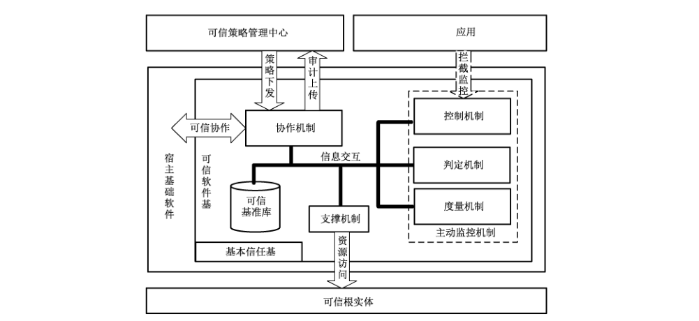
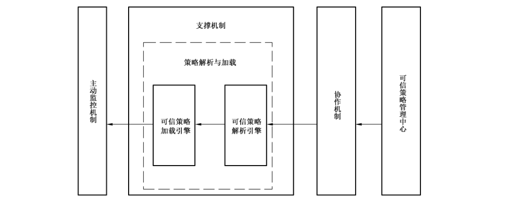
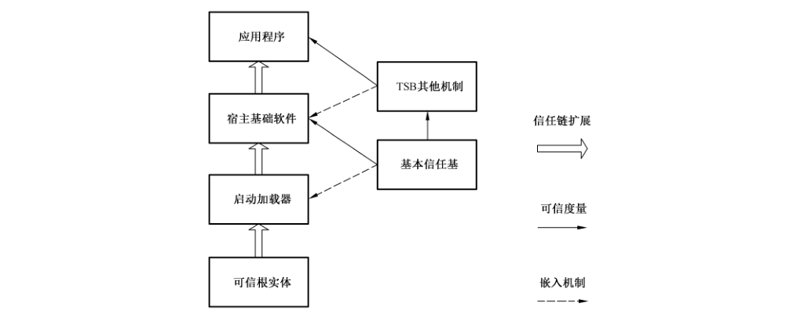
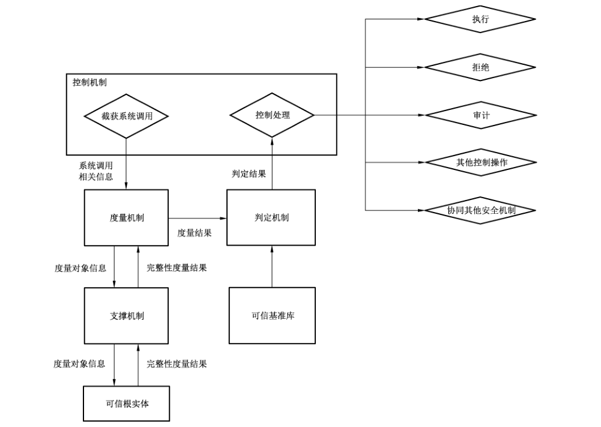
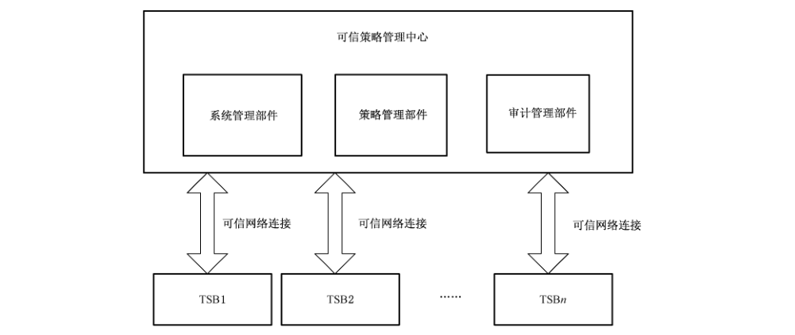

# GB/T 37935-2019 信息安全技术 可信计算规范 可信软件基

> 来源：[GB/T 37935-2019 国家标准详情](https://openstd.samr.gov.cn/bzgk/std/newGbInfo?hcno=9A508E08DAC94D384AF7CFA6204485E3)；封面发布日期：2019-08-30；实施日期：2020-03-01。
> PDF SHA-256：9cf8b030e050e33cfa4abe291a8459241d12a8ecf95a599f7a9f183b3a1f589d。
> 转写说明：对照官方 PDF 全部 25 页的页面图像校正文字、图示、表格和附录 B 接口定义；省略封面、目录、页眉、页脚和页码，合并跨页内容。原文中的 `OTEHR`、`STARTEGY`、`acition`、`retrun` 等拼写及 B.2.3.2、B.2.3.4 的重复定义照录。正式引用请核对原 PDF。

## 前言

本标准按照 GB/T 1.1—2009给出的规则起草。

请注意本文件的某些内容可能涉及专利。本文件的发布机构不承担识别这些专利的责任。

本标准由全国信息安全标准化技术委员会（SAC/TC 260）提出并归口。

本标准起草单位：北京可信华泰信息技术有限公司、北京工业大学、中标软件有限公司、全球能源互联网研究院有限公司、中国人民大学、中国船舶重工集团公司第七〇九研究所、北京新云东方系统科技有限责任公司、华大半导体有限公司、北京得安信息技术有限公司、浪潮（北京）电子信息产业有限公司。

本标准主要起草人：孙瑜、宁振虎、胡俊、赵保华、董军平、沈楚楚、吴欣、黄坚会、洪宇、张建标、王涛、梁鹏、宋元、周晓刚、宗栋瑞、田健生、王志皓、徐宁、马洪富、杨紫东、王昱波、徐明迪、张敏健、王振宇、黄磊、王大海、夏攀。

## 1 范围

本标准规定了可信软件基的功能结构、工作流程、保障要求和交互接口规范。

本标准适用于可信软件基的设计、生产和测评。

## 2 规范性引用文件

下列文件对于本文件的应用是必不可少的。凡是注日期的引用文件，仅注日期的版本适用于本文件。凡是不注日期的引用文件，其最新版本（包括所有的修改单）适用于本文件。

- GB/T 29827—2013 信息安全技术 可信计算规范 可信平台主板功能接口

- GB/T 29828—2013 信息安全技术 可信计算规范 可信连接架构

- GB/T 29829—2013 信息安全技术 可信计算密码支撑平台功能与接口规范

- IETF RFC 5209 网络终端评估：概述和要求［Network Endpoint Assessment （NEA）：Overview and Requirements］

## 3 术语和定义

GB/T 29827—2013、GB/T 29828—2013、GB/T 29829—2013界定的以及下列术语和定义适用于本文件。为了便于使用，以下重复列出了 GB/T 29829—2013中的一些术语和定义。

### 3.1 可信计算平台 trusted computing platform

构建在计算系统中，用于实现可信计算功能的支撑系统。

> ［GB/T 29829—2013，定义 3.1.1］

### 3.2 宿主基础软件 legacy fundamental software

可信计算平台中实现常规功能部分（如操作系统）软件的总称。

### 3.3 可信软件基 trusted software base

为可信计算平台的可信性提供支持的软件元素的集合。

### 3.4 基本信任基 fundamental trusted software

负责宿主基础软件的可信启动及可信软件基其他部件完整性度量的部件。

### 3.5 可信基准值 trusted baseline value

表示对象可信特性的数据，作为判断对象是否可信的参照。

### 3.6 可信基准库 trusted baseline value database

可信基准值的集合。

### 3.7 可信策略管理中心 trusted policy management center

对可信软件基的策略制定、下发、维护、存储等集中管理的平台。

### 3.8 策略语言 policy language

用于描述安全需求的编程语言，由可信软件基管理、解释和执行。

### 3.9 动态度量 dynamic measurement

在系统运行过程中，对系统完整性和行为安全性进行测量和评估的可信度量方法。

### 3.10 系统控制点 system control point

嵌入到宿主基础软件，截获和控制系统行为的执行代码。

> 注：系统控制点包括文件读写、进程创建销毁、设备访问、网络访问等操作。

### 3.11 主动监控机制 active monitoring mechanism

实现对应用的系统调用行为的拦截，并进行主动度量和主动控制处理的功能机制。

### 3.12 可信根实体 entity of root of trust

用于支撑可信计算平台信任链建立和传递的可对外提供完整性度量、安全存储、密码计算等服务的功能模块。

> 注：可信根实体包括 TPCM、TCM、TPM等。

### 3.13 可信根实体服务模块 ERT service module

支持可信根实体的软件模块，为实体外部提供访问所需的软件接口。

> 注：可信根实体服务模块包括 TSM、TSS 等。

## 4 缩略语

下列缩略语适用于本文件。

ERT：可信根实体（Entity of Root of Trust）  
TCM：可信密码模块（Trusted Cryptography Module）  
TPCM：可信平台控制模块（Trusted Platform Control Module）  
TPM：可信平台模块（Trusted Platform Module）  
TSB：可信软件基（Trusted Software Base）  
TSM：TCM 服务模块（TCM Service Module）  
TSS：可信软件栈（TPM Software Stack）

## 5 总体结构

TSB 由基本信任基、主动监控机制（包括控制机制、度量机制、判定机制）、可信基准库、支撑机制和协作机制组成。

基本信任基在TSB启动过程中实现对其他机制的验证和加载。主动监控机制拦截应用的系统调用，在ERT 支撑下实现对系统调用相关的主体、客体、操作和环境的主动度量和控制。TSB通过支撑机制实现对 ERT 资源的访问；TSB通过协作机制实现与可信策略管理中心的策略和审计信息交互（可信策略管理中心参见附录 A），以及与其他计算平台之间的可信协作。

TSB 交互接口包括内部交互接口和外部交互接口。内部交互接口支持TSB 各机制之间的交互（内部交互接口设计示例参见附录 B）；外部交互接口支持TSB 与ERT、宿主基础软件和可信策略管理中心之间的交互。

凡涉及采用密码技术解决机密性、完整性、真实性、不可否认性需求的均遵循密码相关国家标准和行业标准。

图1展示了 TSB 的功能结构。



## 6 功能模块

### 6.1 基本信任基

基本信任基是 TSB 中最基础的部件，是具备基本的度量能力的软件的最小集合。度量能力体现为基本信任基负责对 TSB 的其他部分实施完整性度量。基本信任基应不依赖 TSB 的其他部分，也不依赖宿主基础软件，只需利用 ERT 和硬件平台就能够正常工作。

> 注：在嵌入式可信计算平台中，基本信任基可以以固件的形式存在。

系统启动过程中，基本信任基先于 TSB 其他机制加载，完成对TSB 其他机制的度量工作，将信任链传递给 TSB 其他机制。度量操作通过调用 ERT提供的度量接口实现。

基本信任基中存储着两类基准值信息，分别是宿主基础软件启动过程中度量对象的基准值和 TSB其他机制（控制机制、度量机制、判定机制、可信基准库、支撑机制和协作机制）的基准值。

### 6.2 控制机制

控制机制是主动监控机制发挥作用的入口，依据控制策略主动截获应用的系统行为，并根据判定结果实施控制。控制策略包含系统控制点的范围、系统控制点获取信息和控制机制响应判定结果的处理方式等。控制过程包括拦截系统调用行为，获取行为相关的主体、客体、操作、环境等信息，依据控制策略将信息发送给度量机制进行度量，并接受判定机制的判定结果，进行相关的控制。

### 6.3 度量机制

度量机制依据度量策略对度量对象进行度量。度量策略由度量对象、度量方法等组成。度量对象包括程序、数据和行为等。度量方法包括度量对象中度量点的设置、度量的时机、度量的算法等。度量过程包括依据度量策略对控制机制传递的相关的主体、客体、操作、环境等信息进行度量，并将度量结果发送至判定机制。

### 6.4 判定机制

判定机制依据判定策略对度量结果进行判定。判定策略包括度量结果与基准值的比较方式、不同度量结果的权重值、综合计算方法等。判定过程包括依据判定策略利用可信基准库和度量结果进行综合判定，并将判定结果发送控制机制。

### 6.5 可信基准库

可信基准库提供可信基准值（包括基准对象和基准内容等信息）存储、查询和更新等功能。可信基准库分为驻留基准库和即时基准库两种类型。驻留基准库长期保存基准信息，其基准信息一般存放在非易失性存储器（如硬盘）中；即时基准库提供实时的基准信息，方便快速查询，基准信息一般存放在内存中。

### 6.6 支撑机制

#### 6.6.1 可信根实体访问和管理

支撑机制中对 ERT 的访问和管理，由 ERT 服务模块实现，ERT 服务模块依据 ERT 相关标准实现，包括访问和管理 ERT 的上下文信息管理、会话管理、并发访问调度管理、权限管理等功能。

#### 6.6.2 应用可信支撑

TSB 支撑机制为应用提供完整性度量、数据加解密、可信认证等调用接口，接口应符合 GB/T 29829—2013 的要求。

#### 6.6.3 可信策略管理

支撑机制支持策略的解析、加载功能。可信策略管理流程如图2所示。



可信策略由通过鉴别和授权的可信策略管理中心下发，经协作机制获取，也可直接本地配置。

可信策略采用策略语言编写。可信策略解析引擎实现策略的解析，然后经由可信策略加载引擎加载，由主动监控机制执行。

### 6.7 协作机制

#### 6.7.1 策略接收

协作机制接收可信策略管理中心传送的可信策略，分发给支撑机制进行解析和加载。

#### 6.7.2 审计上传

协作机制接收 TSB 运行时审计数据，上传至可信策略管理中心。

#### 6.7.3 平台间可信协作

可信计算平台之间通过可信连接机制进行可信协作，接口应符合可信连接相关标准。对于 TPCM支撑的可信计算平台，应符合 GB/T 29828—2013 的要求；对于 TPM 支撑的可信计算平台，应符合IETF RFC 5209的要求。

## 7 交互接口

### 7.1 内部交互接口

#### 7.1.1 控制机制与度量机制交互接口

控制机制获取系统调用行为的相关主体、客体、操作、环境等信息，并通过控制机制与度量机制交互接口传递给度量机制。本接口由度量机制提供。

#### 7.1.2 度量机制与判定机制交互接口

度量机制通过度量机制与判定机制交互接口将度量结果发送至判定机制。本接口由判定机制提供。

#### 7.1.3 判定机制与可信基准库交互接口

判定机制通过判定机制与可信基准库交互接口向可信基准库查询信息。本接口由可信基准库提供。

#### 7.1.4 协作机制与可信基准库的交互接口

协作机制通过协作机制与可信基准库交互接口进行可信基准值的查询、更新、添加、删除等操作。

本接口由可信基准库提供。

#### 7.1.5 判定机制与控制机制交互接口

判定机制通过控制机制与判定机制交互接口将判定结果发送给控制机制，控制机制根据判定结果产生控制措施。本接口由控制机制提供。

#### 7.1.6 度量机制与支撑机制之间的交互接口

度量机制通过支撑机制接口实现对可信根实体的访问。本接口由支撑机制提供。

### 7.2 外部交互接口

#### 7.2.1 与可信根实体的交互接口

##### 7.2.1.1 策略管理类接口

对于具有主动控制能力的可信根实体，TSB 通过策略管理接口实现对可信根实体进行度量策略管理以及控制策略管理。策略管理接口主要包括可信平台启动前，为启动代码、基板控制器代码等提供度量控制策略；可信平台启动过程中，为设备串号、设备固件代码、操作系统内核、操作系统引导程序等提供可信度量管理策略；可信平台系统运行时，为系统内核、关键数据、运行进程、应用程序等所驻留的内存区域提供动态监控策略。

##### 7.2.1.2 密码服务类接口

可信根实体通过密码服务接口为 TSB 提供密钥管理、数据加解密、数字签名验签、密码杂凑运算、真随机数生成等功能服务，包括安全算法的选择、安全协议的选择、安全算法参数的设定、密钥生成、密钥下载、密钥更新、密钥信息绑定和解绑、密钥使用、密钥清除以及密钥迁移等。

##### 7.2.1.3 系统管理类接口

TSB 通过系统管理接口实现对可信根实体系统资源的访问和管理。系统管理指令接口包括 PCR管理指令、NV管理指令接口等。对于具有主动控制能力的可信根实体，系统管理指令接口还包括用户管理、日志管理等，其中用户管理功能包括增加、删除、查找、锁定用户、修改用户的权限、属性等管理提供接口；日志管理功能包括日志的生成、归类、存储、更新、查询、删除、权限保护以及可信报告等。

#### 7.2.2 与宿主基础软件交互接口

##### 7.2.2.1 设备操作类接口

当宿主基础软件中发生设备操作时，TSB 的控制机制通过设备操作类接口获取设备操作的主体、客体及操作内容等信息。设备操作包括：加载、卸载、读操作、写操作等。

##### 7.2.2.2 文件操作类接口

当宿主基础软件中发生对文件操作时，TSB 的控制机制通过文件操作类接口获取文件操作的主体、客体及操作内容等信息。文件操作包括：创建、删除、关闭、读操作、写操作、文件属性更改、可执行文件运行等。

##### 7.2.2.3 网络操作类接口

当宿主基础软件中发生网络操作时，可信软件基的控制机制通过网络操作类接口获取网络操作的主体、客体及操作内容等信息。网络操作包括：连接建立、报文发送、报文接收等。

##### 7.2.2.4 进程操作接口

当宿主基础软件中发生对进程操作时，TSB 的控制机制通过进程操作类接口获取进程操作的主体、客体及操作内容等信息。进程操作包括：进程的新建、调度、销毁、权限设置等。

##### 7.2.2.5 内存映射操作接口

当宿主基础软件中发生内存映射操作时，TSB 的控制机制通过内存映射操作接口获取内存映射操作的主体、客体及操作内容等信息。

#### 7.2.3 与可信策略管理中心交互接口

##### 7.2.3.1 平台注册接口

通过平台注册接口，可信计算平台在可信策略管理中心进行注册。

##### 7.2.3.2 策略管理接口

可信策略管理中心通过策略管理接口向可信计算平台中的 TSB 下发可信策略。

##### 7.2.3.3 审计信息接口

可信计算平台中的TSB 向可信策略管理中心上报审计信息。

##### 7.2.3.4 信息查询类接口

信息查询类接口向可信策略管理中心提供 TSB 相关信息查询功能，包括 TSB 基本信息、TSB状态信息、TSB 可信报告等。

##### 7.2.3.5 异常报警信息接口

TSB 通过异常报警信息接口向可信策略管理中心提供异常报警信息，包括信任链异常报警、主动度量异常报警和访问控制异常报警等。

##### 7.2.3.6 基准值更新接口

TSB 通过基准值更新接口从可信策略管理中心获取更新的基准值。

## 8 工作流程

### 8.1 系统启动过程中的工作流程

在系统启动过程中，TSB在 ERT 的支撑下完成对宿主基础软件核心及自身的完整性度量。具体工作流程如图3所示。



ERT负责起始的可信链构建，度量并验证启动加载器的可信性，将可信扩展至启动加载器；基本信任基嵌入到启动加载器中，除了对宿主基础软件的核心部分进行完整性度量外，还对嵌入在宿主基础软件的TSB 其他机制（包括主动监控机制、协作机制、支撑机制和可信基准库）进行完整性度量；最后，TSB 的主动监控机制利用可信基准库在应用启动时进行完整性度量。

### 8.2 系统运行过程中的工作流程

如图4所示，在系统运行过程中，TSB 在 ERT 的支撑下实现运行时的动态度量。



系统运行时的TSB工作流程应按照下述步骤进行：

a） 控制机制依据控制策略截获系统调用。

b） 控制机制获取系统调用相关的主体、客体、操作、环境信息，并发送给度量机制。

c） 度量机制依据度量策略，利用控制机制发送的信息，生成度量对象信息（度量的位置、参数、度量的方法、度量时机等）。

d） 度量机制通过支撑机制将度量对象信息传递给 ERT，并调用 ERT 进行度量。在度量过程中ERT 作为度量的执行者，协同其他安全机制将完整性度量结果反馈给度量机制。

e） 度量机制生成度量结果，并发送至判定机制。

f） 判定机制依据判定策略访问可信基准库，获取相应可信基准值。

g） 判定机制依据判定策略，利用可信基准值对度量结果进行综合判定，并将判定结果反馈给控制机制。

h） 控制机制根据判定机制返回的判定结果进行处置，包括：

1） 允许该系统调用的执行；

2） 拒绝该系统调用；

3） 审计该系统调用；

4） 其他控制操作；

5） 协同其他安全机制等。

## 9 自身安全要求

### 9.1 TSB 交互接口的安全性

TSB 的接口应具有明确的参数定义，对外接口的所有参数均有诸如最大长度限制等合法参数说明以及验证流程。

TSB 应提供对外部调用实体身份鉴别的功能。

TSB 应提供防止外部调用通过非法接口参数干扰内部模块行为的措施。

### 9.2 可信根实体对 TSB 的保障

#### 9.2.1 数据机密性保护

可信根实体应以安全方式存储所有用于可信度量、可信存储和可信报告的密钥及其他敏感信息，并保障密钥和敏感信息的使用安全。

#### 9.2.2 数据完整性保护

可信根实体应对可信基准值、可信策略及可信审计数据等进行完整性保护，防止被非法篡改。

#### 9.2.3 TSB 执行环境的保护

对于具有主动控制能力的可信根实体，可信根实体应对TSB 执行环境中的程序代码段、内核模块、共享库等进行完整性保护，防止被非法篡改。

## 附录 A（资料性附录）可信策略管理中心

可信策略管理中心是负责可信软件基可信策略制定、下发、维护和存储等的统一管理平台，主要功能包括 TSB 系统管理、策略管理和审计管理。可信策略管理的功能部件（如图 A.1 所示）主要有：

- 系统管理部件：对各可信计算平台的 TSB 信息进行管理。TSB 信息包括基本信息、运行信息、已配置策略信息和日志等。
- 策略管理部件：对可信策略进行生成、修改、下发、删除等全生命周期的管理。
- 审计管理部件：对 TSB 运行中的可信策略相关信息进行审计，并对审计记录进行存储、备份和查询等操作。



在可信策略管理中心对系统管理员、安全管理员和审计管理员进行身份鉴别。系统管理员负责节点管理和策略管理工作，安全管理员负责定义安全级别以及授权，审计管理员通过特定的命令或操作界面进行策略审计操作。

## 附录 B（资料性附录）内部交互接口设计示例

### B.1 基础定义

#### B.1.1 度量结果数据结构

```c
typedef struct tsb_measure_result
{
    int result;
    int length;
    const char value[0];
} TSBMeasureResult;
```

成员变量：

- `result`：度量结果。0 表示度量成功，非 0 表示度量失败（错误码）。度量成功并不表示度量值正确（是期待的值），度量是否正确由判定机制决定。
- `length`：度量结果长度，如果度量成功，就会由度量结果 `length` 指定结果长度。
- `value[0]`：度量结果数据，可变长度数组。

#### B.1.2 基准值数据结构

```c
typedef struct tsb_reference_value{
    int length;
    const void *value;
} TSBReferenceValue;
```

成员变量：

- `length`：基准值长度。
- `*value`：基准值。

#### B.1.3 度量结果返回值定义

度量结果返回值定义见表 B.1。

**表 B.1 度量返回值列表**

| 度量结果 | 返回值 | 含义 |
| --- | --- | --- |
| MEASURE_RESULT_PASS | 0 | 度量成功 |
| MEASURE_RESULT_NO_MEASURE | 1 | 度量函数不存在 |
| MEASURE_RESULT_MISSING_PARAM | 2 | 缺少参数 |
| MEASURE_RESULT_OTHER_ERROR | 3 | 其他错误 |

#### B.1.4 基准库返回值定义

基准库返回值定义见表 B.2。

**表 B.2 基准库返回值列表**

| 基准库返回结果 | 返回值 | 含义 |
| --- | --- | --- |
| TSB_REFERENCE_OTEHR_ERROR | -1 | 其他错误 |
| TSB_REFERENCE_VALUE_DUPLICATED | -2 | 键值重复 |
| TSB_REFERENCE_INVALID_KEY | -3 | 无效键值 |
| TSB_REFERENCE_INVALID_VALUE | -4 | 无效值 |

#### B.1.5 判定结果返回值定义

判定结果返回值定义见表 B.3。

**表 B.3 判定结果返回值列表**

| 判定结果 | 返回值 | 含义 |
| --- | --- | --- |
| ESTIMATE_RESULT_PASS | 0 | 判定通过 |
| ESTIMATE_RESULT_NOT_EXIST | -1 | 判定结果不存在 |
| ESTIMATE_RESULT_INCONSISTENT | 1 | 判定结果与基准不一致 |
| ESTIMATE_RESULT_NO_REFERENCE | 2 | 无基础值 |
| ESTIMATE_RESULT_NOT_DEFINE | 3 | 判定函数未定义 |

#### B.1.6 控制模式定义

控制模式定义见表 B.4。

**表 B.4 控制模式定义列表**

| 控制模式 | 返回值 | 含义 |
| --- | --- | --- |
| CONTROL_MODE_PASS | 0 | 通过，不进行控制 |
| CONTROL_MODE_STOP | 0x1 | 不准许执行 |
| CONTROL_MODE_REPORT | 0x2 | 报告 |
| CONTROL_MODE_REDIRECT | 0x4 | 重定向 |

#### B.1.7 控制策略返回值定义

控制策略返回值定义见表 B.5。

**表 B.5 控制策略返回值列表**

| 控制策略返回结果 | 返回值 | 含义 |
| --- | --- | --- |
| CONTROL_STARTEGY_SUCCESS | 0 | 执行成功 |
| CONTROL_STARTEGY_NOT_DEFINE | 1 | 策略机制函数未找到 |
| CONTROL_STARTEGY_OTHER_ERROR | 2 | 策略机制函数失败 |

#### B.1.8 可信软件基上下文数据结构

##### B.1.8.1 数据结构

```c
typedef struct tsb_context
{
    int (*get_int_value)(TSBContext *context, const char *var_name, long *pvalue);
    int (*get_pointer_value)(TSBContext *context, const char *var_name, const void **pvalue);
    int (*set_measure_result)(TSBContext *context, const char *value, int length);
    TSBMeasureResult *(*get_measure_result_by_name)(TSBContext *context, const char *measure_name);
    TSBMeasureResult *(*get_measure_result_by_index)(TSBContext *context, int index);
    int (*get_estimate_result_by_name)(TSBContext *context, const char *estimate_name);
    int (*get_estimate_result_by_index)(TSBContext *context, int index);
} TSBContext;
```

成员函数：

- `get_int_value`：读取环境变量，从环境上下文读取长整数变量。
- `get_pointer_value`：读取环境变量，从环境上下文读取指针变量。
- `set_measure_result`：设置度量结果。
- `get_measure_result_by_name`：读取度量结果。
- `get_measure_result_by_index`：读取度量结果。
- `get_estimate_result_by_name`：读取判定结果。
- `get_estimate_result_by_index`：读取判定结果。

##### B.1.8.2 函数操作

###### B.1.8.2.1 get_int_value

定义：`int get_int_value(TSBContext *context, const char *var_name, long *pvalue)`

输入参数：`context`，环境上下文；`var_name`，指定变量名称；`pvalue`，值保存到 pvalue 指向的区域。

返回值：0，成功；非 0（错误码），失败。

###### B.1.8.2.2 get_pointer_value

定义：`int get_pointer_value(TSBContext *context, const char *var_name, const void **pvalue)`

输入参数：`context`，环境上下文；`var_name`，指定变量名称；`pvalue`，值保存到 pvalue 指向的区域。

返回值：0，成功；非 0（错误码），失败。

###### B.1.8.2.3 set_measure_result

定义：`int set_measure_result(TSBContext *context, const char *value, int length)`

输入参数：`context`，环境上下文；`*value`，指向度量结果；`length`，度量结果的长度。

返回值：0，成功；非 0（错误码），失败。

###### B.1.8.2.4 get_measure_result_by_name

定义：`TSBMeasureResult *(*get_measure_result_by_name)(TSBContext *context, const char *measure_name)`

输入参数：`*context`，环境上下文；`*measure_name`，度量名称。

返回值：度量结果；如果度量结果不存在，则返回空值。

###### B.1.8.2.5 get_measure_result_by_index

定义：`TSBMeasureResult *(*get_measure_result_by_index)(TSBContext *context, int index)`

输入参数：`*context`，环境上下文；`index`，度量名称。

返回值：度量结果；如果判定结果不存在，则返回 -1。

###### B.1.8.2.6 get_estimate_result_by_name

定义：`int (*get_estimate_result_by_name)(TSBContext *context, const char *estimate_name)`

输入参数：`*context`，环境上下文；`*estimate_name`，判定名称。

返回值：判定结果；如果判定结果不存在，则返回 -1。

###### B.1.8.2.7 get_estimate_result_by_index

定义：`int (*get_estimate_result_by_index)(TSBContext *context, int index)`

输入参数：`*context`，环境上下文；`index`，序号。

返回值：判定结果；如果判定结果不存在，则返回 -1。

### B.2 各功能机制提供的接口

#### B.2.1 度量机制提供的交互接口

接口定义：`int tsb_measure(TSBContext *context, const char *measure_name, const char *acition_name)`

输入参数：`*context`，软件基上下文；`*measure_name`，度量函数名称；`acition_name`，本次度量行为的名称。

输出参数：`context`，软件基上下文。

返回参数：度量成功返回 0；度量失败返回非 0 错误码。

#### B.2.2 判定机制提供的交互接口

接口定义：`int tsb_estimate(TSBContext *context, const char *estimate_name, const char *acition_name)`

输入参数：`*context`，软件基上下文；`*estimate_name`，判定函数名称；`acition_name`，本次判定行为的名称。

输出参数：`context`，软件基上下文。

返回参数：判定正确返回 0；判定失败返回非 0 错误码。

#### B.2.3 可信基准库提供的交互接口

##### B.2.3.1 添加一个基准值

定义：`int tsb_reference_add(const char *category, void *key, int key_length, void *value, int value_length)`

输入参数：`category`，基准值类别；`key`，键值；`key_length`，键值长度；`value`，基准值；`value_length`，值的长度。

返回参数：成功返回 0；失败返回非 0 错误码。

##### B.2.3.2 删除键值及其对应的基准值

定义：`int tsb_reference_remove_key(const char *category, void *key, int key_length)`

输入参数：`category`，基准值类别；`key`，键值；`key_length`，键值长度。

返回参数：删除的基准值个数；出错返回错误码。

##### B.2.3.3 删除一个基准值

定义：`int tsb_reference_remove_value(const char *category, void *key, int key_length, void *value, int value_length);`

输入参数：`category`，基准值类别；`key`，键值；`key_length`，键值长度；`value`，基准值；`value_length`，基准值的长度。

返回参数：返回删除的基准值个数；出错返回错误码。

##### B.2.3.4 删除键值及其对应的基准值

定义：`int tsb_reference_remove_key(const char *category, void *key, int key_length);`

输入参数：`category`，基准值类别；`key`，键值；`key_length`，键值长度。

返回参数：返回删除的基准值个数；出错返回错误码。

##### B.2.3.5 匹配一个基准值

定义：`int tsb_reference_match_value(const char *category, void *key, int key_length, void *value, int value_length);`

输入参数：`category`，基准值类别；`key`，键值；`key_length`，键值长度；`value`，值；`value_length`，值的长度。

返回参数：成功返回 0；失败返回错误码。

##### B.2.3.6 按键值查询

定义：`int tsb_reference_query_by_key(const char *category, void *key, int key_length, int max_number, TSBReferenceValue *value, int *retrun_number, int *total_number);`

输入参数：`category`，基准值类别；`key`，键值；`key_length`，键值长度；`max_number`，最大返回值个数；`value`，值；`retrun_number`，返回的基准值个数；`total_number`，输出匹配的基准值个数。

返回参数：成功返回 0；失败返回错误码。

#### B.2.4 控制机制提供交互接口

定义：`int tsb_control_strategy(TSBContext *context, const char *strategy_name, int *control_mode);`

输入参数：`context`，软件基上下文；`strategy_name`，控制策略函数名称；`*control_mode`，控制模式结果指针。

输出参数：`control_mode`，控制策略函数返回控制模式，保存到 control_mode 指向的区域。

返回参数：执行成功返回 0；判定失败返回非 0 错误码。

## 参考文献

- ［1］ ISO/IEC 11889:2015（all parts） Information technology—Trusted platform module library
