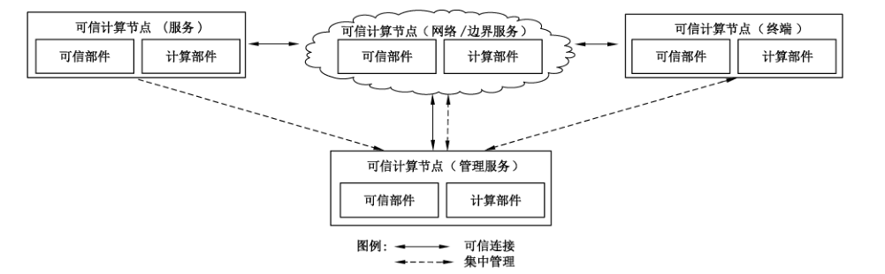
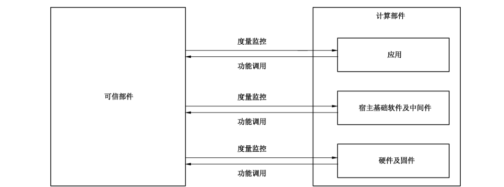
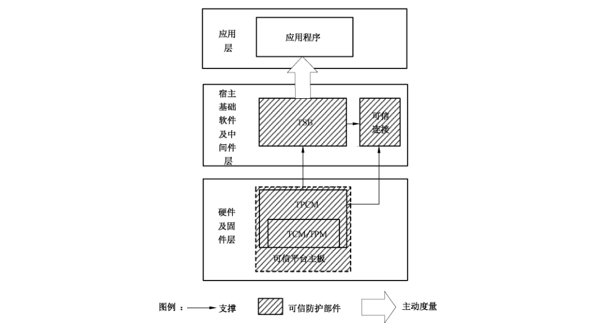
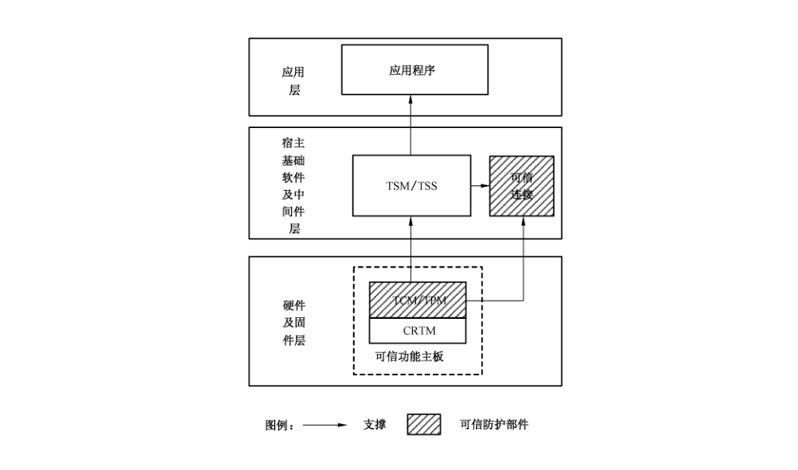
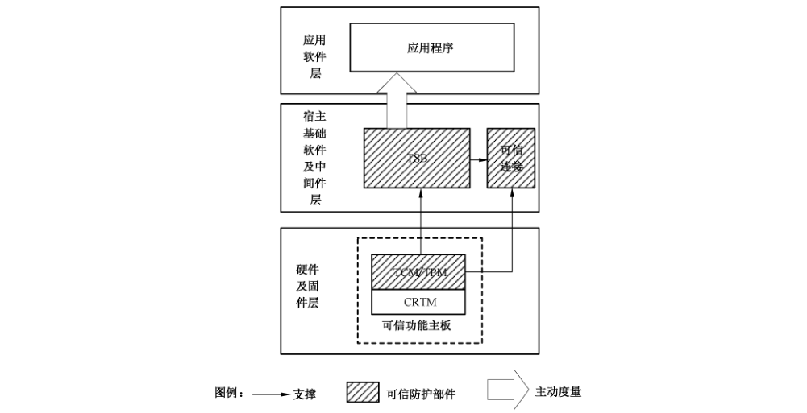

# GB/T 38638-2020 信息安全技术 可信计算 可信计算体系结构

> 来源：[GB/T 38638-2020 国家标准详情](https://openstd.samr.gov.cn/bzgk/std/newGbInfo?hcno=76B0E3C2D7898AF1DDB00E01C2DA88B0)；发布日期：2020-04-28；实施日期：2020-11-01。
> PDF SHA-256：67f0bc9caeac042b5125e4982b30763d72acec8660c30888f7f5ad34e9ae82f4。
> 转写说明：按页渲染 PDF 并进行图像识别，对照全部 9 页原图校正文字和 5 张图；省略封面、目录、页眉和页脚。正式引用请核对原 PDF。

## 前言

本标准按照 GB/T 1.1—2009 给出的规则起草。

请注意本文件的某些内容可能涉及专利。本文件的发布机构不承担识别这些专利的责任。

本标准由全国信息安全标准化技术委员会（SAC/TC 260）提出并归口。

本标准起草单位：全球能源互联网研究院有限公司、北京可信华泰信息技术有限公司、北京工业大学、北京新云东方系统科技有限责任公司、中国电子技术标准化研究院、中标软件有限公司、中电科技（北京）有限公司、北京旋极信息技术股份有限公司、国民技术股份有限公司、华大半导体有限公司、北京华胜天成信息技术发展有限公司、上海兆芯集成电路有限公司、浪潮（北京）电子信息产业有限公司、南京百敖软件有限公司、中国船舶重工集团公司第七〇九研究所、北京得安信息技术有限公司等。

本标准主要起草人：高昆仑、赵保华、安宁钰、杨建军、孙炜、张建标、于昇、宁振虎、董军平、胡俊、王惠莅、梁潇、王冠、韩兆刚、刘鑫、孙瑜、刘贤刚、陈小春、王志皓、孙亮、王薪达、施光源、吴保锡、赵江、赵勇、黄坚会、王树才、任春卉、徐宁、肖思莹、李强、徐明迪、李凯、沈昀、吕昇亮、谢立华、沈楚楚、孔凡玉。

## 1 范围

本标准规定了可信计算的体系结构、可信部件及完整性度量模式以及可信计算节点类型。

本标准适用于可信计算体系的设计、开发和应用。

## 2 规范性引用文件

下列文件对于本文件的应用是必不可少的。凡是注日期的引用文件，仅注日期的版本适用于本文件。凡是不注日期的引用文件，其最新版本（包括所有的修改单）适用于本文件。

- GB/T 29827—2013 信息安全技术 可信计算规范 可信平台主板功能接口
- GB/T 29828—2013 信息安全技术 可信计算规范 可信连接架构
- GB/T 29829—2013 信息安全技术 可信计算密码支撑平台功能与接口规范
- GB/T 36639—2018 信息安全技术 可信计算规范 服务器可信支撑平台
- GB/T 37935—2019 信息安全技术 可信计算规范 可信软件基
- ISO/IEC 11889:2015 信息技术 可信平台模块库（Information technology—Trusted platform module library）

## 3 术语和定义

GB/T 29827—2013、GB/T 29828—2013、GB/T 29829—2013、GB/T 36639—2018 和 GB/T 37935—2019 界定的以及下列术语和定义适用于本文件。为了便于使用，以下重复列出了 GB/T 29827—2013、GB/T 29829—2013、GB/T 37935—2019 中的某些术语和定义。

### 3.1 可信计算节点 trusted computing node

由可信部件和计算部件共同构成、具备计算和防护并行特征的计算节点。

### 3.2 可信密码模块 trusted cryptography module

可信计算平台的硬件模块，为可信计算平台提供密码运算功能，具有受保护的存储空间。

［GB/T 29829—2013，定义 3.1.7］

### 3.3 可信平台控制模块 trusted platform control module

一种集成在可信计算中，用于建立和保障信任源点的硬件核心模块，为可信计算提供完整性度量、安全存储、可信报告及密码服务等功能。

［GB/T 29827—2013，定义 3.20］

### 3.4 可信平台主板 trusted main board

由可信平台控制模块和其他通用部件组成，可实现从开机到操作系统内核加载前的平台可信引导功能。

### 3.5 可信软件基 trusted software base

为可信计算平台的可信性提供支持的软件元素的集合。

［GB/T 37935—2019，定义 3.3］

### 3.6 信任链 trusted chain

在计算节点启动和运行过程中，使用完整性度量方法在部件之间所建立的信任传递关系。

［GB/T 29829—2013，定义 3.1.13］

## 4 缩略语

下列缩略语适用于本文件。

- BIOS：基本输入输出系统（Basic Input Output System）
- CRTM：核心可信度量根（Core Root of Trust for Measurement）
- TCM：可信密码模块（Trusted Cryptography Module）
- TPCM：可信平台控制模块（Trusted Platform Control Module）
- TPM：可信平台模块（Trusted Platform Module）
- TSB：可信软件基（Trusted Software Base）
- TSM：TCM 服务模块（TCM Service Module）
- TSS：可信软件栈（TCG Software Stack）

## 5 可信计算的体系结构

可信计算是指计算的同时进行安全防护，计算全程可测可控，不被干扰，使计算结果总是与预期一致。可信计算的体系由可信计算节点及其间的可信连接构成，为其所在的网络环境提供相应等级的安全保障，如图 1 所示。依据网络环境中节点的功能，可信计算节点可根据其所处业务环境部署不同功能的应用程序，可信计算节点包括可信计算节点（服务）和可信计算节点（终端），不同类型的可信计算节点采用相同的组成结构。不同类型的可信节点可独立或相互间通过可信连接构成可信计算体系，其中可信计算节点（管理服务）为实现对其所在网络内各类可信计算节点进行集中管理的一种特殊的可信计算节点（服务）。

可信计算节点由可信部件和计算部件组成。计算部件为程序提供计算、存储和网络资源，主要包括通用硬件和固件、操作系统及中间件、应用程序和网络等部分构成。

可信部件主要对计算部件进行度量和监控，其中监控功能依据不同的完整性度量模式为可选功能，可信部件同时提供密码算法、平台身份可信、平台数据安全保护等可信计算功能调用的支撑。

可信计算节点中的计算系统部件和可信部件逻辑相互独立，形成具备计算功能和防护功能并存的双体系结构，如图 2 所示。

可信部件主要包括：可信密码模块（TCM）或可信平台模块（TPM）、可信平台控制模块（TPCM）、可信平台主板、可信软件基（TSB）和可信连接。可信部件具有三种工作模式，即裁决度量模式、报告度量模式和混合度量模式，三种工作模式依赖不同的可信部件。

## 6 可信部件及完整性度量模式

### 6.1 可信部件

#### 6.1.1 可信密码模块/可信平台模块

可信密码模块（TCM）/可信平台模块（TPM）应提供密码算法支撑，具有完整性度量、可信存储及可信报告等功能。

TCM 功能及接口应符合 GB/T 29829—2013。

TPM 功能及接口应符合 ISO/IEC 11889:2015。

#### 6.1.2 可信平台控制模块

可信平台控制模块（TPCM）在 TCM/TPM 的支撑下应具备主动度量和控制功能。TPCM 应是一个逻辑独立或者物理独立的实体，可采用独立的模块或物理封装、通过 IP 核或固件方式与 TCM/TPM 集成、虚拟化实现实体等形式。

#### 6.1.3 可信平台主板

可信平台主板是集成了 TPCM 的计算机主板，将 TPCM 作为信任根建立信任链，并提供 TPCM 与其他硬件的连接。

可信平台主板组成结构及功能接口应符合 GB/T 29827—2013。

#### 6.1.4 可信软件基

可信软件基（TSB）实现对运行于宿主基础软件中应用程序的监控和度量。

TSB 组成结构及功能接口应符合 GB/T 37935—2019。

#### 6.1.5 可信连接

可信连接实现可信计算节点接入网络时的身份鉴别和平台鉴别，包括用户身份鉴别、平台身份鉴别和平台完整性评估，确保只有可信计算节点才能访问网络。

可信连接具体构成及功能接口应符合 GB/T 29828—2013。

### 6.2 完整性度量模式

#### 6.2.1 裁决度量模式

可信部件的裁决度量模式如图 3 所示，参与部件应包括 TCM/TPM、TPCM、可信平台主板和 TSB。

在硬件及固件层，TPCM 应为可信计算节点中第一个运行的部件，作为可信计算节点的信任根，应用 TCM/TPM 或其他的密码算法和完整性度量功能对 BIOS、宿主基础软件等计算部件主动发起完整性度量操作，并依据度量结果进行主动裁决和控制。

在宿主基础软件及中间件层，TPCM 向上层提供使用 TPCM 基础资源的支撑，TSB 通过调用 TPCM 的相关接口对应用软件进行主动监控和主动度量，对应用软件完全透明，保证应用软件启动时和运行中的可信。可信计算节点在接入网络时，对于支持可信连接的网络部署，可信连接调用 TSB 和 TPCM 提供的完整性度量结果，进行相应操作。

#### 6.2.2 报告度量模式

可信部件的报告度量模式如图 4 所示，参与部件应为 TCM/TPM。

在硬件及固件层，BIOS 中的 CRTM 构成可信计算节点的信任根，并通过 TSM/TSS 等向上层提供使用 TCM/TPM 等基础资源的支撑。在信任链建立过程中，各计算部件代码应调用 TCM/TPM 等的完整性度量接口对信任链建立的下一环节进行完整性度量，并报告度量结果，由应用程序或其使用者进行裁决。

在宿主软件及中间件层，由应用层的应用程序调用 TSM/TSS 等相关接口进行完整性度量，并给出完整性报告，由应用程序使用者进行裁决。对于支持可信连接的网络部署，可信连接调用 TSM/TSS 等提供的接口进行完整性度量，并根据度量结果进行相应操作。

#### 6.2.3 混合度量模式

可信部件的混合度量模式如图 5 所示，参与部件应为 TCM/TPM 和 TSB。

信任链建立过程中，在硬件及固件层的 TCM/TPM 工作于报告度量模式，在宿主基础软件及中间件层，TSB 通过调用 TCM/TPM 相关接口工作于裁决度量模式。

## 7 可信计算节点类型

### 7.1 可信计算节点（终端）

可信计算节点（终端）包括可信桌面终端和可信嵌入式终端等可信计算节点。

可信桌面终端应在实现终端安全的同时充分考虑操作的便利性，宜采用报告度量模式，对于应用于关键信息基础设施中业务功能较为固定的可信计算节点（终端）宜采用裁决度量模式，在其应用领域的安全要求允许时可采用报告度量模式或混合度量模式。

可信嵌入式终端大多业务功能相对固定，且处于无人值守状态，宜采用裁决度量模式，在其应用领域的安全要求允许时可采用报告度量模式或混合度量模式，手持终端属于特殊的可信嵌入式终端，可采用报告度量模式。

### 7.2 可信计算节点（服务）

可信计算节点（服务）包括信息系统中实现各类服务的节点，包括实现 WEB 服务、存储等功能的服务器节点，实现路由、交换等功能的网络节点以及实现安全功能的安全设备等。

可信计算节点（服务）宜采用裁决度量模式，在其应用领域的安全要求允许时可采用报告度量模式或混合度量模式。在云计算环境下，可信部件应满足运行环境的需求。
