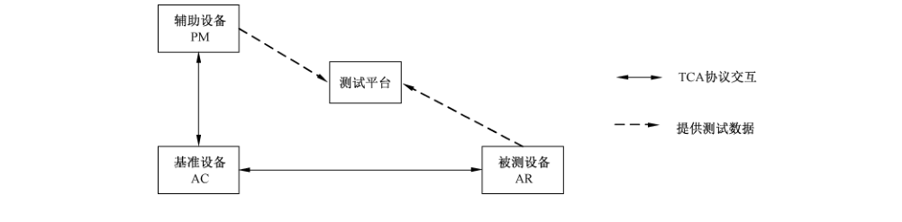
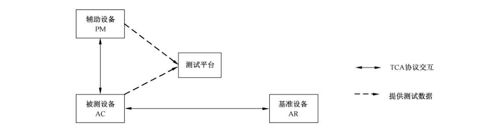
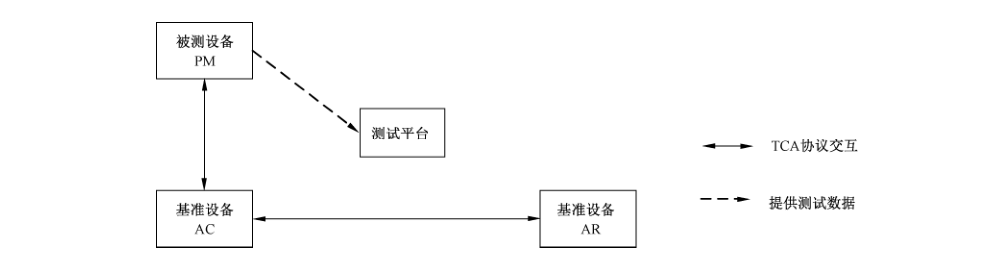

# GB/T 38644-2020 信息安全技术 可信计算 可信连接测试方法

> 来源：[GB/T 38644-2020 国家标准详情](https://openstd.samr.gov.cn/bzgk/std/newGbInfo?hcno=313886B1D7FDCD5FFAEECAA4C6417A52)；封面发布日期：2020-04-28；实施日期：2020-11-01。
> 官方 PDF SHA-256：086f0291bd0b7ada38efe6abdb00dead4f83268a1bc9ebe75aa06fcc81e41d84。
> 转写说明：对照官方在线预览全部 24 页图像逐页校正，合并跨页段落和续表，省略封面、目录、页眉、页脚和页码。正式引用请核对原标准页面。

## 前言

本标准按照 GB/T 1.1—2009 给出的规则起草。

本标准由全国信息安全标准化技术委员会（SAC/TC 260）提出并归口。

本标准起草单位：西安西电捷通无线网络通信股份有限公司、无线网络安全技术国家工程实验室、中关村无线网络安全产业联盟（WAPI 产业联盟）、北京工业大学、国家密码管理局商用密码检测中心、国家信息技术安全研究中心、北京计算机技术及应用研究所、中国通用技术研究院、天津市电子机电产品检测中心、国家无线电监测中心检测中心、中国电子科技集团公司第十五研究所、西安邮电大学、工业和信息化部宽带无线 IP 标准工作组。

本标准主要起草人：曹军、李琴、杜志强、芦亮、潘琪、赖英旭、黄振海、颜湘、王冠、李冬、吕春梅、铁满霞、刘科伟、刘景莉、王月辉、张国强、张玲、井经涛、熊克琦、赵晓荣、罗鹏、吴冬宇、林德欣、彭潇、方华、于光明、朱正美、郑东、赵慧、吴冬宇、郑骊、黄奎刚。

## 引言

GB/T 29828—2013 规范了基于三元对等架构的可信连接架构（Trusted Connect Architecture，TCA），本标准针对基于 TCA 的可信网络连接协议提出一套测试要求及方法。

本文件的发布机构提请注意，声明符合本文件时，可能涉及第6章、第7章、第8章与ZL201410255349.X、US15/309,861、JP2016-567036、EP15807391.6、KR10-2016-7034816等相关的专利的使用。

本文件的发布机构对于该专利的真实性、有效性和范围无任何立场。

该专利持有人已向本文件的发布机构保证，他愿意同任何申请人在合理且无歧视的条款和条件下，就专利授权许可进行谈判。该专利持有人的声明已在本文件发布机构备案。相关信息可通过以下联系方式获得：

- 专利持有人：西安西电捷通无线网络通信股份有限公司
- 地址：西安市高新区科技二路 68 号西安软件园秦风阁 A201
- 联系人：冯玉晨
- 邮政编码：710075
- 电子邮件：ipri@iwncomm.com
- 电话：029-87607836
- 传真：029-87607829
- 网址：http://www.iwncomm.com

请注意除上述专利外，本文件的某些内容仍可能涉及专利。本文件的发布机构不承担识别这些专利的责任。

## 1 范围

本标准依据GB/T 29828—2013，规定了可信网络连接协议以及所涉及的密码算法的测试要求及方法，包括如下内容：

a） 可信网络连接协议涉及的协议交互机制符合性测试要求及方法；

b） 可信网络连接协议涉及的密码算法实现的正确性测试要求及方法。

本标准适用于符合GB/T 29828—2013的可信连接设备的测试，用于检测其密码算法及基于可信连接架构 TCA 的可信网络连接协议的实现是否符合要求。

## 2 规范性引用文件

下列文件对于本文件的应用是必不可少的。凡是注日期的引用文件，仅注日期的版本适用于本文件。凡是不注日期的引用文件，其最新版本（包括所有的修改单）适用于本文件。

- GB/T 15843.3 信息技术 安全技术 实体鉴别 第 3 部分：采用数字签名技术的机制

- GB/T 20518 信息安全技术 公钥基础设施 数字证书格式

- GB/T 28455—2012 信息安全技术 引入可信第三方的实体鉴别及接入架构规范

- GB/T 29828—2013 信息安全技术 可信计算规范 可信连接架构

- GB/T 32905 信息安全技术 SM3 密码杂凑算法

- GB/T 32907 信息安全技术 SM4 分组密码算法

- GB/T 32915 信息安全技术 二元序列随机性检测方法

- GB/T 32918（所有部分）信息安全技术 SM2椭圆曲线公钥密码算法

- GB/T 35276 信息安全技术 SM2密码算法使用规范

- GM/T 0042—2015 三元对等密码安全协议测试规范
- GM/T 0062—2018 密码产品随机数检测要求

## 3 术语和定义

GB/T 29828—2013界定的以及下列术语和定义适用于本文件。为了便于使用，以下重复列出了GB/T 29828—2013中的一些术语和定义。

### 3.1 被测设备 tested equipment

实现了可信网络连接协议的测试对象。

### 3.2 测试平台 test platform

对可信网络连接协议进行测试，具有可信网络连接协议以及所涉及的密码算法的测试能力，收集和分析处理测试数据，按照测试规范的要求对测试数据进行判断，并且对判断结果进行呈现并记录的平台。

### 3.3 基准设备 standard equipment

对被测设备开展测试时，与被测设备协同执行可信网络连接交互协议，并且符合三元对等密码安全协议的设备。

### 3.4 辅助设备 auxiliary equipment

对被测设备开展测试时，与被测设备、基准设备协同执行可信网络连接交互协议、符合三元对等密码安全协议，并主动提供用于辅助测试的数据给测试平台的设备。

### 3.5 完整性度量值 integrity measurement value

组件被杂凑算法计算后得到的杂凑值。

［GB/T 29828—2013，定义 3.3］

### 3.6 平台鉴别 platform authentication

实现平台身份鉴别和平台完整性评估的过程。

［GB/T 29828—2013，定义 3.6］

### 3.7 基于三元对等架构的访问控制技术 TePA-based access control

一种基于端口控制的访问控制方法，通信双方在三元对等架构下依据鉴别协议的结果进行端口控制。

［GB/T 29828—2013，定义3.14］

### 3.8 三元可扩展鉴别协议 tri-element authentication extensible protocol

满足基于三元对等架构的访问控制技术的可扩展鉴别协议，采用了复用模型，即鉴别协议的传输应经两次封装过程。

［GB/T 29828—2013，定义 3.15］

### 3.9 可信网络连接 trusted network connect

终端连接到受保护网络的过程，包括用户身份鉴别、平台身份鉴别和平台完整性评估三个步骤。

［GB/T 29828—2013，定义3.16］

### 3.10 可信第三方 trusted third party

在同安全相关的活动方面，被其他实体信任的安全机构或其代理。

> 注：在本标准中，为了鉴别的目的，可信第三方被访问请求者和访问控制器所信任。

### 3.11 用户身份鉴别 user identity authentication

对用户身份进行验证的过程，提供用户身份保障。

## 4 缩略语

下列缩略语适用于本文件。

- AC：访问控制器（Access Controller）
- AR：访问请求者（Access Requestor）
- PAE：端口访问实体（Port Access Entity）
- PAI：平台鉴别基础设施（Platform Authentication Infrastructure）
- PM：策略管理器（Policy Manager）
- TAEP：三元可扩展鉴别协议（Tri-element Authentication Extensible Protocol）
- TCA：可信连接架构（Trusted Connect Architecture）
- TCP：传输控制协议（Transmission Control Protocol）
- TePA：三元对等架构（Tri-element Peer Architecture）
- TePA-AC：基于三元对等架构的访问控制技术（TePA-based Access Control）
- TePA-EA：三元对等体鉴别（TePA-based Entity Authentication）
- TTP：可信第三方（Trusted Third Party）
- UDP：用户数据报协议（User Datagram Protocol）

## 5 总体要求

### 5.1 协议交互机制符合性和互操作性要求

#### 5.1.1 端口控制要求

可信连接协议产品中的端口访问控制机制应满足 GB/T 28455—2012 中第5章、第6章以及GB/T 29828—2013第6章所规定的有关受控端口的控制要求，基于 GB/T 15843.3定义的TePA-EA机制，实现基于端口的访问控制。

#### 5.1.2 TAEP 协议封装要求

可信网络连接协议的数据封装应满足 GB/T 28455—2012第5章中定义的 TAEP 协议的封装要求。

TAEP Request 和 Response 分组格式中的Type 字段用于表示 Request 和 Response 分组的类型，定义见GM/T 0042—2015中附录 A,TAEP-PAI 使用201标识 TCA 中 TAEP封装PAI 协议。

#### 5.1.3 TAEPoL 封装协议要求

GB/T 28455—2012第6章定义了请求者 PAE 和鉴别访问控制器 PAE 之间负载 TAEP 分组的封装技术。该封装为链路上的TAEP封装 TAEPoL，使用0x891b 的以太类型字段。

#### 5.1.4 底层、传输层协议封装要求

在鉴别访问控制器和鉴别服务器之间传递 TAEP 消息使用GB/T 28455—2012中所规范的TAEP-AS-SVC服务协议，鉴别服务器作为服务端在 UDP/TCP 端口 5111上接收 TAEP 消息，鉴别访问控制器作为客户端发送 TAEP 消息。

#### 5.1.5 可信连接架构要求

GB/T 29828—2013第5章规定的TCA 中涉及的实体主要有 AR、AC、PM。TCA 包括网络访问控制层、可信平台评估层、完整性度量层。AR 请求访问受保护网络，AC控制 AR对受保护网络的访问。PM对AR 和AC 进行集中管理。AR 和 AC 基于PM 来实现 AR 和AC 之间的双向用户身份鉴别和平台鉴别，其中平台鉴别包括平台身份鉴别和平台完整性评估，PM 在用户身份鉴别和平台鉴别过程中充当可信第三方 TTP。

可信网络连接协议符合性和互操作性要求主要针对AR、AC、PM三种功能实体，规定了各功能实体应满足的技术要求以及测试方法。

### 5.2 密码算法实现的正确性要求

可信网络连接协议中所使用的密码算法应符合 GB/T 29828—2013及国家密码管理主管部门相关要求，密码算法的实现应满足：

a） 可信网络连接协议中使用的对称密码算法，其运算结果应与国家密码相关标准中所规定的对应算法运算要求一致，包括加密、解密等。

b） 可信网络连接协议中使用的非对称密码算法，其运算结果应与国家密码相关标准中所规定的对应算法运算要求一致，包括加密、解密、密钥交换、签名和验签等。

c） 可信网络连接协议中使用的杂凑算法，其运算结果应与国家密码相关标准中所规定的对应算法运算要求一致。

d） 可信网络连接协议中使用的密码算法性能应满足产品应用的特定场景需求和国家密码管理相关规定。

## 6 测试方法概述

### 6.1 测试设备

测试设备包括被测设备、基准设备和辅助设备，其中辅助设备是可选的。

辅助设备和被测设备应按GM/T 0042—2015 中第7章的要求向测试平台提供测试数据。

### 6.2 测试拓扑

#### 6.2.1 测试角色

可信网络连接协议涉及 AR、AC、PM 三种协议实体。可信网络连接协议测试拓扑中除测试平台外，还有三种测试角色：被测设备、基准设备、辅助设备。开展测试时，由被测设备和辅助设备提供测试数据。协议实体与测试角色的对应关系见表1。

**表1 协议实体与测试角色的对应关系**

| 被测设备 | 辅助设备（可选） | 基准设备 |
| --- | --- | --- |
| 访问请求者（AR） | PM | AC |
| 访问控制器（AC） | PM | AR |
| 策略管理器（PM） | 无 | AC、AR |

#### 6.2.2 AR 测试拓扑

针对 AR 的测试拓扑见图 1，被测设备为 AR，基准设备为 AC，辅助设备为 PM。

辅助设备 PM和基准设备 AC连接，基准设备AC 与被测设备 AR 连接；由辅助设备PM 和被测设备AR将执行可信网络连接协议过程中收发的数据提供给测试平台。

#### 6.2.3 AC 测试拓扑

针对AC的测试拓扑见图2，被测设备为 AC，基准设备为 AR，辅助设备为PM。

辅助设备 PM 和被测设备 AC连接，基准设备 AR与被测设备AC连接；由辅助设备 PM 和被测设备AC将执行可信网络连接协议过程中收发的数据提供给测试平台。

#### 6.2.4 PM测试拓扑

针对PM的测试拓扑见图3，被测设备为PM，基准设备应同时提供 AC 和 AR，无辅助设备。

被测设备 PM 和基准设备 AC连接，基准设备 AR 与基准设备AC 连接；由被测设备PM 将执行可信网络连接协议过程中收发的数据提供给测试平台。

### 6.3 测试依据

本标准依据GM/T 0042—2015 和 GB/T 29828—2013，对可信网络连接协议规范其测试要求及方法。

### 6.4 测试说明

本标准中的功能实体在实际网络中可以是多个实体设备，也可以集成在一个实体设备中。

结合 GB/T 29828—2013，本标准中合法平台是指设备的平台证书合法且设备的平台完整性符合平台完整性策略要求；可修补非法平台指设备的平台证书合法，但设备平台完整性不符合平台完整性策略且能修补；不可修补非法平台指设备的平台证书非法或者设备的平台完整性不符合平台完整性策略且不能修补。其中可修补非法平台和不可修补非法平台都属于非法平台。

## 7 协议交互机制符合性和互操作性测试方法

### 7.1 端口访问控制测试

#### 7.1.1 AR 端口访问控制测试

当被测设备为 AR时，测试拓扑见图1，应按如下步骤对基准设备AC、辅助设备PM开展测试：

a） 搭建测试网络，将被测设备 AR、基准设备 AC 和辅助设备 PM按照6.2.2 测试拓扑连接，配置被测设备 AR 和基准设备AC 的受控端口为自动模式，配置平台鉴别功能开启；配置AC对AR 的平台完整性评估策略，配置 AR 对AC的平台完整性评估策略。

b） 为被测设备AR 安装合法身份证书，配置被测设备 AR 平台为合法平台；为基准设备AC 安装合法身份证书，配置基准设备AC平台为合法平台；被测设备 AR、基准设备AC 和辅助设备PM执行可信网络连接协议。

c） 检查被测设备 AR 的受控端口在鉴别完成前和鉴别完成后的状态是否符合 TCA 要求，即鉴别完成后被测设备AR 的受控端口（应用服务受控端口）为授权，被测设备AR 可以通过基准设备AC 访问网络应用服务。

d） 为被测设备 AR安装合法身份证书，配置被测设备AR平台为合法平台；为基准设备AC 安装合法身份证书，配置基准设备AC 平台为可修补非法平台；被测设备 AR、基准设备AC 和辅助设备 PM 执行可信网络连接协议。

e） 检查被测设备 AR 的受控端口在鉴别完成前和鉴别完成后的状态是否符合 TCA 要求，即鉴别完成后被测设备 AR 的受控端口（隔离服务受控端口）为授权，被测设备AR可以通过基准设备AC 访问隔离修补服务。

f） 为被测设备 AR 安装合法身份证书，配置被测设备 AR 平台为合法平台；为基准设备AC 安装合法身份证书，配置基准设备AC平台为不可修补非法平台；被测设备AR、基准设备AC 和辅助设备PM执行可信网络连接协议。

g） 检查被测设备 AR 的受控端口在鉴别完成前和鉴别完成后的状态是否符合 TCA 要求，即鉴别完成后被测设备 AR 的受控端口为非授权，被测设备AR无法通过基准设备 AC 访问任何网络服务。

h） 为被测设备 AR安装合法身份证书，配置被测设备AR平台为合法平台；为基准设备AC 安装非法身份证书，配置基准设备AC 平台为合法平台；被测设备AR、基准设备AC 和辅助设备PM 执行可信网络连接协议。

i） 检查被测设备AR 的受控端口在鉴别完成前和鉴别完成后的状态是否符合 TCA 要求，即鉴别完成后被测设备 AR 的受控端口为非授权，被测设备 AR无法通过基准设备AC 访问任何网络服务。

j） 为被测设备 AR 安装合法身份证书，配置被测设备 AR 平台为合法平台；为基准设备AC 安装非法身份证书，配置基准设备 AC平台为非法平台；被测设备 AR、基准设备AC 和辅助设备PM 执行可信网络连接协议。

k）检查被测设备AR的受控端口在鉴别完成前和鉴别完成后的状态是否符合 TCA 要求，即鉴别完成后被测设备 AR 的受控端口为非授权，被测设备 AR无法通过基准设备AC 访问任何网络服务。

#### 7.1.2 AC 端口访问控制测试

当被测设备为 AC 时，测试拓扑见图2，应按如下步骤对基准设备 AR、辅助设备 PM开展测试：

a） 搭建测试网络，将被测设备 AC、基准设备 AR 和辅助设备PM按照6.2.3测试拓扑连接，配置被测设备 AC 和基准设备 AR 受控端口为自动模式，配置平台鉴别功能开启；配置 AC对 AR的平台完整性评估策略，配置 AR对AC的平台完整性评估策略。

b） 为被测设备AC 安装合法身份证书，配置被测设备AC平台为合法平台；为基准设备 AR 安装合法身份证书，配置基准设备 AR 平台为合法平台；被测设备AC、基准设备 AR 和辅助设备PM 执行可信网络连接协议。

c） 检查被测设备 AC的受控端口在鉴别完成前和鉴别完成后的状态是否符合TCA 要求，即鉴别完成后被测设备 AC 的受控端口（应用服务受控端口）为授权，基准设备 AR通过被测设备AC访问网络应用服务。

d） 为被测设备 AC 安装合法身份证书，配置被测设备AC平台为合法平台；为基准设备 AR 安装合法身份证书，配置基准设备 AR平台为可修补非法平台；被测设备AC、基准设备 AR 和辅助设备 PM 执行可信网络连接协议。

e） 检查被测设备 AC的受控端口在鉴别完成前和鉴别完成后的状态是否符合TCA 要求，即鉴别完成后被测设备AC 的受控端口（隔离服务受控端口）为授权，基准设备 AR可以被测设备AC访问隔离修补服务。

f） 为被测设备 AC安装合法身份证书，配置被测设备AC平台为合法平台；为基准设备 AR安装合法身份证书，配置基准设备 AR 平台为不可修补非法平台；被测设备 AC、基准设备AR 和辅助设备PM执行可信网络连接协议。

g） 检查被测设备AC的受控端口在鉴别完成前和鉴别完成后的状态是否符合TCA 要求，即鉴别完成后被测设备AC的受控端口为非授权，基准设备 AR无法通过被测设备AC 访问任何网络服务。

h） 为被测设备AC 安装合法身份证书，配置被测设备 AC平台为合法平台；为基准设备 AR 安装非法身份证书，配置基准设备 AR 台为合法平台；被测设备 AC、基准设备 AR 和辅助设备PM执行可信网络连接协议。

i） 检查被测设备 AC 的受控端口在鉴别完成前和鉴别完成后的状态是否符合 TCA 要求，即鉴别完成后被测设备 AC 的受控端口为非授权，基准设备 AR无法通过被测设备AC访问任何网络服务。

j） 为被测设备AC 安装合法身份证书，配置被测设备AC平台为合法平台；为基准设备AR 安装非法身份证书，配置基准设备 AR 台为非法平台；被测设备AC、基准设备AR 和辅助设备PM执行可信网络连接协议。

k）检查被测设备AC 的受控端口在鉴别完成前和鉴别完成后的状态是否符合TCA 要求，即鉴别完成后被测设备AC的受控端口为非授权，基准设备AR无法通过被测设备AC访问任何网络服务。

### 7.2 TAEP 协议封装测试

该项测试针对 AR、AC、PM，应按如下步骤进行：

a） 搭建测试网络，被测设备、基准设备和辅助设备执行可信网络连接协议交互；

b） 被测设备和辅助设备将TCA 安全协议交互过程中接收和发送的消息以及已知的相关数据提交给测试平台；包括被测设备提交的身份鉴别协议和平台鉴别协议中被测设备发送和接收的所有消息；

c） 检查被测设备发出的数据的封装是否符合 GB/T 28455—2012中定义的TAEP 协议封装的要求：平台鉴别协议是否封装在 TAEP Type 字段为201 的TAEP 分组中。

### 7.3 TAEPoL 协议封装测试

该项测试针对可信网络连接协议涉及链路层交互时的AR 和 AC，应按如下步骤进行：

a） 搭建测试网络，被测设备、基准设备和辅助设备执行可信网络连接协议交互；

b） 被测设备和辅助设备将TCA 安全协议交互过程中接收和发送的消息以及已知的相关数据提交给测试平台；包括被测设备提交的身份鉴别协议和平台鉴别协议中被测设备发送和接收的AR 和AC 之间的消息；

c） 检查被测设备发出的数据的封装是否符合 GB/T 28455—2012中定义的 TAEPoL 协议封装的要求，以太类型字段是否为 0x891b。

### 7.4 TCP/UDP 端口测试

该项测试针对 AC和PM。

当被测设备为 AC时，应按如下步骤对基准设备 AR、辅助设备PM开展测试：

a） 搭建测试网络，AR、AC、PM执行可信网络连接协议交互；

b） 被测设备和辅助设备将 TCA 安全协议交互过程中接收和发送的 TCP/UDP 端口号的相关数据信息以及已知的相关数据提交给测试平台；包括被测设备AC提交的身份鉴别协议中 AC发送给 PM的消息和辅助设备 PM 提交的身份鉴别协议中PM 发送给 AC的消息；

c） 测试平台检查被测设备发给 PM的TCA 可信连接安全协议交互数据是否是发送到GB/T 28455—2012 中规定的 TCP/UDP 端口（5111）。

当被测设备为PM 时，应按如下步骤对基准设备 AR 和基准设备AC开展测试：

a） 搭建测试网络，AR、AC、PM 执行可信网络连接协议交互；

b） 被测设备和辅助设备将 TCA 安全协议交互过程中接收和发送的TCP/UDP 端口号的相关数据信息以及已知的相关数据提交给测试平台；包括被测设备PM 提交的身份鉴别协议中 PM发送给 AC 的消息；

c） 测试平台检查被测设备 PM 发出的数据是否通过 GB/T 28455—2012中规定的TCP/UDP 端口（5111）发出。

### 7.5 可信连接架构测试

#### 7.5.1 AR 的测试

当被测设备为AR 时，测试拓扑见图1，应按如下步骤对基准设备AC、辅助设备 PM开展测试：

a） 搭建测试网络，将 AR、AC、PM按照6.2.2 测试拓扑连接，配置AC 和 AR 的受控端口为自动模式，配置平台鉴别功能开启；配置AC对AR 的平台完整性评估策略，配置 AR对AC 的平台完整性评估策略；

b）为AR安装合法身份证书，配置 AR平台为合法平台；为AC 安装合法身份证书，配置AC平台为合法平台；AR、AC、PM执行可信网络连接协议；

c） 检测被测设备 AR先与基准设备 AC 借助辅助设备PM执行用户身份鉴别协议；

d） 检测被测设备AR在c）步骤后与基准设备AC 借助辅助设备PM执行平台鉴别协议，并在平台鉴别协议过程中将被测设备AR平台完整性度量值、AR 的平台配置保护策略、对AC的平台完整性评估策略以加密的形式通过基准设备 AC 发送给辅助设备 PM；

e） 检查平台鉴别完成后，被测设备 AR 的应用服务受控端口为授权，被测设备AR可以通过基准设备 AC 访问网络应用服务。

#### 7.5.2 AC的测试

当被测设备为 AC时，测试拓扑见图2，应按如下步骤对基准设备AR、辅助设备 PM开展测试：

a） 搭建测试网络，将 AR、AC、PM按照6.2.3测试拓扑连接，配置AC 和 AR 的受控端口自动模式，配置平台鉴别功能开启；配置 AC 对 AR 的平台完整性评估策略，配置 AR对AC的平台完整性评估策略；

b）为AC 安装合法身份证书，配置AC平台为合法平台；为AR 安装合法身份证书，配置AR平台为合法平台；AR、AC、PM执行可信网络连接协议；

c） 检测被测设备AC先与基准设备AR 借助辅助设备 PM 执行用户身份鉴别协议；

d） 检测被测设备AC在c）步骤后与基准设备AR 借助辅助设备PM 执行平台鉴别协议，并在平台鉴别协议过程中将被测设备AC平台完整性度量值、AC 的平台配置保护策略、对AR的平台完整性评估策略以加密的形式发送给辅助设备 PM；

e） 检查平台鉴别完成后，被测设备AC 的应用服务受控端口为授权，基准设备AR 可以通过被测设备 AC 访问网络应用服务。

#### 7.5.3 PM 的测试

当被测设备为 PM时，测试拓扑见图3，应按如下步骤对基准设备 AC、基准设备AR开展测试：

a） 搭建测试网络，将 AR、AC、PM按照6.2.4测试拓扑连接，配置AC 和 AR 的受控端口自动模式，配置平台鉴别功能开启；配置AC对AR 的平台完整性评估策略，配置 AR对AC 的平台完整性评估策略；

b） 为AR 安装合法身份证书，配置 AR平台为合法平台；为AC 安装合法身份证书，配置AC平台为合法平台；AR、AC和PM执行可信网络连接协议；

c） 检测基准设备 AR先与基准设备 AC 借助被测设备PM 执行用户身份鉴别协议；

d） 检测基准设备AR先与基准设备AC 借助被测设备PM执行平台鉴别协议，并在平台鉴别协议过程中由 AC将 AR 的平台完整性度量值、平台配置保护策略、平台完整性评估策略以及AC 的平台完整性度量值、平台配置保护策略、平台完整性评估策略以加密的形式发送给被测设备 PM；

e） 检查平台鉴别完成后，基准设备 AR、AC 的应用服务受控端口为授权，基准设备AR可以通过基准设备 AC访问网络应用服务。

可信连接架构测试涉及的新增数据元素定义见附录 A。

## 8 密码算法实现的正确性测试方法

### 8.1 对称密码算法测试

测试方法如下：

a） 搭建测试网络，被测设备、基准设备和辅助设备执行可信网络连接协议交互。

b） 被测设备和辅助设备将 TCA 安全协议交互过程中接收和发送的交互消息涉及对称密码算法的相关数据信息以及已知的相关数据提交给测试平台：

1） 被测设备为AR时：包括被测设备AR提交的平台鉴别协议中的消息2和辅助设备PM提交的平台鉴别协议中的消息3；

2） 被测设备为 AC时：包括被测设备 AC 提交的平台鉴别协议中的消息3和辅助设备PM提交的平台鉴别协议中的消息 3；

3） 被测设备为 PM 时：包括被测设备 PM 提交的平台鉴别协议中的消息3。

c） 测试平台解析得到对称密码算法测试相关的数据字段，并利用这些字段开展对称密码算法实现的正确性测试，其中对 SM4算法的运算要求见 GB/T 32907。

> 注：本测试项中依据被测设备接收的交互消息开展的测试是针对被测设备对称密码算法解密正确性的测试；依据被测设备发送的交互消息开展的测试时针对被测设备对称密码算法加密正确性的测试。

### 8.2 数字签名算法测试

测试方法如下：

a） 搭建测试网络，被测设备、基准设备和辅助设备执行可信网络连接协议交互。

b） 被测设备和辅助设备将 TCA 安全协议交互过程中接收和发送的交互消息涉及数字签名算法的相关数据信息以及已知的相关数据提交给测试平台：

1） 被测设备为 AR时：包括被测设备AR 提交的平台鉴别协议中的消息2、消息5和辅助设备PM 提交的平台鉴别协议中的消息3、消息4；

2） 被测设备为AC时：包括被测设备AC 提交的平台鉴别协议中的消息2、消息5和辅助设备 PM 提交的平台鉴别协议中的消息3、消息4；

3） 被测设备为 PM 时：包括被测设备 PM 提交的平台鉴别协议中的消息3。

c） 测试平台解析得到数字签名算法测试相关的数据字段，并利用这些字段开展数字签名算法实现的正确性测试，其中对SM2数字签名算法的运算要求见 GB/T 32918 和 GB/T 35276。

> 注：本测试项中依据被测设备接收的交互消息开展的测试是针对被测设备数字签名算法验签正确性的测试；依据被测设备发送的交互消息开展的测试时针对被测设备数字签名算法签名正确性的测试。

### 8.3 密钥交换协议测试

测试方法如下：

a） 搭建测试网络，被测设备、基准设备和辅助设备执行可信网络连接协议交互。

b） 被测设备和辅助设备将TCA 安全协议交互过程中接收和发送的交互消息涉及密钥交换协议的相关数据信息以及已知的相关数据提交给测试平台：

1） 被测设备为 AR时：包括被测设备 AR 提交的身份鉴别协议中 AR发送和接收的消息；

2） 被测设备为 AC 时：包括被测设备AC 提交的身份鉴别协议中 AC 发送和接收的消息；

3） 被测设备为PM时：包括被测设备PM提交的身份鉴别协议中 PM发送和接收的消息。

c） 测试平台解析得到密钥交换协议测试相关的数据字段，并利用这些字段开展密钥交换协议实现的正确性测试，其中对 SM2密钥交换协议的运算要求见 GB/T 32918和 GB/T 35276。

### 8.4 公钥加密算法测试

测试方法如下：

a） 搭建测试网络，被测设备、基准设备和辅助设备执行可信网络连接协议交互。

b） 被测设备和辅助设备将TCA 安全协议交互过程中接收和发送的交互消息涉及公钥加密算法的相关数据信息以及已知的相关数据提交给测试平台：

1） 被测设备为AR时：包括被测设备AR 提交的平台鉴别协议中的消息2和辅助设备PM提交的平台鉴别协议中的消息 3；

2） 被测设备为AC时：包括被测设备AC 提交的平台鉴别协议中的消息3和辅助设备PM提交的平台鉴别协议中的消息 3；

3） 被测设备为PM时：包括被测设备PM提交的平台鉴别协议中的消息3。

c） 测试平台解析得到公钥加密算法测试相关的数据字段，并利用这些字段开展公钥加密算法实现的正确性测试，其中对 SM2 加密算法的运算要求见 GB/T 32918 和 GB/T 35276。

> 注：本测试项中依据被测设备接收的交互消息开展的测试是针对被测设备公钥加密算法解密正确性的测试；依据被测设备发送的交互消息开展的测试时针对被测设备公钥加密算法加密正确性的测试。

### 8.5 数字证书格式测试

测试方法如下：

a） 搭建测试网络，被测设备、基准设备和辅助设备执行可信网络连接协议交互。

b） 被测设备和辅助设备将 TCA 安全协议交互过程中接收和发送的交互消息涉及数字证书格式的相关数据信息以及已知的相关数据提交给测试平台：

1） 被测设备为 AR时：包括被测设备AR 提交的平台鉴别协议中的消息1、消息2和辅助设备PM提交的平台鉴别协议中的消息 3；

2） 被测设备为AC时：包括被测设备AC 提交的平台鉴别协议中的消息2、消息3和辅助设备 PM提交的平台鉴别协议中的消息 3；

3） 被测设备为 PM 时：包括被测设备PM提交的平台鉴别协议中的消息3、消息4。

c） 测试平台解析得到数字证书格式测试相关的数据字段，并利用这些字段开展数字证书格式测试，其中对 SM2 数字证书格式的运算要求见 GB/T 20518。

### 8.6 密码杂凑算法测试

测试方法如下：

a） 搭建测试网络，被测设备、基准设备和辅助设备执行可信网络连接协议交互。

b） 被测设备和辅助设备将TCA 安全协议交互过程中接收和发送的交互消息涉及密码杂凑算法的相关数据信息以及已知的相关数据提交给测试平台：

1） 被测设备为AR时：包括被测设备AR 提交的平台鉴别协议中的消息2和辅助设备PM提交的平台鉴别协议中的消息3；

2） 被测设备为AC时：包括被测设备AC 提交的平台鉴别协议中的消息2、消息3和辅助设备 PM 提交的平台鉴别协议中的消息3；

3） 被测设备为 PM 时：包括被测设备 PM 提交的平台鉴别协议中的消息3、消息4。

c） 测试平台解析得到密码杂凑算法测试相关的数据字段，并利用这些字段开展密码杂凑算法实现的正确性测试，其中对 SM3密码杂凑算法的运算要求见 GB/T 32905。

### 8.7 随机数测试

测试方法如下：

a） 搭建测试网络，被测设备、基准设备和辅助设备执行可信网络连接协议交互。

b） 被测设备和辅助设备将TCA安全协议交互过程中接收和发送的交互消息涉及随机数的相关数据信息以及已知的相关数据提交给测试平台：

1） 被测设备为AR时：包括被测设备AR提交的平台鉴别协议中的消息2和辅助设备PM提交的平台鉴别协议中的消息 3；

2） 被测设备为AC时：包括被测设备 AC 提交的平台鉴别协议中的消息1和辅助设备 PM提交的平台鉴别协议中的消息 3；

3） 被测设备为 PM 时：包括被测设备 PM 提交的平台鉴别协议中的消息4。

c） 测试平台解析得到随机数测试相关的数据字段，并利用这些字段以及被测设备的随机数测试接口所采集的随机数按照 GM/T 0062—2018第8章或第9章要求提取随机数样本，并按照GB/T 32915 的相关要求进行检测。

### 8.8 算法性能测试

密码算法性能测试方法见附录 B。

## 附录 A（规范性附录）可信连接架构测试涉及的新增数据元素

### A.1 三元对等密码安全协议测试统一封装数据元素

三元对等密码安全协议测试统一封装数据元素 ID 定义见 GM/T 0042—2015 中的附录 B。本标准中针对可信网络连接协议的测试，在 GM/T 0042—2015 附录 B 定义的基础上增加如下表 A.1 所示的元素 ID 定义，对应字段的定义见 GB/T 29828—2013。

**表 A.1 三元对等密码安全协议测试统一封装数据元素 ID 定义**

| 元素 ID | 字段 | 长度（八位位组） | 意义 |
| --- | --- | --- | --- |
| 0 | — | — | 保留 |
| 1～28 | — | — | 见 GM/T 0042—2015 中的附录 B |
| 29 | PAI_FLAG | 2 个 | PAI 标识 FLAG |
| 30 | CertAR-PAI | 可变 | AR 的 PIK 证书 |
| 31 | CertAC-PAI | 可变 | AC 的 PIK 证书 |
| 32 | NTNCAP | 32 | TNCAP 挑战 |
| 33 | NTNCC | 32 | TNCC 挑战 |
| 34 | PIMValueAR | 可变 | AR 的平台完整性度量值 |
| 35 | PIMValueAC | 可变 | AC 的平台完整性度量值 |
| 36 | PIPAR | 可变 | AR 的平台配置保护策略 |
| 37 | PIPAC | 可变 | AC 的平台配置保护策略 |
| 38 | PIMRPAR | 可变 | 对 AR 的平台完整性度量请求参数 |
| 39 | PIMRPAC | 可变 | 对 AC 的平台完整性度量请求参数 |
| 40 | PIASAR | 可变 | 对 AR 的平台完整性评估策略 |
| 41 | PIASAC | 可变 | 对 AC 的平台完整性评估策略 |
| 42 | PAEIAR | 可变 | AR 的平台鉴别错误指示 |
| 43 | PAEIAC | 可变 | AC 的平台鉴别错误指示 |
| 44 | QAR | 可变 | AR 的 Quote 数据值 |
| 45 | QAC | 可变 | AC 的 Quote 数据值 |
| 46 | ResPAI | 可变 | PIK 证书验证和平台完整性评估结果 |
| 47 | SigResPAI | 可变 | PIK 证书验证和平台完整性评估结果的签名 |
| 48 | C_ResPAI | 可变 | 复合 PIK 证书验证和平台完整性评估结果 |
| 49 | ADAR | 可变 | AR 的访问决策 |
| 50 | ADAC | 可变 | AC 的访问决策 |
| 51 | DEPNIVAR | 可变 | AR 数字信封数据分组序号 PN |
| 52 | DEPNIVAC | 可变 | AC 数字信封数据分组序号 PN |
| 53 | DEKEYAR | 可变 | AR 数字信封加密保护序列/数据 EPD |
| 54 | DEKEYAC | 可变 | AC 数字信封加密保护序列/数据 EPD |
| 55～65 534 | — | — | 保留 |
| 65 535 | Original_Message | 可变 | 原始消息 |

注：AR 对应 GM/T 0042—2015 附录 B 中的 REQ；AC 对应 GM/T 0042—2015 附录 B 中的 AAC；PM 对应 GM/T 0042—2015 附录 B 中的 AS。

### A.2 数据元素中字段定义

#### A.2.1 PAI 标识 FLAG

PAI_FLAG：PAI 标识 FLAG 字段，标识该测试数据对应的原始消息封装对应的平台鉴别协议消息所使用的标识 FLAG 字段。

#### A.2.2 AR 的 PIK 证书

CertAR-PAI：AR的PIK 证书字段，标识 AR 用于平台鉴别的证书。

#### A.2.3 AC 的 PIK 证书

CertAC-PAI：AC 的 PIK 证书字段，标识 AC 用于平台鉴别的证书。

#### A.2.4 TNCAP 挑战

NTNCAP：TNCAP 挑战字段，标识平台鉴别协议交互过程中 AR 的随机数。

#### A.2.5 TNCC 挑战

NTNCC：TNCC挑战字段，标识平台鉴别协议交互过程中 AC 的随机数。

#### A.2.6 AR 的平台完整性度量值

PIMValueAR：AR的平台完整性度量值字段，标识该测试数据对应的原始消息封装对应的平台鉴别协议消息所使用的 AR的平台完整性度量值字段。

#### A.2.7 AC 的平台完整性度量值

PIMValueAC：AC 的平台完整性度量值字段，标识该测试数据对应的原始消息封装对应的平台鉴别协议消息所使用的 AC 的平台完整性度量值字段。

#### A.2.8 AR 的平台配置保护策略

PIPAR：AR的平台配置保护策略字段，标识该测试数据对应的原始消息封装对应的平台鉴别协议消息所使用的 AC 的平台完整性度量值字段。

#### A.2.9 AC 的平台配置保护策略

PIPAC：AC 的平台配置保护策略字段，标识该测试数据对应的原始消息封装对应的平台鉴别协议消息所使用的 AC 的平台完整性度量值字段。

#### A.2.10 对 AR 的平台完整性度量请求参数

PIMRPAR：对 AR的平台完整性度量请求参数字段，标识该测试数据对应的原始消息封装对应的平台鉴别协议消息所使用的AR 的平台完整性度量值字段。

#### A.2.11 对 AC 的平台完整性度量请求参数

PIMRPAC：对AC 的平台完整性度量请求参数字段，标识该测试数据对应的原始消息封装对应的平台鉴别协议消息所使用的AC的平台完整性度量值字段。

#### A.2.12 对 AR 的平台完整性评估策略

PIASAR：对AR 的平台完整性评估策略字段，标识该测试数据对应的原始消息封装对应的平台鉴别协议消息所使用的对 AR的平台完整性评估策略字段。

#### A.2.13 对 AC 的平台完整性评估策略

PIASAC：对 AC 的平台完整性评估策略字段，标识该测试数据对应的原始消息封装对应的平台鉴别协议消息所使用的对 AC的平台完整性评估策略字段。

#### A.2.14 AR 的平台鉴别错误指示

PAEIAR：AR 的平台鉴别错误指示字段，标识该测试数据对应的原始消息封装对应的平台鉴别协议消息所使用的 AR的平台鉴别错误指示字段。

#### A.2.15 AC 的平台鉴别错误指示

PAEIAC：AC 的平台鉴别错误指示字段，标识该测试数据对应的原始消息封装对应的平台鉴别协议消息所使用的 AC 的平台鉴别错误指示字段。

#### A.2.16 AR 的 Quote 数据值

QAR：AR的Quote 数据值字段，标识该测试数据对应的原始消息封装对应的平台鉴别协议消息所使用的 AR的 Quote 数据值字段。

#### A.2.17 AC 的 Quote 数据值

QAC：AC 的 Quote 数据值字段，标识该测试数据对应的原始消息封装对应的平台鉴别协议消息所使用的 AC的 Quote 数据值字段。

#### A.2.18 PIK 证书验证和平台完整性评估结果

ResPAI：PIK 证书验证和平台完整性评估结果字段，标识该测试数据对应的原始消息封装对应的平台鉴别协议消息所使用的 PIK 证书验证和平台完整性评估结果字段。

#### A.2.19 PIK 证书验证和平台完整性评估结果的签名

SigResPAI：PIK 证书验证和平台完整性评估结果的签名字段，标识该测试数据对应的原始消息封装对应的平台鉴别协议消息所使用的PIK 证书验证和平台完整性评估结果的签名字段。

#### A.2.20 复合 PIK 证书验证和平台完整性评估结果

C_ResPAI：复合 PIK 证书验证和平台完整性评估结果字段，标识该测试数据对应的原始消息封装对应的平台鉴别协议消息所使用的复合 PIK 证书验证和平台完整性评估结果字段。

#### A.2.21 AR 的访问决策

ADAR：AR 的访问决策字段，标识该测试数据对应的原始消息封装对应的平台鉴别协议消息所使用的复合 PIK 证书验证和平台完整性评估结果字段。

#### A.2.22 AC 的访问决策

ADAC：AC的访问决策字段，标识该测试数据对应的原始消息封装对应的平台鉴别协议消息所使用的复合 PIK 证书验证和平台完整性评估结果字段。

#### A.2.23 AR 数字信封数据分组序号 PN

DEPNIVAR：AR数字信封数据分组序号PN字段，标识该测试数据对应的原始消息封装对应的平台鉴别协议消息所使用用于加密AR平台完整性度量结果等字段所使用的数据分组序号 PN字段。

#### A.2.24 AC 数字信封数据分组序号 PN

DEPNIVAC：AC 数字信封数据分组序号 PN 字段，标识该测试数据对应的原始消息封装对应的平台鉴别协议消息所使用用于加密AC平台完整性度量结果等字段所使用的数据分组序号 PN 字段。

#### A.2.25 AR 数字信封加密保护序列/数据 EPD

DEKEYAR：AR 数字信封加密保护序列/数据 EPD 字段，标识该测试数据对应的原始消息封装对应的平台鉴别协议消息所使用用于加密 AR平台完整性度量结果等字段所使用的加密保护序列/数据EP。

#### A.2.26 AC 数字信封加密保护序列/数据 EPD

DEKEYAC：AC数字信封加密保护序列/数据EPD字段，标识该测试数据对应的原始消息封装对应的平台鉴别协议消息所使用用于加密 AC平台完整性度量结果等字段所使用的加密保护序列/数据EP。

## 附录 B（规范性附录）密码算法性能测试方法及新增数据元素

### B.1 密码算法性能测试方法

密码算法性能测试方法如下：

a） 搭建测试网络，被测设备、基准设备和辅助设备执行可信网络连接协议交互；

b） 被测设备调用密码算法测试接口，将密码算法性能测试相关的数据按照 GM/T 0042—2015的要求提交给测试平台；

c） 测试平台解析得到密码算法性能测试相关的数据字段，并利用这些字段计算对应的密码算法性能。

### B.2 三元对等密码安全协议测试统一封装数据元素

三元对等密码安全协议测试统一封装数据元素 ID 定义见 GM/T 0042—2015 中的附录 B。本标准针对密码算法性能测试在 GM/T 0042—2015 附录 B 定义的基础上，增加如下表 B.1 所示的元素 ID 定义。

**表 B.1 三元对等密码安全协议测试统一封装数据元素 ID 定义**

| 元素 ID | 字段 | 长度（八位位组） | 意义 |
| --- | --- | --- | --- |
| 0 | — | — | 保留 |
| 1～28 | — | — | 见 GM/T 0042—2015 中的附录 B |
| 29～54 | — | — | 见附录 A |
| 55 | S_Enc_Performance_Testdata | 变长 | 对称密码算法加密性能测试数据 |
| 56 | S_Dec_Performance_Testdata | 变长 | 对称密码算法解密性能测试数据 |
| 57 | AS_Enc_Performance_Testdata | 变长 | 公钥加密性能测试数据 |
| 58 | AS_Dec_Performance_Testdata | 变长 | 公钥解密性能测试数据 |
| 59 | AS_DH_Performance_Testdata | 变长 | 密钥交换性能测试数据 |
| 60 | AS_Sig_Performance_Testdata | 变长 | 公钥签名性能测试数据 |
| 61 | AS_VerSig_Performance_Testdata | 变长 | 公钥验签性能测试数据 |
| 62 | HMAC_Performance_Testdata | 变长 | 消息鉴别码生成性能测试数据 |
| 63～65 534 | — | — | 保留 |
| 65 535 | Original_Message | 可变 | 原始消息 |

### B.3 数据元素中字段定义

#### B.3.1 对称密码算法加密性能测试数据

S_Enc_Performance_Testdata：对称密码算法加密性能测试数据字段，由对称密码算法标识、加密密钥、IV、加密对象明文、加密对象密文、测试次数、测试时长组成：其中：

- Encrypt_Algorithm_Flag，对称密码算法标识字段，长度为1个八位位组，标识所使用的对称密码算法及模式，字段定义同GM/T 0042—2015 中对称密码算法及模式字段；

- Encrypt_KeyInfo，加密密钥字段，标识对称密码算法加密时所使用的密钥，长度可变，字段定义同 GM/T 0042—2015中密钥字段；

- IV，初始化向量，长度可变，标识特定加密模式下使用的初始化向量，字段定义同GM/T 0042—2015 中数据字段；

- EncryptObject_Plaintext，加密对象明文字段，长度可变，标识加密所保护的对象的明文数据信息，字段定义同GM/T 0042—2015中数据字段；

- EncryptObject_Ciphertext，加密对象密文字段，长度可变，标识加密所保护的对象的加密后的密文数据信息，字段定义同 GM/T 0042—2015 中数据字段；

- TestCount，测试次数字段，长度为4个八位位组，标识调用算法接口的次数；

- TestDuration，测试时长字段，长度为2个八位位组，标识调用算法接口执行算法的时长，单位为 ms。

#### B.3.2 对称密码算法解密性能测试数据

S_Dec_Performance_Testdata 对称密码算法解密性能测试数据字段，定义同 B.3.1 S_Enc_Performance_Testdata 对称密码算法加密性能测试数据字段。

#### B.3.3 公钥加密性能测试数据

AS_Enc_Performance_Testdata 公钥加密性能测试数据字段，由公钥加密密码算法标识、公钥算法曲线参数、密码杂凑算法标识、加密公钥、加密对象明文、加密对象密文、测试次数、测试时长组成；其中：

- Encrypt_Algorithm_Flag，公钥加密密码算法标识字段，长度为1个八位位组，标识所使用的公钥密码算法；定义同 GM/T 0042—2015中公钥加密密码算法标识字段；

- CurvePara，公钥算法曲线参数字段，标识所使用的曲线的信息，长度可变，定义同GM/T 0042—2015中公钥算法曲线参数字段；

- Hash_Algorithm_Flag，密码杂凑算法标识字段，长度1个八位位组，标识公钥加密时所使用的密码杂凑算法；定义同GM/T 0042—2015中密码杂凑算法标识字段；

- Encrypt_KeyInfo，加密公钥字段，长度可变，标识公钥加密时所使用的密钥，字段定义同GM/T 0042—2015中密钥字段；

- EncryptObject_Plaintext，加密对象明文字段，长度可变，标识加密所保护的对象的明文数据信息，字段定义同GM/T 0042—2015中数据字段；

- EncryptObject_Ciphertext，加密对象密文字段，长度可变，标识加密所保护的对象的加密后的密文数据信息，字段定义同GM/T 0042—2015中数据字段；

- TestCount，测试次数字段，同 B.3.2测试次数字段；

- TestDuration，测试时长字段，同B.3.2测试时长字段。

#### B.3.4 公钥解密性能测试数据

AS_Dec_Performance_Testdata 公钥解密性能测试数据字段，定义同 B.3.3 AS_Enc_Performance_Testdata 公钥加密性能测试数据字段。

#### B.3.5 密钥交换性能测试数据

AS_DH_Performance_Testdata 密钥交换性能测试数据字段，由密钥交换算法标识、公钥算法曲线参数、密码杂凑算法标识、对端密钥交换公钥、本地密钥交换公钥、对端临时公钥、本地临时公钥、对端随机数、本地随机数、对端ID、本地ID、密钥交换输出密钥、测试次数、测试时长组成：其中：

- KeyExchange_Algorithm_Flag，密钥交换算法标识字段，长度1个八位位组，标识所使用的密钥交换算法；定义同 GM/T 0042—2015 密钥交换算法标识字段；

- CurvePara，公钥算法曲线参数字段，定义同 GM/T 0042—2015公钥算法曲线参数字段；

- Hash_Algorithm_Flag，密码杂凑算法标识字段，标识密钥交换时所使用的哈希算法，同GM/T 0042—2015密码杂凑算法标识字段；

- Peer_DHPublicKeyInfo，对端密钥交换公钥，标识对端设备用于密钥交换时的公钥信息，字段定义同 GM/T 0042—2015密钥字段；

- Local_DHPublicKeyInfo，本地密钥交换公钥，标识本地设备用于密钥交换时的公钥信息，字段定义同 GM/T 0042—2015密钥字段；

- Peer_Temporary_DHPublicKeyInfo，对端临时公钥，标识对端设备用于密钥交换时的临时公钥信息，字段定义同GM/T 0042—2015 密钥字段；

- Local_Temporary_DHPublicKeyInfo，本地临时公钥，标识本地设备用于密钥交换时的临时公钥信息，字段定义同 GM/T 0042—2015 密钥字段；

- Peer_Random_Number，对端随机数，字段定义同GM/T 0042—2015随机数字段；

- Local_Random_Number，本地随机数，字段定义同GM/T 0042—2015 随机数字段；

- PeerID，对端ID，标识对端设备身份ID，字段定义同GM/T 0042—2015设备ID 字段；

- LocalID，本地ID，标识本地设备身份 ID，字段定义同GM/T 0042—2015设备ID字段；

- KeyExchange_KeyInfo，密钥交换输出密钥字段，长度可变，标识密钥交换算法最终的输出密钥，字段定义同GM/T 0042—2015密钥字段；

- TestCount，测试次数字段，同B.3.2 测试次数字段；

- TestDuration，测试时长字段，同B.3.2 测试时长字段。

#### B.3.6 公钥签名性能测试数据

AS_Sig_Performance_Testdata 公钥签名性能测试数据字段，由签名算法标识、公钥算法曲线参数、密码杂凑算法标识、签名保护对象、签名、测试次数、测试时长组成；其中：

- Signature_Algorithm_Flag，签名算法标识字段，长度为1个八位位组，标识所使用的签名算法；字段定义同GM/T 0042—2015 签名算法标识字段；

- CurvePara，公钥算法曲线参数字段，标识所使用的曲线的信息，字段定义同GM/T 0042—2015公钥算法曲线参数字段；

- Hash_Algorithm_Flag，密码杂凑算法标识字段，标识签名时所使用的密码杂凑算法，字段定义同 GM/T 0042—2015 密码杂凑算法标识字段；

- LocalID，本地ID，标识本地设备身份ID，字段定义同GM/T 0042—2015设备ID字段；

- 签名设备角色字段，长度为1个八位位组，其值表示签名者的角色，字段定义同GM/T 0042—2015 签名设备角色字段；

- SignatureObject，签名保护对象字段，标识签名所保护的对象的数据信息，字段定义同GM/T 0042—2015 数据字段；

- SignatureValue，签名字段，长度可变，标识签名信息，字段定义同GM/T 0042—2015 签名字段；

- TestCount，测试次数字段，同 B.3.2测试次数字段；

- TestDuration，测试时长字段，同B.3.2测试时长字段。

#### B.3.7 公钥验签性能测试数据

AS_VerSig_Performance_Testdata 公钥验签性能测试数据字段，定义同 B.3.6 AS_Sig_Performance_Testdata 公钥签名性能测试数据字段。

#### B.3.8 消息鉴别码生成性能测试数据

HMAC_Performance_Testdata 杂凑性能测试数据字段，由密码杂凑算法标识、保护对象、鉴别密钥、杂凑值、测试次数、测试时长组成。其中：

- Hash_Algorithm_Flag，密码杂凑算法标识字段，标识签名时所使用的密码杂凑算法，字段定义同 GM/T 0042—2015 密码杂凑算法标识字段；

- HASH_KeyInfo，鉴别密钥，长度可变，标识计算消息鉴别码所使用的密钥信息，字段定义同GM/T 0042—2015 密钥字段；

- HashObject，保护对象字段，标识杂凑算法所保护的对象的数据信息，字段定义同GM/T 0042—2015 数据字段；

- HashValue，杂凑值字段，长度可变，标识调用杂凑算法对所保护对象计算后的杂凑值，字段定义同 GM/T 0042—2015 数据字段；

- TestCount，测试次数字段，同 B.3.2 测试次数字段；

- TestDuration，测试时长字段，同B.3.2测试时长字段。
