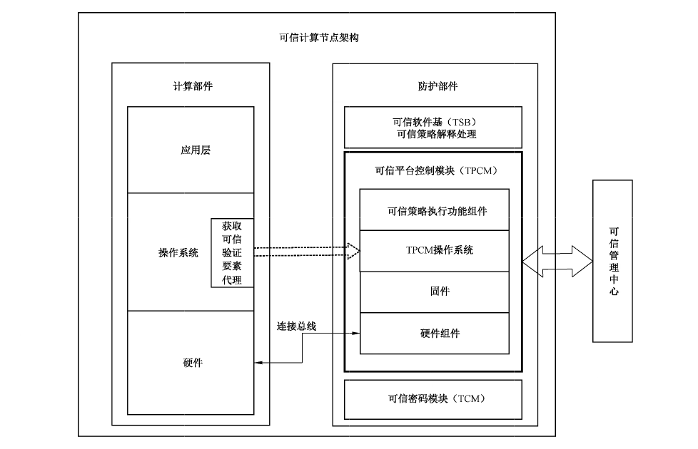
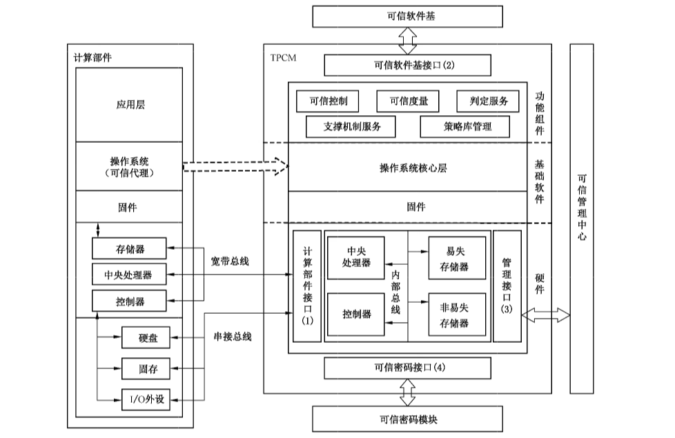
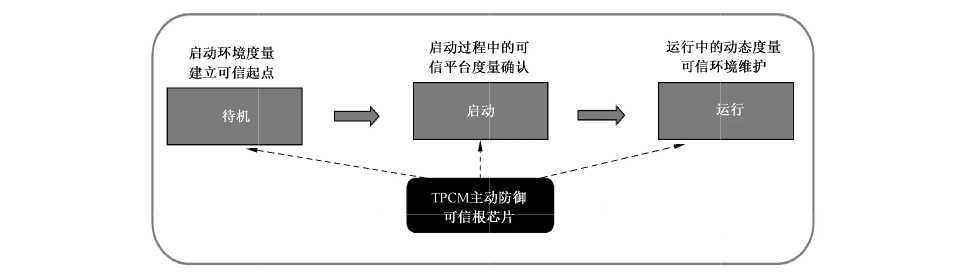

# GB/T 40650-2021 信息安全技术 可信计算规范 可信平台控制模块

> 来源：[GB/T 40650-2021 国家标准详情](https://openstd.samr.gov.cn/bzgk/std/newGbInfo?hcno=18C7FD6FBC935007E0ACEA03DDF28AD0)；发布日期：2021-10-11；实施日期：2022-05-01。
> 官方在线预览截图 SHA-256：95f92840e1a95e8c809f2314acfc48652d218930674c0a55d1c3c99b95278e32。
> 转写说明：依据官方在线预览的全部 13 张页图对照校正，保留三张原页图示；省略封面、目录、页眉、页脚和页码，合并跨页段落。正式引用请核对官方原文。

## 前言

本文件按照 GB/T 1.1—2020《标准化工作导则 第1部分：标准化文件的结构和起草规则》的规定起草。

请注意本文件的某些内容可能涉及专利。本文件的发布机构不承担识别专利的责任。

本文件由全国信息安全标准化技术委员会（SAC/TC 260）提出并归口。

本文件起草单位：华大半导体有限公司、北京工业大学、北京可信华泰信息技术有限公司、全球能源互联网研究院有限公司、上海算石科技有限公司、同济大学、阿里巴巴（中国）有限公司、浪潮（北京）电子信息产业有限公司、中国船舶重工集团公司第七〇九研究所、武汉大学、上海兆芯集成电路有限公司、广东玖章信息科技有限公司、上海工业控制安全创新科技有限公司、蓝玛卓信科技（上海）有限公司、中安科技集团有限公司、北京新云东方系统科技有限责任公司。

本文件主要起草人：黄坚会、张建标、王冠、胡俊、王昱波、公备、宁振虎、孙瑜、高昆仑、赵保华、蒋昌俊、喻剑、洪宇、王亮、杨欢、付颖芳、肖鹏、徐明迪、吴保锡、苏振宇、王鹃、薛刚汝、凌金弘、刘虹、程军、苏秋雨、刘建利、徐万山、王晓、杨勇敢。

## 1 范围

本文件描述了可信平台控制模块在可信计算节点中的位置和作用，规定了可信平台控制模块的功能组成、功能接口、安全防护、运行维护要求和证实方法。

本文件适用于可信平台控制模块的设计、生产、运行维护和测评。

## 2 规范性引用文件

下列文件中的内容通过文中的规范性引用而构成本文件必不可少的条款。其中，注日期的引用文件，仅该日期对应的版本适用于本文件；不注日期的引用文件，其最新版本（包括所有的修改单）适用于本文件。

- GB/T 29829 信息安全技术 可信计算密码支撑平台功能与接口规范

- GB/T 37935 信息安全技术 可信计算规范 可信软件基

- GM/T 0008 安全芯片密码检测准则

## 3 术语和定义

下列术语和定义适用于本文件。

### 3.1 可信密码模块 trusted cryptography module

具有可信计算所需要的密码运算等功能，并可提供受保护的存储空间的一种模块。

### 3.2 可信计算节点 trusted computing node

由可信防护部件和计算部件共同构成，具备计算和防护并行运行功能的计算节点。

### 3.3 可信平台控制模块 trusted platform control module

集成在可信计算节点中的防护部件组件，由硬件、软件及固件组成，与计算部件的硬件、软件及固件并行连接，是用于建立和保障信任源点的一种基础核心模块，为可信计算节点提供主动度量、主动控制、可信验证、加密保护、可信报告、密码调用等功能。

### 3.4 有效状态 enabled state

可信平台控制模块处于可以接收、执行所有指令的工作状态。

### 3.5 禁用状态 disable state

可信平台控制模块处于只能执行查询及启用指令的特殊工作状态。

### 3.6 主动自检 active self-checking

可信平台控制模块上电后主动对模块内部指定内容进行的检测操作。

### 3.7 被动自检 passive self-checking

可信平台控制模块接收到自检指令后，对模块内部指定内容进行的检测操作。

### 3.8 可信软件基 trusted software base

为可信计算节点提供可信支撑的软件元素集合。

### 3.9 可信管理中心 trusted management center

对可信计算节点的防护策略和基准值进行制定、下发、维护、存储等操作的集中管理平台。

### 3.10 主动度量 active measuring

防护部件依据防护策略发起对防护对象进行状态度量的行为。

### 3.11 可信验证 trusted verification

依据防护策略和基准值对防护对象进行主动度量和对度量结果判定的过程。

### 3.12 主动控制 active controlling

防护部件依据防护策略对防护对象的行为进行控制的过程。

## 4 缩略语

下列缩略语适用于本文件。

- I/O：输入输出（Input/Output）
- IP：知识产权（Intellectual Property）
- TCM：可信密码模块（Trusted Cryptography Module）
- TPCM：可信平台控制模块（Trusted Platform Control Module）
- TSB：可信软件基（Trusted Software Base）
- USB：通用串行总线（Universal Serial Bus）

## 5 概述

### 5.1 可信平台控制模块定位

可信计算节点由计算部件和防护部件构成，TPCM 是可信计算节点中实现可信防护功能的关键部件，可以采用多种技术途径实现，如板卡、芯片、IP核等，其内部包含中央处理器、存储器等硬件、固件，以及操作系统与可信功能组件等软件，支撑其作为一个独立于计算部件的防护部件组件，并行于计算部件按内置防护策略工作，对计算部件的硬件、固件及软件等需防护的资源进行可信监控，是可信计算节点中的可信根。

TPCM 在可信计算节点中的位置及其与可信计算节点其他部件互动关系的示意图如图1所示。

### 5.2 可信平台控制模块与周边的交互

TPCM 需与TSB、TCM、可信管理中心和可信计算节点的计算部件交互，交互方式如下：

a） TPCM 的硬件、固件与软件为 TSB 提供运行环境，设置的可信功能组件为 TSB 按策略库解释要求实现度量、控制、支撑与决策等功能提供支持；

b） TPCM 通过访问 TCM 获取可信密码功能，完成对防护对象可信验证、度量和保密存储等计算任务，并提供 TCM 服务部件以支持对 TCM 的访问；

c） TPCM通过管理接口连接可信管理中心，实现防护策略管理、可信报告处理等功能；

d） TPCM 通过内置的控制器和 I/O 端口，经由总线与计算部件的控制器交互，实现对计算部件的主动监控；

e） 计算部件操作系统中内置的防护代理获取预设的防护对象有关代码和数据提供给 TPCM，TPCM 将监控信息转发给 TSB，由 TSB依据策略库进行分析处理。

### 5.3 其他

TPCM 在可信计算节点中应满足下面几项要求：

a） TPCM应是整个可信计算节点中第一个获得执行权的部件；

b） TPCM 所使用的 TCM 应遵循 GB/T 29829 及相关密码国家标准和行业标准的规定；

c） TPCM所使用的 TSB 应遵循 GB/T 37935的规定。

## 6 可信平台控制模块功能组成

### 6.1 功能组成框架

TPCM 的功能及接口框架见图2，其功能逻辑上划分为3个层次，即硬件、基础软件和功能组件。

与TPCM 相关的实体包括计算部件、可信软件基、可信管理中心和可信密码模块，TPCM 通过相应的接口与各个实体进行连接和交互。

### 6.2 硬件层

硬件层应包括中央处理器、易失存储器、非易失存储器、计算部件接口、管理接口、可信密码接口，为TPCM 的功能实现提供基础运行环境。硬件组件之间通过内部总线实现相互连接。根据连接对象的不同，计算部件接口可分为控制器和I/O接口。

### 6.3 基础软件层

基础软件层应包括固件、操作系统核心，实现对TPCM 内部的资源调度、任务管理，以及提供I/O接口驱动及控制。

### 6.4 功能组件层

功能组件层包括可信控制、可信度量、判定服务、支撑机制服务及策略库管理，以及可信软件基接口。各部分功能如下：

a） 可信控制是指 TPCM 依据防护策略和度量结果，进行基于节点控制部件的总线、电源信号等方式的控制；

b） 可信度量是依据防护策略，获取预设的计算部件中防护对象有关内存、I/O、固件中的关键数据信息，并进行密码运算；

c） 判定服务为可信软件基判定机制的实现提供支持；

d） 支撑机制服务为可信软件基提供有关系统处理的运算；

e） 策略库管理对节点的可信度量、可信控制等规则进行管理；

f） 可信软件基接口为可信软件基提供功能访问。

### 6.5 互联接口

TPCM通过互联接口实现访问计算部件资源、连接可信密码模块和提供面向外部的功能访问，接口应包括计算部件接口、可信密码模块接口、可信软件基接口和管理接口。

## 7 可信平台控制模块的接口

### 7.1 计算部件接口

#### 7.1.1 接口类型

计算部件接口主要为总线接口，与节点计算部件中不同类型的总线相连接，用于访问内存、I/O、系统固件等系统资源，并通过控制器对系统资源进行控制。

#### 7.1.2 接口功能

TPCM 可通过计算部件总线接口连接计算部件硬件层的控制器，实现对可信计算节点的主动监控，监控对象可包括内存、硬盘、USB、并口、串口和网络等。

#### 7.1.3 接口输入/输出

计算部件接口中总线接口的输入/输出应符合不同总线标准的数据或控制命令。

### 7.2 可信软件基接口

#### 7.2.1 接口类型

可信软件基接口为软接口，为可信软件基提供 TPCM 功能的调用。TPCM 在提供接口服务前，应先与调用者进行相互认证并建立可信的数据通道。

#### 7.2.2 接口功能

可信软件基可通过该接口调用TPCM 中的度量、控制、判定和支撑等服务功能，并返回处理数据。

#### 7.2.3 接口输入/输出

可信软件基接口的输入为功能相应的输入参数，输出为功能执行的返回结果。

### 7.3 管理接口

#### 7.3.1 接口类型

管理接口为物理接口，应为网络或总线接口模式，由可信管理中心访问。

#### 7.3.2 接口功能

TPCM 的管理接口应包括 TPCM自身管理、可信密码模块管理、基本信任基管理及日志管理等。

各接口功能要求如下：

a） TPCM自身管理接口应包括TPCM 配置管理和安全管理；

b） 可信密码模块管理接口应提供TPCM 所使用的可信密码模块的授权管理、密钥管理；

c） 基本信任基管理接口应提供基本信任基的度量值管理与度量策略管理；

d） 日志管理接口应提供 TPCM 管理行为日志的导出机制。

#### 7.3.3 接口输入/输出

管理接口的输入应包括配置信息、管理命令、TPCM 基本信任基的策略及 TPCM 日志策略；输出应包括 TPCM 自身的状态、可信密码模块的状态、基本信任基状态及 TPCM 日志信息。

### 7.4 可信密码模块接口

可信密码模块接口提供 TPCM 对可信密码模块访问的I/O通道，接口应遵循 GB/T 29829 的规定。

## 8 安全防护

### 8.1 身份鉴别

#### 8.1.1 用户分类

用户分类要求如下：

a） TPCM 只允许管理员执行TPCM 配置，管理员应具备设置防护策略及 TPCM 的状态权限；

b） TPCM 可依据内部的验证策略对计算部件的用户进行身份鉴别，并根据鉴别结果绑定对应的权限。

#### 8.1.2 用户鉴别要求

当TPCM提供服务时，应对访问的身份进行鉴别，鉴别要求如下：

a） 可通过身份识别设备获取当前使用者的身份信息；

b） 可通过通信通道获取当前使用者的身份信息；

c） 用户可根据安全防护需求选择其他的鉴别方式。

### 8.2 资源访问控制

TPCM 应支持对资源访问的控制，控制的资源可包括内存、硬盘、USB、总线、并口、串口和网络等。

### 8.3 审计

TPCM 应对所执行的指令记录日志，日志应包括时标、指令类型、执行是否成功。审计日志应满足如下要求：

a） 日志存储在非易失性数据存储单元中；

b） 应对日志的访问进行权限控制，并应保证日志的完整性；

c） 可提供日志记录安全转移及安全迁移功能。

### 8.4 存储空间安全要求

TPCM的存储空间应有如下限制：

a） TPCM 不对外开放地址空间，对TPCM 的访问应通过TPCM 的功能接口实现；

b） TPCM 运行过程中产生的临时数据在失效后应及时清除。

### 8.5 数据保护

数据保护要求如下。

a） TPCM 应能够将重要数据与度量值捆绑，实现数据封装保护。受保护的数据只能在绑定 TPCM 的平台及特定完整性状态下才能被解封；

b） TPCM 应具有安全数据迁移、备份与恢复的功能，迁移、备份与恢复操作在保证数据的机密性和完整性前提下进行。

### 8.6 物理防护

在 TPCM 内部应使用物理防护手段实现对外部攻击的防护，具体要求遵循GM/T 0008的规定。

## 9 运行维护

### 9.1 自检

#### 9.1.1 主动自检

TPCM上电启动时，应进行主动自检。主动自检对象应包括TCM、设计者自定义状态标识及TPCM 内部代码完整性。

#### 9.1.2 被动自检

TPCM 应支持被动自检，被动自检对象包括可信密码模块、设计者自定义状态标识、当前用户身份标识和当前用户身份。

#### 9.1.3 自检异常处理

自检异常处理流程为：

a） 当发生自检异常时，TPCM 应立即发出自检失败信号，将自检信息记录到日志中，然后发出节点启动信号；

b） 当节点启动程序代码执行启动后，应报告自检失败信息，管理员可以选择重新启动可信计算节点、禁用 TPCM以非可信方式启动或采取其他措施。

### 9.2 状态维护

TPCM 应具有使能和禁用状态。具体要求如下：

a） 出厂默认处于禁用状态。

b） 应由管理员执行使能和禁用状态切换操作。

c） TPCM处于使能状态时，又分为两种工作状态：有效和无效状态。有效状态即是 TPCM正常工作时的状态，无效状态即是 TPCM 不能正常对外提供服务时的状态。

d） TPCM 每次加电启动时，都要对使用状态进行判断。如果禁用状态，则只能进行TPCM 的状态查询和使能操作。

## 10 证实方法

### 10.1 可信计算节点的可信平台控制模块

检查可信计算节点设计，应确认 TPCM先于主机计算部件上电启动，并全程并行于计算部件运行，实现从计算部件第一条指令开始的可信建立。不但在系统启动过程中能防止使用经篡改的部件来构建运行环境、抵御恶意代码攻击，并且在系统运行中能动态地保护运行环境及应用程序的可信安全，最终实现对计算系统全生命周期的可信度量和可信控制，如图3所示。

### 10.2 可信平台控制模块功能组成

#### 10.2.1 基础硬件

检查TPCM的模块电路/芯片版图等设计资料，应确认其包括中央处理器、存储器、总线及I/O接口等组成部分。

#### 10.2.2 基础软件

检查 TPCM 内部基础软件的设计资料，应确认其包含 TPCM 内部的资源调度、任务管理、提供 I/O 接口驱动及控制的功能软件。

#### 10.2.3 功能服务

功能服务检测应包括设计资料的检查和运行测试，要求如下：

a） 检查 TPCM 内部基础软件的设计资料，应确认其包含主动度量、主动控制、可信验证、加密保护、可信报告、用户管理、基本信任基管理和密码调用功能；

b） 启动TPCM，构造可激活上述功能服务的输入序列，对上述功能进行测试，应确认其具备文档所设计的功能。

#### 10.2.4 接口

接口的证实方法见10.3。

### 10.3 可信平台控制模块的接口

#### 10.3.1 计算部件接口

在TPCM 软件中添加计算部件接口测试程序，通过TPCM 计算部件接口访问内存、I/O、系统固件等系统资源，应确认其可以实时获取系统资源中的信息，并测试对I/O总线、电源等系统资源的控制功能，确认其具备对I/O总线、电源的控制能力。

#### 10.3.2 可信软件基接口

在可信软件基执行向 TPCM下达可信验证、状态度量、加密保护和可信控制等策略的程序，读取TPCM 内部的审计信息，应确认这些信息中记录了对 TPCM 的访问行为。

#### 10.3.3 管理接口

通过管理接口输入配置信息、管理命令、TPCM 基本信任基的策略及 TPCM 日志策略，从管理接口读取 TPCM 当前状态、可信密码模块状态、基本信任基状态及TPCM 日志信息，应确认读出信息符合预期。

#### 10.3.4 可信密码模块接口

在可信密码模块接口上根据可信密码模块标准对接可信密码模块，在 TPCM 中编写访问可信密码模块接口的测试软件，应确认访问结果符合预期。

### 10.4 安全防护

#### 10.4.1 身份鉴别

身份鉴别的检查包括存在性检查与有效性检查，内容如下：

a） 检查 TPCM 用户的身份，应确认其登录时需执行身份鉴别操作；

b） 应确认身份鉴别的有效性，使用非法用户身份，或使用合法用户身份与错误口令进行身份鉴别，鉴别过程会失败，使用合法用户身份、合法口令进行身份鉴别，鉴别过程成功。

#### 10.4.2 资源访问控制

在TPCM 内部设置对TPCM 可控制资源的访问控制，在计算部件中尝试访问可控制资源，应确认访问控制起到了作用。

#### 10.4.3 审计

审计功能需检查下列内容。

a） 对已生成审计日志的TPCM进行断电重启等操作，再读取审计日志，应确认所生成的审计日志未丢失。

b） 应确认分别使用授权用户和非授权用户访问审计日志，授权用户能访问审计日志，非授权用户不能访问审计日志。应确认尝试以授权用户修改审计日志，审计日志不能被修改或被修改后无法消除修改痕迹。

c） 应确认 TPCM有日志记录安全转移及安全迁移命令，执行这些命令，可以完成日志记录安全转移及安全迁移功能。

#### 10.4.4 存储空间安全要求

存储空间安全要求需检查下列内容：

a） 确认检查确认 TPCM 的所有访问接口，不存在直接访问地址空间的命令；

b）在TPCM 内部编写临时数据检查程序，运行TPCM 时同时启动临时数据检查程序，应确认临时数据失效后能够被及时清除。

#### 10.4.5 数据保护

数据保护需检查下列内容：

a） TPCM的数据保护通过TCM 实现，监控TPCM 的可信密码模块接口，应确认该接口在数据保护过程中调用了TCM 的对应功能对数据进行保护处理；

b）在TPCM 进行安全数据迁移、备份和恢复操作时，尝试进行数据迁移备份过程的监听、篡改等操作，应确认监听操作不能获取安全数据的明文信息，篡改操作在恢复时会被发现。

#### 10.4.6 物理防护

应遵循GM/T 0008规定检测准则对 TPCM 的物理防护手段进行测试。

### 10.5 运行维护

#### 10.5.1 自检

自检过程需检查下列内容：

a） 在TPCM上电启动前，分别尝试断开 TCM、更改设计者自定义状态标识和修改TPCM 内部代码，应确认 TPCM上电启动时可通过主动自检发现异常；

b） TPCM 启动后，尝试断开 TCM、更改设计者自定义状态标识、修改当前用户身份，再启动被动自检，应确认被动自检可发现异常；

c） 当上述过程发现异常后，应检查到自检失败信号，读取TPCM日志，将发现自检失败信息。

#### 10.5.2 状态维护

状态维护需检查下列内容：

a） 应确认在证实管理员身份情况下可执行TPCM 的使能和禁用状态切换，未证实管理员身份情况下不可成功执行切换操作；

b） 应确认分别在使能状态和禁用状态加电启动TPCM，并尝试进行TPCM操作，使能状态TPCM 可正常操作，禁用状态 TPCM 只能执行查询和使能操作。
