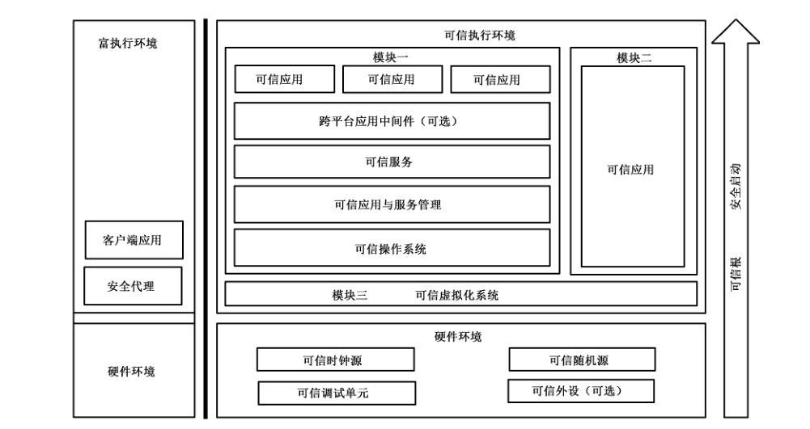
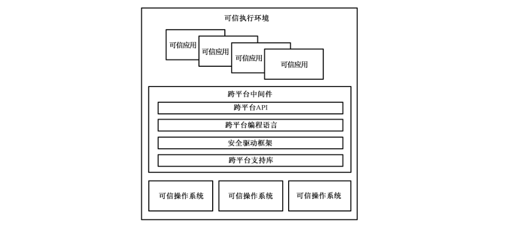
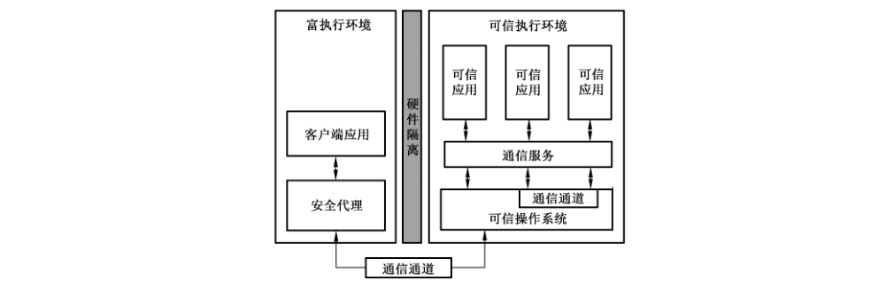
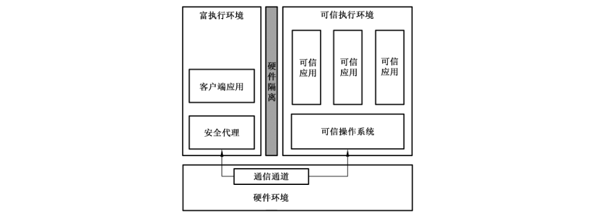
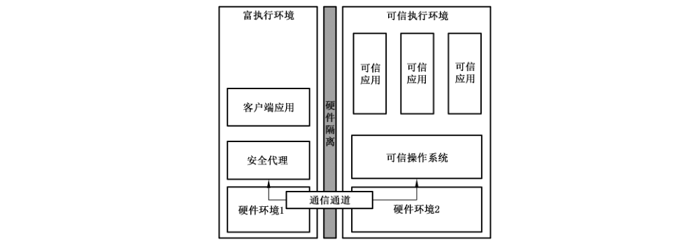
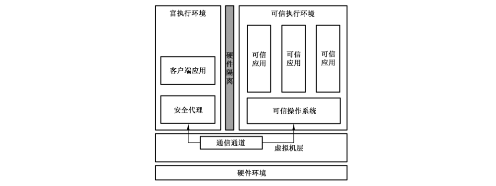
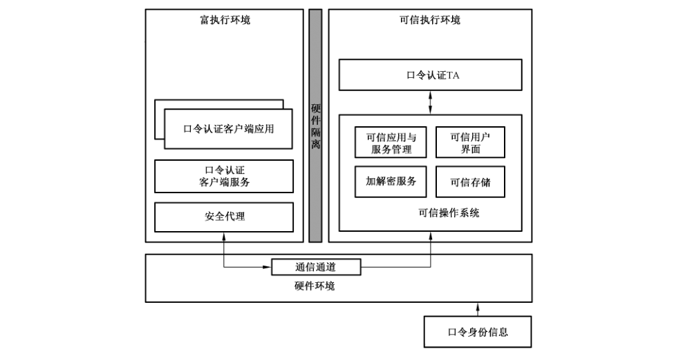
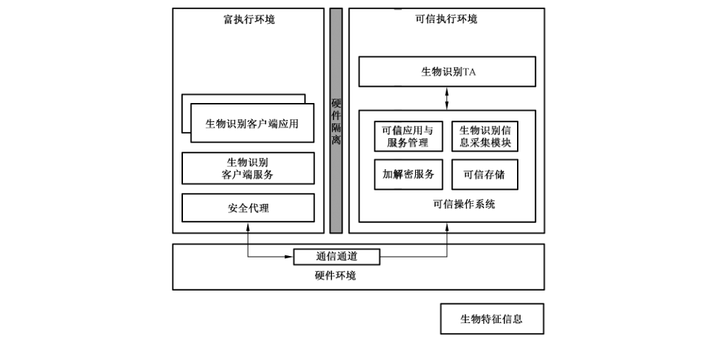

# GB/T 41388-2022 信息安全技术 可信执行环境 基本安全规范

> 来源：[GB/T 41388-2022 国家标准详情](https://openstd.samr.gov.cn/bzgk/std/newGbInfo?hcno=B5B601094A265390BF353980D90E534D)；封面发布日期：2022-04-15；实施日期：2022-11-01。
> PDF SHA-256：e53cb87ad1769399b9e2c637aed802b00aae753cf3eb23c03baa9152c504ee9b。
> 转写说明：以官方 PDF 的 25 页渲染图像为依据校核文字，保留 10 幅原图，合并跨页段落，省略封面、目录、页眉和页码。正式引用请核对官方原件。

## 前言

本文件按照 GB/T 1.1—2020《标准化工作导则 第1部分：标准化文件的结构和起草规则》的规定起草。

请注意本文件的某些内容可能涉及专利。本文件的发布机构不承担识别专利的责任。

本文件由全国信息安全标准化技术委员会（SAC/TC 260）提出并归口。

本文件起草单位：中国银联股份有限公司、中国电子技术标准化研究院、中国科学院大学、北京银联金卡科技有限公司、中国信息通信研究院、公安部第三研究所、华为技术有限公司、北京小米移动软件有限公司、OPPO 广东移动通信有限公司、维沃移动通信有限公司、中国金融认证中心、深圳市腾讯计算机系统有限公司、蚂蚁科技集团股份有限公司、北京百度网讯科技有限公司、北京谦川科技有限公司、联想（北京）有限公司、高通无线通信技术（中国）有限公司、华控清交信息科技（北京）有限公司、上海聚虹光电科技有限公司。

本文件主要起草人：柴洪峰、孙权、孙彦、王跃武、渠韶光、胡莹、曾望年、国炜、胥怡心、张炼、张友奖、王磊、李根、贾科、龚喜杰、郭铁涛、林冠辰、周吉文、郝春亮、任泽君、雷灵光、周荃、马哲、王鑫、魏凡星、孟庆洋、张强、王思善、刘渤、杜志敏、王云河、李嘉扬。

## 1 范围

本文件确立了可信执行环境系统整体技术架构，描述了可信执行环境基础要求、可信虚拟化系统、可信操作系统、可信应用与服务管理、跨平台应用中间件等主要内容及其测试评价方法。

本文件适用于指导可信执行环境系统的设计、生产及测试。

## 2 规范性引用文件

下列文件中的内容通过文中的规范性引用而构成本文件必不可少的条款。其中，注日期的引用文件，仅该日期对应的版本适用于本文件；不注日期的引用文件，其最新版本（包括所有的修改单）适用于本文件。

- GB/T 20271—2006 信息安全技术 信息系统通用安全技术要求

- GB/T 25069—2010 信息安全技术 术语

## 3 术语和定义

GB/T 25069—2010界定的以及下列术语和定义适用于本文件。

### 3.1 虚拟化 virtualization

将一种或多种形式资源虚拟化成另外一种或多种形式资源的方法。

### 3.2 可信虚拟化 trusted virtualization

基于可信执行环境的虚拟化方法。

### 3.3 可信执行环境 trusted execution environment

基于硬件级隔离及安全启动机制，为确保安全敏感应用相关数据和代码的机密性、完整性、真实性和不可否认性目标构建的一种软件运行环境。

> 注：硬件级隔离是指基于硬件安全扩展机制，通过对计算资源的固定划分或动态共享，保证隔离资源不被富执行环境访问的一种安全机制。

### 3.4 富执行环境 rich execution environment

为应用程序提供基础功能和计算资源的一种软件运行环境。

> 注：富执行环境是相对可信执行环境独立存在的运行环境。

### 3.5 可信执行环境系统 trusted execution environment system

由可信执行环境及富执行环境下用以支撑客户端应用的运行环境共同构成的系统。

### 3.6 可信服务 trusted service

在可信执行环境中为可信应用和执行环境自身所提供的各种服务。

### 3.7 安全启动 secure boot

在系统启动过程中，为验证系统启动过程每一阶段所加载代码的真实性、完整性而提供的一种安全机制。

### 3.8 可信应用 trusted application

运行在可信执行环境中的应用程序。

### 3.9 客户端应用 client application

运行在富执行环境中的应用程序，与可信应用协同工作，共同构成完整的应用。

### 3.10 证书颁发方 certificate issuer

用于签名验证的证书的颁发者。

## 4 缩略语

以下缩略语适用于本文件。

- API：应用程序编程接口（Application Programming Interface）
- CPU：中央处理器（Central Processing Unit）
- DMA：直接内存访问（Direct Memory Access）
- IOMMU：输入输出内存管理单元（Input Output Memory Management Unit）
- NFC：近场通信（Near Field Communication）
- SE：安全元件（Secure Element）
- TA：可信应用（Trusted Application）
- TAM：可信应用管理（Trusted Application Manager）
- TEE：可信执行环境（Trusted Execution Environment）

## 5 总体描述

### 5.1 概述

为了兼顾安全与开放，通常会在一个设备上基于硬件级隔离同时建立起两个完整的执行环境。其中，一个环境负责处理对功能性、开放性等要求较高的业务，定义为富执行环境；另一个负责处理对安全性、机密性要求较高的业务，定义为可信执行环境。两个执行环境在一个设备上同时并存，其运行所需要的CPU、内存、外设等资源在硬件级安全机制基础上严格隔离，隔离机制按 GB/T 20271—2006 中4.2.5关于特别安全防护规定的要求。富执行环境中的客户端应用和可信执行环境中的可信应用相互通信、相互协作，共同构成一个完整的应用。本文件主要描述可信执行环境系统架构以及各组成部分的基本功能和安全要求。

### 5.2 整体架构

本文件所定义的可信执行环境系统整体架构见图1。

可信执行环境系统要求设备同时具备两个运行环境：富执行环境、可信执行环境。其中富执行环境主要负责处理安全性要求相对较低、功能相对丰富的业务。富执行环境中主要包括用于与可信执行环境通信的安全代理、用于业务处理并与可信应用通信的客户端应用等。可信执行环境运行安全等级较高的可信操作系统及可信服务与应用等。可信执行环境基于具备安全隔离属性的硬件基础之上构建，该硬件只有在切换为可信环境后才能够被正常访问和进行数据处理，包括可信时钟源、可信密码单元（可选）、可信调试单元以及可信外设（可选）等。整个可信执行环境系统的启动过程应以可信根为起点，并满足安全启动相关安全要求。

可信执行环境系统根据应用场景的不同，可由下述3个不同的功能模块组成：

a） 模块一由可信操作系统、可信服务、可信应用、可信应用与服务管理以及可选的跨平台中间件组成的系统；

b） 模块二可信应用直接运行于硬件环境上；

c） 模块三由基于可信虚拟化技术构建的可信虚拟化系统。

通过组合3个模块可以形成三种架构。

a） 精简架构，在可信执行环境中，只包含模块二中直接运行在硬件环境上的可信应用。该架构面向功能简单、处理能力较弱的应用场景。

b） 标准架构，标准架构指由模块一组成的可信执行环境。跨平台应用中间件为可选项。

c） 虚拟化架构，虚拟化架构包含模块一、模块二和模块三共3个模块。该架构用于在同一设备上支持多个包含模块一与模块二中所描述的系统。虚拟化架构通过可信虚拟化系统为上层提供创建和管理一个或多个客户虚拟机的能力。客户虚拟机可以同时运行一个或多个模块一与模块二中所描述的系统。

可信执行环境与富执行环境间的通信通过安全代理完成。富执行环境中的客户端应用通过安全代理与可信执行环境进行通信，具体要求见第12 章相关描述。

## 6 基础要求

### 6.1 硬件要求

#### 6.1.1 硬件基本要求

可信执行环境系统架构应基于硬件级隔离机制实现，应保证所隔离的可信执行环境的资源不被富执行环境访问，具体需要隔离的资源包括但不限于：CPU、内存、时钟源、密码单元、调试单元等。可信执行环境硬件参考架构见附录 A。

#### 6.1.2 可信时钟源

可信时钟源是可信执行环境系统中使用的看门狗计时器和可信执行环境调度计时器的硬件基础。

可信时钟源应在设备加电启动后立即运行，且不能被禁用、关闭、篡改等，避免因外部干扰等原因导致可信执行环境系统内的编程状态被破坏。

#### 6.1.3 可信随机源

可信随机源为可信执行环境中各类加解密算法提供随机源，随机源所涉及的随机数发生器，应采用满足相关密码学要求的真随机数硬件发生器，该随机数发生器应被设置成只能通过可信执行环境访问。

#### 6.1.4 可信调试单元

可信调试单元负责整个设备的调试功能，其硬件基础应满足以下要求：

a） 可信调试单元硬件子系统应保证所有侵入式调试机制能够被禁用；

b） 可信调试单元硬件子系统应保证所有调试机制（包括非侵入式和侵入式）可以被设定只有可信执行环境才能够使用；

c） 可信调试硬件单元子系统应保证所有调试机制（包括非侵入式和侵入式）可以被富执行环境使用；当可信调试硬件单元子系统被设定为富执行环境和可信执行环境都能够访问时，调试子系统不允许访问或修改可信执行环境中的任何寄存器与存储器；

d） 可信调试硬件单元子系统的寄存器使用过程中应保证持续供电，或者能够保证寄存器在系统断电前被完整地保存并在系统恢复供电时完整恢复。

#### 6.1.5 可信外设

可信外设指对驱动控制与数据采集有一定安全或隐私要求的一类外设。在使用可信外设前，系统应被切换到可信执行环境内，以阻止任何停留在富执行环境的恶意代码监控和记录数据的输入。

对于采集与处理过程不能够完全由可信执行环境控制的外设，宜采用以下两种方式进行处理：

a） 加密传输方式，即在可信外设和可信执行环境之间建立加密通道，保证数据在传输过程中的机密性、完整性、真实性；

b） 监控方式，通过可信执行环境对富执行环境及整个设备的安全状态进行严格检测和监测，及时控制风险。

### 6.2 可信根

可信根为可信执行环境建立及运行提供支撑，可以是硬件、代码和数据。可信根应具备以下安全要求：

a） 应具备机密性、完整性、真实性三个基本安全特性，能够为可信执行环境系统的安全鉴证、安全度量和安全存储提供支持；

b）应提供访问控制机制，保证未经授权的用户不能访问和篡改可信根的数据和代码。

### 6.3 安全启动要求

安全启动是通过安全机制来验证可信执行环境系统启动过程中每一个阶段软件代码的完整性和真实性，防止非授权或被恶意篡改的代码被执行。安全启动过程构建了一个信任链，整个过程始于一个可信根，其他组件或代码需通过完整性和真实性验证才能被执行。安全启动过程应保证可信执行环境系统的完整性和真实性。

安全启动应满足如下要求：

a） 应保证用于验证完整性和真实性的密码算法本身的鲁棒性；

b） 应保证可信根不可被替换或篡改；

c） 应保证用于代码完整性和真实性验证的密钥不可被非授权替换或篡改，并提供安全的密钥更新、撤销机制；

d） 应保证安全启动信任链按序逐级验证，不可被恶意绕过；

e） 宜提供代码防回滚功能。

## 7 可信虚拟化系统

可信虚拟化系统应具备以下能力：

a） 创建、删除等动态管理可信执行环境内虚拟机的能力；

b）管理可信执行环境中虚拟机内部CPU、内存、中断、外设等硬件资源的能力；

c） 可信执行环境内虚拟机之间应具备互相通信和数据交换的能力。

可信虚拟化系统应具备如下安全要求：

a） 应保证可信执行环境内各虚拟机仅根据其所分配的权限访问相应的资源，不能越权访问；

b） 应保证可信执行环境系统自身及内部虚拟机加载和运行过程的正确性与完整性；

c） 应保证可信执行环境系统自身及内部虚拟机数据与代码的真实性和完整性；

d） 可信执行环境内虚拟机之间的通信应具备一定的访问控制策略。

可信虚拟化系统应避免赋予内部虚拟机最高等级权限，单一虚拟机出现崩溃或安全隐患时，不应影响到可信执行环境系统自身及内部其他虚拟机的正常工作。

## 8 可信操作系统

可信操作系统应具备常规操作系统中的进程管理、内存管理、设备管理、文件管理等基本系统功能。

可信操作系统要求在访问控制、身份鉴别、数据完整性、可信路径等方面满足相应的安全技术要求。

包括：

a） 应保证可信应用及可信服务仅根据其所分配的权限访问相应的资源，不能越权访问；

b） 应保证系统自身、可信服务与应用启动的正确性与完整性；

c） 应保证系统自身、可信服务与应用数据和代码的真实性和完整性；

d） 应具备可信应用之间、可信应用与可信服务之间的访问控制能力；

e） 对于系统权限的管理，应避免赋予可信服务与应用最高权限，避免单一可信应用与服务出现异常时，影响系统内核及其他可信应用与服务的正常工作。

## 9 可信应用与服务管理

### 9.1 基本描述

可信应用与服务管理负责可信执行环境下可信应用与可信服务的安装、更新、删除及其安全属性配置管理等。可信执行环境中的可信应用与服务，可采用本地方式管理，也可通过TAM后台进行远程管理，其所遵循的安全要求应保持一致。

### 9.2 技术架构

#### 9.2.1 架构描述

可信应用与服务的发布过程见图2，设备提供商（或授权服务商）是可信执行环境系统拥有方，负责设备提供商（或授权服务商）根证书的管理、应用发布证书的签发；可信应用提供商负责可信应用的开发，并经过应用发布证书对应的私钥签名后，将带签名的TA 提交可信应用运营商进行发布；可信操作系统对收到的带签名的TA，采用设备提供商（或授权服务商）根证书及该 TA 对应的应用发布证书，对TA 进行签名验证，如签名验证通过则执行后续的安装/更新。

#### 9.2.2 互信过程

对可信应用及服务的管理，采用基于设备提供商（或授权服务商）根证书、应用发布证书认证的方式进行，以确保应用数据的机密性、完整性、真实性和行为的不可否认性。

#### 9.2.3 可信应用及服务部署

当采用互信通道将 TA 部署到可信执行环境中时，可信执行环境首先要校验 TA的真实性和完整性，并根据不同 TA 提供商所拥有的权限，对相应 TA 对应的相关资源和通信访问进行严格控制。

## 10 可信服务

### 10.1 可信时间服务

可信执行环境系统应集成可信时间服务，为可信应用及其他可信服务提供取可信时间的功能。

可信时间分为系统时间与可信应用的持久化时间。系统时间具有任意的非持久性的起点，系统时间可以基于专用的安全硬件实现，也可以基于TEE 时间实现，不同的可信应用实例可以拥有不同的系统时间。在整个可信应用实例生命周期中，系统时间不可以重置或回滚，不会因进入低功耗状态而影响系统时间的正常运转；可信应用的持久化时间起点因每个可信应用的不同而不同，但应在重启过程中保持持久化。

### 10.2 可信加解密服务

可信执行环境系统应集成可信加解密服务，为可信应用以及其他可信服务提供加解密功能。可信加解密服务应保证仅获得相应授权的可信应用或可信服务才可以访问密钥。

### 10.3 可信存储服务

可信执行环境系统应集成可信存储服务，为可信应用及其他可信服务提供可信存储功能。可信存储服务包括但不限于如下功能：

a） 对存储对象的读写操作要求确保操作的原子性、数据的机密性、数据的完整性；

b） 可信存储应具备访问控制机制，确保只有授权的应用才能访问相应的存储空间；

c） 可信存储宜提供对数据回滚攻击的防御措施。

### 10.4 可信身份鉴别服务

可信执行环境系统可集成可信身份鉴别服务，为可信执行环境中的可信应用或其他可信服务提供身份鉴别功能。可信身份鉴别服务通过识别用户的个人身份数字特征信息来识别用户身份的合法性、是否有操作相关功能的权利等。可信身份鉴别服务可以采用但不限于下列身份鉴别方式完成用户合法性的判断：口令、指纹、人脸。可信身份鉴别服务宜基于可信存储服务、可信人机交互、可信加解密服务等其他可信服务的协同操作来完成。

### 10.5 可信设备鉴证服务

可信执行环境系统可集成可信设备鉴证服务，用于证明设备真实性。可信设备鉴证服务可以对外提供但不限于如下种类的功能：

a） 证明设备标识的真实性及设备来源的真实性；

b） 监测可信执行环境运行的健康状态；

c） 监测富执行环境运行的健康状态。

### 10.6 可信人机交互服务

可信执行环境系统可集成可信人机交互服务，提供可信执行环境下的用户人机交互界面显示和输入功能，在用户和应用程序之间提供可信通道，具备抵御非法屏幕输入记录、非法屏幕显示内容截取、钓鱼等攻击的防护能力。

### 10.7 SE 管理服务

可信执行环境系统可集成SE管理服务，用于提供可信应用与SE 之间的访问通道的功能，以满足更高安全应用场景的需求。SE 管理服务应具备访问控制机制以确保仅经过授权的可信应用可以访问SE。可信执行环境对SE 管理架构见图3。

## 11 跨平台应用中间件

跨平台应用中间件主要用于解决不同可信执行环境系统之间的应用兼容性问题，具体包括四个功能模块：

a） 跨平台支持库，用于弥补不同可信执行环境系统本地支持库的差异；

b） 安全驱动框架，针对 NFC、摄像头、指纹等安全外设，建立统一驱动框架；

c） 跨平台编程语言，为解决不同可信执行环境系统对TA 支持的兼容性问题，建立符合相应安全要求的跨平台编程语言；

d） 跨平台 API，支持不同平台对跨平台中间件调用的应用编程接口。

跨平台应用中间件整体框架见图4。

## 12 可信应用

### 12.1 可信应用基本架构

可信应用为可信执行环境下的应用程序，通过可信应用与服务管理系统进行管理，客户端应用与可信应用之间通信，以及不同可信应用之间的通信，均应具备访问控制能力。

可信应用通信的基本框架见图5，客户端应用通过安全代理通过富执行环境与可信执行环境之间的通信通道，与可信应用实现数据交换。在可信执行环境内部，可信应用与可信应用之间根据需要可通过内部通信通道进行数据交换。可信应用的具体应用场景，见附录B。

### 12.2 可信应用加载的安全要求

可信执行环境应具备对可信应用验证的能力，以达到保护可信应用内容、验证可信应用的合法性的目的。

### 12.3 客户端应用与可信应用通信的安全要求

可信执行环境应具备访问控制能力，确保只有授权的客户端应用才能访问对应的可信应用。

### 12.4 可信应用与可信应用通信的安全要求

可信执行环境应具备某种访问控制机制，使得仅被授权的可信应用可以与目标可信应用进行通信。

可信应用之间的通信，宜保证通信本身的机密性、完整性，除被授权的可信应用外，其他可信应用无法获取通信本身的信息。

## 13 测试评价方法

### 13.1 基础要求

#### 13.1.1 硬件要求

##### 13.1.1.1 硬件基本要求

硬件基本要求的测试评价方法如下。

a） 测试方法：

1） 审查厂商提交的文档，检查可信执行环境系统的硬件架构设计；

2） 尝试在富执行环境访问可信执行环境所隔离资源，包括但不限于：CPU、内存、时钟源、密码单元、调试单元等。

b） 预期结果：

1） 可信执行环境系统架构基于硬件级隔离机制实现，保证所隔离的可信执行环境的资源不被富执行环境访问；

2） 可信执行环境隔离的资源包括但不限于：CPU、内存、时钟源、密码单元、调试单元等。

c） 结果判定：上述预期结果均满足判定为符合，其他情况判定为不符合。

##### 13.1.1.2 可信时钟源

可信时钟源的测试评价方法如下。

a） 测试方法：

1） 审查厂商提交的文档，检查可信执行环境的可信时钟源设计；

2） 检查设备启动过程中对可信时钟源的配置；

3） 在设备运行时，尝试禁用、关闭、篡改可信时钟源。

b） 预期结果：

1） 可信时钟源在设备加电启动后立即运行，且不能被禁用、关闭、篡改等；

2） 可信执行环境具备防止因外部干扰等原因导致可信执行环境系统内的编程状态被破坏的保护措施。

c） 结果判定：上述预期结果均满足判定为符合，其他情况判定为不符合。

##### 13.1.1.3 可信随机源

可信随机源的测试评价方法如下。

a） 测试方法：

1） 审查厂商提交的文档，检查可信执行环境的可信随机源设计，其所涉及的随机数发生器，是否采用满足相关密码学要求的真随机数硬件发生器；

2） 尝试在可信执行环境之外访问随机数发生器。

b） 预期结果：

1） 可信执行环境的可信随机源所涉及的随机数发生器，采用满足相关密码学要求的真随机数硬件发生器；

2） 随机数发生器被设置成只能通过可信执行环境访问。

c） 结果判定：上述预期结果均满足判定为符合，其他情况判定为不符合。

##### 13.1.1.4 可信调试单元

可信调试单元的测试评价方法如下。

a） 测试方法：

1） 审查厂商提交的文档，检查可信执行环境的可信调试单元设计；

2） 尝试通过侵入式调试机制使用可信调试单元；

3） 设置可信调试单元的所有调试机制（包括非侵入式和侵入式）仅被可信执行环境使用，尝试在可信执行环境之外使用调试机制；

4） 设置可信调试单元的所有调试机制（包括非侵入式和侵入式）可被富执行环境和可信执行环境使用，尝试通过调试机制访问或修改可信执行环境中的寄存器与存储器；

5） 设置可信调试单元硬件子系统的寄存器后，尝试执行系统断电，上电后，重新读取相应寄存器，并与断电前的寄存器值进行比较。

b） 预期结果：

1） 可信调试单元硬件子系统保证所有侵入式调试机制能够被禁用；

2） 可信调试单元硬件子系统保证所有调试机制（包括非侵入式和侵入式）可以被设定为只有可信执行环境才能够使用；

3） 可信调试单元硬件子系统保证所有调试机制（包括非侵入式和侵入式）可以被富执行环境使用；当可信调试硬件子系统被设定为富执行环境和可信执行环境都能够访问时，调试子系统不允许访问或修改可信执行环境中的任何寄存器与存储器；

4） 可信调试单元硬件子系统的寄存器使用过程中保证持续供电，或者能够保证寄存器在系统断电前被完整地保存并在系统恢复供电时完整恢复。

c） 结果判定：上述预期结果均满足判定为符合，其他情况判定为不符合。

##### 13.1.1.5 可信外设

可信外设的测试评价方法如下。

a） 测试方法：

1） 审查厂商提交的文档，检查可信执行环境的可信外设设计；

2） 在可信执行环境使用可信外设时，尝试通过富执行环境监控和记录可信外设的交互数据；

3） 对于采集与处理过程不能够完全由可信执行环境控制的外设，检查可信外设和可信执行环境之间的数据传输保护机制，验证可信执行环境是否具备对富执行环境及整个设备的安全状态的监测和响应机制。

b） 预期结果：

1） 在使用可信外设前，系统被切换到可信执行环境内，以阻止任何停留在富执行环境的恶意代码监控和记录数据的输入。

2） 对于采集与处理过程不能够完全由可信执行环境控制的外设，在可信外设和可信执行环境之间加密传输数据，且可信执行环境具备对富执行环境及整个设备的安全状态的监测和响应机制。

c） 结果判定：上述预期结果均满足判定为符合，其他情况判定为不符合。

#### 13.1.2 可信根

可信根的测试评价方法如下。

a） 测试方法：

1） 审查厂商提交的文档，检查可信执行环境的可信根设计；

2） 检查可信执行环境系统的安全鉴证、安全度量和安全存储过程，验证可信根是否提供了机密性、完整性、真实性等安全特性；

3） 尝试使用未经授权的用户访问和篡改可信根的数据和代码，验证访问控制机制是否有效。

b） 预期结果：

1） 可信根具备机密性、完整性、真实性三个基本安全特性，为可信执行环境系统的安全鉴证、安全度量和安全存储提供支持；

2） 可信根具备访问控制机制，保证未经授权的用户不能访问和篡改可信根的数据和代码。

c） 结果判定：上述预期结果均满足判定为符合，其他情况判定为不符合。

#### 13.1.3 安全启动

安全启动的测试评价方法如下。

a） 测试方法：

1） 审查厂商提交的文档，检查可信执行环境系统的安全启动过程；

2） 检查安全启动过程用于完整性和真实性验证的密码算法不存在已公开脆弱性；

3） 尝试替换或篡改可信根，验证安全启动是否正常执行；

4） 检查用于完整性和真实性验证密钥的更新和撤销机制，尝试非授权替换或篡改相应密钥，验证安全启动是否正常执行；

5） 尝试绕过安全启动信任链的逐级验证过程。

b） 预期结果：

1） 安全启动过程保证可信执行环境系统的完整性和真实性，防止非授权或被恶意篡改的代码被执行；

2） 安全启动过程保证用于完整性和真实性验证的密码算法本身的鲁棒性；

3） 安全启动过程保证可信根不可被替换或篡改；

4） 安全启动过程保证用于进行代码完整性和真实性验证的密钥不可被非授权替换或篡改，并提供安全的密钥更新、撤销功能；

5） 安全启动信任链按序逐级验证，不可被恶意绕过。

c） 结果判定：上述预期结果均满足判定为符合，其他情况判定为不符合。

### 13.2 可信虚拟化系统

可信虚拟化系统的测试评价方法如下。

a） 测试方法：

1） 审查厂商提交的文档，检查可信虚拟化系统的设计；

2） 在可信执行环境内动态创建和删除虚拟机，并尝试管理虚拟机内部CPU，内存，中断，外设等硬件资源；

3） 在可信执行环境内创建多个虚拟机，验证虚拟机之间是否支持互相通信及进行数据交换，检查虚拟机之间通信的访问控制策略，根据策略内容分别访问策略所允许访问和不允许访问的虚拟机，验证策略是否有效；

4） 在可信执行环境内创建多个虚拟机，尝试越权访问其他虚拟机的资源；

5） 检查可信执行环境内部虚拟机的加载和运行过程，尝试篡改相应数据和代码；

6） 检查可信虚拟化系统内部虚拟机的等级权限设置，验证是否赋予虚拟机最高等级权限。

b） 预期结果：

1） 可信虚拟化系统具备创建、删除等动态管理虚拟机的能力，以及管理虚拟机的CPU，内存，中断，外设等硬件资源的能力；

2） 可信执行环境内虚拟机之间具备互相通信及进行数据交换的能力，且虚拟机之间通信具备访问控制能力；

3） 可信执行环境内虚拟机仅根据其所分配的权限访问相应的资源，不能越权访问；

4） 可信虚拟化系统保证虚拟机加载和运行过程的正确性与完整性，以及保证虚拟机数据与代码的真实性和完整性；

5） 可信虚拟化系统未赋予内部虚拟机最高等级权限，单一虚拟机出现崩溃或安全隐患时，不会影响到可信执行环境系统自身及内部其他虚拟机的正常工作。

c） 结果判定：上述预期结果均满足判定为符合，其他情况判定为不符合。

### 13.3 可信操作系统

可信操作系统的测试评价方法如下。

a） 测试方法：

1） 审查厂商提交的文档，检查可信操作系统的设计；

2） 检查可信操作系统的访问控制策略，尝试使用可信应用及可信服务分别访问策略所允许和不允许访问的资源，验证策略是否有效；

3） 检查可信操作系统自身、可信服务与应用启动过程，尝试篡改启动代码和绕过完整性校验过程；

4） 检查可信操作系统自身、可信服务与应用数据和代码的真实性和完整性保护机制，尝试篡改相应数据和代码；

5） 检查可信应用之间、可信应用与可信服务之间的访问控制策略，尝试使用可信应用及可信服务分别访问策略所允许和不允许访问的可信应用和可信服务，验证策略是否有效；

6） 检查可信操作系统内部可信服务与可信应用的权限设置，验证是否赋予可信服务与可信应用最高权限。

b） 预期结果：

1） 可信操作系统具备常规操作系统中的进程管理、内存管理、设备管理、文件管理等基本系统功能；

2） 可信操作系统保证可信应用及可信服务仅根据其所分配的权限访问相应的资源，不能越权访问；

3） 可信操作系统保证系统自身、可信服务与应用启动的正确性与完整性；

4） 可信操作系统保证系统自身、可信服务与应用数据和代码的真实性和完整性；

5） 可信应用之间、可信应用与可信服务之间具备访问控制能力；

6） 可信操作系统的系统权限管理不会赋予可信服务与应用最高权限，单一可信应用与服务出现崩溃或安全问题时不会影响系统内核及其他可信应用与服务的正常工作。

c） 结果判定：上述预期结果均满足判定为符合，其他情况判定为不符合。

### 13.4 可信应用与服务管理

#### 13.4.1 互信过程

互信过程的测试评价方法如下。

a） 测试方法：

1） 审查厂商提交的文档，检查可信应用与服务的管理机制；

2） 执行可信应用与服务的管理操作，检查操作过程中设备提供商（或授权服务商）、可信应用提供商、可信应用运营商的互信是否基于设备根证书、应用发布证书进行认证。

b） 预期结果：可信应用及服务的管理，采用基于设备根证书、应用发布证书认证的方式进行，以确保应用数据的机密性、完整性、真实性和行为的不可否认性。

c） 结果判定：上述预期结果均满足判定为符合，其他情况判定为不符合。

#### 13.4.2 可信应用及服务部署

可信应用及服务部署的测试评价方法如下。

a） 测试方法：

1） 审查厂商提交的文档，检查可信应用及服务部署过程；

2） 尝试篡改设备提供商（或授权服务商）根证书、应用发布证书，执行可信应用与服务的安装操作，验证安装是否失败；

3） 检查可信应用及服务部署过程的访问控制策略，尝试根据TA 提供商所拥有的权限访问策略所允许和不允许的 TA 对应的相关资源和通信，验证策略是否有效。

b） 预期结果：当采用互信通道将 TA 部署到可信执行环境中时，可信执行环境系统首先校验TA 的真实性和完整性，并根据不同TA 提供商所拥有的权限，对相应TA 对应的相关资源和通信访问进行严格控制。

c） 结果判定：上述预期结果均满足判定为符合，其他情况判定为不符合。

### 13.5 可信服务

#### 13.5.1 可信时间服务

可信时间服务的测试评价方法如下。

a） 测试方法：

1） 审查厂商提交的文档，检查可信时间服务的设计；

2） 在可信应用实例生命周期中，在系统正常运行状态和低功耗状态下，多次获取系统时间并进行比较；尝试重置或回滚系统时间，验证操作是否成功；

3） 在可信应用实例中，获取持久化时间，使系统重启，在相同可信应用实例中再次获取持久化时间。

b） 预期结果：

1） 在整个可信应用实例生命周期中，系统时间不可以重置或回滚，且不会因进入低功耗状态而影响系统时间的正常运转；

2） 可信应用的持久化时间在重启过程中保持持久化。

c） 结果判定：上述预期结果均满足判定为符合，其他情况判定为不符合。

#### 13.5.2 可信加解密服务

可信加解密服务的测试评价方法如下。

a） 测试方法：

1） 审查厂商提交的文档，检查可信加解密服务的设计；

2） 使用可信应用以及其他可信服务调用加解密功能；

3） 尝试使用未授权可信应用以及其他可信服务访问密钥。

b） 预期结果：

1） 可信执行环境系统集成可信加解密服务，为可信应用以及其他可信服务提供加解密功能；

2） 可信加解密服务保证仅获得相应授权的可信应用或可信服务才可以访问密钥。

c） 结果判定：上述预期结果均满足判定为符合，其他情况判定为不符合。

#### 13.5.3 可信存储服务

可信存储服务的测试评价方法如下。

a） 测试方法：

1） 审查厂商提交的文档，检查可信存储服务的设计；

2） 使用可信应用调用可信存储功能多次存储数据，验证存储过程是否保证操作的原子性；

3） 尝试使用可信应用获取或篡改其他可信应用或可信服务的数据；

4） 检查可信存储的访问控制策略，根据策略使用可信应用访问策略所允许和不允许的存储空间，验证策略是否有效；

5） 尝试对可信存储的数据执行回滚攻击。

b） 预期结果：

1） 可信执行环境系统集成可信存储服务功能，为可信应用及其他可信服务提供可信存储功能；

2） 可信存储服务对存储对象的读写操作保证操作的原子性、数据的机密性、数据的完整性；

3） 可信存储具备访问控制机制，确保只有授权的应用才能访问相应的存储空间；

4） 可信存储具备对数据回滚攻击的防御措施。

c） 结果判定：上述预期结果均满足判定为符合，其他情况判定为不符合。

#### 13.5.4 可信身份鉴别服务

可信身份鉴别服务的测试评价方法如下。

a） 测试方法：

1） 审查厂商提交的文档，检查可信身份鉴别服务的设计；

2） 使用可信应用调用可信身份鉴别功能，尝试在可信执行环境之外篡改鉴别数据或结果。

b） 预期结果：

1） 可信执行环境系统集成可信身份鉴别服务功能，为可信执行环境系统中的可信应用或其他可信服务提供身份鉴别功能；

2） 可信身份鉴别服务基于可信存储服务、可信人机交互、可信加解密服务等其他可信服务的协同操作来完成。

c） 结果判定：上述预期结果均满足判定为符合，其他情况判定为不符合。

#### 13.5.5 可信设备鉴证服务

可信设备鉴证服务的测试评价方法如下。

a） 测试方法：

1） 审查厂商提交的文档，检查可信设备鉴证服务的设计；

2） 尝试伪造设备标识和设备来源，使用可信应用调用可信设备鉴证功能，验证调用结果是否能够证明设备标识的真实性及设备来源的真实性；

3） 改变可信执行环境和富执行环境的健康状态，使用可信应用调用可信设备鉴证功能，验证调用结果是否能够体现健康状态。

b） 预期结果：

1） 可信执行环境系统集成可信设备鉴证服务功能，用于证明设备的真实性；

2） 可信设备鉴证服务能够证明设备标识的真实性及设备来源的真实性；

3） 可信设备鉴证服务能够监测可信执行环境和富执行环境运行的健康状态。

c） 结果判定：上述预期结果均满足判定为符合，其他情况判定为不符合。

#### 13.5.6 可信人机交互服务

可信人机交互服务的测试评价方法如下。

a） 测试方法：

1） 审查厂商提交的文档，检查可信人机交互服务的设计；

2） 使用可信应用调用可信人机交互服务，尝试在可信执行环境之外执行窃取屏幕输入记录、截取屏幕显示内容等攻击。

b） 预期结果：

1） 可信执行环境系统集成可信人机交互服务功能，提供可信执行环境下的用户人机交互界面显示和输入功能；

2） 可信人机交互服务在用户和应用程序之间提供可信通道，具备抵御非法屏幕输入记录、非法屏幕显示内容截取、钓鱼等攻击的防护能力。

c） 结果判定：上述预期结果均满足判定为符合，其他情况判定为不符合。

#### 13.5.7 SE 管理服务

SE 管理服务的测试评价方法如下。

a） 测试方法：

1） 审查厂商提交的文档，检查 SE 管理服务的设计；

2） 检查 SE 管理服务的访问控制策略，尝试使用授权和未授权的可信应用访问 SE，验证策略是否有效。

b） 预期结果：

1） 可信执行环境系统集成SE管理服务功能，用于提供可信应用与SE之间的访问通道的功能；

2） SE 管理服务具备访问控制机制以确保仅经过授权的可信应用可以访问 SE。

c） 结果判定：上述预期结果均满足判定为符合，其他情况判定为不符合。

### 13.6 跨平台应用中间件

跨平台应用中间件的测试评价方法如下。

a） 测试方法：

1） 审查厂商提交的文档，检查跨平台应用中间件的设计；

2） 尝试在不同可信执行环境系统上安装和使用同一可信应用，调用相同接口和驱动，验证可信应用运行是否正常。

b） 预期结果：

1） 可信执行环境系统集成跨平台应用中间件，解决应用兼容性问题；

2） 跨平台应用中间件能够提供跨平台支持库、安全外设的统一驱动框架、跨平台编程语言和跨平台 API 等功能。

c） 结果判定：上述预期结果均满足判定为符合，其他情况判定为不符合。

### 13.7 可信应用

#### 13.7.1 可信应用加载

可信应用加载的测试评价方法如下。

a） 测试方法：

1） 审查厂商提交的文档，检查可信应用加载过程；

2） 尝试篡改可信应用安装文件，执行可信应用安装操作，验证可信执行环境是否能够验证可信应用合法性。

b） 预期结果：可信执行环境系统具备对可信应用验证的能力。

c） 结果判定：上述预期结果均满足判定为符合，其他情况判定为不符合。

#### 13.7.2 客户端应用与可信应用通信

客户端应用与可信应用通信的测试评价方法如下。

a） 测试方法：

1） 审查厂商提交的文档，检查客户端应用与可信应用通信过程；

2） 检查可信执行环境的访问控制策略，根据策略使用已授权和未授权的客户端应用访问可信应用，验证策略是否有效。

b） 预期结果：可信执行环境具备访问控制能力，确保只有授权的客户端应用才能访问对应的可信应用。

c） 结果判定：上述预期结果均满足判定为符合，其他情况判定为不符合。

#### 13.7.3 可信应用与可信应用通信

可信应用与可信应用通信的测试评价方法如下。

a） 测试方法：

1） 审查厂商提交的文档，检查可信应用与可信应用通信过程；

2） 检查可信执行环境的访问控制策略，根据策略使用已授权和未授权的可信应用访问可信应用，验证策略是否有效；

3） 在可信应用与可信应用通信过程中，尝试使用未授权可信应用获取或篡改通信数据。

b） 预期结果：

1） 可信执行环境具备访问控制机制，使得仅被授权的可信应用可以与目标可信应用进行通信；

2） 可信应用之间的通信，保证通信本身的机密性、完整性，除被授权的可信应用外，其他可信应用无法获取通信本身的信息。

c） 结果判定：上述预期结果均满足判定为符合，其他情况判定为不符合。

## 附录 A（资料性）可信执行环境参考架构

### A.1 共享处理器架构

共享处理器的硬件防火墙技术是在传统 CPU 架构基础上经过特别设计的芯片安全扩展机制。该机制在 CPU 内部划分出两个状态，即富执行环境状态和可信执行环境状态，两个状态之间实现安全的硬件隔离，通过特定的通信机制，可以在两个状态之间自由切换。

基于共享处理器的可信执行环境系统架构见图 A.1，基于共享处理器的纯硬件架构应可通过以下方式确保系统安全：隔离所有硬件和软件资源，使它们分别位于两个环境（用于安全子系统的可信执行环境以及用于存储其他所有内容的富执行环境）中；硬件逻辑防火墙应确保富执行环境中的组件无法访问可信执行环境中资源。

### A.2 独立安全处理器架构

独立安全处理器架构是在芯片内部或外部集成专用安全处理器，安全处理器与通用处理器实现安全的硬件隔离，两个处理器各自独立运行，有自己独立的存储器和外设接口，互不影响。同时，在硬件上提供安全处理器与通用处理器的通信通道，实现富执行环境与可信执行环境的通信。基于独立安全处理器的可信执行环境系统架构见图 A.2。

### A.3 基于虚拟化技术架构

基于虚拟化技术的可信执行环境系统在安全硬件支持的前提下，通过软件的方式创建不同的虚拟机，可以让不同的可信执行环境同时存在于一个硬件体系结构中。这种架构在扩展性上得到了提升，这种架构可以同时使用共享处理器架构和独立安全处理器架构，同时，利用硬件 IOMMU，能够加强隔离性，防止 DMA 攻击。

基于虚拟化技术的可信执行环境系统架构见图 A.3。

## 附录 B（资料性）支持多种身份鉴别的应用场景

### B.1 支持基于口令身份鉴别的应用示例

基于可信执行环境系统的口令身份鉴别采用可信用户界面的方式来实现。口令输入窗口的显示、数据提交对应的操作全部由可信执行环境来控制，确保口令鉴别过程的安全性。

基于可信执行环境系统的口令身份鉴别见图 B.1。

### B.2 支持基于生物识别的身份鉴别的应用示例

基于可信执行环境系统的生物识别身份鉴别，通过可信执行环境内的生物识别 TA，配合可信执行环境相关服务，以及富执行环境中的相关驱动完成整个识别过程。数据的采集、计算都在可信执行环境中执行，确保整个生物识别过程的安全性。

基于可信执行环境系统的生物识别身份鉴别见图 B.2。

