# GB/T 42572-2023 信息安全技术 可信执行环境服务规范

> 来源：[GB/T 42572-2023 国家标准详情](https://openstd.samr.gov.cn/bzgk/std/newGbInfo?hcno=7599351FAB635B7736F973ED367E78AB)。
> PDF SHA-256：eaa274799fb1ae989836ad0180e1944613f15668d9f54733fdd36a4878d23402。
> 转写说明：逐页对照官方 PDF 的 65 页图像校核文字、57 张附录表格和 22 幅原图；合并跨页内容，省略封面、目录、页眉和页码。发布日期：2023-05-23；实施日期：2023-12-01。正式引用请核对官方原件。

## 前言

本文件按照 GB/T 1.1—2020《标准化工作导则 第1部分：标准化文件的结构和起草规则》的规定起草。

请注意本文件的某些内容可能涉及专利。本文件的发布机构不承担识别专利的责任。

本文件由全国信息安全标准化技术委员会（SAC/TC 260）提出并归口。

本文件起草单位：中国银联股份有限公司、中国科学院大学、复旦大学、华为技术有限公司、北京银联金卡科技有限公司、深圳华大北斗科技股份有限公司、中金金融认证中心有限公司、北京谦川科技有限公司、上海摩联信息技术有限公司、北京小米移动软件有限公司、OPPO广东移动通信有限公司、深圳市腾讯计算机系统有限公司、蚂蚁科技集团股份有限公司、郑州信大捷安信息技术股份有限公司、恒宝股份有限公司、云从科技集团股份有限公司、北京创原天地科技有限公司、大唐高鸿信安（浙江）信息科技有限公司、上海聚虹光电科技有限公司、同盾科技有限公司。

本文件主要起草人：柴洪峰、孙权、陈成钱、王跃武、吴杰、李晓伟、孙中亮、胡莹、邹奋、张友奖、周荃、雷灵光、叶家炜、王鑫、池海章、王思善、鲁欣、孟庆洋、许刚、周博、张忠群、王磊、李根、蒋增增、林冠辰、刘为华、赵李明、李军、肖青海、郑驰、李嘉扬、谭成。

## 1 范围

本文件确立了可信执行环境服务的技术框架体系，并规定了相关安全技术要求及测试评价的方法。

本文件适用于可信执行环境服务的设计、开发、测试等，设备制造商、系统软件提供商、检测机构和科研机构等可信执行环境服务参与方可参照使用。

## 2 规范性引用文件

下列文件中的内容通过文中的规范性引用而构成本文件必不可少的条款。其中，注日期的引用文件，仅该日期对应的版本适用于本文件；不注日期的引用文件，其最新版本（包括所有的修改单）适用于本文件。

- GB/T 17901.1—2020 信息技术 安全技术 密钥管理 第1部分：框架

- GB/T 25069—2022 信息安全技术 术语

- GB/T 41388—2022 信息安全技术 可信执行环境 基本安全规范

## 3 术语和定义

GB/T 25069—2022 和 GB/T 41388—2022 界定的以及下列术语和定义适用于本文件。

### 3.1 可信执行环境 trusted execution environment

基于硬件级隔离及安全启动机制，为确保安全敏感应用相关数据和代码的机密性、完整性、真实性和不可否认性目标构建的一种软件运行环境。

> 注：硬件级隔离是指基于硬件安全扩展机制，通过对计算资源的固定划分或动态共享，保证隔离资源不被富执行环境访问的一种安全机制。

［来源：GB/T 41388—2022,3.3］

### 3.2 富执行环境 rich execution environment

为应用程序提供基础功能和计算资源的一种软件运行环境。

> 注：富执行环境是相对可信执行环境独立存在的运行环境。

［来源：GB/T 41388—2022,3.4］

### 3.3 可信执行环境服务 trusted execution environment service

运行在可信执行环境下，为REE 提供基础性、通用性、公共性功能的软件程序。

> 注：本文件中简称“TEE服务”。

### 3.4 TEE 人机交互 trusted execution environment human-machine interaction

运行在可信执行环境下，提供信息交互界面的软件程序。

### 3.5 TEE 设备安全状态评价 trusted execution environment device security state evaluation

提供当前设备的安全风险状态，给出设备安全状态报告（3.6）。

### 3.6 设备安全状态报告 device security state report

具有明确评价当前设备软硬件环境安全指标的数据结构。

### 3.7 TEE 服务密钥 trusted execution environment service key

由TEE 服务生成的用于保证 TEE 服务与 TEE 服务后台安全交互的公私钥对。

### 3.8 应用密钥 application key

由 TEE 服务生成的用于保证用户密钥由应用后台安全发送至 TEE服务的公私钥对。

### 3.9 应用隔离 application isolation

一种提供每个应用完全控制自己的数据且相互之间无法直接数据操作的机制。

### 3.10 用户隔离 user isolation

一种提供每个用户完全控制自己的数据且相互之间无法直接数据操作的机制。

## 4 缩略语

下列缩略语适用于本文件。

REE：富执行环境（Rich Execution Environment）

TA：可信应用（Trusted Application）

TEE：可信执行环境（Trusted Execution Environment）

TUI：可信人机界面（Trusted User Interface）

## 5 总体描述

### 5.1 概述

TEE 服务包含多种类型的服务，如 TEE 人机交互服务、TEE 二维码服务、TEE设备安全状态评价服务、TEE 身份鉴别服务、TEE 时间服务、TEE 位置服务、TEE 密码计算服务等，TEE服务提供方根据业务需求提供具体对应的服务。

### 5.2 TEE 服务类型

#### 5.2.1 TEE 人机交互服务

提供包括但不限于口令输入/修改、注册登录、消息输出等基于 TUI 构建的可信用户界面，保障通过可信用户界面输入的内容不被非授权应用监控、篡改、破坏和窃取，并通过安全通道（如安全传输层协议等）将输入数据或运算结果加密传输给应用。

可信用户界面至少包含以下安全界面要素之一：

a） 可信输入框：用于输入字符（串）等信息；

b） 可信按钮：用于获取用户的点击事件；

c） 可信键盘：为用户提供安全输入界面；

d） 可信文本框：用于展示文本信息；

e） 可信图片框：用于展示图片信息；

f） 可信标签：用于放置可信文本框、可信图片框等；

g） 可信生物信息采集显示器：用于获取、显示用户输入的生物信息。

界面要素的大小、位置、背景色等由TEE 服务提供方自定义，但应符合TEE 操作系统的要求。

#### 5.2.2 TEE 二维码服务

提供 TEE 二维码展示和TEE 二维码扫描功能。TEE 二维码展示指基于 TUI展示通过安全通道获取的二维码，避免二维码数据被非授权程序破坏、窃取、篡改等。TEE二维码扫描指通过符合可信外设要求的摄像头扫描读取二维码信息，并通过安全通道将二维码数据加密传输至应用。

可信用户界面至少包含以下安全界面要素：

a） 可信图片框：用于放置二维码图片或动态显示摄像头捕捉到的画面，图片框的位置、大小、背景色等由 TEE 服务提供方自定义；

b） 可信按钮：用于取消操作，按钮上的提示信息可以是定制图片或者文字。

#### 5.2.3 TEE 设备安全状态评价服务

收集当前的设备信息，生成设备安全状态报告，供应用作为当前设备的风险评分判断的其中一项依据，为业务流程是否正常处理提供参考。手机等个人设备的信息采集方式应符合隐私保护相关法规。

TEE 设备安全状态评价服务采集信息内容一般包括设备启动参数、REE 环境软硬件配置信息、REE 环境状态信息、REE 环境特征信息、TEE 环境特征信息、TEE 服务代理的安全状态信息和 TEE服务的安全状态信息。详细采集因子参考附录 A。

根据信息采集方式和检验者的不同，TEE 设备安全状态评价服务分为以下三种类型。

a） 本地型：此类型为本地离线检测方式，无需联网。通过TEE 服务代理及 TEE 服务采集各项因子，并通过本地TEE 服务评估所采集到的各项因子，生成设备安全状态报告。

b） 远程型：此类型为远程检测方式，需要联网。通过 TEE 服务代理以及 TEE 服务采集各项因子，并通过远程 TEE 服务后台评估所采集到的各项因子，生成设备安全状态报告。

c） 混合型：此类型为本地与远程相结合的检测方式，部分时间需要联网。通过TEE 服务代理以及TEE 服务采集各项因子。根据具体需求，一部分因子由本地TEE 服务进行评估，另一部分由远程TEE 服务后台进行评估，并综合两部分评估结果生成设备安全状态报告。

#### 5.2.4 TEE 身份鉴别服务

提供基于 TEE 的身份鉴别功能，包括但不限于基于口令、指纹、人脸、虹膜、声纹以及密码技术的身份鉴别方式。

#### 5.2.5 TEE 时间服务

提供基于 TEE 的当前时间获取功能，时间来源为卫星（如北斗卫星导航系统、全球定位系统等）时间、电信运营商时间、通过网络授时中心获取的时间等，通过多时间来源相互校验的方式，提供更高可信度的时间服务，为在线支付、电子合同签署等对时间数据的安全性和准确性要求较高的场景提供服务。

#### 5.2.6 TEE 位置服务

提供基于 TEE 的当前位置获取功能，以经纬度、高程（可选）形式提供，位置信息来源为卫星（如北斗卫星导航系统、全球定位系统等）定位、基站定位、短距通信设备辅助定位等，通过多位置信息来源相互校验的方式，提供高可信度位置信息，同步提供定位方式、定位模组是否有硬件防伪能力等定位辅助信息，便于应用判断可信度，为商户收款、移动支付等对位置信息的安全性和准确性要求较高的场景提供服务。

#### 5.2.7 TEE 密码计算服务

通过采用密码算法，提供基于 TEE 的数据加密及解密、消息摘要、消息鉴别码、数字签名及验签、随机数生成等服务功能，应实现数据的机密性、完整性、真实性和不可抵赖性。具体服务功能如下。

a） 数据加密及解密：采用对称或非对称密码算法，对数据内容进行加密和解密计算功能，实现数据的机密性保护。

b） 消息摘要：采用密码杂凑算法，对数据内容进行单向散列的计算输出固定长度的杂凑值（摘要），实现数据完整性校验。

c） 消息鉴别码：采用消息鉴别码算法，实现消息的完整性校验和消息来源的真实性校验。

d） 数字签名及验签：采用非对称密码算法，发送方使用自己的私钥对消息内容进行数字签名，接收方使用发送方的公钥对消息和数字签名进行验证。实现消息的完整性校验、消息来源的真实性和抗抵赖性。

e） 随机数生成：基于可信的硬件单元生成的不可预测的随机数列，是密钥生成的必要保证。

### 5.3 生命周期

TEE 服务的生命周期如图1所示。

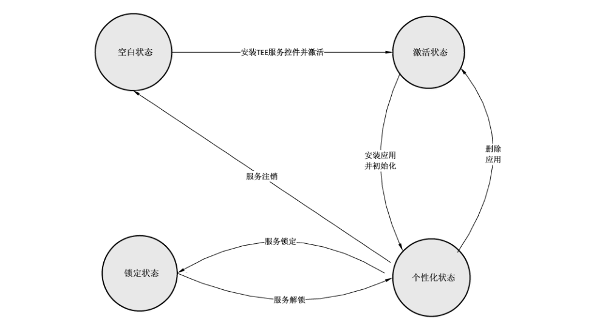

TEE 服务的生命周期包含空白状态、激活状态、个性化状态和锁定状态，具体状态描述如下。

a） 空白状态：设备未下载安装TEE 服务代理或已下载TEE 服务代理但未激活使用TEE 服务时所处的状态。

b） 激活状态：设备安装 TEE 服务代理，并通过触发服务激活流程，生成 TEE 服务所需的密钥等数据后所处的状态。在激活状态下，TEE 服务与 TEE 服务后台具备安全通信能力。

c） 个性化状态：设备安装应用，并通过触发初始化流程，在TEE 服务中生成应用相关密钥，下载个性化数据后所处的状态。在个性化状态下，应用调用TEE 服务各项功能：删除应用功能使TEE 服务回到激活状态；服务注销功能使TEE 服务回到空白状态，并删除相关密钥和个性化数据。

d） 锁定状态：应用发现设备处于风险状态或使用该设备的用户存在恶意行为，锁定运行在该设备的 TEE 服务功能时所处的状态。在锁定状态下，TEE 服务将拒绝应用发起的各项功能调用；在判定风险解除后，解锁功能调用。

## 6 TEE 服务通用安全要求

### 6.1 技术框架

本文件所定义的 TEE 服务技术框架如图2所示。

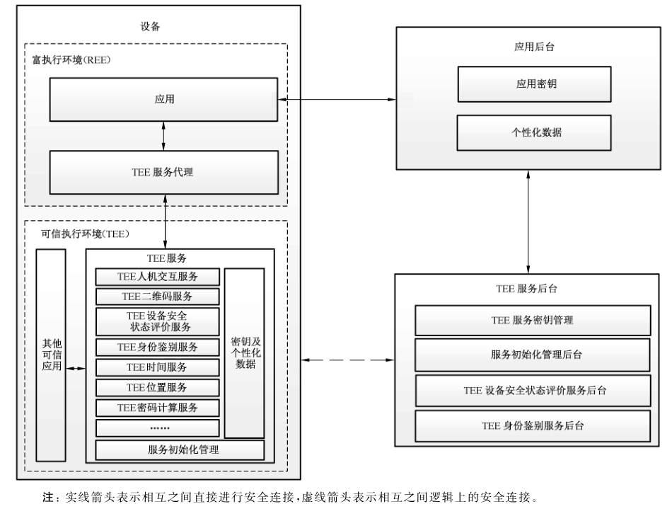

TEE 服务技术框架包含五个部分：应用、TEE 服务代理、TEE 服务、应用后台与TEE 服务后台。

应用和应用后台协同完成应用的业务功能，TEE 服务和 TEE 服务后台协同完成 TEE 服务的业务功能，应用通过TEE 服务代理调用TEE服务功能。具体功能描述如下。

a） 应用：完成应用的业务功能。应用一般运行在 REE 中，通过接口调用 TEE服务。

b） TEE 服务代理：完成 TEE 服务在 REE 中的访问控制和TEE 服务的流程管理，以独立插件或软件开发工具包等形式运行在 REE 中，为应用提供调用 TEE 服务功能的接口，服务接口参考附录B。

c） TEE 服务：通过TEE 服务代理为应用提供服务功能，包含 TEE 人机交互服务、TEE 二维码服务、TEE 设备安全状态评价服务、TEE 身份鉴别服务、TEE 时间服务、TEE位置服务、TEE密码计算服务等服务功能。本文件所述的TEE 服务运行在 TEE 中，并通过安全通道与TEE服务后台进行协同。

d） 应用后台：完成应用的后台业务逻辑功能，负责生成和下载与业务相关的密钥及个性化数据。

e） TEE 服务后台：完成 TEE 服务密钥管理、服务初始化管理、TEE设备安全状态评价服务以及TEE 身份鉴别服务的后台业务逻辑功能。

### 6.2 密钥管理

#### 6.2.1 基本要求

密钥管理应按照 GB/T 17901.1—2020 的要求保护各密钥在生成、注入、更新、存储、备份/恢复等整个生命周期的安全。TEE 服务应建立完善的密钥保护措施，防止密钥的混用和泄露。

#### 6.2.2 密钥结构

TEE 服务的密钥结构如图3所示。

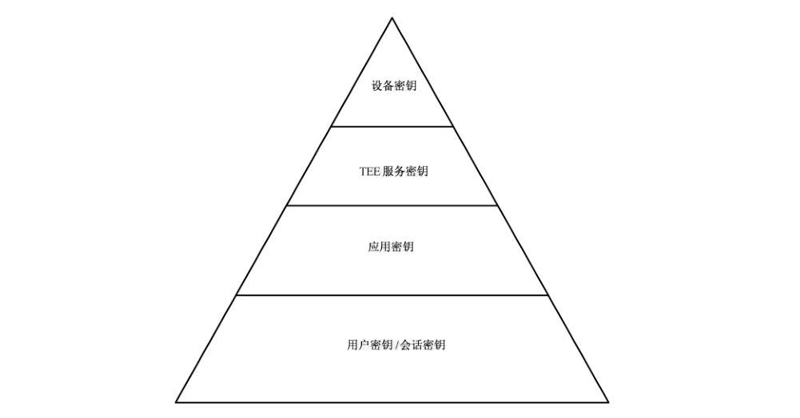

TEE 服务的密钥结构分为四层：设备密钥、TEE 服务密钥、应用密钥及用户密钥/会话密钥（可选）。具体描述如下。

a） 设备密钥：一对非对称密钥，包括设备私钥和设备公钥，用于验证设备真实性。设备密钥一般由设备提供商或其授权服务商提供。利用设备密钥保护 TEE服务公钥的完整性和真实性。

b） TEE服务密钥：一对非对称密钥，包括 TEE 服务私钥和 TEE 服务公钥，用于保证设备本地TEE 服务与TEE 服务后台的安全交互。利用 TEE 服务密钥保护应用公钥的完整性和真实性。

c） 应用密钥：一对非对称密钥，包括应用私钥和应用公钥，用于应用使用 TEE 服务时对用户密钥进行加密保护。

d） 用户密钥/会话密钥：一种对称密钥，用于为 TEE 服务加密敏感信息，保证数据在传输过程中的安全。

#### 6.2.3 密钥生成

设备密钥在设备生产阶段产生。TEE服务密钥在服务激活阶段由 TEE 服务在TEE 中产生，每台完成服务激活的设备拥有唯一TEE服务密钥。应用密钥在应用初始化阶段由 TEE 服务在TEE 中产生，每个应用在每台设备上拥有唯一应用密钥。用户密钥/会话密钥在 TEE 服务使用阶段由应用后台生成并安全下发到 TEE服务的TA中。

#### 6.2.4 密钥注入

设备密钥在生产线上通过设备厂商可控的环境注入设备的TEE中。TEE 服务密钥和应用密钥在设备 TEE 内生成。用户密钥/会话密钥应通过安全通道注入设备的 TEE 中。

#### 6.2.5 密钥更新

设备密钥不可更新，由设备厂商在生产线生成。TEE 服务密钥和应用密钥可更新并应保证唯一性，用户密钥/会话密钥可更新，当成功触发某种密钥的更新功能后，原有密钥应失效销毁。

#### 6.2.6 密钥存储

设备私钥、TEE服务私钥、应用私钥、用户密钥/会话密钥应在TEE中安全存储。应设计有销毁密钥的触发条件，当触发条件被触发时，销毁对应存储的密钥。

#### 6.2.7 密钥备份/恢复

TEE 服务应具备 TEE 服务密钥、应用密钥、用户密钥/会话密钥的备份/恢复功能。备份操作产生的备份数据应以密文形式存储到TEE 中。备份的密钥应恢复到TEE 服务中，不同设备之间不应相互备份恢复，密钥恢复的操作只能在 TEE 中进行。

### 6.3 服务初始化

#### 6.3.1 概述

应用使用 TEE 服务具体功能时，先启动服务初始化，生成应用所属的相关密钥。服务初始化包括服务激活、应用初始化与个性化。相关密钥应调用相应接口重新生成、更新。

#### 6.3.2 服务激活

设备首次使用 TEE 服务时，通过服务激活功能生成 TEE 服务公私钥对，并将 TEE 服务公钥传输至TEE服务后台。具体实施流程参考附录C的C.1.1。

服务激活功能的安全要求包括：

a） 应保证 TEE 服务密钥由 TEE 服务在 TEE 中生成，TEE 服务私钥不出 TEE；

b） 应保证 TEE 服务私钥存储的机密性、完整性；

c） 应利用设备密钥保护 TEE 服务公钥的真实性和完整性。

#### 6.3.3 应用初始化

应用调用初始化功能生成应用公私钥对，将应用公钥传输至应用后台。应用后台获取应用公钥后，生成用户密钥，将用户密钥安全传输至设备的TEE 服务中。具体实施流程参考C.1.2。

应用初始化功能的安全要求包括：

a） 应保证应用密钥由 TEE 服务在 TEE 中生成，应用私钥不出 TEE；

b） 应保证应用密钥存储的机密性、完整性；

c） 应保证应用密钥和用户密钥具有合理的更新策略；

d） 应保证用户密钥传输和存储的机密性、完整性及应用隔离，对用户密钥的机密性保护宜采用公钥加密技术。

#### 6.3.4 个性化

应用对TEE服务使用的图片、文字等展示信息以及会话密钥等密钥信息有个性化需求时，通过个性化功能将对应的个性化数据推送到TEE 服务中。具体实施流程参考C.1.3。

个性化的安全要求包括：

a） 应保证个性化数据在 REE 和网络中传输的机密性和完整性；

b） 应保证 TEE 服务存储个性化数据的机密性、完整性、应用隔离及用户隔离。

### 6.4 安全存储

TEE 服务中涉及的敏感数据应保证机密性和完整性，不应以明文形式暴露给 REE。

### 6.5 访问控制

限制未被授权的应用访问 TEE 服务，限制未被授权的TA访问 TEE 服务。

### 6.6 安全输入及输出

安全输入及输出的安全要求包括：

a） TEE 服务在使用过程中，用户与TEE 服务的交互流程和数据不能被 REE 或者其他TA访问和篡改；

b） 通过 TEE 服务输入的数据不应存放于共享内存中。

### 6.7 应用认证

TEE 服务应验证应用的真实性，对于非授权应用应拒绝任何服务。

### 6.8 通信要求

TEE 服务后台与TEE 服务代理应采用安全通道（如安全传输层协议等）进行数据传输。

## 7 特定 TEE 服务安全要求

### 7.1 TEE 人机交互服务安全要求

#### 7.1.1 总体安全要求

TEE 人机交互服务总体安全要求包括：

a） 应保证可信用户界面基于 TUI 构建；

b） 应保证可信用户界面包含安全指示器用于提示用户处于可信执行环境（可为一段文字、一个指示灯或其他形式），或采用其他明显区别于 REE 的操作方式让用户感知处于可信执行环境，如通过点击电源键方式提交信息；

c） 应保证只通过可信外设在可信用户界面上进行数据输入；

d） 可信外设应符合 GB/T 41388—2022 的相关要求。

#### 7.1.2 可信人机界面（TUI） 安全要求

可信人机界面（TUI）安全要求如下。

a） TUI 会话：

1） 使用基于 TUI 的界面服务时，TEE 服务对TUI 资源独占访问；TUI屏幕显示是原子性的；

2） TUI不会对 REE 的用户界面有干扰；只有TUI使用时，TEE 服务才能控制用户界面的输入和输出；

3） TUI 会话应有超时机制。

b） 电源及操作系统事件管理：

1） TUI会话期间当发生设备复位、设备关闭、睡眠模式打开、背景灯关闭等电源管理事件时，应触发 TUI 会话终止；

2） TUI会话期间当发生操作系统特定事件时，TUI 会话应被终止，典型的操作系统特定事件包括来电、日历事件、电子邮件通知等；其他操作系统特定事件宜根据应用实现需求自行定义；

3） 当TUI 会话终止时，TUI屏幕应从显示屏上消失，并将屏幕区的控制权交还给 REE；当REE 事件操作结束后，TEE 服务应根据需要重放被中断的 TUI 屏幕。

#### 7.1.3 特定功能安全要求

特定功能安全要求如下。

a） 口令输入/修改和注册登录功能的安全要求包括：

1） 应保证账户口令明文不从 TEE 泄露；

2） 应保证用于加密口令的密钥具有合理的更新策略，加密算法应遵循相关密码国家标准；

3） 对于设备本地存储口令的场景，应保证口令存储的机密性、完整性、应用隔离及用户隔离；

4） 对于应用后台存储口令的场景，应保证口令以密文形式在 REE 和网络中传输；

5） 宜采取一些措施对输入的口令进行保护，如口令输入框隐藏明文显示、对输入的口令作混淆处理、设置口令连续输入验证失败次数限制等。

b） 消息输出功能的安全要求包括：

1） 应保证发送给 TEE 服务的消息内容以密文形式在 REE 和网络中传输；

2） 应保证用于加密口令的密钥具有合理的更新策略。

### 7.2 TEE 二维码服务安全要求

#### 7.2.1 TEE 二维码展示安全要求

TEE 二维码展示的安全要求包括：

a） 应保证二维码展示的界面基于 TUI 构建；

b） 应保证二维码不以明文形式在网络和 REE 中传输，传输过程中不被泄露、窃取和篡改；

c） 宜放置一个安全指示器，用于标识当前界面处于可信执行环境中。

#### 7.2.2 TEE 二维码扫描安全要求

TEE 二维码扫描的安全要求包括：

a） 应保证扫描二维码的摄像头满足可信外设的要求；

b） 应保证二维码数据不以明文形式在网络和 REE 中传输，传输过程中不被泄露、窃取和篡改。

### 7.3 TEE 设备安全状态评价服务安全要求

#### 7.3.1 总体安全要求

TEE 设备安全状态评价服务总体安全要求包括：

a） 调用设备安全状态报告请求接口时，请求的报文应具备防止重放攻击的特性；

b） 设备安全状态报告应经过TEE 服务或TEE 服务后台签名，应用和应用后台应验证报告的完整性，确保报告无法被篡改。设备安全状态报告的内容应只限于简单的提示，不包含具体失败的原因。

#### 7.3.2 本地型安全要求

本地型 TEE设备安全状态评价服务应满足以下要求。

a） 因子采集过程的安全要求包括：

1） 含有采集因子的内存应在采集操作结束后擦除数据；

2） TEE 服务在发出采集命令前应验证 TEE 的安全状态。

b） 应用获取设备安全状态报告的安全要求包括：

1） 设备安全状态报告应在TEE 服务中根据收集的各项因子生成；

2） 设备安全状态报告不包含具体检测项的检测结果；

3） TEE 服务不暴露具体检测项的相关信息；

4） TEE服务应对设备安全状态报告的所有内容进行签名；

5） 应用在使用设备安全状态报告前应对设备安全状态报告的签名进行校验。

c） 其他 TA 获取设备安全状态报告的安全要求包括：

1） 设备安全状态报告应在 TEE 服务中根据收集的各项因子生成；

2） 设备安全状态报告不包含具体检测项的检测结果；

3） TEE 服务不暴露具体检测项的相关信息。

#### 7.3.3 远程型和混合型安全要求

远程型和混合型 TEE设备安全状态评价服务应满足以下要求。

a） 因子采集过程的安全要求包括：

1） 含有采集因子的内存应在采集操作结束后擦除数据；

2） TEE 服务在发出采集命令前应验证 TEE 的安全状态；

3） 收集的因子在发送到 TEE 服务后台前应进行脱敏处理。

b） 远程型及混合型都需要联网生成设备安全状态报告，安全要求包括：

1） 收集的因子应包括 TEE 服务和 TEE 服务代理的相关因子；

2） 收集的需要 TEE 服务后台检测的因子应由 TEE 服务加密；

3） 收集的需要 TEE 服务后台检测的因子应由 TEE 服务后台解密；

4） 远程型设备安全状态报告应在 TEE 服务后台中根据收集的各项因子生成，混合型设备安全状态报告应在 TEE 服务和 TEE服务后台中根据收集的各项因子生成；

5） 设备安全状态报告不包含具体检测项的检测结果；

6） TEE 服务和 TEE 服务后台不暴露具体检测项的相关信息；

7） TEE 服务和 TEE 服务后台应对设备安全状态报告的所有内容进行签名；

8） 使用者在使用设备安全状态报告前应对设备安全状态报告的签名进行校验。

### 7.4 TEE 身份鉴别服务安全要求

#### 7.4.1 口令鉴别服务安全要求

口令鉴别服务的安全要求包括：

a） 获取口令前应执行风险判断，检查当前环境的安全性；

b） 应基于 TUI 获取口令；

c） 鉴别结果应在 TEE 服务中加密后返回。

#### 7.4.2 生物特征鉴别服务安全要求

生物特征鉴别服务的安全要求如下。

a） 应在TEE 服务控制下采集生物特征样本或支持应用向应用后台请求获取用户生物特征注册样本。

b）应在本地进行生物特征活体检测或由TEE 服务后台进行远程活体检测。远程活体检测过程中，TEE服务和 TEE 服务后台的通信过程应加密传输生物特征样本。

c） 远程活体检测和生物特征比对过程中，TEE 服务和 TEE 服务后台的通信过程应加密传输生物特征样本。

d） 鉴别结果应在 TEE 服务中加密后返回。

e） 如需要存储用户的生物特征，应保证加密存储，并防止重放攻击。

#### 7.4.3 密码技术鉴别服务安全要求

基于密码技术鉴别服务的安全要求包括：

a） 如采用对称密码技术，应确保对称密钥的机密性和完整性，防止非授权用户访问和篡改，并防止重放攻击；

b） 如采用数字签名技术，应确保私钥的机密性和完整性，防止非授权用户访问和篡改，并防止重放攻击；应确保公钥的真实性，宜使用但不限于数字证书方式。

### 7.5 TEE 时间服务安全要求

TEE 时间服务的安全要求如下。

a） 应在TEE 服务中采集多来源的时间信息，对时间采集方式区分优先级，并对获取到的时间信息进行相互校验。时间来源可信度按照卫星时间（有可用卫星的情况下）、电信运营商时间、通过网络授时中心获取的时间排序。

b） TEE 服务返回给应用的时间信息中应同步提供时间来源，供应用参考及判断可信度。

c） TEE 服务返回给应用的时间相关信息应由 TEE服务签名，并防止重放攻击。

### 7.6 TEE 位置服务安全要求

TEE 位置服务的安全要求如下。

a） 应在 TEE 服务中采集多来源的位置信息，对位置采集方式区分优先级，并对获取到的位置信息进行相互校验。位置来源可信度按照卫星定位（有可用卫星的情况下）、电信运营商基站定位、基于短距通信设备（包括但不限于无线局域网、蓝牙等）的辅助定位排序。

b） TEE 服务返回给应用的信息中应同步提供位置信息来源，供应用参考及判断可信度。

c） TEE 服务宜同步提供定位辅助信息（如定位方式、定位模组是否有硬件防伪能力等），供应用进一步参考及判断可信度。

d）TEE 服务返回给应用的位置相关信息应由TEE服务签名，并防止重放攻击。

### 7.7 TEE 密码计算服务安全要求

TEE 密码计算服务的安全要求包括：

a） 访问 TEE密码计算服务前应通过身份鉴别和权限验证；

b） 应采用符合密码国家标准或行业标准的密码算法，如果使用的密码算法发现存在安全隐患应及时提供替代密码算法方案；

c） TEE 密码计算服务的密码算法和随机数生成应在 TEE 中实现；

d） 服务上线前完成程序代码缺陷检测并避免隐患，针对服务程序和运行环境的安全漏洞及时更新补丁等；

e） 支持一定时期内（如半年）的服务访问日志的安全存储，并支持服务访问日志的查询；

f） 支持定期更换密钥；

g） 支持密钥全生命周期管理，保证密钥的机密性、完整性。防止非授权用户访问或篡改，并防重放攻击。

## 8 TEE 服务通用安全测试评价方法

### 8.1 密钥管理

#### 8.1.1 基本要求

测试评价方法如下。

a） 测试方法：

1） 检查 TEE 服务的密钥管理机制，包括密钥的生成、注入、更新、存储、备份/恢复等整个生命周期，是否满足 GB/T 17901.1—2020 要求；

2） 检查 TEE 服务的密钥保护措施，尝试违反密钥预期用途滥用密钥，尝试未授权获取密钥。

b） 预期结果：

1） TEE 服务的密钥管理机制满足 GB/T 17901.1—2020 要求；

2） TEE 服务的密钥保护措施能够防止密钥的混用和泄露。

c） 结果判定：实际测试结果与预期结果一致则判定为符合，其他情况判定为不符合。

#### 8.1.2 密钥结构

测试评价方法如下。

a） 测试方法：检查 TEE 服务的密钥结构和各个密钥的用途，是否保证密钥用途的唯一性。

b） 预期结果：

1） TEE 服务的密钥结构分为设备密钥、TEE 服务密钥、应用密钥及用户密钥/会话密钥（可选）等四层；

2） TEE 服务的密钥具备唯一用途，其中设备密钥保护 TEE 服务公钥的完整性和真实性，TEE 服务密钥保护应用公钥的完整性和真实性，应用密钥保护用户密钥/会话密钥的机密性，用户密钥/会话密钥保护 TEE 服务的数据传输的安全性。

c） 结果判定：实际测试结果与预期结果一致则判定为符合，其他情况判定为不符合。

#### 8.1.3 密钥生成

测试评价方法如下。

a） 测试方法：检查 TEE 服务的各个密钥的生成过程，是否保证密钥的唯一性。

b） 预期结果：

1） 设备密钥在设备生产阶段由生产线产生，且每设备/批次唯一；

2） TEE 服务密钥在服务激活阶段由 TEE 服务在 TEE 中产生，且每设备唯一；

3） 应用密钥在应用初始化阶段由 TEE服务在TEE 中产生，且每设备唯一；

4） 用户密钥/会话密钥在 TEE 服务使用阶段由应用后台生成，且每用户/会话唯一。

c） 结果判定：实际测试结果与预期结果一致则判定为符合，其他情况判定为不符合。

#### 8.1.4 密钥注入

测试评价方法如下。

a） 测试方法：检查 TEE 服务的各个密钥的注入过程，是否保证密钥的安全注入，尝试未授权获取密钥。

b） 预期结果：

1） 设备密钥在生产线上通过设备厂商可控的环境注入设备的TEE 中；

2） TEE 服务密钥和应用密钥在设备 TEE 内生成；

3） 用户密钥/会话密钥通过安全通道注入设备的TEE中。

c） 结果判定：实际测试结果与预期结果一致则判定为符合，其他情况判定为不符合。

#### 8.1.5 密钥更新

测试评价方法如下。

a） 测试方法：

1） 检查 TEE 服务的各个密钥的更新过程，是否保证密钥的安全更新；

2） 尝试在密钥更新后，获取或恢复原有密钥。

b） 预期结果：

1） 设备密钥不可更新；

2） TEE服务密钥和应用密钥可更新。密钥更新成功后，原有密钥处于失效或销毁状态；

3） 用户密钥/会话密钥可更新。密钥更新成功后，原有密钥处于失效或销毁状态。

c） 结果判定：实际测试结果与预期结果一致则判定为符合，其他情况判定为不符合。

#### 8.1.6 密钥存储

测试评价方法如下。

a） 测试方法：

1） 检查 TEE 服务的各个密钥的存储过程，是否保证密钥的安全存储，尝试未授权访问或篡改存储的密钥；

2） 尝试在密钥销毁后，获取或恢复原有密钥。

b） 预期结果：

1） TEE 服务的各个密钥安全存储在 TEE 中，防止未授权访问或篡改；

2） 密钥销毁成功后，之前的密钥无法访问和恢复。

c） 结果判定：实际测试结果与预期结果一致则判定为符合，其他情况判定为不符合。

#### 8.1.7 密钥备份/恢复

测试评价方法如下。

a） 测试方法：

1） 检查 TEE 服务的各个密钥是否具备备份/恢复功能；

2） 执行密钥备份操作，检查备份数据的内容是否包含密钥明文，以及备份数据的存储方法；

3） 依次执行密钥备份操作和密钥恢复操作，检查操作是否成功；

4） 检查密钥恢复操作过程，是否仅在TEE 中进行；

5） 在一台设备上执行密钥备份操作，尝试使用密钥备份数据在另一台设备上执行密钥恢复操作，检查操作是否成功。

b） 预期结果：

1） TEE 服务具备 TEE 服务密钥、应用密钥、用户密钥/会话密钥的备份/恢复功能；

2） 备份操作产生的备份数据以密文形式存储到 TEE 中；

3） 备份的密钥应恢复到 TEE 服务中；

4） 密钥恢复的操作仅在TEE 中进行；

5） 不同设备之间无法相互备份恢复密钥。

c） 结果判定：实际测试结果与预期结果一致则判定为符合，其他情况判定为不符合。

### 8.2 服务初始化

#### 8.2.1 服务激活

测试评价方法如下。

a） 测试方法：

1）检查 TEE 服务的初始化过程，是否在 TEE 中生成 TEE服务公私钥对；

2） 检查 TEE 服务初始化过程中TEE 服务公私钥对的使用和传输过程，尝试获取和篡改所传输的 TEE 服务公钥，尝试在 REE 中访问 TEE 服务私钥；

3） 检查 TEE 服务初始化过程中TEE 服务公私钥对的存储过程，是否使用TEE 的可信存储功能保证密钥存储的机密性、完整性，尝试获取和篡改存储的TEE 服务密钥。

b） 预期结果：

1） 首次使用 TEE 服务时，TEE 服务通过激活功能在 TEE 中生成 TEE 服务公私钥对；

2） TEE 服务激活过程中，TEE 服务公钥由设备密钥签名后上传至 TEE 服务后台，TEE服务私钥不出 TEE；

3） TEE 服务激活过程中使用TEE 的可信存储功能保证 TEE 服务密钥存储的机密性、完整性。

c） 结果判定：实际测试结果与预期结果一致则判定为符合，其他情况判定为不符合。

#### 8.2.2 应用初始化

测试评价方法如下。

a） 测试方法：

1） 检查应用初始化过程，是否在 TEE 中生成应用公私钥对；

2） 检查应用初始化过程中应用公私钥对的使用和传输过程，尝试获取和篡改所传输的应用公钥，尝试在 REE 中访问应用私钥；

3） 检查应用初始化过程中用户密钥的生成和传输过程，尝试在 REE 中获取和篡改用户密钥；

4） 检查应用初始化过程中应用公私钥对和用户密钥的存储过程，是否使用 TEE 的可信存储功能保证密钥存储的机密性、完整性；

5） 尝试使用应用获取和篡改其他应用的用户密钥。

b） 预期结果：

1） 应用激活后，TEE 服务通过初始化功能在 TEE 中生成应用公私钥对；

2） 初始化过程中，应用公钥由 TEE 服务密钥签名后上传至应用后台，应用私钥不出 TEE；

3） 应用公钥上传至应用后台后，应用后台生成用户密钥，由应用密钥采用公钥加密技术将用户密钥下发至 TEE 服务中；

4） 初始化过程中，使用TEE 的可信存储功能保证应用密钥存储的机密性、完整性；

5） 初始化过程中应用密钥和用户密钥具有合理的更新策略；

6） 采用应用公钥加密用户密钥，保证用户密钥传输和存储的机密性、完整性和应用隔离。

c） 结果判定：实际测试结果与预期结果一致则判定为符合，其他情况判定为不符合。

#### 8.2.3 个性化

测试评价方法如下。

a） 测试方法：

1） 检查应用个性化过程中个性化数据的传输过程，尝试在 REE 和网络传输中获取和篡改个性化数据；

2） 检查应用个性化过程中个性化数据的存储过程，是否使用 TEE 的可信存储功能保证个性化数据的机密性、完整性；

3） 尝试使用应用获取和篡改其他应用的个性化数据。

b） 预期结果：

1） 个性化过程中保证个性化数据在 REE 和网络中传输的机密性和完整性；

2） 个性化过程中保证 TEE 服务存储个性化数据的机密性、完整性、应用隔离和用户隔离。

c） 结果判定：实际测试结果与预期结果一致则判定为符合，其他情况判定为不符合。

### 8.3 安全存储

测试评价方法如下。

a） 测试方法：

1） 审查厂商提交的文档，检查 TEE 服务的敏感信息处理过程；

2） 尝试在 REE 中获取和篡改 TEE服务的敏感信息；

3） 尝试获取和篡改 TEE 服务存储在 TEE 可信存储区域的敏感信息。

b） 预期结果：保证 TEE 服务中涉及的敏感安全信息的机密性和完整性，不以明文形式暴露给 REE。

c） 结果判定：实际测试结果与预期结果一致则判定为符合，其他情况判定为不符合。

### 8.4 访问控制

测试评价方法如下。

a） 测试方法：

1） 审查厂商提交的文档，检查TEE服务的访问控制策略，根据策略分别尝试通过已授权和未授权的应用和 TA 访问 TEE 服务，验证策略是否有效；

2） 当多个应用在同一个设备上访问TEE服务，尝试通过某一应用访问其他应用的数据，验证 TEE 服务是否隔离不同应用敏感数据。

b） 预期结果：

1） TEE 服务具备访问控制机制，限制未被授权的应用和 TA 访问TEE 服务；

2） 多个应用在同一个设备上有调用TEE服务的需求时，TEE 服务安全隔离各应用的敏感数据。

c） 结果判定：实际测试结果与预期结果一致则判定为符合，其他情况判定为不符合。

### 8.5 安全输入及输出

测试评价方法如下。

a） 测试方法：

1） 审查厂商提交的文档，检查 TEE 服务的输入和输出过程；

2） 模拟应用调用 TEE 服务的输入和输出过程，尝试在 REE 或其他 TA 中访问和篡改该 TEE 服务的交互数据；

3） 模拟应用调用 TEE 服务的输入过程，尝试读取共享内存数据。

b） 预期结果：

1） TEE 服务在使用过程中，用户与 TEE服务的交互流程和数据具备安全防护机制，无法被REE 或者其他 TA 访问和篡改；

2） TEE 服务的输入过程中，通过TEE服务输入的数据未存放于共享内存中。

c） 结果判定：实际测试结果与预期结果一致则判定为符合，其他情况判定为不符合。

### 8.6 应用认证

测试评价方法如下。

a） 测试方法：

1） 审查厂商提交的文档，检查应用的访问控制策略；

2） 分别尝试通过已授权和未授权应用调用TEE 服务，验证访问控制策略是否有效。

b） 预期结果：TEE 服务验证应用的真实性，对于非授权应用拒绝任何服务。

c） 结果判定：实际测试结果与预期结果一致则判定为符合，其他情况判定为不符合。

### 8.7 通信要求

测试评价方法如下。

a） 测试方法：

1）审查厂商提交的文档，检查 TEE 服务后台与 TEE 服务代理的数据传输过程，是否具备安全通道；

2） 模拟应用调用TEE服务，尝试获取和篡改 TEE 服务后台与TEE 服务代理的传输数据。

b） 预期结果：TEE 服务后台与 TEE 服务代理采用安全通道进行数据传输。

c） 结果判定：实际测试结果与预期结果一致则判定为符合，其他情况判定为不符合。

## 9 特定 TEE 服务安全测试评价方法

### 9.1 TEE 人机交互服务

#### 9.1.1 总体安全要求

测试评价方法如下。

a） 测试方法：

1） 审查厂商提交的文档，检查可信用户界面的实现机制，是否基于 TUI 构建；

2） 检查设计文档，模拟应用调用TEE 人机交互服务，检查各功能的界面是否包含安全指示器，或是否采用其他明显区别于 REE 的操作方式让用户感知处于可信执行环境；

3） 模拟应用调用可信用户界面，分别尝试通过可信外设和非可信外设进行数据输入，验证是否只有可信外设进行数据输入；

4） 检查可信外设是否符合 GB/T 41388—2022 的相关要求。

b） 预期结果：

1） 可信用户界面基于 TUI 构建；

2） 应保证可信用户界面包含安全指示器用于提示用户处于可信执行环境（可为一段文字、一个指示灯或其他形式），或采用其他明显区别于 REE 的操作方式让用户感知处于可信执行环境，如通过点击电源键方式提交信息；

3） 只有通过可信外设在可信用户界面上输入数据；

4） 可信外设满足 GB/T 41388—2022的相关要求。

c） 结果判定：实际测试结果与预期结果一致则判定为符合，其他情况判定为不符合。

#### 9.1.2 可信人机界面（TUI） 安全要求

##### 9.1.2.1 TUI 会话

测试评价方法如下。

a） 测试方法：

1） 审查厂商提交的文档，检查基于 TUI界面的 TEE 服务的实现过程；

2） 模拟应用调用基于 TUI 界面的TEE 服务，尝试在 REE 或未授权 TA 中访问 TUI 资源；

3） 模拟应用调用基于 TUI 界面的 TEE 服务，检查用户界面的显示和切换过程，验证 TUI 是否干扰 REE 的用户界面；在 REE 控制用户界面时，尝试通过 TEE 服务控制用户的输入和输出；

4） 模拟应用调用基于 TUI界面的TEE 服务，达到厂商声明的时间后，检查 TUI 会话是否超时退出。

b） 预期结果：

1） 使用基于 TUI 的界面服务时，TEE 服务对 TUI 资源独占访问，TUI 屏幕显示是原子性的；

2） TUI 不会对 REE 的用户界面有干扰；只有 TUI 使用时，TEE 服务才能控制用户界面的输入和输出；

3） TUI 会话具备超时机制。

c） 结果判定：实际测试结果与预期结果一致则判定为符合，其他情况判定为不符合。

##### 9.1.2.2 电源及操作系统事件管理

测试评价方法如下。

a） 测试方法：

1） 模拟应用调用基于 TUI界面的TEE 服务，分别执行设备复位、设备关闭、睡眠模式打开、背景灯关闭等操作，检查 TUI 会话是否终止；

2） 模拟应用调用基于 TUI 界面的TEE 服务，分别执行来电、日历事件、电子邮件通知等操作，检查 TUI 会话是否终止；

3） 模拟应用调用基于 TUI 界面的TEE服务，当 TUI 会话终止时，检查TUI屏幕是否从显示屏上消失，是否将屏幕区的控制权交还给 REE；

4） 模拟应用调用基于 TUI界面的TEE 服务，分别执行来电、日历事件、电子邮件通知等操作使 TUI会话终止，上述操作处理结束后，检查 TEE 服务是否重放被中断的TUI屏幕。

b） 预期结果：

1） TUI会话期间发生设备复位、设备关闭、睡眠模式打开、背景灯关闭等电源管理事件时，TUI 会话终止；

2） TUI 会话期间发生来电、日历事件、电子邮件通知等操作系统特定事件时，TUI会话终止；

3） 当TUI 会话终止时，TUI屏幕从显示屏上消失，并将屏幕区的控制权交还给 REE；

4） 当REE 事件操作结束后，TEE 服务应重放被中断的TUI屏幕。

c） 结果判定：实际测试结果与预期结果一致则判定为符合，其他情况判定为不符合。

#### 9.1.3 特定功能安全要求

##### 9.1.3.1 口令输入/修改和注册登录

测试评价方法如下。

a） 测试方法：

1） 审查厂商提交的文档，检查用于加密口令的密钥的更新策略以及使用的加密算法；

2） 模拟应用调用可信用户界面的口令输入/修改、注册登录功能，尝试在 REE 中获取可信用户界面的口令，检查该功能是否保证口令的机密性；

3） 当设备本地存储口令时，检查是否使用TEE 的可信存储功能存储口令；尝试使用应用获取和篡改其他应用存储的口令；

4） 当应用后台存储口令时，尝试在 REE 和网络传输中获取和篡改口令；

5） 模拟应用调用可信用户界面的口令输入和口令修改功能，检查是否采取一些措施对输入的账号口令进行保护，如口令输入框是否明文显示口令、对输入的口令作混淆处理、连续输入错误的口令检查该功能是否具备口令连续输入验证失败次数限制等。

b） 预期结果：

1） 账户口令明文不从 TEE泄露；

2） 口令输入/修改、注册登录功能具备合理的口令加密密钥更新策略，加密算法遵循相关密码国家标准；

3） 对于设备本地存储口令的场景，口令输入和口令修改功能使用 TEE 的可信存储功能保证口令存储的机密性、完整性、应用隔离及用户隔离；

4） 对于应用后台存储口令的场景，口令输入和口令修改功能以密文形式在 REE 和网络中传输口令；

5） 口令输入和口令修改功能采取一些措施对输入的账号口令进行保护，如账户口令输入框隐藏明文显示、对输入的口令作混淆处理、设置账户口令连续输入验证失败次数限制并提示剩余输入机会次数等。

c） 结果判定：实际测试结果与预期结果一致则判定为符合，其他情况判定为不符合。

##### 9.1.3.2 消息输出

测试评价方法如下。

a） 测试方法：

1） 模拟应用调用可信用户界面的消息输出功能，尝试在 REE 和网络传输中获取可信用户界面的消息；

2） 审查厂商提交的文档，检查用于加密口令的密钥的更新策略。

b） 预期结果：

1） 消息输出功能发送给TEE 服务的消息内容是以密文形式在 REE 和网络中传输；

2） 消息输出功能具备合理的口令加密密钥更新策略。

c） 结果判定：实际测试结果与预期结果一致则判定为符合，其他情况判定为不符合。

### 9.2 TEE 二维码服务

#### 9.2.1 TEE 二维码展示安全要求

测试评价方法如下。

a） 测试方法：

1） 模拟应用调用二维码展示功能，检查展示界面是否基于 TUI 构建；

2） 模拟应用调用二维码展示功能，尝试在 REE 和网络传输中获取和篡改二维码；

3） 模拟应用调用二维码展示功能，检查展示界面是否包含安全指示器。

b） 预期结果：

1） 二维码展示界面基于 TUI构建；

2） 二维码不以明文形式在 REE 和网络中传输，传输过程中不被泄露、窃取和篡改；

3） 宜放置一个安全指示器，用于标识当前界面处于可信执行环境中。

c） 结果判定：实际测试结果与预期结果一致则判定为符合，其他情况判定为不符合。

#### 9.2.2 TEE 二维码扫描安全要求

测试评价方法如下。

a） 测试方法：

1） 审查厂商提交的文档，检查二维码读取过程。模拟应用调用扫描二维码功能，尝试在REE 中控制摄像头读取二维码数据；

2） 模拟应用调用扫描二维码功能，尝试在 REE 中获取二维码数据。

b） 预期结果：

1） 扫描二维码的摄像头满足可信外设的要求；

2） 扫描二维码时，二维码数据不以明文形式在网络和 REE 中传输，传输过程中不被泄露、窃取和篡改。

c） 结果判定：实际测试结果与预期结果一致则判定为符合，其他情况判定为不符合。

### 9.3 TEE 设备安全状态评价服务

#### 9.3.1 整体安全要求

测试评价方法如下。

a） 测试方法：

1） 模拟应用分别调用本地型/远程型/混合型TEE 设备安全状态评价服务，检查设备安全状态报告的请求报文，尝试重放之前的请求报文；

2） 模拟应用分别调用本地型/远程型/混合型TEE设备安全状态评价服务，检查设备安全状态报告是否经过TEE 服务或TEE 服务后台签名，尝试篡改设备安全状态报告内容；

3） 模拟应用分别调用本地型/远程型/混合型 TEE 设备安全状态评价服务，检查设备安全状态报告中建议事项的内容是否包含具体失败的原因。

b） 预期结果：

1） 设备安全状态报告的请求报文具备防重放攻击的特性；

2） 设备安全状态报告经过 TEE 服务或 TEE 服务后台签名，应用和应用后台应验证报告的完整性，确保报告无法被篡改；

3） 设备安全状态报告中建议事项的内容只限于简单的提示，不包含具体失败的原因。

c） 结果判定：实际测试结果与预期结果一致则判定为符合，其他情况判定为不符合。

#### 9.3.2 本地型安全要求

测试评价方法如下。

a） 测试方法：

1） 检查设计文档，模拟应用调用本地型 TEE 设备安全状态评价服务，在采集因子操作结束后，尝试读取内存数据，验证内存数据中是否含有采集因子；

2） 模拟应用调用本地型 TEE 设备安全状态评价服务，尝试绕过 TEE 安全状态验证环节，验证因子采集过程是否执行成功；

3） 检查设计文档，分别模拟应用和其他 TA 调用本地型TEE 设备安全状态评价服务，检查设备安全状态报告的生成是否在 TEE 服务中完成；

4） 分别模拟应用和其他TA 调用本地型TEE 设备安全状态评价服务，检查设备安全状态报告是否包含具体检测项的检测结果；

5） 分别模拟应用和其他TA 调用本地型TEE 设备安全状态评价服务，尝试通过TEE 服务获取具体检测项的相关信息；

6） 模拟应用调用本地型TEE 设备安全状态评价服务，尝试在应用使用设备安全状态报告前篡改报告，检查应用是否能够检测报告已被篡改。

b） 预期结果：

1） 在采集操作结束后擦除含有采集因子的内存数据；

2） TEE 服务在发出采集命令前验证 TEE 的安全状态；

3） 设备安全状态报告在TEE 服务中根据收集的各项因子生成；

4） 设备安全状态报告不包含具体检测项的检测结果；

5） TEE 服务未暴露具体检测项的相关信息；

6） 应用获取设备安全状态报告时TEE 服务对设备安全状态报告的所有内容进行签名；

7） 应用在使用设备安全状态报告前对设备安全状态报告的签名进行校验。

c） 结果判定：实际测试结果与预期结果一致则判定为符合，其他情况判定为不符合。

#### 9.3.3 远程型和混合型安全要求

测试评价方法如下。

a） 测试方法：

1） 检查设计文档，模拟应用调用远程型和混合型 TEE 设备安全状态评价服务，在采集因子操作结束后，尝试读取内存数据，验证内存数据中是否含有采集因子；

2） 检查设计文档，模拟应用调用远程型和混合型 TEE 设备安全状态评价服务，尝试绕过TEE 安全状态验证环节，验证因子采集过程是否执行成功；

3） 检查设计文档，模拟应用调用远程型和混合型TEE设备安全状态评价服务，尝试获取向TEE 服务后台传输的采集因子；

4） 检查设计文档，模拟应用调用远程型和混合型TEE 设备安全状态评价服务，检查收集的因子是否包括 TEE 服务和 TEE 服务代理的相关因子；

5） 检查设计文档，模拟应用调用远程型和混合型TEE 设备安全状态评价服务，检查远程型设备安全状态报告的生成是否在 TEE 服务后台完成，混合型设备安全状态报告是否在TEE 服务和 TEE 服务后台完成；

6） 模拟应用调用远程型和混合型 TEE 设备安全状态评价服务，检查设备收集的因子是否由 TEE 服务加密后传输至 TEE 服务后台，尝试在 REE 和网络传输中获取设备收集的因子；

7） 模拟应用调用远程型和混合型TEE 设备安全状态评价服务，检查设备安全状态报告是否包含具体检测项的检测结果；

8） 模拟应用调用远程型和混合型TEE设备安全状态评价服务，尝试通过TEE 服务和 TEE服务后台获取具体检测项的相关信息；

9） 模拟应用调用远程型和混合型TEE设备安全状态评价服务，尝试在使用者使用设备安全状态报告前篡改报告，检查使用者是否能够检测报告已被篡改。

b） 预期结果：

1） 在采集操作结束后擦除含有采集因子的内存数据；

2） TEE 服务在发出采集命令前验证 TEE 的安全状态；

3） 收集的因子在发送到 TEE 服务后台前进行脱敏处理；

4） 远程型设备安全状态报告在 TEE 服务后台中根据收集的各项因子生成，混合型设备安全状态报告在 TEE 服务和 TEE 服务后台中根据收集的各项因子生成；

5） 远程型和混合型 TEE 设备安全状态评价服务收集的需要 TEE 服务后台检测的因子由TEE服务加密，并由 TEE 服务后台解密；

6） 设备安全状态报告不包含具体检测项的检测结果；

7） TEE 服务和 TEE 服务后台未暴露具体检测项的相关信息；

8） TEE 服务和 TEE 服务后台对设备安全状态报告的所有内容进行签名；

9） 使用者在使用设备安全状态报告前对设备安全状态报告的签名进行校验。

c） 结果判定：实际测试结果与预期结果一致则判定为符合，其他情况判定为不符合。

### 9.4 TEE 身份鉴别服务

#### 9.4.1 口令鉴别服务安全要求

测试评价方法如下。

a） 测试方法：

1） 检查设计文档，模拟应用调用口令鉴别服务，检查调用过程是否基于 TUI，尝试在 REE 中获取输入的口令；

2） 改变设备环境的安全状态，模拟应用调用口令鉴别服务，验证获取口令前该功能是否执行当前环境的风险判断；

3） 模拟应用调用口令鉴别服务，检查鉴别结果是否在TEE 服务中加密后返回，尝试篡改鉴别结果。

b） 预期结果：

1） 口令鉴别服务基于 TUI 获取口令；

2） 口令鉴别服务获取口令前执行风险判断，检查当前环境的安全性；

3） 鉴别结果在 TEE服务中加密后返回。

c） 结果判定：实际测试结果与预期结果一致则判定为符合，其他情况判定为不符合。

#### 9.4.2 生物特征鉴别服务安全要求

测试评价方法如下。

a） 测试方法：

1） 检查设计文档，模拟应用调用生物特征鉴别服务，若生物特征样本采集在本地进行，尝试在 REE 中控制采集过程；若生物特征样本来自应用后台，尝试篡改传输的用户生物特征注册样本。

2） 模拟应用调用生物特征鉴别服务，检查生物特征活体检测过程是否在本地进行或由 TEE服务后台进行远程活体检测。若支持远程活体检测，尝试获取和篡改传输的生物特征样本。

3） 模拟应用调用生物特征鉴别服务，检查生物特征活体比对过程是否在本地进行或由 TEE服务后台进行远程生物特征比对。若支持远程生物特征比对，尝试获取和篡改传输的生物特征样本。

4） 模拟应用调用生物特征鉴别服务，检查鉴别结果是否在 TEE 服务中加密后返回，尝试篡改鉴别结果。

5） 模拟应用调用生物特征鉴别服务，在需要存储用户生物特征的场景，检查生物特征是否加密存储，尝试获取生物特征；模拟应用调用生物特征鉴别服务，尝试重放攻击。

b） 预期结果：

1） 生物特征鉴别服务采集生物特征样本时在TEE服务控制下或支持应用向应用后台请求获取用户生物特征注册样本。

2） 生物特征鉴别服务的生物特征活体检测过程在本地进行或由TEE服务后台进行。远程活体检测过程中，TEE 服务和 TEE 服务后台的通信过程加密传输生物特征样本。

3） 生物特征鉴别服务的生物特征比对过程在本地进行或由 TEE 服务后台进行。生物特征比对过程中，TEE服务和 TEE 服务后台的通信过程加密传输生物特征样本。

4） 鉴别结果在 TEE 服务中加密后返回。

5） 如需要存储用户的生物特征，应保证加密存储，并防止重放攻击。

c） 结果判定：实际测试结果与预期结果一致则判定为符合，其他情况判定为不符合。

#### 9.4.3 密码技术鉴别服务安全要求

测试评价方法如下。

a） 测试方法：

1） 检查设计文档，确认基于密码技术鉴别服务的实现方式；

2） 如采用对称密码技术实现方式，检查对称密钥的访问控制策略，尝试使用未授权用户访问和篡改密钥；模拟应用调用密码鉴别服务，尝试重放攻击；

3） 如采用数字签名技术实现方式，检查私钥的访问控制策略，尝试使用未授权用户访问和篡改私钥；检查公钥的使用和存储方式，尝试篡改和伪造公钥；模拟应用调用密码鉴别服务，尝试重放攻击。

b） 预期结果：

1） 密码鉴别服务采用对称密码技术实现时，能够保证对称密钥的机密性和完整性，并能够防止重放攻击；

2） 密码鉴别服务采用数字签名技术实现时，能够保证私钥的机密性和完整性，以及公钥的真实性，并能够防止重放攻击。

c） 结果判定：实际测试结果与预期结果一致则判定为符合，其他情况判定为不符合。

### 9.5 TEE 时间服务

测试评价方法如下。

a） 测试方法：

1） 检查设计文档，模拟应用调用TEE 时间服务，尝试在 REE 中篡改不同时间来源的时间，包括但不限于卫星时间、电信运营商时间、通过网络授时中心获取的时间等，检查调用结果是否提供正确的时间信息及其来源；

2） 模拟应用调用TEE 时间服务，检查返回的时间信息是否在TEE 服务中签名，尝试篡改时间信息，检查应用是否能够检测时间信息已被篡改；模拟应用调用TEE 时间服务，尝试重放攻击。

b） 预期结果：

1） TEE 时间服务采集多来源的时间信息，区分优先级，并相互校验，时间来源可信度按照卫星时间（有可用卫星的情况下）、电信运营商时间、通过网络授时中心获取的时间排序；

2） TEE 服务返回的时间信息中同步提供时间信息来源，供应用参考及判断可信度；

3） TEE 服务返回的时间信息由 TEE 服务签名，并防止重放攻击。

c） 结果判定：实际测试结果与预期结果一致则判定为符合，其他情况判定为不符合。

### 9.6 TEE 位置服务

测试评价方法如下。

a） 测试方法：

1） 检查设计文档，模拟应用调用 TEE 位置服务，尝试在 REE 中篡改不同来源的信息，包括但不限于卫星定位、基站定位、短距通信设备辅助定位等，检查调用结果是否提供正确的位置信息及其来源；

2） 模拟应用调用TEE 位置服务，检查返回的位置信息是否在TEE 服务中签名，尝试篡改位置信息，检查应用是否能够检测位置信息已被篡改；模拟应用调用TEE 位置服务，尝试重放攻击。

b） 预期结果：

1）TEE 位置服务采集多来源的设备位置信息，区分优先级，并相互校验。位置信息来源可信度按卫星定位（有可用卫星的情况下）、电信运营商基站定位、基于短距通信设备（包括但不限于无线局域网、蓝牙等）排序。

2） TEE 服务返回的位置信息中同步提供位置信息来源。

3） TEE 服务返回的位置信息应由TEE 服务签名，并防止重放攻击。

c） 结果判定：实际测试结果与预期结果一致则判定为符合，其他情况判定为不符合。

### 9.7 TEE 密码计算服务

测试评价方法如下。

a） 测试方法：

1） 检查设计文档，模拟应用调用 TEE密码计算服务，检查是否具备身份鉴别和权限验证过程，分别尝试绕过身份鉴别环节和未授权调用 TEE密码计算服务；

2） 模拟应用调用TEE 密码计算服务，验证支持的密码算法不存在已公开脆弱性；

3） 模拟应用调用 TEE 密码计算服务，包括但不限于数据加密及解密、消息摘要、消息鉴别码、数字签名及验签和随机数生成等功能，功能测试细节宜参考相关国家标准；尝试在REE 中篡改密钥和随机数，检查调用结果是否提供正确的计算结果；

4） 模拟应用调用 TEE 密码计算服务，检查该服务是否生成服务访问日志并查询日志，尝试未授权篡改相关日志；

5） 模拟应用调用 TEE密码计算服务，检查是否支持更换密钥；

6） 模拟应用调用TEE 密码计算服务，尝试使用未授权用户访问和篡改密钥，尝试重放攻击。

b） 预期结果：

1） 访问 TEE 密码计算服务前应通过身份鉴别和权限验证；

2） TEE 密码计算服务采用符合密码国家标准或行业标准的密码算法，如果使用的密码算法发现存在安全隐患能及时提供替代密码算法方案；

3） TEE 密码计算服务支持数据加密及解密、消息摘要、消息鉴别码、数字签名及验签和随机数生成等功能，密码算法和随机数生成在 TEE 中实现；

4） TEE 密码计算服务上线前完成程序代码缺陷检测并避免隐患，针对服务程序和运行环境的安全漏洞及时更新补丁；

5） TEE密码计算服务支持一定时期内（如半年）的服务访问日志的安全存储，并支持查询服务访问日志；

6） TEE 密码计算服务支持定期更换密钥；

7） TEE 密码计算服务支持密钥全生命周期管理，保证密钥的机密性、完整性。防止非授权用户访问或篡改，并防重放攻击。

c） 结果判定：实际测试结果与预期结果一致则判定为符合，其他情况判定为不符合。

## 附录 A（资料性）TEE 设备安全状态评价服务采集因子示例

TEE 设备安全状态评价服务采集因子示例如下。

a） TEE 服务代理采集信息内容一般包括：

1） 系统分区信息（如：DM-Verity）；

2） Root 工具、恶意软件（如：基于黑名单检查常见的Root 工具及恶意程序）；

3） 系统是否在调试模式或开发模式（如：adb root 权限检查、系统属性中调试开关检查、模拟器检测）；

4） 系统安全设定（如：检查是否设定屏幕锁定，SElinux 是否开启）；

5） 关键内存区域的属性及访问权限（如：摄像头共享内存等）；

6） TEE 服务控件的软件版本；

7） TEE 服务控件的签名；

8） TEE 服务控件运行模式（调试模式或产品模式）；

9） REE 操作系统软件版本号及安全更新版本号；

10） 设备相关识别码（如：制造商识别码、产品识别码、装置识别码）。

b） TEE服务采集信息内容一般包括：

1） 启动参数（如：设备锁定、安全启动等配置参数）；

2） 可信设备标识；

3） TEE 服务的软件版本；

4） TEE 服务的签名；

5） TEE 服务运行模式（调试模式或产品模式）；

6） 可信执行环境运行模式（调试模式或产品模式）。

## 附录 B（资料性）服务接口

### B.1 初始化

#### B.1.1 接口

`public void init(Bundle data, TSCallBack callback)`

#### B.1.2 接口描述

进行 TEE 服务激活和初始化。

#### B.1.3 输入参数

输入参数如表 B.1 所示。

**表 B.1 初始化接口输入参数**

| 变量名 | 类型 | 属性 | 描述 | 备注 |
| --- | --- | --- | --- | --- |
| insCode | String | M | 第三方代码 | — |

示例：

```java
Bundle data = new Bundle();
data.putString("insCode", "00010000");
```

#### B.1.4 返回参数

接口返回值：无。

（TSCallBack）callback：异步接口回调函数。

失败时回调 onError（String errorCode, String erroMsg），失败的返回参数如表 B.2 所示。

**表 B.2 初始化接口失败返回参数**

| 变量名 | 类型 | 属性 | 描述 | 备注 |
| --- | --- | --- | --- | --- |
| errorCode | String | M | 错误码 | — |
| erroMsg | String | M | 错误信息 | — |

成功时回调 onSuccess（Bundle result），结果在 Bundle 对象中获取，成功的返回参数如表 B.3 所示。

**表 B.3 初始化接口成功返回参数**

| 变量名 | 类型 | 属性 | 描述 | 备注 |
| --- | --- | --- | --- | --- |
| status | String | M | 执行状态 | — |

示例：

```java
String status = result.getString("status");
```

### B.2 个性化信息生成

#### B.2.1 接口

`public void personalize(Bundle data, TSCallBack callback)`

#### B.2.2 接口描述

向应用后台申请个性化数据，并传送给 TEE 服务。

#### B.2.3 输入参数

输入参数如表 B.4 所示。

**表 B.4 个性化信息生成接口输入参数**

| 变量名 | 类型 | 属性 | 描述 | 备注 |
| --- | --- | --- | --- | --- |
| insCode | String | M | 第三方代码 | — |

示例请参考表 B.1。

#### B.2.4 返回参数

接口返回值：无。

（TSCallBack）callback：异步接口回调函数。

失败时回调 onError（String errorCode, String erroMsg），失败的返回参数如表 B.5 所示。

**表 B.5 个性化信息生成接口失败返回参数**

| 变量名 | 类型 | 属性 | 描述 | 备注 |
| --- | --- | --- | --- | --- |
| errorCode | String | M | 错误码 | — |
| erroMsg | String | M | 错误信息 | — |

成功时回调 onSuccess（Bundle result），结果在 Bundle 对象中获取，成功的返回参数如表 B.6 所示。

**表 B.6 个性化信息生成接口成功返回参数**

| 变量名 | 类型 | 属性 | 描述 | 备注 |
| --- | --- | --- | --- | --- |
| status | String | M | 执行状态 | — |

示例请参考表 B.3。

### B.3 TEE 二维码展示

#### B.3.1 接口

`public void twoDimBarcodesShow(Bundle data, TSCallBack callback)`

#### B.3.2 接口描述

展示二维码，将应用传送来的二维码数据密文解密，在 TEE 下进行展示。

#### B.3.3 输入参数

输入参数如表 B.7 所示。

**表 B.7 TEE 二维码展示接口输入参数**

| 变量名 | 类型 | 属性 | 描述 | 备注 |
| --- | --- | --- | --- | --- |
| insCode | String | M | 第三方代码 | — |
| qrCode | String | M | 二维码数据密文 | — |

示例请参考表 B.1。

#### B.3.4 返回参数

接口返回值：无。

（TSCallBack）callback：异步接口回调函数。

失败时回调 onError（String errorCode, String erroMsg），失败的返回参数如表 B.8 所示。

**表 B.8 TEE 二维码展示接口失败返回参数**

| 变量名 | 类型 | 属性 | 描述 | 备注 |
| --- | --- | --- | --- | --- |
| errorCode | String | M | 错误码 | — |
| erroMsg | String | M | 错误信息 | — |

成功时回调 onSuccess（Bundle result），结果在 Bundle 对象中获取，成功的返回参数如表 B.9 所示。

**表 B.9 TEE 二维码展示接口成功返回参数**

| 变量名 | 类型 | 属性 | 描述 | 备注 |
| --- | --- | --- | --- | --- |
| status | String | M | 执行状态 | — |

示例请参考表 B.3。

### B.4 二维码关闭

#### B.4.1 接口

`public void twoDimBarcodesClose(Bundle data, TSCallBack callback)`

#### B.4.2 接口描述

关闭二维码界面。

#### B.4.3 输入参数

输入参数如表 B.10 所示。

**表 B.10 二维码关闭接口输入参数**

| 变量名 | 类型 | 属性 | 描述 | 备注 |
| --- | --- | --- | --- | --- |
| insCode | String | M | 第三方代码 | — |

示例请参考表 B.1。

#### B.4.4 返回参数

接口返回值：无。

（TSCallBack）callback：异步接口回调函数。

失败时回调 onError（String errorCode, String erroMsg），失败的返回参数如表 B.11 所示。

**表 B.11 二维码关闭接口失败返回参数**

| 变量名 | 类型 | 属性 | 描述 | 备注 |
| --- | --- | --- | --- | --- |
| errorCode | String | M | 错误码 | — |
| erroMsg | String | M | 错误信息 | — |

成功时回调 onSuccess（Bundle result），结果在 Bundle 对象中获取，成功的返回参数如表 B.12 所示。

**表 B.12 二维码关闭接口成功返回参数**

| 变量名 | 类型 | 属性 | 描述 | 备注 |
| --- | --- | --- | --- | --- |
| status | String | M | 执行状态 | — |

示例请参考表 B.3。

### B.5 TEE 扫二维码

#### B.5.1 接口

`public void twoDimBarcodesScan(Bundle data, TSCallBack callback)`

#### B.5.2 接口描述

进行二维码扫码，将扫描的二维码数据加密，返回给应用。

#### B.5.3 输入参数

输入参数如表 B.13 所示。

**表 B.13 可信扫二维码接口输入参数**

| 变量名 | 类型 | 属性 | 描述 | 备注 |
| --- | --- | --- | --- | --- |
| insCode | String | M | 第三方代码 | — |

示例请参考表 B.1。

#### B.5.4 返回参数

接口返回值：无。

（TSCallBack）callback：异步接口回调函数。

失败时回调 onError（String errorCode, String erroMsg），失败的返回参数如表 B.14 所示。

**表 B.14 TEE 扫二维码接口失败返回参数**

| 变量名 | 类型 | 属性 | 描述 | 备注 |
| --- | --- | --- | --- | --- |
| errorCode | String | M | 错误码 | — |
| erroMsg | String | M | 错误信息 | — |

成功时回调 onSuccess（Bundle result），结果在 Bundle 对象中获取，成功的返回参数如表 B.15 所示。

**表 B.15 TEE 扫二维码接口成功返回参数**

| 变量名 | 类型 | 属性 | 描述 | 备注 |
| --- | --- | --- | --- | --- |
| status | String | M | 执行状态 | — |
| qrCode | String | M | 二维码数据密文 | — |

示例请参考表 B.3。

### B.6 口令展示

#### B.6.1 接口

`public void displayPinPad(Bundle data, TSCallBack callback)`

#### B.6.2 接口描述

展示口令界面。

#### B.6.3 输入参数

输入参数如表 B.16 所示。

**表 B.16 口令展示接口输入参数**

| 变量名 | 类型 | 属性 | 描述 | 备注 |
| --- | --- | --- | --- | --- |
| insCode | String | M | 第三方代码 | — |

示例请参考表 B.1。

#### B.6.4 返回参数

接口返回值：无。

（TSCallBack）callback：异步接口回调函数。

失败时回调 onError（String errorCode, String erroMsg），失败的返回参数如表 B.17 所示。

**表 B.17 口令展示接口失败返回参数**

| 变量名 | 类型 | 属性 | 描述 | 备注 |
| --- | --- | --- | --- | --- |
| errorCode | String | M | 错误码 | — |
| erroMsg | String | M | 错误信息 | — |

成功时回调 onSuccess（Bundle result），结果在 Bundle 对象中获取，成功的返回参数如表 B.18 所示。

**表 B.18 口令展示接口成功返回参数**

| 变量名 | 类型 | 属性 | 描述 | 备注 |
| --- | --- | --- | --- | --- |
| status | String | M | 执行状态 | — |
| pin | String | M | 用户输入的密码密文 | — |

示例请参考表 B.3。

### B.7 口令修改

#### B.7.1 接口

`public void changePin(Bundle data, TSCallBack callback)`

#### B.7.2 接口描述

展示用户登录界面。

#### B.7.3 输入参数

输入参数如表 B.19 所示。

**表 B.19 口令修改接口输入参数**

| 变量名 | 类型 | 属性 | 描述 | 备注 |
| --- | --- | --- | --- | --- |
| insCode | String | M | 第三方代码 | — |

示例请参考表 B.1。

#### B.7.4 返回参数

接口返回值：无。

（TSCallBack）callback：异步接口回调函数。

失败时回调 onError（String errorCode, String erroMsg），失败的返回参数如表 B.20 所示。

**表 B.20 口令修改接口失败返回参数**

| 变量名 | 类型 | 属性 | 描述 | 备注 |
| --- | --- | --- | --- | --- |
| errorCode | String | M | 错误码 | — |
| erroMsg | String | M | 错误信息 | — |

成功时回调 onSuccess（Bundle result），结果在 Bundle 对象中获取，成功的返回参数如表 B.21 所示。

**表 B.21 口令修改接口成功返回参数**

| 变量名 | 类型 | 属性 | 描述 | 备注 |
| --- | --- | --- | --- | --- |
| status | String | M | 执行状态 | — |
| origPin | String | M | 原密码密文 | — |
| newPin | String | M | 新密码密文 | — |

示例请参考表 B.3。

### B.8 登录界面展示

#### B.8.1 接口

`public void displayLogin(Bundle data, TSCallBack callback)`

#### B.8.2 接口描述

展示用户登录界面。

#### B.8.3 输入参数

输入参数如表 B.22 所示。

**表 B.22 登录界面展示接口输入参数**

| 变量名 | 类型 | 属性 | 描述 | 备注 |
| --- | --- | --- | --- | --- |
| insCode | String | M | 第三方代码 | — |

示例请参考表 B.1。

#### B.8.4 返回参数

接口返回值：无。

（TSCallBack）callback：异步接口回调函数。

失败时回调 onError（String errorCode, String erroMsg），失败的返回参数如表 B.23 所示。

**表 B.23 登录界面展示接口失败返回参数**

| 变量名 | 类型 | 属性 | 描述 | 备注 |
| --- | --- | --- | --- | --- |
| errorCode | String | M | 错误码 | — |
| erroMsg | String | M | 错误信息 | — |

成功时回调 onSuccess（Bundle result），结果在 Bundle 对象中获取，成功的返回参数如表 B.24 所示。

**表 B.24 登录界面展示接口成功返回参数**

| 变量名 | 类型 | 属性 | 描述 | 备注 |
| --- | --- | --- | --- | --- |
| status | String | M | 执行状态 | — |
| userId | String | M | 用户登录名 | — |
| pin | String | M | 用户输入的密码密文 | — |

示例请参考表 B.3。

### B.9 消息展示

#### B.9.1 接口

`public void displayInfor(Bundle data, TSCallBack callback)`

#### B.9.2 接口描述

展示文本信息界面。

#### B.9.3 输入参数

输入参数如表 B.25 所示。

**表 B.25 消息展示接口输入参数**

| 变量名 | 类型 | 属性 | 描述 | 备注 |
| --- | --- | --- | --- | --- |
| insCode | String | M | 第三方代码 | — |
| text | String | M | 文本信息密文 | — |

示例请参考表 B.1。

#### B.9.4 返回参数

接口返回值：无。

（TSCallBack）callback：异步接口回调函数。

失败时回调 onError（String errorCode, String erroMsg），失败的返回参数如表 B.26 所示。

**表 B.26 消息展示接口失败返回参数**

| 变量名 | 类型 | 属性 | 描述 | 备注 |
| --- | --- | --- | --- | --- |
| errorCode | String | M | 错误码 | — |
| erroMsg | String | M | 错误信息 | — |

成功时回调 onSuccess（Bundle result），结果在 Bundle 对象中获取，成功的返回参数如表 B.27 所示。

**表 B.27 消息展示接口成功返回参数**

| 变量名 | 类型 | 属性 | 描述 | 备注 |
| --- | --- | --- | --- | --- |
| status | String | M | 执行状态 | — |

示例请参考表 B.3。

### B.10 TEE 设备安全状态评价服务

#### B.10.1 接口

`public void getDeviceAuth(Bundle data, TSCallBack callback)`

#### B.10.2 接口描述

TEE 设备安全状态评价服务接口。

#### B.10.3 输入参数

输入参数如表 B.28 所示。

**表 B.28 TEE 设备安全状态评价服务接口输入参数**

| 变量名 | 类型 | 属性 | 描述 | 备注 |
| --- | --- | --- | --- | --- |
| insCode | String | M | 第三方代码 | — |

示例请参考表 B.1。

#### B.10.4 返回参数

接口返回值：无。

（TSCallBack）callback：异步接口回调函数。

失败时回调 onError（String errorCode, String erroMsg），失败的返回参数如表 B.29 所示。

**表 B.29 TEE 设备安全状态评价服务接口失败返回参数**

| 变量名 | 类型 | 属性 | 描述 | 备注 |
| --- | --- | --- | --- | --- |
| errorCode | String | M | 错误码 | — |
| erroMsg | String | M | 错误信息 | — |

成功时回调 onSuccess（Bundle result），结果在 Bundle 对象中获取，成功的返回参数如表 B.30 所示。

**表 B.30 TEE 设备安全状态评价服务接口成功返回参数**

| 变量名 | 类型 | 属性 | 描述 | 备注 |
| --- | --- | --- | --- | --- |
| status | String | M | 执行状态 | — |
| devStatus | String | M | 设备状态信息 | — |

示例请参考表 B.3。

### B.11 TEE 时间服务

#### B.11.1 接口

`public void getTrustedTime(Bundle data, TSCallBack callback)`

#### B.11.2 接口描述

获取 TEE 时间服务接口。

#### B.11.3 输入参数

输入参数如表 B.31 所示。

**表 B.31 TEE 时间服务接口输入参数**

| 变量名 | 类型 | 属性 | 描述 | 备注 |
| --- | --- | --- | --- | --- |
| insCode | String | M | 第三方代码 | — |

示例请参考表 B.1。

#### B.11.4 返回参数

接口返回值：无。

（TSCallBack）callback：异步接口回调函数。

失败时回调 onError（String errorCode, String erroMsg），失败的返回参数如表 B.32 所示。

**表 B.32 TEE 时间服务接口失败返回参数**

| 变量名 | 类型 | 属性 | 描述 | 备注 |
| --- | --- | --- | --- | --- |
| errorCode | String | M | 错误码 | — |
| erroMsg | String | M | 错误信息 | — |

成功时回调 onSuccess（Bundle result），结果在 Bundle 对象中获取，成功的返回参数如表 B.33 所示。

**表 B.33 TEE 时间服务接口成功返回参数**

| 变量名 | 类型 | 属性 | 描述 | 备注 |
| --- | --- | --- | --- | --- |
| status | String | M | 执行状态 | — |
| trustedTime | String | M | TEE 时间 | — |

示例请参考表 B.3。

### B.12 TEE 位置服务

#### B.12.1 接口

`public void getTrustedLocation(Bundle data, TSCallBack callback)`

#### B.12.2 接口描述

获取 TEE 位置服务的接口。

#### B.12.3 输入参数

输入参数如表 B.34 所示。

**表 B.34 TEE 位置服务接口输入参数**

| 变量名 | 类型 | 属性 | 描述 | 备注 |
| --- | --- | --- | --- | --- |
| insCode | String | M | 第三方代码 | — |

示例请参考表 B.1。

#### B.12.4 返回参数

接口返回值：无。

（TSCallBack）callback：异步接口回调函数。

失败时回调 onError（String errorCode, String erroMsg），失败的返回参数如表 B.35 所示。

**表 B.35 TEE 位置服务接口失败返回参数**

| 变量名 | 类型 | 属性 | 描述 | 备注 |
| --- | --- | --- | --- | --- |
| errorCode | String | M | 错误码 | — |
| erroMsg | String | M | 错误信息 | — |

成功时回调 onSuccess（Bundle result），结果在 Bundle 对象中获取，成功的返回参数如表 B.36 所示。

**表 B.36 TEE 位置服务接口成功返回参数**

| 变量名 | 类型 | 属性 | 描述 | 备注 |
| --- | --- | --- | --- | --- |
| status | String | M | 执行状态 | — |
| trustedLocation | String | M | 位置信息 | 经度/纬度 |

示例请参考表 B.3。

### B.13 身份鉴别服务

#### B.13.1 接口

`public void identityVerification(Bundle data, TSCallBack callback)`

#### B.13.2 接口描述

身份鉴别服务接口，用于基于口令或者生物特征的身份鉴别场景。

#### B.13.3 输入参数

输入参数如表 B.37 所示。

**表 B.37 身份鉴别服务接口输入参数**

| 变量名 | 类型 | 属性 | 描述 | 备注 |
| --- | --- | --- | --- | --- |
| insCode | String | M | 第三方代码 | — |

示例请参考表 B.1。

#### B.13.4 返回参数

接口返回值：无。

（TSCallBack）callback：异步接口回调函数。

失败时回调 onError（String errorCode, String erroMsg），失败的返回参数如表 B.38 所示。

**表 B.38 身份鉴别服务接口失败返回参数**

| 变量名 | 类型 | 属性 | 描述 | 备注 |
| --- | --- | --- | --- | --- |
| errorCode | String | M | 错误码 | — |
| erroMsg | String | M | 错误信息 | — |

成功时回调 onSuccess（Bundle result），结果在 Bundle 对象中获取，成功的返回参数如表 B.39 所示。

**表 B.39 身份鉴别服务接口成功返回参数**

| 变量名 | 类型 | 属性 | 描述 | 备注 |
| --- | --- | --- | --- | --- |
| status | String | M | 执行状态 | — |
| identityInformation | String | M | 身份信息 | 身份信息密文 |

示例请参考表 B.3。

### B.14 对称加解密服务

#### B.14.1 接口

`public void symmetricCrypto(Bundle data, TSCallBack callback)`

#### B.14.2 接口描述

对称加解密服务接口，用于对称算法的加解密场景。

#### B.14.3 输入参数

输入参数如表 B.40 所示。

**表 B.40 对称加解密服务接口输入参数**

| 变量名 | 类型 | 属性 | 描述 | 备注 |
| --- | --- | --- | --- | --- |
| insCode | String | M | 第三方代码 | — |

示例请参考表 B.1。

#### B.14.4 返回参数

接口返回值：无。

（TSCallBack）callback：异步接口回调函数。

失败时回调 onError（String errorCode, String erroMsg），失败的返回参数如表 B.41 所示。

**表 B.41 对称加解密服务接口失败返回参数**

| 变量名 | 类型 | 属性 | 描述 | 备注 |
| --- | --- | --- | --- | --- |
| errorCode | String | M | 错误码 | — |
| erroMsg | String | M | 错误信息 | — |

成功时回调 onSuccess（Bundle result），结果在 Bundle 对象中获取，成功的返回参数如表 B.42 所示。

**表 B.42 对称加解密服务接口成功返回参数**

| 变量名 | 类型 | 属性 | 描述 | 备注 |
| --- | --- | --- | --- | --- |
| status | String | M | 执行状态 | — |
| returnInfo | String | M | 返回数据 | — |

示例请参考表 B.3。

### B.15 非对称加解密服务

#### B.15.1 接口

`public void asymmetriCrypto(Bundle data, TSCallBack callback)`

#### B.15.2 接口描述

非对称加解密服务接口，用于非对称算法的加解密场景。

#### B.15.3 输入参数

输入参数如表 B.43 所示。

**表 B.43 非对称加解密服务接口输入参数**

| 变量名 | 类型 | 属性 | 描述 | 备注 |
| --- | --- | --- | --- | --- |
| insCode | String | M | 第三方代码 | — |

示例请参考表 B.1。

#### B.15.4 返回参数

接口返回值：无。

（TSCallBack）callback：异步接口回调函数。

失败时回调 onError（String errorCode, String erroMsg），失败的返回参数如表 B.44 所示。

**表 B.44 非对称加解密服务接口失败返回参数**

| 变量名 | 类型 | 属性 | 描述 | 备注 |
| --- | --- | --- | --- | --- |
| errorCode | String | M | 错误码 | — |
| erroMsg | String | M | 错误信息 | — |

成功时回调 onSuccess（Bundle result），结果在 Bundle 对象中获取，成功的返回参数如表 B.45 所示。

**表 B.45 非对称加解密服务接口成功返回参数**

| 变量名 | 类型 | 属性 | 描述 | 备注 |
| --- | --- | --- | --- | --- |
| status | String | M | 执行状态 | — |
| returnInfo | String | M | 返回数据 | — |

示例请参考表 B.3。

### B.16 杂凑计算服务

#### B.16.1 接口

`public void computeHash(Bundle data, TSCallBack callback)`

#### B.16.2 接口描述

杂凑计算服务接口，用于计算杂凑值的场景。

#### B.16.3 输入参数

输入参数如表 B.46 所示。

**表 B.46 杂凑计算服务接口输入参数**

| 变量名 | 类型 | 属性 | 描述 | 备注 |
| --- | --- | --- | --- | --- |
| insCode | String | M | 第三方代码 | — |

示例请参考表 B.1。

#### B.16.4 返回参数

接口返回值：无。

（TSCallBack）callback：异步接口回调函数。

失败时回调 onError（String errorCode, String erroMsg），失败的返回参数如表 B.47 所示。

**表 B.47 杂凑计算服务接口失败返回参数**

| 变量名 | 类型 | 属性 | 描述 | 备注 |
| --- | --- | --- | --- | --- |
| errorCode | String | M | 错误码 | — |
| erroMsg | String | M | 错误信息 | — |

成功时回调 onSuccess（Bundle result），结果在 Bundle 对象中获取，成功的返回参数如表 B.48 所示。

**表 B.48 杂凑计算服务接口成功返回参数**

| 变量名 | 类型 | 属性 | 描述 | 备注 |
| --- | --- | --- | --- | --- |
| status | String | M | 执行状态 | — |
| hashInfo | String | M | 杂凑值 | — |

示例请参考表 B.3。

### B.17 消息鉴别码计算服务

#### B.17.1 接口

`public void computeMac(Bundle data, TSCallBack callback)`

#### B.17.2 接口描述

消息鉴别码计算服务接口，用于计算消息鉴别码的场景。

#### B.17.3 输入参数

输入参数如表 B.49 所示。

**表 B.49 消息鉴别码计算服务接口输入参数**

| 变量名 | 类型 | 属性 | 描述 | 备注 |
| --- | --- | --- | --- | --- |
| insCode | String | M | 第三方代码 | — |

示例请参考表 B.1。

#### B.17.4 返回参数

接口返回值：无。

（TSCallBack）callback：异步接口回调函数。

失败时回调 onError（String errorCode, String erroMsg），失败的返回参数如表 B.50 所示。

**表 B.50 消息鉴别码计算服务接口失败返回参数**

| 变量名 | 类型 | 属性 | 描述 | 备注 |
| --- | --- | --- | --- | --- |
| errorCode | String | M | 错误码 | — |
| erroMsg | String | M | 错误信息 | — |

成功时回调 onSuccess（Bundle result），结果在 Bundle 对象中获取，成功的返回参数如表 B.51 所示。

**表 B.51 消息鉴别码计算服务接口成功返回参数**

| 变量名 | 类型 | 属性 | 描述 | 备注 |
| --- | --- | --- | --- | --- |
| status | String | M | 执行状态 | — |
| MacInfo | String | M | 消息鉴别码 | — |

示例请参考表 B.3。

### B.18 数字签名/验签服务

#### B.18.1 接口

`public void signOrVerifyHash(Bundle data, TSCallBack callback)`

#### B.18.2 接口描述

数字签名或验签服务接口，用于进行数字签名和验签的场景。

#### B.18.3 输入参数

输入参数如表 B.52 所示。

**表 B.52 数字签名或验签服务接口输入参数**

| 变量名 | 类型 | 属性 | 描述 | 备注 |
| --- | --- | --- | --- | --- |
| insCode | String | M | 第三方代码 | — |
| inputData | String | M | 输入数据 | — |

示例请参考表 B.1。

#### B.18.4 返回参数

接口返回值：无。

（TSCallBack）callback：异步接口回调函数。

失败时回调 onError（String errorCode, String erroMsg），失败的返回参数如表 B.53 所示。

**表 B.53 数字签名或验签服务接口失败返回参数**

| 变量名 | 类型 | 属性 | 描述 | 备注 |
| --- | --- | --- | --- | --- |
| errorCode | String | M | 错误码 | — |
| erroMsg | String | M | 错误信息 | — |

成功时回调 onSuccess（Bundle result），结果在 Bundle 对象中获取，成功的返回参数如表 B.54 所示。

**表 B.54 数字签名或验签服务接口成功返回参数**

| 变量名 | 类型 | 属性 | 描述 | 备注 |
| --- | --- | --- | --- | --- |
| status | String | M | 执行状态 | — |
| outputData | String | M | 输出结果 | — |

示例请参考表 B.3。

### B.19 获取随机数

#### B.19.1 接口

`public void getRandom(Bundle data, TSCallBack callback)`

#### B.19.2 接口描述

获取随机数接口，用于需要获取随机数的场景。

#### B.19.3 输入参数

输入参数如表 B.55 所示。

**表 B.55 获取随机数接口输入参数**

| 变量名 | 类型 | 属性 | 描述 | 备注 |
| --- | --- | --- | --- | --- |
| insCode | String | M | 第三方代码 | — |

示例请参考表 B.1。

#### B.19.4 返回参数

接口返回值：无。

（TSCallBack）callback：异步接口回调函数。

失败时回调 onError（String errorCode, String erroMsg），失败的返回参数如表 B.56 所示。

**表 B.56 获取随机数接口失败返回参数**

| 变量名 | 类型 | 属性 | 描述 | 备注 |
| --- | --- | --- | --- | --- |
| errorCode | String | M | 错误码 | — |
| erroMsg | String | M | 错误信息 | — |

成功时回调 onSuccess（Bundle result），结果在 Bundle 对象中获取，成功的返回参数如表 B.57 所示。

**表 B.57 获取随机数接口成功返回参数**

| 变量名 | 类型 | 属性 | 描述 | 备注 |
| --- | --- | --- | --- | --- |
| Status | String | M | 执行状态 | — |
| randomInfo | String | M | 随机数 | — |

示例请参考表 B.3。

## 附录 C（资料性）TEE 服务业务流程

### C.1 服务初始化业务流程

#### C.1.1 服务激活

服务激活业务流程如图 C.1 所示。

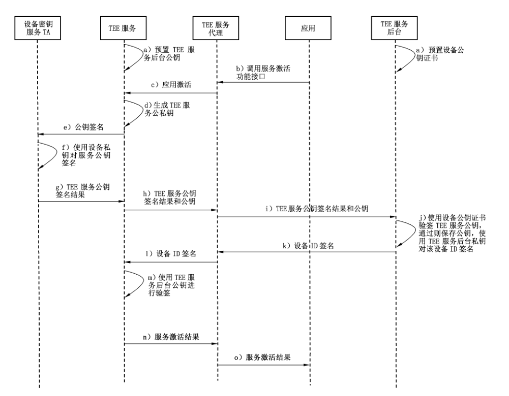

具体流程说明如下：

a） TEE 服务后台部署了设备公钥证书，TEE 服务预置了TEE 服务后台的公钥证书；

b） 应用调用 TEE服务代理激活功能接口；

c） TEE 服务代理向 TEE 服务发送应用激活命令；

d） TEE 服务生成 TEE 服务公私密钥对；

e） TEE 服务将生成的 TEE 服务公钥发送给设备密钥服务 TA；

f） 设备密钥服务 TA 使用设备私钥对 TEE 服务公钥进行签名；

g） 设备密钥服务 TA 将生成的 TEE 服务公钥签名返回给 TEE 服务；

h） TEE 服务将签名结果和 TEE 服务公钥转发给TEE 服务代理；

i） TEE 服务代理通过网络将包含签名结果和可信公钥的报文发送给 TEE 服务后台；

j） TEE 服务后台使用预置的设备公钥证书对 TEE 服务公钥签名进行验签，验签通过后，将该设备的 TEE 服务公钥进行保存，并使用后台私钥对收到的设备 ID 进行签名；

k） TEE 服务后台将设备 ID 签名返回给 TEE 服务代理；

l） TEE 服务代理转发设备 ID 签名给 TEE 服务；

m）TEE 服务使用预置的 TEE 服务后台公钥进行验签，验签通过后，TEE 服务保存本地TEE 服务公私钥对；

n） TEE 服务返回激活结果给 TEE 服务代理；

o） TEE 服务代理转发激活结果给应用。

#### C.1.2 应用初始化

应用初始化业务流程如图 C.2 所示。

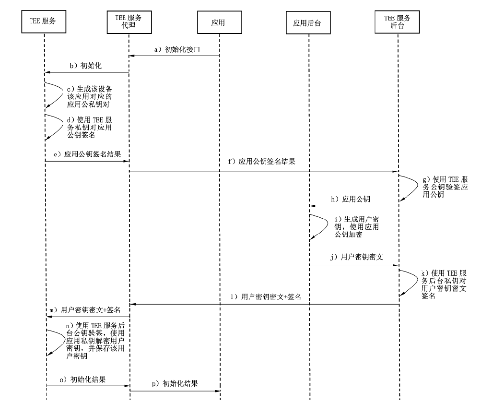

具体流程说明如下：

a） 应用调用 TEE服务代理初始化功能接口；

b） TEE 服务代理向 TEE 服务发送应用初始化命令；

c） TEE 服务为该应用生成应用公私钥对；

d） TEE 服务使用 TEE 服务私钥对该应用公钥签名；

e） TEE 服务将签名结果和应用公钥返回给 TEE 服务代理；

f） TEE 服务代理将包含签名数据和应用公钥的报文通过网络发送给 TEE 服务后台；

g） TEE 服务后台使用 TEE 服务公钥验签应用公钥；

h） 验签成功后，TEE 服务后台将应用公钥发送给应用后台；

i） 应用后台生成用户密钥，并使用应用公钥对用户密钥加密；

j） 应用后台返回用户密钥密文给 TEE 服务后台；

k） TEE服务后台使用TEE 服务后台私钥对用户密钥密文进行签名；

l） TEE 服务后台返回用户密钥密文和签名数据给 TEE 服务代理；

m）TEE 服务代理转发用户密钥密文和签名数据给TEE 服务；

n）TEE 服务使用 TEE 服务后台公钥对签名数据验签，验签成功后使用应用私钥对密文解密得到用户密钥原文并保存；

o） TEE 服务返回初始化结果给 TEE 服务代理；

p） TEE 服务代理转发初始化通知给应用。

#### C.1.3 个性化

个性化业务流程如图 C.3 所示。

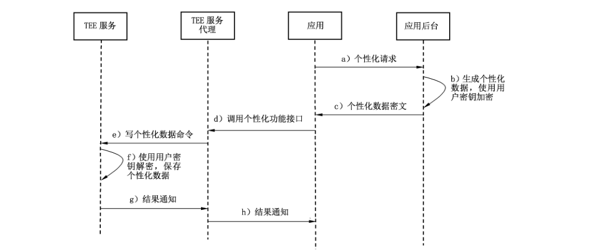

具体流程说明如下：

a） 应用向应用后台发送个性化请求；

b） 应用后台生成个性化数据，并使用用户密钥对个性化数据加密；

c） 应用后台返回密文数据给应用；

d） 应用调用TEE 服务代理的个性化功能接口并传入密文数据；

e） TEE 服务代理发送写入个性化数据的命令给 TEE 服务；

f） TEE 服务使用用户密钥对密文解密得到个性化数据原文并保存；

g） TEE 服务返回操作结果给 TEE 服务代理；

h）TEE 服务代理转发操作结果给应用。

### C.2 TEE 人机交互服务业务流程

#### C.2.1 口令输入

口令输入业务流程如图 C.4 所示。

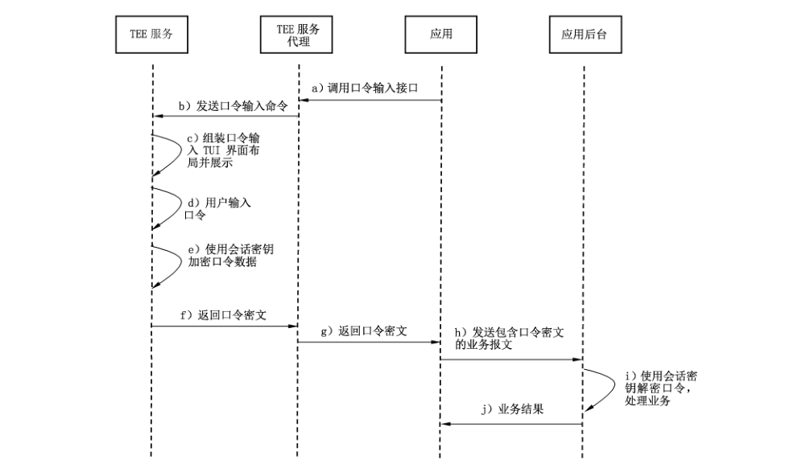

具体流程说明如下：

a） 应用调用 TEE 服务代理的口令输入功能接口；

b） TEE 服务代理给 TEE 服务发送口令输入命令；

c） TEE 服务根据该应用的个性化数据，组装可信口令输入 TUI 界面并展示在屏幕上；

d） 用户通过可信口令输入界面上的键盘向口令输入框中输入口令；

e） 用户完成输入口令后，进行确认操作，TEE 服务获取到输入的口令数据并使用会话密钥对其加密；

f） TEE 服务将口令密文返回给 TEE 服务代理；

g） TEE 服务代理将口令密文转发给应用；

h） 应用通过将口令密文在内的业务报文发送给应用后台；

i） 应用后台收到报文并解析后，使用相对应的会话密钥对口令密文做解密，并处理相关业务；

j） 应用后台发送业务结果给应用。

#### C.2.2 口令修改

口令修改业务流程如图 C.5 所示。

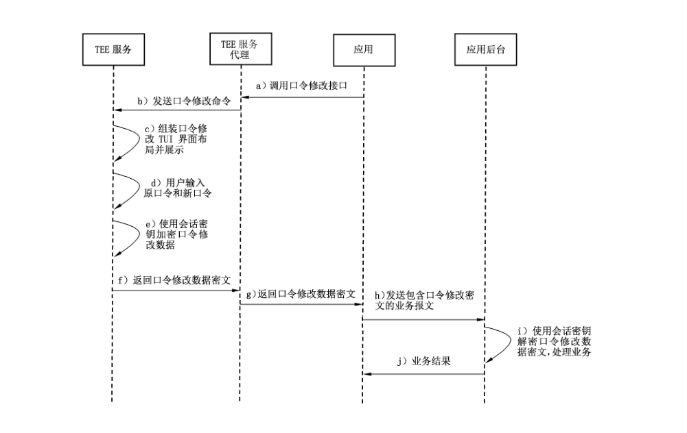

具体流程说明如下：

a） 应用调用TEE 服务代理的口令修改功能接口；

b） TEE 服务代理给 TEE 服务发送口令修改命令；

c） TEE 服务根据该应用的个性化数据，组装该应用的可信口令修改 TUI 界面并展示在屏幕上；

d） 用户通过可信口令修改界面上的键盘分别向输入框中输入原口令和新口令；

e） 用户输入完成后，进行确认操作，TEE 服务获取到原口令和新口令数据并使用会话密钥对其进行加密；

f） TEE 服务将口令修改数据密文返回给TEE 服务代理；

g） TEE服务代理将口令修改数据密文转发给应用；

h） 应用通过将口令修改数据密文在内的业务报文发送给应用后台；

i） 应用后台解析报文后，对口令修改密文数据使用会话密钥做解密，并进行相应业务处理；

j） 应用后台返回业务结果给应用。

#### C.2.3 消息输出

消息输出业务流程如图 C.6 所示。

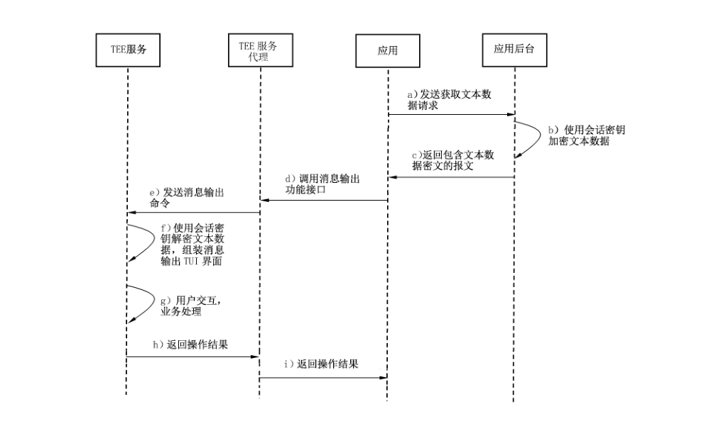

具体流程说明如下：

a） 应用向后台发送获取文本数据的请求；

b） 后台使用会话密钥对文本数据加密成文本数据密文；

c） 后台返回包含文本数据密文的报文给应用；

d） 应用调用 TEE 服务代理的消息输出功能接口；

e） TEE 服务代理向 TEE 服务发送消息输出命令；

f） TEE 服务获取到文本数据密文，并使用会话密钥解密得到文本数据原文，组装可信消息输出TUI 界面并展示在屏幕上；

g） 用户在屏幕上进行交互操作；

h） 用户完成交互操作后，TEE 服务返回操作结果给TEE 服务代理；

i） TEE 服务代理转发操作结果给应用。

#### C.2.4 注册登录

注册登录业务流程如图 C.7 所示。

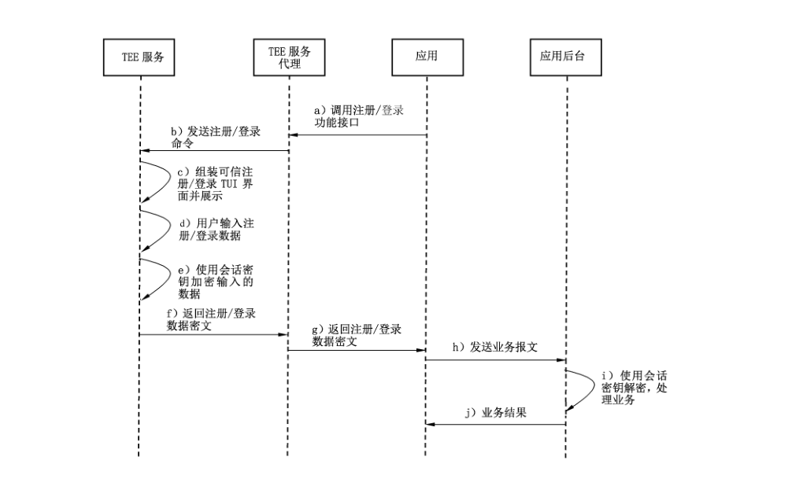

具体流程说明如下：

a） 应用调用TEE 服务代理的注册/登录功能接口；

b） TEE 服务代理给 TEE 服务发送注册/登录命令；

c） TEE 服务根据个性化数据，组装注册或者登录的 TUI界面并展示在屏幕上；

d） 用户通过界面上的键盘输入注册/登录数据；

e） TEE 服务使用会话密钥对注册/登录数据进行加密；

f） TEE 服务返回注册/登录数据密文给 TEE 服务代理；

g） TEE 服务代理返回注册/登录数据密文给应用；

h） 应用将注册/登录数据密文组装成业务报文发送给应用后台；

i） 应用后台解析报文后使用会话密钥对密文进行解密得到注册/登录的数据原文，并进行业务处理；

j） 应用后台返回业务结果给应用。

### C.3 TEE 二维码服务业务流程

#### C.3.1 TEE 二维码展示

TEE 二维码展示业务流程如图 C.8 所示。

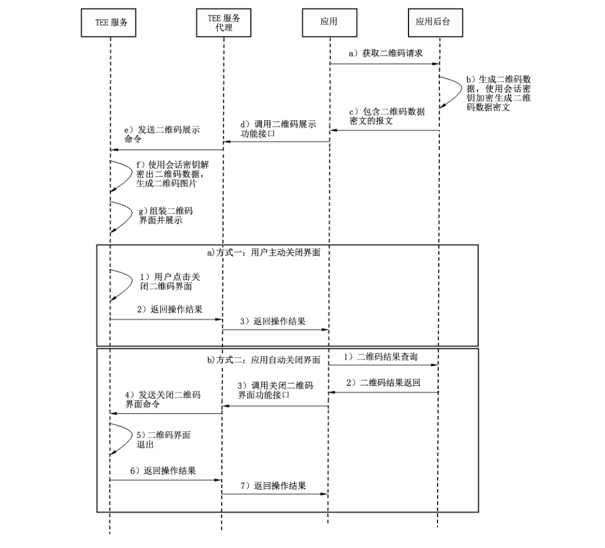

具体流程说明如下：

a） 应用向应用后台申请业务对应的二维码数据；

b） 应用后台在生成二维码数据后，使用会话密钥对二维码数据加密生成密文；

c） 应用后台返回包含二维码数据密文的报文给应用；

d） 应用调用 TEE 服务代理的 TEE 二维码展示功能接口，并输入报文数据；

e） TEE 服务代理向 TEE 服务发送 TEE 二维码展示命令和包含二维码数据密文的报文；

f） TEE 服务使用会话密钥解密二维码数据密文，将解密出的二维码数据明文依据约定的二维码编码规则生成相应的二维码图片数据；

g） TEE 服务组装 TEE 二维码展示界面并展示在屏幕上。

二维码展示界面关闭的方式有两种，方式一为用户主动关闭，方式二为应用自动关闭。

a） 方式一执行如下流程：

1） 用户点击界面上的关闭按钮，关闭二维码界面；

2） TEE 服务将操作结果返回给TEE 服务代理；

3） TEE 服务代理将操作结果返回给应用。

b） 方式二执行如下流程：

1） 应用主动向应用后台发起二维码处理结果查询；

2） 应用后台返回二维码处理结果给应用；

3） 应用调用 TEE 服务代理的关闭二维码界面功能接口；

4） TEE 服务代理向 TEE 服务发送关闭二维码界面命令；

5） TEE 服务退出当前二维码界面；

6） TEE 服务将操作结果返回给 TEE 服务代理；

7） TEE 服务代理将操作结果返回给应用。

#### C.3.2 TEE 二维码扫描

TEE 二维码扫描业务流程如图 C.9 所示。

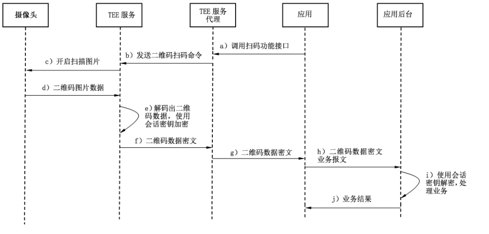

具体流程说明如下：

a） 应用调用 TEE 服务代理的二维码扫码功能接口；

b） TEE 服务代理给TEE 服务发送二维码扫码命令；

c） TEE 服务调用摄像头开始扫描二维码图片；

d） 摄像头将扫描到的二维码图片数据返回给 TEE 服务；

e） TEE 服务解析该二维码图片，将解析出的二维码数据，使用会话密钥加密生成二维码数据密文；

f） TEE 服务将二维码数据密文返回给 TEE 服务代理；

g） TEE 服务代理将二维码数据密文返回给应用；

h） 应用将二维码数据密文组装成业务报文发送给应用后台；

i） 应用后台通过会话密钥对二维码数据密文解密得到二维码数据原文，并做相应的业务处理；

j） 应用后台返回业务结果给应用。

### C.4 TEE 设备安全状态评价服务业务流程

#### C.4.1 本地型获取设备安全状态报告

##### C.4.1.1 应用获取设备安全状态报告

本地型应用获取设备安全状态报告业务流程如图 C.10 所示。

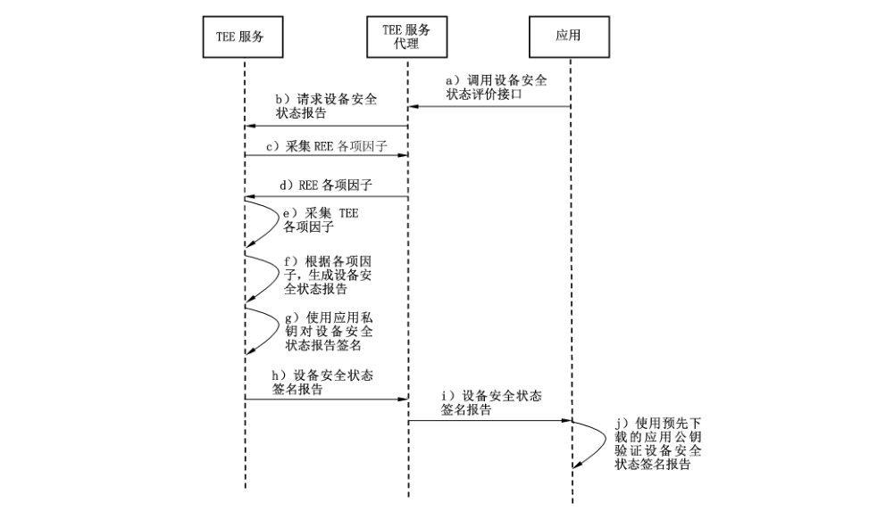

具体流程说明如下：

a） 应用调用 TEE服务代理提供的设备安全状态评价接口；

b） TEE 服务代理请求 TEE 服务生成设备安全状态报告；

c） TEE 服务请求 TEE 服务代理采集 REE 的各项因子；

d） TEE 服务代理采集 REE 各项因子后，将其返回给 TEE 服务；

e） TEE 服务采集 TEE 的各项因子；

f） TEE 服务根据采集到的各项因子和内置的评估策略生成设备安全状态报告；

g） TEE 服务使用应用私钥对设备安全状态报告进行签名；

h） TEE 服务返回设备安全状态签名报告给 TEE 服务代理；

i） TEE 服务代理转发设备安全状态签名报告到应用；

j） 应用使用预先从应用后台下载的应用公钥证书验证设备安全状态签名报告。

##### C.4.1.2 其他 TA 获取设备安全状态报告

本地型其他 TA 获取设备安全状态报告业务流程如图 C.11 所示。

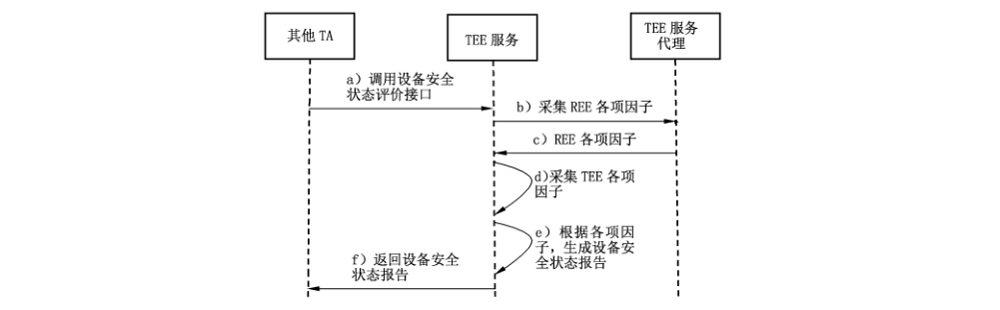

具体流程说明如下：

a） 其他TA调用由 TEE 服务提供的设备安全状态评价接口；

b） TEE 服务请求 TEE 服务代理采集 REE 的各项因子；

c） TEE 服务代理采集 REE 各项因子后，将其返回给 TEE 服务；

d） TEE 服务采集 TEE 的各项因子；

e） TEE 服务根据采集到的各项因子和内置的评估策略生成设备安全状态报告；

f） TEE服务将生成的设备安全状态报告返回给其他TA。

#### C.4.2 远程型获取设备安全状态报告

远程型获取设备安全状态报告业务流程如图 C.12 所示。

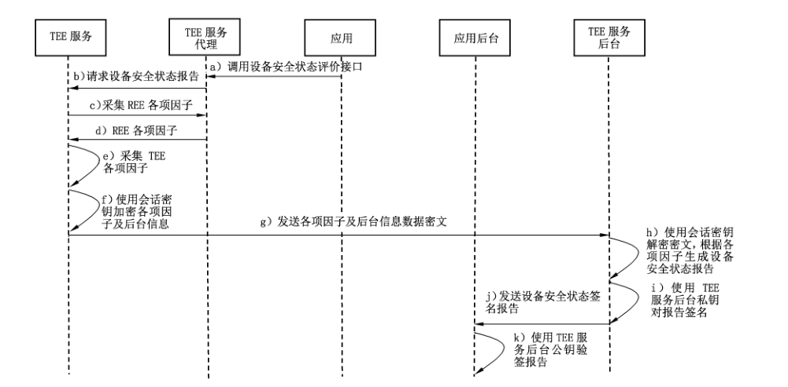

具体流程说明如下：

a） 应用调用 TEE服务代理提供的设备安全状态评价接口；

b） TEE 服务代理请求 TEE 服务生成设备安全状态报告；

c） TEE 服务请求 TEE 服务代理采集 REE 的各项因子；

d） TEE 服务代理采集 REE 各项因子后，将其返回 TEE服务；

e） TEE 服务采集 TEE 的各项因子；

f） TEE 服务使用会话加密采集到的各项因子和应用后台的信息；

g） TEE 服务将集到的各项因子和应用后台的信息的密文发送到 TEE服务后台；

h） TEE 服务后台解密密文，得到各项因子和应用后台的相关信息，生成设备安全状态报告；

i） TEE 服务后台使用 TEE 服务后台私钥对设备安全状态报告进行签名；

j） TEE 服务后台通过收到的应用后台的相关信息，将设备安全状态报告发送到应用后台；

k）应用后台使用 TEE服务后台公钥证书验签报告。

#### C.4.3 混合型获取设备安全状态报告

混合型获取设备安全状态报告业务流程如图 C.13 所示。

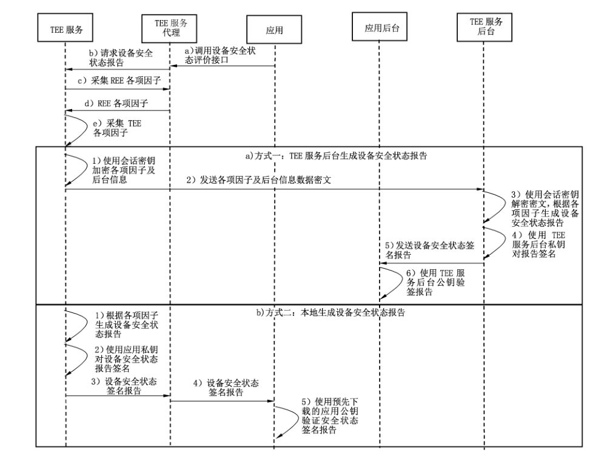

具体流程说明如下：

a） 应用调用 TEE 服务代理提供的获取设备安全状态报告的接口；

b） TEE 服务代理请求TEE 服务生成设备安全状态报告；

c） TEE 服务请求 TEE 服务代理采集 REE 的各项因子；

d） TEE 服务代理采集 REE 各项因子后，将其返回 TEE 服务；

e） TEE 服务采集 TEE 的各项因子。

设备安全状态报告生成方式有两种，方式一为TEE 服务后台生成，方式二为本地生成。

a） 方式一执行如下流程：

1） TEE服务使用会话密钥加密采集到的各项因子和应用后台的信息；

2） TEE 服务将集到的各项因子和应用后台的信息的密文发送到 TEE服务后台；

3） TEE 服务后台解密各项因子和应用后台信息，根据各项因子生成设备安全状态报告；

4） TEE 服务后台使用TEE 服务后台私钥对设备安全状态报告进行签名；

5） TEE 服务后台通过应用后台相关信息，将签名后的设备安全状态报告发送到应用后台；

6） 应用后台使用 TEE 服务后台公钥证书验证设备安全状态报告。

b） 方式二执行如下流程：

1） TEE 服务根据采集到的各项因子和内置的评估策略生成设备安全状态报告；

2） 使用应用私钥对设备安全状态报告进行签名；

3） TEE 服务返回设备安全状态签名报告给 TEE 服务代理；

4） TEE 服务代理转发设备安全状态签名报告给应用；

5） 应用使用预先从应用后台下载的应用公钥证书验证设备安全状态签名报告。

### C.5 TEE 身份鉴别服务业务流程

#### C.5.1 基于口令的身份鉴别

基于口令的身份鉴别业务流程如图 C.14 所示。

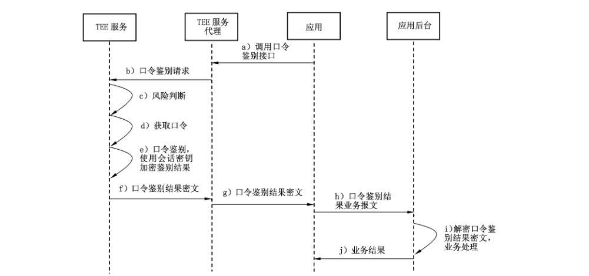

具体流程说明如下：

a） 应用在开始业务之前，需要鉴别当前用户的身份，调用TEE 服务代理的基于口令的身份鉴别接口；

b） TEE 服务代理请求 TEE 服务处理；

c） TEE 服务利用 TEE 的能力进行风险判断；

d） TEE 服务利用 TEE 的人机交互能力获取用户的口令；

e） TEE 服务鉴别用户口令，使用会话密钥生成鉴别结果密文；

f） TEE 服务返回口令鉴别结果密文给 TEE 服务代理；

g） TEE 服务代理返回口令鉴别结果密文给应用；

h） 应用将口令鉴别结果密文放入业务报文中，发给应用后台处理；

i） 应用后台通过会话密钥解密出口令鉴别结果，进行业务处理；

j） 应用后台将业务结果返回给应用。

#### C.5.2 基于生物特征的身份鉴别（本地）

基于生物特征的身份鉴别（本地）业务流程如图 C.15 所示。

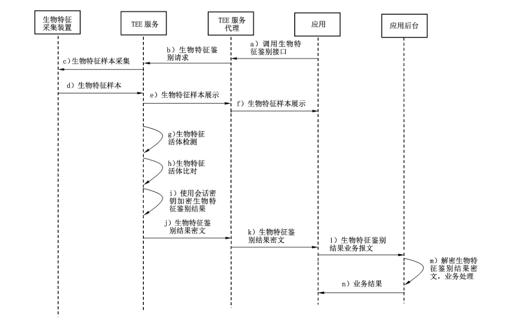

具体流程说明如下：

a） 应用发起基于生物特征身份鉴别的请求；

b） TEE 服务代理向TEE 服务发送基于生物特征认证的请求；

c） TEE 服务启动生物特征采集装置，采集生物特征样本；

d） 生物特征采集装置返回生物特征采集样本给 TEE 服务；

e） TEE 服务将生物特征采集样本发给 TEE 服务代理；

f） TEE 服务代理将生物特征样本发给应用进行展示；

g） 同时 TEE 服务进行生物特征活体检测；

h） TEE 服务本地进行生物特征比对；

i） TEE 服务使用会话密钥对比对后的鉴别结果加密成结果密文；

j） TEE 服务将生物特征鉴别结果密文发送至 TEE 服务代理；

k） TEE 服务代理将生物特征鉴别结果密文发送至应用；

l） 应用将生物特征鉴别结果密文放入业务报文中，发给应用后台处理；

m）应用后台通过会话密钥解密出生物特征鉴别结果，进行业务处理；

n） 应用后台将业务结果返回给应用。

#### C.5.3 基于生物特征的身份鉴别（远程）

基于生物特征的身份鉴别（远程）业务流程如图 C.16 所示。

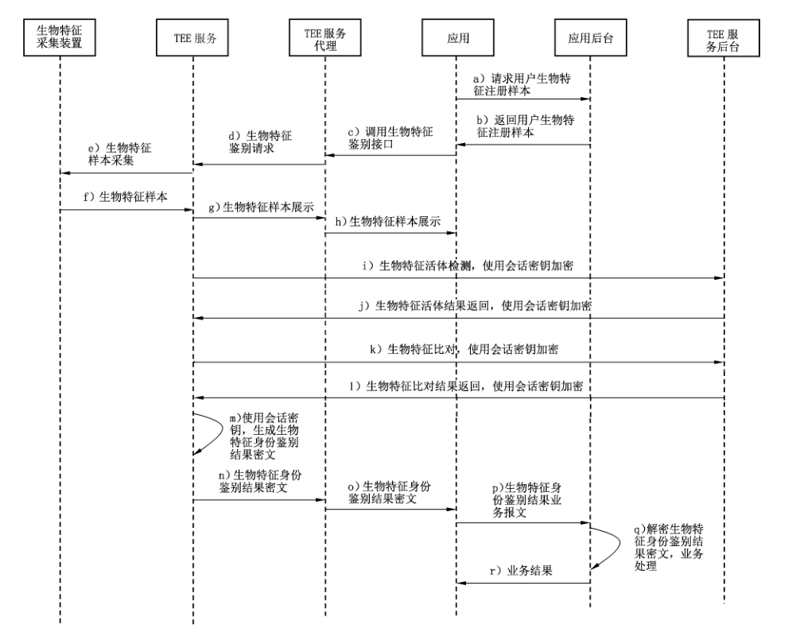

具体流程说明如下：

a） 应用向应用后台请求获取用户生物特征注册样本；

b） 应用后台向应用返回用户生物特征注册样本；

c） 应用通过生物特征鉴别接口向 TEE 服务代理发送基于生物特征鉴别请求；

d） TEE 服务代理向 TEE 服务发送基于生物特征鉴别请求；

e） TEE 服务启动生物特征采集装置，以采集生物特征样本；

f） 生物特征采集装置返回生物特征采集样本；

g） TEE服务将生物特征样本发送至 TEE 服务代理；

h） TEE 服务代理将生物特征样本发送至应用进行展示；

i） TEE 服务向 TEE 服务后台发送生物特征样本，使用会话密钥加密，请求活体检测；

j） TEE 服务后台使用会话密钥解密，完成验证后返回使用会话密钥加密的活体检测结果；

k） TEE 服务向 TEE 服务后台发送生物特征样本，使用会话密钥加密，TEE 服务后台进行生物特征比对；

l） TEE 服务后台使用 TEE 服务后台私钥解密，完成比对后返回使用会话密钥加密的生物特征比对结果；

m）TEE 服务使用会话密钥，生成生物特征身份鉴别结果密文；

n） TEE 服务将生物特征身份鉴别结果密文发送至 TEE 服务代理；

o） TEE 服务代理将生物特征身份鉴别结果密文发送至应用；

p） 应用将生物特征鉴别结果密文放入业务报文中，发给应用后台处理；

q） 应用后台通过会话密钥解密出生物特征身份鉴别结果，进行业务处理；

r） 应用后台将业务结果返回给应用。

### C.6 TEE 时间服务业务流程

TEE 时间服务业务流程如图 C.17 所示。

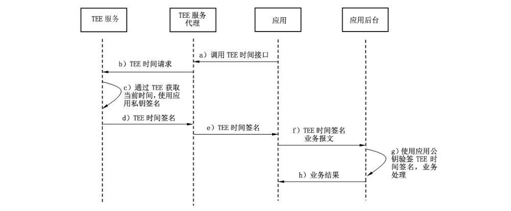

具体流程说明如下：

a） 应用在开始业务之前，需要获取当前设备的TEE 时间，调用TEE 服务代理的TEE 时间接口；

b） TEE 服务代理请求 TEE 服务处理；

c） TEE 服务利用 TEE 的能力，采集当前 TEE 时间，使用应用私钥对时间信息签名；

d） TEE 服务返回 TEE 时间签名给 TEE 服务代理；

e） TEE 服务代理将 TEE 时间签名返回给应用；

f） 应用将 TEE 时间信息放入业务报文中，发给应用后台处理；

g） 应用后台通过应用公钥验证 TEE 时间，验证成功后进行业务处理；

h） 应用后台将业务结果返回给应用。

### C.7 TEE 位置服务业务流程

TEE 位置服务业务流程如图 C.18 所示。

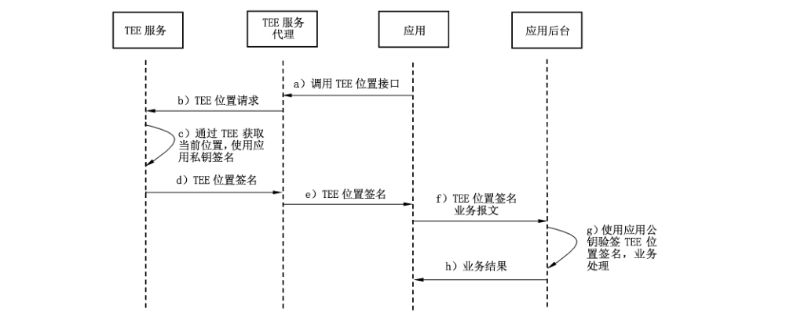

具体流程说明如下：

a） 应用在开始业务之前，需要获取当前设备的TEE 位置，调用 TEE 服务代理的 TEE 位置接口；

b） TEE 服务代理请求 TEE 服务处理 TEE 位置；

c） TEE 服务调用TEE 的位置信息功能获取当前设备的位置信息，使用应用私钥对位置信息签名；

d） TEE 服务将 TEE 位置签名返回给 TEE 服务代理；

e） TEE 服务代理将 TEE 位置签名返回给应用；

f） 应用将 TEE 位置信息放入业务报文中，发给应用后台处理；

g） 应用后台通过应用公钥验签 TEE 位置签名，验证成功后进行业务处理；

h）应用后台将业务结果给应用。

### C.8 TEE 密码计算服务业务流程

TEE 密码计算服务业务流程如图 C.19 所示。

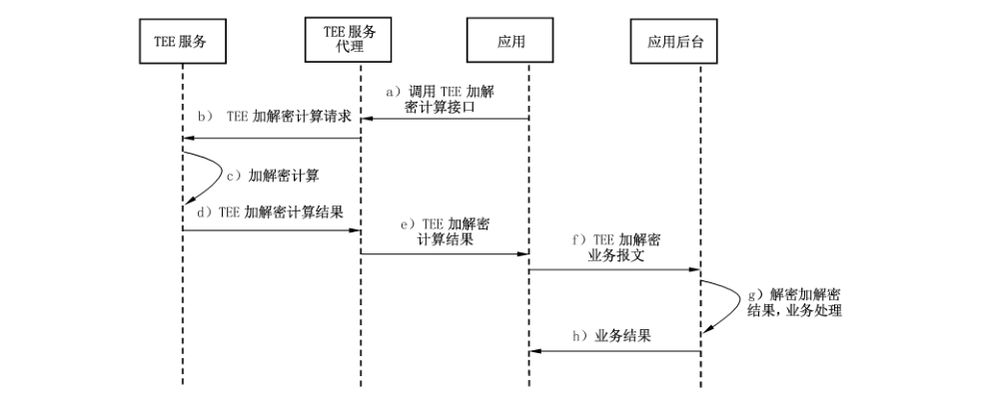

具体流程说明如下：

a） 应用需要对特定数据进行加解密，调用TEE 服务代理的加解密计算接口；

b） TEE 服务代理请求TEE 服务处理加解密计算；

c） TEE服务利用TEE 的能力，使用应用相应的密钥和算法进行加解密、杂凑等运算生成计算结果；

d） TEE 服务将加解密计算结果返回给 TEE 服务代理；

e） TEE 服务代理将加解密计算结果返回给应用；

f） 应用将加解密计算结果放入业务报文中，发给应用后台处理；

g） 应用后台通过应用相应的密钥解密计算结果，进行业务处理；

h）应用后台将业务结果返回给应用。
