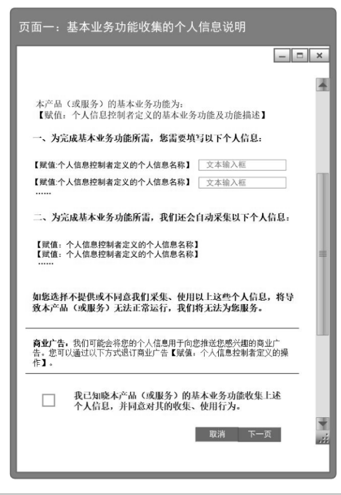
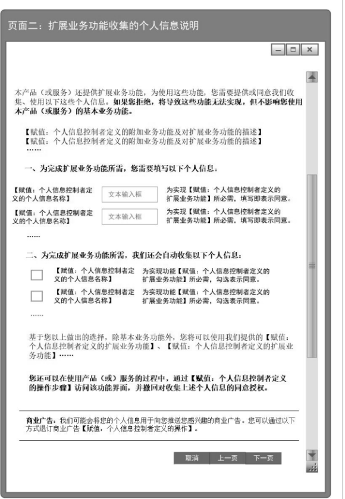
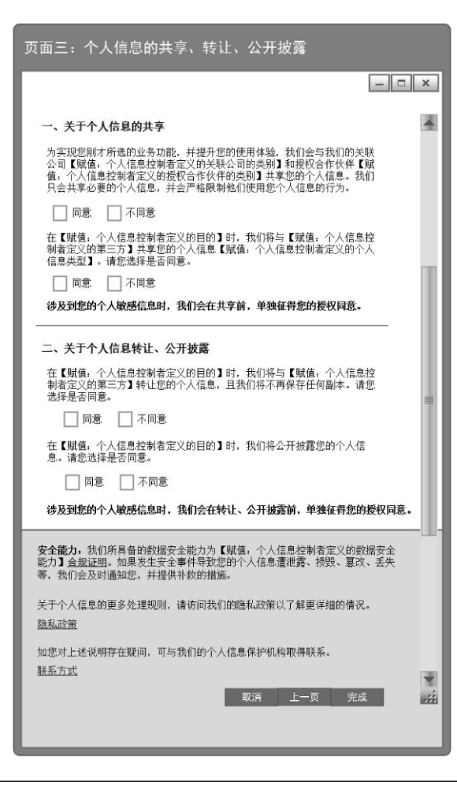

# GB/T 35273-2020 信息安全技术 个人信息安全规范

> 来源：[GB/T 35273-2020 国家标准详情](https://openstd.samr.gov.cn/bzgk/std/newGbInfo?hcno=4568F276E0F8346EB0FBA097AA0CE05E)。
> PDF SHA-256：5ce7ac17a5a97e88912d99aae12761d98fb89f76720d83030434773e3f7e706a。
> 发布日期：2020-03-06；实施日期：2020-10-01。依据官方 PDF 的 35 页图像逐页核对，重建附录 A、B、C 中的表格与附录 D 的跨页双栏表，保留表 C.1 的 3 幅界面图，并去除封面、目录、分页和页眉页脚。正式引用请核对官方原文。

## 前言

本标准按照 GB/T 1.1—2009给出的规则起草。

本标准代替 GB/T 35273—2017《信息安全技术 个人信息安全规范》，与 GB/T 35273—2017 相比，除编辑性修改外主要技术变化如下：

- 增加了“多项业务功能的自主选择”（见 5.3）；
- 修改了“征得授权同意的例外”（见 5.6，2017 年版的 5.4）；
- 增加了“用户画像的使用限制”（见 7.4）；
- 增加了“个性化展示的使用”（见 7.5）；
- 增加了“基于不同业务目的所收集个人信息的汇聚融合”（见 7.6）；
- 修改了“个人信息主体注销账户”（见 8.5，2017 年版的 7.8）；
- 增加了“第三方接入管理”（见 9.7）；
- 修改了“明确责任部门与人员”（见 11.1，2017 年版的 10.1）；
- 增加了“个人信息安全工程”（见 11.2）；
- 增加了“个人信息处理活动记录”（见 11.3）；
- 修改了“实现个人信息主体自主意愿的方法”（见附录 C，2017 年版的附录 C）。

请注意本文件的某些内容可能涉及专利。本文件的发布机构不承担识别这些专利的责任。

本标准由全国信息安全标准化技术委员会（SAC/TC 260）提出并归口。

本标准起草单位：中国电子技术标准化研究院、北京信息安全测评中心、颐信科技有限公司、四川大学、清华大学、中国信息通信研究院、公安部第一研究所、中国网络安全审查技术与认证中心、深圳腾讯计算机系统有限公司、上海国际问题研究院、阿里巴巴（北京）软件服务有限公司、中电长城网际系统应用有限公司、阿里云计算有限公司、华为技术有限公司、强韵数据科技有限公司。

本标准主要起草人：洪延青、何延哲、杨建军、钱秀槟、陈兴蜀、刘贤刚、上官晓丽、高林、邵正强、金涛、胡影、赵冉冉、韩煜、陈湉、高磊、张晓梅、张志强、葛鑫、周晨炜、秦小伟、邵华、蔡晓丹、黄晓林、顾伟、黄劲、李媛、许静慧、赵章界、孔耀晖、范红、杜跃进、杨思磊、张亚男、叶晓俊、郑斌、闵京华、鲁传颖、周亚超、杨露、王海舟、王建民、秦颂、姚相振、葛小宇、王道奎、沈锡镛。

本标准所代替标准的历次版本发布情况为：

- GB/T 35273—2017。

## 引言

近年，随着信息技术的快速发展和互联网应用的普及，越来越多的组织大量收集、使用个人信息，给人们生活带来便利的同时，也出现了对个人信息的非法收集、滥用、泄露等问题，个人信息安全面临严重威胁。

本标准针对个人信息面临的安全问题，根据《中华人民共和国网络安全法》等相关法律，规范个人信息控制者在收集、存储、使用、共享、转让、公开披露等信息处理环节中的相关行为，旨在遏制个人信息非法收集、滥用、泄漏等乱象，最大程度地保障个人的合法权益和社会公共利益。

对标准中的具体事项，法律法规另有规定的，需遵照其规定执行。

## 1 范围

本标准规定了开展收集、存储、使用、共享、转让、公开披露、删除等个人信息处理活动的原则和安全要求。

本标准适用于规范各类组织的个人信息处理活动，也适用于主管监管部门、第三方评估机构等组织对个人信息处理活动进行监督、管理和评估。

## 2 规范性引用文件

下列文件对于本文件的应用是必不可少的。凡是注日期的引用文件，仅注日期的版本适用于本文件。凡是不注日期的引用文件，其最新版本（包括所有的修改单）适用于本文件。

- GB/T 25069—2010 信息安全技术 术语

## 3 术语和定义

GB/T 25069—2010界定的以及下列术语和定义适用于本文件。

### 3.1 个人信息 personal information

以电子或者其他方式记录的能够单独或者与其他信息结合识别特定自然人身份或者反映特定自然人活动情况的各种信息。

注1：个人信息包括姓名、出生日期、身份证件号码、个人生物识别信息、住址、通信通讯联系方式、通信记录和内容、账号密码、财产信息、征信信息、行踪轨迹、住宿信息、健康生理信息、交易信息等。

注2：关于个人信息的判定方法和类型参见附录A。

注3：个人信息控制者通过个人信息或其他信息加工处理后形成的信息，例如，用户画像或特征标签，能够单独或者与其他信息结合识别特定自然人身份或者反映特定自然人活动情况的，属于个人信息。

### 3.2 个人敏感信息 personal sensitive information

一旦泄露、非法提供或滥用可能危害人身和财产安全，极易导致个人名誉、身心健康受到损害或歧视性待遇等的个人信息。

注1：个人敏感信息包括身份证件号码、个人生物识别信息、银行账户、通信记录和内容、财产信息、征信信息、行踪轨迹、住宿信息、健康生理信息、交易信息、14岁以下（含）儿童的个人信息等。

注2：关于个人敏感信息的判定方法和类型参见附录 B。

注3：个人信息控制者通过个人信息或其他信息加工处理后形成的信息，如一旦泄露、非法提供或滥用可能危害人身和财产安全，极易导致个人名誉、身心健康受到损害或歧视性待遇等的，属于个人敏感信息。

### 3.3 个人信息主体 personal information subject

个人信息所标识或者关联的自然人。

### 3.4 个人信息控制者 personal information controller

有能力决定个人信息处理目的、方式等的组织或个人。

### 3.5 收集 collect

获得个人信息的控制权的行为。

注1：包括由个人信息主体主动提供、通过与个人信息主体交互或记录个人信息主体行为等自动采集行为，以及通过共享、转让、搜集公开信息等间接获取个人信息等行为。

注2：如果产品或服务的提供者提供工具供个人信息主体使用，提供者不对个人信息进行访问的，则不属于本标准所称的收集。例如，离线导航软件在终端获取个人信息主体位置信息后，如果不回传至软件提供者，则不属于个人信息主体位置信息的收集。

### 3.6 明示同意 explicit consent

个人信息主体通过书面、口头等方式主动作出纸质或电子形式的声明，或者自主作出肯定性动作，对其个人信息进行特定处理作出明确授权的行为。

> 注：肯定性动作包括个人信息主体主动勾选、主动点击“同意”“注册”“发送”“拨打”、主动填写或提供等。

### 3.7 授权同意 consent

个人信息主体对其个人信息进行特定处理作出明确授权的行为。

> 注：包括通过积极的行为作出授权（即明示同意），或者通过消极的不作为而作出授权（如信息采集区域内的个人信息主体在被告知信息收集行为后没有离开该区域）。

### 3.8 用户画像 user profiling

通过收集、汇聚、分析个人信息，对某特定自然人个人特征，如职业、经济、健康、教育、个人喜好、信用、行为等方面作出分析或预测，形成其个人特征模型的过程。

> 注：直接使用特定自然人的个人信息，形成该自然人的特征模型，称为直接用户画像。使用来源于特定自然人以外的个人信息，如其所在群体的数据，形成该自然人的特征模型，称为间接用户画像。

### 3.9 个人信息安全影响评估 personal information security impact assessment

针对个人信息处理活动，检验其合法合规程度，判断其对个人信息主体合法权益造成损害的各种风险，以及评估用于保护个人信息主体的各项措施有效性的过程。

### 3.10 删除 delete

在实现日常业务功能所涉及的系统中去除个人信息的行为，使其保持不可被检索、访问的状态。

### 3.11 公开披露 public disclosure

向社会或不特定人群发布信息的行为。

### 3.12 转让 transfer of control

将个人信息控制权由一个控制者向另一个控制者转移的过程。

### 3.13 共享 sharing

个人信息控制者向其他控制者提供个人信息，且双方分别对个人信息拥有独立控制权的过程。

### 3.14 匿名化 anonymization

通过对个人信息的技术处理，使得个人信息主体无法被识别或者关联，且处理后的信息不能被复原的过程。

> 注：个人信息经匿名化处理后所得的信息不属于个人信息。

### 3.15 去标识化 de-identification

通过对个人信息的技术处理，使其在不借助额外信息的情况下，无法识别或者关联个人信息主体的过程。

> 注：去标识化建立在个体基础之上，保留了个体颗粒度，采用假名、加密、哈希函数等技术手段替代对个人信息的标识。

### 3.16 个性化展示 personalized display

基于特定个人信息主体的网络浏览历史、兴趣爱好、消费记录和习惯等个人信息，向该个人信息主体展示信息内容、提供商品或服务的搜索结果等活动。

### 3.17 业务功能 business function

满足个人信息主体的具体使用需求的服务类型。

> 注：如地图导航、网络约车、即时通信、网络社区、网络支付、新闻资讯、网上购物、快递配送、交通票务等。

## 4 个人信息安全基本原则

个人信息控制者开展个人信息处理活动应遵循合法、正当、必要的原则，具体包括：

a） 权责一致——采取技术和其他必要的措施保障个人信息的安全，对其个人信息处理活动对个人信息主体合法权益造成的损害承担责任。

b）目的明确——具有明确、清晰、具体的个人信息处理目的。

c） 选择同意——向个人信息主体明示个人信息处理目的、方式、范围等规则，征求其授权同意。

d） 最小必要——只处理满足个人信息主体授权同意的目的所需的最少个人信息类型和数量。目的达成后，应及时删除个人信息。

e） 公开透明——以明确、易懂和合理的方式公开处理个人信息的范围、目的、规则等，并接受外部监督。

f） 确保安全——具备与所面临的安全风险相匹配的安全能力，并采取足够的管理措施和技术手段，保护个人信息的保密性、完整性、可用性。

g） 主体参与——向个人信息主体提供能够查询、更正、删除其个人信息，以及撤回授权同意、注销账户、投诉等方法。

## 5 个人信息的收集

### 5.1 收集个人信息的合法性

对个人信息控制者的要求包括：

a） 不应以欺诈、诱骗、误导的方式收集个人信息；

b） 不应隐瞒产品或服务所具有的收集个人信息的功能；

c） 不应从非法渠道获取个人信息。

### 5.2 收集个人信息的最小必要

对个人信息控制者的要求包括：

a） 收集的个人信息的类型应与实现产品或服务的业务功能有直接关联；直接关联是指没有上述个人信息的参与，产品或服务的功能无法实现。

b） 自动采集个人信息的频率应是实现产品或服务的业务功能所必需的最低频率。

c） 间接获取个人信息的数量应是实现产品或服务的业务功能所必需的最少数量。

### 5.3 多项业务功能的自主选择

当产品或服务提供多项需收集个人信息的业务功能时，个人信息控制者不应违背个人信息主体的自主意愿，强迫个人信息主体接受产品或服务所提供的业务功能及相应的个人信息收集请求。对个人信息控制者的要求包括：

a） 不应通过捆绑产品或服务各项业务功能的方式，要求个人信息主体一次性接受并授权同意其未申请或使用的业务功能收集个人信息的请求。

b） 应把个人信息主体自主作出的肯定性动作，如主动点击、勾选、填写等，作为产品或服务的特定业务功能的开启条件。个人信息控制者应仅在个人信息主体开启该业务功能后，开始收集个人信息。

c） 关闭或退出业务功能的途径或方式应与个人信息主体选择使用业务功能的途径或方式同样方便。个人信息主体选择关闭或退出特定业务功能后，个人信息控制者应停止该业务功能的个人信息收集活动。

d） 个人信息主体不授权同意使用、关闭或退出特定业务功能的，不应频繁征求个人信息主体的授权同意。

e） 个人信息主体不授权同意使用、关闭或退出特定业务功能的，不应暂停个人信息主体自主选择使用的其他业务功能，或降低其他业务功能的服务质量。

f） 不得仅以改善服务质量、提升使用体验、研发新产品、增强安全性等为由，强制要求个人信息主体同意收集个人信息。

### 5.4 收集个人信息时的授权同意

对个人信息控制者的要求包括：

a） 收集个人信息，应向个人信息主体告知收集、使用个人信息的目的、方式和范围等规则，并获得个人信息主体的授权同意。

注1：如产品或服务仅提供一项收集、使用个人信息的业务功能时，个人信息控制者可通过个人信息保护政策的形式，实现向个人信息主体的告知；产品或服务提供多项收集、使用个人信息的业务功能的，除个人信息保护政策外，个人信息控制者宜在实际开始收集特定个人信息时，向个人信息主体提供收集、使用该个人信息的目的、方式和范围，以便个人信息主体在作出具体的授权同意前，能充分考虑对其的具体影响。

注2：符合5.3 和 a）要求的实现方法，可参考附录C。

b） 收集个人敏感信息前，应征得个人信息主体的明示同意，并应确保个人信息主体的明示同意是其在完全知情的基础上自主给出的、具体的、清晰明确的意愿表示。

c） 收集个人生物识别信息前，应单独向个人信息主体告知收集、使用个人生物识别信息的目的、方式和范围，以及存储时间等规则，并征得个人信息主体的明示同意。

注3：个人生物识别信息包括个人基因、指纹、声纹、掌纹、耳廓、虹膜、面部识别特征等。

d） 收集年满14周岁未成年人的个人信息前，应征得未成年人或其监护人的明示同意；不满14周岁的，应征得其监护人的明示同意。

e） 间接获取个人信息时：

1） 应要求个人信息提供方说明个人信息来源，并对其个人信息来源的合法性进行确认；

2） 应了解个人信息提供方已获得的个人信息处理的授权同意范围，包括使用目的，个人信息主体是否授权同意转让、共享、公开披露、删除等；

3） 如开展业务所需进行的个人信息处理活动超出已获得的授权同意范围的，应在获取个人信息后的合理期限内或处理个人信息前，征得个人信息主体的明示同意，或通过个人信息提供方征得个人信息主体的明示同意。

### 5.5 个人信息保护政策

对个人信息控制者的要求包括：

a） 应制定个人信息保护政策，内容应包括但不限于：

1） 个人信息控制者的基本情况，包括主体身份、联系方式。

2） 收集、使用个人信息的业务功能，以及各业务功能分别收集的个人信息类型。涉及个人敏感信息的，需明确标识或突出显示。

3） 个人信息收集方式、存储期限、涉及数据出境情况等个人信息处理规则。

4） 对外共享、转让、公开披露个人信息的目的、涉及的个人信息类型、接收个人信息的第三方类型，以及各自的安全和法律责任。

5） 个人信息主体的权利和实现机制，如查询方法、更正方法、删除方法、注销账户的方法、撤回授权同意的方法、获取个人信息副本的方法、对信息系统自动决策结果进行投诉的方法等。

6） 提供个人信息后可能存在的安全风险，及不提供个人信息可能产生的影响。

7） 遵循的个人信息安全基本原则，具备的数据安全能力，以及采取的个人信息安全保护措施，必要时可公开数据安全和个人信息保护相关的合规证明。

8） 处理个人信息主体询问、投诉的渠道和机制，以及外部纠纷解决机构及联络方式。

b）个人信息保护政策所告知的信息应真实、准确、完整。

c） 个人信息保护政策的内容应清晰易懂，符合通用的语言习惯，使用标准化的数字、图示等，避免使用有歧义的语言。

d） 个人信息保护政策应公开发布且易于访问，例如，在网站主页、移动互联网应用程序安装页、附录C中的交互界面或设计等显著位置设置链接。

e） 个人信息保护政策应逐一送达个人信息主体。当成本过高或有显著困难时，可以公告的形式发布。

f）在a）所载事项发生变化时，应及时更新个人信息保护政策并重新告知个人信息主体。

注1：组织会习惯性将个人信息保护政策命名为“隐私政策”或其他名称，其内容宜与个人信息保护政策内容保持一致。

注2：个人信息保护政策的内容可参考附录D。

注3：在个人信息主体首次打开产品或服务、注册账户等情形时，宜通过弹窗等形式主动向其展示个人信息保护政策的主要或核心内容，帮助个人信息主体理解该产品或服务的个人信息处理范围和规则，并决定是否继续使用该产品或服务。

### 5.6 征得授权同意的例外

以下情形中，个人信息控制者收集、使用个人信息不必征得个人信息主体的授权同意：

a） 与个人信息控制者履行法律法规规定的义务相关的；

b） 与国家安全、国防安全直接相关的；

c） 与公共安全、公共卫生、重大公共利益直接相关的；

d） 与刑事侦查、起诉、审判和判决执行等直接相关的；

e） 出于维护个人信息主体或其他个人的生命、财产等重大合法权益但又很难得到本人授权同意的；

f） 所涉及的个人信息是个人信息主体自行向社会公众公开的；

g） 根据个人信息主体要求签订和履行合同所必需的；

> 注：个人信息保护政策的主要功能为公开个人信息控制者收集、使用个人信息范围和规则，不宜将其视为合同。

h） 从合法公开披露的信息中收集个人信息的，如合法的新闻报道、政府信息公开等渠道；

i） 维护所提供产品或服务的安全稳定运行所必需的，如发现、处置产品或服务的故障；

j） 个人信息控制者为新闻单位，且其开展合法的新闻报道所必需的；

k）个人信息控制者为学术研究机构，出于公共利益开展统计或学术研究所必要，且其对外提供学术研究或描述的结果时，对结果中所包含的个人信息进行去标识化处理的。

## 6 个人信息的存储

### 6.1 个人信息存储时间最小化

对个人信息控制者的要求包括：

a） 个人信息存储期限应为实现个人信息主体授权使用的目的所必需的最短时间，法律法规另有规定或者个人信息主体另行授权同意的除外；

b） 超出上述个人信息存储期限后，应对个人信息进行删除或匿名化处理。

### 6.2 去标识化处理

收集个人信息后，个人信息控制者宜立即进行去标识化处理，并采取技术和管理方面的措施，将可用于恢复识别个人的信息与去标识化后的信息分开存储并加强访问和使用的权限管理。

### 6.3 个人敏感信息的传输和存储

对个人信息控制者的要求包括：

a） 传输和存储个人敏感信息时，应采用加密等安全措施；

注1：采用密码技术时宜遵循密码管理相关国家标准。

b） 个人生物识别信息应与个人身份信息分开存储；

c） 原则上不应存储原始个人生物识别信息（如样本、图像等），可采取的措施包括但不限于：

1） 仅存储个人生物识别信息的摘要信息；

2） 在采集终端中直接使用个人生物识别信息实现身份识别、认证等功能；

3） 在使用面部识别特征、指纹、掌纹、虹膜等实现识别身份、认证等功能后删除可提取个人生物识别信息的原始图像。

注2：摘要信息通常具有不可逆特点，无法回溯到原始信息。

注3：个人信息控制者履行法律法规规定的义务相关的情形除外。

### 6.4 个人信息控制者停止运营

当个人信息控制者停止运营其产品或服务时，应：

a） 及时停止继续收集个人信息；

b） 将停止运营的通知以逐一送达或公告的形式通知个人信息主体；

c） 对其所持有的个人信息进行删除或匿名化处理。

## 7 个人信息的使用

### 7.1 个人信息访问控制措施

对个人信息控制者的要求包括：

a） 对被授权访问个人信息的人员，应建立最小授权的访问控制策略，使其只能访问职责所需的最小必要的个人信息，且仅具备完成职责所需的最少的数据操作权限；

b）对个人信息的重要操作设置内部审批流程，如进行批量修改、拷贝、下载等重要操作；

c） 对安全管理人员、数据操作人员、审计人员的角色进行分离设置；

d） 确因工作需要，需授权特定人员超权限处理个人信息的，应经个人信息保护责任人或个人信息保护工作机构进行审批，并记录在册；

> 注：个人信息保护责任人或个人信息保护工作机构的确定见 11.1。

e） 对个人敏感信息的访问、修改等操作行为，宜在对角色权限控制的基础上，按照业务流程的需求触发操作授权。例如，当收到客户投诉，投诉处理人员才可访问该个人信息主体的相关信息。

### 7.2 个人信息的展示限制

涉及通过界面展示个人信息的（如显示屏幕、纸面），个人信息控制者宜对需展示的个人信息采取去标识化处理等措施，降低个人信息在展示环节的泄露风险。例如，在个人信息展示时，防止内部非授权人员及个人信息主体之外的其他人员未经授权获取个人信息。

### 7.3 个人信息使用的目的限制

对个人信息控制者的要求包括：

a） 使用个人信息时，不应超出与收集个人信息时所声称的目的具有直接或合理关联的范围。因业务需要，确需超出上述范围使用个人信息的，应再次征得个人信息主体明示同意。

注1：将所收集的个人信息用于学术研究或得出对自然、科学、社会、经济等现象总体状态的描述，属于与收集目的具有合理关联的范围之内。但对外提供学术研究或描述的结果时，需对结果中所包含的个人信息进行去标识化处理。

b） 如所收集的个人信息进行加工处理而产生的信息，能够单独或与其他信息结合识别特定自然人身份或者反映特定自然人活动情况的，应将其认定为个人信息。对其处理应遵循收集个人信息时获得的授权同意范围。

注2：加工处理而产生的个人信息属于个人敏感信息的，对其处理需符合对个人敏感信息的要求。

### 7.4 用户画像的使用限制

对个人信息控制者的要求包括：

a） 用户画像中对个人信息主体的特征描述，不应：

1） 包含淫秽、色情、赌博、迷信、恐怖、暴力的内容；

2） 表达对民族、种族、宗教、残疾、疾病歧视的内容。

b） 在业务运营或对外业务合作中使用用户画像的，不应：

1） 侵害公民、法人和其他组织的合法权益；

2） 危害国家安全、荣誉和利益，煽动颠覆国家政权、推翻社会主义制度，煽动分裂国家、破坏国家统一，宣扬恐怖主义、极端主义，宣扬民族仇恨、民族歧视，传播暴力、淫秽色情信息，编造、传播虚假信息扰乱经济秩序和社会秩序。

c） 除为实现个人信息主体授权同意的使用目的所必需外，使用个人信息时应消除明确身份指向性，避免精确定位到特定个人。例如，为准确评价个人信用状况，可使用直接用户画像，而用于推送商业广告目的时，则宜使用间接用户画像。

### 7.5 个性化展示的使用

对个人信息控制者的要求包括：

a） 在向个人信息主体提供业务功能的过程中使用个性化展示的，应显著区分个性化展示的内容和非个性化展示的内容。

注1：显著区分的方式包括但不限于：标明“定推”等字样，或通过不同的栏目、版块、页面分别展示等。

b） 在向个人信息主体提供电子商务服务的过程中，根据消费者的兴趣爱好、消费习惯等特征向其提供商品或者服务搜索结果的个性化展示的，应当同时向该消费者提供不针对其个人特征的选项。

注2：基于个人信息主体所选择的特定地理位置进行展示、搜索结果排序，且不因个人信息主体身份不同展示不一样的内容和搜索结果排序，则属于不针对其个人特征的选项。

c） 在向个人信息主体推送新闻信息服务的过程中使用个性化展示的，应：

1） 为个人信息主体提供简单直观的退出或关闭个性化展示模式的选项；

2） 当个人信息主体选择退出或关闭个性化展示模式时，向个人信息主体提供删除或匿名化定向推送活动所基于的个人信息的选项。

d） 在向个人信息主体提供业务功能的过程中使用个性化展示的，宜建立个人信息主体对个性化展示所依赖的个人信息（如标签、画像维度等）的自主控制机制，保障个人信息主体调控个性化展示相关性程度的能力。

### 7.6 基于不同业务目的所收集个人信息的汇聚融合

对个人信息控制者的要求包括：

a） 应遵守7.3 的要求；

b） 应根据汇聚融合后个人信息所用于的目的，开展个人信息安全影响评估，采取有效的个人信息保护措施。

### 7.7 信息系统自动决策机制的使用

个人信息控制者业务运营所使用的信息系统，具备自动决策机制且能对个人信息主体权益造成显著影响的（例如，自动决定个人征信及贷款额度，或用于面试人员的自动化筛选等），应：

a） 在规划设计阶段或首次使用前开展个人信息安全影响评估，并依评估结果采取有效的保护个人信息主体的措施；

b） 在使用过程中定期（至少每年一次）开展个人信息安全影响评估，并依评估结果改进保护个人信息主体的措施；

c） 向个人信息主体提供针对自动决策结果的投诉渠道，并支持对自动决策结果的人工复核。

## 8 个人信息主体的权利

### 8.1 个人信息查询

个人信息控制者应向个人信息主体提供查询下列信息的方法：

a） 其所持有的关于该主体的个人信息或个人信息的类型；

b） 上述个人信息的来源、所用于的目的；

c） 已经获得上述个人信息的第三方身份或类型。

> 注：个人信息主体提出查询非其主动提供的个人信息时，个人信息控制者可在综合考虑不响应请求可能对个人信息主体合法权益带来的风险和损害，以及技术可行性、实现请求的成本等因素后，作出是否响应的决定，并给出解释说明。

### 8.2 个人信息更正

个人信息主体发现个人信息控制者所持有的该主体的个人信息有错误或不完整的，个人信息控制者应为其提供请求更正或补充信息的方法。

### 8.3 个人信息删除

对个人信息控制者的要求包括：

a） 符合以下情形，个人信息主体要求删除的，应及时删除个人信息：

1） 个人信息控制者违反法律法规规定，收集、使用个人信息的；

2） 个人信息控制者违反与个人信息主体的约定，收集、使用个人信息的。

b） 个人信息控制者违反法律法规规定或违反与个人信息主体的约定向第三方共享、转让个人信息，且个人信息主体要求删除的，个人信息控制者应立即停止共享、转让的行为，并通知第三方及时删除。

c） 个人信息控制者违反法律法规规定或违反与个人信息主体的约定，公开披露个人信息，且个人信息主体要求删除的，个人信息控制者应立即停止公开披露的行为，并发布通知要求相关接收方删除相应的信息。

### 8.4 个人信息主体撤回授权同意

对个人信息控制者的要求包括：

a） 应向个人信息主体提供撤回收集、使用其个人信息的授权同意的方法。撤回授权同意后，个人信息控制者后续不应再处理相应的个人信息。

b） 应保障个人信息主体拒绝接收基于其个人信息推送商业广告的权利。对外共享、转让、公开披露个人信息，应向个人信息主体提供撤回授权同意的方法。

> 注：撤回授权同意不影响撤回前基于授权同意的个人信息处理。

### 8.5 个人信息主体注销账户

对个人信息控制者的要求包括：

a） 通过注册账户提供产品或服务的个人信息控制者，应向个人信息主体提供注销账户的方法，且方法简便易操作；

b） 受理注销账户请求后，需要人工处理的，应在承诺时限内（不超过15个工作日）完成核查和处理；

c） 注销过程如需进行身份核验，要求个人信息主体再次提供的个人信息类型不应多于注册、使用等服务环节收集的个人信息类型；

d） 注销过程不应设置不合理的条件或提出额外要求增加个人信息主体义务，如注销单个账户视同注销多个产品或服务，要求个人信息主体填写精确的历史操作记录作为注销的必要条件等；

注1：多个产品或服务之间存在必要业务关联关系的，例如，一旦注销某个产品或服务的账户，将会导致其他产品或服务的必要业务功能无法实现或者服务质量明显下降的，需向个人信息主体进行详细说明。

注2：产品或服务没有独立的账户体系的，可采取对该产品或服务账号以外其他个人信息进行删除，并切断账户体系与产品或服务的关联等措施实现注销。

e） 注销账户的过程需收集个人敏感信息核验身份时，应明确对收集个人敏感信息后的处理措施，如达成目的后立即删除或匿名化处理等；

f） 个人信息主体注销账户后，应及时删除其个人信息或匿名化处理。因法律法规规定需要留存个人信息的，不能再次将其用于日常业务活动中。

### 8.6 个人信息主体获取个人信息副本

根据个人信息主体的请求，个人信息控制者宜为个人信息主体提供获取以下类型个人信息副本的方法，或在技术可行的前提下直接将以下类型个人信息的副本传输给个人信息主体指定的第三方：

a） 本人的基本资料、身份信息；

b） 本人的健康生理信息、教育工作信息。

### 8.7 响应个人信息主体的请求

对个人信息控制者的要求包括：

a） 在验证个人信息主体身份后，应及时响应个人信息主体基于 8.1~8.6提出的请求，应在三十天内或法律法规规定的期限内作出答复及合理解释，并告知个人信息主体外部纠纷解决途径。

b） 采用交互式页面（如网站、移动互联网应用程序、客户端软件等）提供产品或服务的，宜直接设置便捷的交互式页面提供功能或选项，便于个人信息主体在线行使其访问、更正、删除、撤回授权同意、注销账户等权利。

c） 对合理的请求原则上不收取费用，但对一定时期内多次重复的请求，可视情收取一定成本费用。

d） 直接实现个人信息主体的请求需要付出高额成本或存在其他显著困难的，个人信息控制者应向个人信息主体提供替代方法，以保障个人信息主体的合法权益。

e） 以下情形可不响应个人信息主体基于 8.1～8.6 提出的请求，包括：

1） 与个人信息控制者履行法律法规规定的义务相关的；

2） 与国家安全、国防安全直接相关的；

3） 与公共安全、公共卫生、重大公共利益直接相关的；

4） 与刑事侦查、起诉、审判和执行判决等直接相关的；

5） 个人信息控制者有充分证据表明个人信息主体存在主观恶意或滥用权利的；

6） 出于维护个人信息主体或其他个人的生命、财产等重大合法权益但又很难得到本人授权同意的；

7） 响应个人信息主体的请求将导致个人信息主体或其他个人、组织的合法权益受到严重损害的；

8） 涉及商业秘密的。

f） 如决定不响应个人信息主体的请求，应向个人信息主体告知该决定的理由，并向个人信息主体提供投诉的途径。

### 8.8 投诉管理

个人信息控制者应建立投诉管理机制和投诉跟踪流程，并在合理的时间内对投诉进行响应。

## 9 个人信息的委托处理、共享、转让、公开披露

### 9.1 委托处理

个人信息控制者委托第三方处理个人信息时，应符合以下要求：

a） 个人信息控制者作出委托行为，不应超出已征得个人信息主体授权同意的范围或应遵守5.6所列情形。

b） 个人信息控制者应对委托行为进行个人信息安全影响评估，确保受委托者达到 11.5 的数据安全能力要求。

c） 受委托者应：

1） 严格按照个人信息控制者的要求处理个人信息。受委托者因特殊原因未按照个人信息控制者的要求处理个人信息的，应及时向个人信息控制者反馈。

2） 受委托者确需再次委托时，应事先征得个人信息控制者的授权。

3） 协助个人信息控制者响应个人信息主体基于8.1~8.6 提出的请求。

4） 受委托者在处理个人信息过程中无法提供足够的安全保护水平或发生了安全事件的，应及时向个人信息控制者反馈。

5） 在委托关系解除时不再存储相关个人信息。

d） 个人信息控制者应对受委托者进行监督，方式包括但不限于：

1） 通过合同等方式规定受委托者的责任和义务；

2） 对受委托者进行审计。

e） 个人信息控制者应准确记录和存储委托处理个人信息的情况。

f） 个人信息控制者得知或者发现受委托者未按照委托要求处理个人信息，或未能有效履行个人信息安全保护责任的，应立即要求受委托者停止相关行为，且采取或要求受委托者采取有效补救措施（如更改口令、回收权限、断开网络连接等）控制或消除个人信息面临的安全风险。必要时个人信息控制者应终止与受委托者的业务关系，并要求受委托者及时删除从个人信息控制者获得的个人信息。

### 9.2 个人信息共享、转让

个人信息控制者共享、转让个人信息时，应充分重视风险。共享、转让个人信息，非因收购、兼并、重组、破产原因的，应符合以下要求：

a） 事先开展个人信息安全影响评估，并依评估结果采取有效的保护个人信息主体的措施。

b） 向个人信息主体告知共享、转让个人信息的目的、数据接收方的类型以及可能产生的后果，并事先征得个人信息主体的授权同意。共享、转让经去标识化处理的个人信息，且确保数据接收方无法重新识别或者关联个人信息主体的除外。

c） 共享、转让个人敏感信息前，除 b）中告知的内容外，还应向个人信息主体告知涉及的个人敏感信息类型、数据接收方的身份和数据安全能力，并事先征得个人信息主体的明示同意。

d） 通过合同等方式规定数据接收方的责任和义务。

e） 准确记录和存储个人信息的共享、转让情况，包括共享、转让的日期、规模、目的，以及数据接收方基本情况等。

f） 个人信息控制者发现数据接收方违反法律法规要求或双方约定处理个人信息的，应立即要求数据接收方停止相关行为，且采取或要求数据接收方采取有效补救措施（如更改口令、回收权限、断开网络连接等）控制或消除个人信息面临的安全风险；必要时个人信息控制者应解除与数据接收方的业务关系，并要求数据接收方及时删除从个人信息控制者获得的个人信息。

g） 因共享、转让个人信息发生安全事件而对个人信息主体合法权益造成损害的，个人信息控制者应承担相应的责任。

h） 帮助个人信息主体了解数据接收方对个人信息的存储、使用等情况，以及个人信息主体的权利，例如，访问、更正、删除、注销账户等。

i） 个人生物识别信息原则上不应共享、转让。因业务需要，确需共享、转让的，应单独向个人信息主体告知目的、涉及的个人生物识别信息类型、数据接收方的具体身份和数据安全能力等，并征得个人信息主体的明示同意。

### 9.3 收购、兼并、重组、破产时的个人信息转让

当个人信息控制者发生收购、兼并、重组、破产等变更时，对个人信息控制者的要求包括：

a） 向个人信息主体告知有关情况；

b） 变更后的个人信息控制者应继续履行原个人信息控制者的责任和义务，如变更个人信息使用目的时，应重新取得个人信息主体的明示同意；

c） 如破产且无承接方的，对数据做删除处理。

### 9.4 个人信息公开披露

个人信息原则上不应公开披露。个人信息控制者经法律授权或具备合理事由确需公开披露时，应符合以下要求：

a） 事先开展个人信息安全影响评估，并依评估结果采取有效的保护个人信息主体的措施；

b） 向个人信息主体告知公开披露个人信息的目的、类型，并事先征得个人信息主体明示同意；

c） 公开披露个人敏感信息前，除b）中告知的内容外，还应向个人信息主体告知涉及的个人敏感信息的内容；

d） 准确记录和存储个人信息的公开披露的情况，包括公开披露的日期、规模、目的、公开范围等；

e） 承担因公开披露个人信息对个人信息主体合法权益造成损害的相应责任；

f） 不应公开披露个人生物识别信息；

g） 不应公开披露我国公民的种族、民族、政治观点、宗教信仰等个人敏感数据的分析结果。

### 9.5 共享、转让、公开披露个人信息时事先征得授权同意的例外

以下情形中，个人信息控制者共享、转让、公开披露个人信息不必事先征得个人信息主体的授权同意：

a） 与个人信息控制者履行法律法规规定的义务相关的；

b） 与国家安全、国防安全直接相关的；

c） 与公共安全、公共卫生、重大公共利益直接相关的；

d） 与刑事侦查、起诉、审判和判决执行等直接相关的；

e） 出于维护个人信息主体或其他个人的生命、财产等重大合法权益但又很难得到本人授权同意的；

f） 个人信息主体自行向社会公众公开的个人信息；

g） 从合法公开披露的信息中收集个人信息的，如合法的新闻报道、政府信息公开等渠道。

### 9.6 共同个人信息控制者

对个人信息控制者的要求包括：

a） 当个人信息控制者与第三方为共同个人信息控制者时，个人信息控制者应通过合同等形式与第三方共同确定应满足的个人信息安全要求，以及在个人信息安全方面自身和第三方应分别承担的责任和义务，并向个人信息主体明确告知；

b） 如未向个人信息主体明确告知第三方身份，以及在个人信息安全方面自身和第三方应分别承担的责任和义务，个人信息控制者应承担因第三方引起的个人信息安全责任。

> 注：如个人信息控制者在提供产品或服务的过程中部署了收集个人信息的第三方插件（例如，网站经营者与在其网页或应用程序中部署统计分析工具、软件开发工具包 SDK、调用地图API 接口），且该第三方并未单独向个人信息主体征得收集个人信息的授权同意，则个人信息控制者与该第三方在个人信息收集阶段为共同个人信息控制者。

### 9.7 第三方接入管理

当个人信息控制者在其产品或服务中接入具备收集个人信息功能的第三方产品或服务且不适用 9.1 和 9.6 时，对个人信息控制者的要求包括：

a） 建立第三方产品或服务接入管理机制和工作流程，必要时应建立安全评估等机制设置接入条件；

b） 应与第三方产品或服务提供者通过合同等形式明确双方的安全责任及应实施的个人信息安全措施；

c） 应向个人信息主体明确标识产品或服务由第三方提供；

d） 应妥善留存平台第三方接入有关合同和管理记录，确保可供相关方查阅；

e） 应要求第三方根据本标准相关要求向个人信息主体征得收集个人信息的授权同意，必要时核验其实现的方式；

f） 应要求第三方产品或服务建立响应个人信息主体请求和投诉等的机制，以供个人信息主体查询、使用；

g） 应监督第三方产品或服务提供者加强个人信息安全管理，发现第三方产品或服务没有落实安全管理要求和责任的，应及时督促整改，必要时停止接入；

h） 产品或服务嵌入或接入第三方自动化工具（如代码、脚本、接口、算法模型、软件开发工具包、小程序等）的，宜采取以下措施：

1） 开展技术检测确保其个人信息收集、使用行为符合约定要求；

2） 对第三方嵌入或接入的自动化工具收集个人信息的行为进行审计，发现超出约定的行为，及时切断接入。

### 9.8 个人信息跨境传输

在中华人民共和国境内运营中收集和产生的个人信息向境外提供的，个人信息控制者应遵循国家相关规定和相关标准的要求。

## 10 个人信息安全事件处置

### 10.1 个人信息安全事件应急处置和报告

对个人信息控制者的要求包括：

a） 应制定个人信息安全事件应急预案。

b）应定期（至少每年一次）组织内部相关人员进行应急响应培训和应急演练，使其掌握岗位职责和应急处置策略和规程。

c） 发生个人信息安全事件后，个人信息控制者应根据应急响应预案进行以下处置：

1） 记录事件内容，包括但不限于：发现事件的人员、时间、地点，涉及的个人信息及人数，发生事件的系统名称，对其他互联系统的影响，是否已联系执法机关或有关部门；

2） 评估事件可能造成的影响，并采取必要措施控制事态，消除隐患；

3） 按照《国家网络安全事件应急预案》等有关规定及时上报，报告内容包括但不限于：涉及个人信息主体的类型、数量、内容、性质等总体情况，事件可能造成的影响，已采取或将要采取的处置措施，事件处置相关人员的联系方式；

4） 个人信息泄露事件可能会给个人信息主体的合法权益造成严重危害的，如个人敏感信息的泄露，按照10.2的要求实施安全事件的告知。

d） 根据相关法律法规变化情况，以及事件处置情况，及时更新应急预案。

### 10.2 安全事件告知

对个人信息控制者的要求包括：

a） 应及时将事件相关情况以邮件、信函、电话、推送通知等方式告知受影响的个人信息主体。难以逐一告知个人信息主体时，应采取合理、有效的方式发布与公众有关的警示信息。

b） 告知内容应包括但不限于：

1） 安全事件的内容和影响；

2） 已采取或将要采取的处置措施；

3） 个人信息主体自主防范和降低风险的建议；

4） 针对个人信息主体提供的补救措施；

5） 个人信息保护负责人和个人信息保护工作机构的联系方式。

## 11 组织的个人信息安全管理要求

### 11.1 明确责任部门与人员

对个人信息控制者的要求包括：

a） 应明确其法定代表人或主要负责人对个人信息安全负全面领导责任，包括为个人信息安全工作提供人力、财力、物力保障等。

b） 应任命个人信息保护负责人和个人信息保护工作机构，个人信息保护负责人应由具有相关管理工作经历和个人信息保护专业知识的人员担任，参与有关个人信息处理活动的重要决策直接向组织主要负责人报告工作。

c） 满足以下条件之一的组织，应设立专职的个人信息保护负责人和个人信息保护工作机构，负责个人信息安全工作：

1） 主要业务涉及个人信息处理，且从业人员规模大于200人；

2） 处理超过100万人的个人信息，或预计在12个月内处理超过100万人的个人信息；

3） 处理超过10万人的个人敏感信息的。

d） 个人信息保护负责人和个人信息保护工作机构的职责应包括但不限于：

1） 全面统筹实施组织内部的个人信息安全工作，对个人信息安全负直接责任；

2） 组织制定个人信息保护工作计划并督促落实；

3） 制定、签发、实施、定期更新个人信息保护政策和相关规程；

4） 建立、维护和更新组织所持有的个人信息清单（包括个人信息的类型、数量、来源、接收方等）和授权访问策略；

5） 开展个人信息安全影响评估，提出个人信息保护的对策建议，督促整改安全隐患；

6） 组织开展个人信息安全培训；

7） 在产品或服务上线发布前进行检测，避免未知的个人信息收集、使用、共享等处理行为；

8） 公布投诉、举报方式等信息并及时受理投诉举报；

9） 进行安全审计；

10） 与监督、管理部门保持沟通，通报或报告个人信息保护和事件处置等情况。

e） 应为个人信息保护负责人和个人信息保护工作机构提供必要的资源，保障其独立履行职责。

### 11.2 个人信息安全工程

开发具有处理个人信息功能的产品或服务时，个人信息控制者宜根据国家有关标准在需求、设计、开发、测试、发布等系统工程阶段考虑个人信息保护要求，保证在系统建设时对个人信息保护措施同步规划、同步建设和同步使用。

### 11.3 个人信息处理活动记录

个人信息控制者宜建立、维护和更新所收集、使用的个人信息处理活动记录，记录的内容可包括：

a） 所涉及个人信息的类型、数量、来源（如从个人信息主体直接收集或通过间接获取方式获得）；

b）根据业务功能和授权情况区分个人信息的处理目的、使用场景，以及委托处理、共享、转让、公开披露、是否涉及出境等情况；

c） 与个人信息处理活动各环节相关的信息系统、组织或人员。

### 11.4 开展个人信息安全影响评估

对个人信息控制者的要求包括：

a） 应建立个人信息安全影响评估制度，评估并处置个人信息处理活动存在的安全风险。

b） 个人信息安全影响评估应主要评估处理活动遵循个人信息安全基本原则的情况，以及个人信息处理活动对个人信息主体合法权益的影响，内容包括但不限于：

1） 个人信息收集环节是否遵循目的明确、选择同意、最小必要等原则；

2） 个人信息处理是否可能对个人信息主体合法权益造成不利影响，包括是否会危害人身和财产安全、损害个人名誉和身心健康，导致差别性待遇等；

3） 个人信息安全措施的有效性；

4） 匿名化或去标识化处理后的数据集重新识别出个人信息主体或与其他数据集汇聚后重新识别出个人信息主体的风险；

5） 共享、转让、公开披露个人信息对个人信息主体合法权益可能产生的不利影响；

6） 发生安全事件时，对个人信息主体合法权益可能产生的不利影响。

c） 在产品或服务发布前，或业务功能发生重大变化时，应进行个人信息安全影响评估。

d） 在法律法规有新的要求时，或在业务模式、信息系统、运行环境发生重大变更时，或发生重大个人信息安全事件时，应进行个人信息安全影响评估。

e） 形成个人信息安全影响评估报告，并以此采取保护个人信息主体的措施，使风险降低到可接受的水平。

f） 妥善留存个人信息安全影响评估报告，确保可供相关方查阅，并以适宜的形式对外公开。

### 11.5 数据安全能力

个人信息控制者应根据有关国家标准的要求，建立适当的数据安全能力，落实必要的管理和技术措施，防止个人信息的泄漏、损毁、丢失、篡改。

### 11.6 人员管理与培训

对个人信息控制者的要求包括：

a） 应与从事个人信息处理岗位上的相关人员签署保密协议，对大量接触个人敏感信息的人员进行背景审查，以了解其犯罪记录、诚信状况等；

b） 应明确内部涉及个人信息处理不同岗位的安全职责，建立发生安全事件的处罚机制；

c） 应要求个人信息处理岗位上的相关人员在调离岗位或终止劳动合同时，继续履行保密义务；

d） 应明确可能访问个人信息的外部服务人员应遵守的个人信息安全要求，与其签署保密协议，并进行监督；

e） 应建立相应的内部制度和政策对员工提出个人信息保护的指引和要求；

f） 应定期（至少每年一次）或在个人信息保护政策发生重大变化时，对个人信息处理岗位上的相关人员开展个人信息安全专业化培训和考核，确保相关人员熟练掌握个人信息保护政策和相关规程。

### 11.7 安全审计

对个人信息控制者的要求包括：

a） 应对个人信息保护政策、相关规程和安全措施的有效性进行审计；

b） 应建立自动化审计系统，监测记录个人信息处理活动；

c） 审计过程形成的记录应能对安全事件的处置、应急响应和事后调查提供支撑；

d） 应防止非授权访问、篡改或删除审计记录；

e） 应及时处理审计过程中发现的个人信息违规使用、滥用等情况；

f） 审计记录和留存时间应符合法律法规的要求。

## 附录 A（资料性附录）个人信息示例

个人信息是指以电子或者其他方式记录的能够单独或者与其他信息结合识别特定自然人身份或者反映特定自然人活动情况的各种信息，如姓名、出生日期、身份证件号码、个人生物识别信息、住址、通信通讯联系方式、通信记录和内容、账号密码、财产信息、征信信息、行踪轨迹、住宿信息、健康生理信息、交易信息等。

判定某项信息是否属于个人信息，应考虑以下两条路径：一是识别，即从信息到个人，由信息本身的特性识别出特定自然人，个人信息应有助于识别出特定个人。二是关联，即从个人到信息，如已知特定自然人，由该特定自然人在其活动中产生的信息（如个人位置信息、个人通话记录、个人浏览记录等）即为个人信息。符合上述两种情形之一的信息，均应判定为个人信息。

表 A.1 给出了个人信息举例。

**表 A.1 个人信息举例**

| 类型 | 举例 |
| --- | --- |
| 个人基本资料 | 个人姓名、生日、性别、民族、国籍、家庭关系、住址、个人电话号码、电子邮件地址等 |
| 个人身份信息 | 身份证、军官证、护照、驾驶证、工作证、出入证、社保卡、居住证等 |
| 个人生物识别信息 | 个人基因、指纹、声纹、掌纹、耳廓、虹膜、面部识别特征等 |
| 网络身份标识信息 | 个人信息主体账号、IP 地址、个人数字证书等 |
| 个人健康生理信息 | 个人因生病医治等产生的相关记录，如病症、住院志、医嘱单、检验报告、手术及麻醉记录、护理记录、用药记录、药物食物过敏信息、生育信息、以往病史、诊治情况、家族病史、现病史、传染病史等，以及与个人身体健康状况相关的信息，如体重、身高、肺活量等 |
| 个人教育工作信息 | 个人职业、职位、工作单位、学历、学位、教育经历、工作经历、培训记录、成绩单等 |
| 个人财产信息 | 银行账户、鉴别信息（口令）、存款信息（包括资金数量、支付收款记录等）、房产信息、信贷记录、征信信息、交易和消费记录、流水记录等，以及虚拟货币、虚拟交易、游戏类兑换码等虚拟财产信息 |
| 个人通信信息 | 通信记录和内容、短信、彩信、电子邮件，以及描述个人通信的数据（通常称为元数据）等 |
| 联系人信息 | 通讯录、好友列表、群列表、电子邮件地址列表等 |
| 个人上网记录 | 指通过日志储存的个人信息主体操作记录，包括网站浏览记录、软件使用记录、点击记录、收藏列表等 |
| 个人常用设备信息 | 指包括硬件序列号、设备 MAC地址、软件列表、唯一设备识别码（如 IMEI/Android ID/IDFA/OpenUDID/GUID/SIM 卡 IMSI 信息等）等在内的描述个人常用设备基本情况的信息 |
| 个人位置信息 | 包括行踪轨迹、精准定位信息、住宿信息、经纬度等 |
| 其他信息 | 婚史、宗教信仰、性取向、未公开的违法犯罪记录等 |

## 附录 B（资料性附录）个人敏感信息判定

个人敏感信息是指一旦泄露、非法提供或滥用可能危害人身和财产安全，极易导致个人名誉、身心健康受到损害或歧视性待遇等的个人信息。通常情况下，14 岁以下（含）儿童的个人信息和涉及自然人隐私的信息属于个人敏感信息。可从以下角度判定是否属于个人敏感信息：

泄露：个人信息一旦泄露，将导致个人信息主体及收集、使用个人信息的组织和机构丧失对个人信息的控制能力，造成个人信息扩散范围和用途的不可控。某些个人信息在泄漏后，被以违背个人信息主体意愿的方式直接使用或与其他信息进行关联分析，可能对个人信息主体权益带来重大风险，应判定为个人敏感信息。例如，个人信息主体的身份证复印件被他人用于手机号卡实名登记、银行账户开户办卡等。

非法提供：某些个人信息仅因在个人信息主体授权同意范围外扩散，即可对个人信息主体权益带来重大风险，应判定为个人敏感信息。例如，性取向、存款信息、传染病史等。

滥用：某些个人信息在被超出授权合理界限时使用（如变更处理目的、扩大处理范围等），可能对个人信息主体权益带来重大风险，应判定为个人敏感信息。例如，在未取得个人信息主体授权时，将健康信息用于保险公司营销和确定个体保费高低。

表 B.1 给出了个人敏感信息举例。

**表 B.1 个人敏感信息举例**

| 类型 | 举例 |
| --- | --- |
| 个人财产信息 | 银行账户、鉴别信息（口令）、存款信息（包括资金数量、支付收款记录等）、房产信息、信贷记录、征信信息、交易和消费记录、流水记录等，以及虚拟货币、虚拟交易、游戏类兑换码等虚拟财产信息 |
| 个人健康生理信息 | 个人因生病医治等产生的相关记录，如病症、住院志、医嘱单、检验报告、手术及麻醉记录、护理记录、用药记录、药物食物过敏信息、生育信息、以往病史、诊治情况、家族病史、现病史、传染病史等 |
| 个人生物识别信息 | 个人基因、指纹、声纹、掌纹、耳廓、虹膜、面部识别特征等 |
| 个人身份信息 | 身份证、军官证、护照、驾驶证、工作证、社保卡、居住证等 |
| 其他信息 | 性取向、婚史、宗教信仰、未公开的违法犯罪记录、通信记录和内容、通讯录、好友列表、群组列表、行踪轨迹、网页浏览记录、住宿信息、精准定位信息等 |

## 附录 C（资料性附录）实现个人信息主体自主意愿的方法

### C.1 概述

保障个人信息主体自主意愿包括两个方面：一是不强迫个人信息主体接受多项业务功能；二是保障个人信息主体对个人信息收集、使用的知情权和授权同意的权利。个人信息控制者，尤其是移动互联网应用程序运营者，可通过以下方式实现。

### C.2 区分基本业务功能和扩展业务功能

保障个人信息主体选择同意的权利，首先需划分产品或服务的基本业务功能和扩展业务功能，划分的方法如下：

a） 应根据个人信息主体选择、使用所提供产品或服务的根本期待和最主要的需求，划定产品或服务的基本业务功能；

注1：个人信息主体之所以识别或挑选某项产品或服务，主要依据个人信息控制者对所提供产品或服务开展的市场推广和商业定位、产品或服务本身的名称、在应用商店中的描述、所属的应用类型等因素。因此，个人信息控制者应根据一般个人信息主体对上述因素的最可能的认识和理解，而非自身想法来确定个人信息主体的主要需求和期待来划定基本业务功能。一般来说，如果产品或服务不提供基本业务功能，个人信息主体将不会选择使用该产品或服务。

注2：随着产品或服务的迭代、拓展、升级等，基本业务功能可能需要随之重新划分。个人信息控制者仍可根据一般个人信息主体最可能的认识和理解，来重新划定基本业务功能。但个人信息控制者不宜短时间内大范围改变基本业务功能和扩展业务功能的划分。在重新划分后，个人信息控制者宜再次告知并征得个人信息主体对基本业务功能收集、使用其个人信息的明示同意。

b） 不应将改善服务质量、提升个人信息主体体验、研发新产品单独作为基本业务功能；

c） 将产品或服务所提供的基本业务功能之外的其他功能，划定为扩展业务功能。

### C.3 基本业务功能的告知和明示同意

基本业务功能的告知和明示同意的实现方法如下：

a） 在基本业务功能开启前（如个人信息主体初始安装、首次使用、注册账号等），应通过交互界面或设计（如弹窗、文字说明、填写框、提示条、提示音等形式），向个人信息主体告知基本业务功能所必要收集的个人信息类型，以及个人信息主体拒绝提供或拒绝同意收集将造成的影响，并通过个人信息主体对信息收集主动作出肯定性动作（如勾选、点击“同意”或“下一步”等）征得其明示同意；

注1：当产品或服务所提供的基本业务功能无需一次性全部开启时，宜根据个人信息主体的具体使用行为逐步开启基本业务功能，并即时完成a）的告知要求。

b） 个人信息主体不同意收集基本业务功能所必要收集的个人信息的，个人信息控制者可拒绝向个人信息主体提供该业务功能；

c） a）所要求的交互界面或设计应方便个人信息主体再次访问及更改其同意的范围。

注2：上述要求的实现方式可参考C.5。

### C.4 扩展业务功能的告知和明示同意

扩展业务功能的告知和明示同意的实现方法如下：

a） 在扩展业务功能首次使用前，应通过交互界面或设计（如弹窗、文字说明、填写框、提示条、提示音等形式），向个人信息主体逐一告知所提供扩展业务功能及所必要收集的个人信息，并允许个人信息主体对扩展业务功能逐项选择同意。

b） 个人信息主体不同意收集扩展业务功能所必要收集的个人信息的，个人信息控制者不应反复征求个人信息主体的同意。除非个人信息主体主动选择开启扩展功能，在48h 内向个人信息主体征求同意的次数不应超过一次。

c） 个人信息主体不同意收集扩展业务功能所必要收集的个人信息的，不应拒绝提供基本业务功能或降低基本业务功能的服务质量。

d） a）所要求的交互界面或设计应方便个人信息主体再次访问及更改其同意的范围。

> 注：上述要求的实现方式可参考C.5。

### C.5 交互式功能界面设计

个人信息控制者可参考表 C.1 所示模板设计交互式功能界面，保障个人信息主体能充分行使其选择同意的权利。

该功能界面应在个人信息控制者开始收集个人信息前，如产品安装过程中，或个人信息主体首次使用产品或服务时，或个人信息主体注册账号时，由个人信息控制者主动向个人信息主体提供。如以填写纸质材料收集个人信息的，个人信息控制者可以参考以下模板内容设计表格，以保障个人信息主体能行使选择同意的权利。

**表 C.1 交互式功能界面模板**

| 功能界面模板 | 说明 |
| --- | --- |
|  | 1. 为向个人信息主体清晰展示收集个人信息的目的和种类等，并分情形征得个人信息主体同意。建议个人信息控制者采用分阶段、分窗口、分屏幕等方式向个人信息主体展示左侧模板中的功能界面。 2. 个人信息控制者需明确定义其产品或服务的基本业务功能，识别其所需收集的个人信息。 3. 左侧模板中的赋值需要个人信息控制者根据实际情形给出，且内容应清楚明白易懂，不应使用概括性、模糊性语句描述所收集的个人信息。 4. 个人信息控制者可结合实际的产品或服务形态，考虑适宜、便捷等因素实现左侧模板中的功能。 5. 个人信息控制者在实现左侧功能界面时，“勾选处”不应采用预填写的方式。 |
|  | 6. 扩展业务功能是基本业务功能之外的其他功能，常见的扩展业务功能如：基本业务功能基础上的一些衍生服务或新型业务、提高产品或服务的使用体验的附加功能（如语音识别、图片识别、地理定位等）、提升产品或服务的安全机制的扩展功能等（如收集密保邮箱、指纹等）。 7. 扩展业务功能一般具有可选择、可退订、不影响基本业务等特点，个人信息控制者在识别扩展业务功能时需要充分分析其是否具备这些特点，不应将扩展业务功能等同于基本业务功能，强制收集个人信息。 8. 在此页面中，综合个人信息主体主动填写的个人信息项和同意自动采集的个人信息项，个人信息控制者可即时展示个人信息主体可使用的扩展功能。 9. 个人信息控制者应告知个人信息主体再次访问该功能界面的方法，保障个人信息主体撤回授权同意的权利。 |
|  | 10. 与第三方共享、转让和公开披露的情形可能因业务功能复杂的原因变得多样化。个人信息控制者可酌情在此页面增加共享、转让、公开披露的场景，或在个人信息主体使用过程中以弹窗等形式单独告知，并征得同意。 11. 数据安全能力指个人信息控制者保护个人信息保密性、完整性和可用性的能力，个人信息控制者可以通过开展相关的国家标准合规工作证明其数据安全能力，并将相关证明以链接形式向个人信息主体展示。 12. 个人信息控制者应向个人信息主体提供针对处理规则的答疑渠道，如果个人信息主体不认可其处理规则，可以选择不继续使用该产品或服务。 13. 应向个人信息主体告知与个人信息控制者联系的方式。 14. 应明示个人信息保护政策的链接，以便个人信息主体查阅。 |

## 附录 D（资料性附录）个人信息保护政策模板

发布个人信息保护政策是个人信息控制者遵循公开透明原则的重要体现，是保证个人信息主体知情权的重要手段，还是约束自身行为和配合监督管理的重要机制。个人信息保护政策应清晰、准确、完整地描述个人信息控制者的个人信息处理行为。个人信息保护政策模板示例见表 D.1。

**表 D.1 个人信息保护政策模板**

### 适用范围

**个人信息保护政策模版**

本政策仅适用于××××的××××产品或服务，包括……。

最近更新日期：××××年××月。

如果您有任何疑问、意见或建议，请通过以下联系方式与我们联系：

电子邮件：

电话：

传真：

**编写要求**

该部分为适用范围。包含个人信息保护政策所适用的产品或服务范围、所适用的个人信息主体类型、生效及更新时间等。

### 重点说明

**个人信息保护政策模版**

本政策将帮助您了解以下内容：

- 业务功能一的个人信息收集使用规则
- 业务功能二的个人信息收集使用规则
- ……
- 我们如何保护您的个人信息
- 您的权利
- 我们如何处理儿童的个人信息
- 您的个人信息如何在全球范围转移
- 本政策如何更新
- 如何联系我们

××××深知个人信息对您的重要性，并会尽全力保护您的个人信息安全可靠。我们致力于维持您对我们的信任，恪守以下原则，保护您的个人信息：权责一致原则、目的明确原则、选择同意原则、最小必要原则、确保安全原则、主体参与原则、公开透明原则等。同时，××××承诺，我们将按业界成熟的安全标准，采取相应的安全保护措施来保护您的个人信息。

请在使用我们的产品或服务前，仔细阅读并了解本《个人信息保护政策》。

**编写要求**

该部分为个人信息保护政策的重点说明，是个人信息保护政策的一个要点摘录。目的是使个人信息主体快速了解个人信息保护政策的主要组成部分、个人信息控制者所做声明的核心要旨。

### 业务功能一的个人信息收集使用规则

**个人信息保护政策模版**

**1. 我们收集哪些您的个人信息**

- 我们提供的业务功能需要依赖部分信息才得以运行。您选择使用该项业务功能，则需要向我们提供或允许我们收集的必要信息包括：……

  共计××类个人信息。

- 您可自主选择向我们提供或允许我们收集下列信息：……

  共计××类个人信息。这些信息并非该业务功能运行所必需，但这些信息对改善服务质量、研发新产品或服务等有非常重要的意义。我们不会强制要求您提供这些信息，您如拒绝不会对使用该业务功能产生不利影响。

- 在您使用该业务功能时，我们的 App 会向您申请下列与个人信息相关的系统权限：……

  共计××项系统权限。如果您不授权，将会导致我们无法提供该业务功能。

  除上述权限之外，您可自主选择是否额外授予 App 其他的系统权限。

**2. 我们如何使用您的个人信息**

- 对于必要的个人信息，我们会用来提供该项业务功能，包括……。我们也会使用上述信息来维护和改进本项业务功能，开发新的业务功能等。
- 对于非必要的个人信息，我们会用于以下用途，包括……。

**3. 我们如何委托处理、共享、转让、公开披露您的个人信息**

（1）委托处理

本业务功能中某些具体的模块或功能由外部供应商提供。例如我们会聘请服务提供商来协助我们提供客户支持。

对我们委托处理个人信息的公司、组织和个人，我们会与其签署严格的保密协定，要求他们按照我们的要求、本个人信息保护政策以及其他任何相关的保密和安全措施来处理个人信息。

（2）共享

我们不会与本公司以外的任何公司、组织和个人分享您的个人信息，除非获得您的明确同意。目前，我们会在以下情形中，向您征求您对共享个人信息的授权同意：

a）……

了解此情形中目前涉及的公司、组织和个人，请点击此处。【提供超链接】

b）……

了解此情形中目前涉及的公司、组织和个人，请点击此处。【提供超链接】

c）……

了解此情形中目前涉及的公司、组织和个人，请点击此处。【提供超链接】

我们可能会根据法律法规规定，或按政府主管部门的强制性要求，对外共享您的个人信息。

（3）转让

我们不会将您的个人信息转让给任何公司、组织和个人，但以下情形除外：

a）在获取明确同意的情况下转让：获得您的明确同意后，我们会向其他方转让您的个人信息；

b）在涉及合并、收购或破产清算时，如涉及个人信息转让，我们会在要求新的持有您个人信息的公司、组织继续受此个人信息保护政策的约束，否则我们将要求该公司、组织重新向您征求授权同意。

（4）公开披露

我们仅会在以下情形下，公开披露您的个人信息：

a）获得您明确同意后；

b）基于法律的披露：在法律、法律程序、诉讼或政府主管部门强制性要求的情况下，我们可能会公开披露您的个人信息。

**编写要求**

1. 详细列举收集和使用个人信息的业务功能，不应使用概括性语言。
2. 根据不同业务功能，分别列出各业务功能所收集的个人信息类型。
3. 明确描述哪些类型的个人信息属于特定业务功能所必需的。
4. 收集身份证、护照、驾驶证等法定证件信息和个人生物识别信息时，应专门提醒个人信息主体此次收集活动涉及的信息，并说明处理目的、处理规则。
5. 不应使用概括性语言综述所收集个人信息，如“我们收集您的身份等相关信息”此类描述，而应明确写明“我们收集您的姓名、电话号码、地址信息”。
6. 说明个人信息在使用过程中涉及的地理区域，如个人信息存储和备份的地域，个人信息传输过程中涉及的地域范围；如果个人信息存在跨境传输情况，需单独列出或重点标识。
7. 根据个人信息的使用情况，注明不同类型个人信息预计的保留时间（如：自收集日期开始 5 年内）以及需要删除或销毁的截止日期（如：2019 年 12 月 31 日或个人信息主体注销账户时）。
8. 确需改变信息收集和使用的目的，应当说明会征得个人信息主体的同意。
9. 个人信息控制者说明是否需要共享、转让个人信息，并详细描述需要共享、转让的个人信息类型和原因、个人信息的接收方、对接收方的约束和管理准则、接收方使用个人信息的目的、个人信息共享、转让过程中的安全措施，及共享、转让个人信息是否对个人信息主体带来高危风险。
10. 个人信息控制者说明是否需要公开披露个人信息，并详细描述需要公开披露的个人信息类型、原因、是否对个人信息主体带来高危风险。
11. 说明何种情况下个人信息控制者会不经过个人信息主体同意，共享、转让和公开披露数据，如响应执法机关和政府机构的要求、进行个人信息安全审计、保护个人信息主体避免遭受欺诈和严重人身伤害等。

### 业务功能二的个人信息收集使用规则

**个人信息保护政策模版**

略。

**编写要求**

—

### 我们如何保护您的个人信息

**个人信息保护政策模版**

（一）我们已使用符合业界标准的安全防护措施保护您提供的个人信息，防止数据遭到未经授权访问、公开披露、使用、修改、损坏或丢失。我们会采取一切合理可行的措施，保护您的个人信息。例如，……

（二）我们已经取得了以下认证：……

（三）我们的数据安全能力：……

（四）我们会采取一切合理可行的措施，确保未收集无关的个人信息。我们只会在达成本政策所述目的所需的期限内保留您的个人信息，除非需要延长保留期或受到法律的允许。

（五）我们将定期更新并公开安全风险、个人信息安全影响评估等报告的有关内容。您可通过以下方式获得……

（六）互联网环境并非百分之百安全，我们将尽力确保或担保您发送给我们的任何信息的安全性。如果我们的物理、技术、或管理防护设施遭到破坏，导致信息被非授权访问、公开披露、篡改、或毁坏，导致您的合法权益受损，我们将承担相应的法律责任。

（七）在不幸发生个人信息安全事件后，我们将按照法律法规的要求，及时向您告知：安全事件的基本情况和可能的影响、我们已采取或将要采取的处置措施、您可自主防范和降低风险的建议、对您的补救措施等。我们将及时将事件相关情况以邮件、信函、电话、推送通知等方式告知您，难以逐一告知个人信息主体时，我们会采取合理、有效的方式发布公告。

同时，我们还将按照监管部门要求，主动上报个人信息安全事件的处置情况。

**编写要求**

1. 详细说明个人信息控制者对个人信息进行安全保护的措施。包括但不限于个人信息完整性保护措施、个人信息传输、存储和备份过程的加密措施、个人信息访问、使用的授权和审计机制、个人信息的保留和删除机制等。
2. 目前遵循的个人信息安全协议和取得的认证。包含个人信息控制者目前主动遵循的国际或国内的个人信息安全法律、法规、标准、协议等，以及个人信息控制者目前已取得的个人信息安全相关的权威独立机构认证。
3. 应描述提供个人信息后可能存在的安全风险。
4. 应表明在发生个人信息安全事件后，个人信息控制者将承担法律责任。
5. 应表明在发生个人信息安全事件后，将及时告知个人信息主体。

### 您的权利

**个人信息保护政策模版**

按照中国相关的法律、法规、标准，以及其他国家、地区的通行做法，我们保障您对自己的个人信息行使以下权利：

（一）访问您的个人信息

您有权访问您的个人信息，法律法规规定的例外情况除外。如果您想行使数据访问权，可以通过以下方式自行访问：……

如果您无法通过上述链接访问这些个人信息，您可以随时使用我们的 Web 表单联系，或发送电子邮件至……

我们将在 30 天内回复您的访问请求。

对于您在使用我们的产品或服务过程中产生的其他个人信息，只要我们不需要过多投入，我们会向您提供。如果您想行使数据访问权，请发送电子邮件至……

（二）更正您的个人信息

当您发现我们处理的关于您的个人信息有错误时，您有权要求我们作出更正。您可以通过“（一）访问您的个人信息”中罗列的方式提出更正申请。

如果您无法通过上述链接更正这些个人信息，您可以随时使用我们的 Web 表单联系，或发送电子邮件至……

我们将在 30 天内回复您的更正请求。

（三）删除您的个人信息

在以下情形中，您可以向我们提出删除个人信息的请求：

1. 如果我们处理个人信息的行为违反法律法规；
2. 如果我们收集、使用您的个人信息，却未征得您的同意；
3. 如果我们处理个人信息的行为违反了与您的约定；
4. 如果您不再使用我们的产品或服务，或您注销了账号；
5. 如果我们不再为您提供产品或服务。

若我们决定响应您的删除请求，我们还将同时通知从我们获得您的个人信息的实体，要求其及时删除，除非法律法规另有规定，或这些实体获得您的独立授权。

当您从我们的服务中删除信息后，我们可能不会立即在备份系统中删除相应的信息，但会在备份更新时删除这些信息。

（四）改变您授权同意的范围

每个业务功能需要一些基本的个人信息才能得以完成。对于额外收集的个人信息的收集和使用，您可以随时给予或收回您的授权同意。

您可以通过以下方式自行操作：……

当您收回同意后，我们将不再处理相应的个人信息。但您收回同意的决定，不会影响此前基于您的授权而开展的个人信息处理。

如果您不想接受我们给您发送的商业广告，您随时可通过以下方式取消……

（五）个人信息主体注销账户

您随时可注销此前注册的账户，您可以通过以下方式自行操作……

在注销账户之后，我们将停止为您提供产品或服务，并依据您的要求，删除您的个人信息，法律法规另有规定的除外。

（六）个人信息主体获取个人信息副本

您有权获取您的个人信息副本，您可以通过以下方式自行操作……

在技术可行的前提下，如数据接口已匹配，我们还可按您的要求，直接将您的个人信息副本传输给您指定的第三方。

（七）约束信息系统自动决策

在某些业务功能中，我们可能仅依据信息系统、算法等在内的非人工自动决策机制作出决定。如果这些决定显著影响您的合法权益，您有权要求我们作出解释，我们也将提供适当的救济方式。

（八）响应您的上述请求

为保障安全，您可能需要提供书面请求，或以其他方式证明您的身份。我们可能会先要求您验证自己的身份，然后再处理您的请求。

我们将在三十天内作出答复。如您不满意，还可以通过以下途径投诉：……

对于您合理的请求，我们原则上不收取费用，但对多次重复、超出合理限度的请求，我们将视情收取一定成本费用。对于那些无端重复、需要过多技术手段（例如，需要开发新系统或从根本上改变现行惯例）、给他人合法权益带来风险或者非常不切实际（例如，涉及备份磁带上存放的信息）的请求，我们可能会予以拒绝。

在以下情形中，我们将无法响应您的请求：

1. 与个人信息控制者履行法律法规规定的义务相关的；
2. 与国家安全、国防安全直接相关的；
3. 与公共安全、公共卫生、重大公共利益直接相关的；
4. 与刑事侦查、起诉、审判和执行判决等直接相关的；
5. 个人信息控制者有充分证据表明个人信息主体存在主观恶意或滥用权利的；
6. 出于维护个人信息主体或其他个人的生命、财产等重大合法权益但又很难得到本人同意的；
7. 响应个人信息主体的请求将导致个人信息主体或其他个人、组织的合法权益受到严重损害的；
8. 涉及商业秘密的。

**编写要求**

1. 说明个人信息主体对其个人信息拥有何种权利，内容包括但不限于：信息收集、使用和公开披露时允许个人信息主体选择的个人信息范围，个人信息主体所具备的访问、更正、删除、获取等控制权限、个人信息主体隐私偏好设置、个人信息主体可以选择的通信和广告偏好、个人信息主体不再使用服务后撤回授权同意和注销账户的渠道、个人信息主体进行维权的有效渠道等。
2. 对于需要自行配置或操作（如对所使用的软件、浏览器、移动终端等进行配置和操作）以达到访问、更正、删除、撤回授权同意等目的，个人信息控制者应对配置和操作的过程进行详细说明，说明方式易于个人信息主体理解，必要时提供技术支持的渠道（客服电话、在线客服等）。
3. 如果个人信息主体行使权利的过程产生费用，需明确说明收费的原因和依据。
4. 如果个人信息主体提出行使权利的需求后需要较长时间才能响应，需明确说明响应的时间节点，以及无法短时间内响应的原因。
5. 如果个人信息主体行使权利的过程需要再次验证身份，需明确说明验证身份的原因，并采取适当的控制措施，避免验证身份过程中造成的个人信息泄露。
6. 如果个人信息控制者拒绝个人信息主体对个人信息进行访问、更正、删除、撤回授权同意等的要求，需明确说明拒绝的原因和依据。

### 我们如何处理儿童的个人信息

**个人信息保护政策模版**

我们的产品、网站和服务主要面向成人。如果没有父母或监护人的同意，儿童不应创建自己的个人信息主体账户。

对于经父母同意而收集儿童个人信息的情况，我们只会在受到法律允许、父母或监护人明确同意或者保护儿童所必要的情况下使用或公开披露此信息。

尽管当地法律和习俗对儿童的定义不同，但我们将不满 14 周岁的任何人均视为儿童。

如果我们发现自己在未事先获得可证实的父母同意的情况下收集了儿童的个人信息，则会设法尽快删除相关数据。

**编写要求**

—

### 您的个人信息如何在全球范围转移

**个人信息保护政策模版**

原则上，我们在中华人民共和国境内收集和产生的个人信息，将存储在中华人民共和国境内。

由于我们通过遍布全球的资源和服务器提供产品或服务，这意味着，在获得您的授权同意后，您的个人信息可能会被转移到您使用产品或服务所在国家/地区的境外管辖区，或者受到来自这些管辖区的访问。

此类管辖区可能设有不同的数据保护法，甚至未设立相关法律。在此类情况下，我们会确保您的个人信息得到在中华人民共和国境内足够同等的保护。例如，我们会请求您对跨境转移个人信息的同意，或者在跨境数据转移之前实施数据去标识化等安全举措。

**编写要求**

如果因业务需求、政府和司法监管要求存在跨境信息传输情况，需详细说明需要进行跨境传输的数据类型，以及跨境传输遵守的标准、协议和法律机制（合同等）。

### 本政策如何更新

**个人信息保护政策模版**

我们的个人信息保护政策可能变更。

未经您明确同意，我们不会削减您按照本个人信息保护政策所应享有的权利。我们会在本页面上发布对本政策所做的任何变更。

对于重大变更，我们还会提供更为显著的通知（包括对于某些服务，我们会通过电子邮件发送通知，说明个人信息保护政策的具体变更内容）。

本政策所指的重大变更包括但不限于：

1. 我们的服务模式发生重大变化。如处理个人信息的目的、处理的个人信息类型、个人信息的使用方式等；
2. 我们在所有权结构、组织架构等方面发生重大变化。如业务调整、破产并购等引起的所有者变更等；
3. 个人信息共享、转让或公开披露的主要对象发生变化；
4. 您参与个人信息处理方面的权利及其行使方式发生重大变化；
5. 我们负责处理个人信息安全的责任部门、联络方式及投诉渠道发生变化时；
6. 个人信息安全影响评估报告表明存在高风险时。

我们还会将本政策的旧版本存档，供您查阅。

**编写要求**

个人信息控制者在个人信息保护政策发生重大变化时，需及时更新个人信息保护政策，并说明使用何种方式及时通知个人信息主体。通常情况下采取的通知方式如：个人信息主体登录信息系统时、更新信息系统版本并在个人信息主体使用时弹出窗口、个人信息主体使用信息系统时直接向个人信息主体推送通知、向个人信息主体发送邮件、短信等。

### 如何联系我们

**个人信息保护政策模版**

如果您对本个人信息保护政策有任何疑问、意见或建议，通过以下方式与我们联系：……

我们设立了个人信息保护专职部门（或个人信息保护专员），您可以通过以下方式与其联系：……

一般情况下，我们将在三十天内回复。

如果您对我们的回复不满意，特别是我们的个人信息处理行为损害了您的合法权益，您还可以通过以下外部途径寻求解决方案：……

**编写要求**

1. 个人信息控制者需要明确给出处理个人信息安全问题相关反馈、投诉的渠道，如个人信息安全责任部门的联系方式、地址、电子邮件地址、个人信息主体反馈问题的表单等，并明确个人信息主体可以收到回应的时间。
2. 个人信息控制者需给出外部争议解决机构及其联络方式，以应对与个人信息主体出现无法协商解决的争议和纠纷。外部争议解决机构通常为：个人信息控制者所在管辖区的法院、认证个人信息控制者个人信息保护政策的独立机构、行业自律协会或政府相关管理机构等。

## 参考文献

[1] GB/Z 28828—2012 信息安全技术 公共及商用服务信息系统个人信息保护指南

[2] GB/T 32921—2016 信息安全技术 信息技术产品供应方行为安全准则

[3] 中华人民共和国网络安全法（2016 年 11 月 7 日第十二届全国人民代表大会常务委员会第二十四次会议通过）

[4] 全国人大常委会关于维护互联网安全的决定（2000 年 12 月 28 日第九届全国人民代表大会常务委员会第十九次会议通过）

[5] 全国人大常委会关于加强网络信息保护的决定（2012 年 12 月 28 日第十一届全国人民代表大会常务委员会第三十次会议通过）

[6] 中华人民共和国电子商务法（2018 年 8 月 31 日第十三届全国人民代表大会常务委员会第五次会议通过）

[7] 电信和互联网个人信息主体个人信息保护规定（2013 年 7 月 16 日中华人民共和国工业和信息化部令第 24 号公布）

[8] 中华人民共和国刑法修正案（七）（2009 年 2 月 28 日第十一届全国人民代表大会常务委员会第七次会议通过）

[9] 中华人民共和国刑法修正案（九）（2015 年 8 月 29 日第十二届全国人民代表大会常务委员会第十六次会议通过）

[10] 国家网络安全事件应急预案（2017 年 1 月 10 日中央网络安全和信息化领导小组办公室〔2017〕4 号文公布）

[11] ISO/IEC 29100:2011 Information technology—Security techniques—Privacy framework

[12] ISO/IEC 29101:2013 Information technology—Security techniques—Privacy architecture framework

[13] ISO/IEC 29134:2017 Information technology—Security techniques—Guidelines for privacy impact assessment

[14] ISO/IEC 29151:2017 Information technology—Security techniques—Code of practice for personally identifiable information protection

[15] ISO/IEC DIS 29184 Information technology—Online privacy notices and consent

[16] APEC Privacy Framework, APEC, 2005

[17] Consumer Privacy Bill of Rights Act of 2015 (Administration Discussion Draft), White House, 2015

[18] CWA 16113:2012 Personal data protection good practices

[19] EU General Data Protection Regulation, 2015

[20] EU-U.S Privacy Shield, 2016

[21] NIST SP800-53 Rev. 4:2013 Security and privacy controls for federal information systems and organizations

[22] NIST SP800-122:2010 Guide to protecting the confidentiality of personally identifiable information (PII)

[23] NISTIR 8062:2017 An introduction to privacy engineering and risk management for federal systems

[24] The OECD Privacy Framework, OECD, 2013
