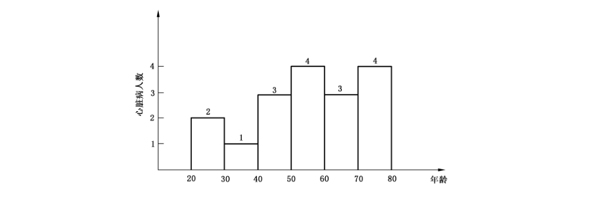
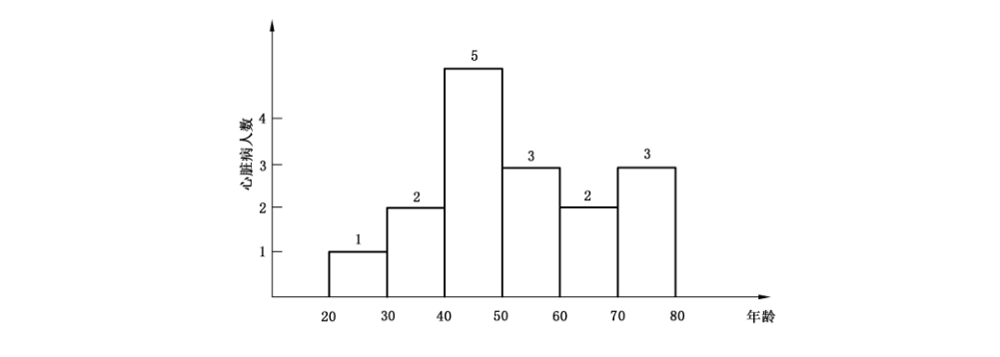

# GB/T 37964-2019 信息安全技术 个人信息去标识化指南

> 来源：[GB/T 37964-2019 国家标准详情](https://openstd.samr.gov.cn/bzgk/std/newGbInfo?hcno=C8DF1BC2FB43C6EC0E602EB65EF0BC66)。
> PDF SHA-256：69606f2e821a65d58c9bce9866f6f9f778ca979f3a7168a70f813d0be2ad85e4。
> 发布日期：2019-08-30；实施日期：2020-03-01。依据官方 PDF 的 35 页图像逐页核对，重建附录 B、C、D 的表格和公式，保留 3 幅图示，并去除封面、目录、分页和页眉页脚。正式引用请核对官方原文。

## 前言

本标准按照 GB/T 1.1—2009给出的规则起草。

请注意本文件的某些内容可能涉及专利。本文件的发布机构不承担识别这些专利的责任。

本标准由全国信息安全标准化技术委员会（SAC/TC 260）提出并归口。

本标准起草单位：清华大学、启明星辰信息技术集团股份有限公司、浙江蚂蚁小微金融服务集团有限公司、阿里巴巴（北京）软件服务有限公司、北京奇安信科技有限公司、北京天融信网络安全技术有限公司、中国科学院软件研究所、中国软件评测中心、上海计算机软件技术开发中心、北京数字认证股份有限公司、西安电子科技大学、湖南科创信息技术股份有限公司、中国电子技术标准化研究院、陕西省信息化工程研究院。

本标准主要起草人：金涛、谢安明、陈星、白晓媛、郑新华、刘贤刚、陈文捷、刘玉岭、宋鹏举、赵亮、宋玲娓、叶晓俊、王建民、方明、裴庆祺、潘正泰。

## 引言

在大数据、云计算、万物互联的时代，基于数据的应用日益广泛，同时也带来了巨大的个人信息安全问题。为了保护个人信息安全，同时促进数据的共享使用，特制定个人信息去标识化指南标准。

本标准旨在借鉴国内外个人信息去标识化的最新研究成果，提炼业内当前通行的最佳实践，研究个人信息去标识化的目标、原则、技术、模型、过程和组织措施，提出能科学有效地抵御安全风险、符合信息化发展需要的个人信息去标识化指南。

本标准关注的待去标识化的数据集是微数据（以记录集合表示的数据集，逻辑上可通过表格形式表示）。去标识化不仅仅是对数据集中的直接标识符、准标识符进行删除或变换，可以结合后期应用场景考虑数据集被重标识的风险，从而选择恰当的去标识化模型和技术措施，并实施合适的效果评估。

对于不是微数据的数据集，可以转化为微数据进行处理，也可以参照本标准的目标、原则和方法进行处理。例如针对表格数据，如果关于同一个人的记录有多条，则可将多条记录拼接成一条，从而形成微数据，其中同一个人的记录只有一条。

## 1 范围

本标准描述了个人信息去标识化的目标和原则，提出了去标识化过程和管理措施。

本标准针对微数据提供具体的个人信息去标识化指导，适用于组织开展个人信息去标识化工作，也适用于网络安全相关主管部门、第三方评估机构等组织开展个人信息安全监督管理、评估等工作。

## 2 规范性引用文件

下列文件对于本文件的应用是必不可少的。凡是注日期的引用文件，仅注日期的版本适用于本文件。凡是不注日期的引用文件，其最新版本（包括所有的修改单）适用于本文件。

- GB/T 25069—2010 信息安全技术 术语

## 3 术语和定义

GB/T 25069—2010界定的以及下列术语和定义适用于本文件。

### 3.1 个人信息 personal information

以电子或其他方式记录的能够单独或与其他信息结合识别特定自然人身份或反映特定自然人活动情况的各种信息。

［GB/T 35273—2017，定义3.1］

### 3.2 个人信息主体 personal data subject

个人信息所标识的自然人。

［GB/T 35273-2017，定义3.3］

### 3.3 去标识化 de-identification

通过对个人信息的技术处理，使其在不借助额外信息的情况下，无法识别个人信息主体的过程。

［GB/T 35273—2017，定义3.14］

> 注：去除标识符与个人信息主体之间关联性。

### 3.4 微数据 microdata

一个结构化数据集，其中每条（行）记录对应一个个人信息主体，记录中的每个字段（列）对应一个属性。

### 3.5 聚合数据 aggregate data

表征一组个人信息主体的数据。

> 注：例如各种统计值的集合。

### 3.6 标识符 identifier

微数据中的一个或多个属性，可以实现对个人信息主体的唯一识别。

> 注：标识符分为直接标识符和准标识符。

### 3.7 直接标识符 direct identifier

微数据中的属性，在特定环境下可以单独识别个人信息主体。

注1：特定环境指个人信息使用的具体场景。例如，在一个具体的学校，通过学号可以直接识别出一个具体的学生。

注2：常见的直接标识符有：姓名、身份证号、护照号、驾照号、地址、电子邮件地址、电话号码、传真号码、银行卡号码、车牌号码、车辆识别号码、社会保险号码、健康卡号码、病历号码、设备标识符、生物识别码、互联网协议（IP）地址号和网络通用资源定位符（URL）等。

### 3.8 准标识符 quasi-identifier

微数据中的属性，结合其他属性可唯一识别个人信息主体。

> 注：常见的准标识符有：性别、出生日期或年龄、事件日期（例如入院、手术、出院、访问）、地点（例如邮政编码、建筑名称、地区）、族裔血统、出生国、语言、原住民身份、可见的少数民族地位、职业、婚姻状况、受教育水平、上学年限、犯罪历史、总收入和宗教信仰等。

### 3.9 重标识 re-identification

把去标识化的数据集重新关联到原始个人信息主体或一组个人信息主体的过程。

### 3.10 敏感属性 sensitive attribute

数据集中需要保护的属性，该属性值的泄露、修改、破坏或丢失会对个人产生损害。

> 注：在潜在的重标识攻击期间需要防止其值与任何一个个人信息主体相关联。

### 3.11 有用性 usefulness

数据对于应用有着具体含义、具有使用意义的特性。

> 注：去标识化数据应用广泛，每种应用将要求去标识化数据具有某些特性以达到应用目的，因此在去标识化后，需要保证对这些特性的保留。

### 3.12 完全公开共享 completely public sharing

数据一旦发布，很难召回，一般通过互联网直接公开发布。

> 注：同英文术语 The Release and Forget Model。

### 3.13 受控公开共享 controlled public sharing

通过数据使用协议对数据的使用进行约束。

注1：例如通过协议禁止信息接收方发起对数据集中个体的重标识攻击，禁止信息接收方关联到外部数据集或信息，禁止信息接收方未经许可共享数据集。

注2：同英文术语 The Data Use Agreement Model。

### 3.14 领地公开共享 enclave public sharing

在物理或虚拟的领地范围内共享，数据不能流出到领地范围外。

> 注：同英文术语 The Enclave Model。

### 3.15 去标识化技术 de-identification technique

降低数据集中信息和个人信息主体关联程度的技术。

注1：降低信息的区分度，使得信息不能对应到特定个人，更低的区分度是不能判定不同的信息是否对应到同一个个人，实践中往往要求一条信息可能对应到的人数超过一定阈值。

注2：断开和个人信息主体的关联，即将个人其他信息和标识信息分离。

### 3.16 去标识化模型 de-identification model

应用去标识化技术并能计算重标识风险的方法。

## 4 概述

### 4.1 去标识化目标

去标识化目标包括：

a） 对直接标识符和准标识符进行删除或变换，避免攻击者根据这些属性直接识别或结合其他信息识别出原始个人信息主体；

b） 控制重标识的风险，根据可获得的数据情况和应用场景选择合适的模型和技术，将重标识的风险控制在可接受范围内，确保重标识风险不会随着新数据发布而增加，确保数据接收方之间的潜在串通不会增加重标识风险；

c） 在控制重标识风险的前提下，结合业务目标和数据特性，选择合适的去标识化模型和技术，确保去标识化后的数据集尽量满足其预期目的（有用）。

### 4.2 去标识化原则

对数据集进行去标识化，应遵循以下原则：

a） 合规：应满足我国法律、法规和标准规范对个人信息安全保护的有关规定，并持续跟进有关法律、法规和标准规范；

b） 个人信息安全保护优先：应根据业务目标和安全保护要求，对个人信息进行恰当的去标识化处理，在保护个人信息安全的前提下确保去标识化后的数据具有应用价值；

c） 技术和管理相结合：根据工作目标制定适当的策略，选择适当的模型和技术，综合利用技术和管理两方面措施实现最佳效果。包括设定具体的岗位，明确相应职责；对去标识化过程中形成的辅助信息（例如密钥、映射表等）采取有效的安全防护措施等；

d） 充分应用软件工具：针对大规模数据集的去标识化工作，应考虑使用软件工具提高去标识化效率、保证有效性；

e） 持续改进：在完成去标识化工作后应进行评估和定期重评估，对照工作目标，评估工作效果（包括重标识风险和有用性）与效率，持续改进方法、技术和工具。并就相关工作进行文档记录。

### 4.3 重标识风险

#### 4.3.1 重标识方法

常见的用于重标识的方法如下：

a） 分离：将属于同一个个人信息主体的所有记录提取出来；

b） 关联：将不同数据集中关于相同个人信息主体的信息联系起来；

c） 推断：通过其他属性的值以一定概率判断出一个属性的值。

#### 4.3.2 重标识攻击

常见的重标识攻击包括：

a） 重标识一条记录属于一个特定个人信息主体；

b） 重标识一条特定记录的个人信息主体；

c） 尽可能多的将记录和其对应的个人信息主体关联；

d） 判定一个特定的个人信息主体在数据集中是否存在；

e） 推断和一组其他属性关联的敏感属性。

### 4.4 去标识化影响

对数据集进行去标识化，会改变原始数据集，可能影响数据有用性。业务应用使用去标识化后的数据集时应充分认识到这一点，并考虑数据集变化可能带来的影响。

### 4.5 不同公开共享类型对去标识化的影响

在开展去标识化工作之前需要根据应用需求确定数据的公开共享类型，不同公开共享类型可能引发的重标识风险和对去标识化的要求如表1所示。

**表1 不同公开共享类型对去标识化的影响**

| 公开共享类型 | 可能的重标识风险 | 对去标识化的要求 |
| --- | --- | --- |
| 完全公开共享 | 高 | 高 |
| 受控公开共享 | 中 | 中 |
| 领地公开共享 | 低 | 低 |

## 5 去标识化过程

### 5.1 概述

去标识化过程通常可分为确定目标、识别标识、处理标识以及验证审批等步骤，并在上述各步骤的实施过程中和完成后进行有效的监控和审查。如图1所示。

### 5.2 确定目标

#### 5.2.1 概述

确定目标步骤包括确定去标识化对象、建立去标识化目标和制定工作计划等内容。

#### 5.2.2 确定去标识化对象

确定去标识化对象，指确定需要去标识化的数据集范围，宜根据以下要素确定哪些数据属于去标识化对象：

a） 法规标准。了解国家、地区或行业的相关政策、法律、法规和标准，待采集或发布数据是否涉及去标识化相关要求。

b） 组织策略。了解数据是否属于组织列入的重要数据或敏感数据范畴，数据应用时是否存在去标识化的要求。

c） 数据来源。了解这些数据采集时是否做过去标识化相关承诺。

d）业务背景。了解数据来源相关信息系统的业务特性，了解业务内容和业务流程，披露数据是否涉及个人信息安全风险。

e） 数据用途。了解待发布数据的用途，是否存在个人信息安全风险。

f） 关联情况。了解数据披露历史和去标识化历史情况，待披露数据是否和历史数据存在关联关系。

#### 5.2.3 建立去标识化目标

建立去标识化目标，具体包括确定重标识风险不可接受程度以及数据有用性最低要求。

需要考虑的因素包括：

a） 数据用途。了解数据去标识化后的用途，涉及业务系统的功能和特性，考虑数据去标识化的影响，确定数据有用性的最低要求。

b） 数据来源。了解数据获取时的相关承诺，以及涉及哪些个人信息。

c） 公开共享类别。若为数据发布实施个人信息去标识化，需了解数据是完全公开共享、受控公开共享还是领地公开共享，以及对数据在浏览和使用方面的安全保护措施。

d）风险级别。了解数据属性和业务特性，拟采用的重标识风险评估模型及设定的风险级别。

e） 去标识化模型和技术。了解数据适用的保护或去标识化标准，以及可能采用的去标识化模型和技术。

#### 5.2.4 制定工作计划

制定个人信息去标识化的实施计划，包括去标识化的目的、目标、数据对象、公开共享方式、实施团队、实施方案、利益相关方、应急措施以及进度安排等，形成去标识化实施计划书。

确定相关内容后，去标识化实施计划书应得到组织高级管理层的批准和支持。

### 5.3 识别标识

#### 5.3.1 概述

识别标识符的方法包括查表识别法、规则判定法和人工分析法。

#### 5.3.2 查表识别法

查表识别法指预先建立元数据表格，存储标识符信息，在识别标识数据时，将待识别数据的各个属性名称或字段名称，逐个与元数据表中记录进行比对，以此识别出标识数据。

建立的标识符元数据表，应包括标识符名称、含义、格式要求、常用数据类型、常用字段名字等内容。

查表识别法适用于数据集格式和属性已经明确的去标识化场景，如采用关系型数据库，在表结构中已经明确姓名、身份证号等标识符字段。

#### 5.3.3 规则判定法

规则判定法是指通过建立软件程序，分析数据集规律，从中自动发现标识数据。

组织可分析业务特点，总结可能涉及直接标识符和准标识符的数据格式和规律，确立相关标识符识别规则，然后通过运行程序，自动化地从数据集中识别出标识数据。如可依据GB 11643—1999建立身份证号码识别规则，并通过自动化程序在数据集中自动发现存在的身份证号码数据。

组织识别标识数据宜先采用查表识别法，并根据数据量大小和复杂情况，结合采用规则判定法。规则判定法在某些情况下有助于发现查表识别法不能识别出的标识符，如标识符处于下面情况时：

a） 业务系统存储数据时未采用常用的字段名称，如使用“备注”字段存储身份证号；

b） 数据中存在混乱或错误情况，如“备注”字段前100条记录的值为空，而后10000条记录的值为用户身份证号码。

规则判定法不仅仅适用于结构化数据应用场景，也适用于某些半结构化和非结构化数据应用场景，如对于非结构化存储的司法判决书，可以通过建立身份证号识别规则和开发程序，从司法判决书中自动识别出所有的身份证号。

#### 5.3.4 人工分析法

人工分析法是通过人工发现和确定数据集中的直接标识符和准标识符。

组织可在对业务处理、数据集结构、相互依赖关系和对数据集之外可用数据等要素分析的基础上，综合判断数据集重标识风险后，直接指定数据集中需要去标识化的直接标识符和准标识符。

人工分析法在结构化、半结构化和非结构化数据应用场景下都可使用。在下列场景时，人工分析法具有明显的优势：

a） 数据集中的多个不同数据子集之间存在关联、引用关系时，如通过数据挖掘算法，可关联分析数据集中多个非常见标识符属性后识别出唯一的用户身份；

b） 数据集中有特别含义的数据，或数据具有特殊值、容易引起注意的值，从而可能被用来重标识时，如超出常人的身高、独特的地理坐标、罕见的病因等。

相比较于查表识别法和规则判定法，人工分析法能够更加准确地识别出标识符。

### 5.4 处理标识

#### 5.4.1 概述

处理标识步骤分为预处理、选择模型技术、实施去标识化三个阶段工作。

#### 5.4.2 预处理

预处理是在对数据集正式实施去标识化前的准备过程。一般地，预处理是对数据集施加某种变化，使其有利于后期进行处理。

预处理阶段工作可参考如下方法进行：

a） 形成规范化，或满足特定格式要求的数据；

b） 对数据抽样，减小数据集的规模；

c） 增加或扰乱数据，改变数据集的真实性。

组织应根据数据集的实际情况选择预处理措施，或选择不预处理。

#### 5.4.3 选择模型技术

不同类型的数据需要采用不同的去标识化技术，所以在去标识化的早期阶段，重要的一步是确定数据的类型和业务特性，考虑去标识化的影响，选择合适的去标识化模型和技术，在可接受的重标识风险范围内满足数据有用性的最低要求。选择的参考因素包括但不限于如下方面：

a） 是否需要对重标识风险进行量化；

b） 聚合数据是否够用；

c） 数据是否可删除；

d） 是否需要保持唯一性；

e） 是否需要满足可逆性；

f） 是否需要保持原有数据值顺序；

g） 是否需要保持原有数据格式，如数据类型、长度等保持不变；

h） 是否需要保持统计特征，如平均值、总和值、最大值、最小值等；

i） 是否需要保持关系型数据库中的实体完整性、参照完整性或用户自定义完整性；

j） 是否可以更改数据类型，例如在针对字符串类型的“性别”（男/女）进行去标识化时，是否可以变成数字类型表示（1/0）；

k） 是否需要满足至少若干个属性值相同，以加强数据的不可区分性；

l） 是否可以对属性值实施随机噪声添加，对属性值做微小变化；

m） 去标识化的成本约束。

附录A 和附录B分别给出了常见的去标识化技术和模型，针对这些技术和模型的特性以及选择方法可参考附录C，附录D给出了去标识化面临的风险。

#### 5.4.4 实施去标识化

根据选择的去标识化模型和技术，对数据集实施去标识化。主要工作包括：

a） 若存在多个需要去标识化的标识符，则根据数据特点和业务特性设定去标识化的顺序；

b） 依次选择相应的工具或程序；

c） 设置工具或程序的属性和参数，如设置数据源、用户名/口令、算法参数等；

d） 依次执行去标识化工具或程序，获得结果数据集。

### 5.5 验证审批

#### 5.5.1 验证结果含义

对数据集去标识化后进行验证，以确保生成的数据集在重标识风险和数据有用性方面都符合预设的目标。在验证满足目标过程中，需对去标识化后重标识风险进行评估，计算出实际风险，与预期可接受风险阈值进行比较，若风险超出阈值，需继续进行调整直到满足要求。由于重标识技术和重标识攻击的能力在迅速演变，需要由内部专业人员或权威的外部组织定期展开验证评估。

#### 5.5.2 验证个人信息安全

验证去标识化数据满足个人信息安全保护要求的方法包括：

a） 检查生成的数据文件，以确保文件数据或元数据中不包含直接标识符和准标识符；

b） 检查生成的数据文件，以确保所得数据符合既定重标识风险要求；

c） 评估去标识化软件及其参数配置；

d） 进行有针对性的入侵者测试，看看是否有具备合格能力的外部人员可以使用公开的数据集执行重标识；

e） 让团队利用内部数据进行有针对性的入侵者测试，模拟违规者或敌对内幕人士可能发生的情况。

这些方法不能保证去标识化后的数据满足个人信息安全保护的要求，但它们可以作为整个组织风险评估的一部分。可证明的个人信息安全保护应依赖于形式化方法，例如用于规划组织数据发布的差分隐私方法。通过使用经过验证的去标识化软件，可以大大简化去标识化数据的个人信息安全保护的验证工作。

#### 5.5.3 验证数据有用性

去标识化降低了数据质量和生成数据集的有用性。因此，需要考虑去标识化后的数据集对于预期的应用仍然有用。

存在一些方法用于验证数据有用性。例如，内部人员可对原始数据集和去标识化的数据集执行统计计算，并对结果进行比较，以查看去标识化后是否导致不可接受的更改。组织可让可信的外部人员检查去标识化数据集，以确定数据能被用于预期目的。

#### 5.5.4 审批去标识化工作

在完成处理标识和验证结果后，组织管理层应依据数据发布共享用途、重标识风险、数据有用性最低要求等因素，以及验证结果、去标识化各步骤实施过程中的监控审查记录等因素，做出是否认可数据去标识化结果的决定。

审批由组织高级管理层来执行。

### 5.6 监控审查

#### 5.6.1 监控审查去标识化各步骤实施过程

应确保去标识化的每一步骤均实现了预定目标。

在去标识化的各个步骤中，为有效完成去标识化任务，需在确定目标步骤撰写去标识化工作方案，明确各步骤要完成的工作，并在识别标识、处理标识、验证结果阶段记录工作过程和结果，形成文档。

组织管理层在去标识化的各个步骤完成时，对该阶段记录文档进行审查，检查输出文档是否齐全和内容完备，及时发现已经出现或可能出现的错误或偏差，并采取适当控制措施，监督各步骤执行过程得到完整和有效地执行。

监控审查过程也应记录到文档中，记录内容至少包括监控审查对象、时间、过程、结果和措施等内容。

#### 5.6.2 持续监控去标识化效果

持续监控是指数据在去标识化、审批同意交付用户后，宜根据情况变化或定期进行去标识化数据的重标识风险评估，并与预期可接受风险阈值进行比较，以保障个人信息安全性。

情况发生变化是指重标识风险的相关要素发生变化，相关要素包括但不限于：

a） 去标识化数据使用者；

b） 目标信息系统；

c） 目标信息安全环境；

d） 新增去标识化数据。

此外，即使各种要素均未发生变化，只要去标识化数据仍然可以被目标用户访问，也需定期对数据进行重标识风险评估。这是由于重标识技术以及重标识攻击能力都在迅速演变，所以要通过重标识风险评估，检查先前的去标识化数据是否仍然安全。

## 6 角色职责与人员管理

### 6.1 角色职责

个人信息去标识化工作相关的主要角色包括规划管理者、执行者、监督者。

a） 规划管理者

在组织中，规划管理者对个人信息去标识化工作负总责，具体职责包括：规划个人信息去标识化策略，建立相关的规范制度和监控审计机制，宣贯去标识化政策和制度，认可和批准去标识化工作的结果，和上级主管部门、监管机构进行沟通，与外部技术单位进行合作和交流。

b） 执行者

执行者负责去标识化业务的具体执行，主要职责包括：依据数据共享场景，提出个人信息去标识化需求；识别个人信息安全风险，制定去标识化工作计划；执行去标识化工作，记录工作情况；申请审批去标识化结果。

c） 监督者

监督者的主要职责是监督去标识化工作情况、审计该业务执行过程，保证业务合规、安全风险可控。

### 6.2 人员管理

组织应整体规划个人信息去标识化有关的工作任务和职责，做到有效保护个人信息安全、确保个人信息去标识化工作顺利开展。在人员管理方面还应考虑如下因素：

a） 提炼个人信息去标识化工作岗位需求，包括技术能力需求和安全保密需求；

b）个人信息去标识化工作岗位招聘时应按照相关法律、法规、道德规范和相应的工作岗位需求，对应聘人员进行考察；

c） 与个人信息去标识化工作岗位人员工作合同或补充文档中，应明确其理解工作职责和要承担的安全保密要求；

d） 组织应定期开展业务和安全培训，确保个人信息去标识化工作岗位人员接受充分和最新的培训，保证岗位人员达到培训要求，持续拥有适当的技能，能够按要求执行个人信息去标识化的相关工作；

e） 个人信息去标识化工作岗位人员离职时，应依据其涉及数据重要程度，在离职保密协议中增加适当的保密要求条款。

## 附录 A（资料性附录）常用去标识化技术

### A.1 统计技术

#### A.1.1 概述

统计技术是一种对数据集进行去标识化或提升去标识化技术有效性的常用方法，主要包含数据抽样和数据聚合两种技术。

#### A.1.2 数据抽样

数据抽样是通过选取数据集中有代表性的子集来对原始数据集进行分析和评估的，它是提升去标识化技术有效性的重要方法。

对数据抽样技术选择和使用应注意以下几个方面：

a） 从数据集中抽取样本的方法很多，各方法差异很大，需根据数据集的特点和预期的使用场景来选择。

b） 数据抽样经常用于去标识化的预处理，对数据集进行随机抽样能够增加识别出特定个人信息主体的不确定性，从而可以提高后续应用的其他去标识化技术的有效性。

c） 数据抽样可以简化对数据集的计算量，因此，在对大样本的数据集进行去标识化时，首先进行抽样，然后再采用某项特定的技术进行去标识化。

例如：某市从1000万市民中随机抽取1万人的4项信息（性别、学历、籍贯、身高）。如果攻击者发现市民A的情况完全符合记录甲（男，本科，北京，1.75 m），攻击者并不能确定记录甲就是指市民 A，因为A并不一定在此抽样数据集中。

#### A.1.3 数据聚合

数据聚合作为一系列统计技术（如求和、计数、平均、最大值与最小值）的集合，应用于微数据中的属性时，产生的结果能够代表原始数据集中的所有记录。

对数据抽样技术选择和使用应注意以下几个方面：

a） 数据聚合可能会降低数据的有用性；因为得到的是统计值，无法反映独立数据记录的特征。

b） 数据聚合对重标识攻击非常有效；数据聚合的输出是“统计值”，该值有利于对数据进行整体报告或分析，而不会披露任何个体记录。

例如：2012年我国18岁及以上成年男性平均身高1.67 m。如果数据集以平均身高来标识数据集中每个人的身高值，则记录（男，本科，北京，1.67 m,1980年9月1日）中，身高属性值对攻击者识别身份主体没有什么作用。

### A.2 密码技术

#### A.2.1 概述

本节描述适用于去标识化的密码技术。使用密码技术应遵循国家密码管理相关规定。

#### A.2.2 确定性加密

确定性加密是一种非随机加密方法。在去标识化过程中应用时，可以用确定性加密结果替代微数据中的标识符值。

对确定性加密技术的选择和使用应注意以下几个方面：

a） 确定性加密可以保证数据真实可用，即相同的两个数据用同一密钥进行加密将产生两个一样的密文。

b） 确定性加密可以一定程度上保证数据在统计处理、隐私防挖掘方面的有用性，确定性加密也可以生成用于精准匹配搜索、数据关联及分析的微数据。对确定性加密结果的分析局限于检查数据值是否相等。

c） 对确定性加密的重标识攻击主要在于不具备密钥使用权时的攻击；关联性攻击则可能适用于采用同一密钥进行确定性加密的密文，攻击能否成功很大程度上取决于对加密算法参数的选择。

#### A.2.3 保序加密

保序加密是一种非随机加密方法。用作去标识化技术时，可以用保序加密值替代微数据中的标识符值。

对保序加密技术选择和使用应注意以下几个方面：

a） 密文的排序与明文的排序相同。

b） 保序加密可以在有限的范围内保证加密结果在统计处理、隐私防挖掘、数据外包存储与处理等场景中的有用性。保序加密可以产生用于范围/区间匹配搜索、分析的微数据。对保序加密结果的分析局限于检查数据相等和排序比较关系。

c） 保序加密数据的完全重标识仅可能适用于拥有密钥的一方。关联性攻击能否成功很大程度上取决于保序加密方案的参数选择。

#### A.2.4 保留格式加密

保留格式加密是一种适宜于去标识化技术的加密方法，加密要求密文与明文具有相同的格式，当作为去标识化技术的一部分加以采用时，可用保留格式加密值替代微数据中的标识符值。

对保留格式加密技术的选择和使用应注意以下几个方面：

a） 某些保留格式加密具有确定性加密技术一样的特点，如相同数据在同一密钥下加密生成同样的密文，且可以通过生成微数据进行精准匹配搜索、数据关联分析等。

b） 保留格式加密适用于多种格式的数据，包括字符型、数字型、二进制等，加密结果也是同类型数据。

c） 和其他加密技术不一样，在给定有限符号集的情况下，保留格式加密可以保证加密后的数据具有与原始数据相同的格式和长度，这有助于在不需要应用修改的情况下，实现去标识化。

#### A.2.5 同态加密

同态加密是一种随机加密。当作为去标识化技术的一部分加以采用时，对加密数据进行处理，但是处理过程不会泄露任何原始内容。同时，拥有密钥的用户对处理过的数据进行解密后，得到的正好是处理后的结果。同态加密用加密值替代微数据中的标识符值。

对同态加密技术的选择和使用应注意以下几个方面：

a） 对经过同态加密的数据进行处理得到一个输出，将这一输出进行解密，其结果与用同一方法处理未加密的原始数据得到的输出结果是一样的。

b） 与传统的确定性加密方案相比，同态加密的性能一般较低，存储成本较高。

c） 同态加密方案具有语义上的安全性，使得在不具备访问私钥权限时无法实现重标识攻击。

#### A.2.6 同态秘密共享

同态秘密共享可将一个秘密拆分为“若干份额”，可利用拆分后秘密信息的特定子集来重构原始的秘密，如果对用于重构秘密的所有份额执行相同的数学运算，则其结果等价于在原始秘密上执行相应数学运算的结果。当作为去标识化技术的一部分加以采用时，同态秘密共享可用信息共享算法得出的两个或以上若干份额替代数据记录中的任何标识符或敏感属性。这样，便可将这些若干份额分配给两个或以上的份额持有者。这些份额持有者的数量通过秘密共享方案加以确定。

有效的同态秘密共享的特性是，相同份额持有者共享机密的两个值可与加密方案的同态运算相结合，产生代表原始属性运算结果的新份额。此外，同态密钥共享可与安全的多方计算相结合，以便对去标识化数据进行任何安全运算。同态密钥共享并不会降低数据的真实性。

虽然同态密钥共享有着相对低的计算性能开销，但存在与份额持有者之间交换份额的额外开销。

共享秘密数据的存储开销是有限的。基于安全多方计算执行的数据去标识化的处理技术是灵活的，但根据所采用的不同方案，可能会导致高昂的成本。

同态密钥共享会产生微数据的分布式实例，该类实例可被同态运算或安全多方计算技术处理。同态加密方案是随机的，攻击者只有控制所有份额持有者才能实现重标识攻击。

### A.3 抑制技术

#### A.3.1 概述

抑制技术即对不满足隐私保护的数据项删除，不进行发布。包括从所有记录中选定的属性（如屏蔽）、对所选定的属性值（例如，局部抑制），或是从数据集中选定的记录（例如，记录抑制）进行的删除操作。抑制技术主要适用于分类数据。

抑制技术可用于防止基于关联规则推导的攻击，因为不发布能最大化降低关联规则支持度和置信度的属性值，从而破坏关联规则推导攻击。

抑制技术适用于数值与非数值数据属性，执行相对比较容易，且可以保持数据的真实性。

#### A.3.2 屏蔽

屏蔽技术包括从数据集中删除整个直接标识符，或删除直接标识符的一部分，使其不再是直接标识符也不是唯一标识符。

使用屏蔽技术后，通常还会对数据集使用其他去标识化技术。

在将屏蔽技术作为唯一的去标识化技术的系统中，应采取安全措施和组织其他的管理措施去保护未被识别的数据。

屏蔽技术也有其他一些叫法，如：

a） 部分数据移除：指在屏蔽过程中不会删除所有标识符。

b） 数据隔离：指屏蔽需要有严格的安全措施，以确保对数据集的授权访问，如访问控制和相应的合约条款

c） 数据限制：指在有特定目的的环境中收集数据时进行数据抑制的情况。

#### A.3.3 局部抑制

局部抑制技术是一种去标识化技术，即从所选记录中删除特定属性值，该特定属性值与其他标识符结合使用可能识别出相关个人信息主体。通常应用局部抑制技术来移除准标识符在泛化后仍然出现的稀有值（或这些值的稀有组合）。

局部抑制技术应用于分类值，而泛化通常应用于数值，其共同目标是增加共享其标识符值的记录数。

#### A.3.4 记录抑制

“记录抑制”是一种从数据集中删除整个记录或一些记录的去标识化技术。典型应用场景为删除包含稀有属性（如异常值）组合的记录。

#### A.3.5 注意事项

抑制技术会导致信息丢失，抑制技术处理后的数据有被重标识的风险，因此需要与其他去标识化技术相结合以降低数据的重标识风险。

过多的抑制会影响数据的效用，所以在具体应用时，为保证数据的可用性，要对抑制的数据项数量设定一个上限值。

#### A.3.6 示例

在某个具体应用中，需要对某组织的不同工作年限的薪资水平进行分析，原始数据集包括｛姓名，性别，薪水，工作年限，职务｝，采用如下步骤进行去标识化：

a） 姓名是直接标识符，需要应用抑制技术删除；通过｛职务，工作年限｝或｛职务，性别｝也可以推导出该组织中的一部分员工，因此应用抑制技术删除职务属性；

b）剩下的｛性别，薪水，工作年限｝，有被重标识的风险，需要结合泛化技术，对“薪水”“工作年限”属性值进行泛化处理，如薪水泛化为5000~10 000、10 000~15 000、15 000~20 000等，工作年限泛化0~3年、4～6年等；

c） 如果数据记录中只有1人工作年限为0~3年，薪水15 000~20 000，则能够定位到某个员工，应用抑制技术删除该条记录。

### A.4 假名化技术

#### A.4.1 概述

假名化技术是一种使用假名替换直接标识（或其他准标识符）的去标识化技术。假名化技术为每一个人信息主体创建唯一的标识符，以取代原来的直接标识或准标识符。不同数据集中的相关记录在进行假名化处理后依然可以进行关联，并且不会泄露个人信息主体的身份。

在使用假名化技术的过程中，通常会使用一些辅助信息。这些辅助信息包括从原始数据集中删除的标识符、假名分配表或密钥等，采取必要的措施来保护这些辅助信息有利于降低重标识风险。

假名创建技术主要包括独立于标识符的假名创建技术和基于密码技术的标识符派生假名创建技术。假名创建技术的选择需要考虑以下因素：创建假名的成本、散列函数的抗碰撞能力以及重标识过程中假名被还原的手段。

独立于标识符的假名创建技术不依赖于被替代的属性原始值，而是独立生成，典型方法用随机值代替属性原始值。基于密码技术的标识符派生假名创建技术通过对属性值采用加密或散列等密码技术生成假名，这一过程也称为对数据集中的属性进行“密钥编码”。其中加密技术生成的假名可以用合适的密钥及对应的算法解密，而散列技术是一种单向的数学运算。

#### A.4.2 独立于标识符的假名创建

独立于标识符的假名创建技术不依赖于被替代的属性原始值，而是独立生成，典型方法用随机值代替属性原始值。

使用该类技术时需创建假名与原始标识的分配表。根据去标识化的目标，应采取适当的技术与管理措施限制和控制对该分配表的访问。例如，使用去标识化后数据的应用系统禁止访问分配表。

#### A.4.3 基于密码技术的标识符派生假名创建

基于密码技术的标识符派生假名创建技术通过对属性值采用加密或散列等密码技术生成假名，这一过程也称为对数据集中的属性进行“密钥编码”。其中加密技术生成的假名可以用合适的密钥及对应的算法解密，而散列技术是一种单向的数学运算。

采用多种密码技术的组合可更好地保护属性原始值。

采用加密方法来创建假名的计算成本很高，但非常有效。应采取特殊措施来保护密钥，防止密钥被未授权访问，包括密钥与数据分离，不与第三方共享密钥，安全地删除密钥以防重标识等。

散列函数的单向运算及抗碰撞能力等特性，使其适用于假名化过程。但是，当散列算法和所用密钥是已知的，且有可能遍历散列函数生成数值空间时，散列函数是可逆的。因此使用密钥散列函数时可增加另一随机输入，增强其对抗暴力搜索攻击的能力，防止未经授权的重标识。即使采用了安全的散列技术，如果在使用或执行散列算法中发生了疏忽，或未经授权共享密钥，均可能导致数据的重标识。

#### A.4.4 注意事项

如果采用恰当的方式构建假名与原始标识的分配表，并能对分配表和分配技术加以保护，则能够有效地降低数据的重标识风险。采用多个原始标识符对应一个假名的分配表比采用一一对应的分配表能够更加有效降低重标识风险。加密技术通常是一一对应的分配技术；散列技术由于碰撞性的存在，通常是多对一的分配技术；采用纯随机的方式构建分配表通常也是多对一的。

采用多个原始标识符对应一个假名的分配表方法和分配技术，会导致在以标识符为统计对象的数据分析结果失真，从而降低数据的有用性。加密技术能够还原标识符，在需要还原原始标识符的情况下采用该技术。

#### A.4.5 示例

在某个具体的应用中，需要从外部某数据库中抽取包含人名的有效数据以供分析，采用如下步骤进行去标识化：

a） 构建常用人名字典表。

常用人名字典表有200个常用人名构成：龚小虹、黄益洪、龙家锐、龚尧莞、齐新燕、车少飞、龙家铸、赖鸿华、龙宣霖、连丽英⋯⋯

b） 制定人名与假名的分配技术。

分配技术采用纯随机方式，对于每一个标识符（人名），随机生成一个不小于1并且不大于200的随机数，从字典表中的对应位置获取假名，进行替换。

c） 使用字典表和分配技术，完成对人名的去标识化。

在去标识过程中，在遇到人名“辛培军”时，随机生成了数5，则使用字典中的排列第5的名字“齐新燕”替换“辛培军”。

该示例使用随机方式构建分配规则，采用了多对一的方式，在保留适当可用性的同时，降低了数据的重标识风险。

### A.5 泛化技术

#### A.5.1 概述

泛化技术是指一种降低数据集中所选属性粒度的去标识化技术，对数据进行更概括、抽象的描述。

泛化技术实现简单，能保护记录级数据的真实性。

使用泛化技术的目标是减少属性唯一值（更概括地说，是指多个属性值的组合集的唯一值）的数量，使得被泛化后的值（或多个值的集合）被数据集中多个记录所共享，从而增加某特定个人信息主体被推测出的难度。因此，通常选择对标识符属性进行泛化，但是根据具体情况也可考虑对任何属性（特别是敏感属性）进行泛化。

#### A.5.2 取整

取整涉及为所选的属性选定一个取整基数，然后将每个值向上或向下取整至最接近取整基数的倍数。向上还是向下取整按概率确定，该概率值取决于观察值与最接近取整基数倍数的接近程度。例如，如果取整基数10，观察值为7，应将7向上取整至10，概率为0.7，若向下取整至0，概率为0.3。

受控取整也是可行的，例如确保取整值的求和结果与原始数据的求和取整值相同。

#### A.5.3 顶层与底层编码

泛化技术为某一属性设定一个可能的最大（或最小）阈值。顶层与底层编码技术使用表示顶层（或底层）的阈值替换高于（或低于）该阈值的值。

该技术适用于连续或分类有序的属性。例如，如果一个人的薪水非常高，则可将该用户的薪水值设置为“高于 X元”，其中“X”为高收入值的界限，而不记录或报告准确的金额。

### A.6 随机化技术

#### A.6.1 概述

随机化技术作为一种去标识化技术类别，指通过随机化修改属性的值，使得随机化处理后的值区别于原来的真实值。该过程降低了攻击者从同一数据记录中根据其他属性值推导出某一属性值的能力。

随机化技术并不能保证数据在记录集的真实性。为达到特定的目标，有效随机化过程需要逐项定制，定制过程中需要详细了解数据特性，并选取合适的参数。

随机化技术的输出为微数据。

#### A.6.2 噪声添加

噪声添加是一种随机化技术，通过添加随机值、“随机噪声”到所选的连续属性值中来修改数据集，同时尽可能保持该属性在数据集中的原始统计特性。该类统计特性包括属性的分布、平均值、方差、标准偏差、协方差以及相关性。

#### A.6.3 置换

置换是在不修改属性值的情况下对数据集记录中所选属性的值进行重新排序的一种技术。因此，置换保持了整个数据集中所选属性的准确统计分布。

置换技术适用于数字与非数字值。因为观察到的不一致性可能有助于对置换算法实施逆向工程，需要考虑如何来确保生成的数据集是一致的。

不同置换技术的区别在于方法与复杂性的差别。在保持所选属性之间原有相关性的情况下，置换算法可用于单个或多个属性。

通常情况下，采用逆向工程可以将数据恢复到原始状态，从而加大受控重标识的可能性，因此把随机化算法引入到置换中会增强对抗重标识攻击的能力。

#### A.6.4 微聚集

“微聚集”是指用某种算法方式计算出来的平均值代替连续属性所有值的去标识化技术。对于每种连续属性，或对于所选的一组连续属性，数据集中的所有记录都进行了分组，具有最近属性值的记录属于同一组，而且每一组中至少有 k 个记录。每一种属性的新值替换为该属性所在组中的平均值。每组中的各个值越接近，数据的有效性就保持得越好。

微聚集的输出是微数据，该技术不能保证数据的真实性。

微聚集技术的不同之处在于：选择的属性、属性值之间的相似性计算方式以及其他考虑因素。

### A.7 数据合成技术

数据合成是一种以人工方式产生微数据的方法，用以表示预定义的统计数据模型。

对数据合成技术的选择和使用应注意以下几个方面：

a） 合成数据集与原始数据特性相符，但不包含现有个人信息主体有关的任何数据，但是，若合成后的数据与原始数据的拟合度过高可能会导致敏感信息泄露。

b） 创建合成数据的方法很多。理论上，数据可根据所选的统计特性随机生成。该类模型的关键特征主要体现在每种属性（总体与子总体）的分布以及属性之间的内部关系。实际上，合成数据的生成会采用随机化技术与抽样技术对真实数据集进行多次或连续转换。合成数据通常用于测试工具与应用。

c） 合成数据可用于开发查询。合成数据可用作真实数据的替代项：数据管理者能在实际数据中重现在合成数据中执行的查询，以确保基于合成数据的处理能够同样正确应用于真实数据。

利用差分隐私机制可以保证合成数据的隐私。

## 附录 B（资料性附录）常用去标识化模型

### B.1 K-匿名模型

#### B.1.1 概述

K-匿名模型是在发布数据时保护个人信息安全的一种模型。K-匿名模型要求发布的数据中，指定标识符（直接标识符或准标识符）属性值相同的每一等价类至少包含 K 个记录，使攻击者不能判别出个人信息所属的具体个体，从而保护了个人信息安全。在使用 K-匿名模型整合得到的数据集中，各记录之间的关联性是有限的（1/K）。

可独立或综合使用附录 A中的各种去标识化技术，以符合K-匿名模型的要求。抑制技术、泛化技术及微聚集均适用于数据集中的各种属性，以实现期望的结果。

K-匿名模型还包括一些增强概念，如L-多样性和 T-接近性。

#### B.1.2 L-多样性

L-多样性是针对属性值差异性不大的数据集提出的一种增强概念。为防止确定性推导，L-多样性要求在 K-匿名的基础上，实现每一等价类在每一敏感属性上存在至少 L 个不同值。在数据分布很不均衡时，防止推导性攻击的能力受到限制。

#### B.1.3 T-接近性

T-接近性是 L-多样性的增强概念，适用于发布数据集的敏感属性分布要尽可能贴近整个数据集的敏感属性分布。针对属性值分布不规则、属性值范围很小或已被分类的数据集，为防止概率性推导，要求任何等价类中敏感属性的分布与整个数据集中相应属性的分布之间的距离小于阈值 T。

#### B.1.4 K-匿名的关键考虑因素

##### B.1.4.1 数据风险度量

数据集的重标识风险度量包括如下两个关键因素：

a） 每行记录重标识概率的计算方法

数据集中的每一行都包含有关个体的信息，存在重标识的概率。对于给定的行，重标识的概率取决于数据集中其他行对于准标识符的属性是否具有相同的值。

数据集中的“等价类”是指具有与准标识符属性相同值的数据记录行。例如，在具有性别、年龄和最高教育水平的属性列的数据集中，所有满足“35岁以上且具有大专学位的老年男子”的数据记录，形成一个等价类。等价类的大小等于准标识符具有相同值的行数。

对于每一行，重标识的概率等于1除以其等价类的大小，即，给定记录行重标识概率=1/等价类大小。例如，大小为5的等价类中的每一行都有重标识的概率为0.2。因此，具有较大等价类的行，具有较低的重标识概率。

b） 根据所使用的发布模型采用适当的风险衡量方法

虽然每行记录重标识的概率等于1除以其等价类的大小，但是具体的计算数据集中重标识风险的方法，取决于具体使用的发布模型。

公开共享数据发布应使用最大风险。因为对于公开数据发布，应假设有攻击者会进行炫耀式攻击。该类攻击将针对数据集中最脆弱的行，即具有最小等价类和最高重标识概率的数据行。

因此，应使用所有行中重标识的最大概率来衡量重标识风险。

受控共享数据发布应使用严格的平均风险。受控共享数据发布数据集的访问仅限于选定数量的已鉴别信息接收方，每行数据的重标识概率是均等的，应使用所有行中重标识的平均概率来衡量数据集中重标识风险。为了保护具有高度重标识风险的独特行或等价类，平均值通常建议为0.33，即数据集中等价类的最小尺寸应为3。实际使用时重标识的最大概率也可以定为0.5。

##### B.1.4.2 环境风险度量

重标识风险会受到环境风险的影响。环境风险是针对数据集发起一次或多次重标识攻击的概率。

任何去标识化的数据集中都存在重标识风险，然而依据数据发布模型的不同，攻击者可实施攻击类型也是不同的。

a） 公开共享数据发布

该类数据发布模型中，数据集可供任何人使用，无需任何条件，会有攻击者进行炫耀式攻击。

因此，攻击者对数据集进行重标识攻击的概率为1。

b） 受控共享数据发布

该类数据发布模型中，环境风险的计算相对复杂，需重点确定可能的重标识攻击概率的方法和函数。

对于受控共享数据发布，需确定三种不同的重标识攻击的概率：内部故意攻击、来自熟悉的数据集中的个体的无意识识别、数据泄露。

在衡量环境风险时，应取上述概率的最大值。

1） 内部故意攻击

对于受控共享数据集数据接收者，发起重标识的概率取决于两个因素：数据共享协议中关于数据隐私和安全性的控制范围；接收方进行重标识攻击的动机和能力。这两个因素都需在“高”“中”“低”范围内进行定性评估。

根据受控共享数据发布的数据共享协议，依据不同的隐私和安全控制规定，信息接收方发起身份验证攻击的可能性会有所不同。隐私和安全控制水平越高，重标识攻击的可能性就越低。数据共享协议中需考虑隐私和安全控制，具体内容包括：信息接收方仅允许授权员工以最小权限方式访问和使用数据；

包括外部合作者和分包商在内的所有工作人员都需要签署保密协议；

采取措施处置指定保留期限外的数据；

如果没有必要的控制或事先审批，数据将不能开放或与第三方共享；

制定隐私安全策略和规程，并监督执行；

对包括外部合作或分包场所涉及的人员在内的所有个人和团队成员进行强制性和持续的隐私保护培训和安全培训；

应有应对违反隐私协议的必要措施，可能的措施包括立即向数据保管人发出书面通知；

安装病毒检查和反恶意软件程序；

建立审计系统，记录数据访问人员、时间和行为等信息；

使用加密协议对需要传输的数据进行处理；

信息披露相关的计算机和文件需要被妥善保管，例如用组合门锁或智能门卡等方式保护存放相关计算机的房间，纸质文件存储在密码存储柜中。

确定信息接收方发起重标识攻击可能性的另一个主要因素是他们的动机和能力。信息接收方对于数据集中的一个或多个个体重标识的动机越大，能力越强，实施重标识攻击的概率就越高。评估动机和能力时，需要考虑以下因素：

- 信息接收方在与组织合作中是否发生过安全事故；

- 信息接收方是否存在财务或其他方面的原因，从而发起重标识攻击；

- 信息接收方是否具有相关技术专长或经济能力，以发起重标识攻击；

- 信息接收方是否曾经访问可以关联到实施重标识攻击数据的其他隐私数据库或数据集。

根据数据共享协议中的隐私和安全控制水平，以及接收者的动机和能力，可以估计内部人员发起重标识攻击的可能性。具体如表 B.1 所示。

**表 B.1 重标识攻击的可能性分析表**

| 隐私和安全控制水平 | 动机和能力 | 重标识攻击概率 |
| --- | --- | --- |
| 高 | 低 | 0.05 |
| 高 | 中 | 0.1 |
| 高 | 高 | 0.2 |
| 中 | 低 | 0.2 |
| 中 | 中 | 0.3 |
| 中 | 高 | 0.4 |
| 低 | 低 | 0.4 |
| 低 | 中 | 0.5 |
| 低 | 高 | 0.6 |

2） 熟悉数据集的内部人无意识重标识

除了故意发起重标识攻击，受控共享数据发布的接收方也可能无意中重标识一个或多个主体。例如在分析数据时，他们可能会识别出一个朋友、同事、家人或熟人。发生这种“攻击”的概率等于随机接收者在数据集中知道某人的概率，该概率的计算公式是：

`1 - (1 - p)^m`

式中：

p——所有人中具有数据集中讨论的条件或特征的个体的百分比；

m——认识的平均人数。

p的值应由最近的人口统计确定；建议m 的平均值应在150～190之间。

3） 数据泄露

在受控共享数据发布的情况下，需考虑的第三种攻击是接收方的数据泄露。如果信息接收方的设施发生数据泄露，应假设外部攻击者将发起重标识攻击。因此，发生这种攻击的概率等于信息接收方设施发生信息泄露的概率。应使用公开的数据来了解各行业信息接收方发生数据泄露的情况。

##### B.1.4.3 总体风险度量

总体风险表示数据集中一行或多行数据被重标识攻击概率。根据数据风险和环境风险，可以计算出重标识的总体风险。例如总体风险等于数据风险乘以环境风险。

### B.2 差分隐私模型

#### B.2.1 概述

差分隐私是针对数据隐私泄露问题提出的一种隐私定义，可以用来在数据采集、数据处理和数据发布中对数据集的隐私损失进行度量。差分隐私确保数据集中任何特定的个人信息主体的存在与否无法从去标识化数据集或系统响应中推导出。即使攻击者能够访问其他相关的数据集，只要隐私损失限定在一定范围内，这些保证就会得到保持。

差分隐私提供：

a） 隐私数学定义，在该定义下，数据集的处理结果对单一记录的变化不敏感，单一记录添加到数据集或从数据集中删除，对计算结果的统计特性影响极小，所产生的隐私泄露风险被控制在可接受范围内。

b） 隐私度量方法，可以监控累积的隐私损失并设置损失限制的“预算”。

差分隐私机制在数据集的处理结果上添加了一定量的“噪声”，该噪声通过精心选择的概率分布产生。随机噪声既可在采集点（本地模式）添加至每一个人信息主体信息的输入中，也可以添加至差分隐私系统向分析者（服务器模式）提供的输出中。

#### B.2.2 服务器模式

差分隐私“服务器模式”通常会将数据以原始值保存在安全的数据库中。为了保护隐私，对查询的响应仅能从软件组件获得。

软件组件会接受系统用户或报表软件的查询，并从数据库获得正确的无噪声回答。但是，在对用户或报表软件做出响应前，软件组件会添加一定量的随机噪声，且该噪声与查询所对应的隐私损失成比例。

软件组件负责持续记录累积的隐私损失并确保该损失不超出隐私预算。一旦隐私预算耗尽，软件组件应针对系统建立逐项定义的策略来确定是停止响应查询，还是采取其他措施。

#### B.2.3 本地模式

本地模式适用于执行数据采集的实体不受个人信息主体信任，或采集数据的实体正寻求降低风险并执行数据最小化的情形。在该模型中，首先对属于单个个人信息主体的数据或数据的计算结果进行随机化，以便对数据进行去标识化，然后才将其转移至并存储在服务器中。

特定概率分布生成一个随机量，并添加到每一单独的数据或从属于个人信息主体的数据测量的结果中，以便在采集点对数据进行随机化。

当源自大量设备的随机化数据聚合并用于采集点的统计分析时，分析结果会紧密与总体的集体行为相关。由于噪声在传输前被添加，因此在很多实例中，源自主体的数据报告会存储在服务器中，无需采取其他隐私保护措施，而且产生的数据库可直接共享并进行查询，无需管理者参与。

#### B.2.4 差分隐私系统的关键考虑因素

##### B.2.4.1 概率分布

在差分隐私的环境下，随机噪声采取随机数的形式，随机数根据所选的概率分布生成。可选的概率分布包括零均值的高斯分布、拉普拉斯分布或指数概率分布。

以拉普拉斯分布为例，决定噪声生成器产生噪声高低的参数是标准差，与 S/ε 成正比，其中 S 表示给定查询的敏感度，而 ε 则表示相关的隐私预算。

##### B.2.4.2 敏感度

给定查询或函数的敏感度 S 描述了增加、删除、修改一个个人信息主体时该查询或函数的返回结果最多会改变多少的情况。

为了“隐藏”带来变化的个人信息主体，需要将一定比例的噪声添加至该特殊查询或函数的所有返回结果中。

##### B.2.4.3 隐私预算

隐私预算 ε 是差分隐私系统设计的一个参数。

以拉普拉斯噪声为例，由于噪声的标准差与 S/ε 成正比，则 ε 越大，标准差越小，隐私预算开销越小，但通常也会带来较大的隐私风险。

较小的 ε 会增加标准差，从而增加了较大噪声值添加至实际结果中的概率，因此提供了更大程度的隐私保护。

##### B.2.4.4 累积隐私损失

差分隐私算法对其应答的每次查询会产生隐私成本或隐私损失。在精心设计的差分隐私算法中，单次查询损失可以足够小，不使隐私受到侵犯，但这些损失的累积效应最终会导致对隐私的侵犯。

为了计算隐私预算中发生的变化，需对从多次查询中累积损失的概念进行规定。例如在差分隐私算法中出现了含有相似隐私成本C的n次查询，则总体隐私预算开销将不高于nC。

隐私预算耗尽并不意味着对隐私一定有侵犯，而只是表明数学保证的失效。一旦保证失效，攻击者就可能利用算法输出并运用推导、关联及其他类型的重标识技术实施攻击，可能会导致重标识攻击的成功实施。

#### B.2.5 差分隐私去标识化示例

##### B.2.5.1 概述

差分隐私模型的以下特性导致其在实际应用中鲁棒性更强：

- 攻击者背景知识无关性：攻击者拥有的背景知识和计算能力不会影响隐私保护程度，即使攻击者获得数据集中除某条记录外的所有记录，仍然无法得知这条数据是否存在于数据集中；

- 隐私预算可组合性：如果用保证程度分别为 ε₁ 和 ε₂ 的差分隐私来回应给定数据集的两个查询，则该对查询提供的隐私保护程度为（ε₁＋ε₂）；

- 后期处理的安全性：该模型不会限制差分隐私结果的用途，即无论差分隐私结果与什么结合或怎么被转换，它仍然是差分隐私的；

- 噪声量与数据集大小无关性：隐私保护所添加的噪声量不随数据集的增大而增加，所以差分隐私保护仅通过添加与数据集大小无关的少量噪声，就能达到高级别的隐私保护；

- 数据分布特性保持性：对数据集实施差分隐私保护机制时，虽然对数据集加入了噪声，但是数据集的分布特性仍能保持。

##### B.2.5.2 差分隐私使用方法

下面以医疗患者的直方图发布为例对差分隐私模型的使用进行示例说明。

第一步，获取原始输入数据集 H＝｛h₁，h₂，⋯，hₙ｝，如表 B.2 所示，它表示的是个人信息的原始数据，由三个属性构成，包括姓名、年龄和心脏病情况。

**表 B.2 原始数据集**

| 姓名 | 年龄 | 心脏病 |
| --- | --- | --- |
| Alice | 31 | Yes |
| Cici | 72 | No |
| Dave | 46 | Yes |
| Emily | 78 | Yes |
| ⋯ | ⋯ | ⋯ |

该示例的无噪声直方图如图 B.1 所示。

该处的输入数据集为 H＝｛2，1，3，4，3，4｝。发布如图 B.1 所示的直方图会导致表 B.1 中个人隐私泄露。例如，假设攻击者事前知道 Dave 的年龄为 46 岁，但不知道他是否有心脏病。如果攻击者通过背景知识获知桶［40，50］中除 Dave 之外其他人的病况（例如心脏病人数为 2），通过直方图的桶［40，50］计数为 3，能够推断出 Dave 有心脏病。

第二步，定义差分隐私预算 ε：引入噪声与该值成反比。该值越小，引入的噪声越大，因此隐私保护能力越强；与此相反，ε 越大，引入的噪声越小，隐私泄露的风险越大。在实际使用时，该值是事先设定的，计算公式如下：

任意给定两个邻近数据集 D 和 D′，D 和 D′ 属性结构相同且最多有一条不同的记录，若随机算法 M，值域为 range(M)，在 D 和 D′ 上的输出集 O（O∈range(M)），若满足如下概率公式，则称算法 M 满足 ε-差分隐私。

`P[M(D)＝O] ≤ exp(ε) × P[M(D′)＝O]`

第三步，计算数据集的敏感度 S，敏感度是指删除数据集中任一记录对查询结果造成的最大改变，其计算公式如下：

对于差别至多为一个记录的两个数据集 D 和 D′，对于某查询函数 f 的全局敏感度 S 为：

`S＝max |f(D)－f(D′)|`

敏感度的数据一般都比较小，且敏感度只是函数 f 的性质之一，与数据集无关。

在该示例中，S 的值为 1，它表示删除或添加一条记录，最多影响直方图中 1 个桶的统计情况。例如删除表 B.1 中的 Alice 记录，只影响桶［30，40］的计数。

第四步，在采集用户的数据前，向其中随机地注入一些噪声，即在结果上加满足某种分布的噪声，使查询结果随机化。

常用的噪声添加机制为拉普拉斯机制和指数机制，其中输出结果为数值时采用拉普拉斯机制，输出结果为非数值时采用指数机制。

拉普拉斯机制的计算公式如下：

对于数据集 D 上的任意一个函数 f：D→Rᵈ，d 表示函数 f 的输出维度，若随机算法 M 满足如下所示公式，则其满足 ε-差分隐私。

`M(D)＝f(D)＋Lap(S/ε)`

其中，ε 是隐私预算参数，S 是函数 f 的全局敏感度，公式如上所示。引入噪声与敏感度成正比，与 ε 成反比。S 越大，ε 越小，引入的噪声越大，表示差分隐私机制的隐私保护程度越强。

指数机制的计算公式具体如下：

设随机算法 M 输入为数据集 D，输出为实体对象 r∈range(M)，q(D，r) 为可用性函数，S 为函数 q(D，r) 的敏感度。若算法 M 以正比于 exp(ε×q(D，r)/2S) 的概率从 range(M) 中选择并输出 r，那么算法 M 提供 ε-差分隐私保护。

此处采用拉普拉斯机制分别对直方图中的每个桶的值添加拉普拉斯噪声，对桶的真实值进行扰动，则对每个桶通过添加拉普拉斯噪声后的数据集为 H′＝｛h₁′，h₂′，⋯，hₙ′｝，其中：

`h₁′＝h₁＋Lap(S/ε)，h₂′＝h₂＋Lap(S/ε)，⋯，hₙ′＝hₙ＋Lap(S/ε)。`

因为 S＝1，所以：

`h₁′＝h₁＋Lap(1/ε)，h₂′＝h₂＋Lap(1/ε)，⋯，hₙ′＝hₙ＋Lap(1/ε)。`

计算得出，H′＝｛1，2，5，3，2，3｝。

第五步，发布增加噪声后的数据集 H′，如图 B.2 所示。依据如图 B.2 所示的直方图，攻击者在事前知道 Dave 的年龄为 46 岁，同时获得了桶［40，50］中除 Dave 之外其他人的病况（例如心脏病人数为 2），通过直方图的桶［40，50］计数 5，已经不能推断出 Dave 是否有心脏病。

## 附录 C（资料性附录）去标识化模型和技术的选择

### C.1 常用去标识化技术和模型的特性

常用去标识化技术和模型的特性见表 C.1。

**表 C.1 常用去标识化技术和模型的特性**

| 类别 | 子类 | 输出数据类型 | 数据记录级保真性 | 适用数据类型 | 适用属性类型 | 降低分离风险 | 降低关联风险 | 降低推导风险 | 计算消耗 |
| --- | --- | --- | --- | --- | --- | --- | --- | --- | --- |
| 统计技术 | 抽样 | 微数据 | √ |  |  | 部分 | 部分 | 部分 | 低 |
| 统计技术 | 聚合 | 统计数据 |  | 连续数据 | 所有 | √ | √ | √ | 低/中a |
| 密码技术 | 确定性加密 | 微数据 | √ | 所有 | 所有 | × | 部分 | × | 中 |
| 密码技术 | 保序加密 | 微数据 | √ | 所有 | 所有 | × | 部分 | × | 中 |
| 密码技术 | 同态加密 | 微数据 | √ | 所有 | 所有 | × | × | × | 高 |
| 密码技术 | 保留格式加密 | 微数据 | √ | 所有 | 所有 | × | × | × | 高 |
| 密码技术 | 同态秘密共享 | 微数据 | √ | 所有 | 所有 | × | × | × | 高 |
| 抑制技术 | 屏蔽 | 微数据 | √ | 分类数据 | 局部标识符 | √ | 部分 | × | 低 |
| 抑制技术 | 局部抑制 | 微数据 | √ | 分类数据 | 标识符 | 部分 | 部分 | 部分 | 低 |
| 抑制技术 | 记录抑制 | 微数据 | √ |  |  | 部分 | 部分 | 部分 | 低 |
| 假名化技术 |  | 微数据 | √ | 分类数据 | 直接标识符 | × | 部分 | × | 低b/中 |
| 泛化技术 | 取整 | 微数据 | √ | 连续数据 | 标识属性 | × | 部分 | 部分 | 低 |
| 泛化技术 | 顶层与底层编码 | 微数据 | √ | 有序数据 | 标识属性 | × | 部分 | 部分 | 低 |
| 随机化技术 | 噪声添加 | 微数据 | × | 连续数据 | 标识属性 | 部分 | 部分 | 部分 | 低 |
| 随机化技术 | 置换 | 微数据 | × | 所有 | 标识属性 | 部分 | 部分 | 部分 | 中 |
| 随机化技术 | 微聚集 | 微数据 | × | 连续数据 | 所有 | × | 部分 | 部分 | 中 |
| 数据合成技术 |  | 微数据 |  | 所有 | 所有 | √ | √ | √ | 低/中c |
| 差分隐私模型 |  | 微数据 | × | 所有 | 标识属性 | √ | √ | 部分 | 中/高d |
| K-匿名模型 |  | 微数据 | √e | 所有 | 准标识符 | √ | 部分 | × | 高 |

注：“√”表示满足；“×”表示不满足。

a 如果需要多次进行不同的聚合。

b 如果不需要查看映射表。

c 如果需要多次进行。

d 如果需要进行查询管理。

e 除非 K-匿名是基于微聚集实现的。

### C.2 常见标识符的去标识化参考

#### C.2.1 姓名的去标识化

姓名是一种常用的标识符，适用的去标识化方法举例如下：

a） 泛化编码。使用概括、抽象的符号来表示，如使用“张先生”来代替“张三”，或使用“张某某”来代替“张三”。这种方法是用在需要保留“姓”这一基本特征的应用场景。

b）抑制屏蔽。直接删除姓名或使用统一的“`*`”来表示。如所有的姓名都使用“`***`”代替。

c） 随机替代。使用随机生成的汉字来表示，如使用随机生成的“辰筹猎”来取代“张三丰”。

d） 假名化。构建常用人名字典表，并从中选择一个来表示，如先构建常用的人名字典表，包括龚小虹、黄益洪、龙家锐、⋯⋯等，假名化时根据按照顺序或随机选择一个人名代替原名。如使用“龚小虹”取代“张三丰”。这种方法有可能用在需要保持姓名数据可逆变换的场景。

e） 可逆编码。采用密码或其他变换技术，将姓名转变成另外的字符，并保持可逆特性。如使用密码和字符编码技术，使用“SGIHLIKHJ”代替“张三丰”，或使用“Fzf”代替“Bob”。

#### C.2.2 身份证号的去标识化

身份证号也是一种常用的标识符，国内身份证号按照 GB 11643—1999 制定的规则进行编码，其结构分为地址码、出生日期码、顺序码和校验码，常见的去标识化方法举例如下：

a） 抑制屏蔽。直接删除身份证号或使用统一的“`*`”来表示。如所有的身份证号都使用“`********`”代替。

b） 部分屏蔽。屏蔽身份证号中的一部分，以保护个人信息。如“440524188001010014”可以使用“`440524********0014`”“`440524188*****0014`”或“`******188*******`”代替，上述数据可分别用在需要保密出生日期、保密出生日期但允许对数据按时代做统计分析、保密所有信息但允许对出生日期按时代做统计分析等场景。

c） 可逆编码。采用密码或其他变换技术，将身份证号转变成另外的字符，并保持可逆特性。如使用密码和字符编码技术，使用“SF39F83”代替“440524188001010014”。

d） 数据合成。采用重新产生的数据替代原身份证号，如使用数据集中的记录顺序号替代原身份证号，或随机产生符合身份证号编码规则的新身份证号代替原始值。

#### C.2.3 银行卡号的去标识化

银行卡号在很多应用中和个人身份密切关联，是一种常用的标识符。银行卡号是按照规则进行编码的，其结构分为发卡机构标识代码、自定义位和校验码。常见的去标识化方法举例如下：

a） 抑制屏蔽。直接删除银行卡号或使用统一的“`*`”来表示。如所有的银行卡号都使用“`*** **`”代替。

b） 部分屏蔽。屏蔽银行卡号中的一部分，以保护卡号信息。如分别可以屏蔽银行卡号中的发卡机构标识代码和自定义位。

c） 可逆编码。采用密码或其他变换技术，将银行卡号转变成另外的字符，并保持可逆特性。如使用密码和字符编码技术。这种方法适用于使用银行卡号做数据库主键的应用场景。

d） 数据合成。采用重新产生的数据替代原银行卡号，如使用随机产生符合身份证号编码规则的新银行卡号代替原始值，这种场景适应于对银行卡号做合法性校验的应用场景。

#### C.2.4 地址的去标识化

对于地址，常用的去标识化方法举例如下：

a） 泛化编码。使用概括、抽象的符号来表示，如“江西省吉安市安福县”使用“南方某地”或“J 省”来代替。

b）抑制屏蔽。直接删除姓名或使用统一的“`*`”来表示。如所有的地址都使用“`******`”代替。

c） 部分屏蔽。屏蔽地址中的一部分，以保护地址信息。如使用“江西省 XX市XX县”来代替“江西省吉安市安福县”

d） 数据合成。采用重新产生的数据替代原地址数据，数据产生方法可以采用确定性方法或随机性方法。如使用“黑龙江省鸡西市特铁县北京路 23 号”代替“江西省吉安市安福县安平路 1 号”。

#### C.2.5 电话号码的去标识化

常见的电话号码去标识化方法举例如下：

a） 抑制屏蔽。直接删除电话号码或使用统一的“`* `”来表示。如所有的电话号码都使用“000000”代替。

b） 部分屏蔽。屏蔽电话号码中的一部分，以保护号码信息。如“19888888888”可以使用“`198** ******`”“`198****8888`”或“`*******8888`”代替。

c） 随机替代。使用随机生成的一串数字来表示，如使用随机生成的“2346544580”来取代“19888888888”。

d） 可逆编码。采用密码或其他变换技术，将电话号码转变成另外的字符，并保持可逆特性。如使用密码和字符编码技术，使用“15458982684”代替“19888888888”。

#### C.2.6 数值型标识符的去标识化

常用的数值型标识符的去标识化包括：

a） 泛化编码。使用概括、抽象的符号来表示，如“有四个人，他们分别是蓝色、绿色和浅褐色的眼睛”来代替“有1个人是蓝色眼睛，2个人是绿色的眼睛，1个人是浅褐色的眼睛”。

b）抑制屏蔽。直接删除数值或使用统一的“`*`”来表示。如所有的数值都使用“`*****`”代替。

c） 顶层和底层编码。大于或小于一个特定值的处理成某个固定值。例如，年龄超过70 岁的一律用“大于70 岁”描述，以保障满足此条件的人数多于20 000人。

d） 部分屏蔽。使用数值的高位部分代替原有数值，如百分制考试成绩全部使用去掉个位数、保留十位数的数值代替。

e） 记录交换。使用数据集中其他记录的相应数值代替本记录的数值。如设定规则，将记录集中的所有的身高数据取出并全部打乱位置后（其他属性数据位置不变）放回原数据集中。这种方法可以保持数据集的统计特性不变。

f） 噪声添加。相对原始数据，产生微小的随机数，将其加到原始数值上并代替原始数值。如对于身高 1.72 m，产生随机数值 −0.11 m，加到原始数值后将其变为 1.61 m。

g） 数据合成。采用重新产生的数据替代原始数据，数据产生方法可以采用确定性方法或随机性方法。如使用“19”岁年龄代替“45”岁年龄。

#### C.2.7 日期的去标识化

在数据集中，日期有多种存在形式，包括出生日期、开始日期、纪念日等。常见的对日期的去标识化方法包括：

a） 泛化编码。使用概括、抽象的日期来表示，如使用1880年代替1880年1月1日。

b）抑制屏蔽。直接删除日期数据或使用统一的“`*`”来表示。如所有的数值都使用“某年某日”代替。

c） 部分屏蔽。对日期中的一部分做屏蔽，如1880年某月1日代替1880年1月1日。

d） 记录交换。使用数据集中其他记录的相应数值代替本记录的数值。如设定规则，将记录集中的所有的日期数据取出并全部打乱位置后（其他属性数据位置不变）放回到原数据集中。这种方法有利于保持数据集的统计特性。

e） 噪声添加。相对原始数据，产生微小的随机数，将其加到原始数值上并代替原始数值。如对于出生日期 1880 年 1 月 1 日，产生随机值 32 天，加到原始数值后将其变为 1880 年 2 月 2 日。

f） 数据合成。采用重新产生的数据替代原日期数据，如使用“1972年8月12日”代替“1880年1月1日”。

#### C.2.8 地理位置的去标识化

地理数据在数据集中的表现形式多种多样。地理位置可以通过地图坐标推断出来（例如，39.135 196 6，−77.216 401 3），可以通过街道地址（例如清华园 1 号）或邮编（100084）。地理位置也可能隐藏在文本数据中。

一些地理位置是不可标识的（例如，一个拥挤的火车站），而另一些是高度可标识的（例如，一个单身汉居住的房子）。单独的地址可能并不可标识，但是如果将它们表示的位置与个人相关联则会成为可标识的信息。

对地理位置信息进行去标识化，采用的噪声值很大程度上取决于外界因素。例如在中心区范围内通过加减100m 的范围，而偏远地区通过加减5km 来得到充足的模糊化结果；或基于行政区划进行泛化，例如将“清华园1号”泛化为“北京市”，以保障此范围内的人数多于20000人。

添加噪声时也要考虑噪声对数据真实性的影响。例如，将一个居民的沿海住所搬迁到内陆甚至跨政治领域范畴的另一个国家，这种方式有时是不可取的。

在一个个体的位置信息被持续记录的情况下，对于地理数据信息的去标识化将会变得尤其有挑战性。这是因为事件地点的特征记录就像是人的指纹一样，有利于重标识，即使是很少量的数据记录也能达到这样的效果。

### C.3 去标识化模型的应用

如果针对重标识风险的量化保证纳入了组织的目标中，则可执行合适的去标识化模型。

对于微数据，K-匿名是提供针对重标识风险的量化保证的一种方法。可利用不同的去标识化技术执行K-匿名。因此，去标识化数据的有效性将由模型中所含的特定去标识化技术决定。例如，如果去标识化数据需要在记录级保持真实性，则随机化技术无法用来实现 K-匿名。

差分隐私是一种广泛适用于以下情况的方法：需要可证明的隐私水平，而且针对数据访问及噪声添加是可行的。除了采用不同隐私模型来实现标准的统计分析工具（如平均值、标准偏差及直方图）之外，还可定制适用于特定应用的不同的隐私系统，这些应用采用统计工具作为其逻辑的一部分。例如数据挖掘工具（如聚类算法）及机器学习算法（如决策树、支持向量机及回归）。

去标识化模型需要在实施时确定一些参数的值（如 K-匿名的 k，差分隐私的 ε）。选择这些参数值取决于重标识的总体风险和特定用例中的应用要求。

## 附录 D（资料性附录）去标识化面临的挑战

### D.1 聚合技术的挑战

聚合未必意味着保障了隐私保护，尤其是当数据被多个公开发布的数据源包含时。下面举个例子，学校通过聚合的方式，来公布学生表现好坏分别有多少人。

| 表现 | 学生个数 |
| --- | ---: |
| 良 | 30 |
| 中 | 50 |
| 优 | 20 |

在接下来的一个月，有名新同学加入，然后学校又重新发布了上述表格。

| 表现 | 学生个数 |
| --- | ---: |
| 良 | 30 |
| 中 | 50 |
| 优 | 21 |

通过对比上面这两个表，可以推断出后加入的学生是优秀表现，这是因为聚合的方法没能在多次数据重发布中统一起来以保证保护隐私。单独考虑聚合的方法并不能确保达到隐私保护的目的，但是，差分隐私的方法在理论上保证了采用聚合时的隐私保护，同时也维护了较高的数据精确度，这类方法采用了添加可控的“随机噪声”的方式实现。

### D.2 高维数据的挑战

尽管对直接标识符进行清理和对准标识符进行转化，一些高维数据仍展现出可识别的特征，这些数据可以用来和相关个体进行关联。

### D.3 关联数据的挑战

数据的关联方式多种多样。假名允许来自同一个人的数据记录联系在一起。家族标识符允许父母的数据与子女联系起来。设备标识符允许将数据关联到物理设备，并可能将来自同一设备的所有数据联系在一起。数据也可以与地理位置相关联。

数据间的联系提供了多样的属性，这些属性可用于区分数据记录与人群中其他人的真实身份，从而增加重标识的风险。例如，心率测量可能不被认为是可标识的，但是给定长的心率测量序列，数据集中的每个人都将具有独特的心率测量的特征，因此数据集就可能容易与另一个数据集包含这些相同值的关联起来。地理位置数据可以随着时间的推移而联系起来创建个体行为时间位置模式可以作为重标识目的的“指纹”，即使每个人的记录位置很少。

记录之间的依赖关系即使没有明确的链接标识符也可能导致记录链接。例如，一个组织可能是新雇员在雇用后 7 天内进行能力测试。该信息将允许在正确报告员工的开始日期的员工数据集与准确报告测试日期的员工数据集之间建立联系。

### D.4 组合的挑战

在计算机科学中，组合是指将多个功能结合在一起，创造出更复杂的功能。复杂系统的一个特征是组合创建的复杂功能可能会产生不可预知的结果，即使它们是由非常简单的组件构成的。

当去标识化时，重要的是要了解所使用的技术是否会在组合时保留其隐私保证。例如，如果相同的数据集通过两种不同的去标识化可用，则应注意如果两个下游数据集被重新组合，隐私保证是否保留。

当相同的数据集提供给多个下游用户时，当数据集定期发布时，或计算机技术的变化导致数据集的新方面可用时，可能会出现组合问题。隐私风险可能由意料之外的组合造成，这是发布数据集应经过定期审查和重新评估的原因之一。

### D.5 增量去标识化的挑战

数据去标识化之后，出现新的增量数据时，可以考虑两种方式：

a） 每次对全量数据进行去标识化；

b） 首次全量去标识化，后面仅对增量数据进行去标识化。

第一种方式，需要考虑在每次去标识化过程中，相同部分的去标识化数据是否需要保持一致的问题，这关系到数据的有用性问题。第二种方式，则需要考虑增量数据是否带来重标识风险提高的问题，例如，考虑医院的某个科室，就诊的病人通常在 80 岁以下，在进行噪声添加（＋2 岁或 −2 岁）后共享数据，随后有个 95 岁的病人来就诊，即使采用相同的噪声添加，新增数据共享后，这个病人被重标识的风险依然很高。

## 参考文献

[1] GB/T 31722—2015 信息技术 安全技术 信息安全风险管理

[2] GB/T 35273—2017 信息安全技术 个人信息安全规范

[3] 中华人民共和国全国人民代表大会常务委员会. 中华人民共和国网络安全法. 2016 年 11 月 7 日.

[4] ISO/IEC 2st CD 20889, Information technology—Security techniques—Privacy enhancing data de-identification techniques, June 2017.

[5] Information and Privacy Commissioner of Ontario, De-identification Guidelines for Structured Data, June 2016.

[6] NIST Special Publication 800-188 (2nd DRAFT), De-Identifying Government Datasets, December 2016.

[7] NISTIR 8053, De-Identification of Personal Information, October 2015.

[8] Elliot, Mark, et al. "The Anonymisation Decision-Making Framework." 2016.

[9] HITRUST, De-Identification Framework, March 2015.

[10] IHE IT Infrastructure Technical Committee, IHE IT Infrastructure Handbook De-Identification, June 2014.

[11] HHS, Guidance on De-identification of Protected Health Information, November 2012.
