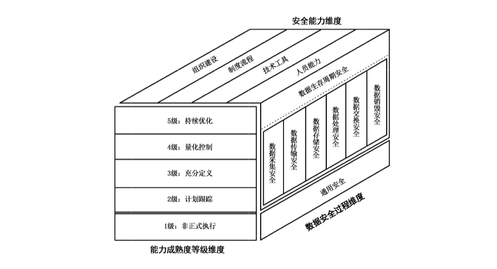
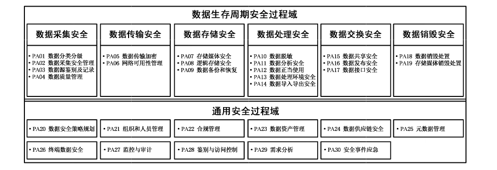
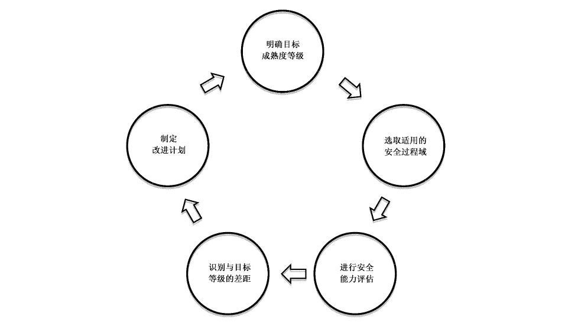

# GB/T 37988-2019 信息安全技术 数据安全能力成熟度模型

> 来源：[GB/T 37988-2019 国家标准详情](https://openstd.samr.gov.cn/bzgk/std/newGbInfo?hcno=3CFD5E5A14C24D303EA1E139E6EB75C8)；发布日期：2019-08-30；实施日期：2020-03-01。
> 官方在线预览页面图像 SHA-256：6dfbc3e510a7f334c5da152f134067e18c780067bebe0b64e6e6cc58ad0f4a9c。
> 转写说明：依据官方在线预览全部 61 页的页面图像核对；省略封面、目录、页眉、页脚和页码，合并印刷折行与跨页表格，保留图示。正式引用请核对原页面。

## 前言

本标准按照GB/T1.1—2009给出的规则起草。

请注意本文件的某些内容可能涉及专利。本文件的发布机构不承担识别这些专利的责任。

本标准由全国信息安全标准化技术委员会（SAC/TC 260）提出并归口。

本标准起草单位：阿里巴巴（北京）软件服务有限公司、中国电子技术标准化研究院、中国信息安全测评中心、北京奇安信科技有限公司、联想（北京）有限公司、公安部第三研究所、清华大学、中国网络安全审查技术与认证中心、中国科学院软件研究所、中国移动通信集团公司、阿里云计算有限公司、北京天融信科技股份有限公司、中国科学院信息工程研究所、陕西省信息化工程研究院、西北大学、浪潮电子信息产业股份有限公司、北京易华录信息技术股份有限公司、新华三技术有限公司、勤智数码科技股份有限公司、北京数字认证股份有限公司、启明星辰信息技术集团股份有限公司、海信集团有限公司、银川市大数据产业发展服务中心、南京中新赛克科技有限责任公司、北京微步在线科技有限公司、上海观安信息技术有限公司、华为技术有限公司、三六零科技股份有限公司、中电长城网际系统应用有限公司。

本标准主要起草人：朱红儒、刘贤刚、胡影、贾雪飞、白晓媛、叶晓俊、李克鹏、潘亮、薛勇、谢安明、梅婧婷、金涛、叶润国、孙明亮、张宇光、徐羽佳、杜跃进、陈彩芳、柯妍、张玉东、徐雨晴、张世长、宋玲娓、闵京华、郑新华、苗光胜、刘玉岭、潘正泰、张锐卿、任卫红、任兰芳、蔡晓丹、常玲、赵蓓、张大江、唐海龙、孙晓军、李正、孙骞、赵江、马红霞、鲁晋、王川、杜青峰、薛坤、尤其、王伟、张屹、何军、张兴。

## 1 范围

本标准给出了组织数据安全能力的成熟度模型架构，规定了数据采集安全、数据传输安全、数据存储安全、数据处理安全、数据交换安全、数据销毁安全、通用安全的成熟度等级要求。

本标准适用于对组织数据安全能力进行评估，也可作为组织开展数据安全能力建设时的依据。

## 2 规范性引用文件

下列文件对于本文件的应用是必不可少的。凡是注日期的引用文件，仅注日期的版本适用于本文件。凡是不注日期的引用文件，其最新版本（包括所有的修改单）适用于本文件。

- GB/T 25069—2010 信息安全技术 术语

- GB/T 29246—2017 信息技术 安全技术信息安全管理体系 概述和词汇

## 3 术语和定义

GB/T 25069—2010 和 GB/T 29246—2017界定的以及下列术语和定义适用于本文件。

### 3.1 数据安全 data security

通过管理和技术措施，确保数据有效保护和合规使用的状态。

### 3.2 保密性 confidentiality

使信息不泄漏给未授权的个人、实体、进程，或不被其利用的特性。

［GB/T 25069—2010，定义2.1.1］

### 3.3 完整性 integrity

准确和完备的特性。

［GB/T 29246—2017，定义2.40］

### 3.4 可用性 availability

已授权实体一旦需要就可访问和使用的数据和资源的特性。

［GB/T 25069—2010，定义2.1.20］

### 3.5 数据安全能力 data security capability

组织在组织建设，制度流程、技术工具以及人员能力等方面对数据的安全保障。

### 3.6 能力成熟度 capability maturity

对一个组织有条理的持续改进能力以及实现特定过程的连续性、可持续性、有效性和可信度的水平。

### 3.7 能力成熟度模型 capability maturity model

对一个组织的能力成熟度进行度量的模型，包括一系列代表能力和进展的特征、属性、指示或者模式。

> 注：能力成熟度模型为组织衡量其当前的实践、流程、方法的能力水平提供参考基准，并设置明确的提升目标。

### 3.8 安全过程 security process

用于实现某一安全目标的完整过程，该过程包含输入和输出。

示例：“安全审计”这一安全过程，输入是系统日志，输出是审计报告。

### 3.9 过程域 process area

实现同一安全目标的相关数据安全基本实践的集合。

> 注：一个过程域中包含一个或多个基本实践。

示例：“元数据管理”这一过程域，包含建立元数据管理规范、建立元数据访问控制策略、建立元数据技术工具等基本实践。

### 3.10 基本实践 base practice

实现某一安全目标的数据安全相关活动。

示例：建立数据资产清单，对数据资产进行分类分级管理等。

### 3.11 通用实践 generic practice

在评估中用于确定任何安全过程域或基本实践的实施能力的评定准则。

### 3.12 数据脱敏 data desensitization

通过一系列数据处理方法对原始数据进行处理以屏蔽敏感数据的一种数据保护方法。

### 3.13 数据处理 data processing

对原始数据进行抽取、转换、加载的过程。

注1：数据处理包括开发数据产品或数据分析等。

注2：数据产品包括但不限于能访问原始数据，提供数据计算、数据存储、数据交换、数据分析、数据挖掘、数据展示等应用的软硬件产品。

### 3.14 数据供应链 data supply chain

为满足数据供应关系，通过资源和过程将需方、供方相互关联的结构。

### 3.15 规程 procedure

对执行一个给定任务所采取动作历程的书面描述。

［GB/T 25069—2010，定义2.1.7］

### 3.16 合规 compliance

对数据安全所适用的法律法规的符合程度。

## 4 缩略语

下列缩略语适用于本文件。

BP：基本实践（Base Practice）

DSMM：数据安全能力成熟度模型（Data Security Capability Maturity Model）

GP：通用实践（Generic Practice）

PA：过程域（Process Area）

SSL：安全套接层（SecureSockets Layer）

TLS：传输层安全（Transport Layer Security）

## 5 DSMM 架构

### 5.1 成熟度模型架构

DSMM架构如图1所示。

DSMM 的架构由以下三个维度构成：

- a） 安全能力维度

  安全能力维度明确了组织在数据安全领域应具备的能力，包括组织建设、制度流程、技术工具和人员能力。

- b） 能力成熟度等级维度

  数据安全能力成熟度等级划分为五级，具体包括：1级是非正式执行级，2级是计划跟踪级，3级是充分定义级，4级是量化控制级，5级是持续优化级。

- c） 数据安全过程维度

  - 1） 数据安全过程包括数据生存周期安全过程和通用安全过程；

  - 2） 数据生存周期安全过程具体包括：数据采集安全、数据传输安全、数据存储安全、数据处理安全、数据交换安全、数据销毁安全6个阶段。

### 5.2 安全能力维度

#### 5.2.1 能力构成

通过对组织各数据安全过程应具备安全能力的量化，进而评估每项安全过程的实现能力。

安全能力分以下4个方面：

- a） 组织建设：数据安全组织的设立、职责分配和沟通协作；

- b） 制度流程：组织数据安全领域的制度和流程执行；

- c） 技术工具：通过技术手段和产品工具落实安全要求或自动化实现安全工作；

- d） 人员能力：执行数据安全工作的人员的安全意识及相关专业能力。

#### 5.2.2 组织建设

从承担数据安全工作的组织应具备的组织建设能力角度，根据以下方面进行能力等级区分：

- a） 数据安全组织架构对组织业务的适用性；

- b） 数据安全组织承担的工作职责的明确性；

- c） 数据安全组织运作、沟通协调的有效性。

#### 5.2.3 制度流程

从组织在数据安全制度流程的建设以及执行情况角度，根据以下方面进行能力等级区分：

- a） 数据生存周期关键控制节点授权审批流程的明确性；

- b） 相关流程制度的制定、发布、修订的规范性；

- c） 制度流程实施的一致性和有效性。

#### 5.2.4 技术工具

从组织用于开展数据安全工作的安全技术、应用系统和工具出发，根据以下方面进行能力等级区分：

- a） 数据安全技术在数据全生存周期过程中的利用情况，应对数据全生存周期安全风险的能力；

- b） 利用技术工具对数据安全工作的自动化支持能力，对数据安全制度流程固化执行的实现能力。

#### 5.2.5 人员能力

从组织承担数据安全工作的人员应具备的能力出发，根据以下方面进行能力等级区分：

- a） 数据安全人员所具备的数据安全技能是否能够满足实现安全目标的能力要求（对数据相关业务的理解程度以及数据安全专业能力）；

- b） 数据安全人员的数据安全意识以及对关键数据安全岗位员工数据安全能力的培养。

### 5.3 能力成熟度等级维度

组织的数据安全能力成熟度等级共分为5级，见表1。

**表1 数据安全能力成熟度等级共性特征**

| 数据安全能力成熟度等级 | 共性特征 | 说明 |
| --- | --- | --- |
| 等级 1：非正式执行 | 执行 BP：组织在数据安全过程中不能有效地执行相关工作，仅在部分业务执行过程中根据临时的需求执行了相关工作，未形成成熟的机制保证相关工作的持续有效进行，执行相关工作的人员未达到相应能力。所执行的过程称为“非正式过程”。 | 随机、无序、被动地执行安全过程，依赖于个人经验，无法复制。 |
| 等级 2：计划跟踪 | a）规划执行：对安全过程进行规划，提前分配资源和责任。 b）规范执行：对安全过程进行控制，使用执行计划、执行基于标准和程序的过程，对数据安全过程实施配置管理。 c）验证执行：确认过程按预定的方式执行，验证过程的执行与计划是一致的。 d）跟踪执行：控制数据安全过程执行的进展，通过可测量的计划跟踪过程的执行，当过程实践与计划产生重大偏离时采取修正行动。 | 在业务系统级别主动地实现了安全过程的计划与执行，但没有形成体系化。 |
| 等级 3：充分定义 | a）定义标准过程：组织对标准过程进行制度化，为组织定义标准化的过程文档，为满足特定用途对标准过程进行裁剪。 b）执行已定义的过程：充分定义的过程是可重复执行的，并使用过程执行的结果数据，对有缺陷的过程结果和安全实践进行核查。 c）协调安全实践：确定业务系统内、各业务系统之间、组织外部活动的协调机制。 | 在组织级别实现了安全过程的规范执行。 |
| 等级 4：量化控制 | a）建立可测的安全目标：为组织的数据安全建立可测量目标。 b）客观地管理执行：确定过程能力的量化测量，使用量化测量管理安全过程，并以量化测量作为修正行动的基础。 | 建立了量化目标，安全过程可度量。 |
| 等级 5：持续优化 | a）改进组织能力：在整个组织范围内对规程的使用进行比较，寻找改进规程的机会，并进行改进。 b）改进过程有效性：制定处于持续改进状态下的规程，对规程的缺陷进行消除，并对规程进行持续改进。 | 根据组织的整体目标，不断改进和优化安全过程。 |

能力成熟度等级与 PA、BP、安全能力的关系如下：

- a） 将组织在每个数据安全PA的能力成熟度划分为五级，针对每个等级下组织应具备的能力要求，从4个安全能力（组织建设、制度流程、技术工具及人员能力）提出具体的BP。

- b） 3级要求应包含全部4个安全能力，其他等级要求可不包含完整的4个数据安全关键能力，并非每个安全 PA 的能力成熟度等级都包含完整的4个数据安全关键能力。

  示例：某些 PA的2级要求具备组织建设和制度流程两个关键能力，而4级和5级的能力要求仅涉及部分关键能力如组织建设、技术工具的提升。

- c） 对于每个数据安全PA，高等级的能力要求应包括所有低等级能力要求。针对某一具体数据安全 PA，如果5级的能力要求中未涉及某一关键能力的内容，则默认应达到在4级的能力要求中的该关键能力的内容；如果4级的能力要求中依旧未涉及该关键能力，则默认应达到在3级的能力要求中该关键能力的内容，依此类推。

能力成熟度等级的描述与GP参见附录A。

能力成熟度等级评估参考方法，参见附录 B。

能力成熟度等级评估流程和模型使用方法，参见附录C。

### 5.4 数据安全过程维度

#### 5.4.1 数据生存周期

数据生存周期分为以下6个阶段：

- a） 数据采集：组织内部系统中新产生数据，以及从外部系统收集数据的阶段；

- b） 数据传输：数据从一个实体传输到另一个实体的阶段；

- c） 数据存储：数据以任何数字格式进行存储的阶段；

- d） 数据处理：组织在内部对数据进行计算、分析、可视化等操作的阶段；

- e） 数据交换：组织与组织或个人进行数据交换的阶段；

- f） 数据销毁：对数据及数据存储媒体通过相应的操作手段，使数据彻底删除且无法通过任何手段恢复的过程。

特定的数据所经历的生存周期由实际的业务所决定，可为完整的6个阶段或是其中的几个阶段。

#### 5.4.2 数据安全 PA体系

##### 5.4.2.1 PA体系

PA 体系分为数据生存周期安全过程和通用安全过程两部分，共包含30个 PA，如图2所示。

数据生存周期安全过程域包括以下6个过程：

- a） 数据采集安全的PA（PA01~PA04）包括：数据分类分级、数据采集安全管理、数据源鉴别及记录、数据质量管理4个 PA；

- b） 数据传输安全的 PA（PA05~PA06）包括：数据传输加密、网络可用性管理2个 PA；

- c） 数据存储安全的 PA（PA07~PA09）包括：存储媒体安全、逻辑存储安全、数据备份和恢复3个安全PA；

- d） 数据处理安全的 PA（PA10~PA14）包括：数据脱敏、数据分析安全、数据正当使用、数据处理环境安全、数据导入导出安全5个安全PA；

- e） 数据交换安全的 PA（PA15~PA17）包括：数据共享安全、数据发布安全、数据接口安全3个安全 PA；

- f） 数据销毁安全的 PA（PA18~PA19）包括：数据销毁处置、存储媒体销毁处置2个安全PA。

通用安全过程域（PA20~PA30）包括：数据安全策略规划、组织和人员管理、合规管理、数据资产管理、数据供应链安全、元数据管理、终端数据安全、监控与审计、鉴别与访问控制、需求分析、安全事件应急11个 PA。

##### 5.4.2.2 编码规则

数据安全 PA 编码规则如下：

- a） 每个 PA 有对应的编号，分别采用递增的数值 01、02、⋯，表示。

  示例1：PA01，代表 PA“数据分类分级”。

- b）每个 PA 由一些 BP 组成。BP 用 BP.XX.XX 来进行编号，第一组编码表示所在 PA 的序号，第二组编码表示具体 BP 的序号，具体 BP 的序号采用递增的数值 01、02、⋯，表示。

  示例 2:BP.01.01 表示，过程域PA01“数据分类分级”中的第一个 BP。

- c） 对于每个 PA 的每个级别，需要同时满足本级别和所有低于该级别的BP 的要求，才能达到本级别的能力水平，依此类推。

## 6 数据采集安全

### 6.1 PA01 数据分类分级

#### 6.1.1 PA描述

基于法律法规以及业务需求确定组织内部的数据分类分级方法，对生成或收集的数据进行分类分级标识。

#### 6.1.2 等级描述

##### 6.1.2.1 等级 1：非正式执行

该等级的数据安全能力描述如下：

制度流程：组织未在任何业务建立成熟稳定的数据分类分级，仅根据临时需求或基于个人经验，对部分数据进行了分类或分级（BP.01.01）。

##### 6.1.2.2 等级 2：计划跟踪

该等级的数据安全能力要求描述如下：

- a） 组织建设：应由业务团队相关人员负责相关业务的数据分类分级（BP.01.02）；

- b） 制度流程：应根据业务特性和外部合规要求，对核心业务的关键数据进行分类分级管理（BP.01.03）。

##### 6.1.2.3 等级3：充分定义

该等级的数据安全能力要求描述如下：

- a） 组织建设：组织应设立负责数据安全分类分级工作的管理岗位和人员，主要负责定义组织整体的数据分类分级的安全原则（BP.01.04）。

- b） 制度流程：

  - 1） 应明确数据分类分级原则、方法和操作指南（BP.01.05）；

  - 2） 应对组织的数据进行分类分级标识和管理（BP.01.06）；

  - 3） 应对不同类别和级别的数据建立相应的访问控制、数据加解密、数据脱敏等安全管理和控制措施（BP.01.07）；

  - 4） 应明确数据分类分级变更审批流程和机制，通过该流程保证对数据分类分级的变更操作及其结果符合组织的要求（BP.01.08）。

- c） 技术工具：应建立数据分类分级打标或数据资产管理工具，实现对数据的分类分级自动标识、标识结果发布、审核等功能（BP.01.09）。

- d） 人员能力：负责该项工作的人员应了解数据分类分级的合规要求，能够识别哪些数据属于敏感数据（BP.01.10）。

##### 6.1.2.4 等级4：量化控制

该等级的数据安全能力要求描述如下：

技术工具：

- a） 应记录自动分类分级结果与人工审核后的分类分级结果之间的差异，定期分析改进分类分级标识工具，提升工具处理的准确度（BP.01.11）；

- b） 应对数据分类分级的操作、变更过程进行日志记录和分析，定期通过日志分析等技术手段进行变更操作审计，数据分类分级可追溯（BP.01.12）。

##### 6.1.2.5 等级5：持续优化

该等级的数据安全能力要求描述如下：

- a） 制度流程：应定期评审数据分类分级的规范和细则，考虑其内容是否完全覆盖了当前的业务，并执行持续的改进优化工作（BP.01.13）；

- b） 技术工具：

  - 1） 应跟踪数据分类分级标识效果，持续改进数据分类分级的技术工具（BP.01.14）；

  - 2） 应参与国际、国家或行业相关标准制定。在业界分享最佳实践，成为行业标杆（BP.01.15）。

### 6.2 PA02 数据采集安全管理

#### 6.2.1 PA 描述

在采集外部客户、合作伙伴等相关方数据的过程中，组织应明确采集数据的目的和用途，确保满足数据源的真实性、有效性和最少够用等原则要求，并明确数据采集渠道、规范数据格式以及相关的流程和方式，从而保证数据采集的合规性、正当性、一致性。

#### 6.2.2 等级描述

##### 6.2.2.1 等级1：非正式执行

该等级的数据安全能力描述如下：

制度流程：未在任何业务建立成熟稳定的数据采集安全管理，仅根据临时需求或基于个人经验对个别数据采集进行安全管理（BP.02.01）。

##### 6.2.2.2 等级2：计划跟踪

该等级的数据安全能力要求描述如下：

- a） 组织建设：应由业务团队相关人员负责数据采集安全管理（BP.02.02）。

- b） 制度流程：

  - 1） 应明确核心业务数据采集原则，保证该业务数据采集的合法、正当（BP.02.03）；

  - 2） 核心业务应明示个人信息采集的目的、方式和范围，并经被收集者同意（BP.02.04）。

##### 6.2.2.3 等级3：充分定义

该等级的数据安全能力要求描述如下：

- a） 组织建设：组织应设立数据采集安全管理的岗位和人员，负责制定相关的数据采集安全管理的制度，推动相关要求、流程的落地，并对具体业务或项目的风险评估提供咨询和支持（BP.02.05）。

- b） 制度流程：

  - 1） 应明确组织的数据采集原则，定义业务的数据采集流程和方法（BP.02.06）；

  - 2） 应明确数据采集的渠道及外部数据源，并对外部数据源的合法性进行确认（BP.02.07）；

  - 3） 应明确数据采集范围、数量和频度，确保不收集与提供服务无关的个人信息和重要数据（BP.02.08）；

  - 4） 应明确组织数据采集的风险评估流程，针对采集的数据源、频度、渠道、方式、数据范围和类型进行风险评估（BP.02.09）；

  - 5） 应明确数据采集过程中个人信息和重要数据的知悉范围和需要采取的控制措施，确保采集过程中的个人信息和重要数据不被泄漏（BP.02.10）；

  - 6） 应明确自动化采集数据的范围（BP.02.11）。

- c） 技术工具：

  - 1） 应依据统一的数据采集流程建设数据采集相关的工具，以保证组织数据采集流程实现的一致性，同时相关系统应具备详细的日志记录功能，确保数据采集授权过程的完整记录（BP.02.12）；

  - 2） 应采取技术手段保证数据采集过程中个人信息和重要数据不被泄漏（BP.02.13）。

- d） 人员能力：负责该项工作的人员应能够充分理解数据采集的法律要求，安全和业务需求，并能够根据组织的业务提出针对性的解决方案（BP.02.14）。

##### 6.2.2.4 等级 4：量化控制

该等级的数据安全能力要求描述如下：

- a） 制度流程：应明确数据采集安全管理效果的评估方式，如数据采集安全管理在业务的覆盖率、制度流程执行效果、数据采集授权率等（BP.02.15）。

- b） 技术工具：

  - 1）应采取必要的技术手段对采集的数据进行校验（BP.02.16）；

  - 2） 应跟踪和记录数据采集和获取过程，支持对数据采集和获取操作过程的可追溯（BP.02.17）。

##### 6.2.2.5 等级5：持续优化

该等级的数据安全能力要求描述如下：

- a） 制度流程：数据采集安全管理应持续优化，持续跟踪数据采集安全管理执行效果、新业务产生的需求、行业新技术和最佳实践、合规新要求新变化等（BP.02.18）。

- b） 技术工具：

  - 1） 应根据制度流程的更新，不断升级优化数据采集工具（BP.02.19）；

  - 2） 应参与国际、国家或行业相关标准制定。在业界分享最佳实践，成为行业标杆（BP.02.20）。

### 6.3 PA03 数据源鉴别及记录

#### 6.3.1 PA 描述

对产生数据的数据源进行身份鉴别和记录，防止数据仿冒和数据伪造。

#### 6.3.2 等级描述

##### 6.3.2.1 等级1：非正式执行

该等级的数据安全能力描述如下：

组织建设：未对任何业务的采集数据源进行有效管理，仅根据临时需求或基于个人经验对采集的数据源进行临时记录（BP.03.01）。

##### 6.3.2.2 等级2：计划跟踪

该等级的数据安全能力要求描述如下：

- a） 组织建设：应由业务团队相关人员负责数据源鉴别和记录（BP.03.02）；

- b） 制度流程：核心业务系统的在线数据采集和外部第三方采集，均应建立了相应机制执行数据源的鉴别和记录（BP.03.03）；

- c） 技术工具：核心业务应具有技术工具支持对数据源的鉴别和记录（BP.03.04）。

##### 6.3.2.3 等级3：充分定义

该等级的数据安全能力要求描述如下：

- a） 组织建设：应由业务团队相关人员负责对数据源进行鉴别和记录（BP.03.05）。

- b） 制度流程：应明确数据源管理的制度，对组织采集的数据源进行鉴别和记录（BP.03.06）。

- c） 技术工具：

  - 1） 组织应采取技术手段对外部收集的数据和数据源进行识别和记录（BP.03.07）；

  - 2） 应对关键追溯数据进行备份，并采取技术手段对追溯数据进行安全保护（BP.03.08）。

- d） 人员能力：负责该项工作的人员应理解数据源鉴别标准和组织内部数据采集的业务，能够结合实际情况执行（BP.03.09）。

##### 6.3.2.4 等级4：量化控制

该等级的数据安全能力要求描述如下：

- a） 制度流程：

  - 1）组织应定义了数据追溯策略要求、追溯数据格式、追溯数据安全存储与使用的管理制度等。根据组织内的业务梳理数据源的类型，并明确在关键的数据管理系统（如数据库管理系统、元数据管理系统）上对数据源类型标记的要求（BP.03.10）；

  - 2） 应明确基于追溯数据的数据业务与法律法规合规性审核的机制，并依据审核结果增强或改进与数据服务相关的访问控制与合规性保障机制和策略（BP.03.11）。

- b） 技术工具：组织关键的数据管理系统中应提供了标记数据的数据源类型的功能，从而实现对组织内部各类数据源的统计和分析（BP.03.12）。

##### 6.3.2.5 等级5：持续优化

该等级的数据安全能力要求描述如下：

- a） 制度流程：应对数据源鉴别方式和分类方法进行持续的改进，基于业务的发展变化以及行业最佳实践，提升数据源管理的成效（BP.03.13）。

- b） 技术工具：

  - 1） 应面向制度流程的更新，持续改进工具在数据鉴别、记录和追溯等方面的服务能力（BP.03.14）；

  - 2） 应参与国际、国家或行业相关标准制定。在业界分享最佳实践，成为行业标杆（BP.03.15）。

### 6.4 PA04 数据质量管理

#### 6.4.1 PA 描述

建立组织的数据质量管理体系，保证对数据采集过程中收集/产生的数据的准确性、一致性和完整性。

#### 6.4.2 等级描述

##### 6.4.2.1 等级1：非正式执行

该等级的数据安全能力描述如下：

组织建设：未在任何业务建立成熟稳定的数据质量管理或监控，仅根据临时需求或基于个人经验考虑数据质量管理（BP.04.01）。

##### 6.4.2.2 等级2：计划跟踪

该等级的数据安全能力要求描述如下：

- a） 组织建设：应由业务团队相关人员根据业务需求进行数据质量管理（BP.04.02）。

- b）制度流程：在核心业务中应将数据质量管理或监控作为必要的环节（BP.04.03）。

##### 6.4.2.3 等级3：充分定义

该等级的数据安全能力要求描述如下：

- a） 组织建设：组织应设立数据质量管理岗位和人员，负责制定统一的数据质量管理要求，明确对数据质量进行管理和监控的责任部门或人员（BP.04.04）。

- b） 制度流程：

  - 1） 应明确数据质量管理相关的要求，包含数据格式要求、数据完整性要求、数据源质量评价标准等（BP.04.05）；

  - 2） 应明确数据采集过程中质量监控规则，明确数据质量监控范围及监控方式（BP.04.06）；

  - 3） 应明确组织的数据清洗、转换和加载操作相关的安全管理规范，明确执行的规则和方法、相关人员权限、完整性和一致性要求等（BP.04.07）。

- c） 技术工具：应利用技术工具实现对关键数据进行数据质量管理和监控，实现异常数据及时告警或更正（BP.04.08）。

- d）人员能力：负责该项工作的人员应了解数据采集阶段的数据质量控制要素，能够基于组织的业务特点开展数据质量评估工作（BP.04.09）。

##### 6.4.2.4 等级 4：量化控制

该等级的数据安全能力要求描述如下：

制度流程：

- a） 应明确数据质量分级标准，明确不同级别和类型的数据采集、清洗、转换等数据采集处理流程质量要求（BP.04.10）；

- b）应定期对数据质量进行分析、预判和盘点，明确数据质量问题定位和修复时间要求（BP.04.11）。

##### 6.4.2.5 等级5：持续优化

该等级的数据安全能力要求描述如下：

- a） 组织建设：应在组织层面实现数据质量管理的可持续优化，建立数据质量管理过程的有效性和效率目标，建立数据质量管理岗位人员与各业务团队的数据管理人员之间的有效沟通、反馈机制，能够持续、及时地针对数据质量管理工作进行改进（BP.04.12）。

- b） 技术工具：

  - 1） 应建立数据质量的技术指标，并通过相关管理系统评估数据质量管理的水平（BP.04.13）；

  - 2） 应参与国际、国家或行业相关标准制定。在业界分享最佳实践，成为行业标杆（BP.04.14）。

## 7 数据传输安全

### 7.1 PA05 数据传输加密

#### 7.1.1 PA 描述

根据组织内部和外部的数据传输要求，采用适当的加密保护措施，保证传输通道、传输节点和传输数据的安全，防止传输过程中的数据泄漏。

#### 7.1.2 等级描述

##### 7.1.2.1 等级1：非正式执行

该等级的数据安全能力描述如下：

组织建设：未在任何业务中建立成熟稳定的数据传输安全和密钥管理机制，仅根据个别业务需求、合规要求，对传输通道、传输节点或数据采用了临时的加密保护措施（BP.05.01）。

##### 7.1.2.2 等级2：计划跟踪

该等级的数据安全能力要求描述如下：

- a） 组织建设：应由业务团队相关人员负责对传输通道进行加密处理（BP.05.02）。

- b） 制度流程：应根据合规要求和业务性能的需求，核心业务明确业务中需要加密传输的数据范围和加密算法（BP.05.03）。

- c） 技术工具：

  - 1） 应有对传输通道两端进行主体身份鉴别和认证的技术方案和工具（BP.05.04）；

  - 2） 应有对传输数据加密的技术方案和工具，包括针对关键的数据传输通道的加密方案（如采用 TLS/SSL 方式），及对传输数据内容进行加密（BP.05.05）。

##### 7.1.2.3 等级3：充分定义

该等级的数据安全能力要求描述如下：

- a） 组织建设：组织应设立了管理数据加密、密钥管理的人员，负责整体的加密原则和技术工作，由各业务的技术团队负责实现具体场景下的数据传输加密（BP.05.06）。

- b） 制度流程：

  - 1） 应明确数据传输安全管理规范，明确数据传输安全要求（如传输通道加密、数据内容加密、签名验签、身份鉴别、数据传输接口安全等），确定需要对数据传输加密的场景（BP.05.07）；

  - 2） 应明确对数据传输安全策略的变更进行审核的技术方案（BP.05.08）。

- c） 技术工具：

  - 1） 应有对传输数据的完整性进行检测，并具备数据容错或恢复的技术手段（BP.05.09）；

  - 2） 应部署对通道安全配置、密码算法配置、密钥管理等保护措施进行审核及监控的技术工具（BP.05.10）。

- d） 人员能力：

  - 1）应了解常用的安全通道方案、身份鉴别和认证技术、主管部门推荐的数据加密算法，基于具体的业务选择合适的数据传输安全管理方式（BP.05.11）；

  - 2） 负责该项工作的人员应熟悉数据加密的算法，并能够基于具体的业务选择合适的加密技术（BP.05.12）。

##### 7.1.2.4 等级 4：量化控制

该等级的数据安全能力要求描述如下：

- a） 制度流程：应在数据分类分级定义的基础上，明确提出对不同类型、级别的数据的加密传输要求，包含对数据加密算法的要求和密钥的管理要求（BP.05.13）。

- b） 技术工具：

  - 1） 每个传输链路上的节点都应部署了独立密钥对和数字证书，以保证各节点有效的身份鉴别（BP.05.14）；

  - 2） 应综合量化敏感数据加密和数据传输通道加密的实现效果和成本，定期审核并调整数据加密的实现方案（BP.05.15）；

  - 3） 组织应提供统一的数据加密模块供开发传输功能的人员调用，根据不同数据类型和级别进行数据加密处理，保证组织内数据加密功能的统一性（BP.05.16）。

##### 7.1.2.5 等级5：持续优化

该等级的数据安全能力要求描述如下：

技术工具：

- a） 应跟进传输通道加密保护的技术发展，评估新技术对安全方案的影响，适当引入新技术以应对最新的安全风险（BP.05.17）；

- b）应参与国际、国家或行业相关标准制定。在业界分享最佳实践，成为行业标杆（BP.05.18）。

### 7.2 PA06 网络可用性管理

#### 7.2.1 PA描述

通过网络基础设施及网络层数据防泄漏设备的备份建设，实现网络的高可用性，从而保证数据传输过程的稳定性。

#### 7.2.2 等级描述

##### 7.2.2.1 等级1：非正式执行

该等级的数据安全能力描述如下：

组织建设：未在任何业务建立网络可用性管理，仅根据临时需求或基于个人经验对网络冗余建设进行规划（BP.06.01）。

##### 7.2.2.2 等级2：计划跟踪

该等级的数据安全能力要求描述如下：

- a） 组织建设：应有负责网络的可用性管理的人员（BP.06.02）；

- b）制度流程：应在网络安全管理的制度中明确关键网络链路、网络（安全）设备的可用性管理要求，关键业务的网络架构应考虑网络的可用性建设需求（BP.06.03）。

##### 7.2.2.3 等级3：充分定义

该等级的数据安全能力要求描述如下：

- a） 组织建设：组织应设立负责网络可用性管理的人员或团队（BP.06.04）。

- b） 制度流程：应制定组织的网络可用性管理指标，包括可用性的概率数值、故障时间/频率/统计业务单元等；基于可用性管理指标，建立网络服务配置方案和宕机替代方案等（BP.06.05）。

- c） 技术工具：

  - 1） 应对关键的网络传输链路、网络设备节点实行冗余建设（BP.06.06）；

  - 2） 应部署相关设备对网络可用性及数据泄漏风险进行防范，如负载均衡、防入侵攻击、数据防泄漏检测与防护等设备（BP.06.07）。

- d） 人员能力：负责该项工作的人员应具有网络安全管理的能力，了解网络安全中对可用性的安全需求，能够根据不同业务对网络性能需求制定有效的可用性安全防护方案（BP.06.08）。

##### 7.2.2.4 等级4：量化控制

该等级的数据安全能力要求描述如下：

技术工具：应通过相关指标定量分析网络可用性及数据防泄漏服务现状，并有针对性地解决问题，提升网络可用性（BP.06.09）。

##### 7.2.2.5 等级5：持续优化

该等级的数据安全能力要求描述如下：

技术工具：

- a） 应实现网络安全设备的健康状态检查及自动化切换（BP.06.10）；

- b）应参与国际、国家或行业相关标准制定。在业界分享最佳实践，成为行业标杆（BP.06.11）。

## 8 数据存储安全

### 8.1 PA07 存储媒体安全

#### 8.1.1 PA描述

针对组织内需要对数据存储媒体进行访问和使用的场景，提供有效的技术和管理手段，防止对媒体的不当使用而可能引发的数据泄漏风险。存储媒体包括终端设备及网络存储。

#### 8.1.2 等级描述

##### 8.1.2.1 等级1：非正式执行

该等级的数据安全能力描述如下：

组织建设：未建立成熟稳定的存储媒体安全管理，仅根据临时需求或基于个人经验处理了存储媒体安全需求（BP.07.01）。

##### 8.1.2.2 等级2：计划跟踪

该等级的数据安全能力要求描述如下：

- a） 组织建设：应由业务团队相关人员根据实际业务需求负责执行存储媒体安全管理工作（BP.07.02）。

- b）制度流程：业务团队应明确存储媒体使用、购买、标记的安全制度（BP.07.03）。

- c） 人员能力：业务团队中负责相关工作的人员，应熟悉存储媒体安全管理的相关制度要求（BP.07.04）。

##### 8.1.2.3 等级3：充分定义

该等级的数据安全能力要求描述如下：

- a） 组织建设：组织应设立统一负责存储媒体安全管理的岗位和人员（BP.07.05）。

- b） 制度流程：

  - 1） 应明确存储媒体访问和使用的安全管理规范，建立存储媒体使用的审批和记录流程（BP.06）；

  - 2） 应明确购买或获取存储媒体的流程，要求通过可信渠道购买或获取存储媒体，并针对各类存储媒体建立格式化规程（BP.07.07）；

  - 3） 应建立存储媒体资产标识，明确存储媒体存储的数据（BP.07.08）；

  - 4） 应对存储媒体进行常规和随机检查，确保存储媒体的使用符合机构公布的关于存储媒体使用的制度（BP.07.09）。

- c） 技术工具：

  - 1） 组织应使用技术工具对存储媒体性能进行监控，包括存储媒体的使用历史、性能指标、错误或损坏情况，对超过安全阈值的存储媒体进行预警（BP.07.10）；

  - 2） 应对存储媒体访问和使用行为进行记录和审计（BP.07.11）。

- d） 人员能力：负责该项工作的人员应熟悉存储媒体安全管理的相关合规要求，熟悉不同存储媒体访问和使用的差异性（BP.07.12）。

##### 8.1.2.4 等级 4：量化控制

该等级的数据安全能力要求描述如下：

技术工具：应建立存储媒体管理系统，确保存储媒体的使用和传递过程得到严密跟踪（BP.07.13）。

##### 8.1.2.5 等级5：持续优化

该等级的数据安全能力要求描述如下：

技术工具：

- a） 应持续更新优化组织的存储媒体管理系统和净化工具，以保证存储媒体的安全使用（BP.07.14）；

- b）应参与国际、国家或行业相关标准制定。在业界分享最佳实践，成为行业标杆（BP.07.15）。

### 8.2 PA08 逻辑存储安全

#### 8.2.1 PA 描述

基于组织内部的业务特性和数据存储安全要求，建立针对数据逻辑存储、存储容器等的有效安全控制。

#### 8.2.2 等级描述

##### 8.2.2.1 等级1：非正式执行

该等级的数据安全能力描述如下：

组织建设：未在任何业务中建立数据逻辑存储环境安全管理，仅根据临时需求或基于个人经验考虑了个别数据逻辑存储系统的安全管理（BP.08.01）。

##### 8.2.2.2 等级2：计划跟踪

该等级的数据安全能力要求描述如下：

- a） 组织建设：应由业务团队相关人员负责相关数据逻辑存储系统（如数据库）的安全管理（BP.08.02）。

- b）技术工具：应采取技术工具支撑逻辑存储系统的安全管理，如配置扫描、身份鉴别、访问控制等（BP.08.03）。

##### 8.2.2.3 等级3：充分定义

该等级的数据安全能力要求描述如下：

- a） 组织建设：

  - 1） 组织应设立统一负责数据逻辑存储安全管理的岗位和人员，负责明确整体的数据逻辑存储系统安全管理要求，并推进相关要求的实施（BP.08.04）；

  - 2） 应明确各数据逻辑存储系统的安全管理员，负责执行数据逻辑存储系统、存储设备的安全管理和运维工作（BP.08.05）。

- b） 制度流程：

  - 1） 应明确数据逻辑存储管理安全规范和配置规则，明确各类数据存储系统的账号权限管理、访问控制、日志管理、加密管理、版本升级等方面的要求（BP.08.06）；

  - 2） 内部的数据存储系统应在上线前遵循统一的配置要求进行有效的安全配置，对使用的外部数据存储系统也应进行有效的安全配置（BP.08.07）；

  - 3） 应明确数据逻辑存储隔离授权与操作要求，确保具备多用户数据存储安全隔离能力（BP.08.08）。

- c） 技术工具：

  - 1） 应提供数据存储系统配置扫描工具，定期对主要数据存储系统的安全配置进行扫描，以保证符合安全基线要求（BP.08.09）；

  - 2） 应利用技术工具监测逻辑存储系统的数据使用规范性，确保数据存储符合组织的相关安全要求（BP.08.10）；

  - 3） 应具备对个人信息，重要数据等敏感数据的加密存储能力（BP.08.11）。

- d） 人员能力：负责该项工作的人员应熟悉数据存储系统架构，并能够分析出数据存储面临的安全风险，从而能够保证对各类存储系统的有效安全防护（BP.08.12）。

##### 8.2.2.4 等级4：量化控制

该等级的数据安全能力要求描述如下：

- a） 制度流程：

  - 1） 应明确分层的逻辑存储授权管理规则和授权操作要求，具备对数据逻辑存储结构的分层和分级保护能力（BP.08.13）；

  - 2） 应明确数据分片和分布式存储安全规则，如数据存储完整性规则、多副本一致性管理规则、存储转移安全规则，以满足分布式存储下分片数据完整性、一致性和保密性保护要求（BP.08.14）；

  - 3） 组织应根据数据分类分级要求，明确各类各级数据的加密存储要求（BP.08.15）。

- b） 技术工具：

  - 1） 应建立管理数据存储系统安全配置的技术工具，实现对安全配置情况的统一管理和控制（BP.08.16）；

  - 2） 应建立可伸缩数据存储架构，以满足数据量持续增长、数据分类分级存储等需求（BP.08.17）；

  - 3） 应建立满足应用层、数据层、操作系统层、数据存储层等不同层次数据存储加密需求的数据存储加密架构（BP.08.18）。

- c） 人员能力：负责数据加密工作的人员应熟悉各类数据加密算法的性能和瓶颈，并能够基于业务发展的需求、合规的需求制定有效的数据加密方案（BP.08.19）。

##### 8.2.2.5 等级5：持续优化

该等级的数据安全能力要求描述如下：

- a） 制度流程：应定期审核数据库的安全配置情况和权限分配情况，并改进优化相关配置和角色权限包的内容（BP.08.20）。

- b）技术工具：应参与国际、国家或行业相关标准制定。在业界分享最佳实践，成为行业标杆（BP.08.21）。

### 8.3 PA09 数据备份和恢复

#### 8.3.1 PA 描述

通过执行定期的数据备份和恢复，实现对存储数据的冗余管理，保护数据的可用性。

#### 8.3.2 等级描述

##### 8.3.2.1 等级1：非正式执行

该等级的数据安全能力描述如下：

组织建设：未在任何业务中建立成熟稳定的数据备份恢复机制，仅根据临时需求或基于个人经验对部分数据执行了临时的数据备份和恢复性测试（BP.09.01）。

##### 8.3.2.2 等级2：计划跟踪

该等级的数据安全能力要求描述如下：

- a） 组织建设：业务团队应明确负责数据备份和恢复的岗位和人员（BP.09.02）。

- b） 制度流程：业务团队应明确数据备份和恢复的制度（BP.09.03）。

- c） 技术工具：应建立数据备份与恢复的技术工具（BP.09.04）。

##### 8.3.2.3 等级3：充分定义

该等级的数据安全能力要求描述如下：

- a） 组织建设：组织应明确负责组织统一的数据备份和恢复管理工作的岗位和人员，负责建立相应的制度流程并部署相关的安全措施（BP.09.05）。

- b） 制度流程：

  - 1） 应明确数据备份与恢复的管理制度，以满足数据服务可靠性、可用性等安全目标（BP.09.06）；

  - 2） 应明确数据备份与恢复的操作规程，明确定义数据备份和恢复的范围、频率、工具、过程、日志记录、数据保存时长等（BP.09.07）；

  - 3） 应明确数据备份与恢复的定期检查和更新工作程序，包括数据副本的更新频率、保存期限等（BP.09.08）；

  - 4） 应依据数据生存周期和业务规范，建立数据生存周期各阶段数据归档的操作流程（BP.09.09）；

  - 5） 应明确归档数据的压缩或加密要求（BP.09.10）；

  - 6） 应明确归档数据的安全管控措施，非授权用户不能访问归档数据（BP.09.11）；

  - 7）应识别组织适用的合规要求，按监管部门的要求对相关数据予以记录和保存（BP.09.12）；

  - 8） 应明确数据存储时效性管理规程，明确数据分享、存储、使用和删除的有效期、有效期到期时对数据的处理流程、过期存储数据的安全管理要求（BP.09.13）；

  - 9） 应明确过期存储数据的安全保护机制，对超出有效期的存储数据应具备再次获取数据控制者授权的能力（BP.09.14）。

- c） 技术工具：

  - 1） 应建立数据备份与恢复的统一技术工具，保证相关工作的自动执行（BP.09.15）；

  - 2） 应建立备份和归档数据安全的技术手段，包括但不限于对备份和归档数据的访问控制、压缩或加密管理、完整性和可用性管理，确保对备份和归档数据的安全性、存储空间的有效利用、安全存储和安全访问（BP.09.16）；

  - 3） 应定期采取必要的技术措施查验备份和归档数据完整性和可用性（BP.09.17）；

  - 4） 应建立过期存储数据及其备份数据彻底删除或匿名化的方法和机制，能够验证数据已被完全删除、无法恢复或无法识别到个人，并告知数据控制者和数据使用者（BP.09.18）；

  - 5） 应通过风险提示和技术手段避免非过期数据的误删除，确保在一定的时间窗口内的误删除数据可以手动恢复（BP.09.19）；

  - 6） 应确保存储架构具备数据存储跨机柜或跨机房容错部署能力（BP.09.20）。

- d） 人员能力：

  - 1） 负责该项工作的人员应了解数据备份媒体的性能和相关数据的业务特性，能够确定有效的数据备份和恢复机制（BP.09.21）；

  - 2） 负责该项工作的人员应了解数据存储时效性相关的合规性要求，并具备基于业务对合规要求的解读能力和实施能力（BP.09.22）。

##### 8.3.2.4 等级4：量化控制

该等级的数据安全能力要求描述如下：

- a） 制度流程：

  - 1） 应明确数据冗余强一致性、弱一致性等控制要求，以满足不同一致性水平需求的数据副本多样性和多变性存储管理要求（BP.09.23）；

  - 2） 应对组织内数据备份的场景、数量、频率进行了定期的统计，了解组织内部数据备份工作的开展情况（BP.09.24）。

- b） 技术工具：

  - 1） 应建立在线/离线的多级数据归档方式，支持海量数据的有效归档、恢复和使用（BP.09.25）；

  - 2） 应为不同时效性的数据建立分层的数据存储方法，具备按时效性自动迁移数据分层存储的能力（BP.09.26）；

  - 3） 应具备数据副本或数据备份存储的多种压缩策略和实现技术，确保压缩数据副本或数据备份的完整性和可用性（BP.09.27）；

  - 4） 存储系统应具备数据存储跨地域的容灾能力（BP.09.28）；

  - 5） 应通过工具对需要符合数据存储合规要求的数据进行标识（BP.09.29）；

  - 6） 应具备数据时效性自动检测能力，包括但不限于告警、自动删除和拒绝访问等，以保证数据的及时删除、更新和有效性（BP.09.30）。

##### 8.3.2.5 等级5：持续优化

该等级的数据安全能力要求描述如下：

- a） 制度流程：应密切关注国内外数据备份和恢复的优秀解决方案，适当地采纳并用于组织内部的数据备份和恢复工作（BP.09.31）。

- b）技术工具：应参与国际、国家或行业相关标准制定。在业界分享最佳实践，成为行业标杆（BP.09.32）。

## 9 数据处理安全

### 9.1 PA10 数据脱敏

#### 9.1.1 PA 描述

根据相关法律法规、标准的要求以及业务需求，给出敏感数据的脱敏需求和规则，对敏感数据进行脱敏处理，保证数据可用性和安全性的平衡。

#### 9.1.2 等级描述

##### 9.1.2.1 等级1：非正式执行

该等级的数据安全能力描述如下：

组织建设：未在任何业务中建立数据脱敏的制度，仅根据临时需求或基于个人经验，在数据使用的过程中对某些数据字段执行了脱敏处理（BP.10.01）。

##### 9.1.2.2 等级2：计划跟踪

该等级的数据安全能力要求描述如下：

- a） 组织建设：应由业务团队相关人员负责数据脱敏工作（BP.10.02）。

- b） 人员能力：负责该项工作的人员应了解数据脱敏的常用技术，并能够基于数据脱敏的具体场景保证业务和安全之间的需求平衡（BP.10.03）。

- c） 制度流程：在核心业务中，应对业务中涉及的数据脱敏需求进行分析，明确脱敏的流程和方法（BP.10.04）。

- d） 技术工具：应通过一定的技术工具（如敏感字段屏蔽等方式），实现对核心业务的数据脱敏（BP.10.05）。

##### 9.1.2.3 等级3：充分定义

该等级的数据安全能力要求描述如下：

- a） 组织建设：

  - 1） 组织应设立统一的数据安全岗位和人员，负责制定数据脱敏的原则和方法，并提供相关技术能力（BP.10.06）；

  - 2） 在数据权限的申请阶段，有相关人员应评估使用真实数据的必要性，以及确定该场景下适用的数据脱敏规则及方法（BP.10.07）。

- b） 制度流程：

  - 1） 应明确组织的数据脱敏规范，明确数据脱敏的规则、脱敏方法和使用限制等（BP.10.08）；

  - 2） 应明确需要脱敏处理的应用场景、脱敏处理流程、涉及部门及人员的职责分工（BP.10.09）。

- c） 技术工具：

  - 1） 组织应提供统一的数据脱敏工具，实现数据脱敏工具与数据权限管理系统的联动，以及数据使用前的静态脱敏（BP.10.10）；

  - 2） 应提供面向不同数据类型的脱敏方案，可基于场景需求自定义脱敏规则（BP.10.11）；

  - 3） 数据脱敏后应保留原始数据格式和特定属性，满足开发与测试需求（BP.10.12）；

  - 4） 应对数据脱敏处理过程相应的操作进行记录，以满足数据脱敏处理安全审计要求（BP.10.13）。

- d） 人员能力：

  - 1） 应熟悉常规的数据脱敏技术，能够分析数据脱敏过程中存在的安全风险，基于数据脱敏的具体场景保证业务和安全之间的需求平衡（BP.10.14）；

  - 2） 应具备对数据脱敏的技术方案定制化的能力，能够基于组织内部各级别的数据建立有效的数据脱敏方案（BP.10.15）。

##### 9.1.2.4 等级4：量化控制

该等级的数据安全能力要求描述如下：

- a） 制度流程：

  - 1） 应明确列出需要脱敏的数据资产，给出不同分类分级数据的脱敏处理流程（BP.10.16）；

  - 2） 应明确脱敏数据治理要求，在评估方法等方面反映脱敏治理效果（BP.10.17）。

- b） 技术工具：

  - 1） 应配置脱敏数据识别和脱敏效果验证服务组件或技术手段，确保数据脱敏的有效性和合规性（BP.10.18）；

  - 2） 应提供数据脱敏组件或技术手段，支持泛化、抑制、假名化等数据脱敏技术（BP.10.19）；

  - 3） 应针对特定的数据使用场景和数据脱敏的策略，部署数据的动态脱敏方案（BP.10.20）。

- c） 人员能力：应定期对数据脱敏工作人员的脱敏操作能力进行考核评估（BP.10.21）。

##### 9.1.2.5 等级 5：持续优化

该等级的数据安全能力要求描述如下：

技术工具：

- a） 应持续跟踪业务新需求、数据脱敏新技术和最佳实践、合规新要求新变化等，持续改进数据脱敏规则和手段（BP.10.22）；

- b） 应实现对非结构化数据、组合数据的数据脱敏（BP.10.23）；

- c）应参与国际、国家或行业相关标准制定。在业界分享最佳实践，成为行业标杆（BP.10.24）。

### 9.2 PA11 数据分析安全

#### 9.2.1 PA 描述

通过在数据分析过程采取适当的安全控制措施，防止数据挖掘、分析过程中有价值信息和个人隐私泄漏的安全风险。

#### 9.2.2 等级描述

##### 9.2.2.1 等级 1：非正式执行

该等级的数据安全能力描述如下：

组织建设：未在任何业务中开展数据分析的安全风险控制，仅根据临时需求或基于个人经验在个别业务中考虑了数据分析的安全风险（BP.11.01）。

##### 9.2.2.2 等级2：计划跟踪

该等级的数据安全能力要求描述如下：

- a） 组织建设：应由业务团队相关人员负责数据分析过程中的数据安全风险控制（BP.11.02）。

- b） 制度流程：

  - 1） 核心业务应明确数据分析安全的原则或要求，如对个人明细数据、业务明细数据进行聚合分析过程中应考虑的关键安全风险等（BP.11.03）；

  - 2） 核心业务团队应对涉及个人信息的数据分析需求进行了人工审核，针对具体的数据分析场景制定了相应的隐私保护方案（BP.11.04）。

##### 9.2.2.3 等级3：充分定义

该等级的数据安全能力要求描述如下：

- a） 组织建设：组织应设立负责数据分析安全的岗位和人员，负责整体的数据分析安全原则制定、提供相应技术支持（BP.11.05）。

- b） 制度流程：

  - 1） 应明确数据处理与分析过程的安全规范，覆盖构建数据仓库、建模、分析、挖掘、展现等方面的安全要求，明确个人信息保护、数据获取方式、访问接口、授权机制、分析逻辑安全、分析结果安全等内容（BP.11.06）；

  - 2） 应明确数据分析安全审核流程，对数据分析的数据源、数据分析需求、分析逻辑进行审核，以确保数据分析目的、分析操作等当面的正当性（BP.11.07）；

  - 3） 应采取必要的监控审计措施，确保实际进行的分析操作与分析结果使用与其声明的一致，整体保证数据分析的预期不会超过相关分析团队对数据的权限范围（BP.11.08）；

  - 4） 应明确数据分析结果输出和使用的安全审核、合规评估和授权流程，防止数据分析结果输出造成安全风险（BP.11.09）。

- c） 技术工具：

  - 1） 在针对个人信息的数据分析中，组织应采用多种技术手段以降低数据分析过程中的隐私泄漏风险，如差分隐私保护、K匿名等（BP.11.10）；

  - 2） 应记录并保存数据处理与分析过程中对个人信息、重要数据等敏感数据的操作行为（BP.11.11）；

  - 3） 应提供组织统一的数据处理与分析系统，并能够呈现数据处理前后数据间的映射关系（BP.11.12）。

- d） 人员能力：应能够基于合规性要求、相关标准对数据安全分析中所可能引发的数据聚合的安全风险进行有效的评估，并能够针对分析场景提出有效的解决方案（BP.11.13）。

##### 9.2.2.4 等级4：量化控制

该等级的数据安全能力要求描述如下：

技术工具：

- a） 应结合技术手段降低数据分析过程中的安全风险，比如基于机器学习的重要数据自动识别、数据安全分析算法设计等（BP.11.14）；

- b） 应采取必要的技术手段（如对分析结果数据进行扫描并采取必要的控制措施）和管理措施，避免输出的数据分析结果包含可恢复的个人信息，重要数据等数据和结构标识（如用户鉴别信息的重要标识和数据结构），以防止数据分析结果危害个人隐私、公司商业价值、社会公共利益和国家安全（BP.11.15）；

- c） 应建立数据分析过程的安全风险监控系统，对数据分析可能涉及的安全风险进行批量的分析和跟进（BP.11.16）；

- d） 应具备基于机器学习的敏感数据自动识别、数据分析算法安全设计等数据分析安全能力（BP.11.17）；

- e） 应在个人信息、重要数据等数据有恢复需求时，采取必要的技术手段恢复数据（BP.11.18）。

##### 9.2.2.5 等级 5：持续优化

该等级的数据安全能力要求描述如下：

- a） 制度流程：应跟踪新业务需求、国内外法律法规变化和技术发展变化，持续调整和改进数据分析安全管理效果（如改进数据分析的个人隐私保护方案）（BP.11.19）。

- b）人员能力：负责该项工作的人员应具备对数据分析的安全技术，能够及时跟进先进的最佳实践以保证对相关技术的合理应用（BP.11.20）。

- c） 技术工具：应参与国际、国家或行业相关标准制定。在业界分享最佳实践，成为行业标杆（BP.11.21）。

### 9.3 PA12 数据正当使用

#### 9.3.1 PA 描述

基于国家相关法律法规对数据分析和利用的要求，建立数据使用过程的责任机制、评估机制，保护国家秘密、商业秘密和个人隐私，防止数据资源被用于不正当目的。

#### 9.3.2 等级描述

##### 9.3.2.1 等级 1：非正式执行

该等级的数据安全能力描述如下：

组织建设：未在业务中建立数据合规评估机制，仅根据临时需求或基于个人经验在个别业务系统中根据常识、法律法规或合同协议等要求关注了对数据的正当使用需求（BP.12.01）。

##### 9.3.2.2 等级2：计划跟踪

该等级的数据安全能力要求描述如下：

- a） 组织建设：应由业务团队相关人员负责数据使用的合规性评估（BP.12.02）。

- b） 制度流程：核心业务应明确数据使用正当性的制度，保证数据使用在声明的目的和范围内（BP.12.03）。

##### 9.3.2.3 等级3：充分定义

该等级的数据安全能力要求描述如下：

- a） 组织建设：组织应设立相关岗位或人员，负责对数据正当使用管理、评估和风险控制（BP.12.04）。

- b） 制度流程：

  - 1） 应明确数据使用的评估制度，所有个人信息和重要数据的使用应先进行安全影响评估，满足国家合规要求后，允许使用。数据的使用应避免精确定位到特定个人，避免评价信用、资产和健康等敏感数据，不得超出与收集数据时所声明的目的和范围（BP.12.05）。

  - 2） 应明确数据使用正当性的制度，保证数据使用在声明的目的和范围内（BP.12.06）。

- c） 技术工具：

  - 1） 应依据合规要求建立相应强度或粒度的访问控制机制，限定用户可访问数据范围（BP.12.07）；

  - 2） 应完整记录数据使用过程的操作日志，以备对潜在违约使用者责任的识别和追责（BP.12.08）。

- d） 人员能力：负责该项工作的人员应能够按最小够用等原则管理权限，并具备对数据正当使用的相关风险的分析和跟进能力（BP.12.09）。

##### 9.3.2.4 等级 4：量化控制

该等级的数据安全能力要求描述如下：

- a） 制度流程：应具备违约责任、缔约过失责任、侵权责任等数据使用风险分析和处理能力（BP.12.10）。

- b） 技术工具：应具备技术手段或机制，对数据滥用行为进行有效的识别、监控和预警（BP.12.11）。

- c） 人员能力：负责该项工作的人员应具备发现数据不正当使用安全风险的能力（BP.12.12）。

##### 9.3.2.5 等级5：持续优化

该等级的数据安全能力要求描述如下：

技术工具：

- a） 应研究并利用新的技术提升对用户的身份及访问管理能力，并通过风险监控与审计实现对数据使用的安全风险进行自动化分析和处理（BP.12.13）；

- b） 应参与国际、国家或行业相关标准制定。在业界分享最佳实践，成为行业标杆（BP.12.14）。

### 9.4 PA13 数据处理环境安全

#### 9.4.1 PA 描述

为组织内部的数据处理环境建立安全保护机制，提供统一的数据计算、开发平台，确保数据处理的过程中有完整的安全控制管理和技术支持。

#### 9.4.2 等级描述

##### 9.4.2.1 等级1：非正式执行

该等级的数据安全能力描述如下：

组织建设：未在任何业务开展成熟稳定的数据处理环境安全，仅根据临时需求或基于个人经验在部分业务系统中关注数据处理环境安全（BP.13.01）。

##### 9.4.2.2 等级2：计划跟踪

该等级的数据安全能力要求描述如下：

- a） 组织建设：应由业务团队相关人员负责数据处理环境安全管理（BP.13.02）。

- b） 技术工具：核心业务的数据处理环境，应实现了身份鉴别、访问控制、安全配置等（BP.13.03）。

##### 9.4.2.3 等级3：充分定义

该等级的数据安全能力要求描述如下：

- a） 组织建设：应由业务团队相关人员负责数据处理环境安全管控（BP.13.04）。

- b） 制度流程：

  - 1） 数据处理环境的系统设计、开发和运维阶段应制定相应的安全控制措施，实现对安全风险的管理（BP.13.05）；

  - 2） 应明确数据处理环境的安全管理要求（BP.13.06）；

  - 3） 组织应基于数据处理环境建立分布式处理安全要求，对外部服务组件注册与使用审核、分布式处理节点间可信连接认证、节点和用户安全属性周期性确认、数据文件标识和用户身份鉴权、数据副本节点更新检测及防止数据泄漏等方面进行安全要求和控制（BP.13.07）；

  - 4） 组织应明确适合数据处理环境的数据加解密处理要求和密钥管理要求（BP.13.08）。

- c） 技术工具：

  - 1） 数据处理系统与数据权限管理系统应实现了联动，用户在使用数据系统前已获得了授权（BP.13.09）；

  - 2） 基于数据处理系统的多租户的特性，应对不同的租户保证其在该系统中的数据、系统功能、会话、调度和运营环境等资源实现隔离控制（BP.13.10）；

  - 3） 应建立数据处理日志管理工具，记录用户在数据处理系统上的加工操作，提供数据在系统上加工计算的关联关系（BP.13.11）。

- d） 人员能力：负责该项工作的人员应了解在数据环境下的数据处理系统的主要安全风险，并能够在相关的系统设计、开发阶段通过合理的设计以及运维阶段的有效配置规避相关风险（BP.13.12）。

##### 9.4.2.4 等级4：量化控制

该等级的数据安全能力要求描述如下：

- a） 制度流程：应针对用户在数据处理系统上对数据的操作开展定期审计，确定用户对数据的加工未超出前期申请数据时的目的（BP.13.13）。

- b） 技术工具：

  - 1） 应对分布式处理过程中不同数据副本节点数据的完整性和一致性进行定期检测（BP.13.14）；

  - 2） 应建立分布式处理节点和用户安全属性的周期性确认机制（BP.13.15）；

  - 3） 应建立数据分布式处理节点的服务组件自动维护和管控措施，包括虚假节点监测、故障用户节点确认和自动修复的技术机制（BP.13.16）；

  - 4） 应建立分布式处理外部服务组件注册与使用审核机制（BP.13.17）；

  - 5） 应具备对密文数据进行搜索、排序、计算等透明处理的技术能力（BP.13.18）；

  - 6） 应建立分布式处理过程中的数据泄漏控制机制，防止数据处理过程中的调试信息，日志记录等不受控制输出导致受保护个人信息、重要数据等敏感数据的泄漏（BP.13.19）。

##### 9.4.2.5 等级5：持续优化

该等级的数据安全能力要求描述如下：

- a） 制度流程：相关人员应能对用户在数据处理系统上的操作执行实时监控，能够及时跟进风险并采取有效的风险控制措施（BP.13.20）。

- b）技术工具：应参与国际、国家或行业相关标准制定。在业界分享最佳实践，成为行业标杆（BP.13.21）。

### 9.5 PA14 数据导入导出安全

#### 9.5.1 PA 描述

通过对数据导入导出过程中对数据的安全性进行管理，防止数据导入导出过程中可能对数据自身的可用性和完整性构成的危害，降低可能存在的数据泄漏风险。

#### 9.5.2 等级描述

##### 9.5.2.1 等级1：非正式执行

该等级的数据安全能力描述如下：

组织建设：未在任何业务开展成熟稳定的数据导入导出安全风险管控，仅根据临时需求或基于个人经验考虑了个别系统的数据导入导出安全需求（BP.14.01）。

##### 9.5.2.2 等级2：计划跟踪

该等级的数据安全能力要求描述如下：

- a） 组织建设：应由业务团队相关人员负责对数据导入导出执行安全管理（BP.14.02）。

- b） 制度流程：应明确核心业务数据导入导出安全制度或审批流程（BP.14.03）。

- c） 人员能力：负责数据导入导出的人员应具备对数据导入导出业务的理解能力，掌握数据导入导出规程，并能够针对具体场景提出有效的解决方案（BP.14.04）。

- d） 技术工具：应记录组织内部的数据导入导出行为，确保数据导入导出行为追溯（BP.14.05）。

##### 9.5.2.3 等级3：充分定义

该等级的数据安全能力要求描述如下：

- a） 组织建设：组织应设立统一的数据导入导出安全管理岗位和人员，负责制定规则和提供技术能力，并推动在组织内业务落地执行（BP.14.06）。

- b） 制度流程：

  - 1） 应依据数据分类分级要求建立符合业务规则的数据导入导出安全策略，如授权策略、流程控制策略、不一致处理策略等（BP.14.07）；

  - 2） 应明确数据导出安全评估和授权审批流程，评估数据导出的安全风险，并对大量或敏感数据导出进行授权审批（BP.14.08）；

  - 3） 如采用存储媒体导出数据，应建立针对导出存储媒体的标识规范，明确存储媒体的命名规则、标识属性等重要信息，定期验证导出数据的完整性和可用性（BP.14.09）；

  - 4） 应制定导入导出审计策略和日志管理规程，并保存导入导出过程中的出错数据处理记录（BP.14.10）。

- c） 技术工具：

  - 1） 应记录并定期审计组织内部的数据导入导出行为，确保未超出数据授权使用范围（BP.14.11）；

  - 2） 应对数据导入导出终端设备、用户或服务组件执行有效的访问控制，实现对其身份的真实性和合法性的保证（BP.14.12）；

  - 3） 在导入导出完成后应对数据导入导出通道缓存的数据进行删除，以保证导入导出过程中涉及的数据不会被恢复（BP.14.13）。

- d） 人员能力：负责数据导入导出安全工作的人员应能够充分理解组织的数据导入导出规程，并根据数据导入导出的业务执行相应的风险评估，从而提出实际的解决方案（BP.14.14）。

##### 9.5.2.4 等级 4：量化控制

该等级的数据安全能力要求描述如下：

技术工具：

- a） 应采取多因素鉴别技术对数据导入导出操作人员进行身份鉴别（BP.14.15）；

- b） 应为数据导入导出通道提供冗余备份能力（BP.14.16）；

- c） 应对数据导入导出接口进行流量过载监控（BP.14.17）；

- d） 应建立组织统一的数据导入导出管理系统，提示数据导入导出的安全风险并进行在线审核（BP.14.18）；

- e） 应配置规范的数据导入导出机制或服务组件，明确数据导入导出最低安全防护要求（BP.14.19）。

##### 9.5.2.5 等级5：持续优化

该等级的数据安全能力要求描述如下：

- a） 制度流程：组织应及时跟进业务相关的法律法规的更新和产业内的优秀做法，定期评估导入导出服务组件和导入导出通道的安全性，对数据导入导出的风险控制方案进行持续的优化调整（BP.14.20）。

- b） 技术工具：应参与国际、国家或行业相关标准制定。在业界分享最佳实践，成为行业标杆（BP.14.21）。

## 10 数据交换安全

### 10.1 PA15 数据共享安全

#### 10.1.1 PA 描述

通过业务系统、产品对外部组织提供数据时，以及通过合作的方式与合作伙伴交换数据时执行共享数据的安全风险控制，以降低数据共享场景下的安全风险。

#### 10.1.2 等级描述

##### 10.1.2.1 等级 1：非正式执行

该等级的数据安全能力描述如下：

组织建设：未在任何业务建立成熟稳定的数据共享安全风险管控，仅根据临时需求或基于个人经验对个别数据共享场景考虑了安全需求（BP.15.01）。

##### 10.1.2.2 等级2：计划跟踪

该等级的数据安全能力要求描述如下：

- a） 组织建设：应由业务团队相关人员负责对数据共享方案进行安全风险管控（BP.15.02）。

- b） 制度流程：应明确核心业务数据共享安全评估机制，可从共享目的合理性、共享数据的范围和合规性、共享方式的安全性、共享后管理责任和约束措施等方面进行评估（BP.15.03）。

- c） 人员能力：负责数据共享安全的人员应具备对数据共享业务的理解能力，能够结合合规性要求给出适当的安全解决方案（BP.15.04）。

##### 10.1.2.3 等级3：充分定义

该等级的数据安全能力要求描述如下：

- a） 组织建设：组织应设立了统一的数据共享交换安全管理的岗位和人员，负责相关原则和技术能力的提供，并推广相关要求在相关业务的落地执行（BP.15.05）。

- b） 制度流程：

  - 1） 应明确数据共享的原则和安全规范，明确数据共享内容范围和数据共享的管控措施，及数据共享涉及机构或部门相关用户职责和权限（BP.15.06）；

  - 2） 应明确数据提供者与共享数据使用者的数据安全责任和安全防护能力（BP.15.07）；

  - 3） 应明确数据共享审计规程和审计日志管理要求，明确审计记录要求，为数据共享安全事件的处置、应急响应和事后调查提供帮助（BP.15.08）；

  - 4） 使用外部的软件开发包/组件/源码前应进行安全评估，获取的数据应符合组织的数据安全要求（BP.15.09）。

- c） 技术工具：

  - 1） 应采取措施确保个人信息在委托处理、共享、转让等对外提供场景的安全合规，如数据脱敏、数据加密、安全通道、共享交换区域等（BP.15.10）；

  - 2） 应对共享数据及数据共享过程进行监控审计，共享的数据应属于共享业务需求且没有超出数据共享使用授权范围（BP.15.11）；

  - 3） 应明确共享数据格式规范，如提供机器可读的格式规范（BP.15.12）。

- d）人员能力：负责该项工作的人员应能够充分理解组织的数据共享规程，并根据数据共享的业务执行相应的风险评估，从而提出实际的解决方案（BP.15.13）。

##### 10.1.2.4 等级4：量化控制

该等级的数据安全能力要求描述如下：

- a） 制度流程：

  - 1） 应在组织统一的数据共享原则基础上，针对主要的数据共享场景明确了安全细则或审批流程，如对境外机构的数据共享安全细则、对政府机构的数据共享安全细则等（BP.15.14）；

  - 2） 应定期评估数据共享机制、相关组件和共享通道的安全性（BP.15.15）；

  - 3） 应在共享数据时，对数据接收方的数据安全防护能力进行评估（BP.15.16）。

- b）技术工具：

  - 1） 应建立组织统一的数据共享交换系统，提示数据共享交换的安全风险并进行在线审核（BP.15.17）；

  - 2） 应配置数据共享机制或服务组件，明确数据共享最低安全防护要求（BP.15.18）。

##### 10.1.2.5 等级5：持续优化

该等级的数据安全能力要求描述如下：

- a） 制度流程：组织应及时跟进业务相关法律法规的更新和产业内的优秀做法，定期评估数据共享机制、服务组件和共享通道的安全性，对数据共享的风险控制方案进行持续的优化调整（BP.15.19）。

- b） 技术工具：应参与国际、国家或行业相关标准制定。在业界分享最佳实践，成为行业标杆（BP.15.20）。

### 10.2 PA16 数据发布安全

#### 10.2.1 PA 描述

在对外部组织进行数据发布的过程中，通过对发布数据的格式、适用范围、发布者与使用者权利和义务执行的必要控制，以实现数据发布过程中数据的安全可控与合规。

#### 10.2.2 等级描述

##### 10.2.2.1 等级1：非正式执行

该等级的数据安全能力描述如下：

组织建设：未在任何业务建立成熟稳定的数据发布安全管理，仅根据临时需求或基于个人经验在个别场景考虑了数据发布安全风险（BP.16.01）。

##### 10.2.2.2 等级2：计划跟踪

该等级的数据安全能力要求描述如下：

- a） 组织建设：应由业务团队相关人员负责数据发布的安全风险控制（BP.16.02）。

- b） 制度流程：应明确核心业务数据公开发布的安全制度和审核流程（BP.16.03）。

- c） 人员能力：负责数据发布安全工作的人员应基本理解数据发布安全的制度要求（BP.16.04）。

##### 10.2.2.3 等级 3：充分定义

该等级的数据安全能力要求描述如下：

- a） 组织建设：组织应设立相关岗位人员，负责组织的数据公开发布信息，并且对数据发布人员进行安全培训（BP.16.05）。

- b） 制度流程：

  - 1） 应明确数据公开发布的审核制度，严格审核数据发布合规要求（BP.16.06）；

  - 2） 应明确数据公开内容、适用范围及规范，发布者与使用者权利和义务（BP.16.07）；

  - 3） 应定期审查公开发布的数据中是否含有非公开信息，并采取相关措施满足数据发布的合规性（BP.16.08）；

  - 4） 应采取必要措施建立数据公开事件应急处理流程（BP.16.09）。

- c） 技术工具：应建立数据发布系统，实现公开数据登记、用户注册等发布数据和发布组件的验证机制（BP.16.10）。

- d） 人员能力：负责数据发布安全管理工作的人员应充分理解数据安全发布的制度和流程，通过了岗位能力评估，并能够根据实际发布要求建立相应的应急方案（BP.16.11）。

##### 10.2.2.4 等级 4：量化控制

该等级的数据安全能力要求描述如下：

- a） 制度流程：

  - 1） 组织应针对关键的数据资源发布明确了安全发布细则和审核流程（BP.16.12）；

  - 2）组织应细化明确各类数据发布场景的审核流程，从审核的有效性和审核的效率层面充分考虑流程节点的制定（BP.16.13）。

- b） 技术工具：组织应建立统一的数据发布系统，提示数据发布安全风险并进行在线审核（BP.16.14）。

##### 10.2.2.5 等级5：持续优化

该等级的数据安全能力要求描述如下：

技术工具：

- a） 应对发布的数据，建立持续的追踪能力，优化数据发布规程（BP.16.15）；

- b）应参与国际、国家或行业相关标准制定。在业界分享最佳实践，成为行业标杆（BP.16.16）。

### 10.3 PA17 数据接口安全

#### 10.3.1 PA 描述

通过建立组织的对外数据接口的安全管理机制，防范组织数据在接口调用过程中的安全风险。

#### 10.3.2 等级描述

##### 10.3.2.1 等级 1：非正式执行

该等级的数据安全能力描述如下：

组织建设：未在任何业务或系统中建立成熟稳定的数据接口安全管理，仅根据临时需求或基于个人经验在个别业务中关注了数据接口安全（BP.17.01）。

##### 10.3.2.2 等级2：计划跟踪

该等级的数据安全能力要求描述如下：

- a） 组织建设：应由业务团队相关人员负责数据服务接口安全管理工作（BP.17.02）。

- b） 制度流程：核心业务或系统应定义数据接口安全策略（BP.17.03）。

- c）技术工具：应采用技术工具实现对数据接口调用的身份鉴别和访问控制（BP.17.04）。

- d） 人员能力：负责数据接口安全工作的人员应具备基本的数据接口调用的安全意识和安全知识（BP.17.05）。

##### 10.3.2.3 等级3：充分定义

该等级的数据安全能力要求描述如下：

- a） 组织建设：组织应设立统一负责数据接口安全管理的岗位和人员，由该岗位人员负责制定整体的规则并推广相关流程的推行（BP.17.06）。

- b） 制度流程：

  - 1） 应明确数据接口安全控制策略，明确规定使用数据接口的安全限制和安全控制措施，如身份鉴别、访问控制、授权策略、签名、时间戳、安全协议等（BP.17.07）；

  - 2） 应明确数据接口安全要求，包括接口名称、接口参数等（BP.17.08）；

  - 3） 应与数据接口调用方签署合作协议，明确数据的使用目的、供应方式、保密约定、数据安全责任等（BP.17.09）。

- c） 技术工具：

  - 1） 应具备对接口不安全输入参数进行限制或过滤能力，接口提供异常处理能力（BP.17.10）；

  - 2） 应具备数据接口访问的审计能力，并能为数据安全审计提供可配置的数据服务接口（BP.17.11）；

  - 3） 应对跨安全域间的数据接口调用采用安全通道、加密传输、时间戳等安全措施（BP.17.12）。

- d）人员能力：负责数据接口安全工作的人员应充分理解数据接口调用业务的使用场景，具备充分的数据接口调用的安全意识、技术能力和风险控制能力（BP.17.13）。

##### 10.3.2.4 等级4：量化控制

该等级的数据安全能力要求描述如下：

技术工具：应建立数据接口安全监控措施，以对接口调用进行必要的自动监控和处理（BP.17.14）。

##### 10.3.2.5 等级5：持续优化

该等级的数据安全能力要求描述如下：

技术工具：

- a） 应在对数据接口调用进行必要的自动化监控和处理基础上，及时跟进最近技术及相关制度，进行安全管理和工程过程的持续改进工作（BP.17.15）；

- b）应参与国际、国家或行业相关标准制定。在业界分享最佳实践，成为行业标杆（BP.17.16）。

## 11 数据销毁安全

### 11.1 PA18 数据销毁处置

#### 11.1.1 PA描述

通过建立针对数据的删除、净化机制，实现对数据的有效销毁，防止因对存储媒体中的数据进行恢复而导致的数据泄漏风险。

#### 11.1.2 等级描述

##### 11.1.2.1 等级1：非正式执行

该等级的数据安全能力描述如下：

组织建设：未在任何业务建立成熟稳定的数据销毁处置，仅根据临时需求或基于个人经验在个别场景考虑了数据销毁的流程和方法（BP.18.01）。

##### 11.1.2.2 等级2：计划跟踪

该等级的数据安全能力要求描述如下：

- a） 组织建设：应由业务团队相关人员负责数据销毁工作（BP.18.02）。

- b） 制度流程：应明确核心业务数据销毁方案和存储媒体销毁方案（BP.18.03）。

- c） 技术工具：应采用技术工具对核心业务存储媒体的数据内容进行擦除销毁（BP.18.04）。

- d） 人员能力：负责数据销毁处置的人员应具备针对数据销毁的需求制定对应的数据销毁方案的能力（BP.18.05）。

##### 11.1.2.3 等级3：充分定义

该等级的数据安全能力要求描述如下：

- a） 组织建设：组织应设立统一负责数据销毁管理的岗位和人员，负责制定数据销毁处置规范，并推动相关要求在业务部门落地实施（BP.18.06）。

- b） 制度流程：

  - 1） 应依照数据分类分级建立数据销毁策略和管理制度，明确数据销毁的场景、销毁对象、销毁方式和销毁要求（BP.18.07）；

  - 2） 应建立规范的数据销毁流程和审批机制，设置销毁相关监督角色，监督操作过程，并对审批和销毁过程进行记录控制（BP.18.08）；

  - 3） 应按国家相关法律和标准销毁个人信息、重要数据等敏感数据（BP.18.09）。

- c） 技术工具：

  - 1） 应针对网络存储数据，建立硬销毁和软销毁的数据销毁方法和技术，如基于安全策略、基于分布式杂凑算法等网络数据分布式存储的销毁策略与机制（BP.18.10）；

  - 2） 应配置必要的数据销毁技术手段与管控措施，确保以不可逆方式销毁敏感数据及其副本内容（BP.18.11）。

- d） 人员能力：负责数据销毁安全工作的人员应熟悉数据销毁的相关合规要求，能够主动根据政策变化和技术发展更新相关知识和技能（BP.18.12）。

##### 11.1.2.4 等级 4：量化控制

该等级的数据安全能力要求描述如下：

- a） 制度流程：

  - 1） 应明确数据销毁效果评估机制，定期对数据销毁效果进行抽样认定（BP.18.13）；

  - 2） 应明确已共享或者已被其他用户使用的数据销毁管控措施（BP.18.14）。

- b） 技术工具：

  - 1） 组织的数据资产管理系统应能够对数据的销毁需求进行明确的标识，并可通过该系统提醒数据管理者及时发起对数据的销毁（BP.18.15）；

  - 2） 应通过技术手段避免对数据的误销毁（BP.18.16）。

##### 11.1.2.5 等级5：持续优化

该等级的数据安全能力要求描述如下：

- a） 制度流程：应定期审核数据存储时长的情况，考虑数据存储成本的需求、法律法规和更新合同的需求，以及相关数据销毁技术的发展现状，对数据销毁的整体方案进行及时更新（BP.18.17）。

- b）技术工具：应参与国际、国家或行业相关标准制定。在业界分享最佳实践，成为行业标杆（BP.18.18）。

### 11.2 PA19 存储媒体销毁处置

#### 11.2.1 PA描述

通过建立对存储媒体安全销毁的规程和技术手段，防止因存储媒体丢失、被窃或未授权的访问而导致存储媒体中的数据泄漏的安全风险。

#### 11.2.2 等级描述

##### 11.2.2.1 等级1：非正式执行

该等级的数据安全能力描述如下：

组织建设：未在任何业务建立成熟稳定的存储媒体销毁管理，仅根据临时需求或基于个人经验考虑了对个别存储媒体进行安全销毁（BP.19.01）。

##### 11.2.2.2 等级2：计划跟踪

该等级的数据安全能力要求描述如下：

- a） 组织建设：应由业务团队相关人员负责存储媒体销毁管理（BP.19.02）。

- b） 制度流程：应明确核心业务媒体销毁的流程和管理要求（BP.19.03）。

- c） 技术工具：核心业务的存储媒体，应仅采用物理销毁的形式进行销毁（BP.19.04）。

- d） 人员能力：相关人员应具备针对数据销毁需求能够明确判断媒体销毁的必要性（BP.19.05）。

##### 11.2.2.3 等级3：充分定义

该等级的数据安全能力要求描述如下：

- a） 组织建设：组织应设立统一负责媒体销毁管理的岗位和人员，整体制定组织媒体销毁管理的制度，并推动相关内容在业务团队实施落地（BP.19.06）。

- b） 制度流程：

  - 1） 应明确存储媒体销毁处理策略、管理制度和机制，明确销毁对象和流程（BP.19.07）；

  - 2） 应依据存储媒体存储内容的重要性，明确磁媒体、光媒体和半导体媒体等不同类存储媒体的销毁方法（BP.19.08）；

  - 3） 应明确对存储媒体销毁的监控机制，确保对销毁存储媒体的登记、审批、交接等存储媒体销毁过程进行监控（BP.19.09）。

- c） 技术工具：

  - 1） 组织应提供统一的存储媒体销毁工具，包括但不限于物理销毁、消磁设备等工具，能够实现对各类媒体的有效销毁（BP.19.10）；

  - 2） 应针对闪存盘、硬盘、磁带、光盘等存储媒体数据，建立硬销毁和软销毁的数据销毁方法和技术（BP.19.11）。

- d） 人员能力：负责该项工作的人员应能够依据数据销毁的整体需求明确应使用的媒体销毁工具（BP.19.12）。

##### 11.2.2.4 等级 4：量化控制

该等级的数据安全能力要求描述如下：

- a） 制度流程：

  - 1） 应明确存储媒体销毁效果评估机制，定期对存储媒体销毁效果进行抽样认定（BP.19.13）；

  - 2） 应定期进行存储媒体销毁记录的检查（BP.19.14）。

- b） 技术工具：应由经过认证的机构或设备对存储媒体进行物理销毁，或联系经认证的销毁服务商进行存储媒体销毁工作（BP.19.15）。

##### 11.2.2.5 等级5：持续优化

该等级的数据安全能力要求描述如下：

- a） 制度流程：应不断根据组织的存储媒体销毁需求优化存储媒体销毁的流程以及方案（BP.19.16）。

- b）技术工具：

  - 1） 应持续更新组织的存储媒体销毁工具，以保证存储媒体销毁的效果（BP.19.17）；

  - 2） 应参与国际、国家或行业相关标准制定。在业界分享最佳实践，成为行业标杆（BP.19.18）。

## 12 通用安全

### 12.1 PA20 数据安全策略规划

#### 12.1.1 PA 描述

建立适用于组织数据安全风险状况的组织整体的数据安全策略规划，数据安全策略规划的内容应覆盖数据全生存周期的安全风险。

#### 12.1.2 等级描述

##### 12.1.2.1 等级 1：非正式执行

该等级的数据安全能力描述如下：

组织建设：未在任何业务中建立成熟稳定的数据安全制度规程，仅根据临时需求或基于个人经验，考虑了数据安全策略和规划（BP.20.01）。

##### 12.1.2.2 等级2：计划跟踪

该等级的数据安全能力要求描述如下：

- a） 组织建设：应由业务团队具有人员负责制定业务的数据安全策略（BP.20.02）。

- b） 制度流程：核心业务应基于主要的数据安全风险，建立以数据安全生存周期为核心思想的数据安全制度体系（BP.20.03）。

- c） 人员能力：核心业务应负责该项工作的人员具备对组织执行数据安全风险评估，以及将数据安全要求提炼形成制度的能力（BP.20.04）。

##### 12.1.2.3 等级3：充分定义

该等级的数据安全能力要求描述如下：

- a） 组织建设：组织应设立专职的岗位和人员，负责组织数据安全制度流程和战略规划的建设（BP.20.05）。

- b） 制度流程：

  - 1） 应明确符合组织数据战略规划的数据安全总体策略，明确安全方针、安全目标和安全原则（BP.20.06）；

  - 2） 应基于组织的数据安全总体策略，在组织层面明确以数据为核心的数据安全制度和规程，覆盖数据生存周期相关的业务、系统和应用，内容包含目的、范围、岗位、责任、管理层承诺、内外部协调机制及合规目标等（BP.20.07）；

  - 3） 应明确并实施大数据系统和数据应用安全实施细则（BP.20.08）；

  - 4） 应明确数据安全制度规程分发机制，将数据安全策略、制度和规程分发至组织相关部门、岗位和人员（BP.20.09）；

  - 5） 应明确数据安全制度及规程的评审、发布流程，并确定适当的频率和时机对制度和规程进行审核和更新（BP.20.10）；

  - 6） 应明确组织层面的数据安全战略规划，包括各阶段目标、任务、工作重点，并保障其与业务规划相适应（BP.20.11）。

- c） 技术工具：应建立数据安全策略规划的系统，通过该系统向组织全体员工发布策略规划的解读材料，以便于策略规划的落地推进（BP.20.12）。

- d） 人员能力：

  - 1） 负责制定数据安全总体策略和战略规划的人员应了解组织的业务发展目标，能够将数据安全工作的目标和业务发展的目标进行有机结合（BP.20.13）；

  - 2） 负责制定数据安全制度和规程的人员应具备信息安全管理体系建设的知识，并具备良好的规范撰写能力（BP.20.14）；

  - 3） 负责推广数据安全策略规划的人员应能够以员工和相关方易理解的方式，通过培训等宣导形式对数据安全管理的方针、策略和制度进行有效传达（BP.20.15）。

##### 12.1.2.4 等级4：量化控制

该等级的数据安全能力要求描述如下：

- a） 制度流程：

  - 1） 在组织架构发生重大调整或数据服务业务发生重大变化时，应及时评估数据安全制度与规程的实施效果，并将效果反映到安全制度和规程文件的修订过程中（BP.20.16）；

  - 2） 应对数据安全制度和规程进行体系化的评估，制定数据安全能力提升计划（BP.20.17）；

  - 3） 应对数据安全战略规划进行评估，确保数据安全总体策略、安全目标和战略规划内容的合规性（BP.20.18）。

- b） 人员能力：负责该工作的人员能够应及时评估策略规划的实施效果，并根据实施效果修订数据安全策略规划文件（BP.20.19）。

##### 12.1.2.5 等级5：持续优化

该等级的数据安全能力要求描述如下：

- a） 制度流程：应持续跟进国内外在数据安全领域的管理标准和技术发展，并关注组织所在行业的发展动态及组织自身的业务发展方向，及时对数据安全策略规划进行调整和改进（BP.20.20）。

- b） 技术工具：

  - 1） 应建立数据安全规划动态调整机制，通过信息化系统执行对数据安全规划的动态管理（BP.20.21）；

  - 2） 应参与国际、国家或行业相关标准制定。在业界分享最佳实践，成为行业标杆（BP.20.22）。

- c） 人员能力：负责该工作的人员应能够持续跟踪国内外数据安全政策、标准、产业趋势、新技术，并能够对组织的数据安全策略规划实现持续优化（BP.20.23）。

### 12.2 PA21 组织和人员管理

#### 12.2.1 PA 描述

通过建立组织内部负责数据安全工作的职能部门及岗位，以及对人力资源管理过程中各环节进行安全管理，防范组织和人员管理过程中存在的数据安全风险。

#### 12.2.2 等级描述

##### 12.2.2.1 等级 1：非正式执行

该等级的数据安全能力描述如下：

组织建设：

- a） 未在任何业务中设立固定的数据安全管理人员，仅根据临时需求或基于个人经验，由个别人员临时承担了业务的数据安全工作（BP.21.01）；

- b） 未在任何业务建立成熟稳定的人力资源安全管理，仅根据临时需求或基于个人经验考虑过内部人员或第三方人员的数据安全管理（BP.21.02）。

##### 12.2.2.2 等级2：计划跟踪

该等级的数据安全能力要求描述如下：

- a） 组织建设：

  - 1） 应由业务团队相关人员负责人力资源管理中安全要求（BP.21.03）；

  - 2） 核心业务应具有数据安全职能部门或岗位，以实现对关键业务环节数据安全风险的有效管理（BP.21.04）。

- b） 制度流程：

  - 1） 核心业务应明确针对数据安全违规的纪律处理制度（BP.21.05）；

  - 2） 核心业务应对重要岗位候选者从法律法规、行业道德准则等层面执行背景调查（BP.21.06）；

  - 3） 核心业务应明确数据安全职能部门或岗位的制度，明确数据安全相关岗位和职责（BP.21.07）；

  - 4） 核心业务应明确数据安全培训计划，并按计划对相关人员开展数据安全培训（BP.21.08）；

  - 5） 应与所有涉及数据服务的人员签订安全责任协议和保密协议（BP.21.09）。

- c） 人员能力：负责核心业务数据安全职能架构设置的人员，应能够充分了解目前数据安全在组织整体业务目标中的定位（BP.21.10）。

##### 12.2.2.3 等级3：充分定义

该等级的数据安全能力要求描述如下：

- a） 组织建设：

  - 1） 人力资源部门与数据安全部门的人员应能够进行有效配合（BP.21.11）；

  - 2） 组织应建立组织层面专职的数据安全职能部门和岗位并在职能岗位设计时考虑了职责分离的原则（BP.21.12）；

  - 3） 应建立组织层面的数据安全领导小组，指定机构最高管理者或授权代表担任小组组长，并明确了组长的责任与权力（BP.21.13）；

  - 4） 应建立组织内部的监督管理职能部门，负责对组织内部的数据操作行为进行安全监督（BP.21.14）；

  - 5） 应指定大数据系统的安全规划、安全建设、安全运营和系统维护工作的责任部门（BP.21.15）；

  - 6） 组织应明确在组织层面人力资源管理中承担数据安全要求制定和执行的人员或岗位，并与数据安全人员进行有效配合（BP.21.16）；

  - 7） 应明确组织层面承担人员数据安全培训管理职责的岗位和人员，负责对数据安全培训需求的分析及落地方案的制定和推进（BP.21.17）。

- b） 制度流程：

  - 1） 应明确数据安全部门或岗位的要求，明确其工作职责，以及职能部门之间的协作关系和配合机制（BP.21.18）；

  - 2） 应明确数据安全追责机制，定期对责任部门和安全岗位组织安全检查，形成检查报（BP.21.19）；

  - 3） 应明确数据服务人力资源安全策略，明确不同岗位人员在数据生存周期各阶段相关的工作范畴和安全管控措施（BP.21.20）；

  - 4） 应明确组织层面的数据服务人员招聘、录用、上岗、调岗、离岗、考核、选拔等人员安全管理制度，将数据安全相关的要求固化到人力资源管理流程中（BP.21.21）；

  - 5） 在录用重要岗位人员前应对其进行背景调查，符合相关的法律、法规、合同要求，对数据安全员工候选者的背景调查中也包含了对候选者的安全专业能力的调查（BP.21.22）；

  - 6） 应明确数据服务重要岗位的兼职和轮岗、权限分离、多人共管等安全管理要求（BP.21.23）；

  - 7） 应明确针对合作方的安全管理制度，对接触个人信息，重要数据等数据的人员进行审批和登记，并要求签署保密协议，定期对这些人员行为进行安全审查（BP.21.24）；

  - 8） 在重要岗位人员调离或终止劳动合同前，应与其签订保密协议或竞业协议（BP.21.25）；

  - 9） 应明确组织内部员工的数据安全培训计划，按计划定期对员工开展数据安全培训（BP.21.26）；

  - 10） 应明确重要岗位人员的数据安全培训计划，并在重要岗位转岗、岗位升级等环节对相关人员开展培训（BP.21.27）。

- c） 技术工具：

  - 1） 应通过技术工具自动化实现了数据安全相关的人力资源管理流程（BP.21.28）；

  - 2） 应及时终止或变更离岗和转岗员工的数据操作权限，并及时将人员的变更通知到相关方（BP.21.29）；

  - 3） 员工入职时应按最少够用原则分配初始权限（BP.21.30）；

  - 4） 应以公开信息且可查询的形式，面向组织全员公布数据安全职能部门的组织架构（BP.21.31）。

- d） 人员能力：

  - 1） 负责组织和人员管理的人员应充分理解人力资源管理流程中可对安全风险进行把控的环节（BP.21.32）；

  - 2） 应开展针对员工入职过程中的数据安全教育，通过培训、考试等手段提升其整体的数据安全意识水平（BP.21.33）；

  - 3） 负责设置数据安全职能的人员应能够明确组织的数据安全工作目标（BP.21.34）。

##### 12.2.2.4 等级4：量化控制

该等级的数据安全能力要求描述如下：

- a） 组织建设：

  - 1） 组织应建立数据安全领导小组，指定机构最高管理者或授权代表担任小组组长，并明确组长责任与权力（BP.21.35）；

  - 2） 应建立覆盖各业务部门的体系化的数据安全管理部门，且配备必要的管理人员和技术人员（BP.21.36）；

  - 3） 应对数据安全职能的运行效果以量化指标的形式进行定期衡量，并根据量化结果优化调整数据职能岗位的设置（BP.21.37）；

  - 4） 应定期评估在当前组织职能架构下，数据安全职能岗位与业务职能岗位之间的关系是否平衡，是否能够保证安全需求在业务中的推广（BP.21.38）。

- b） 制度流程：

  - 1） 应明确重要岗位人员安全能力要求，并确定其培训技能考核内容与考核指标，定期对重要岗位人员进行审查和能力考核（BP.21.39）；

  - 2） 应定期对数据安全培训计划审核更新（BP.21.40）。

- c） 技术工具：应建立人员数据安全意识或能力的客观评价机制，通过在线的人力资源管理系统，量化管理人力资源安全中存在的风险点和改进点（BP.21.41）。

##### 12.2.2.5 等级5：持续优化

该等级的数据安全能力要求描述如下：

- a） 组织建设：应能够持续优化组织的数据安全职能设置，以实现整体业务目标的优化（BP.21.42）。

- b） 制度流程：应能够持续优化组织和人员管理的相关流程，以保证符合业务发展的实际情况（BP.21.43）。

- c） 技术工具：应参与国际、国家或行业相关标准制定。在业界分享最佳实践，成为行业标杆（BP.21.44）。

### 12.3 PA22 合规管理

#### 12.3.1 PA描述

跟进组织需符合的法律法规要求，以保证组织业务的发展不会面临个人信息保护、重要数据保护、跨境数据传输等方面的合规风险。

#### 12.3.2 等级描述

##### 12.3.2.1 等级 1：非正式执行

该等级的数据安全能力描述如下：

组织建设：未在任何业务建立成熟稳定的个人信息保护、重要数据保护、跨境数据传输等方面的安全合规工作，仅根据临时需求或基于个人经验在个别业务中考虑了个人信息保护、重要数据保护、跨境数据传输的合规要求（BP.22.01）。

##### 12.3.2.2 等级2：计划跟踪

该等级的数据安全能力要求描述如下：

- a） 组织建设：应由业务团队相关人员负责个人信息保护、重要数据保护、跨境数据传输等方面的数据安全合规管理（BP.22.02）。

- b） 制度流程：核心业务应通过识别在个人信息保护、重要数据保护、跨境数据传输等方面的合规要求，将合规要求更新至核心业务相关的制度流程中，并在重要环节中设置了相应的管控措施（BP.22.03）。

- c） 人员能力：负责该项工作的人员应基本理解个人信息保护、重要数据保护、跨境数据传输等方面的安全合规要求，并可基于业务实际情况制定和推进数据安全合规方案（BP.22.04）。

##### 12.3.2.3 等级3：充分定义

该等级的数据安全能力要求描述如下：

- a） 组织建设：应在组织层面设立了专职负责个人信息保护、重要数据保护、跨境数据传输等方面的安全合规的岗位和人员，负责明确组织在个人信息保护、重要数据保护、跨境数据传输等方面的安全合规需求，制定数据安全合规的规范要求和解决方案，推进其在组织整体范围内的执行（BP.22.05）。

- b） 制度流程：

  - 1） 应明确组织所有的外部合规要求并形成清单，能够定期通过跟进监管机构合规要求的动态对该清单进行更新，同时将其拆分发送给相关方以进行宣贯（BP.22.06）；

  - 2） 应依据个人信息保护相关法律法规和标准等的要求，制定组织统一的个人信息保护制度，建立符合国家法律法规和相关标准的个人信息保护能力（BP.22.07）；

  - 3） 应依据相关法律法规及相关标准中对重要数据的保护要求，建立组织统一的重要数据全生存周期保护的制度和管控措施（BP.22.08）；

  - 4） 应依据相关法律法规和相关标准中对数据跨境传输的安全要求，明确组织统一的数据跨境安全制度和管控措施（BP.22.09）；

  - 5） 应针对组织内部因业务架构、组织职能变更而引发的重要数据流向变化建立了有效的变更管控机制，以控制重要数据流向变化时可能引发的合规风险（BP.22.10）；

  - 6） 应定期对重要数据安全策略、规范、制度和管控措施进行风险评估，并及时响应（BP.22.11）。

- c） 技术工具：

  - 1） 应建立数据安全合规资料库，相关人员可以通过该资料库查询合规要求（BP.22.12）；

  - 2） 应采取必要的技术手段和控制措施实现个人信息安全保护，例如在个人信息处理过程中进行匿名化、去标识化（BP.22.13）；

  - 3） 应建立重要数据监控机制，防范重要数据安全事件（BP.22.14）。

- d） 人员能力：负责该项过程的人员应具备对个人信息保护、重要数据保护、跨境数据传输等方面的安全合规要求的解读和分析能力（BP.22.15）。

##### 12.3.2.4 等级4：量化控制

该等级的数据安全能力要求描述如下：

- a） 制度流程：

  - 1） 应基于组织内部各类业务所涉及的在个人信息保护、重要数据保护、跨境数据传输等方面的合规风险，在组织整体的数据安全制度中明确了针对个人信息保护、重要数据保护、跨境数据传输等方面的指导细则（BP.22.16）；

  - 2） 应定期或在发生重大信息安全事件后，能够对个人信息保护、重要数据保护、数据跨境传输方面的制度流程进行审核和检验，并将所记录的审核检验结果提交组织最高的数据安全管理组织进行审批（BP.22.17）；

  - 3） 在数据应用及关联业务组件下线以及设备退网时，应妥善转存、销毁保存的个人信息，避免因人员岗位调整或机构业务重组与兼并等原因而规避个人信息保护要求（BP.22.18）。

- b） 技术工具：

  - 1） 应量化组织整体的合规情况，并将合规结果通过图形化方式上报给管理层，以保证管理层对组织整体的合规情况得到有效了解（BP.22.19）；

  - 2） 应基于针对个人信息保护、重要数据保护、数据跨境传输的风险进行监控的技术工具，定期审核相关操作记录（BP.22.20）；

  - 3） 应建立针对多源数据集汇聚和关联后个人信息利用的安全风险分析和保护控制措施（BP.22.21）。

##### 12.3.2.5 等级5：持续优化

该等级的数据安全能力要求描述如下：

- a） 组织建设：应设置专门的合规岗位，该岗位负责与监管机构对接，跟进监管机构的合规要求动态，并参与合规制度流程的前期制定（BP.22.22）。

- b） 制度流程：组织的合规制度流程应能够及时根据监管机构的合规要求进行更新（BP.22.23）。

- c） 技术工具：

  - 1） 应关注行业内个人信息保护、重要数据保护、数据跨境传输等方面的技术动态，能够根据合规要求以及组织业务战略的变化，及时更新个人信息保护、重要数据保护、数据跨境传输的整体解决方案（BP.22.24）；

  - 2）应参与国际、国家或行业相关标准制定。在业界分享最佳实践，成为行业标杆（BP.22.25）。

### 12.4 PA23 数据资产管理

#### 12.4.1 PA描述

通过建立针对组织数据资产的有效管理手段，从资产的类型、管理模式方面实现统一的管理要求。

#### 12.4.2 等级描述

##### 12.4.2.1 等级1：非正式执行

该等级的数据安全能力描述如下：

组织建设：未在任何业务实现成熟稳定的数据资产管理，仅根据临时需求或基于个人经验，摸排了个别业务的数据资产情况（BP.23.01）。

##### 12.4.2.2 等级2：计划跟踪

该等级的数据安全能力要求描述如下：

- a） 组织建设：应由收集数据的业务团队负责对数据资产进行管理（BP.23.02）。

- b） 制度流程：

  - 1） 核心业务应制定数据资产登记制度，建立数据资产清单，明确数据资产管理的相关方（BP.23.03）；

  - 2） 对于密钥类数据资产，应明确密钥管理安全要求，至少应涵盖密钥生成、备份、存储、使用、分发、更新、销毁等相关的流程和要求（BP.23.04）。

- c） 人员能力：相关人员应充分了解所管理数据资产的相关信息（BP.23.05）。

##### 12.4.2.3 等级3：充分定义

该等级的数据安全能力要求描述如下：

- a） 组织建设：组织应设置数据资产管理岗位和人员，对组织的数据资产进行统一管理，负责数据资产管理规范的制定和落地推动（BP.23.06）。

- b） 制度流程：

  - 1） 应在组织层面建立数据资产安全管理制度，定义数据资产的相关角色定位和职责（BP.23.07）；

  - 2） 应明确数据资产登记机制，明确数据资产管理范围和属性，确保组织内部重要的数据资产已有明确的管理者或责任部门（BP.23.08）；

  - 3） 应明确数据资产变更管理要求和变更审批机制，例如数据资产内容、分类、分级、标识、管理者等变更（BP.23.09）。

- c） 技术工具：

  - 1） 应通过技术工具执行数据资产的登记，实现对数据资产的自动属性标识（BP.23.10）；

  - 2） 应建立便于索引和查询的数据资产清单，并能够及时更新数据资产相关信息（BP.23.11）；

  - 3） 应具有密钥管理系统，实现对密钥的全生存周期（生成、存储、使用、分发、更新、销毁等）的安全管理（BP.23.12）。

- d）人员能力：负责统一管理组织数据资产的人员应了解组织内部数据资产的管理需求，以及数据资产所涉及的业务范围，能够建立适用于组织业务实际情况的管理制度（BP.23.13）。

##### 12.4.2.4 等级4：量化控制

该等级的数据安全能力要求描述如下：

- a） 制度流程：应明确数据资产更新、运营风险评估和供应链安全审查的规程和制度（BP.23.14）。

- b） 技术工具：

  - 1） 应建立组织统一的数据资产管理系统，通过技术工具实现对数据资产的统一管理，明确数据资产标识和数据资产相关管理方的属性标识（BP.23.15）；

  - 2） 应通过数据资产管理系统量化组织内部数据资产的整体情况，包括但不限于数据资产的数据量、各等级数据资产的分布情况等，从而便于数据资产管理人员进行组织整体数据资产现状的统计（BP.23.16）；

  - 3） 应能够量化评估组织内部数据资产相关管理者在相关数据安全流程中的参与情况，并能够根据评估结果调整管理者的职责（BP.23.17）。

##### 12.4.2.5 等级5：持续优化

该等级的数据安全能力要求描述如下：

- a） 制度流程：数据资产管理的相关制度流程和安全机制应能够根据国内外对于数据资产管理的最新要求及时进行更新（BP.23.18）。

- b）技术工具：应参与国际、国家或行业相关标准制定。在业界分享最佳实践，成为行业标杆（BP.23.19）。

### 12.5 PA24 数据供应链安全

#### 12.5.1 PA描述

通过建立组织的数据供应链管理机制，防范组织上下游的数据供应过程中的安全风险。

#### 12.5.2 等级描述

##### 12.5.2.1 等级1：非正式执行

该等级的数据安全能力描述如下：

组织建设：未在任何业务建立成熟稳定的供应链安全管理，仅根据临时需求或基于个人经验，考虑了个别数据供应链的安全管理（BP.24.01）。

##### 12.5.2.2 等级2：计划跟踪

该等级的数据安全能力要求描述如下：

- a） 组织建设：应由实际存在数据上下游供应的业务团队相关人员负责数据供应链的管理工作（BP.24.02）；

- b） 制度流程：在核心业务中，应与数据上下游的供应方针对具体的数据供应场景签署了合作协议，在合作协议中明确了数据的使用目的、供应方式、保密约定等（BP.24.03）；

- c） 人员能力：负责该项过程的人员应具备对具体数据供应场景的风险评估能力（BP.24.04）。

##### 12.5.2.3 等级3：充分定义

该等级的数据安全能力要求描述如下：

- a） 组织建设：应设置了组织整体的数据供应链安全管理岗位和人员，负责制定整体的数据供应链管理要求和解决方案（BP.24.05）。

- b） 制度流程：

  - 1） 应明确数据供应链安全管理规范，定义数据供应链安全目标、原则和范围，明确数据供应链的责任部门和人员、数据供应链上下游的责任和义务以及组织内部的审核原则（BP.24.06）；

  - 2） 组织应通过合作协议方式明确数据链中数据的使用目的、供应方式、保密约定、安全责任义务等（BP.24.07）；

  - 3） 应明确针对数据供应商的数据安全能力评估规范，根据该规范对数据供应商的数据安全能力进行评估，并将评估结果应用于供应商选择、供应商审核等供应商管理过程中（BP.24.08）。

- c） 技术工具：应建立组织整体的数据供应链库，用于管理数据供应链目录和相关数据源数据字典，便于及时查看并更新组织上下游数据链路的整体情况，并用于事后追踪分析数据供应链上下游合规情况（BP.24.09）。

- d）人员能力：负责该项过程的人员应了解组织上下游数据供应链的整体情况，熟悉供应链安全方面的法规和标准，并具备推进供应链管理方案执行的能力（BP.24.10）。

##### 12.5.2.4 等级 4：量化控制

该等级的数据安全能力要求描述如下：

- a） 制度流程：应定期对数据供应链上下游数据活动的安全风险和数据供应方的数据安全管理能力进行评估（BP.24.11）。

- b） 技术工具：

  - 1） 应通过技术工具量化组织整体的数据供应链情况，对组织上下游的数据供应需求、对象和方式进行分类整理，能够及时发现并跟进数据供应链管理过程中的潜在风险（BP.24.12）；

  - 2） 应对数据供应链上下游的数据服务提供者和数据使用者的行为进行合规性审核和分析（BP.24.13）；

  - 3） 应基于数据供应链的相关记录，利用技术工具对数据供应链上下游的相关方开展安全审核和分析（BP.24.14）。

##### 12.5.2.5 等级5：持续优化

该等级的数据安全能力要求描述如下：

- a） 制度流程：组织整体的数据供应链管理方案应能够根据国内外数据供应链管理领域的监管动态和行业实践进行及时调整（BP.24.15）。

- b）技术工具：应参与国际、国家或行业相关标准制定。在业界分享最佳实践，成为行业标杆（BP.24.16）。

### 12.6 PA25 元数据管理

#### 12.6.1 PA 描述

建立组织的元数据管理体系，实现对组织内元数据的集中管理。

#### 12.6.2 等级描述

##### 12.6.2.1 等级1：非正式执行

该等级的数据安全能力描述如下：

组织建设：未在任何业务建立成熟稳定的元数据管理，仅根据临时需求或基于个人经验，考虑了个别元数据管理需求（BP.25.01）。

##### 12.6.2.2 等级2：计划跟踪

该等级的数据安全能力要求描述如下：

- a） 组织建设：应由业务团队相关人员负责对业务涉及的元数据进行管理（BP.25.02）。

- b） 制度流程：核心业务应建立元数据语义规范和管理规则，如统一数据格式等（BP.25.03）。

##### 12.6.2.3 等级3：充分定义

该等级的数据安全能力要求描述如下：

- a） 组织建设：应设立组织层面的元数据管理人员，统一负责建立组织内部元数据语义规则、管理要求和技术工具（BP.25.04）。

- b） 制度流程：

  - 1） 应明确数据服务元数据语义统一格式和管理规则，如数据格式、数据域、字段类型、表结构、逻辑存储和物理存储结构及管理方式（BP.25.05）；

  - 2） 应明确数据安全元数据管理要求，如口令策略、权限列表、授权策略（BP.25.06）。

- c） 技术工具：

  - 1） 元数据管理工具应支持数据表的导航和搜索，提供表血缘关系，字段信息、使用说明、其他关联信息，方便用户使用数据表（BP.25.07）；

  - 2） 应建立元数据访问控制策略和审计机制，确保元数据操作的追溯（BP.25.08）。

- d）人员能力：负责该项工作的人员应了解元数据管理的理论基础，理解组织的元数据管理的业务需求（BP.25.09）。

##### 12.6.2.4 等级4：量化控制

该等级的数据安全能力要求描述如下：

- a） 制度流程：应依据数据资产分类分级明确元数据安全属性自动分级机制，并依据元数据属性建立标记定义和标记管理机制（BP.25.10）。

- b） 技术工具：

  - 1） 应具备实现元数据统一管理的能力，如建立组织统一的元数据管理系统，将各业务的元数据通过集中的系统面向组织内部提供（BP.25.11）；

  - 2） 应基于元数据管理建立可视化的功能，在元数据管理系统上以数据标签形式实现对数据的存储、访问、所属业务等信息的有效管理（BP.25.12）；

  - 3） 应在元数据管理系统上建立数据上下游关系链路，实现对字段级、表级、应用级的数据上下游关系的量化管理（BP.25.13）。

##### 12.6.2.5 等级5：持续优化

该等级的数据安全能力要求描述如下：

技术工具：

- a） 应基于组织数据规模的发展，提升元数据管理的技术并扩大其覆盖范围，提升组织内数据的使用效率（BP.25.14）；

- b）应参与国际、国家或行业相关标准制定。在业界分享最佳实践，成为行业标杆（BP.25.15）。

### 12.7 PA26 终端数据安全

#### 12.7.1 PA 描述

基于组织对终端设备层面的数据保护要求，针对组织内部的工作终端采取相应的技术和管理方案。

#### 12.7.2 等级描述

##### 12.7.2.1 等级1：非正式执行

该等级的数据安全能力描述如下：

组织建设：未在任何业务部门开展成熟稳定的终端数据安全管理，仅根据临时需求或基于个人经验考虑了终端数据安全管理需求（BP.26.01）。

##### 12.7.2.2 等级2：计划跟踪

该等级的数据安全能力要求描述如下：

- a） 制度流程：核心业务部门应制定面向终端的数据安全管理要求（BP.26.02）。

- b） 技术工具：

  - 1） 应为进入内部网络环境的终端设备分配了终端识别号，并实现计算机终端设备与用户账号的一对一绑定（BP.26.03）；

  - 2） 核心业务员工的终端设备均应实现员工和终端设备的绑定，并为终端设备安装了统一的防病毒软件（BP.26.04）。

##### 12.7.2.3 等级3：充分定义

该等级的数据安全能力要求描述如下：

- a） 组织建设：组织内应设立统一的终端设备或办公数据安全管理岗位和人员（BP.26.05）。

- b） 制度流程：组织应明确面向终端设备的数据安全管理规范，明确终端设备的安全配置管理、使用终端数据的注意事项和数据防泄漏管理要求等（BP.26.06）。

- c） 技术工具：

  - 1）打印输出设备应采用身份鉴别、访问控制等手段进行安全管控，并对用户账户在此终端设备上的数据操作进行日志记录（BP.26.07）；

  - 2） 组织内入网的终端设备均应按统一的要求部署防护工具，如防病毒、硬盘加密、终端入侵检测等软件，并定期进行软件的更新，并将终端设备纳入组织整体的访问控制体系中（BP.26.08）；

  - 3） 组织应部署终端数据防泄漏方案，通过技术工具对终端设备上数据以及数据的操作进行风险监控（BP.26.09）；

  - 4） 应提供整体的终端安全解决方案，实现终端设备与组织内部员工的有效绑定，按统一的部署标准在终端设备系统上安装各类防控软件（如防病毒、硬盘加密、终端入侵检测等软件）（BP.26.10）。

- d） 人员能力：负责该项工作的人员应充分了解终端设备的数据出入口以及相应的数据安全风险，能利用相应的工具实现整体的安全控制方案（BP.26.11）。

##### 12.7.2.4 等级4：量化控制

该等级的数据安全能力要求描述如下：

- a） 制度流程：组织应定期对终端数据防泄漏解决方案的成效进行量化评估，评估新风险和需要调整的控制措施，量化提升组织整体的终端数据防泄漏方案（BP.26.12）。

- b） 技术工具：终端数据安全自动化工具应能够量化统计数据安全泄漏风险，并将相关风险展示，为后续终端数据安全管控能力提升提供技术支持（BP.26.13）。

##### 12.7.2.5 等级5：持续优化

该等级的数据安全能力要求描述如下：

技术工具：

- a） 应基于组织内部终端环境的变化，利用新的技术实现对多终端环境的数据防泄漏保护（BP.26.14）；

- b） 应参与国际、国家或行业相关标准制定。在业界分享最佳实践，成为行业标杆（BP.26.15）。

### 12.8 PA27 监控与审计

#### 12.8.1 PA 描述

针对数据生存周期各阶段开展安全监控和审计，以保证对数据的访问和操作均得到有效的监控和审计，以实现对数据生存周期各阶段中可能存在的未授权访问、数据滥用、数据泄漏等安全风险的防控。

#### 12.8.2 等级描述

##### 12.8.2.1 等级1：非正式执行

该等级的数据安全能力描述如下：

组织建设：未在任何业务建立成熟稳定的监控审计手段，仅根据临时需求或基于个人经验对个别业务进行了监控审计（BP.27.01）。

##### 12.8.2.2 等级2：计划跟踪

该等级的数据安全能力要求描述如下：

- a） 组织建设：应由业务团队相关人员负责对业务的数据交换进行安全监控（BP.27.02）。

- b） 制度流程：核心业务应建立数据安全风控或审计监控相关规则，如对数据生存周期各阶段的数据访问和操作进行监控的方案（如实时监控、定期批量监控等）（BP.27.03）。

##### 12.8.2.3 等级3：充分定义

该等级的数据安全能力要求描述如下：

- a） 组织建设：组织应设立负责对数据生存周期各阶段的数据访问和操作的安全风险进行监控和审计的岗位和人员，该岗位和人员属于组织风险管理架构的一部分，遵循风险管理整体的职能设置（BP.27.04）。

- b） 制度流程：

  - 1） 应明确对组织内部各类数据访问和操作的日志记录要求、安全监控要求和审计要求（BP.27.05）；

  - 2） 应记录数据操作事件，并制定数据安全风险行为识别和评估规则（BP.27.06）；

  - 3） 应定期对组织内部员工数据操作行为进行人工审计（BP.27.07）。

- c） 技术工具：

  - 1） 应采用自动和人工审计相结合的方法或手段对数据的高风险操作进行监控（BP.27.08）；

  - 2） 应建立针对数据访问和操作的日志监控技术工具，实现对数据异常访问和操作进行告警，高敏感数据以及特权账户对数据的访问和操作都纳入重点的监控范围（BP.27.09）；

  - 3） 应部署必要的数据防泄漏实时监控技术手段，监控及报告个人信息、重要数据等的外发行为（BP.27.10）；

  - 4） 应采用技术工具对数据交换服务流量数据进行安全监控和分析（BP.27.11）。

- d） 人员能力：负责该项工作的人员应了解数据访问和操作涉及的数据范围，具备对安全风险的判断能力（BP.27.12）。

##### 12.8.2.4 等级 4：量化控制

该等级的数据安全能力要求描述如下：

- a） 技术工具：

  - 1） 应建立统一的数据访问和操作的日志监控技术工具，该技术工具可对各类数据访问和操作的日志进行统一的处理和分析，并量化数据访问和操作引发的数据安全风险，实现对数据安全风险的整体感知（BP.27.13）；

  - 2） 应记录数据交换服务接口调用事件信息，监控是否存在恶意数据获取、数据盗用等风险（BP.27.14）；

  - 3） 应具备对数据的异常或高风险操作进行自动识别和实时预警的能力（BP.27.15）。

- b） 人员能力：负责该项工作的人员应充分理解数据监控和审计的要求，能够识别数据泄漏风险，并及时应对（BP.27.16）。

##### 12.8.2.5 等级5：持续优化

该等级的数据安全能力要求描述如下：

技术工具：

- a） 应利用数据分析的技术改进日志监控技术工具，提升对安全风险事件发现的精确度和效率（BP.27.17）；

- b） 应持续提升数据安全风险控制能力，不断完善改进数据安全风险识别规则和模型（BP.27.18）；

- c） 应参与国际、国家或行业相关标准制定。在业界分享最佳实践，成为行业标杆（BP.27.19）。

### 12.9 PA28 鉴别与访问控制

#### 12.9.1 PA 描述

通过基于组织的数据安全需求和合规性要求建立身份鉴别和数据访问控制机制，防止对数据的未授权访问风险。

#### 12.9.2 等级描述

##### 12.9.2.1 等级 1：非正式执行

该等级的数据安全能力描述如下：

组织建设：未在任何业务中建立成熟稳定的身份鉴别与访问控制机制，仅根据临时需求或基于个人经验在个别系统中采用了身份鉴别与访问控制手段（BP.28.01）。

##### 12.9.2.2 等级2：计划跟踪

该等级的数据安全能力要求描述如下：

- a） 组织建设：应由业务团队相关人员负责管理核心业务系统的用户身份及数据权限管理（BP.28.02）。

- b） 制度流程：核心业务应明确重要系统和数据库的身份鉴别、访问控制和权限管理的安全要求（BP.28.03）。

- c） 技术工具：

  - 1） 核心业务系统应对登录的用户进行身份标识和鉴别，身份标识具有唯一性，鉴别信息具有复杂度要求并定期更换（BP.28.04）；

  - 2） 核心业务系统应提供访问控制功能，对登录的用户分配帐户和权限（BP.28.05）；

  - 3） 核心业务系统应提供并启用登录失败处理功能，多次登录失败后应采取必要的保护措施（BP.28.06）。

##### 12.9.2.3 等级3：充分定义

该等级的数据安全能力要求描述如下：

- a） 组织建设：组织应设立统一的岗位和人员，负责制定组织内用户身份鉴别、访问控制和权限管理的策略，提供相关技术能力或进行统一管理（BP.28.07）。

- b） 制度流程：

  - 1） 应明确组织的身份鉴别、访问控制与权限管理要求，明确对身份标识与鉴别、访问控制及权限的分配、变更、撤销等权限管理的要求（BP.28.08）；

  - 2） 应按最少够用、职权分离等原则，授予不同账户完成各自承担任务所需的最小权限，并在它们之间形成相互制约的关系（BP.28.09）；

  - 3） 应明确数据权限授权审批流程，对数据权限申请和变更进行审核（BP.28.10）；

  - 4）应定期审核数据访问权限，及时删除或停用多余的、过期的账户和角色，避免共享账户和角色权限冲突的存在（BP.28.11）；

  - 5） 应对外包人员和实习生的数据访问权限进行严格控制（BP.28.12）。

- c） 技术工具：

  - 1） 应建立组织统一的身份鉴别管理系统，支持组织主要应用接入，实现对人员访问数据资源的统一身份鉴别（BP.28.13）；

  - 2） 应建立组织统一的权限管理系统，支持组织主要应用接入，对人员访问数据资源进行访问控制和权限管理（BP.28.14）；

  - 3） 应采用技术手段实现身份鉴别和权限管理的联动控制（BP.28.15）；

  - 4） 应采用口令、密码技术、生物技术等两种或两种以上组合的鉴别技术对用户进行身份鉴别，且其中一种鉴别技术至少应使用密码技术来实现（BP.28.16）；

  - 5） 访问控制的粒度应达到主体为用户级，客体系统、文件、数据库表级或字段（BP.28.17）。

- d）人员能力：负责该项工作的人员应熟悉相关的数据访问控制的技术知识，并能够根据组织数据安全管理制度对数据权限进行审批管理（BP.28.18）。

##### 12.9.2.4 等级4：量化控制

该等级的数据安全能力要求描述如下：

- a） 制度流程：组织应建立数据安全角色清单，明确数据安全角色的安全要求、分配策略、授权机制和权限范围（BP.28.19）。

- b） 技术工具：

  - 1） 应建立面向数据应用的访问控制机制，包括访问控制时效的管理和验证，以及数据应用接入的合法性和安全性取证机制（BP.28.20）；

  - 2） 应建立人力资源管理与身份鉴别管理、权限管理的联动控制，及时删除离岗、转岗人员的权限（BP.28.21）；

  - 3） 应采用技术手段对系统或应用访问敏感数据进行访问控制（BP.28.22）。

##### 12.9.2.5 等级5：持续优化

该等级的数据安全能力要求描述如下：

技术工具：

- a） 应建立针对数据生存周期各阶段的数据安全主动防御机制或措施，如基于用户行为或设备行为安全控制机制（BP.28.23）；

- b）应参与国际、国家或行业相关标准制定。在业界分享最佳实践，成为行业标杆（BP.28.24）。

### 12.10 PA29 需求分析

#### 12.10.1 PA 描述

通过建立针对组织业务的数据安全需求分析体系，分析组织内数据业务的安全需求。

#### 12.10.2 等级描述

##### 12.10.2.1 等级1：非正式执行

该等级的数据安全能力描述如下：

组织建设：未在任何业务建立成熟稳定的数据安全需求分析机制，仅根据临时需求或基于个人经验对个别新业务进行了数据安全需求分析（BP.29.01）。

##### 12.10.2.2 等级2：计划跟踪

该等级的数据安全能力要求描述如下：

- a） 组织建设：业务部门应设置负责数据安全需求分析的岗位或人员（BP.29.02）。

- b） 制度流程：核心业务应开展数据安全需求分析（BP.29.03）。

##### 12.10.2.3 等级3：充分定义

该等级的数据安全能力要求描述如下：

- a） 组织建设：组织应设立负责数据安全需求分析的岗位和人员，负责对数据业务设计开发等阶段开展数据安全需求分析工作，确保安全需求的有效制定和规范化表达（BP.29.04）。

- b） 制度流程：

  - 1） 应明确数据安全需求分析的制定流程和评审机制，明确安全需求文档内容要求（BP.29.05）；

  - 2） 应依据国家法律、法规、标准等要求，分析数据安全合规性需求（BP.29.06）；

  - 3） 应结合机构战略规划、数据服务业务目标和业务特点，明确数据服务安全需求和安全规划实施的优先级（BP.29.07）；

  - 4） 应识别数据服务面临的威胁和自身脆弱性，分析数据安全风险和应对措施需求（BP.29.08）。

- c） 技术工具：应建立承载数据业务的安全需求分析系统，该系统记录所有的数据业务的需求分析的申请、需求分析以及相关安全方案，以保证对所有的数据业务的安全需求分析过程的有效追溯（BP.29.09）。

- d） 人员能力：负责该项工作的人员应具有需求分析挖掘能力，对组织的数据安全管理的业务有充分的理解，并通过培训实现各业务的需求分析人员对数据安全需求分析标准的一致性理解（BP.29.10）。

##### 12.10.2.4 等级 4：量化控制

该等级的数据安全能力要求描述如下：

制度流程：应使用数据驱动分析方法或安全需求工程思想进行数据安全需求分析，确保数据安全需求的有效表达（BP.29.11）。

##### 12.10.2.5 等级5：持续优化

该等级的数据安全能力要求描述如下：

- a） 制度流程：应持续优化数据安全需求分析，以保证符合组织发展战略和业务发展的实际需要（BP.29.12）。

- b）人员能力：负责该项工作的人员应具有需求分析挖掘能力（BP.29.13）。

- c） 技术工具：应参与国际、国家或行业相关标准制定。在业界分享最佳实践，成为行业标杆（BP.29.14）。

### 12.11 PA30 安全事件应急

#### 12.11.1 PA 描述

建立针对数据的安全事件应急响应体系，对各类安全事件进行及时响应和处置。

#### 12.11.2 等级描述

##### 12.11.2.1 等级1：非正式执行

该等级的数据安全能力描述如下：

组织建设：未在任何业务建立成熟稳定的数据安全事件应急响应机制，仅根据临时需求或基于个人经验对个别数据安全事件进行过应急处理（BP.30.01）。

##### 12.11.2.2 等级2：计划跟踪

该等级的数据安全能力要求描述如下：

- a） 组织建设：核心业务应设立负责数据安全事件管理和应急响应的岗位和人员（BP.30.02）。

- b）制度流程：核心业务应明确数据安全事件管理和应急响应的策略和具体方案（BP.30.03）。

##### 12.11.2.3 等级3：充分定义

该等级的数据安全能力要求描述如下：

- a） 组织建设：组织应设立专职负责数据安全事件管理和应急响应的岗位和人员（BP.30.04）。

- b） 制度流程：

  - 1） 应明确数据安全事件管理和应急响应工作指南，定义数据安全事件类型，明确不同类别事件的处置流程和方法（BP.30.05）；

  - 2） 应明确数据安全事件应急预案，定期开展应急演练活动（BP.30.06）；

  - 3） 组织的数据安全事件应急响应机制，应符合国家有关主管部门的政策文件要求（BP.30.07）。

- c） 技术工具：应建立统一的安全事件管理系统，对日志、流量等内容进行关联分析（BP.30.08）。

- d） 人员能力：负责该项工作的人员应具备安全事件的判断能力，熟悉安全事件应急响应措施（BP.30.09）。

##### 12.11.2.4 等级4：量化控制

该等级的数据安全能力要求描述如下：

技术工具：安全事件管理系统应能够基于分析的内容实现预警及自动化响应决策（BP.30.10）。

##### 12.11.2.5 等级5：持续优化

该等级的数据安全能力要求描述如下：

- a） 制度流程：安全事件管理和应急响应机制应随着组织实际情况不断调整、更新和完善，并定期对组织员工开展流程培训和宣贯（BP.30.11）。

- b）技术工具：应参与国际、国家或行业相关标准制定。在业界分享最佳实践，成为行业标杆（BP.30.12）。

## 附录 A（资料性附录）能力成熟度等级描述与 GP

### A.1 概述

本附录的能力成熟度等级描述与 GP 给出了每一个级别的数据安全 PA 和 BP 应达到的程度，GP 给出了划分数据安全 PA 和 BP 等级的原则和方法论，用于形成第 6、7、8、9、10、11、12 章中各 PA 的等级要求。

通用实践使用GP来进行编号，第一位数字表示等级，第二位数字表示GP 的序号。

示例：GP2.1表示等级2（计划跟踪级）的第一个GP。

### A.2 能力成熟度等级 1——非正式执行

#### A.2.1 能力成熟度等级描述

在这一等级上，组织的数据安全 PA 可被标识，相关 BP 通常在需要时被执行，但主要基于个人的知识水平和经验判定，未经过严格的计划和跟踪。

在这一等级里，只是保证PA的BP 以某种方式执行，仅在部分业务中根据临时的需求执行了相关BP，未形成成熟稳定的机制保证实践的持续有效进行，数据安全保障的一致性、有效性及质量可能波动很大，所执行的过程称为“非正式过程”。

#### A.2.2 GP 1.1 组织建设

仅在部分业务场景中根据临时的需求建立数据安全的岗位和人员，未形成成熟和稳定的专职/兼职的数据安全的岗位和人员。数据安全的组织建设未经严格的计划和跟踪。

#### A.2.3 GP 1.2 制度流程

仅在部分业务场景中根据临时的需求建立数据安全的制度流程，未形成成熟和稳定的数据安全制度流程，多为对特定业务需求的响应而触发。数据安全的制度流程未经严格的计划和跟踪。

#### A.2.4 GP 1.3 技术工具

仅在部分业务场景中根据临时的需求部署数据安全的技术工具，未形成成熟和稳定的技术工具来支撑数据安全工作，执行效果未经规范化的测量或验证。

#### A.2.5 GP 1.4 人员能力

从事数据安全工作的人员具备数据安全意识，但仅能支撑部分业务场景工作，人员能力未得到有效的保障。

### A.3 能力成熟度等级 2——计划跟踪

#### A.3.1 能力成熟度等级描述

在这一等级上，组织机构的数据安全 PA 管理符合标准的规定，相关 BP 的执行是有计划和有跟踪的，并可对实践情况进行过程验证，与等级 1“非正式执行”的主要区别是 BP 执行过程被规范地计划和管理。

在这一等级上，PA 和BP的执行按如下的共性特征来执行：

- a） 规划执行：对PA 和BP的执行进行规划，涉及过程文档的编制、过程工具的提供、过程实践的计划、规划执行的培训、过程资源的分配以及过程执行的责任指派，为规范化的过程执行提供了最根本的基础；

- b） 规范化执行：对PA 和BP的执行进行规范化管理，需要使用过程执行计划、执行基于标准和程序的过程、对数据安全过程实施配置管理等；

- c） 验证执行：注重于验证过程是否按预定计划执行，涉及执行过程与计划的一致性验证；

- d） 跟踪执行：通过可测量的计划跟踪PA 和 BP 的执行，当与计划产生重大偏离时采取修正行动，包括：执行计划、组织架构、制度流程、技术工具及人员能力等的变更和调整。

#### A.3.2 GP 2.1 组织建设

基于数据安全 PA 的内容，应规划并设立规范化的数据安全岗位，该岗位人员负责制定和落实组织机构内部的数据安全要求。

同时，对组织机构的岗位设置进行验证，并对组织建设定期进行跟踪，通过测量来检查跟踪数据安全组织建设工作执行的状态，并建立对业务系统级别的组织建设的测量历史记录。

#### A.3.3 GP 2.2 制度流程

建立以数据为中心的数据安全制度流程，将数据安全制度流程形成标准化文档，并按规划方式执行，并使用文档化的计划、标准指导执行过程。

同时，将数据安全制度流程实施配置管理，进行版本控制和/或变更控制，并对制度流程进行验证，定期检查跟踪制度流程执行的状态，并建立对制度流程的测量历史记录。

#### A.3.4 GP 2.3 技术工具

为执行数据安全 PA 提供合适的技术工具，并基于版本控制和配置管理确保数据安全过程的自动化执行。

同时，应对技术工具进行验证，定期进行跟踪，检查技术工具的状态，并建立对技术工具的测量历史记录。

#### A.3.5 GP 2.4 人员能力

对数据安全人员规划适当的培训，使其具备数据安全风险管理知识，以及规范化执行数据安全过程的能力。

并制定人员能力的验证计划，对人员能力定期进行考核。

### A.4 能力成熟度等级 3——充分定义

#### A.4.1 能力成熟度等级描述

在这一等级上，组织机构根据已批准的过程、标准的剪裁版本和文档化过程执行 BP，称为充分定义的过程。与等级 2“计划跟踪”的主要区别在于，使用组织级的标准过程来策划和管理数据安全。

在这一等级上，PA 和 BP 的执行按如下的共性特征来执行：

- a） 定义标准过程：定义标准化的过程和过程文档，为满足特定用途对标准过程进行裁剪。

- b） 执行已定义的过程：已定义的过程可重复执行，针对有缺陷的过程结果和安全实践的核查，对缺陷过程进行规避。

- c） 协调安全实践：对不同业务系统和组织活动间的数据安全过程建立协调机制，包括业务系统内、组织机构的各业务系统之间、组织机构外部的协调机制。

#### A.4.2 GP 3.1 组织建设

组织机构设立了明确的岗位和人员，实现对数据安全人员的角色及其职责分配，并建立完备有效的工作考核机制。

数据安全人员主要负责建立有效的数据安全保护机制，包括但不限于建立组织机构统一的安全管理策略、制度和流程，并提供面向组织机构整体的技术标准解决方案。

该岗位的数据安全人员与具体数据安全过程相关的部门（如业务部门、法律部门等），以及与组织机构外部共同合作，建立有效的沟通和推进机制，保证数据安全组织建设相关标准的统一执行。

#### A.4.3 GP 3.2 制度流程

参考相关的安全管理体系，建立了适用于组织机构自身的与数据安全过程相关的制度流程。包括但不限于：与组织机构结构和数据业务相一致的安全策略、具有明确管控要求的制度、用于相关管控要求流程、指导整体工作执行的实施指南等。

同时，组织机构针对数据安全相关制度流程建立标准的培训和宣传方案，保证与具体数据安全过程相关的人员在对制度流程的理解上的一致性，并针对制度流程进行专门的缺陷复查和规避。

数据安全的制度流程能够协调业务系统内、组织机构的不同业务系统之间，以及与组织机构外部之间以统一的标准来进行数据安全保障。

#### A.4.4 GP 3.3 技术工具

建立数据安全过程相关的在线化技术工具，固化并记录相关的流程。在组织机构内部建设，部署数据安全技术产品，强化安全控制，并基于具体的业务场景实现了对数据安全技术产品的有效运营，以保证产品功能对组织机构的业务场景的适用性。

数据安全的技术工具应能够协调业务系统内、组织机构的不同业务系统之间，以及与组织机构外部之间以统一的标准来实现数据安全保障。

#### A.4.5 GP 3.4 人员能力

数据安全人员应具备数据安全资质和工程实践经验，充分理解组织机构在具体数据安全过程中面临的安全风险，具备风险控制和改进方案的能力，能够有效执行已定义的数据安全过程，并通过考核、复查和培训等方式，对能力上的不足进行补齐。

数据安全人员能够协调业务系统内、组织机构的不同业务系统之间，以及与组织机构外部之间以统一的标准来实现数据安全保障。

### A.5 能力成熟度等级 4——量化控制

#### A.5.1 能力成熟度等级描述

在这一等级上，组织机构通过对 BP 执行情况的收集、分析和评估，获得过程执行能力的量化表示。

这个等级的数据安全管理和质量控制过程是客观，与等级3“充分定义”的主要区别在于执行过程的量化表示和控制。

在这一等级上，PA 和 BP 的执行按如下的共性特征来执行：

- a） 建立可评估的安全目标：建立可评估目标，为客观地管理执行提供了必要的基础；

- b） 客观地管理执行：使用量化的方式来客观地管理和评估数据安全PA。

#### A.5.2 GP 4.1 组织建设

组织机构应明确定量的数据安全保障要求，将安全目标分解落实到数据安全相关的岗位职责中，以利于安全目标的可测量、可执行。

#### A.5.3 GP 4.2 制度流程

在制度流程中制定收集和评估数据的方法，对各项数据安全工作的执行情况及其效果进行客观的评估。

当制度流程未按定义执行时，识别出现偏差的原因，并制定出适当的纠正、预防措施，提出何时和采取何种修正行动，从而反馈到相关制度流程的内容修订上。

#### A.5.4 GP 4.3 技术工具

根据定量的安全目标，对技术工具提出相应的功能和性能需求。在已有的技术工具的基础上实现对关键数据安全能力的量化控制。

技术工具应支持在数据的各生存周期过程中自动化采集数据和评估，并对评估结果进行展示。当技术工具未按定义执行时，识别出现偏差的原因，从安全要求、工具执行的有效性方面进行持续的跟踪和效果评估，从而反馈到相关技术工具的完善和更新上。

#### A.5.5 GP 4.4 人员能力

对数据安全人员能力建立量化的衡量指标，定期进行考核、培训等。

岗位的数据安全人员应具备客观地量化执行数据安全工作的意识，具备采用相关方法和工具开展数据安全工作的能力。

### A.6 能力成熟度等级 5——持续优化

#### A.6.1 能力成熟度等级描述

在这个等级上，组织机构的数据安全管理 PA 是可持续优化的，在业务目标的基础上制定量化的有效性和效率指标，通过执行已定义过程、组织定期评估、运用新思想与技术等进行持续性的改进，以更好适应业务发展。这一级与等级 4“量化控制”的主要区别在于对已定义和标准过程变化效果进行量化表示，并进行连续调整和改进。

在这一等级上，PA 和BP的执行按如下的共性特征来执行：

- a） 改进组织能力：关注标准过程在整个组织机构范围内的使用情况，分析和标识产生的缺陷的原因，寻求对组织架构的变更和能力提升，以更好地适应业务目标和规划；

- b） 改进过程有效性：对标准过程的持续监控和有效性评价，提出消除产生缺陷的因素，和提出持续改进的标准过程。

#### A.6.2 GP 5.1 组织建设

能够分析和消除组织架构的设置上的不足，通过分析与国内外领先的数据安全管理理念的差距，提出对组织架构的可能改进目标，并持续改进组织架构的设置，进行及时调整以促进业务发展。

#### A.6.3 GP 5.2 制度流程

持续跟踪数据安全管理领域的最佳实践和业务的最新动向，预先判断业务在数据安全领域所面临的风险，并在制度流程上进行持续性的优化，从而提高过程有效性。

对制度流程进行持续监控，并对制度流程的执行效果进行有效性评价，分析并消除制度流程上的缺陷，并提出持续改进的制度流程。

#### A.6.4 GP 5.3 技术工具

能够分析技术工具执行效果上的不足，建立改进目标，标识出对技术工具的改进点，分析对技术工具的可能变更。

基于数据安全技术的最新进展以及组织机构积累的数据安全技术能力，结合业务发展的实际情况引入先进的技术工具提升数据安全控制的有效性。

#### A.6.5 GP 5.4 人员能力

能够分析人员能力上的不足，标识出对人员能力的改进点，建立改进目标，开展人员培训等。

密切关注国内外最新的数据安全标准，加强行业领域内的专家交流，结合本组织机构的特点合理优化并组织机构内的数据安全解决方案。

## 附录 B（资料性附录）能力成熟度等级评估参考方法

组织机构的数据安全能力成熟度等级取决于各个数据安全 PA 的能力成熟度等级。各个数据安全 PA 的成熟度等级取决于该 PA 中的 BP 对于目标等级的满足情况。

本标准不对评级方法做具体限定，表B.1给出一种综合判定参考方法，供评估人员参考。

**表B.1 PA评估表**

| 过程域 | 是否适用，如果不适用，给出说明 | 评估小结 | 评估等级 | 修正因子 | 修正后等级 |
| --- | --- | --- | --- | --- | --- |
| PA（X） | 是/否 |  | 1～5 | 0.5～1.5 | 1～5 |
| ⋯ |  |  |  |  |  |
| 综合等级评定 |  |  |  |  | 1～5 |

注1：基于组织机构业务场景和数据安全风险，可对数据生存周期各阶段安全（PA01~PA19）进行适用性判断。

注2：基于数据安全行业专家经验和组织机构对某一 PA 数据安全风险的接受程度，可对等级结果进行修订，修订因子不超过 0.5～1.5 区间范围，修正后向下取整。

注3：组织机构综合数据安全等级评定，可以采用“木桶原理”“最多原则”“加权平均”等方式。

注4：在评估通用安全PA等级时，可不评估在生存周期已覆盖的BP，如密钥管理、权限管理相关等。

## 附录 C（资料性附录）能力成熟度等级评估流程和模型使用方法

### C.1 能力成熟度等级评估流程

数据安全能力成熟度等级的评估从组织建设、制度流程、技术工具和人员能力 4 个关键能力展开。

通过对各项安全过程所需具备安全能力的评估，可评估组织在每项安全过程的实现能力属于哪一等级。

能力成熟度等级评估要素如下：

- a） 对能力成熟度等级的详细评估流程如下：

  - 1） 确定模型适用范围：分析需要保护的数据资产及业务范围，确定模型使用或评估范围。

  - 2） 确定能力成熟度级别目标：分析组织机构数据安全风险，确定能力成熟度等级建设目标。

  - 3） 选取安全 PA：针对组织机构的数据相关的业务现状，选取适当的数据安全 PA。例如，对于有的组织机构而言，不存在数据对外共享的处理，则无需选择共享安全的 PA。

  - 4） 执行 BP：依据标准对各等级数据安全 BP 要求，从4个关键能力进行落地和不断改进提升。

  - 5） PA 安全评估：基于选择的安全PA范畴，针对各项安全PA对组织机构的数据安全实践情况进行现状的调研和分析。按附录 A各级别的GP描述确定该PA 的等级，参见表B.1。

  - 6） 确定组织机构整体等级：结合所有PA 的等级，确定组织机构整体的数据安全能力成熟度等级，对数据安全能力进行持续建设和改进。

- b）其中，对4个关键能力的评估方法如下：

  - 1） 组织建设：评估是否具有开展工作的专职/兼职岗位、团队或人员，其工作职责是否通过规范要求或其他手段得到确认和保障；

  - 2） 制度流程：检查是否有关键数据安全领域的制度规范和流程及其在组织机构内的落地执行情况；

  - 3） 技术工具：检查组织机构内的各项安全技术手段、通过产品工具固化安全要求或自动化的安全作业的实施运作情况；

  - 4） 人员能力：执行数据安全工作的人员是否经过专业的技能和安全意识教育培训。

- c） DSMM 的评估所采用的方式与基线风险评估的方式类似，可以包括但不限于以下几种手段：

  - 1） 人员访谈：通过访谈的方式与被评估方进行交流、讨论等活动，获取相关证据，了解有关信息；

  - 2） 文档审核：由被评估方输入与数据安全相关的文档材料（如数据安全的方针政策、制度规范流程、培训教育材料、以及与产品技术相关的设计实施方案、配置说明、运行记录和其他配套表单），评估小组审核相关的文档材料是否已涵盖完整数据生存周期的PA 和控制项；

  - 3） 配置检查：根据被评估方提供的技术材料，登录相关的系统工具平台，检查配置是否与材料保持一致，对文档审核内容进行核实；

  - 4） 工具测试：利用技术工具对系统工具进行测试，验证是否符合数据安全成熟度模型特定等级的技术能力要求；

  - 5） 旁站式验证：评估人员在现场通过实地观察人员行为、技术设施和环境状况判断人员的安全意识、业务操作、管理程序等方面的安全情况。

### C.2 能力成熟度模型使用方法

由于各组织机构在业务规模、业务对数据的依赖性以及组织机构对数据安全工作定位等方向的差异，组织机构对模型的使用应“因地制宜”。

组织机构使用 DSMM 的闭环如图C.1所示。

使用模型时，组织机构应首先明确其数据安全能力的目标成熟度等级。根据对组织机构整体的数据安全能力成熟度等级的定义，见5.3，组织机构可以选择适合自己业务实际情况的数据安全能力成熟度等级目标。本标准定义的数据安全能力成熟度等级中，3级目标适用于所有具备数据安全保障需求的组织机构作为自己的短期目标/长期目标，具备了3级的数据安全能力则意味着组织机构能够针对数据安全的各方面风险进行有效的控制。然而，对于业务中尚未大量依赖于大数据技术的组织机构而言，数据仍然倾向于在固有的业务环节中流动，其数据安全保障的需求整体弱于强依赖于大数据技术的组织机构，因此其短期目标可先定位为2级，待达到2级的目标之后再进一步提升到3级的能力。

在确定目标成熟度等级的前提下，组织机构根据数据生存周期所覆盖的业务场景挑选适用于组织机构的数据安全PA。例如组织机构 A不存在数据交换的情况，因此数据交换的PA就可以从评估范围中剔除掉。

最后，组织机构基于对成熟度模型内容的理解，识别数据安全能力现状并分析与目标能力等级之间的差异，在此基础上进行数据安全能力的整改提升计划。而伴随着组织机构业务的发展变化，组织机构也需要定期复核、明确自己的目标成熟度等级，然后开始新一轮目标达成的工作。

## 参考文献

- ［1］ GB/T 20261—2006 信息技术 系统安全工程 能力成熟度模型

- ［2］ GB/T 22081—2016 信息技术 安全技术 信息安全控制实践指南（ISO/IEC 27002:2013，IDT）

- ［3］ GB/T 30271—2013 信息安全技术 信息安全服务能力评估准则

- ［4］ GB/T 31497—2015 信息技术 安全技术 信息安全管理 测量（ISO/IEC 27004:2009，IDT）

- ［5］ GB/T 35273—2017 信息安全技术 个人信息安全规范

- ［6］ GB/T 35274—2017 信息安全技术 大数据服务安全能力要求

- ［7］ GB/T 35295—2017 信息技术 大数据 术语

- ［8］ GB/T 35589—2017 信息技术 大数据 技术参考模型

- ［9］ GB/T 36073—2018 数据管理能力成熟度评估模型

- ［10］ ISO/IEC 21827:2008 Information technology—Security techniques—Systems Security Engineering—Capability Maturity Model®（SSE-CMM®）

- ［11］ ISO/IEC 29190:2013 Information technology—Security techniques—Privacy capability assessment model

- ［12］ ISO/IEC 33063:2015 Information technology—Process assessment—Process assessment model for software testing
