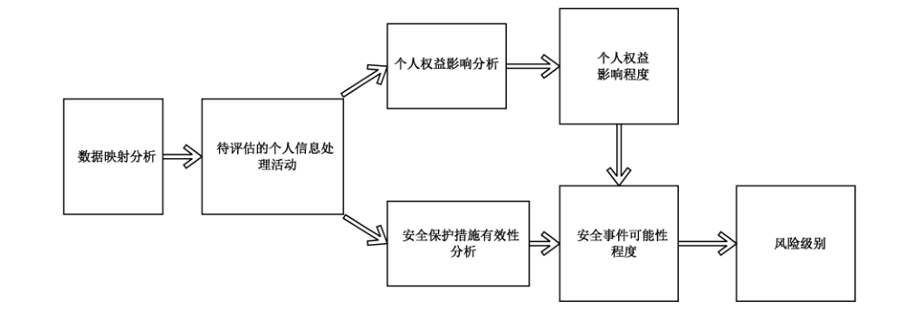

# GB/T 39335-2020 信息安全技术 个人信息安全影响评估指南

> 来源：[GB/T 39335-2020 国家标准详情](https://openstd.samr.gov.cn/bzgk/std/newGbInfo?hcno=9EA84C0C3C2DBD3997B23F8E6C8ECA35)；封面发布日期：2020-11-19；实施日期：2021-06-01。
> PDF SHA-256：9bd8cf7a7629794942a79181db20e1f1d650677ba4725c971ad25ed600c3a6dc。
> 转写说明：对照官方 PDF 全部 26 页图像校核文字、图示与跨页表格；省略封面、目录、页眉、页脚和页码。正式引用请核对官方原件。

## 前言

本标准按照 GB/T 1.1—2009 给出的规则起草。

请注意本文件的某些内容可能涉及专利。本文件的发布机构不承担识别这些专利的责任。

本标准由全国信息安全标准化技术委员会（SAC/TC 260）提出并归口。

本标准起草单位：中国电子技术标准化研究院、四川大学、颐信科技有限公司、深圳市腾讯计算机系统有限公司、华为技术有限公司、全知科技（杭州）有限责任公司、北京腾云天下科技有限公司、国家金融 IC 卡安全检测中心、强韵数据科技有限公司、中国信息通信研究院、北京信息安全测评中心、联想（北京）有限公司、清华大学、阿里巴巴（北京）软件服务有限公司、中国软件评测中心、浙江蚂蚁小微金融服务集团股份有限公司、陕西省网络与信息安全测评中心。

本标准主要起草人：洪延青、何延哲、胡影、高强裔、陈湉、赵冉冉、刘贤刚、皮山杉、黄劲、葛梦莹、范为、宁华、葛鑫、周顿科、高磊、李汝鑫、秦颂、兰晓、陈舒、陈兴蜀、金涛、秦博阳、高志民、顾伟、白利芳、白晓媛、张谦、王伟光、贾雪飞、冯坚坚、朱信铭、王艳红、李怡。

## 1 范围

本标准给出了个人信息安全影响评估的基本原理、实施流程。

本标准适用于各类组织自行开展个人信息安全影响评估工作，同时可为主管监管部门、第三方测评机构等组织开展个人信息安全监督、检查、评估等工作提供参考。

## 2 规范性引用文件

下列文件对于本文件的应用是必不可少的。凡是注日期的引用文件，仅注日期的版本适用于本文件。凡是不注日期的引用文件，其最新版本（包括所有的修改单）适用于本文件。

- GB/T 20984 信息安全技术 信息安全风险评估规范
- GB/T 25069—2010 信息安全技术 术语
- GB/T 35273—2020 信息安全技术 个人信息安全规范

## 3 术语和定义

GB/T 25069—2010、GB/T 35273—2020界定的以及下列术语和定义适用于本文件。

### 3.1 个人信息 personal information

以电子或者其他方式记录的能够单独或者与其他信息结合识别特定自然人身份或者反映特定自然人活动情况的各种信息。

［GB/T 35273—2020，定义3.1］

### 3.2 个人敏感信息 personal sensitive information

一旦泄露、非法提供或滥用可能危害人身和财产安全，极易导致个人名誉、身心健康受到损害或歧视性待遇等的个人信息。

［GB/T 35273—2020，定义3.2］

### 3.3 个人信息主体 personal information subject

个人信息所标识或者关联的自然人。

［GB/T 35273—2020，定义3.3］

### 3.4 个人信息安全影响评估 personal information security impact assessment

针对个人信息处理活动，检验其合法合规程度，判断其对个人信息主体合法权益造成损害的各种风险，以及评估用于保护个人信息主体的各项措施有效性的过程。

## 4 评估原理

### 4.1 概述

个人信息安全影响评估旨在发现、处置和持续监控个人信息处理过程中对个人信息主体合法权益造成不利影响的风险。

### 4.2 开展评估的价值

实施个人信息安全影响评估，能够有效加强对个人信息主体权益的保护，有利于组织对外展示其保护个人信息安全的努力，提升透明度，增进个人信息主体对其的信任。包括：

a） 在开展个人信息处理前，组织可通过影响评估，识别可能导致个人信息主体权益遭受损害的风险，并据此采用适当的个人信息安全控制措施。

b） 对于正在开展的个人信息处理，组织可通过影响评估，综合考虑内外部因素的变化情况，持续修正已采取的个人信息安全控制措施，确保对个人合法权益不利影响的风险处于总体可控的状态。

c） 个人信息安全影响评估及其形成的记录文档，可帮助组织在政府、相关机构或商业伙伴的调查、执法、合规性审计等中，证明其遵守了个人信息保护与数据安全等方面的法律、法规和标准的要求。

d） 在发生个人信息安全事件时，个人信息安全影响评估及其形成的记录文档，可用于证明组织已经主动评估风险并采取一定的安全保护措施，有助于减轻、甚至免除组织相关责任和名誉损失。

e） 组织可通过个人信息安全影响评估，加强对员工的个人信息安全教育。参与评估之中，员工能熟悉各种个人信息安全风险，增强处置风险的能力。

f） 对合作伙伴，组织通过评估的实际行动表明其严肃对待个人信息安全保护，并引导其能够采取适当的安全控制措施，以达到同等或类似的安全保护水平。

### 4.3 评估报告的用途

个人信息安全影响评估报告的内容主要包括：评估所覆盖的业务场景、业务场景所涉及的具体的个人信息处理活动、负责及参与的部门和人员、已识别的风险、已采用及拟采用的安全控制措施清单、剩余风险等。

因此，个人信息安全影响评估报告的用途包括但不限于：

a） 对于个人信息主体，评估报告可确保个人信息主体了解其个人信息被如何处理、如何保护，并使个人信息主体能够判断是否有剩余风险尚未得到处置。

b） 对于开展影响评估的组织，评估报告的用途可能包括：

1） 在产品、服务或项目的规划阶段，用于确保在产品或服务的设计中充分考虑并实现个人信息的保护要求（例如，安全机制的可实现性、可行性、可追踪性等）；

2） 在产品、服务或项目的运营过程中，用于判断运营的内外部因素（例如运营团队的变动、互联网安全环境、信息共享的第三方安全控制能力等）、法律法规是否发生实质变更，是否需要对影响评估结果进行审核和修正；

3） 用于建立责任制度，监督发现存在安全风险的个人信息处理活动是否已采取安全保护措施，改善或消除已识别的风险；

4） 用于提升内部员工的个人信息安全意识。

c） 对于主管监管部门，要求组织提供个人信息安全影响评估报告，可督促组织开展评估并采取有效的安全控制措施。在处理个人信息安全相关投诉、调查个人信息安全事件等时，主管监管部门可通过影响评估报告了解相关情况，或将报告作为相关证据。

d） 对于开展影响评估的组织的合作伙伴，用于整体了解其在业务场景中的角色和作用，以及其应具体承担的个人信息保护工作和责任。

### 4.4 评估责任主体

组织指定个人信息安全影响评估的责任部门或责任人员，由其负责个人信息安全影响评估工作流程的制定、实施、改进，并对个人信息安全影响评估工作结果的质量负责。该责任部门或人员具有独立性，不受到被评估方的影响。通常，组织内部牵头执行个人信息安全影响评估工作的部门为法务部门、合规部门或信息安全部门。

组织内的责任部门可根据部门的具体能力配备情况，选择自行开展个人信息安全影响评估工作，或聘请外部独立第三方来承担具体的个人信息安全影响评估工作。

对于具体的产品、服务或项目，由相应的产品、服务或项目负责人确保个人信息安全影响评估活动的开展和顺利进行，并给予相应支持。

当由组织自行进行个人信息安全影响评估时，主管监管部门和客户可要求独立审计来核证影响评估活动的合理性和完备性。同时，该组织允许主管监管部门对影响评估流程以及相关信息系统或程序进行取证。

### 4.5 评估基本原理

个人信息安全影响评估的基本原理如图1。

开展评估前，需对待评估的对象（可为某项产品、某类业务、某项具体合作等）进行全面的调研，形成清晰的数据清单及数据映射图表（data flow charts），并梳理出待评估的具体的个人信息处理活动。开展评估时，通过分析个人信息处理活动对个人信息主体的权益可能造成的影响及其程度，以及分析安全措施是否有效、是否会导致安全事件发生及其可能性，综合两方面结果得出个人信息处理活动的安全风险及风险等级，并提出相应的改进建议，形成评估报告。

### 4.6 评估实施需考虑的要素

#### 4.6.1 评估规模

个人信息安全影响评估的规模往往取决于受到影响的个人信息主体范围、数量和受影响的程度。

通常，组织在实施该类个人信息安全影响评估时，个人信息的类型、敏感程度、数量，涉及个人信息主体的范围和数量，以及能访问个人信息的人员范围等，都会成为影响评估规模的重要因素。

#### 4.6.2 评估方法

评估实施过程中采用的基本评估方法，包括但不限于以下三种：

a） 访谈：指评估人员对相关人员进行谈话，以对信息系统中个人信息的处理、保护措施设计和实施情况进行了解、分析和取证的过程。访谈的对象包括产品经理、研发工程师、个人信息保护负责人、法务负责人员、系统架构师、安全管理员、运维人员、人力资源人员和系统用户等。

b） 检查：指评估人员通过对管理制度、安全策略和机制、合同协议、安全配置和设计文档、运行记录等进行观察、查验、分析，以便理解、分析或取得证据的过程。检查的对象为规范、机制和活动，如个人信息保护策略规划和程序、系统的设计文档和接口规范、应急规划演练结果、事件响应活动、技术手册和用户/管理员指南、信息系统的硬件/软件中信息技术机制的运行等。

c） 测试：指评估人员通过人工或自动化安全测试工具进行技术测试，获得相关信息，并进行分析以便获取证据的过程。测试的对象为安全控制机制，如访问控制、身份识别和验证、安全审计机制、传输链路和保存加密机制、对重要事件进行持续监控、测试事件响应能力以及应急规划演练能力等。

#### 4.6.3 评估工作形式

从实施主体来区分，个人信息安全影响评估分为自评估和检查评估两种形式。

自评估是指组织自行发起对其个人信息处理行为的评估，自评估可以由本组织指定专门负责评估、审计的岗位或角色开展，也可以委托外部专业组织开展评估工作。

检查评估是指组织的上级组织发起的个人信息安全影响评估工作。上级组织是对组织有直接领导关系或负有监督管理责任的组织。检查评估也可以委托外部专业组织开展评估。

在确定评估规模，选定评估方法、评估工作形式后，评估实施的具体流程可参照第5章内容。

## 5 评估实施流程

### 5.1 评估必要性分析

#### 5.1.1 概述

个人信息安全影响评估可用于合规差距分析，也可以用于合规之上、进一步提升自身安全风险管理能力和安全水平的目的。因此启动个人信息安全影响评估的必要性，取决于组织的个人信息安全目标，组织可根据实际的需求选取需要启动评估的业务场景。

#### 5.1.2 合规差距评估

##### 5.1.2.1 概述

当组织定义的个人信息安全目标为符合相关法律、法规或标准的基线要求时，则个人信息安全影响评估主要目的在于识别待评估的具体个人信息处理活动已采取的安全控制措施，与相关法律、法规或标准的具体要求之间的差距，例如在某业务场景中与第三方共享个人信息，是否取得了个人信息主体的明示同意。

##### 5.1.2.2 整体合规分析

组织可根据所适用的个人信息保护相关法律、法规、政策及标准，分析特定产品或服务所涉及的全部个人信息处理活动与所适用规则的差距。该评估方式的应用场景包括但不限于以下情形：

a） 产品或服务的年度整体评估；

b） 新产品或新服务（不限技术平台）设计阶段评估；

c） 新产品或新服务（不限技术平台）上线初次评估；

d） 法律法规、政策，标准等出现重大变化时重新评估；

e） 业务模式、互联网安全环境、外部环境等发生重大变化的重新评估；

f） 发生重大个人信息安全事件后重新评估；

g） 发生收购、兼并、重组等情形开展评估。

##### 5.1.2.3 局部合规分析

组织可根据所适用的个人信息保护相关法律、法规、政策及标准，对特定产品或服务所涉及的部分个人信息处理活动与所适用规则的差距进行分析。该评估方式的应用场景包括但不限于以下情形：

a） 新增功能需要收集新的个人信息类型时的评估；

b） 法律、法规、政策、标准出现部分变化时的评估；

c） 业务模式、信息系统、运行环境等发生变化时评估。

##### 5.1.2.4 评估性合规要求分析

部分个人信息保护相关的法律、法规、标准的规定提出了评估性合规要求。这类规定并没有针对特定的个人信息处理活动提出明确、具体的安全控制措施，而是要求组织针对特定个人信息处理活动，专门开展风险评估，并采取与风险程度相适应的安全控制措施，将对个人信息主体合法权益不利影响的风险降低到可接受的程度，才符合其规定。

评估性合规要求往往针对的是对个人权益有重大影响的个人信息处理活动，例如处理个人敏感信息、使用自动化决策方式处理个人信息、委托处理个人信息、向第三方转让或共享个人信息、公开披露个人信息、向境外转移个人信息等。

针对此类规定，组织可使用本指南提供的个人信息安全影响评估方法进行评估，保证个人信息处理活动的安全风险可控，以符合相应的法律、法规、标准的要求。

> 注：评估性合规要求分析示例及具体评估要点可参考附录 A。

#### 5.1.3 尽责性风险评估

出于审慎经营、声誉维护、品牌建立等目的，组织往往选取可能对个人合法权益产生高风险的个人信息处理活动，开展尽责性风险评估。此种风险评估的目标，是在符合相关法律、法规和标准的基线要求之上，尽可能降低对个人信息主体合法权益的不利影响。

> 注：高风险个人信息处理活动示例可参考附录 B。

组织可使用本标准提供的个人信息安全影响评估方法，对高风险个人信息处理活动进行评估，进一步降低个人信息处理活动的安全风险。

### 5.2 评估准备工作

#### 5.2.1 组建评估团队

组织确认并任命负责进行个人信息安全影响评估的人员（评估人）。此外，组织还要指定人员负责签署评估报告。

评估人明确规定个人信息安全影响评估报告的提交对象、个人信息安全影响评估的时间段、是否会公布评估报告或其摘要。

如有必要评估人需申请团队支持，例如由技术部门、相关业务部门及法律部门的代表构成的团队。

组织内部个人信息安全影响评估需要组织管理层给予长期支持。

管理层需为个人信息安全影响评估团队配置必要资源。

#### 5.2.2 制定评估计划

计划需清楚规定完成个人信息安全影响评估报告所进行的工作、评估任务分工、评估计划表。此外，计划还需考虑到待评估场景中止或撤销的情况。具体操作时考虑以下方面：

a） 人员、技能、经验及能力；

b） 执行各项任务所需时间；

c） 进行评估每一步骤所需资源，如自动化的评估工具等。

> 注：涉及的场景复杂、耗用资源多时，建议对原有方案进行更新迭代，针对常规评估活动或涉及待评估场景复杂度低等情形时，可沿用原有计划或简化该步骤。

如涉及相关方咨询，计划需说明在何种情况下需要咨询相关方、将咨询哪些人员以及具体的咨询方式（例如通过公众意见调查、研讨会、焦点小组、公众听证会、线上体验等等）。

#### 5.2.3 确定评估对象和范围

从以下三个方面描述评估的对象和范围：

a） 描述系统基本信息，包括但不限于：

1） 处理个人信息的目的和类型；

2） 对支撑当前或未来业务流程的信息系统的描述；

3） 履行信息系统管理职责的部门或相关人员，以及其职责或履行水平；

4） 关于个人信息处理方式、处理范围的说明、有权访问个人信息的角色等；

5） 如预计委托第三方处理，或与第三方共享、转让信息系统的个人信息，说明上述第三方身份、第三方接入信息系统的情况等。

b） 描述系统设计信息，包括但不限于：

1） 功能（或逻辑）结构概览；

2） 物理结构概览；

3） 包含个人信息的信息系统数据库、表格和字段的清单和结构；

4） 按组件和接口划分的数据流示意图；

5） 个人信息生命周期的数据流示意图，例如个人信息的收集、存储、使用和共享等；

6） 描述通知个人信息主体的时间节点以及取得个人信息主体同意的时间节点和工作流程图；

7） 可对外传输个人信息的接口清单；

8） 个人信息处理过程中的安全措施。

c） 描述处理流程和程序信息，包括但不限于：

1） 信息系统的身份与用户管理概念；

2） 操作概念，包括信息系统或其中部分结构采用现场运行、外部托管，或云外包的方式；

3） 支持概念，包括列示可访问个人信息的第三方范围、其所拥有的个人信息访问权限、其可访问个人信息的位置等；

4） 记录概念，包括已登入信息的保存计划；

5） 备份与恢复计划；

6） 元数据的保护与管理；

7） 数据保存与删除计划及存储介质的处置。

#### 5.2.4 制定相关方咨询计划

相关方包括但不限于：

- 员工，例如人力资源、法律、信息安全、财务、业务运营职能、通信与内部审计（尤其是在监管环境下）相关人员；
- 个人信息主体和消费者代表；
- 分包商和业务合作伙伴；
- 系统开发和运维人员；
- 对于评估有相应担忧的其他组织人员。

为保证评估流程的透明，实现降低安全风险的目标，评估人需详细确认进入评估程序的内部或外部相关方。相关方与待评估的个人信息处理活动具有直接的利益关系，相关方可以是拥有或可能获取个人信息访问权限的组织或个人。

评估人需确认相关方的分类，然后具体确认各类相关方中的特定组织或个人。如果相关方为个人，则该个人宜尽可能具有代表性。

个人信息的范围与规模，以及业务重要性、成本收益等因素，对于确定恰当的相关方非常重要。如对大型个人信息处理活动进行评估，则可能存在较多相关方。在这种情况下，社会团体（如消费者权益保护组织）可能被确认为相关方。相反，一些小型评估，可能不需要确认宽泛的相关方清单。

制定咨询计划需明确不同的相关方所受的影响、后果（如果已知）以及所采取的用于降低不利影响的安全控制措施等相关问题。计划中还包含咨询范围及计划表。

咨询计划的目标包括但不限于：

a） 确定相关方的数量与范围；

b） 相关方参与识别并评估个人权益影响及安全风险的具体方式；

> 注：相关方的反馈意见所提出的问题可能与主观风险认识有关，而非客观实际风险，但不能忽略这些意见，组织可将这些意见放在更广泛的相关方管理问题中进行处理，为交流活动提供帮助。

c） 就评估报告咨询相关方意见，以确认报告是否充分反映他们对有关问题的关注。

组织在开展个人信息安全影响评估时，可以督促适当的相关方（主要包括分包商和业务合作伙伴）开展个人信息安全影响评估。适当的相关方有义务开展个人信息安全影响评估，或者配合组织开展个人信息安全影响评估，组织可以引用相关方的个人信息安全影响评估报告作为咨询结果。

### 5.3 数据映射分析

组织在针对个人信息处理过程进行全面的调研后，形成清晰的数据清单及数据映射图表。

数据映射分析阶段需结合个人信息处理的具体场景。调研内容包括个人信息收集、存储、使用、转让、共享、删除等环节涉及的个人信息类型、处理目的、具体实现方式等，以及个人信息处理过程涉及的资源（如内部信息系统）和相关方（如个人信息处理者、平台经营者、外部服务供应商、云服务商等第三方）。调研过程中尽可能考虑已下线系统、系统数据合并、企业收购、并购及全球化扩张等情况。

梳理数据映射分析的结果时，根据个人信息的类型、敏感程度、收集场景、处理方式、涉及相关方等要素，对个人信息处理活动进行分类，并描述每类个人信息处理活动的具体情形，便于后续分类进行影响分析和风险评价。

> 注：开展数据映射分析，可参考附录C中表C.1和表C.2。

### 5.4 风险源识别

风险源识别是为了分析个人信息处理活动面临哪些威胁源，是否缺乏足够的安全措施，导致存在脆弱性而引发安全事件。决定个人信息安全事件发生的要素很多，就威胁源而言，有内部威胁源，也有外部威胁源，有恶意人员导致的数据被窃取等事件，也有非恶意人员无意中导致的数据泄露等事件；就脆弱性而言，有物理环境影响导致的数据毁损，有技术因素导致的数据泄露、篡改、丢失等事件，也有管理不当引起的滥用等事件。

GB/T 20984 中所描述的威胁识别和脆弱性识别方法均可用于对个人信息安全事件的分析过程。

为进一步简化个人信息安全事件可能性的分析过程，将与个人信息安全事件可能性相关的要素归纳为以下四个方面：

a） 网络环境和技术措施。评估时关注的要素包括但不限于：

1） 处理个人信息的信息系统所处网络环境为内部网络还是互联网，不同的网络环境其面临的威胁源不同，连接互联网的信息系统面临的风险更高；

2） 处理个人信息的信息系统与其他系统的交互方式，比如是否采用网络接口进行数据交互，是否嵌入可收集个人信息的第三方代码、插件等，通常情况下数据交互越多，需采取更加全面的安全措施防止信息泄露、窃取等风险；

3） 个人信息处理过程中是否实施严格的身份鉴别、访问控制等措施；

4） 是否在网络边界部署了边界防护设备，配置了严格的边界防护策略，实施了数据防泄露技术措施；

5） 是否监测和记录网络运行状态，是否标记、分析个人信息在内部或与第三方交互时的状态，及时发现异常流量和违规使用情况；

6） 是否采取了防范病毒和木马后门攻击、端口扫描、拒绝服务攻击等网络入侵行为的技术措施；

7） 是否采用加密传输、加密存储等措施对个人敏感信息进行额外保护；

8） 是否对个人信息收集、保存、传输、使用、共享等各阶段的个人信息处理活动进行审计，并对异常操作行为进行报警；

9） 是否建立了完备的网络安全事件预警、应急处置、报告机制；

10） 是否对信息系统进行定期安全检查、评估、渗透测试，并及时进行补丁更新和安全加固；

11） 是否对数据存储介质加强安全管理，是否具备对数据进行备份和恢复的能力；

12） 其他必要的网络安全技术保障措施。

注1：如果组织参照其他网络安全、数据安全相关国家标准建立成熟的安全防护体系，可基于其已有基础进行分析评估。

b） 个人信息处理流程。评估时关注的要素包括但不限于：

1） 个人敏感信息的判定是否准确；

2） 收集个人信息的目的是否正当、合法；

3） 从第三方获得的数据是否得到正式的处理授权；

4） 告知方式和告知的内容是否友好可达，是否所有的处理活动都征得了用户同意；

5） 是否定义了个人信息最小元素集，是否超范围收集了个人信息；

6） 变更个人信息使用目的是否对个人信息主体产生影响；

7） 是否提供便捷有效的个体参与的机制，包括查询、更正、删除、撤回同意、注销账号等；

8） 接收个人信息的第三方是否会变更目的使用个人信息；

9） 个人信息的保存时间是否最小化，超出期限的删除等机制是否合理；

10） 是否对用户画像机制进行限制，避免精确定位到特定个人；

11） 是否为个性化展示提供用户可控制、可退出或关闭的机制；

12） 匿名化机制是否有效，去标识化后的个人信息是否能够被关联分析等，导致可重新识别个人信息主体身份；

13） 是否提供及时有效的安全事件通知机制和应急处置机制；

14） 是否提供有效的投诉和维权渠道等；

15） 是否未经用户同意向第三方共享、转让个人信息；

16） 是否散播不准确的数据或不完整的误导性数据；

17） 是否诱导或强迫个人提供过多个人信息；

18） 是否过多地追踪或监视个人行为；

19） 是否无根据地限制个人控制其个人信息的行为等；

20） 其他个人信息处理流程的规范性。

注2：对个人信息处理流程规范性的分析可参照 GB/T 35273—2020 相应内容。

c） 参与人员与第三方。评估时关注的要素包括但不限于：

1） 是否任命个人信息保护负责人或个人信息保护工作机构，个人信息保护负责人是否由具有相关管理工作经历和个人信息保护专业知识的人员担任；

2） 是否依据业务安全需求，制定并执行个人信息安全管理的方针和策略；

3） 是否制定涉及个人信息处理各环节的安全管理制度，并提出具体的安全管理要求；

4） 是否与从事个人信息处理岗位上的相关人员签署保密协议，并对大量接触个人敏感信息的人员进行背景审查；

5） 是否明确内部涉及个人信息处理不同岗位的安全职责，并建立发生安全事件的处罚、问责机制；

6） 是否对个人信息处理岗位上的相关人员开展个人信息安全专业化培训和考核，并确保相关人员熟练掌握隐私政策和相关规程；

7） 是否明确可能访问个人信息的外部服务人员需遵守的个人信息安全要求，并进行监督；

8） 是否与第三方签署有约束力的合同等文件，约定个人信息传输至第三方后的处理目的、方式、数据留存期限、超出期限后的处理方式；

9） 是否对第三方处理个人信息的行为进行定期检查、审计，确保其严格执行合同等约定；

10） 其他方面的必要措施。

注3：如果组织参照其他网络安全、数据安全相关国家标准建立成熟的安全管理体系，可基于其已有基础进行分析评估。

d） 业务特点和规模及安全态势。评估时关注的要素包括但不限于：

1） 业务对个人信息处理的依赖性；

2） 业务处理或可能处理个人信息的数量、频率、用户规模、用户峰值等；

3） 是否曾经发生过个人信息泄露、篡改、毁损、丢失等事件；

4） 个人信息保护相关执法监管动态；

5） 近期内遭受网络攻击或发生安全事件的情况；

6） 近期收到过或公开发布的安全相关的警示信息。

组织在对以上维度的相应内容进行充分了解后，通过调研访谈，查阅支撑性文档、功能检查、技术测试等方式，识别已采取的措施与当前的状态。针对5.5 中对个人权益影响分析的不同维度，从以上四方面对安全事件发生的可能性等级进行综合评价。

注4：安全事件可能性等级评估可参考附录D中D.1。

### 5.5 个人权益影响分析

#### 5.5.1 个人权益维度

个人权益影响分析指分析特定的个人信息处理活动是否会对个人信息主体合法权益产生影响，以及可能产生何种影响。个人权益影响概括可分为“限制个人自主决定权”“引发差别性待遇”“个人名誉受损或遭受精神压力”“人身财产受损”四个维度：

a） 限制个人自主决定权，例如被强迫执行不愿执行的操作、缺乏相关知识或缺少相关渠道更正个人信息、无法选择拒绝个性化广告的推送、被蓄意推送影响个人价值观判断的资讯等；

b） 引发差别性待遇，例如因疾病、婚史、学籍等信息泄露造成的针对个人权利的歧视，因个人消费习惯等信息的滥用而对个人公平交易权造成损害等；

c） 个人名誉受损或遭受精神压力，例如被他人冒用身份、公开不愿为人知的习惯、经历等，被频繁骚扰、监视追踪等；

d） 人身财产受损，例如引发人身伤害、资金账户被盗、遭受诈骗、勒索等。

#### 5.5.2 个人权益影响分析过程

组织可根据数据映射分析结果及确定需要评估的个人信息处理活动，结合相关法律、法规、标准的要求或组织自定义的个人信息安全目标，分析个人信息处理活动全生命周期或特定处理行为对个人权益可能产生的影响，以及个人信息泄露、毁损、丢失、滥用等对个人权益可能产生的影响，以审视是否存在侵害个人信息主体权益的风险。

个人权益影响分析过程一般包含对个人信息敏感程度分析、个人信息处理活动特点分析、个人信息处理活动问题分析以及影响程度分析四个阶段：

a） 在个人信息敏感程度分析阶段，组织可参照国家有关法律、法规、标准，依据数据映射分析结果，分析个人信息的敏感程度对个人权益可能产生的影响，例如健康生理信息的泄露、滥用等可能会对个人生理、心理产生较严重的影响；

b） 在个人信息处理活动特点分析阶段，组织可参照与国家有关法律、法规、标准，依据数据映射分析结果，分析个人信息处理活动是否涉及限制个人自主决定权、引发差别性待遇、个人名誉受损或遭受精神压力、人身财产受损等，例如公开披露个人经历的行为可能会对个人声誉产生影响；

c） 在个人信息处理活动问题分析阶段，组织可参照与国家有关法律、法规、标准，依据数据映射分析结果，分析个人信息处理活动可能存在的弱点、差距和问题，其中 5.4 b）中的对个人信息流程规范性的分析结果可以支撑该阶段的分析过程，对问题严重程度的分析有助于分析个人权益的影响程度；

d） 在个人权益影响程度分析阶段，组织可结合前几个阶段的分析结果，综合分析个人信息处理活动对个人权益可能造成的影响，及其严重程度。

> 注：个人权益影响程度评估可参考 D.2。

### 5.6 安全风险综合分析

进行安全风险综合分析时，可参照 4.5中的基本原理，采取以下步骤：

a） 参照5.4，分析已实施的安全措施、相关方、处理规模等要素，评价安全事件发生的可能性等级；

b） 参照5.5，分析可能发生的安全事件会对个人权益产生何种影响，并评价对个人权益影响的程度等级；

c） 综合考虑安全事件可能性和个人权益影响程度两个要素，综合分析得出个人信息处理活动的安全风险等级。

> 注：安全风险分析的具体过程和风险等级的判定可参考 D.3，安全风险分析的具体过程可参考使用表 C.3、表 C.4 和表 C.5。

在完成针对特定个人信息处理活动影响评估之后，组织可综合针对所有相关个人信息处理活动的评估结果，形成对整个评估对象（如业务部门、具体项目、具体合作等）的风险等级。

### 5.7 评估报告

评估报告的内容通常包括：个人信息保护专员的审批页面、评估报告适用范围、实施评估及撰写报告的人员信息、参考的法律、法规和标准、个人信息影响评估对象（明确涉及的个人敏感信息）、评估内容、涉及的相关方等，以及个人权益影响分析结果，安全保护措施分析结果、安全事件发生的可能性分析结果、风险判定的准则、合规性分析结果、风险分析过程及结果、风险处置建议等。

### 5.8 风险处置和持续改进

根据评估结果，组织可选取并实施相应的安全控制措施进行风险处置。通常情况下，可根据风险的等级，采取立即处置、限期处置、权衡影响和成本后处置，接受风险等处置方式。

组织需持续跟踪风险处置的落实情况，评估剩余风险，将风险控制在可接受的范围内。此外，还可将评估结果用于下一次个人信息安全影响评估工作。

### 5.9 制定报告发布策略

为促进自身持续提升个人信息保护水平、配合监管活动、增加客户信任，组织可制定个人信息安全影响评估报告发布策略。选择公开发布的个人信息安全影响评估报告可以在已有评估报告基础上予以简化，但其内容通常不少于以下方面：

a） 收集和处理个人信息的类型和必要性；

b） 收集和处理的个人信息类型（个人敏感信息需单独强调）；

c） 个人信息处理的例外情况（法律法规规定等）；

d） 合规性分析的概况；

e） 评估过程和结果概况；

f） 已实施和将要实施的风险处置措施概况；

g） 对个人信息主体的建议；

h） 实施评估责任部门和人员的联系方式和解答疑问的渠道等。

## 附录 A（资料性附录）评估性合规的示例及评估要点

### A.1 概述

常见的个人信息相关法律、法规、标准中评估性合规要求，包括处理个人敏感信息、使用自动化决策方式处理个人信息、委托处理个人信息、向第三方转让或共享个人信息、公开披露个人信息、向境外转移个人信息、个人信息处理目的变更评估、个人信息匿名化和去标识化效果评估，以及确定个人信息安全事件处置方案的评估等，其中部分评估要点示例如下。

### A.2 个人信息出境安全评估

个人信息出境场景的评估可参照有关国家标准执行。

### A.3 个人信息处理目的变更前的影响评估

分析个人信息处理活动的影响时，需要考虑多种因素，以评估“与收集个人信息时所声称的目的具有直接或合理关联的范围”的影响为例，如果新设目的与原目的有直接或合理的关联，且不会为个人权益带来额外影响，无需再次告知个人信息主体并征得其明示同意。判断时是否有直接或合理的关联，至少需要考虑如下因素：

- 个人信息主体对原先目的、组织处理个人信息方式和方法的合理性的理解程度；
- 个人信息收集时的场景，包括个人信息主体和组织之间的关系、产品或服务的范围及使用的商标和名称、个人信息主体使用产品或服务的方式、产品或服务为个人信息主体提供的便利等；
- 特定场景中可合理预期的个人信息处理方式，如常规商业运营中，可预见到的将被使用的个人信息的类型，与个人信息主体之间直接互动的范围、频率、性质、历史，以及为提供产品或服务，或改进或推广产品或服务，可预见到的将被使用的个人信息的类型；
- 如将所收集的个人信息用于学术研究或得出对自然、科学、社会、经济等现象总体状态的描述，属于与收集目的具有合理关联的范围之内。但对外提供学术研究或描述的结果时，需对结果中所包含的个人信息进行去标识化处理，否则在对目的变更后的影响评估中可能会得出存在高风险的判断。

### A.4 个人信息匿名化和去标识化效果评估

匿名化和去标识化对个人信息进行了技术处理，使其在不借助额外信息的情况下，无法识别个人信息主体。但数据接收方可能会借助于额外的信息以及技术手段，进行重标识攻击，从而将去标识化的数据集归因到原始个人信息主体或一组个人信息主体。

常见的用于重标识的方法如下：

- 筛选：基于是否能唯一确定一个个人信息主体，将属于一个个人信息主体的记录筛选出来；
- 关联：将不同数据集中关于相同个人信息主体的信息关联；
- 推断：通过其他属性的值以一定概率推断出一个属性的值。

评估个人信息匿名化和去标识化效果时，可充分考虑以下要素：

- 个人信息匿名化和去标识化过程的规范性，所采用技术的通用性；
- 匿名化后的个人信息是否为统计型结果；
- 去标识化后的个人信息是否能够达到使用目的；
- 匿名化和去标识化后的个人信息使用场景；
- 如委托第三方进行去标识化或匿名化时，需评估其采用的方案及数据安全保障能力；
- 能否在公开渠道或数据交易组织获得类似的个人信息；
- 未经去标识化或匿名化处理保留的个人信息类型和内容的特殊性。

### A.5 个人信息委托处理、转让、共享或公开披露前的影响评估

在对个人信息进行委托处理、转让、共享和公开披露前，开展个人信息安全影响评估，评估的内容包括但不限于以下方面：

- 个人信息的类型、数量、敏感程度等；
- 是否向个人信息主体告知了转让、共享、公开披露的基本情况，并征得个人信息主体的明示授权同意；
- 数据发送方的安全管理保障和安全技术保障能力；
- 数据接收方的安全管理保障和安全技术保障能力（不包括公开披露）；
- 数据接收方可能会开展的个人信息处理活动，或公开披露的个人信息可能会被使用的个人信息处理场景；
- 个人信息是否进行过去标识化处理；
- 发生个人信息安全事件后的补救措施；
- 数据接收方所能响应个人信息主体的请求的范围，如：访问、更正、删除等。

### A.6 确定个人信息安全事件处置方案的评估

发生个人信息安全事件后，组织需及时评估事件可能造成的影响，并采取必要措施控制事态、消除隐患。评估影响时，可充分考虑以下因素：

- 个人信息的类型、数量、敏感程度、涉及的个人信息主体数量等；
- 发生事件的信息系统状况，对其他互联系统的影响；
- 已采取或将要采取的处置措施及措施的有效性；
- 对个人信息主体权益造成的直接影响和长期影响；
- 向个人信息主体告知事件的方式和内容；
- 是否达到《国家网络安全事件应急预案》等有关规定的上报要求。

### A.7 使用自动化决策方式处理个人信息的评估

组织在设计、采用自动化决策方式处理个人信息时，如自动决定个人征信及贷款额度，或用于面试人员的自动化筛选等，需充分考虑对个人权益产生的不利影响，并在规划设计阶段或首次使用前开展个人信息安全影响评估，评估考虑的要素包括：

- 是否向用户说明了自动化决策的基本原理或运行机制；
- 是否定期对自动化决策的效果进行评价；
- 是否对自动化决策使用的数据源、算法等持续优化；
- 是否向用户提供针对自动化决策结果的投诉渠道；
- 是否支持对自动化决策结果的人工复核。
## 附录 B（资料性附录）高风险的个人信息处理活动示例

个人信息处理活动自身可能涉及对个人信息主体权益影响及相应风险较高的情况下，需开展个人信息安全影响评估，可能产生高风险的个人信息处理活动及场景示例见表 B.1。

**表 B.1 高风险的个人信息处理活动及场景示例**

| 个人信息处理活动 | 场景示例 |
| --- | --- |
| a）数据处理涉及对个人信息主体的评价或评分，特别是对个人信息主体的工作表现、经济状况、健康状况、偏好或兴趣的评估或预测 | 示例 1：对个人信息主体使用社交网络和其他应用程序的行为进行分析，以便向其发送商业信息或垃圾邮件。 示例 2：银行或其他金融组织在提供贷款前使用人工智能算法对个人信息主体进行信用评估，数据处理可能涉及与信用评估没有直接关联的个人信息。 示例 3：保险公司通过分析香烟、酒精、极限运动、驾驶等偏好数据，评估个人信息主体的生活方式、健康状况等，据此作出保费设置的决策。 |
| b）使用个人信息进行自动分析给出司法裁定或其他对个人有重大影响的决定 | 示例 1：在设置有分段测速或电子收费的道路，建设有用于流量、道路违规等行为的检测系统，特别是能够自动识别车辆的系统，对驾驶员及其驾驶行为进行详细的记录和监督，并给出是否违法的判断。 示例 2：电商平台监控用户购物行为，进行用户画像，分析用户的购买偏好和购买能力，设置针对用户特定偏好的营销计划。 |
| c）系统性的监控分析个人或个人信息，如在公共区域监控、采集个人信息等，但仅在涉及违规事件分析时才使用的视频监测系统除外 | 示例 1：大规模公共空间监测系统，用于人员追踪，并且能够收集超出提供服务范围的个人信息。 示例 2：设置在工作场所的 IT 监测系统，监控员工的电子邮件、所使用的应用程序等，用于分析员工工作时间及使用工具（如电子邮件、互联网）的情况。 |
| d）收集的个人敏感信息数量、比重较多，收集频率要求高，与个人经历、思想观点、健康、财务状况等密切相关 | 示例 1：通过智能手表、手环、制服、头盔或其他移动设备持续收集或监控个人信息主体的活动、健康相关数据。 示例 2：通过健身手环或智能手机中的传感器持续收集或监控用户运动、健康相关数据，通过数据分析和处理提供定制化的健身建议或改善训练流程的服务。 |
| e）数据处理的规模较大，如涉及 100 万人以上、持续时间久、在某个特定群体的占比超过 50%、涵盖的地理区域广泛或较集中等 | 示例 1：社交网络、在线浏览器、有线电视订阅服务大规模收集用户浏览网站、购买记录、观看记录、收听记录等数据。 示例 2：百货商店、购物中心或其他类似营业场所中，通过收集路人和顾客的 GPS、蓝牙或移动通信信号，对客流情况进行监测，跟踪顾客的购物路线和购物习惯。 |
| f）对不同处理活动的数据集进行匹配和合并，并应用于业务 | 示例 1：基于防欺诈或风险管控目的，电商平台合并处理不同来源的数据集，以便根据分析或测试结果显示的风险值采取相应管控措施。 示例 2：电商平台、零售商店通过分析顾客的购物、优惠券使用等行为数据，结合顾客的信用数据、第三方和社交网络数据等，获得提高销售额的营销策略。 |
| g）数据处理涉及弱势群体的，如未成年人、病人、老年人、低收入人群等 | 示例 1：能够连接网络的智能玩具收集儿童玩耍的音频、视频数据，或收集儿童的年龄、性别、位置等信息。 示例 2：在远程医疗场景中，医生通过网站或应用程序与患者进行视频通话，通过各类传感器收集分析患者的血糖、血氧等健康数据。 |
| h）创新型技术或解决方案的应用，如生物特征识别、物联网、人工智能等 | 示例 1：通过人工智能提供客户服务或支持，呼叫中心利用人工智能技术处理呼叫者的音频数据，自动评估呼叫者的心情，并根据评估结果确定与呼叫者的沟通方式或向呼叫者提供的建议。 示例 2：健身俱乐部、酒店等入口控制系统，指纹支付或刷脸支付等支付程序，通过收集和处理个人信息主体的个人生物识别信息，判断是否拥有进入某些区域、使用某些功能的权限。 |
| i）处理个人信息可能导致个人信息主体无法行使权利、使用服务或得到合同保障等 | 示例 1：提供贷款、信贷、分期付款销售的实体通过收集、处理包含有债务人或类似个人信息主体的数据库信息，针对潜在客户制定信贷决策。 |

判断个人信息处理活动是否与上述场景相关，需考虑贯穿数据映射分析、合规差距分析等过程，一旦涉及上述情形，可针对以上场景评估影响和风险，同时重视个人信息主体代表等相关方的咨询意见，保障评估的准确性。
## 附录 C（资料性附录）个人信息安全影响评估常用工具表

以下工具表（表 C.1～表 C.5）均为资料性工具，供组织进行评估时选取参考。工具表以个人信息处理活动/场景/特性或组件为维度，各表可基于此项进行整合或分开处理。建议组织采取 IT 化/自动化处理方式进行影响评估。

**表 C.1 基于处理活动/场景/特性或组件的个人信息映射表**

| 个人信息处理活动/场景/特性或组件 | 个人信息类型¹） | 个人信息主体 | 个人信息收集、处理的目的 | 个人信息处理的合法事由 | 个人信息控制者²） | 个人信息处理者³） | 是否涉及跨境转移⁴） | 是否涉及第三方共享⁵） |
| --- | --- | --- | --- | --- | --- | --- | --- | --- |
| 处理活动 A |  |  |  |  |  |  |  |  |
| 处理活动 B |  |  |  |  |  |  |  |  |
| 处理活动 C |  |  |  |  |  |  |  |  |

**表 C.2 个人信息生命周期安全管理**

| 个人信息处理活动/场景/特性或组件 | 相关个人信息项 | 收集来源 | 收集方式 | 存储方式/加密措施 | 传输方式/加密措施 | 存储期限 | 删除/匿名化方式 |
| --- | --- | --- | --- | --- | --- | --- | --- |
| 处理活动 A⁶） |  |  |  |  |  |  |  |
| 处理活动 B |  |  |  |  |  |  |  |
| 处理活动 C |  |  |  |  |  |  |  |

表 C.1～表 C.2 注：

1. 具体字段请详细列举。
2. 涉及联合控制者的，请详细列举并说明。
3. 涉及多个处理者的，请详细列举并说明。
4. 如涉及，请填写表 C.3 相关内容。
5. 如涉及，请填写表 C.3 相关内容。
6. 此处可分为多行填写（每一行对应一项个人信息字段），也可合并处理。

**表 C.3 安全事件可能性分析表**

| 个人信息处理活动/场景/特性或组件 | 风险源维度 | 产生风险的原因/存在的问题 | 相关证据 | 安全事件发生可能性 |
| --- | --- | --- | --- | --- |
| 处理活动 A | 网络环境和技术措施 |  |  |  |
| 处理活动 A | 个人信息处理流程 |  |  |  |
| 处理活动 A | 参与人员与第三方 |  |  |  |
| 处理活动 A | 业务特点和规模及安全态势 |  |  |  |
| 处理活动 B |  |  |  |  |
| 处理活动 B |  |  |  |  |
| 处理活动 B |  |  |  |  |
| 处理活动 B |  |  |  |  |

**表 C.4 安全风险评估及整改措施表**

| 个人信息处理活动/场景/特性或组件 | 风险源维度 | 产生风险的原因/存在的问题 | 安全事件发生可能性等级 | 对个人权益产生的影响维度 | 影响程度 | 风险描述及等级 | 相关责任方与风险处置建议 | 整改效果验证及归档情况 |
| --- | --- | --- | --- | --- | --- | --- | --- | --- |
| 处理活动 A | 网络环境和技术措施 |  |  | 限制个人自主决定权 |  |  |  |  |
| 处理活动 A | 网络环境和技术措施 |  |  | 引发差别性待遇 |  |  |  |  |
| 处理活动 A | 网络环境和技术措施 |  |  | 个人名誉受损或遭受精神压力 |  |  |  |  |
| 处理活动 A | 网络环境和技术措施 |  |  | 人身财产受损 |  |  |  |  |
| 处理活动 A | 个人信息处理流程 |  |  |  |  |  |  |  |
| 处理活动 A | 参与人员与第三方 |  |  |  |  |  |  |  |
| 处理活动 A | 业务特点和规模及安全态势 |  |  |  |  |  |  |  |
| 处理活动 B |  |  |  |  |  |  |  |  |
| 处理活动 B |  |  |  |  |  |  |  |  |
| 处理活动 B |  |  |  |  |  |  |  |  |
| 处理活动 B |  |  |  |  |  |  |  |  |

> 注：评估过程中仅需体现识别出的风险源维度及对个人权益产生的影响维度，可不体现本标准所列举所有维度。

组织针对特定个人信息处理活动开展具体的风险分析时，可参考表 C.5 简化评估过程，首先，从识别的风险源维度出发，分析可能发生的安全事件及其可能性，同时，按照影响程度类型，分析对个人信息主体权益的影响程度，如果两者存在交叉，则可参考表 D.5 得出风险等级，并简要说明存在风险的原因。

**表 C.5 特定个人信息处理活动的安全风险评估表**

| 影响方面 | 限制个人自主决定权：风险等级 | 原因说明 | 引发差别性待遇：风险等级 | 原因说明 | 名誉受损或精神压力：风险等级 | 原因说明 | 人身财产受损：风险等级 | 原因说明 |
| --- | --- | --- | --- | --- | --- | --- | --- | --- |
| 网络环境和技术措施 |  |  |  |  |  |  |  |  |
| 个人信息处理流程 |  |  |  |  |  |  |  |  |
| 参与人员与第三方 |  |  |  |  |  |  |  |  |
| 业务特点和规模及安全态势 |  |  |  |  |  |  |  |  |
## 附录 D（资料性附录）个人信息安全影响评估参考方法

### D.1 评估安全事件发生的可能性

安全事件可能性等级评价可采用定性、半定量和定量的方式。安全事件可能性等级判定准则见表 D.1。

**表 D.1 安全事件可能性等级判定准则**

| 可能性描述 | 可能性等级 |
| --- | --- |
| 采取的措施严重不足，个人信息处理行为极不规范，安全事件的发生几乎不可避免 | 很高 |
| 采取的措施存在不足，个人信息处理行为不规范，安全事件曾经发生过或已经在类似场景下被证实发生过 | 高 |
| 采取了一定的措施，个人信息处理行为遵循了基本的规范性原则，安全事件在同行业、领域被证实发生过 | 中 |
| 采取了较有效的措施，个人信息处理行为遵循了规范性最佳实践，安全事件还未被证实发生过 | 低 |

以定性方式为例，可从“网络环境和技术措施”“处理流程规范性”“参与人员与第三方”“安全态势及业务特点”等方面，依据表 D.1 的判定准则，对安全事件可能性等级进行评价。可能性等级分为“很高”“高”“中”“低”四个等级，安全事件可能性判定可参考表 D.2。

**表 D.2 可能性判定表**

| 可能性描述 | 可能性等级 |
| --- | --- |
| 网络环境与互联网及大量信息系统有交互现象，基本上未采取安全措施保护个人信息安全 | 很高 |
| 该个人信息处理行为为常态、不间断的业务行为，该行为已经对个人主体的权益造成了影响，或收到了大量相关的投诉，并引起了社会关注 | 很高 |
| 任意人员可接触到个人信息，对第三方处理个人信息的范围无任何限制，或已出现第三方滥用个人信息的情形 | 很高 |
| 威胁引发的相关安全事件已经被本组织发现，或已收到监管部门发出的相关风险警报 | 很高 |
| 网络环境与互联网及其他信息系统有较多交互现象，采取的安全措施不够全面 | 高 |
| 该个人信息处理行为为常态、不间断的业务行为，个人信息处理行为不规范，且收到了相关的投诉 | 高 |
| 对处理个人信息相关人员的管理松散，管理制度无落实的记录，未对第三方处理个人信息的范围提出相关要求 | 高 |
| 威胁引发的相关安全事件曾经在组织内部发生过，或已在合作方中发生，或收到过权威组织发出的相关风险预警信息，或处理个人信息的规模超过 1 000 万人 | 高 |
| 网络环境与互联网及其他信息系统有交互现象，采取了一定的安全措施 | 中 |
| 该个人信息处理行为为常态业务行为，个人信息处理行为规范性欠缺，且合作伙伴或同领域其他组织收到过相关的投诉 | 中 |
| 有相关的管理制度，对人员提出了管理要求，对第三方处理个人信息的范围提出限制条件，但相应的管理和监督效果不明 | 中 |
| 威胁引发的相关安全事件已经被同领域其他组织发现，或在专业组织相关报告中被证实已出现，或处理个人信息的规模超过 100 万人 | 中 |
| 网络环境比较独立，交互少，或采取了有效的措施保护个人信息安全 | 低 |
| 该个人信息处理行为非常态业务行为，个人信息处理行为符合规范，几乎没有出现关于该行为的投诉 | 低 |
| 有完善的管理机制，对人员的管理和审核比较严格，与第三方合作时提出有效的约束条件并进行监督 | 低 |
| 威胁引发的安全事件仅被专业组织所预测 | 低 |

评估过程中，可根据事件自身的性质估计和经验数据评估其可能性，再根据组织所实施的针对性安全控制措施、相关事件处置经验对可能性进行修正。比如，个人信息处理的规模超过 1 000 万人，但有完备的、针对性的个人信息保护措施和应急机制，或者已具备类似事件处置的经验，并得到了个人信息主体的认同，则安全可能性等级可降低一个级别。在进行修正时需要具体说明修正的理由，必要时可咨询外部专业组织保证修正过程的合理性。

### D.2 评估个人信息主体权益影响程度

个人权益影响程度评价可采用定性、半定量和定量的方式。个人权益影响程度判定准则见表 D.3。

**表 D.3 个人权益影响程度判定准则**

| 影响描述 | 影响程度 |
| --- | --- |
| 个人信息主体可能会遭受重大的、不可消除的、可能无法克服的影响，如遭受无法承担的债务、失去工作能力、导致长期的心理或生理疾病、导致死亡等 | 严重 |
| 个人信息主体可能遭受重大影响，个人信息主体克服难度高，消除影响代价大，如遭受诈骗、资金被盗用、被银行列入黑名单、信用评分受损、名誉受损、造成歧视、被解雇、被法院传唤、健康状况恶化等 | 高 |
| 个人信息主体可能会遭受较严重的困扰，且克服困扰存在一定的难度，如付出额外成本、无法使用所提供的服务、造成误解、产生害怕和紧张的情绪、导致较小的生理疾病等 | 中 |
| 个人信息主体可能会遭受一定程度的困扰，但尚可以克服，如被占用额外的时间、被打扰、产生厌烦和恼怒情绪等 | 低 |

以定性方式为例，可从“限制个人自主决定权”“引发差别性待遇”“个人名誉受损和遭受精神压力”“人身财产受损”四个维度，依据表 D.3 的判定准则，对个人信息主体的权益进行影响程度评价。影响程度分为“严重”“高”“中”“低”四个等级，影响程度判定可参考表 D.4。

**表 D.4 影响程度判定表**

| 影响类别 | 影响描述 | 影响程度 |
| --- | --- | --- |
| 限制个人自主决定权 | 例如个人人身自由受限 | 严重 |
| 限制个人自主决定权 | 例如被强迫执行违反个人意愿的操作、被蓄意推送消息影响个人价值观判断、可能引发个人人身自由受限 | 高 |
| 限制个人自主决定权 | 例如缺乏相关知识或缺少相关渠道更正个人信息、为使用应提供的产品或服务而付出额外的成本等 | 中 |
| 限制个人自主决定权 | 例如被占用额外的时间 | 低 |
| 引发差别性待遇 | 例如因信息泄露造成歧视性对待以致被用人单位解除劳动关系 | 严重 |
| 引发差别性待遇 | 例如造成对个人合法权利的歧视性待遇、造成对个人公平交易权的损害（无法全部或部分使用所提供的产品或服务） | 高 |
| 引发差别性待遇 | 例如造成误解、为使用所提供的产品或服务而需付出额外的成本（包含资金成本、时间成本等） | 中 |
| 引发差别性待遇 | 例如耗费额外的时间获取公平的服务或取得相应的资格等 | 低 |
| 个人名誉受损和遭受精神压力 | 例如名誉受损以致长期无法获得财务收入、导致长期的心理或生理疾病以至于失去工作能力、导致死亡等 | 严重 |
| 个人名誉受损和遭受精神压力 | 例如名誉受损以致被用人单位解除劳动关系、导致心理或生理疾病以致健康遭受不可逆的损害等 | 高 |
| 个人名誉受损和遭受精神压力 | 例如造成误解、名誉受损（通过澄清可全部或部分恢复）、产生害怕和紧张的情绪、导致心理或生理疾病（通过治疗或纠正措施，短期可痊愈）等 | 中 |
| 个人名誉受损和遭受精神压力 | 例如被频繁打扰、产生厌烦和恼怒情绪等 | 低 |
| 人身财产受损 | 例如造成重伤、遭受无法承担的债务等 | 严重 |
| 人身财产受损 | 例如造成轻伤、遭受金融诈骗、资金被盗用、征信信息受损等 | 高 |
| 人身财产受损 | 例如造成轻微伤、社会信用受损，为获取金融产品或服务，或挽回损失需付出额外的成本等 | 中 |
| 人身财产受损 | 例如因个人信息更正而需执行额外的流程（或提供额外的证明性材料）等 | 低 |

评估过程中，可先分析个人信息处理活动对某一个个人信息主体造成的影响程度，再根据处理活动的规模、特点、外部环境、个人信息去标识化、群体性特征等要素修正影响等级。比如，个人信息处理活动涉及典型的个人敏感信息，如健康状况等，且达到一定的数量（如 50 万人），则影响程度可上升一个级别；如果受影响个人信息主体群体抗财务风险能力差、心理承受能力差等情形，如未成年人、学生、老年人等，则影响程度可上升一个级别；如果个人信息经去标识化后已确认降低敏感程度的，影响程度可降低一个级别。在进行修正时需要具体说明修正的理由，必要时可咨询外部专业组织，保证修正过程的合理性。

此外，从组织实践角度出发，可以进一步将个人信息主体权益的影响映射到对组织的影响，以促进组织进一步认识到其中的风险。比如，可根据个人权益受损对组织付出的成本进行评价。成本一般包括：违规成本（如监管处罚、诉讼费用、整改费用等）、直接的业务损失（如流失客户减少了业务收入等）、名誉损失（如品牌形象受损、客户信任受损等）、内部企业文化损失（如企业执行力受损、价值观冲突引起员工积极性下降等）等，以上方面还可以进行初步的半定量或定量分析（比如处罚的案例与罚金等），以促进组织充分重视个人信息保护工作，积极改进，降低个人信息处理过程对个人权益的影响。

### D.3 个人信息安全风险综合评估

综合分析个人权益影响程度和安全事件可能性两个要素，得出风险等级，并给出相应的改进建议，最终形成评估报告。风险等级可分为：严重、高、中、低四个等级。以定性分析为例，可参考表 D.5。

组织可以根据自身业务特点和内部风险管理策略，设计科学、合理的风险等级判定表，并设定何种等级风险为不可接受的风险，但注意保证风险等级判定表不得随意变更或修订，必要时可咨询外部专业组织保证风险等级判定表的合理性。

**表 D.5 风险等级判定表**

| 影响级别 \ 可能性级别 | 低 | 中 | 高 | 很高 |
| --- | --- | --- | --- | --- |
| 严重 | 中 | 高 | 严重 | 严重 |
| 高 | 中 | 中 | 高 | 严重 |
| 中 | 低 | 中 | 中 | 高 |
| 低 | 低 | 低 | 中 | 中 |

## 参考文献

- ［1］ ISO/IEC 29100:2011 Information technology—Security techniques—Privacy framework
- ［2］ ISO/IEC FDIS 29134:2017 Information technology—Security techniques—Privacy impact assessment
- ［3］ NIST SP 800-53 Rev.4:2013 Security and privacy controls for federal information systems and organizations
- ［4］ NIST SP 800-122:2010 Guide to protecting the confidentiality of personally identifiable information（PII）
- ［5］ NISTIR 8062:2017 An introduction to privacy engineering and risk management for federal systems
- ［6］ 中华人民共和国网络安全法（2016年11月7日第十二届全国人民代表大会常务委员会第二十四次会议通过）
- ［7］ 全国人大常委会关于维护互联网安全的决定（2000年12月28日第九届全国人民代表大会常务委员会第十九次会议通过）
- ［8］ 全国人大常委会关于加强网络信息保护的决定（2012年12月28日第十一届全国人民代表大会常务委员会第三十次会议通过）
- ［9］ 电信和互联网用户个人信息保护规定（2013年7月16日中华人民共和国工业和信息化部令第24号发布）
- ［10］ 中华人民共和国刑法修正案（七）（2009年2月28日第十一届全国人民代表大会常务委员会第七次会议通过）
- ［11］ 中华人民共和国刑法修正案（九）（2015年8月29日第十二届全国人民代表大会常务委员会第十六次会议通过）
- ［12］ 国家网络安全事件应急预案（2017年1月10日中央网络安全和信息化领导小组办公室〔2017〕4号文公布）
- ［13］ ENISA handbook on security of personal data processing, 2017.
- ［14］ EU General Data Protection Regulation, 2015.
- ［15］ EU-U.S Privacy Shield, 2016.
- ［16］ ICO conducting privacy impact assessments code of practice, 2014.
- ［17］ OAIC guide to undertaking privacy impact assessments, 2014.
