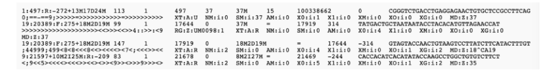
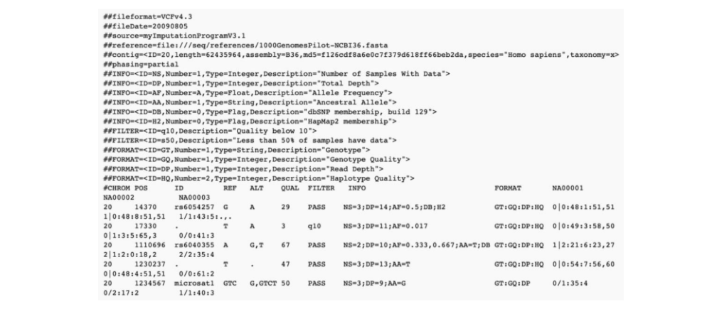

# GB/T 41806-2022 信息安全技术 基因识别数据安全要求

> 来源：[GB/T 41806-2022 国家标准详情](https://openstd.samr.gov.cn/bzgk/std/newGbInfo?hcno=EACA08F5F077771ACE82FBE7987F40AE)；封面发布日期：2022-10-12；实施日期：2023-05-01。
> PDF SHA-256：37a9d0cf804912ae0992f68b86aac8f11cc735746572d2d9a6b0f5c026ab3f1e。
> 转写说明：对照官方 PDF 全部 26 页图像校核文字、图示与跨页表格；省略封面、目录、页眉、页脚和页码。正式引用请核对官方原件。

## 前言

本文件按照 GB/T 1.1—2020《标准化工作导则 第1部分：标准化文件的结构和起草规则》的规定起草。

请注意本文件的某些内容可能涉及专利。本文件的发布机构不承担识别专利的责任。

本文件由全国信息安全标准化技术委员会（SAC/TC 260）提出并归口。

本文件起草单位：深圳华大基因科技有限公司、中国电子技术标准化研究院、神州网信技术有限公司、深圳华大法医科技有限公司、上海赴源科技服务有限公司、深圳华大基因股份有限公司、杭州普链数安科技有限责任公司、深圳市早知道科技有限公司、全知科技（杭州）有限责任公司、山西医科大学、西安交通大学、粤港澳大湾区精准医学研究院（广州）、广州市妇女儿童医疗中心、阿里巴巴（北京）软件服务有限公司、北京天融信网络安全技术有限公司、海信集团控股股份有限公司、中国信息通信研究院。

本文件主要起草人：郭小森、张建军、郝春亮、叶明芝、丁国徽、肖棉文、李潇、陈钢、上官晓丽、朱丽地孜·叶尔欣、李鹰翔、唐川、郭云峰、魏风玲、高升杰、胡影、沈悦生、姜先华、严江伟、赖江华、邱琇、黄铭曦、吴昊、顾斐、李建彬、姜华艳、卢旗、许晓耕、许四虎、高雪松、傅山、王姣、甘俊杰、尹烨。

## 1 范围

本文件规定了基因识别数据及关联信息的收集、存储、使用、加工、传输、提供、公开、删除等数据处理活动的安全要求。

本文件适用于基因识别数据及关联信息的处理者规范数据处理活动，也可为监管部门、第三方评估机构对基因识别数据处理活动进行监督、管理、评估提供参考。

## 2 规范性引用文件

下列文件中的内容通过文中的规范性引用而构成本文件必不可少的条款。其中，注日期的引用文件，仅该日期对应的版本适用于本文件；不注日期的引用文件，其最新版本（包括所有的修改单）适用于本文件。

- GB/T 25069 信息安全技术 术语

- GB/T 35273 信息安全技术 个人信息安全规范

- GB/T 37864 生物样本库质量和能力通用要求

- GB/T 37988 信息安全技术 数据安全能力成熟度模型

- GB/T 39335 信息安全技术 个人信息安全影响评估指南

- GB/T 40660 信息安全技术 生物特征识别信息保护基本要求

- GB/T 41479 信息安全技术 网络数据处理安全要求

## 3 术语和定义

GB/T 25069、GB/T 35273、GB/T 37864、GB/T 37988、GB/T 40660 和 GB/T 41479 界定的以及下列术语和定义适用于本文件。

### 3.1 基因识别数据主体 genetic recognition data subject

基因识别数据所标识或者关联的自然人。

> 注：简称“数据主体”。

### 3.2 基因识别数据 genetic recognition data

使用技术手段，从人类遗传物质中提取的表征个体或群体遗传信息的数据，该数据可以直接或间接识别到人类个体或群体。

注1：基因识别数据指的是基因数据，主要包括基因组核酸序列数据、功能基因组数据以及提取过程中生成的原始数据和中间数据。

注2：基因组核酸序列数据是指在基因组层面，利用各类测序技术（如：Sanger 测序技术、高通量测序技术、质谱技术等）或基因分型技术（如：基因芯片技术、聚合酶链式反应技术等）获得的描述核酸排列顺序的数据以及各类遗传变异的数据［如：单核苷酸多态性（Single Nucleotide Polymorphism, SNP）、插入缺失（Insertions and Deletions, INDEL）突变、短串联重复序列（Short Tandem Repeat, STR）、拷贝数变异（Copy Number Variation，CNV）及基因组结构变异（Structural Variation,SV）等］；功能基因组数据是指遗传物质中除基因组核酸序列数据外的表观遗传数据以及基因空间位置数据等。典型基因识别数据格式见附录A。

### 3.3 关联信息 associated information

描述遗传物质样本及其数据主体的附加信息。

> 注：该信息包含部分个人敏感信息、其他个人信息及标签信息。常见的个人敏感信息包括姓名、身份证、家族病史、用药记录等。其他个人信息包括性别、籍贯、民族、出生日期等。常见标签信息包括收集时间、收集地点、收集对象、收集者、收集方式、样本类型、规格、单位、样本保存期限、测序平台信息、芯片信息、测序时间、数据量、数据类型等。

### 3.4 知情同意 informed consent

基因识别数据（3.2）处理者和数据主体或数据主体的法定监护人之间关于基因识别数据处理边界的约定。

> 注：知情同意由知情权和同意权两个密切相连的权利组成。知情权是同意权得以存在的前提和基础，同意权又是知情权的价值体现，强调数据主体的知情同意权，主要目的在于通过赋予基因识别数据处理者相应的告知义务，使数据主体在了解自己将面临的风险、付出的代价和可能取得的收益的基础上自由作出选择，从而维护数据主体的利益。

## 4 概述

### 4.1 基因识别数据及关联信息处理活动

基因识别数据及关联信息处理活动如下。

a） 数据收集：

1） 需求提出：基因识别数据处理者为完成业务活动，对数据主体提出基因识别数据及关联信息使用需求的活动。

2） 知情同意书签订：基因识别数据处理者提出基因识别数据及关联信息的使用需求、数据主体知情同意后，双方应完成的知情同意书签订的活动。

注1：知情同意书模板见附录B。

3） 遗传物质收集：收集生物样本，并从中提取相应遗传物质的活动。生物样本包括血液、唾液、尿液、粪便、毛发、脑脊液和脱落细胞等。此活动中会产生相应的关联信息，如：收集时间、收集地点、收集对象、收集者、收集方式、样本类型、规格、单位、样本保存期限等。

4） 数据提取：通过测序技术、基因分型技术等手段从人类遗传物质中获得对应的基因识别数据的活动。此活动中会产生相应的关联信息，如：测序平台信息、芯片信息、测序时间、数据量、数据类型等。

b） 数据存储和传输：在数据主体知情同意或法定使用的情况下，对基因识别数据及关联信息进行存储和传输的活动。

注2：数据的存储也包括归档及保藏。

c） 数据使用和加工：为满足知情同意书约定或维护公共利益的使用需求，对所获取的基因识别数据及关联信息进行分析、检测、鉴定、评估、研究及开发的活动。此活动中会产生与数据主体直接相关的、涉及隐私的关联信息，如：遗传疾病、个体特征、用药指南、健康风险等。

d） 数据提供：为达到一定的服务目标或科研目标，在数据主体书面的单独同意或法定使用的前提下，将基因识别数据及关联信息提供给其他基因识别数据处理者的活动。

e） 数据公开：为科研目的，在向有关部门备案并提交信息备份、数据主体知情同意并经过匿名化处理后，用于公开发表学术文章或者开放使用的活动。

f） 数据删除：不可逆地删除基因识别数据及关联信息的活动。

### 4.2 基因识别数据及关联信息应用场景

基因识别数据及关联信息应用场景如下：

a） 个体服务场景：针对数据主体，提取并使用基因识别数据及关联信息，得到结果，达到服务目标的场景。其特点为在服务目标确定的情况下，所需的基因识别数据及关联信息种类和数量固定，使用方式、手段、流程相对固定。相关服务业务的开展一般需要经过相应的行政审批或许可。典型服务场景包括：

1） 医疗服务场景：医疗服务机构使用基因识别数据及关联信息为数据主体进行辅助诊断、治疗、预后、护理等的服务场景。此场景中，部分机构具备完成4.1中所有活动的能力。部分机构会根据自身的情况，委托受托方完成全部或部分遗传物质收集、数据提取（如：医学检测机构）、数据使用、数据存储等活动。

2） 法庭科学生物样本基因信息鉴定服务场景：以人类生物样本（如：体液、组织、毛发等）对象，运用科学技术（如：聚合酶链式反应、毛细管电泳、高通量测序等）和专门知识（如：遗传学、法医学等）对案、事件中涉及的专门性问题（如：个体识别、亲子鉴定、性别鉴定、种族和种属认定等）进行鉴别和判断并提供鉴定意见的服务场景。此场景描述仅为体现基因识别数据应用场景的完整性，产生的基因识别数据及关联信息的安全应遵循司法部门的要求，不在本文件要求范围内。

3） 消费级服务场景：消费者通过广告、电商、线下门店等途径认知且直接购买基因检测服务的服务场景。该服务场景不涉及医疗服务机构的体外诊断。消费级服务机构直接向个人提供基因检测服务，结合已发表文献或其他研究结果，对个人的基因检测结果进行解读，如：营养健康服务、运动能力评估、遗传缺陷分析、溯源分析等。此场景中，部分机构具备完成4.1中所有活动的能力；部分机构会根据自身的情况，委托受托方完成全部或部分活动。

b） 研究开发场景：利用基因识别数据及关联信息，以发现新知识、开发新技术或产品、改良现有技术或产品等为目标进行的科学研究或者技术开发等活动的场景。此场景中，基因识别数据的提取方式、使用方式，手段及流程等往往不固定。此场景涉及的基因识别数据处理者为高等学校、医疗机构、科研机构、企业、非营利机构等多种组织。此场景会存在不同个体、团队和组织之间的数据提供情况。常见的研究开发场景包括：

1） 科学研究场景：以发现新知识为主要目的的场景，主要包括基础生物学研究、人类遗传学研究、医学遗传学研究、药物药理研究以及其他涉及人类遗传信息的研究等。科学研究成果一般会以文章、专利等形式公开发表，其中会涉及部分基因识别数据及关联信息。

2） 技术开发场景：以开发新技术或升级已有技术为目的的场景，主要包括计算技术开发（如：算法、分析流程等）和实验技术开发（如：测序技术、临床实验方法等）两大类。

3） 产品研发或升级场景：以研发或升级应用产品为目的的场景（多以盈利或实现具体落地功能为目的），主要包括临床检测类、药物研发、消费级服务等。

c） 其他场景包括：

1） 公共卫生相关活动场景：一般为国家或地方公共卫生主管部门发起的活动场景，这些活动场景均会有一定的配套法律法规和行政授权，并由被授权的组织机构完成，如：流行病调查、疾病筛查等；

2） 遗传信息公共服务场景：在有关部门的行政授权下，提供对基因识别数据及关联信息的存储、使用和提供等服务。此类服务常用于支持相关领域的科学研究和产业发展，支撑国家或地方重大项目和工程的实施等。此类基因识别数据及关联信息通常来自数据主体的捐赠。

### 4.3 安全风险

基因识别数据处理活动中常见的安全风险主要包括数据的滥采、滥用，数据的泄露、损毁，受托方对数据的未授权处理及未经许可的数据出境等。

## 5 基本安全要求

对基因识别数据处理者的要求如下。

a） 应符合 GB/T 35273、GB/T 40660、GB/T 41479 规定的要求。

b） 应符合 GB/T 37988 中数据安全能力成熟度等级3规定的要求。

c） 开展基因识别数据处理活动前，根据相关法律法规的要求，取得有关部门的许可。不同场景下的基因识别数据处理者应符合的要求如下：

1） 在医疗服务场景中，应按相关要求取得卫生主管部门的许可，并具备相应的资质，如：二类医疗技术的准入（备案）资质、临床基因扩增检验实验室资质等；

注1：相关要求见《医疗机构管理条例》《医学检验实验室基本标准（试行）》《医学检验实验室管理规范（试行）》《医疗机构临床基因扩增检验实验室管理办法》《医疗机构临床实验室管理办法（2020 修正）》等。

2） 在消费级服务场景中，应按相关要求取得卫生主管部门的许可，并具备相应的资质或合格的质量评估，如：临床基因扩增检验实验室资质、不同类型药物相关基因分型室间质量评估等；

注2：相关要求见《医疗机构管理条例》《医学检验实验室基本标准（试行）》《医学检验实验室管理规范（试行）》《医疗机构临床基因扩增检验实验室管理办法》等。

3） 在研究开发场景中，应按相关要求具备相关研究开发的能力，包括相应等级的实验室、研究团队、相关研究经历及成果等，并按照科技管理部门相关的法律法规要求开展基因识别数据的研究开发活动；

注3：相关要求见《中华人民共和国人类遗传资源管理条例》等。

4） 在公共卫生相关活动场景中，应按照相关要求获得资质，如：二级生物安全实验室生物安全备案、检验人员具有市级以上病原微生物实验室生物安全培训证书、临床基因扩增检验技术人员上岗证书等，应获得行政许可；

注4：相关要求见《医疗机构管理条例》《病原微生物实验室生物安全管理条例》《医疗机构临床基因扩增检验实验室管理办法》等。

5） 在遗传信息公共服务场景中，应获得国家有关部门批准的资质，如：采集、保藏、利用、对外提供等。

d） 开展基因识别数据处理活动前，应按照GB/T 39335的规定开展个人信息安全影响评估，并形成评估报告。

e） 应设立伦理委员会，按照尊重数据主体选择、处理活动有利于数据主体、确保平等公正无歧视的原则，负责独立地审查、跟踪审查及复审基因识别数据处理活动的科学性和伦理合理性，对相关业务活动中基因识别数据滥采、滥用等活动可能造成的社会危害做出评估，同意基因识别数据处理活动的开展，在本机构组织开展伦理审查培训，保护数据主体的尊严、安全和合法权益，促进基因识别数据处理活动规范开展。

f） 应设立数据管理委员会，在伦理委员会的审查和监督下，制定个人信息保护政策、基因识别数据安全策略，建立数据安全管理机制，形成完整的数据安全与信息安全管理体系，应针对基因识别数据及关联信息进行数据安全风险评估、数据安全风险监测预警、数据访问控制，保障基因识别数据及关联信息全生命周期的安全性及数据主体的合法权益。

注5：伦理委员会是指为确保机构围绕人类遗传物质及相关遗传信息开展的业务活动（例如：科学研究、医学研究、商业服务等）符合基本社会伦理道德和行为规范的要求，由具有生物医学、伦理学、法学、社会学、生物信息学等专业背景和其他背景的人员组成的专业机构。在审查相关活动时，该机构至少包括内外各一位生物医学数据安全领域专家，参与评估数据风险和收益。

注6：数据管理委员会是指为确保基因识别数据处理者业务运转的连续性，保障基因识别数据及关联信息的保密性、完整性、可用性，在基因识别数据处理者内部设立的专业机构。该机构负责制定各项数据管理制度，实施数据安全技术防护，开展业务活动过程中的数据安全风险评估和合规审计，制定数据安全事件应急预案，及时处置安全事件，组织数据安全教育及培训等，确保开展业务活动过程中的数据安全、个人信息隐私得到保护。

g） 基因识别数据处理活动中应关注如下风险点，并根据风险评估结果和风险控制策略，采取如下安全措施。

1） 个体服务场景中，机构在业务开展前，应对基因识别数据的规模及内容等进行预判，分析数据的机密性、完整性及可用性遭受破坏后，对数据主体个人权益、社会以及国家的影响。

2） 研究开发场景中，机构应开展项目级别和机构级别的基因识别数据风险分析和评估。在项目级别，应根据研究过程分析数据滥采、滥用的风险；在机构级别，应从项目管理、数据存储和归档、研究成果评审及发布、研究成果利用等方面分析数据泄露、毁损及滥用等安全风险。

3） 其他场景中，机构可根据业务的实际情况，对所涉及基因识别数据的规模、内容等进行预判，分析数据的机密性、完整性及可用性遭受破坏后，对数据主体个人权益、社会以及国家的影响。

4） 机构还应建立相关的工作机制，随时跟踪有关法律、法规、标准，并根据自身业务情况，梳理风险点，对风险进行全面的监控和管理。

h） 针对基因识别数据及关联信息的信息系统，应采取相关网络安全技术保障数据安全。在个体服务和研究开发场景中，存储达到1万人份及以上的基因识别数据及关联信息的信息系统，或遗传信息公共服务场景中提供基因识别数据服务的信息系统，应至少满足三级等级保护要求；

存储达到10万人份及以上的基因识别数据及关联信息的信息系统，应采用更高级别的安全保护措施。公共卫生相关活动场景依据国家的法律法规执行。

i） 应针对基因识别数据相关的特有设备（如：测序仪、质谱仪、生物计算服务器等）和业务特点，制定和实施相关的安全管理制度和技术措施，如：网络隔离措施、访问控制措施、入侵防范措施等。

j） 当发生基因识别数据及关联信息被窃取、篡改、丢失、泄露、毁损等安全事件时，应按照规定向相关部门报告，及时采取应急处置及补救措施。应按照规定通过邮件、信函、电话、推送通知等方式及时告知数据主体，难以逐一告知数据主体时，应采取合理、有效的方式公开发布警示信息。

k）应建立数据主体撤回授权、投诉及跟踪处理机制，并在承诺时限内对数据主体的相关请求进行响应。

l） 凡涉及采用密码技术解决保密性、完整性、真实性、不可否认性需求的应遵循密码相关国家标准和行业标准。

m）基因识别数据及其关联信息出境应按照国家有关规定执行。

n） 不应基于基因识别数据产生对数据主体（个体或群体）的歧视行为（如：使用基因识别数据进行歧视性保险核保和歧视性雇佣行为等）。

o） 处理1万人份及以上的基因识别数据及关联信息，应进行重要数据安全风险评估，并根据评估结果加强保护。

## 6 数据收集

### 6.1 需求提出

对基因识别数据处理者的要求如下。

a） 应根据自身业务的特点，提出需求，制定知情同意书。所需的基因识别数据及关联信息应与相关业务直接关联，并明示只收集和使用满足业务需要的最少数据。

b） 知情同意书内容应满足的要求包括：

1） 告知方应为提出基因识别数据需求的基因识别数据处理者；

2） 应与相关业务对基因识别数据及关联信息的需求一致，不应要求超出需求的生物样本、基因识别数据及关联信息；

3） 应列明数据主体拥有的权利及行使权利的方式和程序；

4） 应告知遗传物质及所获取数据的种类、用途、安全保护措施、数据应用的潜在风险，生物样本和数据存储时限以及剩余生物样本的处理方式；

5） 应列明业务过程中所涉及的所有基因识别数据处理者；

6） 如涉及基因识别数据及关联信息的提供，应描述提供的内容、范围及数据接收方身份；

7） 应描述数据主体撤回授权同意的方法。

c） 使用需求应得到许可后方可开展相关活动。依据不同的应用场景，相关使用需求应通过伦理委员会的审查。

### 6.2 知情同意书签订

对基因识别数据处理者的要求如下：

a） 应以显著方式向数据主体展示知情同意书，并进行充分的解释说明，得到数据主体的书面的单独同意，并签署知情同意书；

b） 应针对每一个场景分别进行明确描述、告知，并按每一个场景分别取得数据主体的书面的单独同意。

### 6.3 遗传物质收集

对基因识别数据处理者的要求如下：

a） 数据主体生物样本及遗传物质的收集应符合 GB/T 37864的要求；

b） 收集过程完成后，应对样本进行去标识化处理，去除数据主体样本与关联信息的关联关系；

c） 如委托受托方收集生物样本及关联信息，应签订委托协议，确保其在约定的目的和范围内收集。

### 6.4 数据提取

对基因识别数据处理者的要求如下：

a） 应对基因识别数据和关联信息明确区分，提取的数据格式应支持基因识别数据与关联信息的分离；

b） 应符合最小必要原则，按照知情同意书中描述的基因识别数据类型和数量进行提取，不应提取非直接相关的基因识别数据及关联信息；

c） 数据提取过程中，应只将基因识别数据与生物样本建立关联，不应与任何个体或群体自然人的任何信息相关联；

d） 数据提取过程中，应按照知情同意书中的描述处理生物样本；

e） 数据提取完成并通过质量检测后，剩余样本应按照知情同意书中的描述处理；

f） 如委托提取数据，不应提供关联信息，应与受托方签订委托协议，确保其在约定的目的和范围内提取基因识别数据，且符合本文件对数据提取的数据安全要求；

g） 如委托提取数据，受托方应使用适用的密码技术，保证数据安全。

## 7 数据存储和传输

对基因识别数据处理者的要求如下：

a） 应在按照 6.2的要求取得数据主体同意后，进行基因识别数据及关联信息的存储；

b） 应按照实现基因识别数据及关联信息处理目的所需要的最短时间进行存储；

> 注：医学服务场景部分数据存储时限见附录C。

c） 存储设施应通过伦理委员会及数据管理委员会审查，存储设施的建设和运行应遵循国家相关安全标准和规范，应采用密码技术等安全措施，保证基因识别数据和关联信息的保密性、可用性和完整性，并通过相关安全评估；

d） 数据存储过程中，基因识别数据应经过去标识化处理；

e） 数据存储过程中，基因识别数据与关联信息应分开存储，并设置不同的访问和管理权限；

f） 基因识别数据及关联信息的存储时间达到审查批准或知情同意要求的存储时限且需继续存储的，应重新进行相关审查登记批准流程，并按照6.2的要求重新取得数据主体同意；

g） 在取得数据主体书面的单独同意的情况下，对数据进行加密处理后，可委托其他具有基因识别数据及关联信息存储资质的机构代为存储；

h） 基因识别数据与关联信息应在中华人民共和国境内存储；

i） 基因识别数据及关联信息应采用适用的密码技术进行传输。

## 8 数据使用和加工

对基因识别数据处理者的要求如下：

a） 获取基因识别数据后，应按照知情同意书中的内容，根据相应场景的使用目的，合理使用基因识别数据及关联信息；

b） 基因识别数据使用时，可与符合使用目的的关联信息建立关联，达到使用目的后，应及时解除关联；

c） 如委托进行数据分析，应满足的数据安全要求包括：

1） 数据分析前，应对委托行为进行个人信息安全影响评估；

2） 数据分析前，应对受托方数据安全能力提出要求，通过委托协议明确双方的数据安全责任及数据安全措施，明确数据分析的规范，包括保存期限、删除或返还期限等；

3） 数据分析过程中，应根据分析目的提供最少的关联信息；

4） 数据分析过程中，禁止受托方处理基因识别数据以实现除委托目的之外的其他用途。

## 9 数据提供和公开

对基因识别数据处理者的要求如下。

a） 按照6.2的要求取得数据主体同意并通过伦理委员会和数据管理委员会的审核批准后，可提供最小限度的基因识别数据及关联信息；该数据提供应符合知情同意书中明确描述的目的、接收对象、提供内容等。

b） 应与接收方签署协议，应确认接收方的数据应用场景，确认接收方应承担的数据保护责任并约定违约条款。

c） 接收方应将所接收的数据仅用于提供方所约定的目的，不应用于其他目的，不应提供给其他接收方。

d） 因业务目的确需扩展提供数据的范围和内容，且超出原知情同意书要求的，应单独向数据主体告知新的提供目的、涉及的数据类型、数据接收方的具体身份，并按照6.2 的要求重新取得数据主体的同意并重新取得伦理委员会或数据管理委员会的批准。

e） 不应出于转让的目的提供基因识别数据及其关联信息，基因识别数据处理者发生收购、兼并、重组和破产时除外；当基因识别数据处理者发生收购、兼并、重组和破产等情况时，应告知数据主体有关情况，并按照6.2的要求重新取得数据主体的同意，变更后的基因识别数据处理者应继续履行原基因识别数据处理者的责任和义务。

f） 不应公开基因识别数据及关联信息，科学研究场景中，在向有关部门备案并提交信息备份、取得数据主体知情同意并经过匿名化处理后，用于公开发表学术文章或者开放使用的除外。

## 10 数据删除

有下列情形之一的，基因识别数据及关联信息处理者应删除基因识别数据及关联信息、中间数据及分析结果：

a） 数据主体撤回授权或明示停止使用的，进行公共卫生相关的分析或科学研究发表的数据除外；

b） 存储时间达到授权存储期限且无新的存储授权的；

c） 处理目的已实现的，如数据已通过物理介质完成传输、数据分析受托方已完成结果交付的；

d） 因机构吊销执照、取消资质、破产等原因无法开展相关业务，且存储的基因识别数据及关联信息无接收方的。

## 11 各场景的安全要求

### 11.1 概述

各场景除满足第6章～第10章中的安全要求外，还应满足以下安全要求。

### 11.2 个体服务场景安全要求

对基因识别数据处理者的要求如下：

a） 基因识别数据及关联信息的分析、解读结果，应仅提供给数据主体及其授权的人员；

b） 不应基于分析结果进行商品或服务推荐等活动，数据主体同意的除外；

c） 不应对分析结果进行多个数据主体的统计分析，数据主体同意的除外；

d） 医疗服务场景中，单个产品基因检测位点数不应超过批准的服务产品中所需的位点数；

e） 消费级服务场景中，单个产品基因检测位点数不应超过官方产品描述中的位点数。

### 11.3 研究开发场景安全要求

对基因识别数据处理者的要求如下。

a） 应制定科学的研究方案或计划，明确说明前期工作基础、研究目的、意义、必要性、相关实验设计、研究过程中可能涉及的合作及相关数据提供需求，如：提供的数据类型、格式及必要性等，并依照最小必要原则，制定采样数量、基因识别数据及关联信息的提取方法等。

b） 研究方案或计划应通过科学性审查、科研诚信调查、伦理委员会及数据管理委员会审批。

c） 研究开发活动的知情同意书应满足如下安全要求：

1） 应明确告知数据主体科研项目名称、项目来源、研究目的及批准单位；

2） 应明确告知数据主体基因识别数据及关联信息（包括中间数据）存储期限；

3） 不应使用宽泛的用途描述，如“用于科研目的”等字样。

d） 基于捐赠的基因识别数据及关联信息开展的研究开发活动，无需再次取得数据主体的同意。

e） 所有环节中，基因识别数据及关联信息应经过去标识化处理后使用。

f） 研究开发过程中新发现的关联信息，应仅用于研究目的。

### 11.4 其他场景安全要求

对基因识别数据处理者的要求如下。

a） 公共卫生相关活动场景中，应提出合理的基因识别数据及关联信息的收集需求。

b） 公共卫生相关活动场景中，应根据活动的内容对指定范围内的基因识别数据及关联信息进行处理和使用；因业务需要，在结果交付或告知数据主体时，可恢复与数据主体的关联。

c） 遗传信息公共服务场景中，不应只以数据存储为目的提出基因识别数据及关联信息收集的需求，取得有关部门许可的除外。

d） 遗传信息公共服务场景中，应准备专门的知情同意书，知情同意书应符合如下安全要求：

1） 应告知数据主体所收集的基因识别数据及关联信息属于捐赠，会用于广泛的科研目的；

2） 应告知数据主体审批部门的名称及相关授权文件的名称或标识；

3） 应告知数据主体对所获得的基因识别数据及关联信息进行的去标识化、匿名化的方法。

e） 遗传信息公共服务场景中，如所收集的捐赠数据仅用于研究开发活动，该数据应经过去标识化处理。

## 附录 A（资料性）基因识别典型数据格式

### A.1 概述

典型的基因识别数据格式包括序列数据格式和遗传变异数据格式两大类。常见的基因组序列数据格式包括 FASTA、FASTQ、SAM/BAM 等；常见的遗传变异数据格式包括基因突变资料储存格式（Variant Call Format，VCF）、基因组基因突变资料储存格式（Genomic Variant Call Format，GVCF）、BED、PLINK、GEN/BGEN、VDS 及 MT 等。

### A.2 序列数据格式

#### A.2.1 FASTA 格式

FASTA 格式是一种用于表示核苷酸序列或氨基酸（蛋白质）序列的文本格式，常用于存储基因组信息，其中核苷酸或氨基酸使用单字母编码表示。

每个 FASTA 文件可存储多条序列信息，每条序列信息的存储格式由两部分构成：第一部分为以“>”开头的描述行或标题行/标识符行，给出了序列的名称和唯一标识符，还可能包含其他信息。第二部分是实际序列本身，以单字母字符串表示。有效字符以外的任何字符都将被忽略（包括空格、制表符及星号等）。文件扩展名通常是 fasta 或 fa，另外特殊类型序列也有对应的文件扩展名，如 ffn 对应基因编码区间，faa 指氨基酸，frn 对应非编码核糖核酸（Ribonucleic Acid，RNA）序列。具体示例见图 A.1。


#### A.2.2 FASTQ 格式

FASTQ 格式是 FASTA 格式的扩展，用于存储生物序列（通常是核苷酸序列）及其相应的质量分数，常用于存储下一代测序数据。下一代测序原始脱氧核糖核酸（Deoxyribo Nucleic Acid，DNA）测序数据文件为 FASTQ 格式。在 FASTQ 格式中每一条测序片段用 4 行信息表示，符合 GB/T 35890—2018 中 6.1。

FASTQ 文件中每个序列用 4 行表示：

- 第 1 行以“@”字符开头，后面跟着序列标识符和可选的描述；
- 第 2 行是核苷酸或氨基酸序列信息，使用单字母编码表示；
- 第 3 行以“+”字符开头，其后视需要跟随相同的序列标识符（和任何描述）；
- 第 4 行为序列对应的编码质量，每一个符号对应相应核苷酸或氨基酸的质量；表示质量的字节从 0x21 开始运行到 0x7e。

FASTQ 格式示例见图 A.2。


#### A.2.3 SAM/BAM 格式

SAM（Sequence Alignment/Map）格式是一种制表符分隔纯文本格式，主要用来存储比对到参考序列的序列，也可以用来存储未经过比对的序列数据。BAM（Binary Alignment/Map）格式是 SAM 文件通过区块压缩而产生的二进制格式。SAM/BAM 格式通常用于存储由下一代测序技术产生的核苷酸序列。

SAM 格式由标题部分和比对部分组成。标题部分在比对部分之前。标题以“@”符号开始，将其与比对部分区别开来。

比对部分有序列名、标记、参考序列名、比对位置、序列比对质量、CIGAR 字符串、配对序列名、配对序列的位置、比对序列长度、序列及碱基对质量等 11 个强制字段。除强制字段外，还有多个自定义区域。示例见图 A.3。



### A.3 遗传变异数据格式

#### A.3.1 VCF/BCF 格式

VCF 格式是一种制表符分隔的文本格式，用于存储个体或群体的遗传变异数据。BCF 格式是 VCF 格式的区块压缩二进制格式。VCF 格式分为文件头和变异数据两部分，文件头由 # 标识，标识了文件中的相关信息。变异数据内容包括染色体、物理位置、变异名、参考碱基、变异碱基、质量、过滤和详细信息等 8 个强制字段。除此以外，第九列格式用来记录每个样本的变异信息，后续每一列代表一个样本的变异信息。具体示例见图 A.4。



#### A.3.2 GVCF 格式

GVCF 格式是一种特殊的 VCF 格式，由基因组分析工具包（Genome Analysis Toolkit，GATK）的变异检测（HaplotypeCaller）v3 引入。与普通 VCF 关键区别在于，GVCF 记录所有位点的碱基情况。GVCF 中的记录包括对某一位点是否为纯合参考位点的可信程度的准确估计。

#### A.3.3 PLINK 格式

PLINK 格式是群体遗传学分析工具 PLINK 使用的遗传变异存储格式，在人类遗传学领域广泛应用。PLINK 格式通过谱系文件 PED（Pedigree）和 MAP 两个空白字符分隔文件，或对应的二进制 BED 格式（Binary Pedigree）、BIM 格式（Binary Map）和 FAM（Family）格式 3 个空白字符分隔文本来存储群体遗传变异数据。

PED 文件是一个空白字符分隔文本文件，用来存储个体的信息［如家庭识别编码（identification，ID）、个体 ID、父亲/母亲 ID、性别、性状以及遗传突变信息］，包含至少 6 列信息，分别是：家庭识别编码、个体身份识别编码、父亲识别编码、母亲识别编码、性别（1=男性；2=女性；other=未知）、性状。

第七列之后可以添加遗传变异，例如：

```text
FAM001 1 0 0 1 2 A A G G A C
FAM001 2 0 0 1 2 A A A G 0 0
```

MAP 文件记录遗传突变的位置信息，包含染色体、突变 ID、遗传距离和物理距离等 4 列信息。

#### A.3.4 GEN/BGEN 格式

GEN 格式又被称为 Oxford 或者 Chiamo 格式，最初被设计用来存储 impute2 产生的基因型概率数据。BGEN 格式是 GEN 格式的区块压缩形式。GEN 文件包含文件头以及数据两部分。文件头的前 N 项对应着数据的变异信息，通常是家庭 ID+个体 ID 或者个体 ID 的方式。当 GEN 文件不包含头文件时，个体信息存储在一个单独的表格内。

GEN 的数据部分的格式：前 N 列包含变异的信息，包括变异 ID、位置、变异碱基及参考碱基。

#### A.3.5 VDS 格式

VDS（Variant Dataset）格式是 Hail 0.1 使用的一种基于 Hadoop 框架的分布式遗传变异数据存储格式，该格式将突变位点及注释、群体样本及注释按照行和列存储，同时存储数据集的元数据。

#### A.3.6 MatrixTable 格式

MatrixTable 格式是一般化的 VDS，是 Hail 0.2 使用的基于 Hadoop 的分布式遗传变异数据格式。MatrixTable 包括全局、行、列以及数据 4 个部分。

## 附录 B（资料性）知情同意书模板示例

表 B.1～表 B.5 给出了不同场景的知情同意书模板示例。

**表 B.1 医学服务场景知情同意书模板**

**检测（全称）协议书（版本号及版本日期）**

编写要求：该部分医学服务场景知情同意书标题，包括医学检测服务的标题、版本号及版本日期。

**须知页**

1. 检测项目介绍
2. 检测局限性
3. 风险提示
4. 检测结果与报告
5. 数据安全及隐私保护说明
6. 医师告知与同意

编写要求：该部分为数据主体须知范围，包括检测项目介绍、检测局限性、风险提示、检测结果与报告、数据安全及隐私保护说明。检测局限性应包括检测范围、无法检测内容告知等。风险提示应包括检测结果说明，可能出现假阳性或假阴性结果告知，是否委托处理及处理方式说明等。检测结果与报告应包括检测的结果、仅对本次送检样本负责、本检测仅为筛查结果、不作为诊断结果告知、客户服务联系方式等。数据安全及隐私保护说明应包括数据全生命周期的所有环节中涉及的数据控制者、遗传物质及所获取数据的用途、生物样本和数据存储时限、数据隐私保护手段、安全保护措施及应用的潜在风险等。

**签字页**

送检医师及受检者在充分知晓上述情况的基础上，承诺以下事项。

- 我已阅读《×××检测知情同意书》，已充分了解该检测的性质、适用人群、目的、风险和必要性。医方已履行了告知义务，对其中疑问进行了解答，并承诺保护受检者个人隐私信息。
- 我承诺提供的资料真实、完整。
- 经本人及家属慎重考虑，自愿进行检测，同意回访。
- 我授权院方处理本次检测涉及的血液、血浆和医疗废物。
- 我同意授权以下个人信息。

| 个人信息 | 涉及的数据处理活动 | 确认 |
| --- | --- | --- |
| 姓名 | 收集、存储、使用、加工、传输、提供、公开、删除（按照实际填写） | 签字/主动勾选/点击“同意”等 |
| 电话 |  |  |
| …… | …… | …… |

双方确认上述内容为双方意思的真实表达，院方已履行了告知义务，受检者已享有充分知情和选择的权利，签字生效。

送检医师（签字）：　签字日期：

受检者/监护人（签字）：　与受检者关系：　签字日期：

（当受检者知情同意能力欠缺或不足时，其监护人签字生效）

编写要求：该部分为数据主体或监护人的签字页，包括送检医师及受检人的签字及日期。

**表 B.2 消费级服务场景知情同意书模板**

**×××检测（全称）协议书（版本号及版本日期）**

编写要求：该部分为消费级服务场景知情同意书标题，包括消费级服务的标题、版本号及版本日期。

**须知页**

1. 服务定义
2. 服务介绍
3. 接受条款
4. 服务条件
5. 服务范围
6. 风险告知
7. 数据安全及隐私声明
8. 用户知悉
9. 用户责任
10. 购买方式
11. 禁止转售
12. 中止服务

编写要求：该部分为数据主体须知范围，包括服务定义、服务内容介绍、服务条件及范围、风险提示、数据及隐私安全告知等。服务定义应包括针对该协议中的数据主体、数据控制者（一般为××公司）、提供的服务内容以及涉及的个人相关信息进行定义。接受条款应包括数据主体的权利告知，告知内容应包括接受服务、知情同意、签署条件、撤回授权等。风险告知，包括可能产生的健康或心理问题的风险、样本质量导致的检测失败的风险、误差风险、个人基因信息主动分享的风险等。数据安全及隐私保护说明应包括数据全生命周期的所有环节中涉及的数据控制者、遗传物质及所获取数据的用途、生物样本和数据存储时限、数据隐私保护手段、安全保护措施及应用的潜在风险等。

**签字页**

受检者在充分知晓上述情况的基础上，承诺以下事项。

- 我已阅读《×××检测服务协议》，已充分了解该检测的性质、适用人群、目的、风险和必要性。服务方已履行了告知义务，对其中疑问进行了解答，并承诺保护受检者个人隐私信息。
- 我承诺提供的资料真实、完整。
- 经本人及家属慎重考虑，自愿进行检测。
- 我同意授权以下个人信息。

| 个人信息 | 涉及的数据处理活动 | 确认 |
| --- | --- | --- |
| 姓名 | 收集、存储、使用、加工、传输、提供、公开、删除（按照实际填写） | 签字/主动勾选/点击“同意”等 |
| 电话 |  |  |
| …… | …… | …… |

双方确认上述内容为双方意思的真实表达，服务方已履行了告知义务，受检者已享有充分知情和选择的权利，签字生效。

受检者/监护人（签字）：　与受检者关系：　签字日期：

（当受检者知情同意能力欠缺或不足时，其监护人签字生效）

编写要求：该部分为数据主体或监护人的签字页，包括签字和日期。

**表 B.3 研究开发场景知情同意书模板**

**×××研究（全称）知情同意书（版本号及版本日期）**

编写要求：该部分为研究开发场景知情同意书标题，包括知情同意书的标题、版本号及版本日期。

**须知页**

我们将要开展一项×××研究，现在邀请您参加这项研究。这项研究的负责人是×××单位的×××，资助方是×××。

请仔细阅读本知情同意书后慎重做出是否参加研究的决定。参与这项研究与否，完全取决于您自己的决定。当研究人员或者您的主管医生和您讨论知情同意书时，您可以随时提问并让他/她向您解释您不明白的地方。您可以与家人、朋友、病友、医生或其他您信任的人讨论之后再决定是否参加。

如果您认为您有兴趣参加这项研究，请认真阅读以下材料。我们首先声明：您在阅读后做出不参加这项研究的决定，不会影响您日常的医疗或参与项目发起方组织的其他科研、教育活动。详细情况请阅读本知情同意书。

（根据情况增补：若您目前正参加其他某项研究，或使用某些药物，请告知研究人员或您的主管医生）

1. 为什么开展这项研究？（需简要阐明研究前期工作基础、目的、意义、必要性）
2. 本研究项目来源？（需阐明项目承担单位、通过的相关伦理、学术的讨论审批等）
3. 这项研究怎样进行，我该怎样参与？
4. 哪些研究人员可以使用我的样本，他们可以拥有关于我的哪些信息？
5. 我的样本及数据是如何储存的？
6. 我的样本和信息将被保存多久？
7. 我参加这项研究有无任何费用或补偿？
8. 我参加这项研究有何受益？
9. 我参加这项研究有何风险和不适？对我的家庭、所在社群有何风险？
10. 这项研究如何保护我的个人信息和隐私？
11. 如果我因为参加这项研究而受伤将如何处理？
12. 我能获得使用我样本和数据的研究结果吗？
13. 这项研究结束后剩余样本（如有）和产生的数据如何处理？
14. 我能退出这项研究，并终止对我样本及数据的存储和使用吗？
15. 如果我有问题或困难，想了解研究进展或了解自己作为研究对象的权利，该与谁联系？

如果您有与这项研究相关的任何问题，请联系（项目负责人）博士/医生（电话、邮箱）。（建议同时提供另一名研究者的联系方式）

如果您有与自身权利/权益相关的任何问题，或者您想反映参与这项研究过程中遭遇的困难、不满和忧虑，请联系×××生命伦理委员会，联系电话：××××-××××××××，电子邮件：×××@×××.×××

编写要求：该部分为数据主体须知范围，主要包括研究的目的及必要性等、项目来源、数据如何存储、存储时限、风险及收益、个人信息及隐私如何保护、如何退出等。

**签字页**

我已告知该参与者×××（项目名称）的研究背景、目的、步骤、风险及获益情况，给予他/她足够的时间阅读知情同意书、与他人讨论，并解答了其有关研究的问题；我已告知该参与者当遇到相关问题时的联系方式；我已告知该参与者他/她可以退出这项研究；我已告知该参与者他/她将得到这份知情同意书的副本，上面包含我和他/她的签名。

研究者：（签名）　日期：

**知情同意声明**

我已被告知这项研究的背景、目的、步骤、风险及获益情况。我有足够的时间和机会进行提问，问题的答复我很满意。我也被告知，当我有问题、想反映困难、顾虑、对研究的建议，或想进一步获得信息，或为研究提供帮助时，应当与谁联系。我已经阅读这份知情同意书，并且同意参加这项研究。我知道我可以在研究期间的任何时候无需任何理由退出这项研究及退出方式。我被告知我将得到这份知情同意书的副本，上面包含我和研究者的签名。我声明：

- 我同意参与“研究题目全称”；
- 我同意授权以下个人信息；

| 个人信息 | 涉及的数据处理活动 | 确认 |
| --- | --- | --- |
| 姓名 | 收集、存储、使用、加工、传输、提供、公开、删除（按照实际填写） | 签字/主动勾选/点击“同意”等 |
| 电话 |  |  |
| …… | …… | …… |

- □我不愿意获知这项研究中关于我个人的研究发现（此句话视项目研究情况决定是否需要）。

（正楷）参与者姓名（年满 14 岁）　参与者签名（年满 14 岁）　日期

（当样本提供者不满 18 岁时，或知情同意能力欠缺、不足时，增加或替换以下方式）

（正楷）法定监护人姓名　法定监护人签名　与参与者关系　日期

- 参与者：指样本提供者或其法定监护人。
- 参与者/法定监护人必须亲自注明其签名日期。
- 研究者或研究者指定进行知情同意程序的人（要求有适当资质且经过培训），必须在参与者签署同意书的同一次访谈期间在同意书上签字，并注明日期。

编写要求：该部分为数据控制者（研究者）及数据主体（参与者）的签字页，包括签字和日期。

**表 B.4 基因识别数据及关联信息存储（捐赠保藏）知情同意书模板**

**基因识别数据及关联信息捐赠知情同意书（版本号及版本日期）**

编写要求：该部分为基因识别数据及关联信息存储（捐赠保藏）知情同意书标题，包括知情同意书的标题、版本号。

**须知页**

**关于本知情同意书**

请您仔细阅读此知情同意书。同意书中包含将样本和数据捐献给×××（数据保藏机构名称）保藏和使用。我们团队的成员将与您沟通有关参与此捐献的细节。同意参与捐献的人员被称为“捐献者”。该术语将在本同意书中通篇使用。如果您对捐献或此文档有任何疑问，请询问我们。是否参与捐献取决于您本人的决定。如果您决定参与，则必须签署此同意书以示您的许可。我们将为您提供此表格的签名副本供保留。

若有资格捐献的人由于健康状况或年龄不足 18 岁（未成年）而无法给予同意许可，我们将要求该人的授权代表或者孩子的父母或法定监护人表示同意。在整个同意书中，“您”始终指代参与研究的捐献者。

1. 为什么要捐赠生物样本及信息？（捐献生物样本及信息的意义、存储机构的位置、样本类型、经费来源等信息）
2. 我该怎样参与捐献？（捐赠的步骤，包括知情同意、收集的关联信息、样本收集方式、测序机构，还包括其他事项，如：用于科研的照片或录像、家庭成员参与意愿、其他类型的样本、过去的生物样本、未成年人知情同意、研究成果的返还等）
3. 哪些人员可以使用我的样本，他们可以拥有关于我的哪些信息？（使用人员包括学术机构的研究人员和非营利性公司的研究人员。数据可能会在特定研究项目中提供给与研究人员合作的营利性公司，不会被出售给任何人以获取利润，只提供去标识化的样本）
4. 我的样本及数据是如何储存的？（样本及数据的保存方式，如：容器、编码、加密等）
5. 我的样本和信息将被保存多久？（没有销毁的时间，可能被存储并无限期地用于研究，以便用于将来的研究）
6. 我的隐私将如何被保护？（隐私信息加密并隔离存储，只有相关人员进行存储、使用和提供，如：相关的研究及工作人员、生物样本库相关人员、伦理委员会、供独立认证和监督的组织的人员、政府有关部门人员等）
7. 我的捐献有无任何费用或补偿？您的捐献是免费的（即使基于您的样本和信息进行的研究导致了产品或技术的开发或销售）
8. 参与捐献对我有何受益？（有助于了解与自己相关的前沿研究进展，直接或间接改善捐献者及家庭成员的健康）
9. 参加此研究对我有何风险？（包括采样时的身体不适、家系信息滥用的担忧、新发现的遗传突变的心理负担、信息被非授权使用的风险等）用针采血时，您可能会有一些身体不适（可能会出现瘀伤、头晕、昏厥或针头处感染等）
10. 我能获得使用我样本和数据的研究结果吗？（通常情况下，不会获得参与的研究的结果）
11. 如果我因为参与捐献而受伤将如何处理？（告知发生意外伤害，将不会得到赔偿）
12. 我能退出这项研究，并终止对我样本及数据的存储和使用吗？（有权在任何时候撤回许可，样本及信息将被销毁，提供联系人员及方式）
13. 如果我有问题或困难，想了解研究进展或了解自己作为研究对象的权利，该与谁联系？（提供联系人员及方式）

如果您想与不直接参与生物样本库项目的人交谈，请联系伦理委员会办公室：________

编写要求：该部分为数据主体须知范围，主要包括研究的目的及必要性等、项目来源、数据如何存储、存储时限、风险及收益、个人信息及隐私如何保护、如何退出等。

**签字页**

我已经阅读这份知情同意书，知晓我的各项权益，并且同意捐献我的样本和数据。

- 我同意授权以下个人信息。

| 个人信息 | 涉及的数据处理活动 | 确认 |
| --- | --- | --- |
| 姓名 | 收集、存储、使用、加工、传输、提供、公开、删除（按照实际填写） | 签字/主动勾选/点击“同意”等 |
| 电话 |  |  |
| …… | …… | …… |

（正楷）参与者姓名（年满 14 岁）　参与者签名（年满 14 岁）　日期

（当样本提供者不满 18 岁时，或知情同意能力欠缺、不足时，增加或替换以下方式）

（正楷）法定监护人姓名　法定监护人签名　与参与者关系　日期

（当样本提供者不能读写时，增加或替换以下方式）

（正楷）证人姓名　证人签名　与参与者关系　日期

- 参与者：指样本提供者或其法定监护人。
- 参与者/法定监护人必须亲自注明其签名日期。
- 指定进行知情同意程序的人（要求有适当资质且经过培训），必须在参与者签署同意书的同一次访谈期间在同意书上签字，并注明日期。

编写要求：该部分为数据主体（参与者）的签字页，包括签字和日期。

**表 B.5 基因识别数据及关联信息提供知情同意书模板**

**基因识别数据及关联信息提供知情同意书（版本号及版本日期）**

编写要求：该部分为基因识别数据及关联信息提供知情同意书标题，包括知情同意书的标题、版本号。

**须知页**

请您仔细阅读此知情同意书。我们团队的成员将与您沟通您的基因识别数据及关联信息提供的细节。同意基因识别数据及关联信息被提供的人员被称为“捐献者”。该术语将在本同意书中通篇使用。如果您对您的基因识别数据及关联信息或此文档有任何疑问，请询问我们。是否参与数据及信息的提供，取决于您本人的决定。如果您决定参与，则必须签署此同意书以示您的许可。我们将为您提供此表格的签名副本供保留。

若有资格捐献的人由于健康状况或年龄不足 18 岁（未成年）而无法给予同意许可，我们将要求该人的授权代表或者孩子的父母或法定监护人表示同意。在整个同意书中，“您”始终指代参与数据及信息提供的捐献者。

1. 为什么要提供？（描述数据提供的意义）
2. 我该怎样参与？（参与的步骤，包括签署知情同意、样本的类型及数量、基因识别数据及信息的类型及数量、研究成果的返还等）
3. 哪些人员可以使用我的样本？他们可以获得关于我的哪些信息？［使用人员包括学术机构的研究人员和非营利性公司的研究人员。数据可能会在特定研究项目中提供给与研究人员合作的营利性公司，不会被出售给任何人以获取利润，只提供去标识化的样本。根据必要原则，接受方只会获得与使用目的直接相关的基因识别数据及关联信息（不包括姓名等与身份直接相关的敏感个人信息）。受方只会获得与使用目的直接相关的基因识别数据及关联信息（不包括姓名等与身份直接相关的敏感个人信息）］
4. 如何提供给其他人？（评估数据及信息使用者的使用目的、合理性及数据安全能力，签署提供协议，明确接收方只能自己使用）
5. 我的样本及数据是如何储存的？（样本及数据在数据接收方的保存方式，如：容器、编码、加密等）
6. 我的样本和信息将被保存多久？（没有预定的销毁时间，可能被存储并无限期地用于研究，以便用于将来的研究）
7. 我的隐私将如何被保护？（隐私信息加密并隔离存储，只有相关人员进行存储、使用和提供，如：相关的研究及工作人员、生物样本库相关人员、伦理委员会、供独立认证和监督的组织的人员、政府有关部门人员等）
8. 数据提供有无任何费用或补偿？免费的（即使基于您的样本和信息进行的研究导致了产品或技术的开发或销售）
9. 数据提供对我有何受益？（有助于了解与自己相关的前沿研究进展，直接或间接改善捐献者及家庭成员的健康）
10. 数据提供对我有何风险？（包括家系信息滥用的担忧、新发现的遗传突变的心理负担、信息被非授权使用的风险等）
11. 我能获得使用我样本和数据的研究结果吗？（通常情况下，不会获得参与的研究的结果）
12. 我能退出数据提供，并终止对我样本及数据的存储和使用么？（有权在任何时候撤回许可，数据控制者处的样本及信息可以继续存储或将被销毁，提供联系人员及方式；将不可能销毁已经交给研究人员的数据）

编写要求：该部分为数据主体须知范围，主要包括数据提供的意义、参与方式、提供给何人、如何提供、风险及收益、个人信息及隐私如何保护、如何退出等。

**签字页**

我已经阅读这份知情同意书，知晓我的各项权益，并且同意提供我的样本和数据。

- 我同意授权以下个人信息。

| 个人信息 | 涉及的数据处理活动 | 确认 |
| --- | --- | --- |
| 姓名 | 收集、存储、使用、加工、传输、提供、公开、删除（按照实际填写） | 签字/主动勾选/点击“同意”等 |
| 电话 |  |  |
| …… | …… | …… |

（正楷）参与者姓名（年满 14 岁）　参与者签名（年满 14 岁）　日期

（当样本提供者不满 18 岁时，或知情同意能力欠缺、不足时，增加或替换以下方式）

（正楷）法定监护人姓名　法定监护人签名　与参与者关系　日期

（当样本提供者不能读写时，增加或替换以下方式）

（正楷）证人姓名　证人签名　与参与者关系　日期

- 参与者：指样本提供者或其法定监护人。
- 参与者/法定监护人必须亲自注明其签名日期。
- 指定进行知情同意程序的人（要求有适当资质且经过培训），必须在参与者签署同意书的同一次访谈期间在同意书上签字，并注明日期。

编写要求：该部分为数据主体（参与者）的签字页，包括签字和日期。

## 附录 C（资料性）医学服务类数据存储时限

表 C.1 给出了医学服务场景部分数据存储时限。

**表 C.1 医学服务类数据存储时限**

| 项目 | 保存期限（年） | 来源 |
| --- | --- | --- |
| 临床项目（包括癌症基因检测等） | 2 | 医疗机构临床实验室管理办法，第三十二条 |
| 产前筛查与诊断（包括胎儿染色体异常无创产前基因检测、单基因病检测等） | 3 | 关于产前诊断机构开展高通量基因测序产前筛查与诊断临床应用试点通知 |
| 新生儿筛查（包括新生儿耳聋基因检测、遗传病筛查等） | 10 | 新生儿疾病筛查技术规范 |
| 胚胎冻存（包括胚胎植入前染色体异常检测等） | 5 | 冷冻胚胎保存时限的中国专家共识 |
| 病原微生物（包括感染病原高通量基因检测等） | 20 | 病原微生物实验室生物安全管理条例，第三十七条 |

## 参考文献

- ［1］ GB/T 35890—2018 高通量测序数据序列格式规范
- ［2］ 中华人民共和国国务院. 医疗机构管理条例（2016 年修订）.
- ［3］ 中华人民共和国国务院. 病原微生物实验室生物安全管理条例（2018 年修订）.
- ［4］ 中华人民共和国国务院. 中华人民共和国人类遗传资源管理条例.
- ［5］ 中华人民共和国卫生部办公厅. 医疗机构临床基因扩增检验实验室管理办法.
- ［6］ 国家卫计委妇幼保健服务司. 新生儿疾病筛查技术规范（2010 年版）（卫妇社发〔2010〕96 号）.
- ［7］ 国家卫生和计划生育委员会妇幼司. 关于产前诊断机构开展高通量基因测序产前筛查与诊断临床应用试点工作的通知（国卫妇幼妇卫便函〔2015〕4 号）.
- ［8］ 国家卫生和计划生育委员会. 医学检验实验室基本标准（试行）.
- ［9］ 国家卫生和计划生育委员会. 医学检验实验室管理规范（试行）.
- ［10］ 国家卫生和计划生育委员会. 涉及人的生物医学研究伦理审查办法.
- ［11］ 国家卫生健康委员会. 医疗机构临床实验室管理办法（2020 修正）.
- ［12］ 全松，黄国宁，孙海翔，等. 冷冻胚胎保存时限的中国专家共识［J］. 生殖医学杂志，2018，27（10）：925-931.
- ［13］ Adriana Deac, 2018. “Regulation (Eu) 2016/679 Of The European Parliament And Of The Council On The Protection Of Individuals With Regard To The Processing Of Personal Data And The Free Movement Of These Data,” Perspectives of Law and Public Administration, Societatea de Stiinte Juridice si Administrative (Society of Juridical and Administrative Sciences), vol. 7(2), pages 151-156, December.
