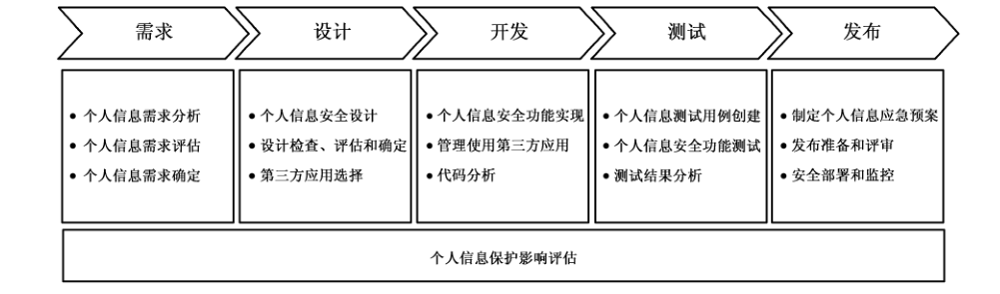

# GB/T 41817-2022 信息安全技术 个人信息安全工程指南

> 来源：[GB/T 41817-2022 国家标准详情](https://openstd.samr.gov.cn/bzgk/std/newGbInfo?hcno=62C795EBF1BF0200A7161718CEFAABA8)；封面发布日期：2022-10-12；实施日期：2023-05-01。
> PDF SHA-256：8637c914d3070ecbd0c6e3d30e17df807df69a4d672eba812e6cf6924305848a。
> 转写说明：按页渲染 PDF 并用 macOS Vision 进行图像识别，对照全部原页校正文字和列表；省略封面、目录、页眉和页脚。正式引用请核对原 PDF。

## 前言

本文件按照 GB/T 1.1—2020《标准化工作导则 第1部分：标准化文件的结构和起草规则》的规定起草。

请注意本文件的某些内容可能涉及专利。本文件的发布机构不承担识别专利的责任。

本文件由全国信息安全标准化技术委员会（SAC/TC 260）提出并归口。

本文件起草单位：中国电子技术标准化研究院、华为技术有限公司、北京百度网讯科技有限公司、深圳市腾讯计算机系统有限公司、阿里巴巴（北京）软件服务有限公司、联想（北京）有限公司、蚂蚁科技集团股份有限公司、上海市方达（北京）律师事务所、北京京东尚科信息技术有限公司、北京三快科技有限公司、中国银行股份有限公司、中电长城网际系统应用有限公司、微软（中国）有限公司、全知科技（杭州）有限责任公司、北京奇虎科技有限公司、北京字节跳动科技有限公司、贝壳找房（北京）科技有限公司、北京小桔科技有限公司、勤智数码科技股份有限公司、陕西省网络与信息安全测评中心、西安电子科技大学、北京邮电大学、上海工业控制安全创新科技有限公司、华东师范大学、浙江鹏信信息科技股份有限公司。

本文件主要起草人：刘贤刚、胡影、徐羽佳、范为、孙硕、郭铁涛、李汝鑫、贾雪飞、王昕、王佳敏、苏丹、白晓媛、武杨、赵冉冉、杨建媛、严少敏、刘笑岑、罗治兵、陈雪秀、白阳、周晨炜、刘行、王姣、王秉政、闵京华、王劲松、章娅玮、张冰烨、张屹、刘凯红、张朝、衣强、孙铁、李正、李俊、裴庆祺、魏玉峰、朱通、邓婷、孙彦、陈舒、张宇光、徐国爱、蒲戈光、刘虹、陈铭松、邹楠。

## 引言

为规范网络产品和服务个人信息处理活动，最大程度保障用户个人信息权益，业界陆续提出个人信息安全措施与产品和服务同步规划、同步建设、同步使用的理念。例如，欧盟《通用数据保护条例》规定在产品设计阶段要考虑个人信息保护要求，同时产品默认设置也要最大程度保护用户个人信息。这不仅有助于主动防御个人信息安全风险，也便于预防侵害用户个人信息权益事件发生。

本文件根据个人信息保护法律法规和政策标准要求，结合国内外在隐私工程方面的实践经验，给出了具有处理个人信息功能的网络产品和服务在规划和建设阶段的个人信息安全工程实施指南，为帮助网络产品和服务提升个人信息保护能力提供工程化指引。

## 1 范围

本文件提出了个人信息安全工程的原则、目标、阶段和准备，提供了网络产品和服务在需求、设计、开发、测试、发布阶段落实个人信息安全要求的工程化指南。

本文件适用于涉及个人信息处理的网络产品和服务（含信息系统），为其同步规划、同步建设个人信息安全措施提供指导，也适用于组织在软件开发生存周期开展隐私工程时参考。

> 注：在不引起混淆的情况下，本文件中的“网络产品和服务”简称为“产品服务”。

## 2 规范性引用文件

下列文件中的内容通过文中的规范性引用而构成本文件必不可少的条款。其中，注日期的引用文件，仅该日期对应的版本适用于本文件；不注日期的引用文件，其最新版本（包括所有的修改单）适用于本文件。

- GB/T 25069—2022 信息安全技术 术语

- GB/T 35273—2020 信息安全技术 个人信息安全规范

- GB/T 39335—2020 信息安全技术 个人信息安全影响评估指南

- GB/T 41391—2022 信息安全技术 移动互联网应用程序（App）收集个人信息基本要求

## 3 术语和定义

GB/T 25069—2022 界定的以及下列术语和定义适用于本文件。

### 3.1 个人信息安全工程 personal information security engineering

将个人信息安全原则和要求融入到产品服务规划、建设的每个阶段，使个人信息安全要求在产品服务中有效落实的工程化过程。

> 注：也称“隐私工程”。

### 3.2 个人信息保护影响评估 personal information protection impact assessment

针对个人信息处理活动，检验个人信息处理目的、处理方式是否合法、正当、必要，判断其对个人合法权益的影响及安全风险，以及评估所采取的个人信息保护措施有效性的过程。

> 注：也称“个人信息安全影响评估”。

### 3.3 个人信息处理活动 personal information processing

对个人信息的收集、存储、使用、加工、传输、提供、公开、删除等行为。

### 3.4 自动化决策 automated decision-making

通过计算机程序自动分析、评估个人的行为习惯、兴趣爱好或者经济、健康、信用状况等，并进行决策的活动。

> 注：包括个性化推荐、个性化展示、精准营销等情形。

### 3.5 第三方应用 third-party components

由产品服务提供者之外的其他组织或个人，提供的软件开发工具包、代码、插件、程序等应用。

注1：包括商业应用和开源应用。

注2：既包括嵌入产品服务的 SDK、代码、插件等（称为“第三方组件”），也包括接入产品服务的移动互联网应用程序（简称“移动应用”）、小程序、应用系统等（称为“第三方产品或服务”）。

## 4 缩略语

下列缩略语适用于本文件。

API：应用程序编程接口（application programming interface）

ICT：信息通信技术（information communication technology）

SDK：软件开发工具包（software development kit）

SDL：安全开发生存周期（security development lifecycle）

## 5 总则

### 5.1 个人信息安全工程原则

使产品服务符合个人信息安全要求、更大程度保障用户个人信息权益，组织宜在产品服务规划建设时开展个人信息安全工程实践，落实同步规划、同步建设，同步使用个人信息安全措施。实施个人信息安全工程时，基于尊重用户、主动防范的理念，按照以下原则开展。

a） 嵌入设计原则：将个人信息保护要求纳入产品服务的设计中。

注1：也称隐私设计原则。

b） 默认保护原则：产品服务的默认设置要最大程度保护个人信息安全，如默认收集最小化等。

注2：也称默认隐私原则。

c） 用户中心原则：充分考虑用户个人信息安全需求，以用户为中心设计产品服务的个人信息安全功能，最大程度保障用户个人信息权益。

d） 工程对应原则：个人信息安全工程与软件开发生存周期对应，阶段划分一致，便于软件开发和工具集成。

e） 全程安全原则：在个人信息处理活动的全流程中实现个人信息安全。

### 5.2 个人信息安全工程目标

与信息系统安全工程侧重于保护 ICT 资产的保密性、完整性和可用性不同，个人信息安全工程聚焦于保障用户个人信息权益，在使产品服务满足 GB/T 35273—2020 中个人信息处理活动原则和安全要求的基础上，重点实现以下目标。

a） 合法正当：遵循个人信息安全相关法律法规要求，处理个人信息具有明确、合理的目的，不通过误导、欺诈、胁迫等方式处理个人信息。

b） 最小必要：处理个人信息与处理目的直接相关，采取对个人权益影响最小的方式，收集个人信息限于实现处理目的的最小范围。

c） 公开透明：公开个人信息处理规则，明示处理的目的、方式和范围，提高产品服务个人信息处理的透明性。

d） 不可关联：采用去标识化、匿名化等手段，减少个人信息关联到个人信息主体引起的安全风险。

e） 可管理性：提供个人信息处理的管理机制，使用户和组织能够适当干预产品服务处理个人信息的过程。

### 5.3 个人信息安全工程阶段

产品服务的个人信息安全工程与其规划建设过程相对应，也分为需求、设计、开发、测试、发布5个阶段，各阶段活动见图1。如果组织已开展安全工程实践（如 SDL），可在安全工程基础上结合自身需要，增加个人信息安全工程活动。

如果产品服务涉及处理敏感个人信息等情形，在产品服务规划建设时需按照 GB/T 39335—2020 开展个人信息保护影响评估。根据组织实际情况，个人信息保护影响评估通常会贯穿于个人信息安全工程各阶段。例如：在需求阶段，启动个人信息保护影响评估，确定评估对象和范围，对需求进行评估；在设计和开发阶段，对个人信息安全设计进行评估，输出设计的评估结果，并按照评估确定后的设计进行开发；在测试阶段，对实际个人信息保护功能进行验证和测试；在发布阶段，对个人信息保护影响评估相关文档进行评审、签发及归档。

> 注：需开展个人信息保护影响评估的场景，包括但不限于处理敏感个人信息、利用个人信息进行自动化决策、委托处理个人信息、向其他个人信息处理者提供个人信息、公开个人信息、向境外提供个人信息及其他对个人权益有重大影响的个人信息处理活动等。

### 5.4 个人信息安全工程准备

组织在开展个人信息安全工程前，宜做好工作团队、制度流程、技术工具等方面的准备工作，包括但不限于以下内容。

a） 组建个人信息安全工程团队，明确工程各阶段相关的角色和职责，并对相关人员进行培训。

> 注：团队通常由个人信息保护团队和业务团队组成。其中，个人信息保护团队根据组织实际情况，可由安全、法务、合规、隐私等多个部门角色构成。业务团队可能涉及产品经理、研发、测试、运营及部署等多个与产品服务相关的岗位。

b） 围绕产品服务建设生存周期，建立个人信息安全工程相关制度流程，细化各阶段的工作任务和实施指南。

c） 根据组织实际情况，准备相关技术工具支撑个人信息安全工程实践，例如需求跟踪系统、隐私测评工具等。

## 6 个人信息安全工程需求阶段

### 6.1 描述

在产品服务规划建设的需求阶段，针对产品服务的个人信息需求进行分析、评估和确定。

> 注：个人信息需求包括个人信息处理需求和个人信息安全需求。

### 6.2 输入

需求阶段的主要输入：产品服务功能需求，适用的个人信息安全法律法规和政策标准等。

产品服务功能需求，需明确产品服务预期的业务功能、应用场景、业务流程、相关方等。

### 6.3 角色与职责

本阶段主要涉及的角色及其职责为：

a） 业务团队负责确定产品服务功能需求，识别个人信息处理需求；

b） 个人信息保护团队负责确定个人信息安全需求，开展个人信息需求评估。

### 6.4 主要活动

#### 6.4.1 个人信息需求分析

个人信息需求分析通常涉及以下内容：

a） 根据产品服务的功能需求清单，识别涉及的个人信息处理场景并分析个人信息处理需求，包括但不限于：

1） 预期的业务功能、业务流程和个人信息处理活动；

2） 预期的个人信息处理目的和处理方式；

3） 预期处理的个人信息种类、数量、敏感程度、方式和范围；

4） 预期的个人信息存储方式、权限管理和保护方式；

5） 可能涉及的信息系统和区域（如物理区域、逻辑区域）；

6） 可能涉及的工作团队角色和职责；

7） 可能涉及的第三方、与第三方的合作方式和预期约束措施；

8） 是否涉及将个人信息向他人提供、公开和出境等活动；

9） 是否涉及对未成年人的个人信息处理、个人生物识别信息处理和自动化决策等活动。

b） 梳理产品服务需满足的个人信息安全合规要求，梳理来源包括但不限于：

1） 适用的法律、行政法规、监管政策和强制性国家标准；

2） 适用的推荐性国家标准和行业标准；

3） 组织内部个人信息安全管理目标和制度要求；

4） 客户对个人信息保护的需求，合同协议中对个人信息保护的约定内容；

5） 历史版本的遗留问题、监测到的个人信息安全风险、监管通报问题和发生的安全事件等。

c） 识别可能存在的个人信息安全风险，结合产品服务需满足的个人信息安全合规要求，综合分析形成个人信息安全需求。

#### 6.4.2 个人信息需求评估

该活动通常涉及以下内容。

a） 明确个人信息需求评估的方法和准则，定义组织个人信息安全风险的最低可接受水平。

> 注：常见评估方法，包括但不限于个人信息保护影响评估、个人信息保护合规评估、数据安全风险评估等。评估准则是指要明确评估模型、评价规则等。

b） 对个人信息处理需求和安全需求进行评估，发现可能存在的个人信息安全风险，判断需求是否合理或风险是否过高，评估要点包括但不限于：

1） 预期的个人信息处理目的和处理方式是否合法、正当，是否超出用户授权或约定范围等；

2） 预期收集的个人信息对实现产品服务功能的必要性；

3） 是否存在对用户个人信息权益产生的影响及安全风险；

4） 拟采取的个人信息安全措施，是否与个人信息安全风险相适应；

5） 拟合作第三方的个人信息保护合规情况、数据安全能力和个人信息主体权益响应情况；

6） 是否存在对产品服务的功能和性能产生的负面影响。

c） 记录并留存需求评估的过程和结果。

#### 6.4.3 个人信息需求确定

该活动包括但不限于以下内容：

a） 当评估结论为需求不合理或存在高风险时，对相关需求进行调整后再次进行评估；

b） 调整后的需求要通过个人信息需求评估，最终输出产品服务个人信息需求；

c） 在后续个人信息安全工程阶段，宜通过使用需求跟踪系统等手段，跟进产品服务个人信息需求的实现情况。

### 6.5 输出

需求阶段的主要输出：产品服务个人信息需求。

产品服务个人信息需求，通常以需求清单或需求规格说明书形式表达，包括产品服务的个人信息处理需求（含预期处理的个人信息清单）、个人信息安全需求等内容。

## 7 个人信息安全工程设计阶段

### 7.1 描述

在产品服务规划建设的设计阶段，针对产品服务的个人信息需求，对个人信息安全功能及实现机制进行设计。

### 7.2 输入

设计阶段的主要输入为：产品服务功能需求和产品服务个人信息需求。

### 7.3 角色与职责

本阶段主要涉及的角色及其职责为：

a） 业务团队负责完成功能架构设计，配合个人信息保护团队完成相关工作；

b）个人信息保护团队负责设计产品服务个人信息安全功能，开展设计检查和评估。

### 7.4 主要活动

#### 7.4.1 个人信息安全设计

根据5.2中个人信息安全工程目标，针对产品服务的个人信息需求，设计对应的个人信息安全功能实现方案。该活动主要包括以下步骤。

a） 制定产品服务个人信息安全设计规范，明确产品服务个人信息安全功能设计要求或实现指南。

b） 根据产品服务功能需求和个人信息处理需求，在功能架构、业务流程、数据元素和数据接口等设计中明确产品服务的个人信息处理设计，包括但不限于：

1） 明确全流程个人信息处理活动及各项活动相关的系统或模块；

2） 明确个人信息处理相关方，确定系统或相关方之间的数据流；

3） 明确产品服务的基本业务功能和扩展业务功能，如产品服务为移动应用，划分基本业务功能和扩展业务功能的要求见 GB/T 41391—2022；

4） 明确收集个人信息种类、使用目的和使用场景；

5） 明确组织与外部第三方的关系（如共同控制、委托处理等），确定与第三方共享的个人信息种类、使用目的、使用场景和共享方式等。

c） 围绕产品服务的功能架构、个人信息处理活动和数据流，对个人信息安全需求进行分解，设计产品服务各模块需包含的个人信息安全功能，常见个人信息安全设计参考要点见 A.1~A.6，SDK 个人信息安全设计参考要点见 A.7。设计的要点包括但不限于：

1） 个人信息收集、存储、使用、加工、传输、提供、公开和删除等处理活动合规机制；

2） 告知和同意；

3） 个人信息查阅、更正、删除、撤回同意和账号注销等个人信息主体权利保障功能；

4） 个人信息保护政策；

5） 自动化决策，如用户画像、广告营销和算法推荐等；

6） 权限申请与使用；

7） 全流程数据处理安全措施；

8） 身份鉴别和访问控制机制；

9） 数据加密；

10） 个人信息处理日志审计；

11） 敏感个人信息保护（如未成年人个人信息和个人生物识别信息）；

12） 个人信息不可关联机制。

d）针对各项个人信息安全功能设计具体技术路线，完成产品服务的个人信息安全详细设计。

> 注：个人信息安全设计也需明确哪些个人信息安全需求或功能，宜通过调用通用组件或工具（如软件工程、安全工程、网络安全工具等）来实现。

#### 7.4.2 设计检查、评估和确定

该活动包括以下内容：

a） 根据产品服务需满足的个人信息安全合规要求，制定个人信息安全合规检查项，并对照检查项对个人信息安全设计进行检查，发现是否存在个人信息违法违规问题；

b） 针对个人信息需求评估时发现的个人信息安全风险，对个人信息安全设计进行影响评估或风险评估，研判设计是否能控制或缓解个人信息安全风险；

c） 如果检查结果为不合规或者评估结果为存在高风险，需对个人信息安全设计进行调整更新后，再次进行检查和评估；

d） 通过个人信息安全设计检查和评估后，确定产品服务个人信息安全设计并进行输出；

e） 记录设计检查和评估的过程，为产品服务改进、管理和维护等提供依据。

#### 7.4.3 第三方应用选择

选择第三方应用时，在满足产品服务相应功能和性能需求的基础上，也要考虑第三方应用的个人信息安全风险。该活动通常涉及以下内容。

a） 识别第三方应用的个人信息处理情况，包括但不限于：

1） 处理个人信息的目的、方式和范围；

2） 申请权限的目的和范围；

3） 个人信息保护政策。

b） 按照合法、正当、必要的原则选择第三方应用，考虑因素包括但不限于：

1） 应用提供者的基本信息明确、沟通反馈渠道有效且版本更新及时；

2） 应用功能与产品服务处理目的直接相关，且限于实现所需处理目的的最小功能范围；

3） 没有超范围收集个人信息、强制授权或过度索权等情况；

4） 真实、准确、完整告知个人信息处理规则；

5） 近两年未被通报安全问题或事件；

6） 应用提供者具有必要的数据安全能力；

7） 应用提供者有及时有效的个人信息主体权利申请受理机制、安全事件响应机制。

c） 组织宜建立第三方应用推荐清单，帮助产品服务筛选符合安全要求的应用。

### 7.5 输出

设计阶段的主要输出为：产品服务个人信息安全设计。

产品服务个人信息安全设计，通常以设计方案或设计说明书形式表达，说明产品服务个人信息处理活动、个人信息字段、数据流、拟使用的第三方应用、个人信息安全功能及技术路线等。

## 8 个人信息安全工程开发阶段

### 8.1 描述

在产品服务规划建设的开发阶段，针对产品服务个人信息安全设计进行开发实现，以满足个人信息安全工程目标。

### 8.2 输入

开发阶段主要输入为：产品服务个人信息安全设计。

### 8.3 角色与职责

本阶段主要涉及的角色及其职责为：

a） 业务团队负责根据个人信息安全设计完成开发；

b）个人信息保护团队负责对第三方应用的安全使用进行管理、配合业务团队实现代码分析。

### 8.4 主要活动

#### 8.4.1 个人信息安全功能实现

根据产品服务个人信息安全设计，对个人信息安全功能进行代码实现，通过以下活动实现个人信息安全工程目标：

a） 实现个人信息保护或隐私设置功能，使用户能够实现对个人信息的管理；

注1：个人信息保护或隐私设置功能，通常实现对产品权限、第三方授权、自动化决策、好友权限、扩展业务功能等进行管理。

b） 实现个人信息处理规则公开功能，增强个人信息处理透明度；

注2：个人信息处理规则公开，通常以隐私政策、个人信息收集清单、第三方信息共享清单等形式实现。

c） 使用去标识化、匿名化等技术实现个人信息不可关联目标；

d） 实现过程中充分考虑个人信息收集的范围、方式、时机和频率等是否符合最小必要目标；

e） 实现个人信息主体权利管理功能，保障用户能够在线实现个人信息查阅、更正、撤回同意、账号注销等权利；

f） 避免将敏感个人信息直接嵌入到代码；

g） 结合产品服务实际需要，对输入个人信息的准确性、完整性等进行测试，并过滤恶意代码；

h） 使用正规渠道下载的开发工具、标准化安全套件；

i） 依据安全编码规范进行安全开发；

j） 宜实现数据保存期限探测和超期自动删除能力；

k）宜设立统一的日志管理接口，避免在日志中记录个人信息。

#### 8.4.2 管理使用第三方应用

该活动主要包括以下内容。

a） 嵌入第三方组件前，需检测其可能存在的个人信息安全风险，检测包括但不限于以下内容：

1） 来源安全，如渠道可靠性、是否最新版本；

2） 代码安全，如是否存在已知的安全漏洞、是否存在恶意代码及是否嵌入其他第三方组件等；

3） 对处理个人信息是否合法、正当、必要，如是否超出用户授权范围，是否超出协议约定范围，是否与其个人信息保护政策一致，申请权限和收集个人信息是否满足最小必要目标；

4） 行为安全，如是否存在个人信息回传服务端，是否涉及个人信息出境，是否存在后台自启动和关联启动后收集个人信息的行为，是否存在不知情的热更新行为等；

5） 数据安全，如是否存在个人信息传输未加密、敏感个人信息未加密存储等风险。

b） 接入第三方产品服务前，需按照 8.4.2a）中的3）和4）对其进行检测。

c） 如检测结果为存在高风险，需调整或替换第三方应用，通过检测的应用经组织批准后可在产品服务中使用。

d） 嵌入第三方组件代码时，需参考安全编码规范进行编码实现，安全要点包括但不限于：

1） 是否对嵌入第三方组件的代码进行混淆保护、加壳、加密等处理；

2） 通过第三方组件对外提供个人信息前，是否向用户告知并取得用户单独同意；

3） 是否使用非正规渠道或停止维护更新的 API 或 SDK；

4） 是否对涉及个人信息处理的关键操作进行身份鉴别和权限检查。

e） 与第三方应用提供者签订相关协议，明确其收集的个人信息类型、申请的敏感权限、处理目的、保存期限、超期处理方式，双方的角色（如委托处理、共同处理等）及个人信息安全职责。

f） 组织宜建立产品服务中使用的第三方应用清单，对第三方应用进行安全管理。

g） 关注第三方应用的安全动态和版本更新情况，及时修复安全问题并更新代码。

#### 8.4.3 代码分析

对产品服务源代码进行分析，发现可能存在个人信息安全风险的代码。该活动包括但不限于以下内容：

a） 采用代码分析工具完成代码安全基准测试；

b） 结合产品服务实际需要，针对处理敏感个人信息的组件采用人工代码分析；

c） 淘汰、移除或替换可能导致个人信息安全风险的代码或者功能；

d） 在每个开发迭代周期检查个人信息安全功能实现的效果。

### 8.5 输出

开发阶段的主要输出为：

a） 产品服务开发过程版本及其开发文档（如数据库文档、接口文档等）；

b）第三方应用个人信息安全测试报告。

## 9 个人信息安全工程测试阶段

### 9.1 描述

在产品服务规划建设的测试阶段，对个人信息安全功能进行测试，并对测试结果进行分析。

### 9.2 输入

测试阶段的主要输入为：

a） 产品服务个人信息需求；

b） 产品服务个人信息安全设计；

c） 产品服务开发过程版本及其开发文档；

d） 已开展的个人信息安全评估相关过程记录。

### 9.3 角色与职责

本阶段主要涉及的角色及其职责为：

a） 业务团队主要负责对产品服务进行安全测试、输出测试结果及测试报告，对测试不通过项进行整改；

b）个人信息保护团队主要负责提出个人信息安全测试要点，监督并配合业务团队开展个人信息安全功能测试，对测试不符合项进行说明并监督业务团队完成改进。

### 9.4 主要活动

#### 9.4.1 个人信息测试用例创建

根据产品服务的个人信息需求，创建并维护个人信息安全测试用例，创建用例时需考虑以下内容：

a） 测试用例能够覆盖对个人信息需求的测试；

b） 测试用例能够覆盖 7.4.2中的个人信息安全合规检查项；

c） 测试用例能够覆盖对个人信息安全风险的测试。

#### 9.4.2 个人信息安全功能测试

按照个人信息测试用例进行安全功能测试，该活动包括但不限于以下内容。

a） 开展个人信息需求符合性测试，测试各项个人信息需求是否已实现。

b） 开展个人信息安全合规性测试，测试全流程个人信息处理活动是否合规。

> 注：对于移动应用，按照《App 违法违规收集使用个人信息行为认定方法》、《常见类型移动互联网应用程序必要个人信息范围规定》、相关监管政策和标准要求，对移动应用可能存在的违法违规收集使用个人信息问题进行检测。

c） 采用人工或个人信息安全测试技术手段进行测试，发现产品服务中存在的个人信息安全风险，包括但不限于：

1） 测试个人信息安全功能有效性，对之前评估发现的个人信息安全风险进行确认；

2） 利用安全测试工具进行白盒测试，发现系统在编码、数据脱敏等方面的问题；

3） 利用安全测试工具进行黑盒或灰盒测试，发现产品服务在安全漏洞、权限控制等方面的问题；

4） 利用隐私测试工具对个人信息收集、敏感权限申请调用等进行静态和动态测试；

5） 采用人工或自动方式，对产品服务的个人信息保护政策与实际个人信息处理行为的符合性进行测试；

6） 采用人工方式对个人信息保护政策公开、告知同意机制、用户个人信息主体权利等功能的实现效果进行测试。

#### 9.4.3 测试结果分析

分析测试结果，对测试不通过项进行整改，该活动包括但不限于以下内容：

a） 如测试发现产品服务存在未能满足个人信息需求的情况，或者产品服务存在个人信息安全合规问题，需记录问题、分析原因，并结合实际情况对设计或开发阶段进行迭代；

b） 如测试发现产品服务存在重大个人信息安全风险，需组织相关方评估风险，在整改后的测试环节重点评估整改方案的有效性，以及整改方案是否会带来新的个人信息安全风险。

### 9.5 输出

测试阶段的主要输出为：个人信息安全测试报告。

## 10 个人信息安全工程发布阶段

### 10.1 描述

在产品服务规划建设的发布阶段，对产品服务进行个人信息安全发布评审，评审通过后对产品服务进行发布和部署，使产品服务默认设置最大程度保护个人信息。

### 10.2 输入

发布阶段的主要输入为：

a） 产品服务的交付版本；

b） 个人信息安全设计；

c） 个人信息安全测试报告。

### 10.3 角色与职责

本阶段主要涉及的角色及其职责为：

a） 业务团队交付产品服务的发布版本，完成产品服务的安全部署；

b） 个人信息保护团队开展个人信息安全发布评审，制定产品服务个人信息安全默认配置规则。

### 10.4 主要活动

#### 10.4.1 制定个人信息应急预案

制定个人信息安全事件应急预案，明确产品服务个人信息安全应急响应计划，应急预案需包括但不限于以下内容：

a） 明确个人信息安全事件应急响应流程、相关方和职责；

b） 明确个人信息安全事件告知用户的方式、渠道和内容等；

c） 明确个人信息安全事件分类分级、响应时间和处置要求；

d） 明确个人信息安全事件记录、评估、修复、上报等环节的实施细则；

e） 明确第三方应用个人信息安全事件的响应流程、相关方和职责。

#### 10.4.2 发布准备和评审

在产品服务发布前做好个人信息安全准备工作，通常涉及以下内容。

a） 完成与第三方合作协议的签署，明确第三方的个人信息保护责任。

b） 对于可能严重影响业务的个人信息安全功能，可选择灰度发布的方式（如首先小范围在部分用户中发布新功能），并测试可能对业务的实际影响，待灰度发布验证通过后，根据业务需要进行扩展发布。

c） 产品服务发布前需通过个人信息安全发布评审，评审内容包括但不限于：

1） 发布前是否完成安全基准测试；

2） 发布前是否完成个人信息需求符合性测试；

3） 发布前是否完成个人信息安全合规性测试；

4） 发布前是否完成个人信息安全残余风险测试；

5） 发布前是否完成个人信息保护政策与实际个人信息处理行为的符合性测试。

#### 10.4.3 安全部署和监控

该活动通常涉及以下内容。

a） 充分考虑个人信息安全需求，制定产品服务个人信息安全相关的配置规则、部署方案及验收标准，产品服务默认配置需考虑默认隐私原则，常见个人信息安全默认配置参考要点见附录B。

注1：个人信息安全默认配置，如涉及产品服务功能开发，可能需要在设计阶段进行考虑。

b） 遵从配置规则完成配置、依据部署方案完成部署，并根据验收标准进行验收。

注2：运维人员将产品部署到相应环境，由验收人员根据产品的需求、设计、合规要求等对产品服务、环境配置等进行验收。

c） 在部署配置过程中，产品服务需具备可访问的个人信息保护政策，供用户知情同意。

d） 如涉及移动应用在应用市场发布，需核验上架版本与发布版本的一致性，并按照应用市场个人信息安全审核反馈结果进行整改。

e） 产品服务发布部署后，宜对个人信息安全风险进行监测，包括但不限于：

1） 外发数据流量监测，发现未授权个人信息传输、出境等风险；

2） 敏感 API 调用监测，发现超范围收集、未授权使用个人信息等风险；

3） 个人信息处理违规行为监测，发现个人信息使用过程中信息泄露、欺诈、恶意营销等行为；

4） 第三方应用个人信息处理行为监测，发现其未授权收集、使用、回传个人信息等行为；

5） 信息服务合规监测，发现可能存在的信息服务违规问题。

注3：常见信息服务违规问题，包括但不限于违法和不良信息传播、大数据杀熟、流量造假、诱导点击等。

f） 产品服务发布部署后发现的个人信息安全风险，可作为个人信息安全需求阶段的输入，对产品服务实现迭代。

### 10.5 输出

发布阶段的主要输出为：

a） 个人信息安全默认配置规则；

b） 完成部署的产品或服务。

## 附录 A（资料性）常见个人信息安全设计参考要点

### A.1 个人信息收集合规机制

设计产品服务的个人信息收集合规机制，要点包括但不限于以下内容。

a） 在识别产品服务基本业务功能、必要个人信息的基础上，设计个人信息收集机制：

1） 建立个人信息收集清单，不收集清单之外的无关个人信息；

2） 要求用户必须提供仅限于必要个人信息范围内的个人信息；

3） 允许用户拒绝非必要个人信息收集，或撤回对收集非必要个人信息收集的同意，且不对其使用基本业务功能产生影响；

4） 收集的个人信息类型、频率、数量、精度，限于实现处理目的所必要的最小范围；

5） 仅当用户使用到特定扩展业务功能时才向用户收集所需个人信息。

b） 提供多种个人信息收集的实现方式时，无需频繁提示用户使用非默认方式，干扰其正常使用产品服务。

c） 对于以间接方式收集个人信息的情形，在收集或使用前对其来源的合法性进行确认。

d） 通过移动应用收集个人信息的，按照 GB/T 41391—2022设计个人信息收集机制。

e） 个人信息收集的默认配置要点见附录B的a）~c）。

### A.2 告知同意

结合产品服务的业务功能特点，参考相关国家标准要求，设计告知同意机制。要点包括但不限于以下内容。

a） 选择适当的告知方式（如一般告知、增强告知、即时提示等），将告知内容重点突出、清晰准确地向用户进行传达。

b） 设计适当的同意机制，确保个人信息主体在充分知情的前提下自愿、明确作出同意；需要取得个人单独同意的，通过增强告知或即时提示的方式，针对需要单独同意的事项专门向个人信息主体进行充分告知，并通过明示同意的方式取得个人信息主体单独同意。

c） 为用户提供拒绝同意的方式，个人信息主体拒绝同意后，避免频繁打扰个人信息主体以再次征得同意，用户主动操作触发取得同意机制的除外。

d）收集生物识别、宗教信仰、特定身份、医疗健康、金融账户、行踪轨迹等敏感个人信息时，需同步告知用户收集使用目的，目的描述需明确具体、通俗易懂，并取得用户单独同意。

e） 为用户提供便捷的撤回同意的方式，并设置适当的撤回同意机制：

1） 可通过多种方式实现撤回同意，如关闭处理个人信息的特定业务、停止处理特定个人信息种类、关闭特定权限等；

2） 设置将撤回同意的结果及时反馈到产品服务功能的机制，使撤回同意后不再处理相应个人信息；

3） 个人信息主体撤回同意后，宜立即处理，如无法立即处理的需向个人信息主体说明处理的时间；

4） 个人信息主体撤回同意后，避免频繁打扰个人信息主体以再次征得同意。

### A.3 个人信息主体权利

设计个人信息主体权利实现机制的要点包括但不限于以下内容。

a） 按照 GB/T 35273—2020中附录C设计实现个人信息主体自主意愿的机制。

b） 在技术上能够实现个人信息主体行使权利（如设计时即能够识别个人信息的存储位置，以便于在个人信息主体行使删除权时能够有效响应）。

c） 保证个人信息主体行使权利的有效性，例如：

1） 在产品服务中设计并实现个人信息查阅、复制、更正、补充、删除、转移、撤回同意、注销账户的入口，使个人信息主体在使用产品服务时，能够较便捷地行使上述权利；

2） 在个人信息主体提出删除其个人信息，且在完成相应操作后，通过电子邮件、电话、推送通知等方式及时告知个人信息主体删除的结果；

3） 向个人信息主体明示账户注销效果，如在个人信息保护政策附件中设立独立的《用户注销协议》，明确提示个人信息主体注销流程和条件；

4） 为用户提供便捷的投诉渠道，使用户通过该渠道能够提交与产品服务相关的投诉。

### A.4 自动化决策

设计产品服务的自动化决策机制时，要点包括但不限于以下内容：

a） 在设计、实现通过自动化决策方式向个人进行信息推送、商业营销等的功能时，向用户同时提供不针对其个人特征使用该功能的渠道，或向用户提供便捷的拒绝方式；

b） 通过自动化决策方式作出对个人权益有重大影响的决定的，向个人信息主体进行说明，同时提供其他决策方式；

c） 宜为用户提供自主设置、调整或校正用户画像维度，标签的功能；

d） 宜为用户提供完全重置画像信息的功能，重置后停止使用重置前用于用户画像的个人信息进行个性化展示；

e）宜为个人信息主体提供对个性化展示推送的频率、方式、内容进行选择和控制的方法。

### A.5 移动应用权限申请与使用

为移动应用设计权限申请与使用机制时的要点包括但不限于以下内容。

a） 按照必要性原则申请使用权限：

1） 不在移动应用清单文件中声明与移动应用功能无关的权限；

2） 区分移动应用的基本业务功能和扩展业务功能，不强制索取仅扩展业务功能所需的权限；

3） 仅申请实现功能所必需的权限。

示例：仅需实现写入的，不申请读取权限；仅需粗略位置的，不申请精准位置权限；无须后台访问位置的，不申请后台位置权限。

b） 移动应用首次开启时仅申请基本业务功能所需的权限；若扩展业务功能需申请权限，仅在用户使用扩展业务功能时申请。

c） 申请时采用弹窗等增强告知方式明确具体地说明权限的申请目的、收集个人信息类型，保证用户知情。操作系统不支持编辑弹窗文字时，在操作系统弹窗前采用其他等效方式（如自行弹窗、搭配图文动画等）同步告知用户。

d） 用户拒绝或撤回权限后：

1） 移动应用不退出，且不影响与该权限无关的功能正常使用；

2） 若存在无需权限的实现方式，则通过该方式为用户提供服务；

3） 不频繁提示或征求用户同意开启该权限，干扰其正常使用；

4） 若用户主动触发或使用某功能，且缺少该权限该功能无法实现的，引导用户到设置中开启该权限。

e） 分析通过权限收集个人信息的必要性，若通过本地方式可实现功能，则不将个人信息回传。

f） 用户未使用相关功能时，不使用该权限读取或收集个人信息，包括：

1） 用户未主动触发该功能；

2） 用户使用其他与该权限无关的功能；

3） 移动应用处于静默状态或在后台运行，且未向用户提供服务。

g） 当通过移动应用进行拍摄、录音、录屏、定位时，采用显著方式实时提示用户。如操作系统不支持，在移动应用中的某位置或在通知栏中（如果移动应用正在后台运行）使用通知图标通知用户。

### A.6 身份鉴别和访问控制

设计产品服务的身份鉴别和访问控制机制时，个人信息安全设计要点包括：

a） 身份鉴别信息具有一定的复杂度要求；安全要求较高的，采用两种或以上的方式进行鉴别；

b） 设置鉴别失败处理机制，限制鉴别失败尝试次数；

c） 对个人信息管理员的授权，宜采取职责分离原则，其中授权与执行分离，超级管理员（或审计账户）只能授权业务管理员处理数据（如审批单据等），不能使用超级管理权限直接处理数据；

d） 宜提供未授权的访问或恶意攻击的检测机制。

### A.7 处理个人信息的 SDK

设计处理个人信息的 SDK 的要点包括：

a） 处理个人信息前需征得用户同意，在用户未同意的情况下，不处理个人信息，不进行自启动、关联启动。

b） 收集个人信息的类型、范围、频率需满足最小必要原则；在未使用到SDK 相关功能时，不申请该功能所需的权限或收集该功能所需的个人信息。

c） SDK 宜为不同的业务功能进行模块化设计，支持根据实际需要对无关功能进行裁剪，或为不同业务功能提供单独开启的开关。不强制捆绑无关功能。

d） 宜采用安全传输协议，通过传输数据加密、数字证书绑定、数字证书双向校验等方式保障个人信息的传输安全；传输敏感个人信息的，宜对敏感个人信息内容进行单独加密。

e） 在保障安全的前提下，SDK 宜优先在本地存储个人信息。对于SDK 与产品服务之间共享的数据宜保存在单独的自有存储目录下。在本地存储和处理敏感个人信息的，宜对敏感个人信息内容进行加密。

f） 具备热更新功能的SDK宜设计单独控制热更新开启或关闭的选项，在不使用热更新功能的情况下仍能够正常使用 SDK 其他功能。

g） 对API 设置鉴权机制，当SDK 被调用时，对调用者的身份进行鉴别，防止被恶意调用而泄露个人信息。

h） 设计用户退出使用SDK 的机制。

## 附录 B（资料性）常见个人信息安全默认配置参考要点

将默认隐私原则融入产品服务中，通过默认配置最大程度保护个人信息。参考要点包括但不限于以下内容。

a） 默认采用对个人权益影响最小的实现方式收集个人信息，包括但不限于：

1） 如能通过不收集个人信息的方式实现功能，默认采用不收集个人信息的方式；

2） 如能通过不收集敏感个人信息的方式实现功能，默认采用不收集敏感个人信息的方式。

b） 当产品服务在静默状态或在后台运行，且未向用户提供服务时，默认不收集用户个人信息。

c） 如能在本地实现个人信息处理目的，默认采用本地处理方式，不向服务端回传个人信息。

d） 默认关闭产品服务的扩展业务功能，包括但不限于：

1） 默认关闭向用户好友推送其浏览、播放、购物等记录功能；

2） 默认关闭收集个人生物识别信息的功能；

3） 默认关闭个性化推荐功能，如分析用户社交网络信息并推荐好友的功能等。

e） 默认仅声明和申请实现处理目的最小范围的系统权限，申请授权后默认仅访问所需要的最少个人信息。

f） 默认仅使用满足处理目的需要的最少数量的第三方应用。

g） 默认以最小期限保存个人信息。

h） 展示敏感个人信息时默认将其去标识化，由用户主动选择明文展示。

i） 避免使用默认勾选的方式取得同意。

## 参考文献

- ［1］ GB/T 20261—2006 信息技术 系统安全工程 能力成熟度模型
- ［2］ GB/T 37964—2019 信息安全技术 个人信息去标识化指南
- ［3］ ISO/IEC/IEEE 15288:2015 Systems and software engineering—System life cycle processes
- ［4］ ISO/IEC 27550:2019 Information technology—Security techniques—Privacy engineering for system life cycle processes
- ［5］ ISO/IEC 27701:2019 Security techniques—Extension to ISO/IEC 27001 and ISO/IEC 27002 for privacy information management—Requirements and guidelines
- ［6］ ISO/IEC 29101:2018 Information technology—Security techniques—Privacy architecture framework
- ［7］ ISO/IEC 29151:2017 Information technology—Security techniques—Code of practice for personally identifiable information protection
- ［8］ NISTIR 8062 An introduction to privacy engineering and risk management in federal systems, January 2017
