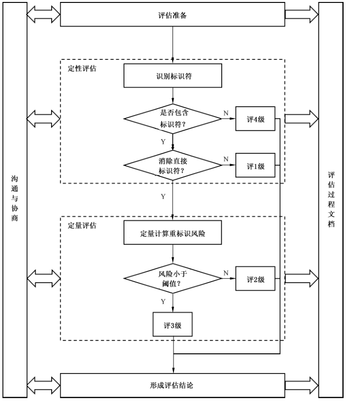

# GB/T 42460-2023 信息安全技术 个人信息去标识化效果评估指南

> 来源：[GB/T 42460-2023 国家标准详情](https://openstd.samr.gov.cn/bzgk/std/newGbInfo?hcno=E1A4E7943D64346D9EF1E3D0855F8496)；封面发布日期：2023-03-17；实施日期：2023-10-01。
> PDF SHA-256：d60e6bca5b4c7b7f7f319bb0a85955d92376873283b2d91d47fcacfb78cfce47。
> 转写说明：按官方 PDF 全部 19 页的页面图像核对正文、图 1、表 1、表 D.1 至表 D.4 及公式；省略封面、目录、页眉、页脚和页码，合并跨页内容。正式引用请核对原 PDF。

## 前言

本文件按照 GB/T 1.1—2020《标准化工作导则 第1部分：标准化文件的结构和起草规则》的规定起草。

请注意本文件的某些内容可能涉及专利。本文件的发布机构不承担识别专利的责任。

本文件由全国信息安全标准化技术委员会（SAC/TC 260）提出并归口。

本文件起草单位：清华大学、中国电子技术标准化研究院、北京大学、绿盟科技集团股份有限公司、上海三零卫士信息安全有限公司、中国软件评测中心、北京天融信网络安全技术有限公司、蚂蚁科技集团股份有限公司、阿里巴巴（北京）软件服务有限公司、北京市政务信息安全保障中心、深圳市腾讯计算机系统有限公司、北京百度网讯科技有限公司、中国人民银行数字货币研究所。

本文件主要起草人：金涛、王建民、周晨炜、谢安明、张峰昌、陈磊、查海平、赵亮、王龑、叶晓俊、屈劲、白晓媛、李媛、刘巍然、刘俊河、洪爵、宋玲娓。

## 引言

GB/T 35273提出了个人信息去标识化的要求，明确了个人信息去标识化处理的环节和场景，GB/T 37964 就如何开展个人信息去标识化活动给出了指导。经去标识化处理后的个人信息并不能完全实现匿名化，仍存在重标识的风险，需结合应用场景进行去标识化效果评估。

本文件旨在依据个人信息能多大程度上标识个人身份（即标识度）进行分级，用于评估个人信息去标识化活动的效果。个人信息基于标识度分级，有利于个人信息分级别探讨适用场景和安全管理要求，更有利于个人信息的使用和保护。根据国内外相关研究及实践成果，附录中给出了可供参考的计算方法和阈值推荐。

## 1 范围

本文件提供了个人信息去标识化效果分级与评估的指南。

本文件适用于个人信息去标识化活动，也适用于开展个人信息安全管理、监管和评估。

## 2 规范性引用文件

下列文件中的内容通过文中的规范性引用而构成本文件必不可少的条款。其中，注日期的引用文件，仅该日期对应的版本适用于本文件；不注日期的引用文件，其最新版本（包括所有的修改单）适用于本文件。

- GB/T 25069—2022 信息安全技术 术语

- GB/T 35273—2020 信息安全技术 个人信息安全规范

- GB/T 37964—2019 信息安全技术 个人信息去标识化指南

## 3 术语和定义

GB/T 25069—2022、GB/T 35273—2020、GB/T 37964—2019界定的以及下列术语和定义适用于本文件。

### 3.1 个人信息 personal information

以电子或者其他方式记录的与已识别或者可识别的自然人有关的各种信息。

> 注：不包括匿名化处理后的信息。

［来源：GB/T 35273—2020,3.1，有修改］

### 3.2 个人信息主体 personal information subject

个人信息所标识或者关联的自然人。

［来源：GB/T 35273—2020,3.3］

### 3.3 去标识化 de-identification

通过对个人信息的技术处理，使其在不借助额外信息的情况下，无法识别或者关联个人信息主体的过程。

［来源：GB/T 35273—2020,3.15］

### 3.4 微数据 microdata

一个结构化数据集，其中每条（行）记录对应一个个人信息主体，记录中的每个字段（列）对应一个属性。

［来源：GB/T 37964—2019,3.4］

### 3.5 标识符 identifier

微数据中的一个或多个属性，可以实现对个人信息主体的唯一识别。

> 注：标识符分为直接标识符和准标识符。

［来源：GB/T 37964—2019,3.6］

### 3.6 直接标识符 direct identifier

微数据中的属性，在特定环境下可以单独识别个人信息主体。

> 注：常见的直接标识符见附录 A。

［来源：GB/T 37964—2019,3.7］

### 3.7 准标识符 quasi-identifier

微数据中的属性，结合其他属性可唯一识别个人信息主体。

> 注：常见的准标识符见附录B，准标识符的识别见附录C。

［来源：GB/T 37964—2019,3.8］

### 3.8 重标识 re-identification

把去标识化的数据集重新关联到原始个人信息主体或一组个人信息主体的过程。

［来源：GB/T 37964—2019,3.9］

### 3.9 完全公开共享 completely public sharing

数据一旦发布，很难召回，一般通过互联网直接公开发布。

［来源：GB/T 37964—2019,3.12］

### 3.10 受控公开共享 controlled public sharing

通过数据使用协议对数据的使用进行约束。

［来源：GB/T 37964—2019,3.13］

### 3.11 领地公开共享 enclave public sharing

在物理或者虚拟的所辖范围内共享，数据不能流出到领地范围外。

［来源：GB/T 37964—2019,3.14］

### 3.12 重标识风险 re-identification risk

标识度 identifiability

从数据中能识别出个人信息主体的概率。

### 3.13 等价类 equivalence class

微数据中所有准标识符属性值相同的记录行的集合。

### 3.14 可接受风险阈值 acceptable risk threshold

设定的重标识风险临界数值。

> 注：当重标识风险大于该数值时，就需要采取缓解措施（包括去标识化处理）和应急措施，实现风险在可控范围内。

## 4 个人信息去标识化效果分级

基于数据是否能直接识别个人信息主体，或能以多大概率识别个人信息主体，个人信息标识度分级划分为4级，详见表1，用于区分个人信息去标识化效果。

**表1 个人信息标识度4级划分**

| 分级 | 划分依据 |
| --- | --- |
| 1级 | 包含直接标识符，在特定环境下能直接识别个人信息主体 |
| 2级 | 消除了直接标识符，但包含准标识符，且重标识风险高于或等于可接受风险阈值 |
| 3级 | 消除了直接标识符，但包含准标识符，且重标识风险低于可接受风险阈值 |
| 4级 | 不包含任何标识符 |

## 5 个人信息去标识化效果评估流程

个人信息去标识化效果评估流程见图1，包括以下内容：

a） 评估准备；

b） 定性评估；

c） 定量评估；

d）形成评估结论。

沟通与协商和评估过程文档管理贯穿于整个评估过程。

**图1 个人信息去标识化效果评估流程**

图 1 的流程节点与分支：评估准备后进入定性评估，先识别标识符；若不包含标识符，则评 4 级，若包含标识符，则判断是否消除直接标识符。未消除直接标识符时评 1 级；已消除时进入定量评估，计算重标识风险。风险小于阈值时评 3 级，否则评 2 级。各分支最后形成评估结论；沟通与协商、评估过程文档管理贯穿全过程。

## 6 评估实施

### 6.1 评估准备

评估准备工作包括以下内容。

<ol type="a">
<li>

确定待评估的数据集。

</li>
<li>

确定数据集使用的环境，包括业务场景、组织、人员、系统、已有其他数据等。

</li>
<li>

组建评估团队，包括个人信息保护合规专家、去标识化技术专家、相关业务专家等。

</li>
<li>

开展前期调研，包括数据使用环境的详细调研。

</li>
<li>

确定评估依据，包括相关的法律法规标准等。

</li>
<li>

确定重标识风险计算方案及可接受风险阈值：

<ol>
<li>

重标识风险计算方案同时考虑数据集及其使用的环境，可基于K匿名模型或是基于差分隐私模型等；

</li>
<li>

可接受风险阈值符合相应安全要求，并符合应用需要。

</li>
</ol>

</li>
<li>

制定评估方案。

</li>
</ol>

### 6.2 定性评估

定性评估包括：

a） 按照 GB/T 37964—2019中 5.3识别标识符，并形成标识符清单（包括直接标识符和准标识符）；

b） 判断数据集是否包含标识符清单中的标识符，如果不包含任何标识符，评为4级，评估结束，否则继续；

c） 判断数据集是否消除了标识符清单中的直接标识符，如果含有清单中的直接标识符，评为1级，评估结束，否则进一步进行定量评估。

### 6.3 定量评估

定量评估包括：

a） 定量计算重标识风险，按照 6.1 f）确定的重标识风险计算方案进行重标识风险计算；

b） 比较计算得到的重标识风险结果与可接受风险阈值，如果重标识风险结果小于可接受风险阈值，评为3级，否则评为2级，评估结束。

基于K匿名模型的重标识风险计算方案及评估示例见附录D。

### 6.4 形成评估结论

形成评估结论包括：

a） 结合定性评估与定量评估结果，形成去标识化效果分级结论；

b） 结论获得管理层批准。

### 6.5 沟通与协商

在评估过程中与相关方（包括数据提供方、数据接收方等）保持沟通并对沟通内容予以记录，包括：

a） 数据共享目的和数据共享环境的理解确认；

b） 重大的数据环境变更通知机制的建立；

c） 关于重标识风险度量的相互交流信息和意见；

d） 相关方已表达的对重标识风险的意见；

e） 定期/不定期重新评估的计划。

### 6.6 评估过程文档管理

评估过程文档管理包括以下内容。

<ol type="a">
<li>

评估过程文档包括评估过程中依据、参考和产生的过程文档与结果文档，包括但不限于：

<ol>
<li>

评估方案：包括待评估数据集、数据使用的环境、评估人员、评估方法、评估结果的形成和实施进度等；

</li>
<li>

标识符识别报告：标识符识别的过程及结果；

</li>
<li>

重标识风险计算方案：重标识风险计算方案及重标识风险可接受阈值的确定过程及结果；

</li>
<li>

评估报告：包含定性评估和定量评估的过程及结果结论；

</li>
<li>

评估记录：评估过程中的各种记录，包括沟通与协商的记录等。

</li>
</ol>

</li>
<li>

文档的管理包括标识、存储、保护、检索以及处置分发等。

</li>
</ol>

## 附录 A（资料性）直接标识符示例

任何在特定环境下可唯一识别个人的识别号码、特征或代码等属于直接标识符，常见的直接标识符包括但不限于：

a） 姓名；

b） 公民身份号码；

c） 护照号；

d） 驾驶证号；

e） 详细住址；

f） 电子邮件地址；

g） 电话号码（包括手机号和固定电话号码）；

h） 传真号码；

i） 银行账户；

j） 车辆标识符和序列号（包括车牌号）；

k） 社会保障号码；

l） 健康卡号码；

m）病历号码；

n） 设备标识符和序列号；

o） 生物识别码（包括指纹和声纹等识别码）；

p） 全脸图片图像和其他任何可比对的图像；

q） 账号、证书号或许可证号；

r） 互联网协议（IP）地址。

## 附录 B（资料性）准标识符示例

任何在相应环境下无法单独唯一识别个人信息主体，但结合其他信息可唯一识别个人信息主体的属性属于准标识符，常见的准标识符包括但不限于：

a） 性别；

b） 出生日期或年龄；

c） 事件日期（例如入院、手术、出院、访问相关日期）；

d） 地理范围（例如邮政编码、建筑名称、地区）；

e） 族裔血统；

f） 国籍、籍贯；

g） 语言；

h） 原住民身份；

i） 可见的少数民族地位；

j） 职务、工作单位、部门等职业信息；

k）婚姻状况；

l） 受教育水平；

m）上学年限；

n） 总收入；

o） 宗教信仰。

## 附录 C（资料性）准标识符识别

### C.1 识别准标识符的考量

准标识符是微数据中的属性，结合其他属性可唯一识别个人信息主体。通常，准标识符中的信息可被个人信息主体的熟人所了解，或者存在于某类数据库中。

通常存在一些比较简化的操作方法识别准标识符。例如：将除去直接标识符之外剩余的其他属性都作为准标识符。这种方法没有考虑属性被数据接收者和其他背景知识（其他外部数据资源）结合进行关联攻击的可能性，可能会形成过多的准标识符。如果应用K匿名方法进行处理，可能造成大量的信息丢失，致使去标识化后的数据无法支持原定的应用目的。另一种方法是比较有限的考虑关联攻击可能性，例如，只有在公开数据集中会出现的属性作为准标识符。这种方法因为对数据接收者或者攻击者可能具备的额外背景知识判断不充分，可能引起较高的重标识个人信息主体的风险。因此，识别准标识符的过程需要同时考虑到数据本身的特征和数据使用的环境（应用目的、接收者以及背景知识等）。

### C.2 识别准标识符的方法

准标识符识别的过程从直接标识符识别之后开始，首先针对数据本身的特征进行初步识别，然后对数据使用的环境因素进行分析，进一步筛选最终的准标识符。

<ol type="a">
<li>

利用已有知识快速识别准标识符：通过和公认的常见准标识符进行对比，快速识别候选准标识符。常见准标识符示例见附录B。

</li>
<li>

通过属性相关性进一步识别准标识符：在目标数据集的属性中，识别相关度较高的属性。例如在出生注册信息库中，婴儿出生日期和出院日期是高度相关的，而出生日期是公认的常见准标识符，因此与其高度相关的出院日期也通常被认定为准标识符。又例如：用药和疾病诊断之间也存在高度相关性，如果其中任何一个属性被认定为准标识符，则另一个通常同样被识别为准标识符。

</li>
<li>

基于重标识风险筛选准标识符：属性取值的重标识风险可被用来进一步筛选准标识符。对于每一个属性可计算其取值的独特性，独特性高的属性，其重标识风险较高。也可考虑属性是否作为准标识符对于整体数据集的等价类数量的影响，影响较大的属性，例如：作为准标识符后，等价类的数量相对于其不作为准标识符有很大程度的增加，则该属性需要考虑被识别为准标识符。

</li>
<li>

基于环境风险筛选准标识符：在确定环境风险对准标识符识别的影响时需要同时从拥有更多背景知识（背景数据）的现状和获得能力以及数据接收者对数据理解和分析能力的角度进行分析。

<ol>
<li>

拥有较多个人信息的企业或者机构，例如保险公司（个人医疗保险）、医院、电商平台等，通常同时具有较强的个人数据获得能力。因此，通常将此类机构利用背景知识进行关联重标识的可能性设定为“高”。对于药品或者医疗器械公司，其获取的个人信息背景信息可能非常有限，所以进行关联性重标识的可能性可设定为“中”或者“低”（取决于具体的案例需求）。

</li>
<li>

拥有较强的数据理解能力和分析处理能力的数据接收者，进行重标识的风险较高。相反，若利用其进行重标识所要求的知识和能力超过了数据接收者的知识和能力范围，则重标识风险较低。

</li>
<li>

通过对环境风险的评估，利用背景信息进行重标识的发生概率低的属性通常不识别为准标识符，概率高的通常识别为准标识符。

</li>
</ol>

</li>
</ol>

## 附录 D（资料性）基于 K 匿名模型的去标识化效果评估示例

### D.1 基于 K 匿名模型的重标识风险计算

#### D.1.1 总体方案

基于 K 匿名模型的重标识风险计算是综合考虑数据和环境因素的计算过程。先计算数据集每行记录、整个数据集的重标识风险，进而计算环境重标识攻击概率，最后再结合环境重标识攻击概率计算整个数据集的重标识总体风险。

#### D.1.2 计算每行记录重标识风险

每行记录重标识风险计算步骤如下：

a） 确定等价类集合 $J$ 及每个等价类大小 $f_j$，其中 $j\in J$；

b） 一个等价类内所有记录的重标识风险是相同的，按式（D.1）计算给定记录行所在等价类重标识风险，即为给定记录行重标识风险。

$$
\theta_j=\frac{1}{f_j}\tag{D.1}
$$

式中：$\theta_j$ 为等价类重标识风险；$f_j$ 为等价类的大小。

#### D.1.3 计算数据集重标识风险

按式（D.2）和或（D.3）可计算两种常用的数据集风险度量指标。

$$
R_b=\max_{j\in J}\theta_j\tag{D.2}
$$

式中：$R_b$ 为等价类重标识风险最大值；$\theta_j$ 为等价类重标识风险；$J$ 为等价类集合。

$$
R_c=\frac{1}{|J|}\sum_{j\in J}\theta_j\tag{D.3}
$$

式中：$R_c$ 为等价类重标识风险平均值；$\theta_j$ 为等价类重标识风险；$J$ 为等价类集合；$|J|$ 为等价类数目。

#### D.1.4 计算环境重标识攻击概率

环境重标识攻击概率计算有以下两种情况。

<ol type="a">
<li>

完全公开共享数据发布，攻击者对数据集进行重标识攻击的概率 $\operatorname{pr}(\text{context})=1$。

</li>
<li>

受控公开共享数据发布和领地公开共享数据发布，取下述概率的最大值，标记为 $\operatorname{pr}(\text{context})$：

<ol>
<li>

内部故意攻击概率，根据数据接收者数据安全和隐私保护方面的风险减缓控制水平，以及动机和能力，可估计内部人员发起重标识攻击的可能性。风险减缓控制水平的评估需要考虑的因素包括：访问控制、数据公开、保留期限、数据处置、个人信息保护、问责机制、透明度等。动机和能力是两个不同的维度，需要综合考虑后给出一个综合性的结果（高、中、低）。动机评估时可考虑的因素包括：合作历史中是否出现过攻击事件，是否有财务回报、炫耀攻击的可能性等。攻击能力的评估考虑因素包括：是否有必要的技术特长，是否有资金支持完成攻击、访问其他私有数据库的可能性等。具体重标识攻击概率取值见表 D.1。

<strong>表D.1 重标识攻击的可能性分析表</strong>

| 风险减缓控制水平 | 动机和能力 | 重标识攻击概率 |
| --- | --- | --- |
| 高 | 低 | 0.05 |
| 高 | 中 | 0.1 |
| 高 | 高 | 0.2 |
| 中 | 低 | 0.2 |
| 中 | 中 | 0.3 |
| 中 | 高 | 0.4 |
| 低 | 低 | 0.4 |
| 低 | 中 | 0.5 |
| 低 | 高 | 0.6 |

</li>
<li>

数据集包含熟人概率，等于数据集中存在随机熟人的概率，按式（D.4）计算。

$$
\operatorname{pr}=1-(1-p)^m\tag{D.4}
$$

式中：$\operatorname{pr}$ 为数据集包含熟人概率；$p$ 为所有人中具有数据集中特征的个体的百分比，$p$ 的值应由最近的人口统计确定；$m$ 为接收者的熟人数，取值宜为 150。

</li>
<li>

数据泄露概率，等于数据接收方发生数据泄露的概率。数据泄漏的发生概率与数据接收方的数据安全和隐私控制的能力分级（高、中、低）相关。对于安全和隐私控制能力评估为低的情况，推荐将数据泄漏概率设定为 0.55。对于安全和隐私控制能力评估为中的情况，推荐将数据泄漏概率设定为 0.27。对于安全和隐私控制能力评估为高的情况，推荐将数据泄漏概率设定为 0.14。

</li>
</ol>

</li>
</ol>

#### D.1.5 计算重标识总体风险

重标识总体风险计算需要结合数据共享类型分两步计算。

a） 按式（D.5）计算等价类门限风险 $R_a$；

$$
R_a=\frac{1}{|J|}\sum_{j\in J}I(\theta_j>\tau)\tag{D.5}
$$

式中：$R_a$ 为等价类门限风险；$J$ 为等价类集合；$|J|$ 为等价类数目；$\theta_j$ 为等价类重标识风险；$\tau$ 为门限阈值：完全公开共享数据发布，取值 $1/20$；受控公开共享数据发布，取值 $1/5$；领地公开共享数据发布，取值 $1/3$；$I(\theta_j>\tau)$ 判断 $\theta_j$ 是否大于 $\tau$，是则取值为 1，否则为 0。

a） 根据 $R_a$ 是否为 0，结合数据共享类型，重标识总体风险 $R$ 计算见表 D.2。

> 转写注：原版 D.1.5 的两项均标作 a），此处保留原编号。

**表 D.2 重标识总体风险计算**

| 数据共享类型 | 重标识总体风险度量 |
| --- | --- |
| 完全公开共享 | 若 $R_a=0$，则按式（D.6）计算 $R$；若 $R_a\ne0$，则 $R=1$ |
| 受控公开共享、领地公开共享 | 若 $R_a=0$，则按式（D.7）计算 $R$；若 $R_a\ne0$，则 $R=1$ |

总体风险可接受阈值宜设定为0.05。

$$
R=R_b\times\operatorname{pr}(\text{context})\tag{D.6}
$$

式中：$R$ 为重标识总体风险；$R_b$ 为等价类重标识风险最大值；$\operatorname{pr}(\text{context})$ 为环境重标识攻击概率。

$$
R=R_c\times\operatorname{pr}(\text{context})\tag{D.7}
$$

式中：$R$ 为重标识总体风险；$R_c$ 为等价类重标识风险平均值；$\operatorname{pr}(\text{context})$ 为环境重标识攻击概率。

### D.2 待评定数据集及条件

某医院领地公开共享的一批胃癌患者的用药记录数据集，已经对姓名、年龄等属性进行去标识化处理，见表 D.3。

**表D.3 某医院内部的去标识化数据集**

| 性别 | 年龄 | 药物编码 |
| --- | --- | --- |
| 男 | 35~40 | 700225 |
| 女 | 35~40 | 355421 |
| 男 | 51~55 | 355611 |
| 男 | 35~40 | 455641 |
| 女 | 45~50 | 355421 |
| 男 | 41~45 | 255456 |
| 男 | 51~55 | 355421 |
| 男 | 35~40 | 756987 |
| 女 | 35~40 | 700227 |
| 男 | 51~55 | 379044 |
| 女 | 35~40 | 455641 |
| 男 | 41~45 | 355459 |
| 女 | 45~50 | 700225 |
| 男 | 41~45 | 487792 |
| 女 | 45~50 | 437562 |
| 男 | 51~55 | 736920 |

该去标识数据集有以下通过判定或获取到的条件：

a） 定性判定：该领地公开共享数据集采取高级别的风险减缓控制水平，攻击者发起攻击的动机和能力处于中等；

b） 根据 GCO（Global Clinical Operations，全球临床操作）在线数据库估计，国内胃癌患者约151万人，占总人口的0.001 08（总人口约为140 005万人）；假设该数据集的接收者认识的平均人数为150人；

c） 评估医院的安全和隐私控制能力为高，数据泄露的概率设定为0.14；

d） 重标识可接受风险阈值设定为0.05。

### D.3 评估过程

按照第 5 章所述评估过程评估。

<ol type="a">
<li>

数据包含准标识符（性别、年龄），不是4级，继续评估。

</li>
<li>

数据不含任何直接标识符，不是1级，继续评估。

</li>
<li>

数据重标识风险计算：

<ol>
<li>

计算表 D.3 每行记录的重标识风险，首先，确定数据集的等价类，在表 D.3 中，“性别”和“年龄”为准标识符（“药物编码”不是标识符），准标识符属性值相同的数据记录行作为一个等价类，因此一共有 5 个等价类，然后，计算数据集中每一个等价类的大小，以及相应的重标识风险，见表 D.4；

<strong>表 D.4 计算表 D.3 每个等价类的重标识风险</strong>

| 等价类 | 准标识符：性别 | 准标识符：年龄 | 等价类大小 $f_j$ | 重标识风险 $\theta_j=1/f_j$ |
| --- | --- | --- | --- | --- |
| 1 | 男 | 35~40 | 3 | 0.33 |
| 2 | 男 | 41~45 | 3 | 0.33 |
| 3 | 男 | 51~55 | 4 | 0.25 |
| 4 | 女 | 35~40 | 3 | 0.33 |
| 5 | 女 | 45~50 | 3 | 0.33 |

</li>
<li>

计算数据集重标识风险指标，$R_b=0.33$，$R_c=(0.33+0.33+0.25+0.33+0.33)/5=0.314$；

</li>
<li>

计算环境重标识攻击概率，待评估数据集属于领地公开共享数据发布的用途，因此需分别计算下述三种情况的概率：内部故意攻击，查表 D.1，重标识攻击概率为 0.1；熟悉数据集的内部人无意识重标识，根据 D.2，$p=0.001\,08$ 和 $m=150$，那么重标识攻击概率为 $1-(1-p)^m=1-(1-0.001\,08)^{150}\approx0.15$；数据泄露，根据 D.2，数据泄露概率等于 0.14；

取上述三个情况的概率最大值，$\operatorname{pr}(\text{context})=0.15$；

</li>
<li>

计算重标识总体风险：计算 $R_a=0$，进一步计算数据集重标识风险乘以环境重标识攻击概率，即 $R=R_c\times\operatorname{pr}(\text{context})=0.314\times0.15=0.047\,1$。

</li>
</ol>

</li>
<li>

重标识总体风险值小于可接受风险阈值 0.05，评3级。

</li>
</ol>

## 参考文献

[1] ISO/IEC 20889 Privacy enhancing data de-identification terminology and classification of techniques

[2] Information and Privacy Commissioner of Ontario, De-identification Guidelines for Structured Data, June 2016.

[3] El Emam K, Arbuckle L. Anonymizing health data: case studies and methods to get you started[M]. "O'Reilly Media, Inc.", 2013.

[4] Nelson, Gregory S. "Practical implications of sharing data: a primer on data privacy, anonymization, and de-identification." SAS Global Forum Proceedings. 2015.

[5] El Emam K. Guide to the de-identification of personal health information. Auerbach Publications, 2013.

[6] El Emam, Khaled, et al. "De-identifying a public use microdata file from the Canadian national discharge abstract database." BMC medical informatics and decision making 11.1 (2011): 53.

[7] Jipmin Jung, Phillip Park, Jaedong Lee, Hyein Lee 0005, Geonkook Lee, Hyosoung Cha. A Determination Scheme for Quasi-Identifiers Using Uniqueness and Influence for De-Identification of Clinical Data. J. Medical Imaging Health Informatics, 10(2): 295-303, 2020.
