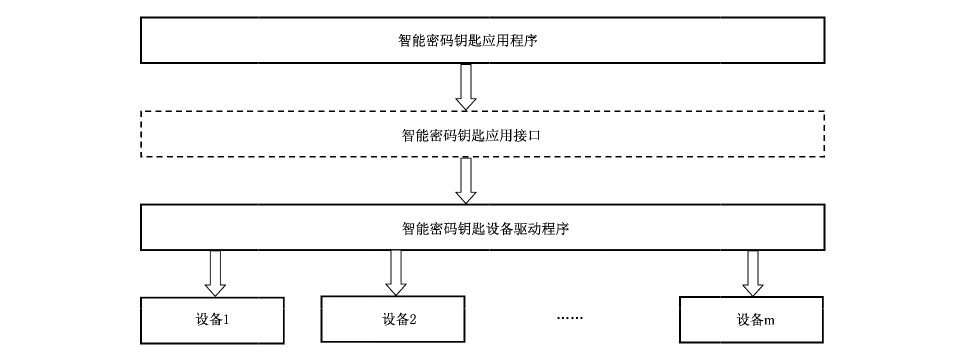
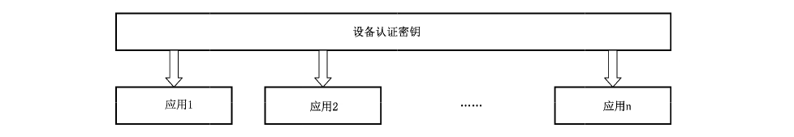
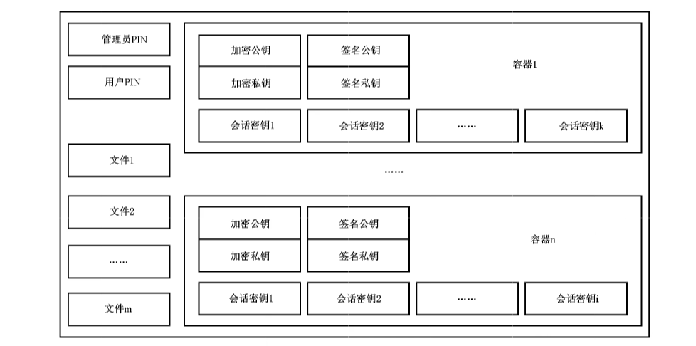

# GB/T 35291-2017 信息安全技术 智能密码钥匙应用接口规范

> 来源：[GB/T 35291-2017 国家标准详情](https://openstd.samr.gov.cn/bzgk/std/newGbInfo?hcno=F969F4765DFEE1CD475201A2D55B10ED)；封面发布日期：2017-12-29；实施日期：2018-07-01。
> 官方在线预览截图 SHA-256：187432e2d662b8173b0ecc36d9fdad45b90f37db4328245ffab6cc41b3baffb3。
> 依据官方在线预览全部 52 页的页面图像转写与核对；省略封面、目录、页眉、页脚和分页，合并印刷折行；3 张结构图保留为从原文页面裁出的图像。

## 前言

本标准依据GB/T 1.1—2009给出的规则起草。

请注意本文件的某些内容可能涉及专利。本文件的发布机构不承担识别这些专利的责任。

本标准由全国信息安全标准化委员会（SAC/TC 260）提出并归口。

本标准起草单位：北京海泰方圆科技股份有限公司、北京握奇智能科技有限公司、北京大明五洲科技有限公司、恒宝股份有限公司、深圳市明华澳汉科技股份有限公司、武汉天喻信息产业股份有限公司、北京飞天诚信科技股份有限公司、华翔腾数码科技有限公司。

本标准起草人：刘平、郭宝安、石玉平、柳增寿、胡俊义、管延军、赵再兴、刘伟丰、何永福、李高锋、汪雪林、赵李明、蒋红宇、王烨。

## 引言

本标准的目标是为公钥密码基础设施应用体系框架下的智能密码钥匙设备制定统一的应用接口标准，通过该接口调用智能密码钥匙，向上层提供基础密码服务。为该类密码设备的开发、使用及检测提供标准依据和指导，有利于提高该类密码设备的产品化、标准化和系列化水平。

本标准未包含标识算法 SM9 相关的应用接口。

## 1 范围

本标准规定了基于 PKI密码体制的智能密码钥匙应用接口，描述了密码相关应用接口的函数、数据类型、参数的定义和设备的安全要求。

本标准适用于智能密码钥匙产品的研制、使用和检测。

## 2 规范性引用文件

下列文件对于本标准的应用是必不可少的。凡是注日期的引用文件，仅注日期的版本适用于本文件。凡是不注日期的引用文件，其最新版本（包括所有的修改单）适用于本文件。

- GB/T 33560 信息安全技术 密码应用标识规范
- GM/T 0022 IPSec VPN 技术规范
- GM/T 0024 SSL VPN 技术规范

## 3 术语和定义

下列术语和定义适用于本文件。

### 3.1 容器 container

密码设备中用于保存密钥所划分的唯一性存储空间。

### 3.2 设备认证 device authentication

智能密码钥匙对应用程序的认证。

### 3.3 设备认证密钥 device authentication key

用于设备认证的密钥。

### 3.4 设备标签 label

由用户设定并存储于设备内部的用于对设备进行标识的字符串。

## 4 缩略语

下列缩略语适用于本文件。

- API：应用编程接口（Application Programming Interface）
- MAC：消息鉴别码（Message Authentication Code）
- PIN：个人身份识别码（Personal Identification Number）
- PKCS#1：公钥密码使用标准系列规范中的第 1 部分，定义 RSA 公开密钥算法加密和签名机制（the Public-Key Cryptography Standard Part 1）
- PKCS#5：公钥密码使用标准系列规范中的第 5 部分，描述一种利用从口令派生出来的安全密钥加密字符串的方法（the Public-Key Cryptography Standard Part 5）
- PKI：公钥基础设施（Public Key Infrastructure）

## 5 结构模型

### 5.1 层次关系

智能密码钥匙应用接口位于智能密码钥匙应用程序与设备驱动程序之间，如图1所示。



### 5.2 设备的应用结构

一个设备中存在设备认证密钥和多个应用，应用之间相互独立。设备的逻辑结构如图2所示。



应用由管理员 PIN、用户PIN、文件和容器组成，可以存在多个文件和多个容器。

每个应用维护各自的与管理员 PIN 和用户 PIN 相关的权限状态。

一个应用的逻辑结构如图3所示。

容器中存放加密密钥对、签名密钥对和会话密钥。其中加密密钥对用于保护会话密钥，签名密钥对用于数字签名和验证，会话密钥用于数据加解密和 MAC运算。容器中也可以存放与加密密钥对对应的加密数字证书和与签名密钥对对应的签名数字证书。其中，签名密钥对由内部产生，加密密钥对由外部产生并安全导人，会话密钥可由内部产生或者由外部产生并安全导人。



## 6 数据类型定义

### 6.1 算法标识

本标准中使用的算法其标识定义见GB/T33560。

### 6.2 基本数据类型

本标准中的字节数组均为高位字节在前（Big-Endian）方式存储和交换。基本数据类型定义如表1所示。

**表1 基本数据类型**

| 类型名称 | 描述 | 定义 |
| --- | --- | --- |
| INT8 | 有符号 8 位整数 |  |
| INT16 | 有符号 16 位整数 |  |
| INT32 | 有符号 32 位整数 |  |
| UINT8 | 无符号 8 位整数 |  |
| UINT16 | 无符号 16 位整数 |  |
| UINT32 | 无符号 32 位整数 |  |
| BOOL | 布尔类型，取值为 TRUE 或 FALSE |  |
| BYTE | 字节类型，无符号 8 位整数 | `typedef UINT8 BYTE` |
| CHAR | 字符类型，无符号 8 位整数 | `typedef UINT8 CHAR` |
| SHORT | 短整数，有符号 16 位 | `typedef INT16 SHORT` |
| USHORT | 无符号 16 位整数 | `typedef UINT16 USHORT` |
| LONG | 长整数，有符号 32 位整数 | `typedef INT32 LONG` |
| ULONG | 长整数，无符号 32 位整数 | `typedef UINT32 ULONG` |
| UINT | 无符号 32 位整数 | `typedef UINT32 UINT` |
| WORD | 字类型，无符号 16 位整数 | `typedef UINT16 WORD` |
| DWORD | 双字类型，无符号 32 位整数 | `typedef UINT32 DWORD` |
| FLAGS | 标志类型，无符号 32 位整数 | `typedef UINT32 FLAGS` |
| LPSTR | 8 位字符串指针，按照 UTF8 格式存储及交换 | `typedef CHAR * LPSTR` |
| HANDLE | 句柄，指向任意数据对象的起始地址 | `typedef void * HANDLE` |
| DEVHANDLE | 设备句柄 | `typedef HANDLE DEVHANDLE` |
| HAPPLICATION | 应用句柄 | `typedef HANDLE HAPPLICATION` |
| HCONTAINER | 容器句柄 | `typedef HANDLE HCONTAINER` |

### 6.3 常量定义

数据常量标识定义了在规范中用到的常量的取值。

数据常量标识的定义如表2所示。

**表2 常量定义**

| 常量名 | 取值 | 描述 |
| --- | --- | --- |
| TRUE | `0x00000001` | 布尔值为真 |
| FALSE | `0x00000000` | 布尔值为假 |
| DEVAPI | `__stdcall` | `__stdcall` 函数调用方式 |
| ADMIN_TYPE | `0` | 管理员 PIN 类型 |
| USER_TYPE | `1` | 用户 PIN 类型 |

### 6.4 复合数据类型

#### 6.4.1 版本

##### 6.4.1.1 类型定义

```c
typedef struct Struct_Version {
    BYTE major;
    BYTE minor;
} VERSION;
```

##### 6.4.1.2 数据项描述

数据项描述见表3。

**表3 版本定义**

| 数据项 | 类型 | 意义 | 备注 |
| --- | --- | --- | --- |
| major | BYTE | 主版本号 | 主版本号和次版本号以“.”分隔，例如 Version 1.0，主版本号为 1，次版本号为 0；Version 2.10，主版本号为 2，次版本号为 10 |
| minor | BYTE | 次版本号 |  |

#### 6.4.2 设备信息

##### 6.4.2.1 类型定义

```c
typedef struct Struct_DEVINFO {
    VERSION Version;
    CHAR Manufacturer[64];
    CHAR Issuer[64];
    CHAR Label[32];
    CHAR SerialNumber[32];
    VERSION HWVersion;
    VERSION FirmwareVersion;
    ULONG AlgSymCap;
    ULONG AlgAsymCap;
    ULONG AlgHashCap;
    ULONG DevAuthAlgId;
    ULONG TotalSpace;
    ULONG FreeSpace;
    ULONG MaxECCBufferSize;
    ULONG MaxBufferSize;
    BYTE Reserved[64];
} DEVINFO_SKF, *PDEVINFO_SKF;
```

##### 6.4.2.2 数据项描述

数据项描述见表4。

**表4 设备信息描述**

| 数据项 | 类型 | 意义 | 备注 |
| --- | --- | --- | --- |
| Version | VERSION | 版本号 | 数据结构版本号，本结构的版本号为 1.0 |
| Manufacturer | CHAR 数组 | 设备厂商信息 | 以 `\0` 为结束符的 ASCII 字符串 |
| Issuer | CHAR 数组 | 发行厂商信息 | 以 `\0` 为结束符的 ASCII 字符串 |
| Label | CHAR 数组 | 设备标签 | 以 `\0` 为结束符的 ASCII 字符串 |
| SerialNumber | CHAR 数组 | 序列号 | 以 `\0` 为结束符的 ASCII 字符串 |
| HWVersion | VERSION | 设备硬件版本 |  |
| FirmwareVersion | VERSION | 设备本身固件版本 |  |
| AlgSymCap | ULONG | 分组密码算法标识 |  |
| AlgAsymCap | ULONG | 非对称密码算法标识 |  |
| AlgHashCap | ULONG | 密码杂凑算法标识 |  |
| DevAuthAlgId | ULONG | 设备认证使用的分组密码算法标识 |  |
| TotalSpace | ULONG | 设备总空间大小 |  |
| FreeSpace | ULONG | 用户可用空间大小 |  |
| MaxECCBufferSize | ULONG | 能够处理的 ECC 加密数据大小 |  |
| MaxBufferSize | ULONG | 能够处理的分组运算和杂凑运算的数据大小 |  |
| Reserved | BYTE | 保留扩展 |  |

#### 6.4.3 RSA 公钥数据结构

##### 6.4.3.1 类型定义

```c
typedef struct Struct_RSAPUBLICKEYBLOB {
    ULONG AlgID;
    ULONG BitLen;
    BYTE Modulus[MAX_RSA_MODULUS_LEN];
    BYTE PublicExponent[MAX_RSA_EXPONENT_LEN];
} RSAPUBLICKEYBLOB, *PRSAPUBLICKEYBLOB;
```

其中，MAX_RSA_MODULUS_LEN 为算法模数的最大长度；MAX_RSA_EXPONENT_LEN 为算法指数的最大长度。

##### 6.4.3.2 数据项描述

数据项描述见表5。

**表5 RSA 公钥数据结构**

| 数据项 | 类型 | 意义 | 备注 |
| --- | --- | --- | --- |
| AlgID | ULONG | 算法标识号 |  |
| BitLen | ULONG | 模数的实际位长度 | 应为 8 的倍数 |
| Modulus | BYTE 数组 | 模数 n=p*q | 实际长度为 BitLen/8 字节<br>`#define MAX_RSA_MODULUS_LEN 256`<br>`#define MAX_RSA_EXPONENT_LEN 4` |
| PublicExponent | BYTE 数组 | 公开密钥 e | 一般为 00010001 |

#### 6.4.4 RSA 私钥数据结构

##### 6.4.4.1 类型定义

```c
typedef struct Struct_RSAPRIVATEKEYBLOB {
    ULONG AlgID;
    ULONG BitLen;
    BYTE Modulus[MAX_RSA_MODULUS_LEN];
    BYTE PublicExponent[MAX_RSA_EXPONENT_LEN];
    BYTE PrivateExponent[MAX_RSA_MODULUS_LEN];
    BYTE Prime1[MAX_RSA_MODULUS_LEN/2];
    BYTE Prime2[MAX_RSA_MODULUS_LEN/2];
    BYTE Prime1Exponent[MAX_RSA_MODULUS_LEN/2];
    BYTE Prime2Exponent[MAX_RSA_MODULUS_LEN/2];
    BYTE Coefficient[MAX_RSA_MODULUS_LEN/2];
} RSAPRIVATEKEYBLOB, *PRSAPRIVATEKEYBLOB;
```

其中，MAX_RSA_MODULUS_LEN 为算法模数的最大长度；MAX_RSA_EXPONENT_LEN 为算法指数的最大长度。

##### 6.4.4.2 数据项描述

数据项描述见表6。

**表6 RSA 私钥数据结构**

| 数据项 | 类型 | 意义 | 备注 |
| --- | --- | --- | --- |
| AlgID | ULONG | 算法标识号 |  |
| BitLen | ULONG | 模数的实际位长度 | 应为 8 的倍数 |
| Modulus | BYTE 数组 | 模数 n=p*q | 实际长度为 BitLen/8 字节 |
| PublicExponent | BYTE 数组 | 公开密钥 e | 一般为 00010001 |
| PrivateExponent | BYTE 数组 | 私有密钥 d | 实际长度为 BitLen/8 字节 |
| Prime1 | BYTE 数组 | 素数 p | 实际长度为 BitLen/16 字节 |
| Prime2 | BYTE 数组 | 素数 q | 实际长度为 BitLen/16 字节 |
| Prime1Exponent | BYTE 数组 | d mod (p-1) 的值 | 实际长度为 BitLen/16 字节 |
| Prime2Exponent | BYTE 数组 | d mod (q-1) 的值 | 实际长度为 BitLen/16 字节 |
| Coefficient | BYTE 数组 | q 模 p 的乘法逆元 | 实际长度为 BitLen/16 字节 |

#### 6.4.5 ECC公钥数据结构

##### 6.4.5.1 类型定义

```c
typedef struct Struct_ECCPUBLICKEYBLOB {
    ULONG BitLen;
    BYTE XCoordinate[ECC_MAX_XCOORDINATE_BITS_LEN/8];
    BYTE YCoordinate[ECC_MAX_YCOORDINATE_BITS_LEN/8];
} ECCPUBLICKEYBLOB, *PECCPUBLICKEYBLOB;
```

其中，ECC_MAX_XCOORDINATE_LEN 为 ECC 算法 X 坐标的最大长度；ECC_MAX_YCOORDINATE_LEN 为 ECC 算法 Y 坐标的最大长度。

##### 6.4.5.2 数据项描述

数据项描述见表7。

**表7 ECC 公钥数据结构**

| 数据项 | 类型 | 意义 | 备注 |
| --- | --- | --- | --- |
| BitLen | ULONG | 模数的实际位长度 | 应为 8 的倍数 |
| XCoordinate | BYTE 数组 | 曲线上点的 X 坐标 | 有限域上的整数<br>`#define ECC_MAX_XCOORDINATE_BITS_LEN 512` |
| YCoordinate | BYTE 数组 | 曲线上点的 Y 坐标 | 有限域上的整数<br>`#define ECC_MAX_YCOORDINATE_BITS_LEN 512` |

#### 6.4.6 ECC 私钥数据结构

##### 6.4.6.1 类型定义

```c
typedef struct Struct_ECCPRIVATEKEYBLOB {
    ULONG BitLen;
    BYTE PrivateKey[ECC_MAX_MODULUS_BITS_LEN/8];
} ECCPRIVATEKEYBLOB, *PECCPRIVATEKEYBLOB;
```

其中，ECC_MAX_MODULUS_BITS_LEN 为 ECC算法模数的最大长度。

##### 6.4.6.2 数据项描述

数据项描述见表8。

**表8 ECC私钥数据结构**

| 数据项 | 类型 | 意义 | 备注 |
| --- | --- | --- | --- |
| BitLen | ULONG | 模数的实际位长度 | 应为 8 的倍数 |
| PrivateKey | BYTE 数组 | 私有密钥 | 有限域上的整数<br>`#define ECC_MAX_MODULUS_BITS_LEN 512` |

#### 6.4.7 ECC密文数据结构

##### 6.4.7.1 类型定义

```c
typedef struct Struct_ECCCIPHERBLOB {
    BYTE XCoordinate[ECC_MAX_XCOORDINATE_BITS_LEN/8];
    BYTE YCoordinate[ECC_MAX_XCOORDINATE_BITS_LEN/8];
    BYTE HASH[32];
    ULONG CipherLen;
    BYTE Cipher[1];
} ECCCIPHERBLOB, *PECCCIPHERBLOB;
```

##### 6.4.7.2 数据项描述

数据项描述见表9。

**表9 ECC密文数据结构**

| 数据项 | 类型 | 意义 | 备注 |
| --- | --- | --- | --- |
| XCoordinate | BYTE 数组 | 与 y 组成椭圆曲线上的点 (x,y) |  |
| YCoordinate | BYTE 数组 | 与 x 组成椭圆曲线上的点 (x,y) |  |
| HASH | BYTE 数组 | 明文的杂凑值 |  |
| CipherLen | ULONG | 密文数据长度 |  |
| Cipher | BYTE 数组 | 密文数据 | 实际长度为 CipherLen |

#### 6.4.8 ECC 签名数据结构

##### 6.4.8.1 类型定义

```c
typedef struct Struct_ECCSIGNATUREBLOB {
    BYTE r[ECC_MAX_XCOORDINATE_BITS_LEN/8];
    BYTE s[ECC_MAX_XCOORDINATE_BITS_LEN/8];
} ECCSIGNATUREBLOB, *PECCSIGNATUREBLOB;
```

其中，ECC_MAX_XCOORDINATE_BITS_LEN 为ECC算法X坐标的最大比特长度。

##### 6.4.8.2 数据项描述

数据项描述见表10。

**表10 ECC签名数据结构**

| 数据项 | 类型 | 意义 | 备注 |
| --- | --- | --- | --- |
| r | BYTE 数组 | 签名结果的 r 部分 |  |
| s | BYTE 数组 | 签名结果的 s 部分 |  |

#### 6.4.9 分组密码参数

##### 6.4.9.1 类型定义

```c
typedef struct Struct_BLOCKCIPHERPARAM {
    BYTE IV[MAX_IV_LEN];
    ULONG IVLen;
    ULONG PaddingType;
    ULONG FeedBitLen;
} BLOCKCIPHERPARAM, *PBLOCKCIPHERPARAM;
```

##### 6.4.9.2 数据项描述

数据项描述见表11。

**表11 分组密码参数**

| 数据项 | 类型 | 意义 | 备注 |
| --- | --- | --- | --- |
| IV | BYTE 数组 | 初始向量，MAX_IV_LEN 为初始化向量的最大长度<br>`#define MAX_IV_LEN 32` |  |
| IVLen | ULONG | 初始向量实际长度（按字节计算） |  |
| PaddingType | ULONG | 填充方式，0 表示不填充，1 表示按照 PKCS #5 方式进行填充 |  |
| FeedBitLen | ULONG | 反馈值的位长度（按位计算） | 只针对 OFB、CFB 模式 |

#### 6.4.10 ECC加密密钥对保护结构

##### 6.4.10.1 类型定义

```c
typedef struct SKF_ENVELOPEDKEYBLOB {
    ULONG Version;
    ULONG ulSymmAlgID;
    ULONG ulBits;
    BYTE cbEncryptedPriKey[64];
    ECCPUBLICKEYBLOB PubKey;
    ECCCIPHERBLOB ECCCipherBlob;
} ENVELOPEDKEYBLOB, *PENVELOPEDKEYBLOB;
```

私钥密文结构中 64 字节，有效密文分组从 0 偏移量字节开始，顺序解密密文分组后将明文连接得到加密密钥对的私钥的明文。

##### 6.4.10.2 数据项描述

数据项描述见表12。

**表12 加密密钥对保护结构参数**

| 数据项 | 类型 | 意义 | 备注 |
| --- | --- | --- | --- |
| Version | ULONG | 版本号，本版本为 1 |  |
| ulSymmAlgID | ULONG | 对称算法标识 | 应为 ECB 模式 |
| ulBits | ULONG | 加密密钥对的密钥位长 |  |
| cbEncryptedPriKey | BYTE 数组 | 对称算法加密的加密私钥，加密私钥的原文为 ECCPRIVATEKEYBLOB 结构中的 PrivateKey | 其有效长度为原文的 (ulBits+7)/8 |
| PubKey | ECCPUBLICKEYBLOB | 加密密钥对的公钥 |  |
| ECCCipherBlob | ECCCIPHERBLOB | 用保护公钥加密过的对称密钥密文 |  |

#### 6.4.11 文件属性

##### 6.4.11.1 类型定义

```c
typedef struct Struct_FILEATTRIBUTE {
    CHAR FileName[32];
    ULONG FileSize;
    ULONG ReadRights;
    ULONG WriteRights;
} FILEATTRIBUTE, *PFILEATTRIBUTE;
```

##### 6.4.11.2 数据项描述

数据项描述见表13。

**表 13 文件属性**

| 数据项 | 类型 | 意义 | 备注 |
| --- | --- | --- | --- |
| FileName | CHAR 数组 | 文件名 | 以 `\0` 结束的 ASCII 字符串，最大长度为 32 |
| FileSize | ULONG | 文件大小 | 创建文件时定义的文件大小 |
| ReadRights | ULONG | 读取权限 | 读取文件需要的权限 |
| WriteRights | ULONG | 写入权限 | 写入文件需要的权限 |

#### 6.4.12 权限类型

权限类型的定义见表14。

**表14 权限类型**

| 权限类型 | 值 | 说明 |
| --- | --- | --- |
| SECURE_NEVER_ACCOUNT | `0x00000000` | 禁用 |
| SECURE_ADM_ACCOUNT | `0x00000001` | 管理员权限 |
| SECURE_USER_ACCOUNT | `0x00000010` | 用户权限 |
| SECURE_ANYONE_ACCOUNT | `0x000000FF` | 任何人 |

#### 6.4.13 设备状态

设备状态的定义见表15。

**表15 设备状态**

| 设备状态 | 值 | 说明 |
| --- | --- | --- |
| DEV_ABSENT_STATE | `0x00000000` | 设备不存在 |
| DEV_PRESENT_STATE | `0x00000001` | 设备存在 |
| DEV_UNKNOW_STATE | `0x00000002` | 设备状态未知 |

## 7 接口函数

### 7.1 设备管理

#### 7.1.1 概述

设备管理主要完成设备的插拔事件处理、枚举设备、连接设备、断开连接、获取设备状态、设置设备标签、获取设备信息、锁定设备、解锁设备和设备命令传输等操作。设备管理系列函数如表16 所示。

**表16 设备管理系列函数**

| 函数名称 | 功能 |
| --- | --- |
| SKF_WaitForDevEvent | 等待设备插拔事件 |
| SKF_CancelWaitForDevEvent | 取消等待设备插拔事件 |
| SKF_EnumDev | 枚举设备 |
| SKF_ConnectDev | 连接设备 |
| SKF_DisconnectDev | 断开连接 |
| SKF_GetDevState | 获取设备状态 |
| SKF_SetLabel | 设置设备标签 |
| SKF_GetDevInfo | 获取设备信息 |
| SKF_LockDev | 锁定设备 |
| SKF_UnlockDev | 解锁设备 |
| SKF_Transmit | 设备命令传输 |

设备管理函数可能返回的错误码见附录 A。

#### 7.1.2 等待设备插拔事件

原型 `ULONG DEVAPI SKF_WaitForDevEvent(LPSTR szDevName, ULONG *pulDevNameLen, ULONG *pulEvent)`

功能描述 该函数等待设备插入或者拔除事件。szDevName 返回发生事件的设备名称。

参数 szDevName ［OUT］发生事件的设备名称。

pulDevNameLen ［IN/OUT］输入/输出参数，当输入时表示缓冲区长度，输出时表示设备名称的有效长度，长度包含字符串结束符。

pulEvent ［OUT］事件类型。1 表示插入，2 表示拔出。

返回值 SAR_OK： 成功。

其他： 错误码。

> 注：本函数为阻塞函数。

#### 7.1.3 取消等待设备插拔事件

原型 `ULONG DEVAPI SKF_CancelWaitForDevEvent()`

功能描述 该函数取消等待设备插入或者拔除事件。

参数返回值 SAR_OK： 成功。

其他： 错误码。

> 注：使本进程正在执行的SKF_WaitForDevEvent 函数立即返回。

#### 7.1.4 枚举设备

原型 `ULONG DEVAPI SKF_EnumDev(BOOL bPresent, LPSTR szNameList, ULONG *pulSize)`

功能描述 获得当前系统中的设备列表。

参数 bPresent ［IN］ TRUE 表示取当前设备状态为存在的设备列表。为FALSE 表示取当前驱动支持的设备列表。

szNameList ［OUT］设备名称列表。如果该参数为 NULL，将由 PulSize 返回所需要的内存空间大小。每个设备的名称以单个“\0’结束，以双“\0’表示列表的结束。

pulSize ［IN,OUT］输入时表示设备名称列表的缓冲区长度，输出时表示 szNameList 所占用的空间大小。

返回值 SAR_OK： 成功。

其他： 错误码。

#### 7.1.5 连接设备

原型 `ULONG DEVAPI SKF_ConnectDev(LPSTR szName, DEVHANDLE *phDev)`

功能描述 通过设备名称连接设备，返回设备的句柄。

参数 szName ［IN］设备名称。

phDev ［OUT］返回设备操作句柄。

返回值 SAR_OK： 成功。

其他： 错误码。

#### 7.1.6 断开连接

原型 `ULONG DEVAPI SKF_DisConnectDev(DEVHANDLE hDev)`

功能描述 断开一个已经连接的设备，并释放句柄。

参数 hDev ［IN］连接设备时返回的设备句柄。

返回值 SAR_OK： 成功。

其他： 错误码。

> 注：如果该设备已被锁定，函数应首先解锁该设备。断开连接操作并不影响设备的权限状态。

#### 7.1.7 获取设备状态

原型 `ULONG DEVAPI SKF_GetDevState(LPSTR szDevName, ULONG *pulDevState)`

功能描述 获取设备是否存在的状态。

参数 szDevName ［IN］设备名称。

pulDevState ［OUT］ 返回设备状态。

返回值 SAR_OK： 成功。

其他： 错误码。

#### 7.1.8 设置设备标签

原型 `ULONG DEVAPI SKF_SetLabel(DEVHANDLE hDev, LPSTR szLabel)`

功能描述 设置设备标签。

参数 hDev ［IN］连接设备时返回的设备句柄。

szLabel ［IN］设备标签字符串。该字符串应小于 32 字节。

返回值 SAR_OK： 成功。

其他： 错误码。

#### 7.1.9 获取设备信息

原型 `ULONG DEVAPI SKF_GetDevInfo(DEVHANDLE hDev, DEVINFO *pDevInfo)`

功能描述 获取设备的一些特征信息，包括设备标签、厂商信息、支持的算法等。

参数 hDev ［IN］连接设备时返回的设备句柄。

pDevInfo ［OUT］ 返回设备信息。

返回值 SAR_OK： 成功。

其他： 错误码。

#### 7.1.10 锁定设备

原型 `ULONG DEVAPI SKF_LockDev(DEVHANDLE hDev, ULONG ulTimeOut)`

功能描述 获得设备的独占使用权。

参数 hDev ［IN］连接设备时返回的设备句柄。

ulTimeOut ［IN］超时时间，单位为毫秒。如果为 0xFFFFFFFF 表示无限等待。

返回值 SAR_OK： 成功。

其他： 错误码。

#### 7.1.11 解锁设备

原型 `ULONG DEVAPI SKF_UnlockDev(DEVHANDLE hDev)`

功能描述 释放对设备的独占使用权。

参数 hDev ［IN］连接设备时返回的设备句柄。

返回值 SAR_OK： 成功。

其他： 错误码。

#### 7.1.12 设备命令传输

原型 `ULONG DEVAPI SKF_Transmit(DEVHANDLE hDev, BYTE *pbCommand, ULONG ulCommandLen, BYTE *pbData, ULONG *pulDataLen)`

功能描述 将命令直接发送给设备，并返回结果。

参数 hDev ［IN］设备句柄。

pbCommand ［IN］ 设备命令。

ulCommandLen ［IN］命令长度。

pbData ［OUT］返回结果数据。

pulDataLen ［IN,OUT］输入时表示结果数据缓冲区长度，输出时表示结果数据实际长度。

返回值 SAR_OK： 成功。

其他： 错误码。

> 注：本函数仅用于设备检测。

### 7.2 访问控制

#### 7.2.1 概述

访问控制主要完成设备认证、PIN码管理和安全状态管理等操作。访问控制系列函数如表17所示。

**表17 访问控制系列函数**

| 函数名称 | 功能 |
| --- | --- |
| SKF_ChangeDevAuthKey | 修改设备认证密钥 |
| SKF_DevAuth | 设备认证 |
| SKF_ChangePIN | 修改 PIN |
| SKF_GetPINInfo | 获得 PIN 码信息 |
| SKF_VerifyPIN | 校验 PIN |
| SKF_UnblockPIN | 解锁 PIN |
| SKF_ClearSecueState | 清除应用安全状态 |

访问控制函数可能返回的错误码见附录 A。

#### 7.2.2 修改设备认证密钥

原型 `ULONG DEVAPI SKF_ChangeDevAuthKey(DEVHANDLE hDev, BYTE *pbKeyValue, ULONG ulKeyLen)`

功能描述 更改设备认证密钥。

参数 hDev ［IN］连接时返回的设备句柄。

pbKeyValue ［IN］密钥值。

ulKeyLen ［IN］密钥长度。

返回值 SAR_OK： 成功。

其他： 错误码。

> 注：权限要求：设备认证成功后才能使用。

#### 7.2.3 设备认证

原型 `ULONG DEVAPI SKF_DevAuth(DEVHANDLE hDev, BYTE *pbAuthData, ULONG ulLen)`

功能描述 设备认证是设备对应用程序的认证。认证过程参见 8.2.3。

参数 hDev ［IN］连接时返回的设备句柄。

pbAuthData ［IN］认证数据。

ulLen ［IN］认证数据的长度。

返回值 SAR_OK： 成功。

其他： 错误码。

#### 7.2.4 修改PIN

原型 `ULONG DEVAPI SKF_ChangePIN(HAPPLICATION hApplication, ULONG ulPINType, LPSTR szOldPin, LPSTR szNewPin, ULONG *pulRetryCount)`

功能描述 调用该函数可以修改 Administrator PIN 和 User PIN 的值。

如果原 PIN码错误导致验证失败，该函数会返回相应 PIN 码的剩余重试次数，当剩余次数为0时，表示 PIN 已经被锁死。

参数 hApplication ［IN］ 应用句柄。

ulPINType ［IN］PIN 类型，可为 ADMIN_TYPE 或 USER_TYPE。

szOldPin ［IN］原 PIN 值。

szNewPin ［IN］新PIN值。

pulRetryCount ［OUT］出错后重试次数。

返回值 SAR_OK： 成功。

其他： 错误码。

#### 7.2.5 获取 PIN信息

原型 `ULONG DEVAPI SKF_GetPINInfo(HAPPLICATION hApplication, ULONG ulPINType, ULONG *pulMaxRetryCount, ULONG *pulRemainRetryCount, BOOL *pbDefaultPin)`

功能描述 获取 PIN 码信息，包括最大重试次数、当前剩余重试次数，以及当前 PIN 码是否为出厂默认 PIN 码。

参数 hApplication ［IN］应用句柄。

ulPINType ［IN］PIN 类型。

pulMaxRetryCount ［OUT］最大重试次数。

pulRemainRetryCount ［OUT］当前剩余重试次数，当为 0 时表示已锁死。

pbDefaultPin ［OUT］ 是否为出厂默认 PIN码。

返回值 SAR_OK： 成功。

其他： 错误码。

#### 7.2.6 校验 PIN

原型 `ULONG DEVAPI SKF_VerifyPIN(HAPPLICATION hApplication, ULONG ulPINType, LPSTR szPIN, ULONG *pulRetryCount)`

功能描述 校验 PIN 码。校验成功后，会获得相应的权限，如果 PIN 码错误，会返回 PIN 码的重试次数，当重试次数为 0 时表示 PIN 码已经锁死。

参数 hApplication ［IN］应用句柄。

ulPINType ［IN］PIN 类型。

szPIN ［IN］PIN 值。

pulRetryCount ［OUT］ 出错后返回的重试次数。

返回值 SAR_OK： 成功。

其他： 错误码。

#### 7.2.7 解锁 PIN

原型 `ULONG DEVAPI SKF_UnblockPIN(HAPPLICATION hApplication, LPSTR szAdminPIN, LPSTR szNewUserPIN, ULONG *pulRetryCount)`

功能描述 当用户的 PIN 码锁死后，通过调用该函数来解锁用户 PIN 码。

解锁后，用户 PIN码被设置成新值，用户 PIN码的重试次数也恢复到原值。

参数 hApplication ［IN］应用句柄。

szAdminPIN ［IN］管理员 PIN码。

szNewUserPIN ［IN］新的用户 PIN码。

pulRetryCount ［OUT］ 管理员 PIN 码错误时，返回剩余重试次数。

返回值 SAR_OK： 成功。

其他： 错误码。

> 注：验证完管理员 PIN 才能够解锁用户 PIN 码，如果输入的 Administrator PIN 不正确或者已经锁死，会调用失败，并返回 Administrator PIN 的重试次数。

#### 7.2.8 清除应用安全状态

原型 `ULONG DEVAPI SKF_ClearSecureState(HAPPLICATION hApplication)`

功能描述 清除应用当前的安全状态。

参数 hApplication ［IN］ 应用句柄。

返回值 SAR_OK： 成功。

其他： 错误码。

### 7.3 应用管理

#### 7.3.1 概述

应用管理主要完成应用的创建、枚举、删除、打开、关闭等操作。应用管理系列函数如表18所示。

**表18 应用管理系列函数**

| 函数名称 | 功能 |
| --- | --- |
| SKF_CreateApplication | 创建应用 |
| SKF_EnumApplication | 枚举应用 |
| SKF_DeleteApplication | 删除应用 |
| SKF_OpenApplication | 打开应用 |
| SKF_CloseApplication | 关闭应用 |

应用管理函数可能返回的错误码见附录 A。

#### 7.3.2 创建应用

原型 `ULONG DEVAPI SKF_CreateApplication(DEVHANDLE hDev, LPSTR szAppName, LPSTR szAdminPin, DWORD dwAdminPinRetryCount, LPSTR szUserPin, DWORD dwUserPinRetryCount, DWORD dwCreateFileRights, HAPPLICATION *phApplication)`

功能描述 创建一个应用。

参数 hDev ［IN］连接设备时返回的设备句柄。

szAppName ［IN］应用名称。

szAdminPin ［IN］ 管理员 PIN。

dwAdminPinRetryCount ［IN］ 管理员 PIN 最大重试次数。

szUserPin ［IN］用户 PIN。

dwUserPinRetryCount ［IN］用户 PIN 最大重试次数。

dwCreateFileRights ［IN］在该应用下创建文件和容器的权限，参见6.4.9权限类型。

为各种权限的或值。

phApplication ［OUT］应用的句柄。

返回值 SAR_OK： 成功。

其他： 错误码。

> 注：权限要求：需要设备权限。

#### 7.3.3 枚举应用

原型 `ULONG DEVAPI SKF_EnumApplication(DEVHANDLE hDev, LPSTR szAppName, ULONG *pulSize)`

功能描述 枚举设备中存在的所有应用。

参数 hDev ［IN］连接设备时返回的设备句柄。

szAppName ［OUT］返回应用名称列表，如果该参数为空，将由 pulSize 返回所需要的内存空间大小。每个应用的名称以单个“\0’结束，以双“\0’表示列表的结束。

pulSize ［IN,OUT］输入时表示应用名称的缓冲区长度，输出时返回 szAppName 所占用的空间大小。

返回值 SAR_OK： 成功。

其他： 错误码。

#### 7.3.4 删除应用

原型 `ULONG DEVAPI SKF_DeleteApplication(DEVHANDLE hDev, LPSTR szAppName)`

功能描述 删除指定的应用。

参数 hDev ［IN］连接设备时返回的设备句柄。

szAppName ［IN］应用名称。

返回值 SAR_OK： 成功。

其他： 错误码。

> 注：权限要求：需要设备权限。

#### 7.3.5 打开应用

原型 `ULONG DEVAPI SKF_OpenApplication(DEVHANDLE hDev, LPSTR szAppName, HAPPLICATION *phApplication)`

功能描述 打开指定的应用。

参数 hDev ［IN］连接设备时返回的设备句柄。

szAppName ［IN］应用名称。

phApplication ［OUT］应用的句柄。

返回值 SAR_OK： 成功。

其他： 错误码。

#### 7.3.6 关闭应用

原型 `ULONG DEVAPI SKF_CloseApplication(HAPPLICATION hApplication)`

功能描述 关闭应用并释放应用句柄。

参数 hApplication ［IN］应用句柄。

返回值 SAR_OK： 成功。

其他： 错误码。

> 注：此函数不影响应用安全状态。

### 7.4 文件管理

#### 7.4.1 概述

文件管理函数用以满足用户扩展开发的需要，包括创建文件、删除文件、枚举文件、获取文件信息、文件读写等操作。文件管理系列函数如表19所示。

**表19 文件管理系列函数**

| 函数名称 | 功能 |
| --- | --- |
| SKF_CreateFile | 创建文件 |
| SKF_DeleteFile | 删除文件 |
| SKF_EnumFiles | 枚举文件 |
| SKF_GetFileInfo | 获取文件信息 |
| SKF_ReadFile | 读文件 |
| SKF_WriteFile | 写文件 |

文件管理函数可能返回的错误码见附录 A。

#### 7.4.2 创建文件

原型 `ULONG DEVAPI SKF_CreateFile(HAPPLICATION hApplication, LPSTR szFileName, ULONG ulFileSize, ULONG ulReadRights, ULONG ulWriteRights)`

功能描述 创建文件时要指定文件的名称、大小，以及文件的读写权限。

参数 hApplication ［IN］应用句柄。

szFileName ［IN］文件名称，长度不得大于32个字节。

ulFileSize ［IN］文件大小。

ulReadRights ［IN］文件读权限，参见 6.4.12 权限类型。可各种权限的或值。

ulWriteRights ［IN］文件写权限，参见6.4.12权限类型。可为各种权限的或值。

返回值 SAR_OK： 成功。

其他： 错误码。

> 注：创建文件需要应用指定的创建文件权限。

#### 7.4.3 删除文件

原型 `ULONG DEVAPI SKF_DeleteFile(HAPPLICATION hApplication, LPSTR szFileName)`

功能描述 删除指定文件：文件删除后，文件中写入的所有信息将丢失。

文件在设备中的占用的空间将被释放。

参数 hApplication ［IN］要删除文件所在的应用句柄。

szFileName ［IN］要删除文件的名称。

返回值 SAR_OK： 成功。

其他： 错误码。

> 注：权限要求：删除一个文件应具有对该文件的创建权限。

#### 7.4.4 枚举文件

原型 `ULONG DEVAPI SKF_EnumFiles(HAPPLICATION hApplication, LPSTR szFileList, ULONG *pulSize)`

功能描述 枚举一个应用下存在的所有文件。

参数 hApplication ［IN］ 应用句柄。

szFileList ［OUT］返回文件名称列表，该参数为空，由 pulSize 返回文件信息所需要的空间大小。每个文件名称以单个 `\0` 结束，以双 `\0` 表示列表的结束。

pulSize ［IN,OUT］输入时表示数据缓冲区的大小，输出时表示实际文件名称列表的长度。

返回值 SAR_OK： 成功。

其他： 错误码。

#### 7.4.5 获取文件属性

原型 `ULONG DEVAPI SKF_GetFileInfo(HAPPLICATION hApplication, LPSTR szFileName, FILEATTRIBUTE *pFileInfo)`

功能描述 获取文件信息：获取应用文件的属性信息，例如文件的大小、权限等。

参数 hApplication ［IN］文件所在应用的句柄。

szFileName ［IN］文件名称。

pFileInfo ［OUT］ 文件信息，指向文件属性结构的指针。

返回值 SAR_OK： 成功。

其他： 错误码。

#### 7.4.6 读文件

原型 `ULONG DEVAPI SKF_ReadFile(HAPPLICATION hApplication, LPSTR szFileName, ULONG ulOffset, ULONG ulSize, BYTE *pbOutData, ULONG *pulOutLen)`

功能描述 读取文件内容。

参数 hApplication ［IN］ 应用句柄。

szFileName ［IN］ 文件名。

ulOffset ［IN］文件读取偏移位置。

ulSize ［IN］要读取的长度。

pbOutData ［OUT］返回数据的缓冲区。

pulOutLen ［IN,OUT］输入时表示给出的缓冲区大小；输出时表示实际读取返回的数据大小。

返回值 SAR_OK： 成功。

其他： 错误码。

> 注：权限要求：须具备对该文件的读权限。

#### 7.4.7 写文件

原型 `ULONG DEVAPI SKF_WriteFile(HAPPLICATION hApplication, LPSTR szFileName, ULONG ulOffset, BYTE *pbData, ULONG ulSize)`

功能描述 写数据到文件中。

参数 hApplication ［IN］应用句柄。

szFileName ［IN］文件名。

ulOffset ［IN］写入文件的偏移量。

pbData ［IN］写入数据缓冲区。

ulSize ［IN］写入数据的大小。

返回值 SAR_OK： 成功。

其他： 错误码。

> 注：权限要求：须具备该文件的写权限。

### 7.5 容器管理

#### 7.5.1 概述

本标准提供的应用管理用于满足各种不同应用的管理，包括创建、删除、枚举、打开和关闭容器的操作。容器管理系列函数如表20所示。

**表20 容器管理系列函数**

| 函数名称 | 功能 |
| --- | --- |
| SKF_CreateContainer | 创建容器 |
| SKF_DeleteContainer | 删除容器 |
| SKF_EnumContainer | 枚举容器 |
| SKF_OpenContainer | 打开容器 |
| SKF_CloseContainer | 关闭容器 |
| SKF_GetContainerType | 获得容器类型 |
| SKF_ImportCertificate | 导入数字证书 |
| SKF_ExportCertificate | 导出数字证书 |

容器管理函数可能返回的错误码见附录A。

#### 7.5.2 创建容器

原型 `ULONG DEVAPI SKF_CreateContainer(HAPPLICATION hApplication, LPSTR szContainerName, HCONTAINER *phContainer)`

功能描述 在应用下建立指定名称的容器并返回容器句柄。

参数 hApplication ［IN］应用句柄。

szContainerName ［IN］ ASCII 字符串，表示所建立容器的名称，容器名称的最大长度不能超过64字节。

phContainer ［OUT］返回所建立容器的容器句柄。

返回值 SAR_OK： 成功。

其他： 错误码。

> 注：权限要求：需要用户权限。

#### 7.5.3 删除容器

原型 `ULONG DEVAPI SKF_DeleteContainer(HAPPLICATION hApplication, LPSTR szContainerName)`

功能描述 在应用下删除指定名称的容器并释放容器相关的资源。

参数 hApplication ［IN］应用句柄。

szContainerName ［IN］ 指向删除容器的名称。

返回值 SAR_OK： 成功。

其他： 错误码。

> 注：权限要求：需要用户权限。

#### 7.5.4 打开容器

原型 `ULONG DEVAPI SKF_OpenContainer(HAPPLICATION hApplication, LPSTR szContainerName, HCONTAINER *phContainer)`

功能描述 获取容器句柄。

参数 hApplication ［IN］应用句柄。

szContainerName ［IN］ 容器的名称。

phContainer ［OUT］返回所打开容器的句柄。

返回值 SAR_OK： 成功。

其他： 错误码。

#### 7.5.5 关闭容器

原型 `ULONG DEVAPI SKF_CloseContainer(HCONTAINER hContainer)`

功能描述 关闭容器句柄，并释放容器句柄相关资源。

参数 hContainer ［IN］容器句柄。

返回值 SAR_OK： 成功。

其他： 错误码。

#### 7.5.6 枚举容器

原型 `ULONG DEVAPI SKF_EnumContainer(HAPPLICATION hApplication, LPSTR szContainerName, ULONG *pulSize)`

功能描述 枚举容器下所有容器并返回容器名称列表。

参数 hApplication ［IN］应用句柄。

szContainerName ［OUT］指向容器名称列表缓冲区，如果此参数为 NULL 时，pulSize 表示返回数据所需缓冲区的长度；如果此参数不为 NULL 时，返回容器名称列表，每个容器名以 `\0` 为结束，列表以双 `\0` 结束。

pulSize ［IN,OUT］输入时表示 szContainerName 缓存区的长度，输出时表示容器名称列表的长度。

返回值 SAR_OK： 成功。

其他： 错误码。

#### 7.5.7 获得容器类型

原型 `ULONG DEVAPI SKF_GetContainerType(HCONTAINER hContainer, ULONG *pulContainerType)`

功能描述 获取容器的类型。

参数 hContainer ［IN］容器句柄。

pulContainerType ［OUT］获得的容器类型。指针指向的值为 0 表示未定、尚未分配类型或者为空容器，为 1 表示为 RSA 容器，为 2 表示为 SM2 容器。

返回值 SAR_OK： 成功。

其他： 错误码。

#### 7.5.8 导入数字证书

原型 `ULONG DEVAPI SKF_ImportCertificate(HCONTAINER hContainer, BOOL bSignFlag, BYTE *pbCert, ULONG ulCertLen)`

功能描述 向容器内导入数字证书。

参数 hContainer ［IN］容器句柄。

bSignFlag ［IN］ TRUE 表示签名证书，FALSE 表示加密证书。

pbCert ［IN］指向证书内容缓冲区。

ulCertLen ［IN］证书长度。

返回值 SAR_OK： 成功。

其他： 错误码。

#### 7.5.9 导出数字证书

原型 `ULONG DEVAPI SKF_ExportCertificate(HCONTAINER hContainer, BOOL bSignFlag, BYTE *pbCert, ULONG *pulCertLen)`

功能描述 从容器内导出数字证书。

参数 hContainer ［IN］ 容器句柄。

bSignFlag ［IN］TRUE 表示签名证书，FALSE 表示加密证书。

pbCert ［OUT］指向证书内容缓冲区，如果此参数为 NULL 时，pulCertLen 表示返回数据所需缓冲区的长度；如果此参数不为 NULL 时，返回数字证书内容。

pulCertLen ［IN/OUT］输入时表示pbCert 缓冲区的长度，输出时表示证书内容的长度。

返回值 SAR_OK： 成功。

其他： 错误码。

### 7.6 密码服务

#### 7.6.1 概述

密码服务函数提供对称算法运算、非对称算法运算、密码杂淡运算、密钥管理、消息鉴别码计算等功能。密码服务系列函数如表21 所示。

**表21 密码服务系列函数**

| 函数名称 | 功能 |
| --- | --- |
| SKF_GenRandom | 生成随机数 |
| SKF_GenExtRSAKey | 生成外部 RSA 密钥对 |
| SKF_GenRSAKeyPair | 生成 RSA 签名密钥对 |
| SKF_ImportRSAKeyPair | 导入 RSA 加密密钥对 |
| SKF_RSASignData | RSA 签名 |
| SKF_RSAVerify | RSA 验签 |
| SKF_RSAExportSessionKey | RSA 生成并导出会话密钥 |
| SKF_ExtRSAPubKeyOperation | RSA 外来公钥运算 |
| SKF_ExtRSAPriKeyOperation | RSA 外来私钥运算 |
| SKF_GenECCKeyPair | 生成 ECC 签名密钥对 |
| SKF_ImportECCKeyPair | 导入 ECC 加密密钥对 |
| SKF_ECCSignData | ECC 签名 |
| SKF_ECCVerify | ECC 验签 |
| SKF_ECCExportSessionKey | ECC 生成并导出会话密钥 |
| SKF_ExtECCEncrypt | ECC 外来公钥加密 |
| SKF_ExtECCDecrypt | ECC 外来私钥解密 |
| SKF_ExtECCSign | ECC 外来私钥签名 |
| SKF_ExtECCVerify | ECC 外来公钥验签 |
| SKF_GenerateAgreementDataWithECC | ECC 生成密钥协商参数并输出 |
| SKF_GenerateKeyWithECC | ECC 计算会话密钥 |
| SKF_GenerateAgreementDataAndKeyWithECC | ECC 产生协商数据并计算会话密钥 |
| SKF_GenerateKeywithIKE | 计算 IKE 工作密钥 |
| SKF_GenerateKeywithEPK_IKE | 计算 IKE 工作密钥并用外部公钥加密导出 |
| SKF_GenerateKeywithIPSEC | 计算 IPSEC 会话密钥 |
| SKF_GenerateKeywithEPK_IPSEC | 计算 IPSEC 会话密钥并用外部公钥加密导出 |
| SKF_GenerateKeywithSSL | 计算 SSL 工作密钥 |
| SKF_GenerateKeywithEPK_SSL | 计算 SSL 工作密钥并用外部公钥加密导出 |
| SKF_ExportPublicKey | 导出公钥 |
| SKF_ImportSessionKey | 导入会话密钥 |
| SKF_SetSymmKey | 明文导入会话密钥 |
| SKF_EncryptInit | 加密初始化 |
| SKF_Encrypt | 单组数据加密 |
| SKF_EncryptUpdate | 多组数据加密 |
| SKF_EncryptFinal | 结束加密 |
| SKF_DecryptInit | 解密初始化 |
| SKF_Decrypt | 单组数据解密 |
| SKF_DecryptUpdate | 多组数据解密 |
| SKF_DecryptFinal | 结束解密 |
| SKF_DigestInit | 密码杂凑初始化 |
| SKF_Digest | 单组数据密码杂凑 |
| SKF_DigestUpdate | 多组数据密码杂凑 |
| SKF_DigestFinal | 结束密码杂凑 |
| SKF_MacInit | 消息鉴别码运算初始化 |
| SKF_Mac | 单组数据消息鉴别码运算 |
| SKF_MacUpdate | 多组数据消息鉴别码运算 |
| SKF_MacFinal | 结束消息鉴别码运算 |
| SKF_CloseHandle | 关闭密码对象句柄 |

密码服务函数可能返回的错误码见附录 A。

#### 7.6.2 生成随机数

原型 `ULONG DEVAPI SKF_GenRandom(DEVHANDLE hDev, BYTE *pbRandom, ULONG ulRandomLen)`

功能描述 产生指定长度的随机数。

参数 hDev ［IN］ 设备句柄。

pbRandom ［OUT］ 返回的随机数。

ulRandomLen ［IN］随机数长度。

返回值 SAR_OK： 成功。

其他： 错误码。

#### 7.6.3 生成外部 RSA密钥对

原型 `ULONG DEVAPI SKF_GenExtRSAKey(DEVHANDLE hDev, ULONG ulBitsLen, RSAPRIVATEKEYBLOB *pBlob)`

功能描述 由设备生成 RSA 密钥对并明文输出。

参数 hDev ［IN］设备句柄。

ulBitsLen ［IN］密钥模长。

pBlob ［OUT］ 返回的私钥数据结构。

返回值 SAR_OK： 成功。

其他： 错误码。

> 注：生成的私钥只用于输出，接口内不做保留和计算。

#### 7.6.4 生成 RSA 签名密钥对

原型 `ULONG DEVAPI SKF_GenRSAKeyPair(HCONTAINER hContainer, ULONG ulBitsLen, RSAPUBLICKEYBLOB *pBlob)`

功能描述 生成 RSA 签名密钥对并输出签名公钥。

参数 hContainer ［IN］容器句柄。

ulBitsLen ［IN］密钥模长。

pBlob ［OUT］返回的RSA公钥数据结构。

返回值 SAR_OK： 成功。

其他： 错误码。

> 注：权限要求：需要用户权限。

#### 7.6.5 导入 RSA加密密钥对

原型 `ULONG DEVAPI SKF_ImportRSAKeyPair(HCONTAINER hContainer, ULONG ulSymAlgId, BYTE *pbWrappedKey, ULONG ulWrappedKeyLen, BYTE *pbEncryptedData, ULONG ulEncryptedDataLen)`

功能描述 导入 RSA 加密公私钥对。

参数 hContainer ［IN］容器句柄。

ulSymAlgId ［IN］对称算法密钥标识。

pbWrappedKey ［IN］使用该容器内签名公钥保护的对称算法密钥。

ulWrappedKeyLen ［IN］保护的对称算法密钥长度。

pbEncryptedData ［IN］对称算法密钥保护的 RSA 加密私钥。私钥的格式遵循 PKCS #1 v2.1:RSA Cryptography Standard 中的私钥格式定义。

ulEncryptedDataLen ［IN］对称算法密钥保护的 RSA 加密公私钥对长度。

返回值 SAR_OK： 成功。

其他： 错误码。

> 注：权限要求：需要用户权限。

#### 7.6.6 RSA 签名

原型 `ULONG DEVAPI SKF_RSASignData(HCONTAINER hContainer, BYTE *pbData, ULONG ulDataLen, BYTE *pbSignature, ULONG *pulSignLen)`

功能描述 使用 hContainer 指定容器的签名私钥，对指定数据 pbData 进行数字签名。签名后的结果存放到 pbSignature 缓冲区，设置 pulSignLen 为签名的长度。

参数 hContainer ［IN］ 用来签名的私钥所在容器句柄。

pbData ［IN］被签名的数据。

ulDataLen ［IN］签名数据长度，应不大于 RSA 密钥模长-11。

pbSignature ［OUT］存放签名结果的缓冲区指针，如果值为 NULL，用于取得签名结果长度。

pulSignLen ［IN,OUT］ 输入时表示签名结果缓冲区大小，输出时表示签名结果长度。

返回值 SAR_OK： 成功。

其他： 错误码。

> 注：权限要求：需要用户权限。

#### 7.6.7 RSA 验签

原型 `ULONG DEVAPI SKF_RSAVerify(DEVHANDLE hDev, RSAPUBLICKEYBLOB *pRSAPubKeyBlob, BYTE *pbData, ULONG ulDataLen, BYTE *pbSignature, ULONG ulSignLen)`

功能描述 验证 RSA 签名。用 pRSAPubKeyBlob 内的公钥值对待验签数据进行验签。

参数 hDev ［IN］设备句柄。

pRSAPubKeyBlob ［IN］ RSA 公钥数据结构。

pbData ［IN］待验证签名的数据。

ulDataLen ［IN］数据长度，应不大于公钥模长-11。

pbSignature ［IN］待验证的签名值。

ulSignLen ［IN］签名值长度，应为公钥模长。

返回值 SAR_OK： 成功。

其他： 错误码。

#### 7.6.8 RSA 生成并导出会话密钥

原型 `ULONG DEVAPI SKF_RSAExportSessionKey(HCONTAINER hContainer, ULONG ulAlgId, RSAPUBLICKEYBLOB *pPubKey, BYTE *pbData, ULONG *pulDataLen, HANDLE *phSessionKey)`

功能描述 生成会话密钥并用外部 RSA 公钥加密输出。

参数 hContainer ［IN］ 容器句柄。

ulAlgId ［IN］会话密钥算法标识。

pPubKey ［IN］加密会话密钥的 RSA 公钥数据结构。

pbData ［OUT］导出的加密会话密钥密文，按照 PKCS#1v1.5 要求封装。

pulDataLen ［IN,OUT］输入时表示会话密钥密文数据缓冲区长度，输出时表示会话密钥密文的实际长度。

phSessionKey ［OUT］ 导出的密钥句柄。

返回值 SAR_OK： 成功。

其他： 错误码。

#### 7.6.9 RSA外来公钥运算

原型 `ULONG DEVAPI SKF_ExtRSAPubKeyOperation(DEVHANDLE hDev, RSAPUBLICKEYBLOB *pRSAPubKeyBlob, BYTE *pbInput, ULONG ulInputLen, BYTE *pbOutput, ULONG *pulOutputLen)`

功能描述 使用外部传入的 RSA 公钥对输入数据做公钥运算并输出结果。

参数 hDev ［IN］设备句柄。

pRSAPubKeyBlob ［IN］RSA 公钥数据结构。

pbInput ［IN］指向待运算的原始数据缓冲区。

ulInputLen ［IN］待运算原始数据的长度，应为公钥模长。

pbOutput ［OUT］指向 RSA 公钥运算结果缓冲区，如果该参数 NULL，则由 pulOutputLen 返回运算结果的实际长度。

pulOutputLen ［IN,OUT］ 输入时表示 pbOutput 缓冲区的长度，输出时表示 RSA 公钥运算结果的实际长度。

返回值 SAR_OK： 成功。

其他： 错误码。

#### 7.6.10 RSA外来私钥运算

原型 `ULONG DEVAPI SKF_ExtRSAPriKeyOperation(DEVHANDLE hDev, RSAPRIVATEKEYBLOB *pRSAPriKeyBlob, BYTE *pbInput, ULONG ulInputLen, BYTE *pbOutput, ULONG *pulOutputLen)`

功能描述 直接使用外部传入的 RSA 私钥对输入数据做私钥运算并输出结果。

参数 hDev ［IN］设备句柄。

pRSAPriKeyBlob ［IN］ RSA 私钥数据结构。

pbInput ［IN］指向待运算数据缓冲区。

ulInputLen ［IN］待运算数据的长度，应为公钥模长。

pbOutput ［OUT］ RSA 私钥运算结果，如果该参数 NULL，则由 pulOutputLen 返回运算结果的实际长度。

pulOutputLen ［IN,OUT］ 输入时表示 pbOutput 缓冲区的长度，输出时表示 RSA 私钥运算结果的实际长度。

返回值 SAR_OK： 成功。

其他： 错误码。

> 注：本函数仅用于测试和调试，不建议用于实际的密码服务。

#### 7.6.11 生成 ECC 签名密钥对

原型 `ULONG DEVAPI SKF_GenECCKeyPair(HCONTAINER hContainer, ULONG ulAlgId, ECCPUBLICKEYBLOB *pBlob)`

功能描述 生成 ECC 签名密钥对并输出签名公钥。

参数 hContainer ［IN］密钥容器句柄。

ulAlgId ［IN］算法标识，只支持 SGD_SM2_1 算法。

pBlob ［OUT］返回 ECC 公钥数据结构。

返回值 SAR_OK： 成功。

其他： 错误码。

> 注：权限要求：需要用户权限。

#### 7.6.12 导入ECC加密密钥对

原型 `ULONG DEVAPI SKF_ImportECCKeyPair(HCONTAINER hContainer, PENVELOPEDKEYBLOB pEnvelopedKeyBlob)`

功能描述 导入 ECC 公私钥对。

参数 hContainer ［IN］密钥容器句柄。

pEnvelopedKeyBlob ［IN］受保护的加密密钥对。

返回值 SAR_OK： 成功。

其他： 错误码。

> 注：权限要求：需要用户权限。

#### 7.6.13 ECC 签名

原型 `ULONG DEVAPI SKF_ECCSignData(HCONTAINER hContainer, BYTE *pbData, ULONG ulDataLen, PECCSIGNATUREBLOB pSignature)`

功能描述 ECC 数字签名。采用 ECC 算法和指定私钥 hKey，对指定数据 pbData 进行数字签名。签名后的结果存放到 pSignature 中。

参数 hContainer ［IN］密钥容器句柄。

pbData ［IN］待签名的数据。

ulDataLen ［IN］待签名数据长度，应小于密钥模长。

pSignature ［OUT］签名值。

返回值 SAR_OK： 成功。

其他： 错误码。

> 注：权限要求：需要用户权限。

输入数据为待签数据的杂凑值。当使用 SM2 算法时，该输入数据为待签数据经过 SM2 签名预处理的结果，预处理过程遵循 GB/T 35276。

#### 7.6.14 ECC 验签

原型 `ULONG DEVAPI SKF_ECCVerify(DEVHANDLE hDev, ECCPUBLICKEYBLOB *pECCPubKeyBlob, BYTE *pbData, ULONG ulDataLen, PECCSIGNATUREBLOB pSignature)`

功能描述 用 ECC 公钥对数据进行验签。

参数 hDev ［IN］设备句柄。

pECCPubKeyBlob ［IN］ ECC 公钥数据结构。

pbData ［IN］待验证签名的数据。

ulDataLen ［IN］数据长度。

pSignature ［IN］待验证签名值。

返回值 SAR_OK： 成功。

其他： 错误码。

> 注：输入数据为待签数据的杂凑值。当使用 SM2 算法时，该输入数据为待签数据经过 SM2 签名预处理的结果，预处理过程遵循 GB/T 35276。

#### 7.6.15 ECC生成并导出会话密钥

原型 `ULONG DEVAPI SKF_ECCExportSessionKey(HCONTAINER hContainer, ULONG ulAlgId, ECCPUBLICKEYBLOB *pPubKey, PECCCIPHERBLOB pData, HANDLE *phSessionKey)`

功能描述 生成会话密钥并用外部公钥加密导出。

参数 hContainer ［IN］容器句柄。

ulAlgId ［IN］会话密钥算法标识。

pPubKey ［IN］外部输入的公钥结构。

pData ［OUT］ 会话密钥密文。

phSessionKey ［OUT］会话密钥句柄。

返回值 SAR_OK： 成功。

其他： 错误码。

#### 7.6.16 ECC外来公钥加密

原型 `ULONG DEVAPI SKF_ExtECCEncrypt(DEVHANDLE hDev, ECCPUBLICKEYBLOB *pECCPubKeyBlob, BYTE *pbPlainText, ULONG ulPlainTextLen, PECCCIPHERBLOB pCipherText)`

功能描述 使用外部传入的 ECC 公钥对输入数据做加密运算并输出结果。

参数 hDev ［IN］ 设备句柄。

pECCPubKeyBlob ［IN］ ECC公钥数据结构。

pbPlainText ［IN］ 待加密的明文数据。

ulPlainTextLen ［IN］待加密明文数据的长度。

pCipherText ［OUT］ 密文数据。

返回值 SAR_OK： 成功。

其他： 错误码。

#### 7.6.17 ECC外来私钥解密

原型 `ULONG DEVAPI SKF_ExtECCDecrypt(DEVHANDLE hDev, ECCPRIVATEKEYBLOB *pECCPriKeyBlob, PECCCIPHERBLOB pCipherText, BYTE *pbPlainText, ULONG *pulPlainTextLen)`

功能描述 使用外部传入的 ECC 私钥对输入数据做解密运算并输出结果。

参数 hDev ［IN］设备句柄。

pECCPriKeyBlob ［IN］ ECC 私钥数据结构。

pCipherText ［IN］ 待解密的密文数据。

pbPlainText ［OUT］返回明文数据，如果该参数为 NULL，则由 pulPlainTextLen 返回明文数据的实际长度。

pulPlainTextLen ［IN,OUT］ 输入时表示 pbPlainText 缓冲区的长度，输出时表示明文数据的实际长度。

返回值 SAR_OK： 成功。

其他： 错误码。

> 注：本函数仅用于测试和调试，不建议用于实际的密码服务。

#### 7.6.18 ECC外来私钥签名

原型 `ULONG DEVAPI SKF_ExtECCSign(DEVHANDLE hDev, ECCPRIVATEKEYBLOB *pECCPriKeyBlob, BYTE *pbData, ULONG ulDataLen, PECCSIGNATUREBLOB pSignature)`

功能描述 使用外部传入的 ECC 私钥对输入数据做签名运算并输出结果。

参数 hDev ［IN］设备句柄。

pECCPriKeyBlob ［IN］ ECC 私钥数据结构。

pbData ［IN］待签名数据。

ulDataLen ［IN］待签名数据的长度。

pSignature ［OUT］ 签名值。

返回值 SAR_OK： 成功。

其他： 错误码。

注1：输入数据为待签数据的杂凑值。当使用 SM2 算法时，该输入数据为待签数据经过 SM2 签名预处理的结果，预处理过程遵循 GB/T 35276。

注2：本函数仅用于测试和调试，不建议用于实际的密码服务。

#### 7.6.19 ECC 外来公钥验签

原型 `ULONG DEVAPI SKF_ExtECCVerify(DEVHANDLE hDev, ECCPUBLICKEYBLOB *pECCPubKeyBlob, BYTE *pbData, ULONG ulDataLen, PECCSIGNATUREBLOB pSignature)`

功能描述 外部使用传入的 ECC 公钥做签名验证。

参数 hDev ［IN］设备句柄。

pECCPubKeyBlob ［IN］ECC公钥数据结构。

pbData ［IN］待验证数据。

ulDataLen ［IN］待验证数据的长度。

pSignature ［IN］ 签名值。

返回值 SAR_OK： 成功。

其他： 错误码。

> 注：输入数据为待签数据的杂凑值。当使用 SM2 算法时，该输入数据为待签数据经过 SM2 签名预处理的结果，预处理过程遵循 GB/T 35276。

#### 7.6.20 ECC生成密钥协商参数并输出

原型 `ULONG DEVAPI SKF_GenerateAgreementDataWithECC(HCONTAINER hContainer, ULONG ulAlgId, ECCPUBLICKEYBLOB *pTempECCPubKeyBlob, BYTE *pbID, ULONG ulIDLen, HANDLE *phAgreementHandle)`

功能描述 使用 ECC 密钥协商算法，为计算会话密钥而产生协商参数，返回临时 ECC 密钥对的公钥及协商句柄。

参数 hContainer ［IN］容器句柄。

ulAlgId ［IN］会话密钥算法标识。

pTempECCPubKeyBlob ［OUT］发起方临时 ECC 公钥。

pbID ［IN］发起方的 ID。

ulIDLen ［IN］发起方 ID 的长度，不大于 32。

phAgreementHandle ［OUT］返回的密钥协商句柄。

返回值 SAR_OK： 成功。

其他： 错误码。

> 注：为协商会话密钥，协商的发起方应首先调用本函数。

#### 7.6.21 ECC产生协商数据并计算会话密钥

原型 `ULONG DEVAPI SKF_GenerateAgreementDataAndKeyWithECC(HANDLE hContainer, ULONG ulAlgId, ECCPUBLICKEYBLOB *pSponsorECCPubKeyBlob, ECCPUBLICKEYBLOB *pSponsorTempECCPubKeyBlob, ECCPUBLICKEYBLOB *pTempECCPubKeyBlob, BYTE *pbID, ULONG ulIDLen, BYTE *pbSponsorID, ULONG ulSponsorIDLen, HANDLE *phKeyHandle)`

功能描述 使用 ECC 密钥协商算法，产生协商参数并计算会话密钥，输出临时 ECC 密钥对公钥，并返回产生的密钥句柄。

参数 hContainer ［IN］容器句柄。

ulAlgId ［IN］会话密钥算法标识。

pSponsorECCPubKeyBlob ［IN］发起方的 ECC公钥。

pSponsorTempECCPubKeyBlob ［IN］发起方的临时 ECC 公钥。

pTempECCPubKeyBlob ［OUT］ 响应方的临时ECC公钥。

pbID ［IN］响应方的ID。

ulIDLen ［IN］ 响应方 ID 的长度，不大于 32。

pbSponsorID ［IN］发起方的 ID。

ulSponsorIDLen ［IN］发起方 ID 的长度，不大于 32。

phKeyHandle ［OUT］返回的对称算法密钥句柄。

返回值 SAR_OK： 成功。

其他： 错误码。

> 注：本函数由响应方调用。

#### 7.6.22 ECC计算会话密钥

原型 `ULONG DEVAPI SKF_GenerateKeyWithECC(HANDLE hAgreementHandle, ECCPUBLICKEYBLOB *pECCPubKeyBlob, ECCPUBLICKEYBLOB *pTempECCPubKeyBlob, BYTE *pbID, ULONG ulIDLen, HANDLE *phKeyHandle)`

功能描述 使用 ECC 密钥协商算法，使用自身协商句柄和响应方的协商参数计算会话密钥，同时返回会话密钥句柄。

参数 hAgreementHandle ［IN］密钥协商句柄。

pECCPubKeyBlob ［IN］外部输入的响应方 ECC 公钥。

pTempECCPubKeyBlob ［IN］外部输入的响应方临时 ECC 公钥。

pbID ［IN］响应方的 ID。

ulIDLen ［IN］ 响应方 ID 的长度，不大于 32。

phKeyHandle ［OUT］返回的密钥句柄。

返回值 SAR_OK： 成功。

其他： 错误码。

> 注：协商的发起方获得响应方的协商参数后调用本函数，计算会话密钥。计算过程遵循 GB/T 35276。

#### 7.6.23 计算 IKE 工作密钥

原型

```c
int SKF_GenerateKeywithIKE(
    HANDLE hSessionHandle,
    BYTE *pucSponsorNonce, UINT uiSponsorNonceLength,
    BYTE *pucResponseNonce, UINT uiResponseNonceLength,
    BYTE *pucSponsorCookie, UINT uiSponsorCookieLength,
    BYTE *pucResponseCookie, UINT uiResponseCookieLength,
    UINT uiPrfAlgID,
    UINT uiKeyBitsD, HANDLE phKeyHandleD,
    UINT uiKeyBitsA, HANDLE phKeyHandleA,
    UINT uiKeyBitsE, HANDLE phKeyHandleE);
```

功能描述 使用 IKE 一阶段（主模式）交换得到的密钥计算参数计算 IKE 工作密钥，同时返回工作密钥句柄。

参数

| 参数 | 方向 | 说明 |
| --- | --- | --- |
| hSessionHandle | in | 与设备建立的会话句柄 |
| pucSponsorNonce | in | 发起方 nonce 载荷主体 |
| uiSponsorNonceLength | in | 发起方 nonce 载荷主体长度 |
| pucResponseNonce | in | 响应方 nonce 载荷主体 |
| uiResponseNonceLength | in | 响应方 nonce 载荷主体长度 |
| pucSponsorCookie | in | 发起方 cookie |
| uiSponsorCookieLength | in | 发起方 cookie 长度 |
| pucResponseCookie | in | 响应方 cookie |
| uiResponseCookieLength | in | 响应方 cookie 长度 |
| uiPrfAlgID | in | PRF 算法标识 |
| uiKeyBitsD | in | 返回的 SKEYID_d 密钥长度 |
| phKeyHandleD | out | 返回的 SKEYID_d 密钥句柄 |
| uiKeyBitsA | in | 返回的 SKEYID_a 密钥长度 |
| phKeyHandleA | out | 返回的 SKEYID_a 密钥句柄 |
| uiKeyBitsE | in | 返回的 SKEYID_e 密钥长度 |
| phKeyHandleE | out | 返回的 SKEYID_e 密钥句柄 |

返回值 0：成功。非 0：失败，返回错误代码。

> 注：IKE 一阶段（主模式）消息 3 和消息 4 交互完成后，参与通信的双方各自调用本函数，计算后续工作密钥 SKEYID_d、SKEYID_a、SKEYID_e。IKE 一阶段（主模式）计算 IKE 工作密钥的过程见 GM/T 0022，输入的密钥参数按顺序为 Ni_b、Nr_b、CKY-I、CKY-R，返回的密钥句柄按顺序为 SKEYID_d、SKEYID_a、SKEYID_e。

#### 7.6.24 计算 IKE 工作密钥并用外部 ECC公钥加密输出

原型

```c
int SKF_GenerateKeywithEPK_IKE(
    HANDLE hSessionHandle,
    BYTE *pucSponsorNonce, UINT uiSponsorNonceLength,
    BYTE *pucResponseNonce, UINT uiResponseNonceLength,
    BYTE *pucSponsorCookie, UINT uiSponsorCookieLength,
    BYTE *pucResponseCookie, UINT uiResponseCookieLength,
    UINT uiPrfAlgID, UINT uiEccAlgID,
    ECCrefPublicKey *pucPublicKey,
    UINT uiKeyBitsD, ECCCipher *pucKeyD, HANDLE phKeyHandleD,
    UINT uiKeyBitsA, ECCCipher *pucKeyA, HANDLE phKeyHandleA,
    UINT uiKeyBitsE, ECCCipher *pucKeyE, HANDLE phKeyHandleE);
```

描述 使用 IKE 一阶段（主模式）交换得到的密钥计算参数计算 IKE 工作密钥，并用外部 ECC 公钥加密输出，同时返回工作密钥句柄。

参数

| 参数 | 方向 | 说明 |
| --- | --- | --- |
| hSessionHandle | in | 与设备建立的会话句柄 |
| pucSponsorNonce | in | 发起方 nonce 载荷主体 |
| uiSponsorNonceLength | in | 发起方 nonce 载荷主体长度 |
| pucResponseNonce | in | 响应方 nonce 载荷主体 |
| uiResponseNonceLength | in | 响应方 nonce 载荷主体长度 |
| pucSponsorCookie | in | 发起方 cookie |
| uiSponsorCookieLength | in | 发起方 cookie 长度 |
| pucResponseCookie | in | 响应方 cookie |
| uiResponseCookieLength | in | 响应方 cookie 长度 |
| uiPrfAlgID | in | PRF 算法标识 |
| uiEccAlgID | in | 外部 ECC 公钥的算法标识 |
| pucPublicKey | in | 输入的外部 ECC 公钥结构 |
| uiKeyBitsD | in | 返回的 SKEYID_d 密钥长度 |
| pucKeyD | out | 缓冲区指针，用于存放返回的 SKEYID_d 密钥密文 |
| phKeyHandleD | out | 返回的 SKEYID_d 密钥句柄 |
| uiKeyBitsA | in | 返回的 SKEYID_a 密钥长度 |
| pucKeyA | out | 缓冲区指针，用于存放返回的 SKEYID_a 密钥密文 |
| phKeyHandleA | out | 返回的 SKEYID_a 密钥句柄 |
| uiKeyBitsE | in | 返回的 SKEYID_e 密钥长度 |
| pucKeyE | out | 缓冲区指针，用于存放返回的 SKEYID_e 密钥密文 |
| phKeyHandleE | out | 返回的 SKEYID_e 密钥句柄 |

返回值 0：成功。非 0：失败，返回错误代码。

> 注：IKE 一阶段（主模式）消息 3 和消息 4 交互完成后，参与通信的双方各自调用本函数，计算后续工作密钥 SKEYID_d、SKEYID_a、SKEYID_e。IKE 一阶段（主模式）计算 IKE 工作密钥的过程见 GM/T 0022，输入的密钥参数按顺序为 Ni_b、Nr_b、CKY-I、CKY-R，返回的密钥密文及密钥句柄按顺序为 SKEYID_d、SKEYID_a、SKEYID_e。

#### 7.6.25 计算 IPSEC 会话密钥

原型

```c
int SKF_GenerateKeywithIPSEC(
    HANDLE hSessionHandle,
    BYTE *pucProtocolID, UINT uiProtocolIDLength,
    BYTE *pucSpi, UINT uiSpiLength,
    BYTE *pucSponsorNonce, UINT uiSponsorNonceLength,
    BYTE *pucResponseNonce, UINT uiResponseNonceLength,
    HANDLE phKeyHandle, UINT uiPrfAlgID,
    UINT uiKeyBitsEnc, HANDLE phKeyHandleEnc,
    UINT uiKeyBitsMac, HANDLE phKeyHandleMac);
```

描述 使用 IKE 二阶段（快速模式）交换得到的密钥计算参数计算 IPSEC 会话密钥，同时返回会话密钥句柄。

参数

| 参数 | 方向 | 说明 |
| --- | --- | --- |
| hSessionHandle | in | 与设备建立的会话句柄 |
| pucProtocolID | in | 协议 ID |
| uiProtocolIDLength | in | 协议 ID 长度 |
| pucSpi | in | 安全参数索引 SPI |
| uiSpiLength | in | 安全参数索引 SPI 长度 |
| pucSponsorNonce | in | 发起方 nonce 载荷主体 |
| uiSponsorNonceLength | in | 发起方 nonce 载荷主体长度 |
| pucResponseNonce | in | 响应方 nonce 载荷主体 |
| uiResponseNonceLength | in | 响应方 nonce 载荷主体长度 |
| hKeyHandle | in | 输入的 SKEYID_d 密钥句柄 |
| uiPrfAlgID | in | PRF 算法标识 |
| uiKeyBitsEnc | in | 返回的加密密钥长度 |
| phKeyHandleEnc | out | 返回的加密密钥句柄 |
| uiKeyBitsMac | in | 返回的杂凑密钥长度 |
| phKeyHandleMac | out | 返回的杂凑密钥句柄 |

返回值 0：成功。非 0：失败，返回错误代码。

> 注：IKE 二阶段（快速模式）消息交互完成后，参与通信的双方各自调用本函数，计算 IPSEC 会话密钥，包括用于加密的会话密钥和用于完整性校验的会话密钥。IKE 二阶段（快速模式）计算 IPSEC 会话密钥的过程见 GM/T 0022，输入的密钥参数按顺序为 protocol、SPI、Ni_b、Nr_b，返回的密钥句柄按顺序为加密密钥和杂凑密钥。本函数需在 7.6.23 计算 IKE 工作密钥函数调用之后调用，并将该函数返回的密钥句柄之一（SKEYID_d）作为输入。

#### 7.6.26 计算 IPSEC会话密钥并用外部 ECC 公钥加密输出

原型

```c
int SKF_GenerateKeywithEPK_IPSEC(
    HANDLE hSessionHandle,
    BYTE *pucProtocolID, UINT uiProtocolIDLength,
    BYTE *pucSpi, UINT uiSpiLength,
    BYTE *pucSponsorNonce, UINT uiSponsorNonceLength,
    BYTE *pucResponseNonce, UINT uiResponseNonceLength,
    Void *phKeyHandle, UINT uiPrfAlgID,
    UINT uiEccAlgID, ECCrefPublicKey *pucPublicKey,
    UINT uiKeyBitsEnc, ECCCipher *pucKeyEnc,
    HANDLE phKeyHandleEnc,
    UINT uiKeyBitsMac, ECCCipher *pucKeyMac,
    HANDLE *phKeyHandleMac);
```

描述 使用 IKE 二阶段（快速模式）交换得到的密钥计算参数计算 IPSEC 会话密钥，并用外部 ECC 公钥加密输出，同时返回会话密钥句柄。

参数

| 参数 | 方向 | 说明 |
| --- | --- | --- |
| hSessionHandle | in | 与设备建立的会话句柄 |
| pucProtocolID | in | 协议 ID |
| uiProtocolIDLength | in | 协议 ID 长度 |
| pucSpi | in | 安全参数索引 SPI |
| uiSpiLength | in | 安全参数索引 SPI 长度 |
| pucSponsorNonce | in | 发起方 nonce 载荷主体 |
| uiSponsorNonceLength | in | 发起方 nonce 载荷主体长度 |
| pucResponseNonce | in | 响应方 nonce 载荷主体 |
| uiResponseNonceLength | in | 响应方 nonce 载荷主体长度 |
| hKeyHandle | in | 输入的 SKEYID_d 密钥句柄 |
| uiPrfAlgID | in | PRF 算法标识 |
| uiEccAlgID | in | 外部 ECC 公钥的算法标识 |
| pucPublicKey | in | 输入的外部 ECC 公钥结构 |
| uiKeyBitsEnc | in | 返回的加密密钥长度 |
| pucKeyEnc | out | 缓冲区指针，用于存放返回的加密密钥密文 |
| phKeyHandleEnc | out | 返回的加密密钥句柄 |
| uiKeyBitsMac | in | 返回的杂凑密钥长度 |
| pucKeyMac | out | 缓冲区指针，用于存放返回的杂凑密钥密文 |
| phKeyHandleMac | out | 返回的杂凑密钥句柄 |

返回值 0：成功。非 0：失败，返回错误代码。

> 注：IKE 二阶段（快速模式）消息交互完成后，参与通信的双方各自调用本函数，计算 IPSEC 会话密钥，包括用于加密的会话密钥和用于完整性校验的会话密钥。IKE 二阶段（快速模式）计算 IPSEC 会话密钥的过程见 GM/T 0022，输入的密钥参数按顺序为 protocol、SPI、Ni_b、Nr_b，返回的密钥密文和密钥句柄按顺序为加密密钥和杂凑密钥（用于完整性校验）。本函数需在 7.6.23 计算 IKE 工作密钥函数调用之后调用，并将该函数返回的密钥句柄之一（SKEYID_d）作为输入。

#### 7.6.27 计算 SSL 工作密钥

原型

```c
int SKF_GenerateKeywithSSL(
    HANDLE hSessionHandle,
    BYTE *pucKeyPreMaster, UINT uiKeyPreMasterLength,
    BYTE *pucClientRandom, UINT uiClientRandomLength,
    BYTE *pucServerRandom, UINT uiServerRandomLength,
    UINT uiPrfAlgID,
    UINT uiKeyBitsClientMac, HANDLE *phKeyHandleClientMac,
    UINT uiKeyBitsServerMac, HANDLE *phKeyHandleServerMac,
    UINT uiKeyBitsClientEnc, HANDLE *phKeyHandleClientEnc,
    UINT uiKeyBitsServerEnc, HANDLE *phKeyHandleServerEnc);
```

描述 使用 SSL 握手协议得到的预主密钥等参数计算 SSL 工作密钥，同时返回工作密钥句柄。

参数

| 参数 | 方向 | 说明 |
| --- | --- | --- |
| hSessionHandle | in | 与设备建立的会话句柄 |
| pucKeyPreMaster | in | 预主密钥 pre_master_secret |
| uiKeyPreMasterLength | in | 预主密钥长度 |
| pucClientRandom | in | 客户端随机数 |
| uiClientRandomLength | in | 客户端随机数长度 |
| pucServerRandom | in | 服务端随机数 |
| uiServerRandomLength | in | 服务端随机数长度 |
| uiPrfAlgID | in | PRF 算法标识 |
| uiKeyBitsClientMac | in | 客户端杂凑密钥长度 |
| phKeyHandleClientMac | out | 客户端杂凑密钥句柄 |
| uiKeyBitsServerMac | in | 服务端杂凑密钥长度 |
| phKeyHandleServerMac | out | 服务端杂凑密钥句柄 |
| uiKeyBitsClientEnc | in | 客户端加密密钥长度 |
| phKeyHandleClientEnc | out | 客户端加密密钥句柄 |
| uiKeyBitsServerEnc | in | 服务端加密密钥长度 |
| phKeyHandleServerEnc | out | 服务端加密密钥句柄 |

返回值 0：成功。非 0：失败，返回错误代码。

> 注：SSL 握手协议消息交互完成后，参与通信的双方各自调用本函数，计算 SSL 记录层协议的工作密钥并返回密钥句柄：client_write_MAC_secret（客户端杂凑密钥）、server_write_MAC_secret（服务端杂凑密钥）、client_write_key（客户端加密密钥）、server_write_key（服务端加密密钥）。SSL 计算工作密钥的过程见 GM/T 0024。

#### 7.6.28 计算 SSL 工作密钥并用外部 ECC公钥加密输出

原型

```c
int SKF_GenerateKeywithEPK_SSL(
    HANDLE hSessionHandle,
    BYTE *pucKeyPreMaster, UINT uiKeyPreMasterLength,
    BYTE *pucClientRandom, UINT uiClientRandomLength,
    BYTE *pucServerRandom, UINT uiServerRandomLength,
    UINT uiPrfAlgID, UINT uiEccAlgID,
    ECCrefPublicKey *pucPublicKey,
    UINT uiKeyBitsClientMac, ECCCipher *pucKeyClientMac,
    HANDLE *phKeyHandleClientMac,
    UINT uiKeyBitsServerMac, ECCCipher *pucKeyServerMac,
    HANDLE *phKeyHandleServerMac,
    UINT uiKeyBitsClientEnc, ECCCipher *pucKeyClientEnc,
    HANDLE *phKeyHandleClientEnc,
    UINT uiKeyBitsServerEnc, ECCCipher *pucKeyServerEnc,
    HANDLE *phKeyHandleServerEnc);
```

描述 使用 SSL 握手协议得到的密钥计算参数计算 SSL 工作密钥，并用外部 ECC 公钥加密输出。

参数

| 参数 | 方向 | 说明 |
| --- | --- | --- |
| hSessionHandle | in | 与设备建立的会话句柄 |
| pucKeyPreMaster | in | 预主密钥 pre_master_secret |
| uiKeyPreMasterLength | in | 预主密钥长度 |
| pucClientRandom | in | 客户端随机数 |
| uiClientRandomLength | in | 客户端随机数长度 |
| pucServerRandom | in | 服务端随机数 |
| uiServerRandomLength | in | 服务端随机数长度 |
| uiPrfAlgID | in | PRF 算法标识 |
| uiEccAlgID | in | 外部 ECC 公钥的算法标识 |
| pucPublicKey | in | 输入的外部 ECC 公钥结构 |
| uiKeyBitsClientMac | in | 客户端杂凑密钥长度 |
| pucKeyClientMac | out | 客户端杂凑密钥 |
| phKeyHandleClientMac | out | 客户端杂凑密钥句柄 |
| uiKeyBitsServerMac | in | 服务端杂凑密钥长度 |
| pucKeyServerMac | out | 服务端杂凑密钥 |
| phKeyHandleServerMac | out | 服务端杂凑密钥句柄 |
| uiKeyBitsClientEnc | in | 客户端加密密钥长度 |
| pucKeyClientEnc | out | 客户端加密密钥 |
| phKeyHandleClientEnc | out | 客户端加密密钥句柄 |
| uiKeyBitsServerEnc | in | 服务端加密密钥长度 |
| pucKeyServerEnc | out | 服务端加密密钥 |
| phKeyHandleServerEnc | out | 服务端加密密钥句柄 |

返回值 0：成功。非 0：失败，返回错误代码。

> 注：SSL 握手协议消息交互完成后，参与通信的双方各自调用本函数，计算 SSL 记录层协议的工作密钥并返回密钥密文和密钥句柄：client_write_MAC_secret（客户端杂凑密钥）、server_write_MAC_secret（服务端杂凑密钥）、client_write_key（客户端加密密钥）、server_write_key（服务端加密密钥）。SSL 计算工作密钥的过程见 GM/T 0024。

#### 7.6.29 导出公钥

原型 `ULONG DEVAPI SKF_ExportPublicKey(HCONTAINER hContainer, BOOL bSignFlag, BYTE *pbBlob, ULONG *pulBlobLen)`

功能描述 导出容器中的签名公钥或者加密公钥。

参数 hContainer ［IN］密钥容器句柄。

bSignFlag ［IN］TRUE 表示导出签名公钥，FALSE 表示导出加密公钥。

pbBlob ［OUT］ 指向 RSA 公钥结构（RSAPUBLICKEYBLOB）或者 ECC 公钥结构（ECCPUBLICKEYBLOB），如果此参数为 NULL 时，由 pulBlobLen 返回 pbBlob 的长度。

pulBlobLen ［IN,OUT］ 输入时表示 pbBlob 缓冲区的长度，输出时表示导出公钥结构的大小。

返回值 SAR_OK： 成功。

其他： 错误码。

#### 7.6.30 导入会话密钥

原型 `ULONG DEVAPI SKF_ImportSessionKey(HCONTAINER hContainer, ULONG ulAlgId, BYTE *pbWrapedData, ULONG ulWrapedLen, HANDLE *phKey)`

功能描述 导入会话密钥密文，使用容器中的加密私钥解密得到会话密钥。

参数 hContainer ［IN］容器句柄。

ulAlgId ［IN］会话密钥算法标识。

pbWrapedData ［IN］要导入的会话密钥密文。当容器为 ECC 类型时，此参数为 ECCCIPHERBLOB 密文数据，当容器为 RSA 类型时，此参数为 RSA 公钥加密后的数据。

ulWrapedLen ［IN］会话密钥密文长度。

phKey ［OUT］ 返回会话密钥句柄。

返回值 SAR_OK： 成功。

其他： 错误码。

> 注：权限要求：需要用户权限。

#### 7.6.31 明文导入会话密钥

原型 `ULONG DEVAPI SKF_SetSymmKey(DEVHANDLE hDev, BYTE *pbKey, ULONG ulAlgID, HANDLE *phKey)`

功能描述 设置明文对称密钥，返回密钥句柄。

参数 hDev ［IN］设备句柄。

pbKey ［IN］ 指向会话密钥值的缓冲区。

ulAlgID ［IN］会话密钥算法标识。

phKey ［OUT］返回会话密钥句柄。

返回值 SAR_OK： 成功。

其他： 错误码。

> 注：本函数仅用于测试和调试，不建议用于实际的密码服务。

#### 7.6.32 加密初始化

原型 `ULONG DEVAPI SKF_EncryptInit(HANDLE hKey, BLOCKCIPHERPARAM EncryptParam)`

功能描述 数据加密初始化。设置数据加密的算法相关参数。

参数 hKey ［IN］加密密钥句柄。

EncryptParam ［IN］分组密码算法相关参数：初始向量、初始向量长度、填充方法、反馈值的位长度。

返回值 SAR_OK： 成功。

其他： 错误码。

#### 7.6.33 单组数据加密

原型 `ULONG DEVAPI SKF_Encrypt(HANDLE hKey, BYTE *pbData, ULONG ulDataLen, BYTE *pbEncryptedData, ULONG *pulEncryptedLen)`

功能描述 单一分组数据的加密操作。用指定加密密钥对指定数据进行加密，被加密的数据只包含一个分组，加密后的密文保存到指定的缓冲区中。SKF_Encrypt 只对单个分组数据进行加密，在调用 SKF_Encrypt 之前，应调用 SKF_EncryptInit 初始化加密操作。SKF_Encrypt 等价于先调用 SKF_EncryptUpdate 再调用 SKF_EncryptFinal。

参数 hKey ［IN］加密密钥句柄。

pbData ［IN］待加密数据。

ulDataLen ［IN］ 待加密数据长度。

pbEncryptedData ［OUT］加密后的数据缓冲区指针，可以 NULL，用于获得加密后数据长度。

pulEncryptedLen ［IN,OUT］ 输入时表示结果数据缓冲区长度，输出时表示结果数据实际长度。

返回值 SAR_OK： 成功。

其他： 错误码。

#### 7.6.34 多组数据加密

原型 `ULONG DEVAPI SKF_EncryptUpdate(HANDLE hKey, BYTE *pbData, ULONG ulDataLen, BYTE *pbEncryptedData, ULONG *pulEncryptedLen)`

功能描述 多个分组数据的加密操作。用指定加密密钥对指定数据进行加密，被加密的数据包含多个分组，加密后的密文保存到指定的缓冲区中。SKF_EncryptUpdate 对多个分组数据进行加密，在调用 SKF_EncryptUpdate 之前，应调用 SKF_EncryptInit 初始化加密操作；在调用 SKF_EncryptUpdate 之后，应调用 SKF_EncryptFinal 结束加密操作。

参数 hKey ［IN］加密密钥句柄。

pbData ［IN］待加密数据。

ulDataLen ［IN］待加密数据长度。

pbEncryptedData ［OUT］加密后的数据缓冲区指针。

pulEncryptedLen ［OUT］返回加密后的数据长度。

返回值 SAR_OK： 成功。

其他： 错误码。

#### 7.6.35 结束加密

原型 `ULONG DEVAPI SKF_EncryptFinal(HANDLE hKey, BYTE *pbEncryptedData, ULONG *ulEncryptedDataLen)`

功能描述 结束多个分组数据的加密，返回剩余加密结果。先调用 SKF_EncryptInit 初始化加密操作，再调用 SKF_EncryptUpdate 对多个分组数据进行加密，最后调用 SKF_EncryptFinal 结束多个分组数据的加密。

参数 hKey ［IN］加密密钥句柄。

pbEncryptedData ［OUT］加密结果的缓冲区。

ulEncryptedDataLen ［OUT］ 加密结果的长度。

返回值 SAR_OK： 成功。

其他： 错误码。

#### 7.6.36 解密初始化

原型 `ULONG DEVAPI SKF_DecryptInit(HANDLE hKey, BLOCKCIPHERPARAM DecryptParam)`

功能描述 数据解密初始化，设置解密密钥相关参数。调用 SKF_DecryptInit 之后，可以调用 SKF_Decrypt 对单个分组数据进行解密，也可以多次调用 SKF_DecryptUpdate 之后再调用 SKF_DecryptFinal 完成对多个分组数据的解密。

参数 hKey ［IN］解密密钥句柄。

DecryptParam ［IN］分组密码算法相关参数：初始向量、初始向量长度、填充方法、反馈值的位长度。

返回值 SAR_OK： 成功。

其他： 错误码。

#### 7.6.37 单组数据解密

原型 `ULONG DEVAPI SKF_Decrypt(HANDLE hKey, BYTE *pbEncryptedData, ULONG ulEncryptedLen, BYTE *pbData, ULONG *pulDataLen)`

功能描述 单个分组数据的解密操作。用指定解密密钥对指定数据进行解密，被解密的数据只包含一个分组，解密后的明文保存到指定的缓冲区中。SKF_Decrypt 只对单个分组数据进行解密，在调用 SKF_Decrypt 之前，应调用 SKF_DecryptInit 初始化解密操作。SKF_Decrypt 等价于先调用 SKF_DecryptUpdate 再调用 SKF_DecryptFinal。

参数 hKey ［IN］解密密钥句柄。

pbEncryptedData ［IN］待解密数据。

ulEncryptedLen ［IN］待解密数据长度。

pbData ［OUT］指向解密后的数据缓冲区指针，当为 NULL 时可获得解密后的数据长度。

pulDataLen ［IN,OUT］ 输入时表示结果数据缓冲区长度，输出时表示结果数据实际长度。

返回值 SAR_OK： 成功。

其他： 错误码。

#### 7.6.38 多组数据解密

原型 `ULONG DEVAPI SKF_DecryptUpdate(HANDLE hKey, BYTE *pbEncryptedData, ULONG ulEncryptedLen, BYTE *pbData, ULONG *pulDataLen)`

功能描述 多个分组数据的解密操作。用指定解密密钥对指定数据进行解密，被解密的数据包含多个分组，解密后的明文保存到指定的缓冲区中。SKF_DecryptUpdate 对多个分组数据进行解密，在调用 SKF_DecryptUpdate 之前，应调用 SKF_DecryptInit 初始化解密操作；在调用 SKF_DecryptUpdate 之后，应调用 SKF_DecryptFinal 结束解密操作。

参数 hKey ［IN］解密密钥句柄。

pbEncryptedData ［IN］待解密数据。

ulEncryptedLen ［IN］ 待解密数据长度。

pbData ［OUT］指向解密后的数据缓冲区指针。

pulDataLen ［IN,OUT］ 输入时表示结果数据缓冲区长度，输出时表示结果数据实际长度。

返回值 SAR_OK： 成功。

其他： 错误码。

#### 7.6.39 结束解密

原型 `ULONG DEVAPI SKF_DecryptFinal(HANDLE hKey, BYTE *pbDecryptedData, ULONG *pulDecryptedDataLen)`

功能描述 结束多个分组数据的解密。先调用 SKF_DecryptInit 初始化解密操作，再调用 SKF_DecryptUpdate 对多个分组数据进行解密，最后调用 SKF_DecryptFinal 结束多个分组数据的解密。

参数 hKey ［IN］解密密钥句柄。

pbDecryptedData ［OUT］指向解密结果的缓冲区，如果此参数为 NULL 时，由 pulDecryptedDataLen 返回解密结果的长度。

pulDecryptedDataLen ［IN,OUT］输入时表示 pbDecryptedData 缓冲区的长度，输出时表示解密结果的长度。

返回值 SAR_OK： 成功。

其他： 错误码。

#### 7.6.40 密码杂凑初始化

原型 `ULONG DEVAPI SKF_DigestInit(DEVHANDLE hDev, ULONG ulAlgID, ECCPUBLICKEYBLOB *pPubKey, BYTE *pucID, ULONG ulIDLen, HANDLE *phHash)`

功能描述 初始化密码杂凑计算操作，指定计算密码杂凑的算法。

参数 hDev ［IN］连接设备时返回的设备句柄。

ulAlgID ［IN］密码杂凑算法标识。

pPubKey ［IN］签名者公钥。当 ulAlgID 为 SGD_SM3 时有效。

pucID ［IN］签名者的 ID 值，当 ulAlgID 为 SGD_SM3 时有效。

ulIDLen ［IN］签名者 ID 的长度，当 ulAlgID 为 SGD_SM3 时有效。

phHash ［OUT］密码杂凑对象句柄。

返回值 SAR_OK： 成功。

其他： 错误码。

> 注：当 ulAlgID 为 SGD_SM3 且 ulIDLen 不为 0 的情况下 pPubKey、pucID 有效，执行 SM2 算法签名预处理 1 操作。

计算过程遵循 GB/T 35276。

#### 7.6.41 单组数据密码杂凑

原型 `ULONG DEVAPI SKF_Digest(HANDLE hHash, BYTE *pbData, ULONG ulDataLen, BYTE *pbHashData, ULONG *pulHashLen)`

功能描述 对单一分组的消息进行密码杂凑计算。调用 SKF_Digest 之前，应调用 SKF_DigestInit 初始化密码杂凑计算操作。SKF_Digest 等价于多次调用 SKF_DigestUpdate 之后再调用 SKF_DigestFinal。

参数 hHash ［IN］密码杂凑对象句柄。

pbData ［IN］指向消息数据的缓冲区。

ulDataLen ［IN］消息数据的长度。

pbHashData ［OUT］密码杂凑数据缓冲区指针，当此参数为 NULL 时，由 pulHashLen 返回密码杂凑结果的长度。

pulHashLen ［IN,OUT］输入时表示结果数据缓冲区长度，输出时表示结果数据实际长度。

返回值 SAR_OK： 成功。

其他： 错误码。

#### 7.6.42 多组数据密码杂凑

原型 `ULONG DEVAPI SKF_DigestUpdate(HANDLE hHash, BYTE *pbData, ULONG ulDataLen)`

功能描述 对多个分组的消息进行密码杂凑计算。调用 SKF_DigestUpdate 之前，应调用 SKF_DigestInit 初始化密码杂凑计算操作；调用 SKF_DigestUpdate 之后，应调用 SKF_DigestFinal 结束密码杂凑计算操作。

参数 hHash ［IN］密码杂凑对象句柄。

pbData ［IN］指向消息数据的缓冲区。

ulDataLen ［IN］消息数据的长度。

返回值 SAR_OK： 成功。

其他： 错误码。

#### 7.6.43 结束密码杂凑

原型 `ULONG DEVAPI SKF_DigestFinal(HANDLE hHash, BYTE *pHashData, ULONG *pulHashLen)`

功能描述 结束多个分组消息的密码杂凑计算操作，将密码杂凑结果保存到指定的缓冲区。

参数 hHash ［IN］密码杂凑对象句柄。

pHashData ［OUT］返回的密码杂凑结果缓冲区指针，如果此参数为 NULL 时，由 pulHashLen 返回杂凑结果的长度。

pulHashLen ［IN,OUT］ 输入时表示杂凑结果缓冲区的长度，输出时表示密码杂凑结果的长度。

返回值 SAR_OK： 成功。

其他： 错误码。

> 注：SKF_DigestFinal 应在调用 SKF_DigestUpdate 之后使用。

#### 7.6.44 消息鉴别码运算初始化

原型 `ULONG DEVAPI SKF_MacInit(HANDLE hKey, BLOCKCIPHERPARAM *pMacParam, HANDLE *phMac)`

功能描述 初始化消息鉴别码计算操作，设置计算消息鉴别码的所需参数，并返回消息鉴别码句柄。

参数 hKey ［IN］计算消息鉴别码的密钥句柄。

pMacParam ［IN］消息认证计算相关参数，包括初始向量、初始向量长度、填充方法等。

phMac ［OUT］消息鉴别码对象句柄。

返回值 SAR_OK： 成功。

其他： 错误码。

> 注：消息鉴别码计算采用分组加密算法的CBC模式，将加密结果的最后一块作为计算结果。待计算数据的长度应为分组加密算法块长的倍数，接口内部不作数据填充。

#### 7.6.45 单组数据消息鉴别码运算

原型 `ULONG DEVAPI SKF_Mac(HANDLE hMac, BYTE *pbData, ULONG ulDataLen, BYTE *pbMacData, ULONG *pulMacLen)`

功能描述 SKF_Mac 计算单一分组数据的消息鉴别码。

参数 hMac ［IN］消息鉴别码句柄。

pbData ［IN］指向待计算数据的缓冲区。

ulDataLen ［IN］待计算数据的长度。

pbMacData ［OUT］指向计算后的 Mac 结果，如果此参数为 NULL 时，由 pulMacLen 返回计算后 Mac 结果的长度。

pulMacLen ［IN,OUT］ 输入时表示 pbMacData 缓冲区的长度，输出时表示 Mac 结果的长度。

返回值 SAR_OK： 成功。

其他： 错误码。

> 注：调用 SKF_Mac 之前，应调用 SKF_MacInit 初始化消息鉴别码计算操作。SKF_Mac 等价于多次调用 SKF_MacUpdate 之后再调用 SKF_MacFinal。

#### 7.6.46 多组数据消息鉴别码运算

原型 `ULONG DEVAPI SKF_MacUpdate(HANDLE hMac, BYTE *pbData, ULONG ulDataLen)`

功能描述 计算多个分组数据的消息鉴别码。

参数 hMac ［IN］消息鉴别码句柄。

pbData ［IN］指向待计算数据的缓冲区。

plDataLen ［IN］待计算数据的长度。

返回值 SAR_OK： 成功。

其他： 错误码。

> 注：调用 SKF_MacUpdate 之前，应调用 SKF_MacInit 初始化消息鉴别码计算操作；调用 SKF_MacUpdate 之后，应调用 SKF_MacFinal 结束多个分组数据的消息鉴别码计算操作。

#### 7.6.47 结束消息鉴别码运算

原型 `ULONG DEVAPI SKF_MacFinal(HANDLE hMac, BYTE *pbMacData, ULONG *pulMacDataLen)`

功能描述 结束多个分组数据的消息鉴别码计算操作。

参数 hMac ［IN］消息鉴别码句柄。

pbMacData ［OUT］指向消息鉴别码的缓冲区，当此参数为 NULL 时，由 pulMacDataLen 返回消息鉴别码返回的长度。

pulMacDataLen ［OUT］调用时表示消息鉴别码缓冲区的最大长度，返回消息鉴别码的长度。

返回值 SAR_OK： 成功。

其他： 错误码。

> 注：SKF_MacFinal 应在 SKF_MacUpdate 之后调用。

#### 7.6.48 关闭密码对象句柄

原型 `ULONG DEVAPI SKF_CloseHandle(HANDLE hHandle)`

功能描述 关闭会话密钥、密码杂凑对象、消息鉴别码对象、ECC 密钥协商等句柄。

参数 hHandle ［IN］要关闭的对象句柄。

返回值 SAR_OK： 成功。

其他： 错误码。

## 8 设备的安全要求

### 8.1 设备使用阶段

设备的使用分成两个阶段：

a） 出厂阶段：设备出厂时，预置设备认证密钥，在此阶段除修改设备认证密钥及创建应用操作外，禁止其他操作。

b） 应用阶段：已创建了应用的设备进入应用阶段。在此阶段，可进行所有操作。

### 8.2 权限管理

#### 8.2.1 权限分类

权限分为设备权限、用户权限和管理员权限。

a） 设备权限：通过设备认证后获得设备权限。

b） 用户权限：用户 PIN 码验证通过后，获得用户权限，用户权限只作用于其所在的应用。

c） 管理员权限：管理员 PIN 码验证通过后，获得管理员权限，管理员权限只作用于其所在的应用。

#### 8.2.2 权限使用

权限的使用遵循以下要求：

a） 设备权限仅用于创建应用、删除应用和修改设备认证密钥；

b） 创建和删除容器需要用户权限；

c） 创建文件的权限在创建应用时指定；

d） 文件的读写权限在创建文件时指定；

e） 容器内私钥的使用需要用户权限；

f） 用户 PIN 码和管理员 PIN 码均具有最大重试次数，在创建应用时设定。当验证 PIN 码错误次数达到最大重试次数后，PIN 码即锁死；

g） 用户 PIN 码的解锁需要管理员权限；

h） 用户 PIN 码的修改需要用户权限，管理员 PIN 码的修改需要管理员权限。

#### 8.2.3 设备认证

在设备内创建和删除应用之前，应成功完成设备认证。

设备认证使用分组密码算法和设备认证密钥进行。认证的流程如下：

a） 被认证方调用 SKF_GenRandom 函数从设备获取 8 字节随机数 RND，并用 0x00 将其填充至密码算法的分块长度，组成数据块 D0；

b） 被认证方对 D0 加密，得到加密结果 D1，并调用 SKF_DevAuth()，将 D1 发送至设备；

c） 设备收到 D1 后，验证 D1 是否正确。正确则通过设备认证，否则设备认证失败。

#### 8.2.4 PIN 码安全要求

a） PIN 码长度不少于 6 个字节；

b） PIN 码在设备和本接口之间的传输过程中应采取保护措施，防止 PIN 码泄露；

c） PIN 码在设备中应安全存储，不可从设备中导出。

### 8.3 密钥安全要求

密钥应遵循以下安全要求：

a） 设备内产生的随机数应为真随机数，应符合随机性检测的要求；

b） 设备内产生的会话密钥应使用随机数；

c） 设备内产生非对称密钥使用的素数应满足素性要求；

d） 设备内的密钥应具备有效的密钥保护机制防止解剖、探测和读取；

e） 设备内的密钥应按权限要求使用；

f） 除公钥外的密钥不能以明文形式出现在设备外；

g） 签名私钥应在设备中产生；

h） 容器内的私钥不能以任何形式导出设备；

i） 删除容器时应销毁该容器内所有的密钥。

### 8.4 设备抗攻击要求

设备应具备抗侧信道、电压、频率、紫外线等攻击的能力。

## 附录 A（规范性附录）错误代码定义和说明

错误代码定义和说明见表 A.1。

**表A.1 错误代码定义和说明**

| 宏描述 | 预定义值 | 说明 |
| --- | --- | --- |
| SAR_OK | `0x00000000` | 成功 |
| SAR_FAIL | `0x0A000001` | 失败 |
| SAR_UNKNOWNERR | `0x0A000002` | 异常错误 |
| SAR_NOTSUPPORTYETERR | `0x0A000003` | 不支持的服务 |
| SAR_FILEERR | `0x0A000004` | 文件操作错误 |
| SAR_INVALIDHANDLEERR | `0x0A000005` | 无效的句柄 |
| SAR_INVALIDPARAMERR | `0x0A00BBBB` | 无效的参数 |
| SAR_READFILEERR | `0x0A000007` | 读文件错误 |
| SAR_WRITEFILEERR | `0x0A000008` | 写文件错误 |
| SAR_NAMELENERR | `0x0A000009` | 名称长度错误 |
| SAR_KEYUSAGEERR | `0x0A00000A` | 密钥用途错误 |
| SAR_MODULUSLENERR | `0x0A00000B` | 模的长度错误 |
| SAR_NOTINITIALIZEERR | `0x0A00000C` | 未初始化 |
| SAR_OBJERR | `0x0A00000D` | 对象错误 |
| SAR_MEMORYERR | `0x0A00000E` | 内存错误 |
| SAR_TIMEOUTERR | `0x0A00000F` | 超时 |
| SAR_INDATALENERR | `0x0A000010` | 输入数据长度错误 |
| SAR_INDATAERR | `0x0A000011` | 输入数据错误 |
| SAR_GENRANDERR | `0x0A000012` | 生成随机数错误 |
| SAR_HASHOBJERR | `0x0A000013` | HASH 对象错 |
| SAR_HASHERR | `0x0A000014` | HASH 运算错误 |
| SAR_GENRSAKEYERR | `0x0A000015` | 产生 RSA 密钥错 |
| SAR_RSAMODULUSLENERR | `0x0A000016` | RSA 密钥模长错误 |
| SAR_CSPIMPRTPUBKEYERR | `0x0A000017` | CSP 服务导入公钥错误 |
| SAR_RSAENCERR | `0x0A000018` | RSA 加密错误 |
| SAR_RSADECERR | `0x0A000019` | RSA 解密错误 |
| SAR_HASHNOTEQUALERR | `0x0A00001A` | HASH 值不相等 |
| SAR_KEYNOTFOUNTERR | `0x0A00001B` | 密钥未发现 |
| SAR_CERTNOTFOUNTERR | `0x0A00001C` | 证书未发现 |
| SAR_NOTEXPORTERR | `0x0A00001D` | 对象未导出 |
| SAR_DECRYPTPADERR | `0x0A00001E` | 解密时做补丁错误 |
| SAR_MACLENERR | `0x0A00001F` | MAC 长度错误 |
| SAR_BUFFER_TOO_SMALL | `0x0A000020` | 缓冲区不足 |
| SAR_KEYINFOTYPEERR | `0x0A000021` | 密钥类型错误 |
| SAR_NOT_EVENTERR | `0x0A000022` | 无事件错误 |
| SAR_DEVICE_REMOVED | `0x0A000023` | 设备已移除 |
| SAR_PIN_INCORRECT | `0x0A000024` | PIN 不正确 |
| SAR_PIN_LOCKED | `0x0A000025` | PIN 被锁死 |
| SAR_PIN_INVALID | `0x0A000026` | PIN 无效 |
| SAR_PIN_LEN_RANGE | `0x0A000027` | PIN 长度错误 |
| SAR_USER_ALREADY_LOGGED_IN | `0x0A000028` | 用户已经登录 |
| SAR_USER_PIN_NOT_INITIALIZED | `0x0A000029` | 没有初始化用户口令 |
| SAR_USER_TYPE_INVALID | `0x0A00002A` | PIN 类型错误 |
| SAR_APPLICATION_NAME_INVALID | `0x0A00002B` | 应用名称无效 |
| SAR_APPLICATION_EXISTS | `0x0A00002C` | 应用已经存在 |
| SAR_USER_NOT_LOGGED_IN | `0x0A00002D` | 用户没有登录 |
| SAR_APPLICATION_NOT_EXISTS | `0x0A00002E` | 应用不存在 |
| SAR_FILE_ALREADY_EXIST | `0x0A00002F` | 文件已经存在 |
| SAR_NO_ROOM | `0x0A000030` | 空间不足 |
| SAR_FILE_NOT_EXIST | `0x0A000031` | 文件不存在 |
| SAR_REACH_MAX_CONTAINER_COUNT | `0x0A000032` | 已达到最大可管理容器数 |
