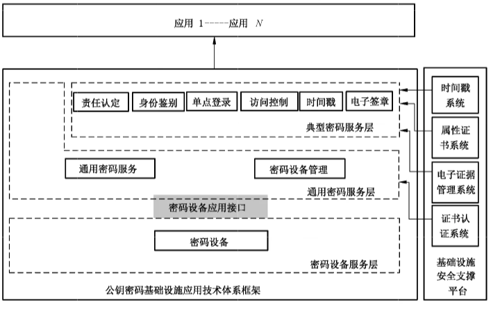

# GB/T 36322-2018 信息安全技术 密码设备应用接口规范

> 来源：[国家标准全文公开系统](https://openstd.samr.gov.cn/bzgk/std/newGbInfo?hcno=69E793FE1769D120C82F78447802E14F)；发布日期：2018-06-07；实施日期：2019-01-01。
> 官方在线预览页面图像 SHA-256：`7586df10d32e6c13cb72277fe84f87e1dc8313100fbac3a4a9d218aa18afde99`。
> 依据官方在线预览全部 43 页页面图像转写与校核；省略封面、目录、页眉、页脚、留白和分页，合并印刷折行。函数原型中的印刷错误按原文保留，并在相应位置说明。

> 转写注：表 9 原文写作 `SDF_ReleasePrivateKeyAccessRigh`，6.2.9 写作 `SDF_ReleasePrivateKeyAccessRight`；6.3.23、6.3.24 原型使用 `phKeyHandle`，参数说明使用 `hKeyHandle`；6.3.22 的 `pucKeyA`、`pucKeyE` 说明使用大写 `SKEYID_A`、`SKEYID_E`。以上差异按原页保留。

## 前言

本标准按照 GB/T 1.1—2009 给出的规则起草。

请注意本文件的某些内容可能涉及专利。本文件的发布机构不承担识别这些专利的责任。

本标准由全国信息安全标准化技术委员会（SAC/TC 260）提出并归口。

本标准起草单位：卫士通信息产业股份有限公司、无锡江南信息安全工程技术中心、四川大学、上海格尔软件股份有限公司、北京数字认证股份有限公司、兴唐通信科技股份有限公司、山东得安信息技术有限公司、北京三未信安科技发展有限公司、海泰方圆科技有限公司、山东大学。

本标准主要起草人：刘平、罗俊、龚勋、李元正、徐强、郑强、李述胜、李玉峰、孔凡玉、马洪富、高志权、徐明翼、柳增寿、蒋红宇。

## 引言

本标准的目标是为公钥密码基础设施应用体系框架下的服务类密码设备制定统一的应用接口标准，通过该接口调用密码设备，向上层提供基础密码服务。为该类密码设备的开发、使用及检测提供标准依据和指导，有利于提高该类密码设备的产品化、标准化和系列化水平。

本标准中涉及密码算法的相关内容，按照国家有关法规实施。

## 1 范围

本标准规定了公钥密码基础设施应用技术体系下服务类密码设备的应用接口标准。

本标准适用于服务类密码设备的研制、使用，以及基于该类密码设备的应用开发，也可用于指导该类密码设备的检测。

## 2 规范性引用文件

下列文件对于本文件的应用是必不可少的。凡是注日期的引用文件，仅注日期的版本适用于本文件。凡是不注日期的引用文件，其最新版本（包括所有的修改单）适用于本文件。

GB/T 33560 信息安全技术 密码应用标识规范

## 3 术语和定义

下列术语和定义适用于本文件。

### 3.1 算法标识 algorithm identifier

用于对密码算法进行唯一标识的符号。

### 3.2 非对称密码算法 asymmetric cryptographic algorithm/public key cryptographic algorithm

公钥密码算法。

加解密使用不同密钥的密码算法。

### 3.3 解密 decipherment/decryption

加密过程对应的逆过程。

### 3.4 设备密钥 device key pair

存储在设备内部的用于设备管理的非对称密钥对，包含签名密钥对和加密密钥对。

### 3.5 加密 encipherment/encryption

对数据进行密码变换以产生密文的过程。

### 3.6 密钥加密密钥 key encryption key

对密钥进行加密保护的密钥。

### 3.7 公钥基础设施 public key infrastructure

用公钥密码技术建立的普遍适用的基础设施，为用户提供证书管理和密钥管理等安全服务。

### 3.8 私钥访问控制码 private key access password

用于验证私钥使用权限的口令字。

### 3.9 对称密码技术 symmetric cryptographic technique

对称密码体制。

原发者和接收者均采用同一秘密密钥进行变换的密码技术（体制）。

> 注：加密密钥与解密密钥相同，或者一个密钥可以从另一个密钥导出的密码体制。

### 3.10 会话密钥 session key

处于层次化密钥结构中的最低层，仅在一次会话中使用的密钥。

### 3.11 用户密钥 user key

存储在设备内部的用于应用密码运算的非对称密钥，包含签名密钥对和加密密钥对。

## 4 符号和缩略语

下列符号和缩略语适用于本文件。

| 缩略语 | 含义 |
| --- | --- |
| ECC | 椭圆曲线算法（Elliptic Curve Cryptography） |
| EPK | 外部加密公钥（External Public Key） |
| IPK | 内部加密公钥（Internal Public Key） |
| ISK | 内部加密私钥（Internal Private Key） |
| KEK | 密钥加密密钥（Key Encrypt Key） |

## 5 算法标识和数据结构

### 5.1 算法标识定义

本标准中所使用的算法其算法标识见 GB/T 33560。对称加密算法的算法标识包含其工作模式。

### 5.2 基本数据类型定义

本标准中的字节数组均为高位字节在前（Big-Endian）方式存储和交换。基本数据类型定义如表 1 所示。

**表 1 基本数据类型**

| 类型名称 | 描述 | 定义 |
| --- | --- | --- |
| BYTE | 字节类型，无符号 8 位字符 | `typedef unsigned char BYTE` |
| CHAR | 字符类型，无符号 8 位字符 | `typedef unsigned char CHAR` |
| LONG | 长整数，有符号 32 位整数 | `typedef int LONG` |
| ULONG | 长整数，无符号 32 位整数 | `typedef unsigned int ULONG` |
| FLAGS | 标志类型，无符号 32 位整数 | `typedef unsigned int FLAGS` |
| LPSTR | 8 位字符串指针，按照 UTF8 格式存储及交换 | `typedef CHAR * LPSTR` |
| HANDLE | 句柄，指向任意数据对象的起始地址 | `typedef void * HANDLE` |

### 5.3 设备信息定义

设备信息描述如表 2 所示。

**表 2 设备信息描述**

| 字段名称 | 数据长度（字节） | 含义 |
| --- | --- | --- |
| IssuerName | 40 | 设备生产厂商名称 |
| DeviceName | 16 | 设备型号 |
| DeviceSerial | 16 | 设备编号，包含：日期（8 字符）、批次号（3 字符）、流水号（5 字符） |
| DeviceVersion | 4 | 密码设备内部软件的版本号 |
| StandardVersion | 4 | 密码设备支持的接口规范版本号 |
| AsymAlgAbility | 8 | 前 4 字节表示支持的算法，表示方法为非对称算法标识按位或运算的结果；后 4 字节表示算法的最大模长，表示方法为支持的模长按位或运算的结果 |
| SymAlgAbility | 4 | 所有支持的对称算法，表示方法为对称算法标识按位或运算的结果 |
| HashAlgAbility | 4 | 所有支持的杂凑算法，表示方法为杂凑算法标识按位或运算的结果 |
| BufferSize | 4 | 支持的最大文件存储空间（单位字节） |

实际数据结构定义：

```c
typedef struct DeviceInfo_st{
    CHAR IssuerName[40];
    CHAR DeviceName[16];
    CHAR DeviceSerial[16]
    ULONG DeviceVersion;
    ULONG StandardVersion;
    ULONG AsymAlgAbility[2];
    ULONG SymAlgAbility;
    ULONG HashAlgAbility;
    ULONG BufferSize;
}DEVICEINFO;
```

### 5.4 密钥分类及存储定义

#### 5.4.1 设备密钥与用户密钥

设备密钥只能在设备初始化时生成或安装，用户密钥通过密码设备管理工具生成或安装。

设备密钥和用户密钥存放于密钥存储区，索引号从 0 开始检索，每个索引号对应一个签名密钥对和一个加密密钥对。其中，索引号为 0 表示设备密钥。索引号 1 开始表示用户密钥。设备密钥和用户密钥存储描述如表 3 所示。

**表 3 设备密钥和用户密钥存储描述**

| 密钥对索引号 | 公钥 | 私钥 |
| --- | --- | --- |
| 0x00 | 设备签名公钥 | 设备签名私钥 |
| 0x00 | 设备加密公钥 | 设备加密私钥 |
| 0x01 | 用户签名公钥 | 用户签名私钥 |
| 0x01 | 用户加密公钥 | 用户加密私钥 |
| …… | …… | …… |
| …… | …… | …… |

#### 5.4.2 密钥加密密钥

密钥加密密钥通过密码设备管理工具生成或安装，密钥长度为 128 位，存放于密钥存储区，使用索引号从 1 开始。密钥加密密钥存储描述如表 4 所示。

**表 4 密钥加密密钥存储描述**

| 密钥索引号 | 密钥加密密钥 |
| --- | --- |
| 0x01 | 密钥加密密钥 001 |
| …… | …… |

#### 5.4.3 会话密钥

会话密钥使用设备接口函数生成或导入，会话密钥使用句柄检索。

### 5.5 RSA 密钥数据结构定义

RSA 密钥结构存储时顺序为从高到低，即密钥存放时从密钥结构数组的最高位开始，最高字节填在最高位，不足位填充数据 0。RSA 密钥数据结构如表 5 所示。

**表 5 RSA 密钥数据结构**

| 分类 | 字段名称 | 数据长度（字节） | 含义 |
| --- | --- | --- | --- |
| 公钥 | bits | 4 | 模长 |
| 公钥 | m | 256 | 模 N |
| 公钥 | e | 256 | 公钥指数 |
| 私钥 | bits | 4 | 模长 |
| 私钥 | m | 256 | 模 N |
| 私钥 | e | 256 | 公钥指数 |
| 私钥 | d | 256 | 私钥指数 |
| 私钥 | prime[2] | 128 × 2 | 素数 p 和 q |
| 私钥 | pexp[2] | 128 × 2 | Dp 和 Dq |
| 私钥 | coef | 128 | 系数 i |

实际数据结构定义：

```c
#define RSAref_MAX_BITS   2048
#define RSAref_MAX_LEN    ((RSAref_MAX_BITS + 7) / 8)
#define RSAref_MAX_PBITS  ((RSAref_MAX_BITS + 1) / 2)
#define RSAref_MAX_PLEN   ((RSAref_MAX_PBITS + 7) / 8)

typedef struct RSArefPublicKey_st
{
    ULONG bits;
    BYTE m[RSAref_MAX_LEN];
    BYTE e[RSAref_MAX_LEN];
} RSArefPublicKey;

typedef struct RSArefPrivateKey_st
{
    ULONG bits;
    BYTE m[RSAref_MAX_LEN];
    BYTE e[RSAref_MAX_LEN];
    BYTE d[RSAref_MAX_LEN];
    BYTE prime[2][RSAref_MAX_PLEN];
    BYTE pexp[2][RSAref_MAX_PLEN];
    BYTE coef[RSAref_MAX_PLEN];
} RSArefPrivateKey;
```

### 5.6 ECC 密钥数据结构定义

ECC 密钥数据结构如表 6 所示。

**表 6 ECC 密钥数据结构**

| 分类 | 字段名称 | 数据长度（字节） | 含义 |
| --- | --- | --- | --- |
| 公钥 | bits | 4 | 密钥位长 |
| 公钥 | x | ECCref_MAX_LEN | 公钥 x 坐标 |
| 公钥 | y | ECCref_MAX_LEN | 公钥 y 坐标 |
| 私钥 | bits | 4 | 密钥位长 |
| 私钥 | K | ECCref_MAX_LEN | 私钥 |

实际数据结构定义：

```c
#define ECCref_MAX_BITS  512
#define ECCref_MAX_LEN   ((ECCref_MAX_BITS+7) / 8)

typedef struct ECCrefPublicKey_st
{
    ULONG bits;
    BYTE x[ECCref_MAX_LEN];
    BYTE y[ECCref_MAX_LEN];
} ECCrefPublicKey;

typedef struct ECCrefPrivateKey_st
{
    ULONG bits;
    BYTE K[ECCref_MAX_LEN];
} ECCrefPrivateKey;
```

### 5.7 ECC 加密数据结构定义

ECC 加密数据结构如表 7 所示。

**表 7 ECC 加密数据结构**

| 字段名称 | 数据长度（字节） | 含义 |
| --- | --- | --- |
| x | ECCref_MAX_LEN | X 分量 |
| y | ECCref_MAX_LEN | Y 分量 |
| M | 32 | 明文的杂凑值 |
| L | 4 | 密文数据长度 |
| C | L | 密文数据 |

实际数据结构定义：

```c
typedef struct ECCCipher_st
{
    BYTE x[ECCref_MAX_LEN];
    BYTE y[ECCref_MAX_LEN];
    BYTE M[32];
    ULONG L;
    BYTE C[1];
} ECCCipher;
```

### 5.8 ECC 签名数据结构定义

ECC 签名数据结构如表 8 所示。

**表 8 ECC 签名数据结构**

| 字段名称 | 数据长度（字节） | 含义 |
| --- | --- | --- |
| r | ECCref_MAX_LEN | 签名的 r 部分 |
| s | ECCref_MAX_LEN | 签名的 s 部分 |

实际数据结构定义：

```c
typedef struct ECCSignature_st
{
    BYTE r[ECCref_MAX_LEN];
    BYTE s[ECCref_MAX_LEN];
} ECCSignature;
```

## 6 设备接口描述

### 6.1 密码设备应用接口在公钥密码基础设施应用技术体系框架中的位置

在公钥密码基础设施应用技术体系框架中，密码设备服务层由密码机、密码卡、智能密码终端等设备组成，通过本标准规定的密码设备应用接口向通用密码服务层提供基础密码服务。如图 1 所示。

基础密码服务包括密钥生成、单一的密码运算、文件管理等的服务。

本标准采用 C 语言描述接口函数。如无特别说明，函数中参数的长度单位均为字节数。



### 6.2 设备管理类函数

#### 6.2.1 概述

设备管理类函数提供设备打开与关闭、会话创建与关闭、设备信息获取、随机数产生、私钥权限获取与释放等功能，如表 9 所示，各函数返回代码见附录 A。

**表 9 设备管理类函数**

| 函数名称 | 功能 |
| --- | --- |
| SDF_OpenDevice | 打开设备 |
| SDF_CloseDevice | 关闭设备 |
| SDF_OpenSession | 创建会话 |
| SDF_CloseSession | 关闭会话 |
| SDF_GetDeviceInfo | 获取设备信息 |
| SDF_GenerateRandom | 产生随机数 |
| SDF_GetPrivateKeyAccessRight | 获取私钥使用权限 |
| SDF_ReleasePrivateKeyAccessRigh | 释放私钥使用权限 |

#### 6.2.2 打开设备

原型：

```c
LONG SDF_OpenDevice(
    HANDLE * phDeviceHandle);
```

描述：打开密码设备。

参数：`phDeviceHandle[out]` 返回的设备句柄。

返回值：0 成功；非 0 失败，返回错误代码。

> 注：phDeviceHandle 由函数初始化并填写内容。

#### 6.2.3 关闭设备

原型：

```c
LONG SDF_CloseDevice(
    HANDLE hDeviceHandle);
```

描述：关闭密码设备，并释放相关资源。

参数：`hDeviceHandle[in]` 已打开的设备句柄。

返回值：0 成功；非 0 失败，返回错误代码。

#### 6.2.4 创建会话

原型：

```c
LONG SDF_OpenSession(
    HANDLE hDeviceHandle,
    HANDLE * phSessionHandle);
```

描述：创建与密码设备的会话。

参数：

- `hDeviceHandle[in]` 已打开的设备句柄；
- `phSessionHandle[out]` 返回与密码设备建立的新会话句柄。

返回值：0 成功；非 0 失败，返回错误代码。

#### 6.2.5 关闭会话

原型：

```c
LONG SDF_CloseSession(
    HANDLE hSessionHandle);
```

描述：关闭与密码设备已建立的会话，并释放相关资源。

参数：`hSessionHandle[in]` 与密码设备已建立的会话句柄。

返回值：0 成功；非 0 失败，返回错误代码。

#### 6.2.6 获取设备信息

原型：

```c
LONG SDF_GetDeviceInfo(
    HANDLE hSessionHandle,
    DEVICEINFO * pstDeviceInfo);
```

描述：获取密码设备能力描述。

参数：

- `hSessionHandle[in]` 与设备建立的会话句柄；
- `pstDeviceInfo[out]` 设备能力描述信息，内容及格式见设备信息定义。

返回值：0 成功；非 0 失败，返回错误代码。

#### 6.2.7 产生随机数

原型：

```c
LONG SDF_GenerateRandom(
    HANDLE hSessionHandle,
    ULONG uiLength,
    BYTE * pucRandom);
```

描述：获取指定长度的随机数。

参数：

- `hSessionHandle[in]` 与设备建立的会话句柄；
- `uiLength[in]` 获取的随机数长度；
- `pucRandom[out]` 缓冲区指针，用于存放获取的随机数。

返回值：0 成功；非 0 失败，返回错误代码。

#### 6.2.8 获取私钥使用权限

原型：

```c
LONG SDF_GetPrivateKeyAccessRight(
    HANDLE hSessionHandle,
    ULONG uiKeyIndex,
    LPSTR pucPassword,
    ULONG uiPwdLength);
```

描述：获取密码设备内部存储的指定索引私钥的使用权。

参数：

- `hSessionHandle[in]` 与设备建立的会话句柄；
- `uiKeyIndex[in]` 密码设备存储私钥的索引值；
- `pucPassword[in]` 私钥访问控制码；
- `uiPwdLength[in]` 私钥访问控制码长度，不少于 8 字节。

返回值：0 成功；非 0 失败，返回错误代码。

> 注：本标准涉及密码设备存储的密钥对索引值的起始索引值为 1，最大为 n，密码设备的实际存储容量决定 n 值。

#### 6.2.9 释放私钥使用权限

原型：

```c
LONG SDF_ReleasePrivateKeyAccessRight(
    HANDLE hSessionHandle,
    ULONG uiKeyIndex);
```

描述：释放密码设备存储的指定索引私钥的使用授权。

参数：

- `hSessionHandle[in]` 与设备建立的会话句柄；
- `uiKeyIndex[in]` 密码设备存储私钥索引值。

返回值：0 成功；非 0 失败，返回错误代码。

### 6.3 密钥管理类函数

#### 6.3.1 概述

密钥管理类函数提供密钥的生成和导入导出等功能，包括签名公钥和加密公钥的导出、非对称密钥对的产生并输出、会话密钥的生成并输出、会话密钥的导入、数字信封转换、密钥协商参数的生成并输出、会话密钥的计算、IKE 工作密钥的计算、IPSEC 会话密钥的计算、SSL 工作密钥的计算以及会话密钥的销毁等函数，如表 10 所示，各函数返回代码见附录 A。

**表 10 密钥管理类函数**

| 函数名称 | 功能 |
| --- | --- |
| SDF_ExportSignPublicKey_RSA | 导出 RSA 签名公钥 |
| SDF_ExportEncPublicKey_RSA | 导出 RSA 加密公钥 |
| SDF_GenerateKeyPair_RSA | 产生 RSA 非对称密钥对并输出 |
| SDF_GenerateKeyWithIPK_RSA | 生成会话密钥并用内部 RSA 公钥加密输出 |
| SDF_GenerateKeyWithEPK_RSA | 生成会话密钥并用外部 RSA 公钥加密输出 |
| SDF_ImportKeyWithISK_RSA | 导入会话密钥并用内部 RSA 私钥解密 |
| SDF_ExchangeDigitEnvelopeBaseOnRSA | 基于 RSA 算法的数字信封转换 |
| SDF_ExportSignPublicKey_ECC | 导出 ECC 签名公钥 |
| SDF_ExportEncPublicKey_ECC | 导出 ECC 加密公钥 |
| SDF_GenerateKeyPair_ECC | 产生 ECC 非对称密钥对并输出 |
| SDF_GenerateKeyWithIPK_ECC | 生成会话密钥并用内部 ECC 公钥加密输出 |
| SDF_GenerateKeyWithEPK_ECC | 生成会话密钥并用外部 ECC 公钥加密输出 |
| SDF_ImportKeyWithISK_ECC | 导入会话密钥并用内部 ECC 私钥解密 |
| SDF_GenerateAgreementDataWithECC | 生成密钥协商参数并输出 |
| SDF_GenerateKeyWithECC | 计算会话密钥 |
| SDF_GenerateAgreementDataAndKeyWithECC | 产生协商数据并计算会话密钥 |
| SDF_ExchangeDigitEnvelopeBaseOnECC | 基于 ECC 算法的数字信封转换 |
| SDF_GenerateKeyWithKEK | 生成会话密钥并用密钥加密密钥加密输出 |
| SDF_ImportKeyWithKEK | 导入会话密钥并用密钥加密密钥解密 |
| SDF_GenerateKeywithIKE | 计算 IKE 工作密钥 |
| SDF_GenerateKeywithEPK_IKE | 计算 IKE 工作密钥并用外部 ECC 公钥加密输出 |
| SDF_GenerateKeywithIPSEC | 计算 IPSEC 会话密钥 |
| SDF_GenerateKeywithEPK_IPSEC | 计算 IPSEC 会话密钥并用外部 ECC 公钥加密输出 |
| SDF_GenerateKeywithSSL | 计算 SSL 工作密钥 |
| SDF_GenerateKeywithEPK_SSL | 计算 SSL 工作密钥并用外部 ECC 公钥加密输出 |
| SDF_GenerateKeywithECDHE_SSL | 计算 SSL 工作密钥（ECDHE） |
| SDF_GenerateKeywithEPK_ECDHE_SSL | 计算 SSL 工作密钥并用外部 ECC 公钥加密输出（ECDHE） |
| SDF_DestroyKey | 销毁会话密钥 |

#### 6.3.2 导出 RSA 签名公钥

原型：

```c
LONG SDF_ExportSignPublicKey_RSA(
    HANDLE hSessionHandle,
    ULONG uiKeyIndex,
    RSArefPublicKey * pucPublicKey);
```

描述：导出密码设备内部存储的指定索引位置的签名公钥。

参数：

- `hSessionHandle[in]` 与设备建立的会话句柄；
- `uiKeyIndex[in]` 密码设备存储的 RSA 密钥对索引值；
- `pucPublicKey[out]` RSA 公钥结构。

返回值：0 成功；非 0 失败，返回错误代码。

#### 6.3.3 导出 RSA 加密公钥

原型：

```c
LONG SDF_ExportEncPublicKey_RSA(
    HANDLE hSessionHandle,
    ULONG uiKeyIndex,
    RSArefPublicKey * pucPublicKey);
```

描述：导出密码设备内部存储的指定索引位置的加密公钥。

参数：

- `hSessionHandle[in]` 与设备建立的会话句柄；
- `uiKeyIndex[in]` 密码设备存储的 RSA 密钥对索引值；
- `pucPublicKey[out]` RSA 公钥结构。

返回值：0 成功；非 0 失败，返回错误代码。

#### 6.3.4 产生 RSA 密钥对并输出

原型：

```c
LONG SDF_GenerateKeyPair_RSA(
    HANDLE hSessionHandle,
    ULONG uiKeyBits,
    RSArefPublicKey * pucPublicKey,
    RSArefPrivateKey * pucPrivateKey);
```

描述：请求密码设备产生指定模长的 RSA 密钥对。

参数：

- `hSessionHandle[in]` 与设备建立的会话句柄；
- `uiKeyBits[in]` 指定密钥模长；
- `pucPublicKey[out]` RSA 公钥结构；
- `pucPrivateKey[out]` RSA 私钥结构。

返回值：0 成功；非 0 失败，返回错误代码。

#### 6.3.5 生成会话密钥并用内部 RSA 公钥加密输出

原型：

```c
LONG SDF_GenerateKeyWithIPK_RSA(
    HANDLE hSessionHandle,
    ULONG uiIPKIndex,
    ULONG uiKeyBits,
    BYTE * pucKey,
    ULONG * puiKeyLength,
    HANDLE * phKeyHandle);
```

描述：生成会话密钥并用指定索引的内部加密公钥加密输出，同时返回密钥句柄。

参数：

- `hSessionHandle[in]` 与设备建立的会话句柄；
- `uiIPKIndex[in]` 密码设备内部存储公钥的索引值；
- `uiKeyBits[in]` 指定产生的会话密钥长度；
- `pucKey[out]` 缓冲区指针，用于存放返回的密钥密文；
- `puiKeyLength[out]` 返回的密钥密文长度；
- `phKeyHandle[out]` 返回的密钥句柄。

返回值：0 成功；非 0 失败，返回错误代码。

> 注：公钥加密数据时填充方式与 PKCS#1 v1.5 相同。

#### 6.3.6 生成会话密钥并用外部 RSA 公钥加密输出

原型：

```c
LONG SDF_GenerateKeyWithEPK_RSA(
    HANDLE hSessionHandle,
    ULONG uiKeyBits,
    RSArefPublicKey * pucPublicKey,
    BYTE * pucKey,
    ULONG * puiKeyLength,
    HANDLE * phKeyHandle);
```

描述：生成会话密钥并用外部公钥加密输出，同时返回密钥句柄。

参数：

- `hSessionHandle[in]` 与设备建立的会话句柄；
- `uiKeyBits[in]` 指定产生的会话密钥长度；
- `pucPublicKey[in]` 输入的外部 RSA 公钥结构；
- `pucKey[out]` 缓冲区指针，用于存放返回的密钥密文；
- `puiKeyLength[out]` 返回的密钥密文长度；
- `phKeyHandle[out]` 返回的密钥句柄。

返回值：0 成功；非 0 失败，返回错误代码。

> 注：公钥加密数据时填充方式与 PKCS#1 v1.5 相同。

#### 6.3.7 导入会话密钥并用内部 RSA 私钥解密

原型：

```c
LONG SDF_ImportKeyWithISK_RSA(
    HANDLE hSessionHandle,
    ULONG uiISKIndex,
    BYTE * pucKey,
    ULONG puiKeyLength,
    HANDLE * phKeyHandle);
```

描述：导入会话密钥并用内部私钥解密，同时返回密钥句柄。

参数：

- `hSessionHandle[in]` 与设备建立的会话句柄；
- `uiISKIndex[in]` 密码设备内部存储加密私钥的索引值，对应于加密时的公钥；
- `pucKey[in]` 缓冲区指针，用于存放输入的密钥密文；
- `puiKeyLength[in]` 输入的密钥密文长度；
- `phKeyHandle[out]` 返回的密钥句柄。

返回值：0 成功；非 0 失败，返回错误代码。

> 注：填充方式与公钥加密时相同。

#### 6.3.8 基于 RSA 算法的数字信封转换

原型：

```c
LONG SDF_ExchangeDigitEnvelopeBaseOnRSA(
    HANDLE hSessionHandle,
    ULONG uiKeyIndex,
    RSArefPublicKey * pucPublicKey,
    BYTE * pucDEInput,
    ULONG uiDELength,
    BYTE * pucDEOutput,
    ULONG * puiDELength);
```

描述：将由内部加密公钥加密的会话密钥转换为由外部指定的公钥加密，可用于数字信封转换。

参数：

- `hSessionHandle[in]` 与设备建立的会话句柄；
- `uiKeyIndex[in]` 密码设备存储的内部 RSA 密钥对索引值；
- `pucPublicKey[in]` 外部 RSA 公钥结构；
- `pucDEInput[in]` 缓冲区指针，用于存放输入的会话密钥密文；
- `uiDELength[in]` 输入的会话密钥密文长度；
- `pucDEOutput[out]` 缓冲区指针，用于存放输出的会话密钥密文；
- `puiDELength[out]` 输出的会话密钥密文长度。

返回值：0 成功；非 0 失败，返回错误代码。

#### 6.3.9 导出 ECC 签名公钥

原型：

```c
LONG SDF_ExportSignPublicKey_ECC(
    HANDLE hSessionHandle,
    ULONG uiKeyIndex,
    ECCrefPublicKey * pucPublicKey);
```

描述：导出密码设备内部存储的指定索引位置的签名公钥。

参数：

- `hSessionHandle[in]` 与设备建立的会话句柄；
- `uiKeyIndex[in]` 密码设备存储的 ECC 密钥对索引值；
- `pucPublicKey[out]` ECC 公钥结构。

返回值：0 成功；非 0 失败，返回错误代码。

#### 6.3.10 导出 ECC 加密公钥

原型：

```c
LONG SDF_ExportEncPublicKey_ECC(
    HANDLE hSessionHandle,
    ULONG uiKeyIndex,
    ECCrefPublicKey * pucPublicKey);
```

描述：导出密码设备内部存储的指定索引位置的加密公钥。

参数：

- `hSessionHandle[in]` 与设备建立的会话句柄；
- `uiKeyIndex[in]` 密码设备存储的 ECC 密钥对索引值；
- `pucPublicKey[out]` ECC 公钥结构。

返回值：0 成功；非 0 失败，返回错误代码。

#### 6.3.11 产生 ECC 密钥对并输出

原型：

```c
LONG SDF_GenerateKeyPair_ECC(
    HANDLE hSessionHandle,
    ULONG uiAlgID,
    ULONG uiKeyBits,
    ECCrefPublicKey * pucPublicKey,
    ECCrefPrivateKey * pucPrivateKey);
```

描述：请求密码设备产生指定类型和模长的 ECC 密钥对。

参数：

- `hSessionHandle[in]` 与设备建立的会话句柄；
- `uiAlgID[in]` 指定算法标识；
- `uiKeyBits[in]` 指定密钥长度；
- `pucPublicKey[out]` ECC 公钥结构；
- `pucPrivateKey[out]` ECC 私钥结构。

返回值：0 成功；非 0 失败，返回错误代码。

#### 6.3.12 生成会话密钥并用内部 ECC 公钥加密输出

原型：

```c
LONG SDF_GenerateKeyWithIPK_ECC(
    HANDLE hSessionHandle,
    ULONG uiIPKIndex,
    ULONG uiKeyBits,
    ECCCipher * pucKey,
    HANDLE * phKeyHandle);
```

描述：生成会话密钥并用指定索引的内部 ECC 加密公钥加密输出，同时返回密钥句柄。

参数：

- `hSessionHandle[in]` 与设备建立的会话句柄；
- `uiIPKIndex[in]` 密码设备内部存储公钥的索引值；
- `uiKeyBits[in]` 指定产生的会话密钥长度；
- `pucKey[out]` 缓冲区指针，用于存放返回的密钥密文；
- `phKeyHandle[out]` 返回的密钥句柄。

返回值：0 成功；非 0 失败，返回错误代码。

#### 6.3.13 生成会话密钥并用外部 ECC 公钥加密输出

原型：

```c
LONG SDF_GenerateKeyWithEPK_ECC(
    HANDLE hSessionHandle,
    ULONG uiKeyBits,
    ULONG uiAlgID,
    ECCrefPublicKey * pucPublicKey,
    ECCCipher * pucKey,
    HANDLE * phKeyHandle);
```

描述：生成会话密钥并用外部 ECC 公钥加密输出，同时返回密钥句柄。

参数：

- `hSessionHandle[in]` 与设备建立的会话句柄；
- `uiKeyBits[in]` 指定产生的会话密钥长度；
- `uiAlgID[in]` 外部 ECC 公钥的算法标识；
- `pucPublicKey[in]` 输入的外部 ECC 公钥结构；
- `pucKey[out]` 缓冲区指针，用于存放返回的密钥密文；
- `phKeyHandle[out]` 返回的密钥句柄。

返回值：0 成功；非 0 失败，返回错误代码。

#### 6.3.14 导入会话密钥并用内部 ECC 私钥解密

原型：

```c
LONG SDF_ImportKeyWithISK_ECC(
    HANDLE hSessionHandle,
    ULONG uiISKIndex,
    ECCCipher * pucKey,
    HANDLE * phKeyHandle);
```

描述：导入会话密钥并用内部 ECC 加密私钥解密，同时返回密钥句柄。

参数：

- `hSessionHandle[in]` 与设备建立的会话句柄；
- `uiISKIndex[in]` 密码设备内部存储加密私钥的索引值，对应于加密时的公钥；
- `pucKey[in]` 缓冲区指针，用于存放输入的密钥密文；
- `phKeyHandle[out]` 返回的密钥句柄。

返回值：0 成功；非 0 失败，返回错误代码。

#### 6.3.15 生成密钥协商参数并输出

原型：

```c
LONG SDF_GenerateAgreementDataWithECC(
    HANDLE hSessionHandle,
    ULONG uiISKIndex,
    ULONG uiKeyBits,
    BYTE * pucSponsorID,
    ULONG uiSponsorIDLength,
    ECCrefPublicKey * pucSponsorPublicKey,
    ECCrefPublicKey * pucSponsorTmpPublicKey,
    HANDLE * phAgreementHandle);
```

描述：使用 ECC 密钥协商算法，为计算会话密钥而产生协商参数，同时返回指定索引位置的 ECC 公钥、临时 ECC 密钥对的公钥及协商句柄。

参数：

- `hSessionHandle[in]` 与设备建立的会话句柄；
- `uiISKIndex[in]` 密码设备内部存储加密私钥的索引值，该私钥用于参与密钥协商；
- `uiKeyBits[in]` 要求协商的密钥长度；
- `pucSponsorID[in]` 参与密钥协商的发起方 ID 值；
- `uiSponsorIDLength[in]` 发起方 ID 长度；
- `pucSponsorPublicKey[out]` 返回的发起方 ECC 公钥结构；
- `pucSponsorTmpPublicKey[out]` 返回的发起方临时 ECC 公钥结构；
- `phAgreementHandle[out]` 返回的协商句柄，用于计算协商密钥。

返回值：0 成功；非 0 失败，返回错误代码。

> 注：协商会话密钥时，本函数首先由协商的发起方调用。

#### 6.3.16 计算会话密钥

原型：

```c
LONG SDF_GenerateKeyWithECC(
    HANDLE hSessionHandle,
    BYTE * pucResponseID,
    ULONG uiResponseIDLength,
    ECCrefPublicKey * pucResponsePublicKey,
    ECCrefPublicKey * pucResponseTmpPublicKey,
    HANDLE hAgreementHandle,
    HANDLE * phKeyHandle);
```

描述：使用 ECC 密钥协商算法，使用自身协商句柄和响应方的协商参数计算会话密钥，同时返回会话密钥句柄。

参数：

- `hSessionHandle[in]` 与设备建立的会话句柄；
- `pucResponseID[in]` 外部输入的响应方 ID 值；
- `uiResponseIDLength[in]` 外部输入的响应方 ID 长度；
- `pucResponsePublicKey[in]` 外部输入的响应方 ECC 公钥结构；
- `pucResponseTmpPublicKey[in]` 外部输入的响应方临时 ECC 公钥结构；
- `hAgreementHandle[in]` 协商句柄，用于计算协商密钥；
- `phKeyHandle[out]` 返回的密钥句柄。

返回值：0 成功；非 0 失败，返回错误代码。

> 注：本函数由协商的发起方在获得响应方的协商参数后调用。使用 SM2 算法计算会话密钥的过程参见 GB/T 35276。会话密钥计算完成后，协商句柄被销毁，为协商句柄分配的内存等资源也被释放。

#### 6.3.17 产生协商数据并计算会话密钥

原型：

```c
LONG SDF_GenerateAgreementDataAndKeyWithECC(
    HANDLE hSessionHandle,
    ULONG uiISKIndex,
    ULONG uiKeyBits,
    BYTE * pucResponseID,
    ULONG uiResponseIDLength,
    BYTE * pucSponsorID,
    ULONG uiSponsorIDLength,
    ECCrefPublicKey * pucSponsorPublicKey,
    ECCrefPublicKey * pucSponsorTmpPublicKey,
    ECCrefPublicKey * pucResponsePublicKey,
    ECCrefPublicKey * pucResponseTmpPublicKey,
    HANDLE * phKeyHandle);
```

描述：使用 ECC 密钥协商算法，产生协商参数并计算会话密钥，同时返回产生的协商参数和密钥句柄。

参数：

- `hSessionHandle[in]` 与设备建立的会话句柄；
- `uiISKIndex[in]` 密码设备内部存储加密私钥的索引值，该私钥用于参与密钥协商；
- `uiKeyBits[in]` 协商后要求输出的密钥长度；
- `pucResponseID[in]` 响应方 ID 值；
- `uiResponseIDLength[in]` 响应方 ID 长度；
- `pucSponsorID[in]` 发起方 ID 值；
- `uiSponsorIDLength[in]` 发起方 ID 长度；
- `pucSponsorPublicKey[in]` 外部输入的发起方 ECC 公钥结构；
- `pucSponsorTmpPublicKey[in]` 外部输入的发起方临时 ECC 公钥结构；
- `pucResponsePublicKey[out]` 返回的响应方 ECC 公钥结构；
- `pucResponseTmpPublicKey[out]` 返回的响应方临时 ECC 公钥结构；
- `phKeyHandle[out]` 返回的密钥句柄。

返回值：0 成功；非 0 失败，返回错误代码。

> 注：本函数由响应方调用。使用 SM2 算法计算会话密钥的过程参见 GB/T 35276。

#### 6.3.18 基于 ECC 算法的数字信封转换

原型：

```c
LONG SDF_ExchangeDigitEnvelopeBaseOnECC(
    HANDLE hSessionHandle,
    ULONG uiKeyIndex,
    ULONG uiAlgID,
    ECCrefPublicKey * pucPublicKey,
    ECCCipher * pucEncDataIn,
    ECCCipher * pucEncDataOut);
```

描述：将由内部加密公钥加密的会话密钥转换为由外部指定的公钥加密，可用于数字信封转换。

参数：

- `hSessionHandle[in]` 与设备建立的会话句柄；
- `uiKeyIndex[in]` 密码设备存储的 ECC 密钥对索引值；
- `uiAlgID[in]` 外部 ECC 公钥的算法标识；
- `pucPublicKey[in]` 外部 ECC 公钥结构；
- `pucEncDataIn[in]` 缓冲区指针，用于存放输入的会话密钥密文；
- `pucEncDataOut[out]` 缓冲区指针，用于存放输出的会话密钥密文。

返回值：0 成功；非 0 失败，返回错误代码。

#### 6.3.19 生成会话密钥并用密钥加密密钥加密输出

原型：

```c
LONG SDF_GenerateKeyWithKEK(
    HANDLE hSessionHandle,
    ULONG uiKeyBits,
    ULONG uiAlgID,
    ULONG uiKEKIndex,
    BYTE * pucKey,
    ULONG * puiKeyLength,
    HANDLE * phKeyHandle);
```

描述：生成会话密钥并用密钥加密密钥加密输出，同时返回密钥句柄。

参数：

- `hSessionHandle[in]` 与设备建立的会话句柄；
- `uiKeyBits[in]` 指定产生的会话密钥长度；
- `uiAlgID[in]` 算法标识，指定对称加密算法；
- `uiKEKIndex[in]` 密码设备内部存储密钥加密密钥的索引值；
- `pucKey[out]` 缓冲区指针，用于存放返回的密钥密文；
- `puiKeyLength[out]` 返回的密钥密文长度；
- `phKeyHandle[out]` 返回的密钥句柄。

返回值：0 成功；非 0 失败，返回错误代码。

> 注：加密模式为 ECB 模式。

#### 6.3.20 导入会话密钥并用密钥加密密钥解密

原型：

```c
LONG SDF_ImportKeyWithKEK(
    HANDLE hSessionHandle,
    ULONG uiAlgID,
    ULONG uiKEKIndex,
    BYTE * pucKey,
    ULONG puiKeyLength,
    HANDLE * phKeyHandle);
```

描述：导入会话密钥并用密钥加密密钥解密，同时返回会话密钥句柄。

参数：

- `hSessionHandle[in]` 与设备建立的会话句柄；
- `uiAlgID[in]` 算法标识，指定对称加密算法；
- `uiKEKIndex[in]` 密码设备内部存储密钥加密密钥的索引值；
- `pucKey[in]` 缓冲区指针，用于存放输入的密钥密文；
- `puiKeyLength[in]` 输入的密钥密文长度；
- `phKeyHandle[out]` 返回的密钥句柄。

返回值：0 成功；非 0 失败，返回错误代码。

> 注：加密模式为 ECB 模式。

#### 6.3.21 计算 IKE 工作密钥

原型：

```c
LONG SDF_GenerateKeywithIKE(
    HANDLE hSessionHandle,
    BYTE * pucSponsorNonce,
    ULONG uiSponsorNonceLength,
    BYTE * pucResponseNonce,
    ULONG uiResponseNonceLength,
    BYTE * pucSponsorCookie,
    ULONG uiSponsorCookieLength,
    BYTE * pucResponseCookie,
    ULONG uiResponseCookieLength,
    ULONG uiPrfAlgID,
    ULONG uiKeyBitsD,
    HANDLE * phKeyHandleD,
    ULONG uiKeyBitsA,
    HANDLE * phKeyHandleA,
    ULONG uiKeyBitsE,
    HANDLE * phKeyHandleE);
```

描述：使用 IKE 一阶段（主模式）交换得到的密钥计算参数计算 IKE 工作密钥，同时返回工作密钥句柄。

参数：

- `hSessionHandle[in]` 与设备建立的会话句柄；
- `pucSponsorNonce[in]` 发起方 nonce 载荷主体；
- `uiSponsorNonceLength[in]` 发起方 nonce 载荷主体长度；
- `pucResponseNonce[in]` 响应方 nonce 载荷主体；
- `uiResponseNonceLength[in]` 响应方 nonce 载荷主体长度；
- `pucSponsorCookie[in]` 发起方 cookie；
- `uiSponsorCookieLength[in]` 发起方 cookie 长度；
- `pucResponseCookie[in]` 响应方 cookie；
- `uiResponseCookieLength[in]` 响应方 cookie 长度；
- `uiPrfAlgID[in]` PRF 算法标识；
- `uiKeyBitsD[in]` SKEYID_d 密钥长度；
- `phKeyHandleD[out]` 返回的 SKEYID_d 密钥句柄；
- `uiKeyBitsA[in]` SKEYID_a 密钥长度；
- `phKeyHandleA[out]` 返回的 SKEYID_a 密钥句柄；
- `uiKeyBitsE[in]` SKEYID_e 密钥长度；
- `phKeyHandleE[out]` 返回的 SKEYID_e 密钥句柄。

返回值：0 成功；非 0 失败，返回错误代码。

> 注：IKE 一阶段（主模式）消息 3 和消息 4 交互完成后，本函数由参与通信的双方各自调用，计算后续工作密钥 SKEYID_d、SKEYID_a、SKEYID_e。IKE 一阶段（主模式）计算 IKE 工作密钥的过程参见 GM/T 0022，输入的密钥参数按顺序为 Ni_b、Nr_b、CKY-I、CKY-R，返回的密钥句柄按顺序为 SKEYID_d、SKEYID_a、SKEYID_e。

#### 6.3.22 计算 IKE 工作密钥并用外部 ECC 公钥加密输出

原型：

```c
LONG SDF_GenerateKeywithEPK_IKE(
    HANDLE hSessionHandle,
    BYTE * pucSponsorNonce,
    ULONG uiSponsorNonceLength,
    BYTE * pucResponseNonce,
    ULONG uiResponseNonceLength,
    BYTE * pucSponsorCookie,
    ULONG uiSponsorCookieLength,
    BYTE * pucResponseCookie,
    ULONG uiResponseCookieLength,
    ULONG uiPrfAlgID,
    ULONG uiEccAlgID,
    ECCrefPublicKey * pucPublicKey,
    ULONG uiKeyBitsD,
    ECCCipher * pucKeyD,
    HANDLE * phKeyHandleD,
    ULONG uiKeyBitsA,
    ECCCipher * pucKeyA,
    HANDLE * phKeyHandleA,
    ULONG uiKeyBitsE,
    ECCCipher * pucKeyE,
    HANDLE * phKeyHandleE);
```

描述：使用 IKE 一阶段（主模式）交换得到的密钥计算参数计算 IKE 工作密钥，并用外部 ECC 公钥加密输出，同时返回工作密钥句柄。

参数：

- `hSessionHandle[in]` 与设备建立的会话句柄；
- `pucSponsorNonce[in]` 发起方 nonce 载荷主体；
- `uiSponsorNonceLength[in]` 发起方 nonce 载荷主体长度；
- `pucResponseNonce[in]` 响应方 nonce 载荷主体；
- `uiResponseNonceLength[in]` 响应方 nonce 载荷主体长度；
- `pucSponsorCookie[in]` 发起方 cookie；
- `uiSponsorCookieLength[in]` 发起方 cookie 长度；
- `pucResponseCookie[in]` 响应方 cookie；
- `uiResponseCookieLength[in]` 响应方 cookie 长度；
- `uiPrfAlgID[in]` PRF 算法标识；
- `uiEccAlgID[in]` 外部 ECC 公钥的算法标识；
- `pucPublicKey[in]` 输入的外部 ECC 公钥结构；
- `uiKeyBitsD[in]` SKEYID_d 密钥长度；
- `pucKeyD[out]` 缓冲区指针，用于存放返回的 SKEYID_d 密钥密文；
- `phKeyHandleD[out]` 返回的 SKEYID_d 密钥句柄；
- `uiKeyBitsA[in]` SKEYID_a 密钥长度；
- `pucKeyA[out]` 缓冲区指针，用于存放返回的 SKEYID_A 密钥密文；
- `phKeyHandleA[out]` 返回的 SKEYID_a 密钥句柄；
- `uiKeyBitsE[in]` SKEYID_e 密钥长度；
- `pucKeyE[out]` 缓冲区指针，用于存放返回的 SKEYID_E 密钥密文；
- `phKeyHandleE[out]` 返回的 SKEYID_e 密钥句柄。

返回值：0 成功；非 0 失败，返回错误代码。
> 注：IKE 一阶段（主模式）消息 3 和消息 4 交互完成后，本函数由参与通信的双方各自调用，计算后续工作密钥 SKEYID_d、SKEYID_a、SKEYID_e。IKE 一阶段（主模式）计算 IKE 工作密钥的过程参见 GM/T 0022，输入的密钥参数按顺序为 Ni_b、Nr_b、CKY-I、CKY-R，返回的密钥密文及密钥句柄按顺序为 SKEYID_d、SKEYID_a、SKEYID_e。

#### 6.3.23 计算 IPSEC 会话密钥

原型：

```c
LONG SDF_GenerateKeywithIPSEC(
    HANDLE hSessionHandle,
    BYTE * pucProtocolID,
    ULONG uiProtocolIDLength,
    BYTE * pucSpi,
    ULONG uiSpiLength,
    BYTE * pucSponsorNonce,
    ULONG uiSponsorNonceLength,
    BYTE * pucResponseNonce,
    ULONG uiResponseNonceLength,
    HANDLE phKeyHandle,
    ULONG uiPrfAlgID,
    ULONG uiKeyBitsEnc,
    HANDLE * phKeyHandleEnc,
    ULONG uiKeyBitsMac,
    HANDLE * phKeyHandleMac);
```

描述：使用 IKE 二阶段（快速模式）交换得到的密钥计算参数计算 IPSEC 会话密钥，同时返回会话密钥句柄。

参数：

- `hSessionHandle[in]` 与设备建立的会话句柄；
- `pucProtocolID[in]` 协议 ID；
- `uiProtocolIDLength[in]` 协议 ID 长度；
- `pucSpi[in]` 安全参数索引 SPI；
- `uiSpiLength[in]` 安全参数索引 SPI 长度；
- `pucSponsorNonce[in]` 发起方 nonce 载荷主体；
- `uiSponsorNonceLength[in]` 发起方 nonce 载荷主体长度；
- `pucResponseNonce[in]` 响应方 nonce 载荷主体；
- `uiResponseNonceLength[in]` 响应方 nonce 载荷主体长度；
- `hKeyHandle[in]` 输入的 SKEYID_d 密钥句柄；
- `uiPrfAlgID[in]` PRF 算法标识；
- `uiKeyBitsEnc[in]` 加密密钥长度；
- `phKeyHandleEnc[out]` 返回的加密密钥句柄；
- `uiKeyBitsMac[in]` 杂凑密钥长度；
- `phKeyHandleMac[out]` 返回的杂凑密钥句柄。

返回值：0 成功；非 0 失败，返回错误代码。

> 注：IKE 二阶段（快速模式）消息交互完成后，本函数由参与通信的双方各自调用，计算 IPSEC 会话密钥，包括用于加密的会话密钥和用于完整性校验的会话密钥。IKE 二阶段（快速模式）计算 IPSEC 会话密钥的过程参见 GM/T 0022，输入的密钥参数按顺序为 protocol、SPI、Ni_b、Nr_b，返回的密钥句柄按顺序为加密密钥和杂凑密钥（用于完整性校验）。本函数在 6.3.21 计算 IKE 工作密钥函数调用之后调用，该函数返回的密钥句柄之一（SKEYID_d）作为本函数输入。

#### 6.3.24 计算 IPSEC 会话密钥并用外部 ECC 公钥加密输出

原型（原文中 `pucKeyEnc` 与 `pucKeyMac` 行末没有逗号）：

```c
LONG SDF_GenerateKeywithEPK_IPSEC(
    HANDLE hSessionHandle,
    BYTE * pucProtocolID,
    ULONG uiProtocolIDLength,
    BYTE * pucSpi,
    ULONG uiSpiLength,
    BYTE * pucSponsorNonce,
    ULONG uiSponsorNonceLength,
    BYTE * pucResponseNonce,
    ULONG uiResponseNonceLength,
    HANDLE phKeyHandle,
    ULONG uiPrfAlgID,
    ULONG uiEccAlgID,
    ECCrefPublicKey * pucPublicKey,
    ULONG uiKeyBitsEnc,
    ECCCipher * pucKeyEnc
    HANDLE * phKeyHandleEnc,
    ULONG uiKeyBitsMac,
    ECCCipher * pucKeyMac
    HANDLE * phKeyHandleMac);
```

描述：使用 IKE 二阶段（快速模式）交换得到的密钥计算参数计算 IPSEC 会话密钥，并用外部 ECC 公钥加密输出，同时返回会话密钥句柄。

参数：

- `hSessionHandle[in]` 与设备建立的会话句柄；
- `pucProtocolID[in]` 协议 ID；
- `uiProtocolIDLength[in]` 协议 ID 长度；
- `pucSpi[in]` 安全参数索引 SPI；
- `uiSpiLength[in]` 安全参数索引 SPI 长度；
- `pucSponsorNonce[in]` 发起方 nonce 载荷主体；
- `uiSponsorNonceLength[in]` 发起方 nonce 载荷主体长度；
- `pucResponseNonce[in]` 响应方 nonce 载荷主体；
- `uiResponseNonceLength[in]` 响应方 nonce 载荷主体长度；
- `hKeyHandle[in]` 输入的 SKEYID_d 密钥句柄；
- `uiPrfAlgID[in]` PRF 算法标识；
- `uiEccAlgID[in]` 外部 ECC 公钥的算法标识；
- `pucPublicKey[in]` 输入的外部 ECC 公钥结构；
- `uiKeyBitsEnc[in]` 加密密钥长度；
- `pucKeyEnc[out]` 缓冲区指针，用于存放返回的加密密钥密文；
- `phKeyHandleEnc[out]` 返回的加密密钥句柄；
- `uiKeyBitsMac[in]` 杂凑密钥长度；
- `pucKeyMac[out]` 缓冲区指针，用于存放返回的杂凑密钥密文；
- `phKeyHandleMac[out]` 返回的杂凑密钥句柄。

返回值：0 成功；非 0 失败，返回错误代码。

> 注：IKE 二阶段（快速模式）消息交互完成后，本函数由参与通信的双方各自调用，计算 IPSEC 会话密钥，包括用于加密的会话密钥和用于完整性校验的会话密钥。IKE 二阶段（快速模式）计算 IPSEC 会话密钥的过程参见 GM/T 0022，输入的密钥参数按顺序为 protocol、SPI、Ni_b、Nr_b，返回的密钥密文和密钥句柄按顺序为加密密钥和杂凑密钥（用于完整性校验）。本函数在 6.3.21 计算 IKE 工作密钥函数调用之后调用，该函数返回的密钥句柄之一（SKEYID_d）作为本函数输入。

#### 6.3.25 计算 SSL 工作密钥

原型：

```c
LONG SDF_GenerateKeywithSSL(
    HANDLE hSessionHandle,
    BYTE * pucKeyPreMaster,
    ULONG uiKeyPreMasterLength,
    BYTE * pucClientRandom,
    ULONG uiClientRandomLength,
    BYTE * pucServerRandom,
    ULONG uiServerRandomLength,
    ULONG uiPrfAlgID,
    ULONG uiKeyBitsClientMac,
    HANDLE * phKeyHandleClientMac,
    ULONG uiKeyBitsServerMac,
    HANDLE * phKeyHandleServerMac,
    ULONG uiKeyBitsClientEnc,
    HANDLE * phKeyHandleClientEnc,
    ULONG uiKeyBitsServerEnc,
    HANDLE * phKeyHandleServerEnc);
```

描述：使用 SSL 握手协议得到的密钥计算参数计算 SSL 工作密钥，同时返回工作密钥句柄。

参数：

- `hSessionHandle[in]` 与设备建立的会话句柄；
- `pucKeyPreMaster[in]` 预主密钥 pre_master_secret；
- `uiKeyPreMasterLength[in]` 预主密钥长度；
- `pucClientRandom[in]` 客户端随机数；
- `uiClientRandomLength[in]` 客户端随机数长度；
- `pucServerRandom[in]` 服务端随机数；
- `uiServerRandomLength[in]` 服务端随机数长度；
- `uiPrfAlgID[in]` PRF 算法标识；
- `uiKeyBitsClientMac[in]` 客户端杂凑密钥长度；
- `phKeyHandleClientMac[out]` 返回的客户端杂凑密钥句柄；
- `uiKeyBitsServerMac[in]` 服务端杂凑密钥长度；
- `phKeyHandleServerMac[out]` 返回的服务端杂凑密钥句柄；
- `uiKeyBitsClientEnc[in]` 客户端加密密钥长度；
- `phKeyHandleClientEnc[out]` 返回的客户端加密密钥句柄；
- `uiKeyBitsServerEnc[in]` 服务端加密密钥长度；
- `phKeyHandleServerEnc[out]` 返回的服务端加密密钥句柄。

返回值：0 成功；非 0 失败，返回错误代码。

> 注：SSL 握手协议消息交互完成后，本函数由参与通信的双方各自调用，计算 SSL 记录层协议的工作密钥并返回密钥句柄：client_write_MAC_secret（客户端杂凑密钥）、server_write_MAC_secret（服务端杂凑密钥）、client_write_key（客户端加密密钥）、server_write_key（服务端加密密钥）。SSL 计算工作密钥的过程参见 GM/T 0024。

#### 6.3.26 计算 SSL 工作密钥并用外部 ECC 公钥加密输出

原型：

```c
LONG SDF_GenerateKeywithEPK_SSL(
    HANDLE hSessionHandle,
    BYTE * pucKeyPreMaster,
    ULONG uiKeyPreMasterLength,
    BYTE * pucClientRandom,
    ULONG uiClientRandomLength,
    BYTE * pucServerRandom,
    ULONG uiServerRandomLength,
    ULONG uiPrfAlgID,
    ULONG uiEccAlgID,
    ECCrefPublicKey * pucPublicKey,
    ULONG uiKeyBitsClientMac,
    ECCCipher * pucKeyClientMac,
    HANDLE * phKeyHandleClientMac,
    ULONG uiKeyBitsServerMac,
    ECCCipher * pucKeyServerMac,
    HANDLE * phKeyHandleServerMac,
    ULONG uiKeyBitsClientEnc,
    ECCCipher * pucKeyClientEnc,
    HANDLE * phKeyHandleClientEnc,
    ULONG uiKeyBitsServerEnc,
    ECCCipher * pucKeyServerEnc,
    HANDLE * phKeyHandleServerEnc);
```

描述：使用 SSL 握手协议得到的密钥计算参数计算 SSL 工作密钥，并用外部 ECC 公钥加密输出，同时返回工作密钥句柄。

参数：

- `hSessionHandle[in]` 与设备建立的会话句柄；
- `pucKeyPreMaster[in]` 预主密钥 pre_master_secret；
- `uiKeyPreMasterLength[in]` 预主密钥长度；
- `pucClientRandom[in]` 客户端随机数；
- `uiClientRandomLength[in]` 客户端随机数长度；
- `pucServerRandom[in]` 服务端随机数；
- `uiServerRandomLength[in]` 服务端随机数长度；
- `uiPrfAlgID[in]` PRF 算法标识；
- `uiEccAlgID[in]` 外部 ECC 公钥的算法标识；
- `pucPublicKey[in]` 输入的外部 ECC 公钥结构；
- `uiKeyBitsClientMac[in]` 客户端杂凑密钥长度；
- `pucKeyClientMac[out]` 缓冲区指针，用于存放返回的客户端杂凑密钥；
- `phKeyHandleClientMac[out]` 返回的客户端杂凑密钥句柄；
- `uiKeyBitsServerMac[in]` 服务端杂凑密钥长度；
- `pucKeyServerMac[out]` 缓冲区指针，用于存放返回的服务端杂凑密钥；
- `phKeyHandleServerMac[out]` 返回的服务端杂凑密钥句柄；
- `uiKeyBitsClientEnc[in]` 客户端加密密钥长度；
- `pucKeyClientEnc[out]` 缓冲区指针，用于存放返回的客户端加密密钥；
- `phKeyHandleClientEnc[out]` 返回的客户端加密密钥句柄；
- `uiKeyBitsServerEnc[in]` 服务端加密密钥长度；
- `pucKeyServerEnc[out]` 缓冲区指针，用于存放返回的服务端加密密钥；
- `phKeyHandleServerEnc[out]` 返回的服务端加密密钥句柄。

返回值：0 成功；非 0 失败，返回错误代码。

> 注：SSL 握手协议消息交互完成后，本函数由参与通信的双方各自调用，计算 SSL 记录层协议的工作密钥并返回密钥密文和密钥句柄：client_write_MAC_secret（客户端杂凑密钥）、server_write_MAC_secret（服务端杂凑密钥）、client_write_key（客户端加密密钥）、server_write_key（服务端加密密钥）。SSL 计算工作密钥的过程参见 GM/T 0024。

#### 6.3.27 计算 SSL 工作密钥（ECDHE）

原型：

```c
LONG SDF_GenerateKeywithECDHE_SSL(
    HANDLE hSessionHandle,
    HANDLE phKeyHandlePreMaster,
    BYTE * pucClientRandom,
    ULONG uiClientRandomLength,
    BYTE * pucServerRandom,
    ULONG uiServerRandomLength,
    ULONG uiPrfAlgID,
    ULONG uiKeyBitsClientMac,
    HANDLE * phKeyHandleClientMac,
    ULONG uiKeyBitsServerMac,
    HANDLE * phKeyHandleServerMac,
    ULONG uiKeyBitsClientEnc,
    HANDLE * phKeyHandleClientEnc,
    ULONG uiKeyBitsServerEnc,
    HANDLE * phKeyHandleServerEnc);
```

描述：使用 SSL 握手协议得到的密钥计算参数计算 SSL 工作密钥，同时返回工作密钥句柄。

参数：

- `hSessionHandle[in]` 与设备建立的会话句柄；
- `phKeyHandlePreMaster[in]` 预主密钥 pre_master_secret 密钥句柄；
- `pucClientRandom[in]` 客户端随机数；
- `uiClientRandomLength[in]` 客户端随机数长度；
- `pucServerRandom[in]` 服务端随机数；
- `uiServerRandomLength[in]` 服务端随机数长度；
- `uiPrfAlgID[in]` PRF 算法标识；
- `uiKeyBitsClientMac[in]` 客户端杂凑密钥长度；
- `phKeyHandleClientMac[out]` 返回的客户端杂凑密钥句柄；
- `uiKeyBitsServerMac[in]` 服务端杂凑密钥长度；
- `phKeyHandleServerMac[out]` 返回的服务端杂凑密钥句柄；
- `uiKeyBitsClientEnc[in]` 客户端加密密钥长度；
- `phKeyHandleClientEnc[out]` 返回的客户端加密密钥句柄；
- `uiKeyBitsServerEnc[in]` 服务端加密密钥长度；
- `phKeyHandleServerEnc[out]` 返回的服务端加密密钥句柄。

返回值：0 成功；非 0 失败，返回错误代码。

> 注：SSL 握手协议消息交互完成后，本函数由参与通信的双方各自调用，计算 SSL 记录层协议的工作密钥并返回密钥句柄：client_write_MAC_secret（客户端杂凑密钥）、server_write_MAC_secret（服务端杂凑密钥）、client_write_key（客户端加密密钥）、server_write_key（服务端加密密钥）。SSL 计算工作密钥的过程参见 GM/T 0024。本函数适用于 ECDHE 的密钥交换方式，该方式的预主密钥采用 SM2 密钥协商产生并且密码设备只返回密钥句柄。

#### 6.3.28 计算 SSL 工作密钥并用外部 ECC 公钥加密输出（ECDHE）

原型：

```c
LONG SDF_GenerateKeywithEPK_ECDHE_SSL(
    HANDLE hSessionHandle,
    HANDLE phKeyHandlePreMaster,
    BYTE * pucClientRandom,
    ULONG uiClientRandomLength,
    BYTE * pucServerRandom,
    ULONG uiServerRandomLength,
    ULONG uiPrfAlgID,
    ULONG uiEccAlgID,
    ECCrefPublicKey * pucPublicKey,
    ULONG uiKeyBitsClientMac,
    ECCCipher * pucKeyClientMac,
    HANDLE * phKeyHandleClientMac,
    ULONG uiKeyBitsServerMac,
    ECCCipher * pucKeyServerMac,
    HANDLE * phKeyHandleServerMac,
    ULONG uiKeyBitsClientEnc,
    ECCCipher * pucKeyClientEnc,
    HANDLE * phKeyHandleClientEnc,
    ULONG uiKeyBitsServerEnc,
    ECCCipher * pucKeyServerEnc,
    HANDLE * phKeyHandleServerEnc);
```

描述：使用 SSL 握手协议得到的密钥计算参数计算 SSL 工作密钥，并用外部 ECC 公钥加密输出，同时返回工作密钥句柄。

参数：

- `hSessionHandle[in]` 与设备建立的会话句柄；
- `phKeyHandlePreMaster[in]` 预主密钥 pre_master_secret 密钥句柄；
- `pucClientRandom[in]` 客户端随机数；
- `uiClientRandomLength[in]` 客户端随机数长度；
- `pucServerRandom[in]` 服务端随机数；
- `uiServerRandomLength[in]` 服务端随机数长度；
- `uiPrfAlgID[in]` PRF 算法标识；
- `uiEccAlgID[in]` 外部 ECC 公钥的算法标识；
- `pucPublicKey[in]` 输入的外部 ECC 公钥结构；
- `uiKeyBitsClientMac[in]` 客户端杂凑密钥长度；
- `pucKeyClientMac[out]` 缓冲区指针，用于存放返回的客户端杂凑密钥；
- `phKeyHandleClientMac[out]` 返回的客户端杂凑密钥句柄；
- `uiKeyBitsServerMac[in]` 服务端杂凑密钥长度；
- `pucKeyServerMac[out]` 缓冲区指针，用于存放返回的服务端杂凑密钥；
- `phKeyHandleServerMac[out]` 返回的服务端杂凑密钥句柄；
- `uiKeyBitsClientEnc[in]` 客户端加密密钥长度；
- `pucKeyClientEnc[out]` 缓冲区指针，用于存放返回的客户端加密密钥；
- `phKeyHandleClientEnc[out]` 返回的客户端加密密钥句柄；
- `uiKeyBitsServerEnc[in]` 服务端加密密钥长度；
- `pucKeyServerEnc[out]` 缓冲区指针，用于存放返回的服务端加密密钥；
- `phKeyHandleServerEnc[out]` 返回的服务端加密密钥句柄。

返回值：0 成功；非 0 失败，返回错误代码。

> 注：SSL 握手协议消息交互完成后，本函数由参与通信的双方各自调用，计算 SSL 记录层协议的工作密钥并返回密钥密文和密钥句柄：client_write_MAC_secret（客户端杂凑密钥）、server_write_MAC_secret（服务端杂凑密钥）、client_write_key（客户端加密密钥）、server_write_key（服务端加密密钥）。SSL 计算工作密钥的过程参见 GM/T 0024。本函数适用于 ECDHE 的密钥交换方式，该方式的预主密钥采用 SM2 密钥协商产生并且密码设备返回密钥密文和密钥句柄。

#### 6.3.29 销毁会话密钥

原型：

```c
LONG SDF_DestroyKey(
    HANDLE hSessionHandle,
    HANDLE hKeyHandle);
```

描述：销毁会话密钥，并释放为密钥句柄分配的内存等资源。

参数：

- `hSessionHandle[in]` 与设备建立的会话句柄；
- `hKeyHandle[in]` 输入的密钥句柄。

返回值：0 成功；非 0 失败，返回错误代码。

> 注：本函数在对称算法运算完成后调用。

### 6.4 非对称算法运算类函数

#### 6.4.1 概述

非对称算法运算类函数提供 RSA 公私钥运算、ECC 签名验证和加密等功能，如表 11 所示，各函数返回代码见附录 A。

**表 11 非对称算法运算类函数**

| 函数名称 | 功能 |
| --- | --- |
| SDF_ExternalPublicKeyOperation_RSA | 外部公钥 RSA 运算 |
| SDF_InternalPublicKeyOperation_RSA | 内部公钥 RSA 运算 |
| SDF_InternalPrivateKeyOperation_RSA | 内部私钥 RSA 运算 |
| SDF_ExternalVerify_ECC | 外部密钥 ECC 验证 |
| SDF_InternalSign_ECC | 内部密钥 ECC 签名 |
| SDF_InternalVerify_ECC | 内部密钥 ECC 验证 |
| SDF_ExternalEncrypt_ECC | 外部密钥 ECC 加密 |

#### 6.4.2 外部公钥 RSA 运算

原型：

```c
LONG SDF_ExternalPublicKeyOperation_RSA(
    HANDLE hSessionHandle,
    RSArefPublicKey * pucPublicKey,
    BYTE * pucDataInput,
    ULONG uiInputLength,
    BYTE * pucDataOutput,
    ULONG * puiOutputLength);
```

描述：指定使用外部公钥对数据进行运算。

参数：

- `hSessionHandle[in]` 与设备建立的会话句柄；
- `pucPublicKey[in]` 外部 RSA 公钥结构；
- `pucDataInput[in]` 缓冲区指针，用于存放输入的数据；
- `uiInputLength[in]` 输入的数据长度；
- `pucDataOutput[out]` 缓冲区指针，用于存放输出的数据；
- `puiOutputLength[out]` 输出的数据长度。

返回值：0 成功；非 0 失败，返回错误代码。

> 注：数据格式由应用层封装。

#### 6.4.3 内部公钥 RSA 运算

原型：

```c
LONG SDF_InternalPublicKeyOperation_RSA(
    HANDLE hSessionHandle,
    ULONG uiKeyIndex,
    BYTE * pucDataInput,
    ULONG uiInputLength,
    BYTE * pucDataOutput,
    ULONG * puiOutputLength);
```

描述：使用内部指定索引的公钥对数据进行运算。

参数：

- `hSessionHandle[in]` 与设备建立的会话句柄；
- `uiKeyIndex[in]` 密码设备内部存储公钥的索引值；
- `pucDataInput[in]` 缓冲区指针，用于存放外部输入的数据；
- `uiInputLength[in]` 输入的数据长度；
- `pucDataOutput[out]` 缓冲区指针，用于存放输出的数据；
- `puiOutputLength[out]` 输出的数据长度。

返回值：0 成功；非 0 失败，返回错误代码。

> 注：索引范围仅限于内部签名密钥对，数据格式由应用层封装。

#### 6.4.4 内部私钥 RSA 运算

原型：

```c
LONG SDF_InternalPrivateKeyOperation_RSA(
    HANDLE hSessionHandle,
    ULONG uiKeyIndex,
    BYTE * pucDataInput,
    ULONG uiInputLength,
    BYTE * pucDataOutput,
    ULONG * puiOutputLength);
```

描述：使用内部指定索引的私钥对数据进行运算。

参数：

- `hSessionHandle[in]` 与设备建立的会话句柄；
- `uiKeyIndex[in]` 密码设备内部存储私钥的索引值；
- `pucDataInput[in]` 缓冲区指针，用于存放外部输入的数据；
- `uiInputLength[in]` 输入的数据长度；
- `pucDataOutput[out]` 缓冲区指针，用于存放输出的数据；
- `puiOutputLength[out]` 输出的数据长度。

返回值：0 成功；非 0 失败，返回错误代码。

> 注：索引范围仅限于内部签名密钥对，数据格式由应用层封装。

#### 6.4.5 外部密钥 ECC 验证

原型：

```c
LONG SDF_ExternalVerify_ECC(
    HANDLE hSessionHandle,
    ULONG uiAlgID,
    ECCrefPublicKey * pucPublicKey,
    BYTE * pucDataInput,
    ULONG uiInputLength,
    ECCSignature * pucSignature);
```

描述：使用外部 ECC 公钥对 ECC 签名值进行验证运算。

参数：

- `hSessionHandle[in]` 与设备建立的会话句柄；
- `uiAlgID[in]` 算法标识，指定使用的 ECC 算法；
- `pucPublicKey[in]` 外部 ECC 公钥结构；
- `pucData[in]` 缓冲区指针，用于存放外部输入的数据；
- `uiDataLength[in]` 输入的数据长度；
- `pucSignature[in]` 缓冲区指针，用于存放输入的签名值数据。

返回值：0 成功；非 0 失败，返回错误代码。

> 注：输入数据为待签数据的杂凑值。当使用 SM2 算法时，该输入数据为待签数据经过 SM2 签名预处理的结果，预处理过程参见 GB/T 35276。

> 转写注：原型写作 `pucDataInput`、`uiInputLength`，而参数说明写作 `pucData`、`uiDataLength`，均依照原文保留。

#### 6.4.6 内部密钥 ECC 签名

原型：

```c
LONG SDF_InternalSign_ECC(
    HANDLE hSessionHandle,
    ULONG uiISKIndex,
    BYTE * pucData,
    ULONG uiDataLength,
    ECCSignature * pucSignature);
```

描述：使用内部 ECC 私钥对数据进行签名运算。

参数：

- `hSessionHandle[in]` 与设备建立的会话句柄；
- `uiISKIndex[in]` 密码设备内部存储的 ECC 签名私钥的索引值；
- `pucData[in]` 缓冲区指针，用于存放外部输入的数据；
- `uiDataLength[in]` 输入的数据长度；
- `pucSignature[out]` 缓冲区指针，用于存放输出的签名值数据。

返回值：0 成功；非 0 失败，返回错误代码。

> 注：输入数据为待签数据的杂凑值。当使用 SM2 算法时，该输入数据为待签数据经过 SM2 签名预处理的结果，预处理过程参见 GB/T 35276。

#### 6.4.7 内部密钥 ECC 验证

原型：

```c
LONG SDF_InternalVerify_ECC(
    HANDLE hSessionHandle,
    ULONG uiISKIndex,
    BYTE * pucData,
    ULONG uiDataLength,
    ECCSignature * pucSignature);
```

描述：使用内部 ECC 公钥对 ECC 签名值进行验证运算。

参数：

- `hSessionHandle[in]` 与设备建立的会话句柄；
- `uiISKIndex[in]` 密码设备内部存储的 ECC 签名公钥的索引值；
- `pucData[in]` 缓冲区指针，用于存放外部输入的数据；
- `uiDataLength[in]` 输入的数据长度；
- `pucSignature[in]` 缓冲区指针，用于存放输入的签名值数据。

返回值：0 成功；非 0 失败，返回错误代码。

> 注：输入数据为待签数据的杂凑值。当使用 SM2 算法时，该输入数据为待签数据经过 SM2 签名预处理的结果，预处理过程参见 GB/T 35276。

#### 6.4.8 外部密钥 ECC 加密

原型：

```c
LONG SDF_ExternalEncrypt_ECC(
    HANDLE hSessionHandle,
    ULONG uiAlgID,
    ECCrefPublicKey * pucPublicKey,
    BYTE * pucData,
    ULONG uiDataLength,
    ECCCipher * pucEncData);
```

描述：使用外部 ECC 公钥对数据进行加密运算。

参数：

- `hSessionHandle[in]` 与设备建立的会话句柄；
- `uiAlgID[in]` 算法标识，指定使用的 ECC 算法；
- `pucPublicKey[in]` 外部 ECC 公钥结构；
- `pucData[in]` 缓冲区指针，用于存放外部输入的数据；
- `uiDataLength[in]` 输入的数据长度；
- `pucEncData[out]` 缓冲区指针，用于存放输出的数据密文。

返回值：0 成功；非 0 失败，返回错误代码。

### 6.5 对称算法运算类函数

#### 6.5.1 概述

对称算法运算类函数提供对称加解密和 MAC 计算等功能，如表 12 所示，各函数返回代码见附录 A。

**表 12 对称算法运算类函数**

| 函数名称 | 功能 |
| --- | --- |
| SDF_Encrypt | 对称加密 |
| SDF_Decrypt | 对称解密 |
| SDF_CalculateMAC | 计算 MAC |

#### 6.5.2 对称加密

原型：

```c
LONG SDF_Encrypt(
    HANDLE hSessionHandle,
    HANDLE hKeyHandle,
    ULONG uiAlgID,
    BYTE * pucIV,
    BYTE * pucData,
    ULONG uiDataLength,
    BYTE * pucEncData,
    ULONG * puiEncDataLength);
```

描述：使用指定的密钥句柄和 IV 对数据进行对称加密运算。

参数：

- `hSessionHandle[in]` 与设备建立的会话句柄；
- `hKeyHandle[in]` 指定的密钥句柄；
- `uiAlgID[in]` 算法标识，指定对称加密算法；
- `pucIV[in|out]` 缓冲区指针，用于存放输入和返回的 IV 数据；
- `pucData[in]` 缓冲区指针，用于存放输入的数据明文；
- `uiDataLength[in]` 输入的数据明文长度；
- `pucEncData[out]` 缓冲区指针，用于存放输出的数据密文；
- `puiEncDataLength[out]` 输出的数据密文长度。

返回值：0 成功；非 0 失败，返回错误代码。

> 注：此函数不对数据进行填充处理，输入的数据是指定算法分组长度的整数倍。返回的 IV 数据用于多包数据对称加密运算。

#### 6.5.3 对称解密

原型：

```c
LONG SDF_Decrypt(
    HANDLE hSessionHandle,
    HANDLE hKeyHandle,
    ULONG uiAlgID,
    BYTE * pucIV,
    BYTE * pucEncData,
    ULONG uiEncDataLength,
    BYTE * pucData,
    ULONG * puiDataLength);
```

描述：使用指定的密钥句柄和 IV 对数据进行对称解密运算。

参数：

- `hSessionHandle[in]` 与设备建立的会话句柄；
- `hKeyHandle[in]` 指定的密钥句柄；
- `uiAlgID[in]` 算法标识，指定对称加密算法；
- `pucIV[in|out]` 缓冲区指针，用于存放输入和返回的 IV 数据；
- `pucEncData[in]` 缓冲区指针，用于存放输入的数据密文；
- `uiEncDataLength[in]` 输入的数据密文长度；
- `pucData[out]` 缓冲区指针，用于存放输出的数据明文；
- `puiDataLength[out]` 输出的数据明文长度。

返回值：0 成功；非 0 失败，返回错误代码。

> 注：此函数不对数据进行填充处理，输入的数据是指定算法分组长度的整数倍。返回的 IV 数据用于多包数据对称解密运算。

#### 6.5.4 计算 MAC

原型：

```c
LONG SDF_CalculateMAC(
    HANDLE hSessionHandle,
    HANDLE hKeyHandle,
    ULONG uiAlgID,
    BYTE * pucIV,
    BYTE * pucData,
    ULONG uiDataLength,
    BYTE * pucMAC,
    ULONG * puiMACLength);
```

描述：使用指定的密钥句柄和 IV 对数据进行 MAC 运算。

参数：

- `hSessionHandle[in]` 与设备建立的会话句柄；
- `hKeyHandle[in]` 指定的密钥句柄；
- `uiAlgID[in]` 算法标识，指定 MAC 加密算法；
- `pucIV[in|out]` 缓冲区指针，用于存放输入和返回的 IV 数据；
- `pucData[in]` 缓冲区指针，用于存放输入的数据明文；
- `uiDataLength[in]` 输入的数据明文长度；
- `pucMAC[out]` 缓冲区指针，用于存放输出的 MAC 值；
- `puiMACLength[out]` 输出的 MAC 值长度。

返回值：0 成功；非 0 失败，返回错误代码。

> 注：此函数不对数据进行分包处理，多包数据 MAC 运算由 IV 控制最后的 MAC 值。

### 6.6 杂凑运算类函数

#### 6.6.1 概述

杂凑运算类函数提供杂凑运算功能，如表 13 所示，各函数返回代码见附录 A。

**表 13 杂凑运算类函数**

| 函数名称 | 功能 |
| --- | --- |
| SDF_HashInit | 杂凑运算初始化 |
| SDF_HashUpdate | 多包杂凑运算 |
| SDF_HashFinal | 杂凑运算结束 |

#### 6.6.2 杂凑运算初始化

原型：

```c
LONG SDF_HashInit(
    HANDLE hSessionHandle,
    ULONG uiAlgID
    ECCrefPublicKey * pucPublicKey,
    BYTE * pucID,
    ULONG uiIDLength);
```

> 转写注：原型中 `uiAlgID` 行末缺少逗号，此处按原文保留。

描述：三步式数据杂凑运算第一步。

参数：

- `hSessionHandle[in]` 与设备建立的会话句柄；
- `uiAlgID[in]` 指定杂凑算法标识；
- `pucPublicKey[in]` 签名者公钥，当 uiAlgID 为 SGD_SM3 时有效；
- `pucID[in]` 签名者的 ID 值，当 uiAlgID 为 SGD_SM3 时有效；
- `uiIDLength[in]` 签名者 ID 的长度，当 uiAlgID 为 SGD_SM3 时有效。

返回值：0 成功；非 0 失败，返回错误代码。

> 注：uiIDLength 非零且 uiAlgID 为 SGD_SM3 时，本函数执行的是 SM2 的预处理 1 操作。计算过程参见 GB/T 35276。

#### 6.6.3 多包杂凑运算

原型：

```c
LONG SDF_HashUpdate(
    HANDLE hSessionHandle,
    BYTE * pucData,
    ULONG uiDataLength);
```

描述：三步式数据杂凑运算第二步，对输入的明文进行杂凑运算。

参数：

- `hSessionHandle[in]` 与设备建立的会话句柄；
- `pucData[in]` 缓冲区指针，用于存放输入的数据明文；
- `uiDataLength[in]` 输入的数据明文长度。

返回值：0 成功；非 0 失败，返回错误代码。

#### 6.6.4 杂凑运算结束

原型：

```c
LONG SDF_HashFinal(
    HANDLE hSessionHandle,
    BYTE * pucHash,
    ULONG * puiHashLength);
```

描述：三步式数据杂凑运算第三步，杂凑运算结束返回杂凑数据并清除中间数据。

参数：

- `hSessionHandle[in]` 与设备建立的会话句柄；
- `pucHash[out]` 缓冲区指针，用于存放输出的杂凑数据；
- `puiHashLength[out]` 返回的杂凑数据长度。

返回值：0 成功；非 0 失败，返回错误代码。

### 6.7 用户文件操作类函数

#### 6.7.1 概述

用户文件操作类函数提供文件的创建、读写和删除功能，如表 14 所示，各函数返回代码见附录 A。

**表 14 用户文件操作类函数**

| 函数名称 | 功能 |
| --- | --- |
| SDF_CreateFile | 创建文件 |
| SDF_ReadFile | 读取文件 |
| SDF_WriteFile | 写文件 |
| SDF_DeleteFile | 删除文件 |

#### 6.7.2 创建文件

原型：

```c
LONG SDF_CreateFile(
    HANDLE hSessionHandle,
    LPSTR pucFileName,
    ULONG uiNameLen,
    ULONG uiFileSize);
```

描述：在密码设备内部创建用于存储用户数据的文件。

参数：

- `hSessionHandle[in]` 与设备建立的会话句柄；
- `pucFileName[in]` 缓冲区指针，用于存放输入的文件名，最大长度 128 字节；
- `uiNameLen[in]` 文件名长度；
- `uiFileSize[in]` 文件所占存储空间的长度。

返回值：0 成功；非 0 失败，返回错误代码。

#### 6.7.3 读取文件

原型：

```c
LONG SDF_ReadFile(
    HANDLE hSessionHandle,
    LPSTR pucFileName,
    ULONG uiNameLen,
    ULONG uiOffset,
    ULONG * puiFileLength,
    BYTE * pucBuffer);
```

描述：读取在密码设备内部存储用户数据的文件的内容。

参数：

- `hSessionHandle[in]` 与设备建立的会话句柄；
- `pucFileName[in]` 缓冲区指针，用于存放输入的文件名，最大长度 128 字节；
- `uiNameLen[in]` 文件名长度；
- `uiOffset[in]` 指定读取文件时的偏移值；
- `puiFileLength[in|out]` 入参时指定读取文件内容的长度；出参时返回实际读取文件内容的长度；
- `pucBuffer[out]` 缓冲区指针，用于存放读取的文件数据。

返回值：0 成功；非 0 失败，返回错误代码。

#### 6.7.4 写文件

原型：

```c
LONG SDF_WriteFile(
    HANDLE hSessionHandle,
    LPSTR pucFileName,
    ULONG uiNameLen,
    ULONG uiOffset,
    ULONG uiFileLength,
    BYTE * pucBuffer);
```

描述：向密码设备内部存储用户数据的文件中写入内容。

参数：

- `hSessionHandle[in]` 与设备建立的会话句柄；
- `pucFileName[in]` 缓冲区指针，用于存放输入的文件名，最大长度 128 字节；
- `uiNameLen[in]` 文件名长度；
- `uiOffset[in]` 指定写入文件时的偏移值；
- `uiFileLength[in]` 指定写入文件内容的长度；
- `pucBuffer[in]` 缓冲区指针，用于存放输入的写文件数据。

返回值：0 成功；非 0 失败，返回错误代码。

#### 6.7.5 删除文件

原型：

```c
LONG SDF_DeleteFile(
    HANDLE hSessionHandle,
    LPSTR pucFileName,
    ULONG uiNameLen);
```

描述：删除指定文件名的密码设备内部存储用户数据的文件。

参数：

- `hSessionHandle[in]` 与设备建立的会话句柄；
- `pucFileName[in]` 缓冲区指针，用于存放输入的文件名，最大长度 128 字节；
- `uiNameLen[in]` 文件名长度。

返回值：0 成功；非 0 失败，返回错误代码。

## 附录 A（规范性附录）函数返回代码定义

本标准定义的各函数返回代码如表 A.1 所示。

**表 A.1 函数返回代码定义**

| 宏描述 | 预定义值 | 说明 |
| --- | --- | --- |
| `#define SDR_OK` | `0x0` | 操作成功 |
| `#define SDR_BASE` | `0x01000000` | 错误码基础值 |
| `#define SDR_UNKNOWERR` | `SDR_BASE + 0x00000001` | 未知错误 |
| `#define SDR_NOTSUPPORT` | `SDR_BASE + 0x00000002` | 不支持的接口调用 |
| `#define SDR_COMMFAIL` | `SDR_BASE + 0x00000003` | 与设备通信失败 |
| `#define SDR_HARDFAIL` | `SDR_BASE + 0x00000004` | 运算模块无响应 |
| `#define SDR_OPENDEVICE` | `SDR_BASE + 0x00000005` | 打开设备失败 |
| `#define SDR_OPENSESSION` | `SDR_BASE + 0x00000006` | 创建会话失败 |
| `#define SDR_PARDENY` | `SDR_BASE + 0x00000007` | 无私钥使用权限 |
| `#define SDR_KEYNOTEXIST` | `SDR_BASE + 0x00000008` | 不存在的密钥调用 |
| `#define SDR_ALGNOTSUPPORT` | `SDR_BASE + 0x00000009` | 不支持的算法调用 |
| `#define SDR_ALGMODNOTSUPPORT` | `SDR_BASE + 0x0000000A` | 不支持的算法模式调用 |
| `#define SDR_PKOPERR` | `SDR_BASE + 0x0000000B` | 公钥运算失败 |
| `#define SDR_SKOPERR` | `SDR_BASE + 0x0000000C` | 私钥运算失败 |
| `#define SDR_SIGNERR` | `SDR_BASE + 0x0000000D` | 签名运算失败 |
| `#define SDR_VERIFYERR` | `SDR_BASE + 0x0000000E` | 验证签名失败 |
| `#define SDR_SYMOPERR` | `SDR_BASE + 0x0000000F` | 对称算法运算失败 |
| `#define SDR_STEPERR` | `SDR_BASE + 0x00000010` | 多步运算步骤错误 |
| `#define SDR_FILESIZEERR` | `SDR_BASE + 0x00000011` | 文件长度超出限制 |
| `#define SDR_FILENOEXIST` | `SDR_BASE + 0x00000012` | 指定的文件不存在 |
| `#define SDR_FILEOFSERR` | `SDR_BASE + 0x00000013` | 文件起始位置错误 |
| `#define SDR_KEYTYPEERR` | `SDR_BASE + 0x00000014` | 密钥类型错误 |
| `#define SDR_KEYERR` | `SDR_BASE + 0x00000015` | 密钥错误 |
| `#define SDR_ENCDATAERR` | `SDR_BASE + 0x00000016` | ECC 加密数据错误 |
| `#define SDR_RANDERR` | `SDR_BASE + 0x00000017` | 随机数产生失败 |
| `#define SDR_PRKRERR` | `SDR_BASE + 0x00000018` | 私钥使用权限获取失败 |
| `#define SDR_MACERR` | `SDR_BASE + 0x00000019` | MAC 运算失败 |
| `#define SDR_FILEEXISTS` | `SDR_BASE + 0x0000001A` | 指定文件已存在 |
| `#define SDR_FILEWERR` | `SDR_BASE + 0x0000001B` | 文件写入失败 |
| `#define SDR_NOBUFFER` | `SDR_BASE + 0x0000001C` | 存储空间不足 |
| `#define SDR_INARGERR` | `SDR_BASE + 0x0000001D` | 输入参数错误 |
| `#define SDR_OUTARGERR` | `SDR_BASE + 0x0000001E` | 输出参数错误 |
| `... ...` | `SDR_BASE + 0x0000001F` 至 `SDR_BASE + 0x00FFFFFF` | 预留 |

## 参考文献

[1] GB/T 17901.1—1999 信息技术 安全技术 密钥管理 第 1 部分：框架

[2] GB/T 17903.2—2008 信息技术 安全技术 抗抵赖 第 2 部分：采用对称技术的机制

[3] GB/T 17903.3—2008 信息技术 安全技术 抗抵赖 第 3 部分：采用非对称技术的机制

[4] GB/T 17964—2008 信息安全技术 分组密码算法的工作模式

[5] GB/T 18238.1—2000 信息技术 安全技术 散列函数 第 1 部分：概述

[6] GB/T 18238.2—2002 信息技术 安全技术 散列函数 第 2 部分：采用 n 位块密码的散列函数

[7] GB/T 18238.3—2002 信息技术 安全技术 散列函数 第 3 部分：专用散列函数

[8] GB/T 35276 信息安全技术 SM2 密码算法使用规范

[9] GM/T 0022 IPSec VPN 技术规范

[10] GM/T 0024 SSL VPN 技术规范
