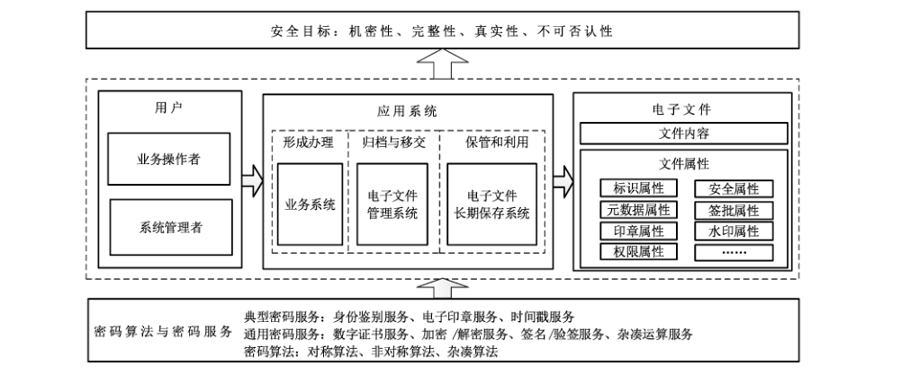
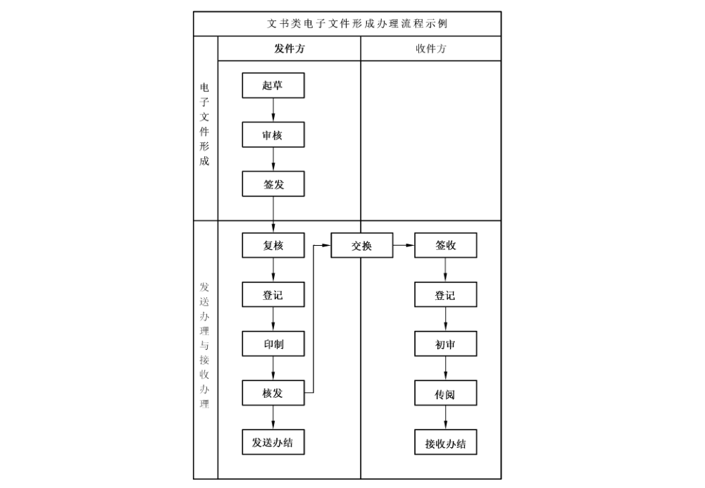

# GB/T 38541-2020 信息安全技术 电子文件密码应用指南

> 来源：[GB/T 38541-2020 国家标准详情](https://openstd.samr.gov.cn/bzgk/std/newGbInfo?hcno=92698E64A0A622E97D6A8CD09D411597)；封面发布日期：2020-03-06；实施日期：2020-10-01。
> PDF SHA-256：b5e01258803a62a38378eed54bacee0950da134cd82350ba5fa3585588d52b25。
> 转写说明：按页渲染官方 PDF 并对照全部 16 页校正文字、列表和附录层级；保留图 1 和图 A.1，省略封面、目录、页眉、页脚和页码，合并跨页段落。正式引用请核对原 PDF。

## 前言

本标准按照 GB/T 1.1—2009给出的规则起草。

请注意本文件的某些内容可能涉及专利。本文件的发布机构不承担识别这些专利的责任。

本标准由全国信息安全标准化技术委员会（SAC/TC 260）提出并归口。

本标准起草单位：中安网脉（北京）技术股份有限公司、北京电子科技学院、北京国脉信安科技有限公司、国家密码管理局商用密码检测中心、北京海泰方圆科技有限公司、北京书生电子技术有限公司、中国软件与技术服务有限公司。

本标准主要起草人：童新海、吴科科、冯雁、刘歆、谢四江、王佳宁、王天顺、袁峰、吕春梅、蒋红宇、郝立臣、郑志梅、李强。

## 1 范围

本标准提出了电子文件的密码应用技术框架和安全目标，描述了对电子文件进行密码操作的方法和电子文件应用系统使用密码技术的方法。

本标准适用于电子文件应用系统的开发和使用。

## 2 规范性引用文件

下列文件对于本文件的应用是必不可少的。凡是注日期的引用文件，仅注日期的版本适用于本文件。凡是不注日期的引用文件，其最新版本（包括所有的修改单）适用于本文件。

- GB/T 20518 信息安全技术 公钥基础设施 数字证书格式

- GB/T 25069—2010 信息安全技术 术语

- GB/T 31913—2015 文书类电子文件形成办理系统通用功能要求

- GB/T 32905 信息安全技术 SM3密码杂凑算法

- GB/T 32907 信息安全技术 SM4分组密码算法

- GB/T 32918（所有部分）信息安全技术 SM2椭圆曲线公钥密码算法

- GB/T 35275 信息安全技术 SM2密码算法加密签名消息语法规范

- GM/T 0019 通用密码服务接口规范

- GM/T 0031 安全电子签章密码应用技术规范

- GM/T 0033 时间戳接口规范

- GM/T 0054 信息系统密码应用基本要求

- GM/T 0055—2018 电子文件密码应用技术规范

## 3 术语和定义

GB/T 31913—2015、GB/T 25069—2010、GM/T 0055—2018界定的以及下列术语和定义适用于本文件。为了便于使用，以下重复列出了 GM/T 0055—2018中的某些术语和定义。

### 3.1 电子文件 electronic records

在数字设备及环境中形成，以数码形式存储于磁带、磁盘、光盘、智能密码钥匙等载体，依赖计算机等数字设备阅读、处理，并可在通信网络上传送的文字、图表、音频、视频等不同形式的文件，由文件内容和文件属性组成。

> 注：改写 GB/T 31913—2015，定义3.1。

### 3.2 文书类电子文件 administrative electronic records

反映党务、政务、生产经营管理等各项管理活动的电子文件。

### 3.3 标签 label

和电子文件绑定的一段数字实体，用于标识文件的属性和状态，定义文件的操作对象、操作行及访问权限，记录文件处理环节中操作者的操作行为，确保文件在创建、修改、授权、阅读、签批、盖章、打印、添加水印、流转、存档和销毁等操作中始终处于安全可控的状态，为应用系统提供追溯和审计的依据。

［GM/T 0055—2018，定义3.3］

### 3.4 应用系统 application system

以电子文件为处理对象，对电子文件进行创建、修改、授权、阅读、签批、盖章、打印、添加水印、流转、存档和销毁等操作的系统。

### 3.5 数字信封 digital envelope

一种数据结构，包含用对称密钥加密的密文和用公钥加密的该对称密钥。

## 4 缩略语

下列缩略语适用于本文件。

CBC：密码分组链接（Cipher Block Chaining）

CFB：密文反馈（Cipher Feedback）

CTR：计数器（Counter）

OFB：输出反馈（Output Feedback）

## 5 概述

### 5.1 密码应用技术框架

电子文件的密码应用技术框架如图1所示。

本标准凡涉及密码算法、密码协议宜遵循密码相关国家标准和行业标准。

图 1 电子文件密码应用技术框架

### 5.2 安全目标

电子文件管理的安全目标包括机密性、完整性、真实性和不可否认性。

为实现电子文件管理的安全目标，宜使用密码技术保证电子文件全生命周期的安全性。即保证电子文件的形成过程真实可靠，保证电子文件在传输（交换）、接收和存储的过程中未被篡改，保证电子文件不被泄露给非授权的访问者，保证电子文件的操作者不能否认其操作行为和处理结果。

电子文件的安全性由文件内容的安全性和文件属性的安全性共同来保证。

### 5.3 应用系统

遵循GB/T 31913—2015，电子文件全生命周期中，一般经历三种类型的系统，即业务系统、电子文件管理系统、电子文件长期保存系统。

业务系统也称作电子文件形成办理系统，主要为电子文件提供从形成到办理这一过程中所涉及的业务功能，并提供与其他系统连接的数据接口。电子文件管理系统负责从业务系统中捕获电子文件，维护文件之间、文件和业务之间的各种关联，支持查询利用，并以有序的、系统的、可审计的方式进行处置。

电子文件长期保存系统则以正确的和长期有效的方式维护电子文件并提供利用。

### 5.4 用户

用户是应用系统的操作人员，包括电子文件的业务操作者和应用系统的系统管理者。

业务操作者是指在业务系统、电子文件管理系统和电子文件长期保存系统中，对电子文件进行创建、修改、授权、阅读、签批、盖章、打印、流转、存档和销毁等具体操作的人员。

系统管理者是指对应用系统进行管理与维护的人员，包括系统管理员、审计管理员和保密管理员。

### 5.5 电子文件

电子文件是应用系统的操作对象。

文件内容可以包含一个或多个文件。

文件属性包括标识属性、元数据属性、安全属性、签批属性、印章属性、水印属性、权限属性、日志属性和扩展属性等。标识属性是文件的唯一标识，该标识在电子文件创建时确定，并在电子文件全生命周期中保持不变；元数据属性描述电子文件的背景、内容、结构及其整个管理过程的数据；安全属性描述与电子文件密码操作相关的属性和状态的数据，包括对文件内容及相关文件属性进行加密、签名等密码运算所采用算法的算法标识、数字证书信息、签名结果等内容；签批属性定义了对文件进行签批以及对签批行为进行签名的操作，包括签批人信息、签批时间、签批内容等内容；印章属性定义了对文件进行盖章、验章操作，包括签章人信息、签章时间、电子签章等内容；水印属性定义了对文件嵌入/提取水印的操作，包括水印设置人、水印设置时间、水印内容、水印位置等内容；权限属性定义对文件的读、写、打印、密码操作等操作权限；日志属性定义了对文件操作过程中的日志信息；扩展属性是由应用系统自定义的属性，由应用系统根据实际应用需要定义其结构及各要素的含义。

文件属性可遵循GM/T 0055—2018以标签的方式组织，电子文件与标签存在唯一绑定关系，可内联式存储也可外联式存储。

文件属性也可由应用系统以自维护方式组织，应用系统可根据属性含义自定义属性所包含的字段，并直接对文件属性进行密码操作，保证文件属性的安全性，维护其与电子文件的关联关系。

### 5.6 密码算法与密码服务

#### 5.6.1 密码算法

电子文件的密码操作宜使用对称算法、非对称算法和杂凑算法，根据场景宜采用 GB/T 32918、GB/T 32905、GB/T 32907 或者国家密码管理部门认可的其他密码算法。

对称算法用于加解密文件内容和文件属性。非对称算法用于加密和解密对称密钥，以及进行数字签名和签名验证。杂凑算法用于完整性计算和验证。对称算法可采用 CBC、OFB、CFB、CTR 等多种模式。当使用 OFB和CFB模式时，应用系统应设置反馈位数。

对密码算法的调用通过密码算法的标识来完成。

#### 5.6.2 通用密码服务

通用密码服务包括数字证书服务、加密/解密服务、签名/验签服务、杂凑运算服务等。通用密码服务由证书认证系统、密码设备/部件等密码基础设施提供，通过调用相关服务接口实现。提供密码服务的证书认证系统、密码设备/部件宜遵循相关国家标准和行业标准，并得到国家密码管理部门认证核准。

密码服务接口宜遵循GM/T 0019。数字证书格式宜遵循GB/T 20518。签名语法宜遵循 GB/T 35275。

#### 5.6.3 典型密码服务

典型密码服务包括身份鉴别服务、电子印章服务、时间戳服务等。

身份鉴别服务用于实现基于数字证书的用户身份鉴别。

电子印章服务用于对电子文件的印章加盖、验证和读取。电子印章服务接口宜遵循GM/T 0031。

时间戳服务用于对数字签名、电子印章提供时间信息。时间戳服务接口宜遵循GM/T 0033。

#### 5.6.4 密钥

电子文件涉及的密钥按类型分为对称密钥和非对称密钥，按配用分为用户密钥和系统密钥。

对称密钥由通用密码服务产生，用于加密电子文件；非对称密钥包括签名密钥对和加密密钥对，可来源于证书认证系统，签名密钥对用于电子文件在传输、交换和存储过程中的签名与验证，加密密钥对用于对称密钥的加密与解密。

用户密钥包括用户签名公私钥对和用户加密公私钥对，系统中所有用户宜配备对应的签名证书和加密证书；系统密钥包括系统签名密钥对和系统加密密钥对，所有电子文件应用系统宜配备对应的签名证书和加密证书。

## 6 电子文件的密码操作方法

### 6.1 基本原则

在应用系统中，可使用密码技术对电子文件进行机密性、完整性、真实性和不可否认性保护。在实际使用过程中，可根据电子文件重要程度、应用场景，确定电子文件的安全目标。在需要同时保证文件的机密性和完整性时，宜先对电子文件进行完整性保护，再对电子文件进行机密性保护。

### 6.2 机密性

#### 6.2.1 文件内容的机密性

可采用数字信封方式对文件内容进行加密，以保证文件内容的机密性。

文件属性采用标签方式组织时，应用系统宜遵循GM/T 0055—2018，调用电子文件密码服务中间件对指定的文件内容进行加密操作和解密操作。

文件属性由应用系统自行维护时，应用系统可直接对指定的文件内容进行加密操作和解密操作。

加密操作的对称密钥应随机生成，并确保一文一密，且应用系统无法获取明态的对称密钥。

文件内容加密操作方法如下：

a） 获取对称算法、非对称算法标识；

b） 调用通用密码服务产生对称密钥；

c） 调用对称加密服务使用对称密钥加密文件内容；

d） 调用非对称加密服务使用电子文件接收者或应用系统加密公钥加密对称密钥；

e） 将加密后的对称密钥、对称密钥加密后的文件内容按数字信封格式封装，形成加密文件内容；

如果电子文件接收者多人，则分别采用各接收者加密公钥加密对称密钥，并将所有接收者的加密对称密钥、对称密钥加密后的文件内容封装于数字信封头部；

f） 将算法标识、算法模式、反馈位数存储在安全属性中。

文件内容解密操作方法如下：

a） 从安全属性中获取加密电子文件的对称算法和非对称算法标识；

b） 根据非对称算法标识调用非对称解密服务，使用加密私钥解密加密后的对称密钥，得到对称密钥；

c） 根据对称算法标识调用对称解密服务，使用对称密钥解密文件内容。

#### 6.2.2 文件属性的机密性

可根据需要采用数字信封的方式对文件属性中的元数据属性、印章属性、水印属性、权限属性等属性信息进行加密，以保证相应属性信息的机密性。

文件属性采用标签方式组织时，宜遵循GM/T 0055—2018中的方式对相应属性进行机密性保护。

文件属性由应用系统自行维护时，应用系统可采用封装数字信封方式，对元数据属性、印章属性等需要保护的属性信息进行加解密操作，具体加解密操作方法同 6.2.1。

### 6.3 完整性

#### 6.3.1 文件内容的完整性

可采用对文件内容进行签名操作的方式，保证文件内容的完整性。

文件属性采用标签方式组织时，应用系统宜遵循GM/T 0055—2018，调用电子文件密码服务中间件对指定的文件内容进行签名操作和验签操作。

文件属性由应用系统自行维护时，可采用对文件内容进行签名的方式保证文件内容的完整性。添加签名过程如下：

a） 获取签名算法、杂凑算法标识；

b） 调用杂凑算法服务对文件内容明文计算摘要；

c） 使用业务操作者或应用系统的签名私钥对摘要值进行数字签名；

d） 将签名值、算法标识及签名证书按顺序填充到安全属性中。

可采用对文件内容进行验证签名操作的方式验证文件内容的完整性，过程如下：

a） 从安全属性中获取电子文件签名的杂凑算法标识、签名算法标识、签名证书信息和签名值；

b） 根据杂凑算法标识调用杂凑算法服务对文件内容计算摘要；

c） 根据签名算法标识调用签名验证服务，使用签名公钥和摘要值验证文件内容的签名值。

#### 6.3.2 文件属性的完整性

文件属性采用标签方式组织时，宜遵循GM/T 0055—2018，采用对标签进行签名操作的方式，保证文件属性的完整性。

文件属性由应用系统自行维护时，可采用对文件属性进行签名操作的方式，保证文件属性（不含日志属性）的完整性。应用系统可通过对应用系统日志的完整性保护来保证单个文件的日志属性的完整性。

文件属性（不含日志属性）形成或更新时，签名操作的过程如下：

a） 获取签名算法、杂凑算法标识；

b） 调用杂凑算法服务对除安全属性外其他属性计算摘要；

c） 调用杂凑算法服务对安全属性中除自签名信息外的内容计算摘要；

d） 将所有计算的摘要按既定的规则进行组装；

e） 调用杂凑算法服务对组装后的数据重新计算摘要；

f） 调用签名算法服务使用业务操作者或应用系统的签名私钥对摘要值进行数字签名；

g） 将签名值、算法标识及签名证书按顺序填充到安全属性的自签名信息中。

通过验证签名可验证文件属性（不含日志属性）的完整性，签名验证操作方法如下：

a） 从安全属性中获取文件属性签名的杂凑算法标识、签名算法标识、签名证书信息和签名值；

b） 根据杂凑算法标识调用杂凑算法服务对除安全属性外其他属性计算摘要；

c） 调用杂凑算法服务对安全属性中除自签名信息外的内容计算摘要；

d） 将所有计算的摘要按既定的规则进行组装；

e） 调用杂凑算法服务对组装后的数据重新计算摘要；

f） 根据签名算法标识调用签名验证服务，使用签名公钥和摘要值验证文件属性签名值。

### 6.4 真实性

#### 6.4.1 文件内容的真实性

文件内容的真实性由文件的签批属性、印章属性以及水印属性来保证。数字签名生成过程如下：

a） 签批属性：使用签批人签名私钥对签批数据进行数字签名，签名内容包括签批人信息、签批时间、签批内容、文件内容等；

b） 印章属性：使用签章人签名私钥对签章数据进行数字签名形成电子印章，签章数据包括签章人信息、签章时间、文件内容等；

c） 水印属性：使用水印设置人签名私钥对水印数据进行数字签名，水印数据包括水印设置人、水印设置时间、水印内容、水印位置等。

验证文件内容真实性的操作方法如下：

a） 验证签批属性：使用签批人签名公钥验证签批属性的数字签名；

b） 验证印章属性：使用签章人签名公钥验证印章属性的数字签名；

c） 验证水印属性：使用水印设置人签名公钥验证水印属性的数字签名。

#### 6.4.2 文件属性的真实性

文件属性的真实性由文件属性的数字签名保证。签名与验证操作同 6.3.2。

### 6.5 不可否认性

业务操作者对电子文件操作行为和操作结果的不可否认性可由签批属性、印章属性以及水印属性中的数字签名来保证，也可由业务操作者日志来保证。

签批属性、印章属性以及水印属性中的数字签名和验证过程同 6.4.1。

业务操作者对文件进行操作时需形成业务操作者日志并进行数字签名，过程如下：

a） 获取签名算法、杂凑算法标识；

b） 调用杂凑算法服务对本次操作形成的日志记录计算摘要，参与运算的内容包括文件标识号、操作人、操作时间、操作地点、操作内容、操作结果；

c） 调用签名算法服务使用业务操作者签名私钥对摘要值进行数字签名；

d） 将算法标识、签名值填充到该条日志记录；

e） 将该条日志记录提交应用系统服务器保存。

对日志进行签名验证，过程如下：

a） 从日志中获取日志签名的杂凑算法标识、签名算法标识和签名值；

b） 根据杂凑算法标识调用杂凑算法服务对日志记录计算摘要，参与运算的内容包括文件标识号、操作人、操作时间、操作地点、操作内容、操作结果；

c） 根据业务操作者信息获得业务操作者签名证书；

d） 根据签名算法标识调用签名验证服务，使用业务操作者签名公钥和摘要值验证日志签名值。

## 7 应用系统的密码应用方法

### 7.1 基本原则

应用系统可采用密码技术提供身份鉴别、权限控制、交换安全、存储安全和审计跟踪等方面的安全保障，宜遵循 GM/T 0054。

应用系统配置自身的签名密钥对、加密密钥对及对应的签名证书、加密证书；应用系统用户宜配置各自的签名密钥对、加密密钥对及对应的签名证书、加密证书；证书的有效性由应用系统调用数字证书服务功能提供保证。

应用系统可为每份文件分配唯一的文件标识号，并负责建立和维护文件内容与文件属性的关联关系。

### 7.2 身份鉴别

应用系统采用身份鉴别机制，实现用户、系统的单向或双向身份鉴别服务，保证用户、系统身份的真实性。身份鉴别可采用基于数字证书的鉴别模式，数字证书格式见 GB/T 20518。

### 7.3 权限控制

应用系统建立用户权限表，限定用户的最小权限集，同时保证任何用户不能同时拥有系统管理员和审计管理员的权限。

应用系统的授权行为由保密管理员完成。可使用保密管理员签名私钥对授权内容进行数字签名，保证授权内容的真实性、完整性，保证保密管理员对授权行为的不可否认性。

用户操作电子文件时，应用系统先使用保密管理员的签名公钥验证授权内容的数字签名，再验证用户对电子文件的操作权限。

### 7.4 存储安全

电子文件存储在应用系统中时，根据需要保证其机密性、完整性和真实性。机密性保护时，可使用业务操作者或应用系统加密公钥封装数字信封保护电子文件；完整性和真实性保护时，可使用业务操作者或应用系统签名私钥对电子文件进行数字签名。具体密码操作同 6.2、6.3 和6.4。

### 7.5 交换安全

#### 7.5.1 交换分类

根据电子文件交换双方的身份不同，可分为业务系统内部交换、业务系统间交换、业务系统与电子文件管理系统间交换、电子文件管理系统与电子文件长期保存系统间交换。宜采用密码技术保障交换安全，保证电子文件在交换过程中的真实性、完整性；对于重要电子文件，还要保证其机密性。

#### 7.5.2 业务系统内部交换

业务系统内部交换指业务系统内的业务操作者之间交换电子文件。发送时，文件发送者使用自己或系统的签名私钥和文件接收者的加密公钥对电子文件进行签名与加密；接收时，文件接收者使用对应的加密私钥与签名公钥进行解密与验签，并将解析得到的电子文件存储于本地系统。具体密码操作同 6.2、6.3 和 6.4。

#### 7.5.3 业务系统间交换

业务系统间交换电子文件时，可保留文件内容及标识属性、元数据属性、安全属性、签批属性、印章属性、数字水印属性，并根据需要保留日志属性、权限属性。

发送时，文件发送系统使用自己的系统签名私钥和文件接收系统的加密公钥对电子文件进行签名与加密；接收时，文件接收系统使用对应的加密私钥与签名公钥进行解密与验签，并将解析得到的电子文件存储于本地系统。具体密码操作同 6.2、6.3 和 6.4。

#### 7.5.4 业务系统与电子文件管理系统间交换

业务系统与电子文件管理系统间交换电子文件时，可保留电子文件内容及标识属性、元数据属性、安全属性，并根据需要保留签批属性、印章属性、数字水印属性、权限属性、日志属性。

交换时，遵循多文件整体一次性交换原则，在保证文件内容与文件属性关联关系的前提下，将多个文件按预定规则进行组装形成文件包，对文件包整体做机密性、完整性、真实性保护，而对单个电子文件仅保留其真实性与完整性保护。

业务系统发送电子文件密码操作方法如下：

a） 对准备交换的单个电子文件去除机密性，仅保证其完整性与真实性，具体密码操作同 6.2、6.3和 6.4；

b） 将准备交换的所有电子文件封装成文件包；

c） 调用通用密码服务产生对称密钥；

d） 调用对称加密服务使用对称密钥加密封装成的文件包；

e） 调用非对称加密服务使用电子文件管理系统加密公钥加密对称密钥；

f） 将加密后的对称密钥、加密后的电子文件包按数字信封格式封装，形成加密文件包；

g） 调用杂凑算法服务对加密文件包计算摘要；

h）使用业务系统签名私钥对摘要值计算数字签名；

i） 将业务系统签名证书、签名值、加密文件包一起发送给电子文件管理系统。

电子文件管理系统接收电子文件密码操作方法如下：

a） 使用业务系统签名公钥验证文件包的签名值；

b） 使用电子文件管理系统的加密私钥解密文件包；

c） 解封文件包获得电子文件；

d） 将解析得到的电子文件存储于本地系统。具体密码操作同 6.2、6.3 和 6.4。

#### 7.5.5 电子文件管理系统与电子文件长期保存系统间交换

电子文件管理系统与电子文件长期保存系统间交换电子文件时，可保留电子文件内容及标识属性、元数据属性，去除安全属性、权限属性和日志属性，并根据需要保留签批属性、印章属性、数字水印属性。

交换时，去除所有的安全保护机制，遵循多文件整体一次性交换原则，在保证文件内容与文件属性关联关系的前提下，将多个文件按预定规则进行组装形成文件包，对文件包整体做机密性、完整性、真实性保护，而对单个电子文件仅保留其真实性与完整性保护。

电子文件管理系统发送电子文件密码操作方法如下：

a） 对准备交换的文件去除所有的安全保护机制，并封装成文件包；

b） 调用通用密码服务产生对称密钥；

c） 调用对称加密服务使用对称密钥加密封装成的文件包；

d） 调用非对称加密服务使用电子文件长期保存系统加密公钥加密对称密钥；

e） 将加密后的对称密钥、加密后的电子文件包按数字信封格式封装，形成加密文件包；

f） 调用杂凑算法服务对加密文件包计算摘要；

g） 使用电子文件管理系统签名私钥对摘要值计算数字签名；

h）将电子文件管理系统签名证书、签名值、加密文件包一起发送给电子文件长期保存系统。

电子文件长期保存系统接收电子文件流程如下：

a） 使用电子文件管理系统签名公钥验证文件包的签名值；

b） 使用电子文件长期保存系统的加密私钥解密数字信封；

c） 解封文件包获得电子文件；

d） 将解析得到的电子文件存储于本地系统。具体密码操作同 6.2、6.3和6.4。

### 7.6 审计跟踪

应用系统具备完善的审计跟踪机制，在电子文件全生命周期的各个环节跟踪文件的运转和利用，记录业务操作者、系统管理者、应用系统对文件操作的具体行为。日志的审计跟踪由审计管理员负责，审计管理员的审计行为也可记录在系统管理者日志中。所有日志均采用数字签名/验签实现日志安全，保证重要行为日志的真实性、完整性和不可否认性。

根据日志操作对象，日志分为业务操作者日志、系统管理者日志和应用系统日志，具体内容如下：

a） 业务操作者日志：使用业务操作者签名私钥对日志内容进行数字签名，保证日志内容的完整性、真实性，以及业务操作者对操作行为的不可否认性。具体密码操作方法同 6.5。

b） 系统管理者日志：使用系统管理者签名私钥对日志内容进行数字签名，安全特性、密码操作方法同业务操作者日志。

c） 应用系统日志：使用应用系统签名私钥对日志内容进行数字签名，安全特性、密码操作方法同业务操作者日志。

应用系统日志整体的完整性，可使用应用系统签名私钥对日志整体内容进行数字签名的方式来保证。签名周期可根据日志的规模、数量灵活配置，如一小时一签、一天一签，也可在日志达到预设长度后就进行签名。

## 8 电子文件密码应用参考

本标准给出了文书类电子文件形成办理系统密码应用示例作为电子文件密码应用参考。文书类电子文件形成办理系统主要为文书类电子文件提供从形成到办理这一过程中所涉及的业务功能。文书类电子文件形成办理系统可作为一个独立系统存在，也可作为一个子系统或功能模块与电子文件管理系统同属于一个信息系统。

示例参见附录 A。

## 附录 A（资料性附录）文书类电子文件形成办理系统密码应用示例

### A.1 业务流程示例

#### A.1.1 概述

文书类电子文件形成办理系统（以下简称办理系统），遵循 GB/T 31913—2015，系统中电子文件形成办理的典型流程如图 A.1 所示，包含电子文件形成、发送办理与接收办理三个阶段。其中接收办理阶段仅以电子文件“传阅”为例，未涉及其他承办过程。

图 A.1 文书类电子文件形成办理流程示例

#### A.1.2 电子文件形成

起草环节：起草人填写文件的基本信息，并编写文件内容。

审核环节：审核人审核文件内容，并记录审核人、审核日期、审核意见。

签发环节：签发人对文件内容进行签发前的审核，并记录签发人、签发日期、签发意见。

#### A.1.3 电子文件发送办理

复核环节：复核人对电子文件及元数据进行复核，并记录复核人、复核日期、复核意见。

登记环节：记录电子文件的元数据信息。

印制环节：将电子文件制成版式文件，并加盖电子印章。

核发环节：记录电子文件发送、接收信息，对电子文件的实体信息和元数据信息进行封装后，通过电子文件交换送达收件方。

发送办结环节：完成发送办结过程。

#### A.1.4 电子文件交换

将电子文件由发件方传递至收件方。

#### A.1.5 电子文件接收办理

签收环节：签收人签收电子文件，记录签收人、签收日期。

登记环节：记录文件接收的元数据信息。

初审环节：初审人对接收的电子文件进行初审，并记录初审人、初审日期、初审意见。

传阅环节：电子文件在阅知人范围内传阅，并记录阅知人、阅知日期、阅知意见。

接收办结环节：完成接收办理过程。

### A.2 密码应用需求

#### A.2.1 电子文件形成

宜保证起草人、审核人、签发人对自身操作行为的不可否认性；宜保证文件内容、意见的真实性、完整性；宜依据电子文件的密级、保密期限保证电子文件存储的机密性。

#### A.2.2 电子文件发送办理

宜保证复核人、盖章人对自身操作行为的不可否认性；宜保证元数据属性、印章属性等文件属性信息的真实性和完整性；宜依据电子文件的密级、保密期限保证电子文件存储的机密性。

#### A.2.3 电子文件交换

宜保证电子文件交换过程中的机密性和完整性；宜对参与交换双方身份进行鉴别，保证电子文件来源真实、接收可靠。

#### A.2.4 电子文件接收办理

宜保证签收人、登记人、查阅人对自身操作行为的不可否认性；宜保证电子文件的文件内容和文件属性的真实性和完整性；宜使用密码技术保证电子文件的机密性，控制电子文件的知悉范围。

### A.3 密码应用示例

#### A.3.1 起草

起草人通过办理系统客户端，使用起草人的签名私钥对文件内容进行数字签名，并发送给办理系统。办理系统收到电子文件后，验证起草人的数字签名，并使用办理系统的加密私钥对电子文件进行机密性保护。

#### A.3.2 审核

办理系统将电子文件去除机密性保护后发送给审核人。

审核人首先验证起草人对电子文件的数字签名，然后填写审核意见，并使用审核人的签名私钥对文件内容、审核意见、审核时间等进行数字签名，最后将上述信息一同发送给办理系统。

办理系统收到电子文件后，验证审核人的数字签名，并使用办理系统的加密私钥对电子文件进行机密性保护。

#### A.3.3 签发

办理系统将电子文件去除机密性保护后发送给签发人。

签发人首先验证起草人和审核人对电子文件的数字签名，然后填写签发意见，并使用签发人的签名私钥对文件内容、签发意见、签发时间等进行数字签名，最后将上述信息一同发送给办理系统。

办理系统收到电子文件后，验证签发人的数字签名，并使用办理系统的加密私钥对电子文件进行机密性保护。

#### A.3.4 复核

办理系统电子文件去除机密性保护后发送给复核人。

复核人首先验证起草人、审核人和签发人对电子文件的数字签名，然后填写复核意见，并使用复核人的签名私钥对文件内容、复核意见、复核时间等进行数字签名，最后将上述信息一同发送给办理系统。

办理系统收到电子文件后，验证复核人的数字签名，并使用办理系统的加密私钥对电子文件进行机密性保护。

#### A.3.5 登记

办理系统将电子文件去除机密性保护后发送给登记人。

登记人首先验证起草人、审核人、复核人和签发人对电子文件的数字签名；然后修改电子文件的文号、发往单位、份数等元数据信息，并使用登记人的签名私钥对文件内容和元数据属性进行数字签名；最后将上述信息一同发送给办理系统。

办理系统收到电子文件后，验证登记人的数字签名，并使用办理系统的加密私钥对电子文件进行机密性保护。

#### A.3.6 印制

办理系统将电子文件去除机密性保护后发送给盖章人。

盖章人首先验证起草人、审核人、复核人、签发人和登记人对电子文件的数字签名；然后为电子文件加盖电子印章；最后将上述信息一同发送给办理系统。

办理系统收到电子文件后，验证电子签章的正确性，并使用办理系统的加密私钥对电子文件进行机密性保护。

#### A.3.7 核发

办理系统将电子文件去除机密性保护后发送给核发人。

核发人验证电子签章的正确性，然后填写核发意见，并使用核发人的签名私钥对文件内容、核发意见、核发时间等进行数字签名，最后将上述信息一同发送给办理系统。

办理系统收到电子文件后，验证核发人的数字签名，并使用办理系统的加密私钥对电子文件进行机密性保护。

#### A.3.8 发送办结

完成发送办理过程，此过程不涉及电子文件密码应用。

#### A.3.9 交换

业务系统间交换电子文件，密码应用方案见 7.5.3。

#### A.3.10 签收

收件方验证电子文件机密性、完整性，验证电子印章的真实性。并使用收件方办理系统的加密私钥对电子文件重新进行机密性保护。

#### A.3.11 登记

记录文件接收信息，此过程不涉及密码应用。

#### A.3.12 初审

办理系统将电子文件去除机密性保护后发送给初审人。

初审人验证电子签章的正确性，然后填写初审意见，并使用初审人的签名私钥对文件内容、初审意见、初审时间等进行数字签名，最后将上述信息一同发送给办理系统。

办理系统收到电子文件后，验证初审人的数字签名，并使用办理系统的加密私钥对电子文件进行机密性保护。

#### A.3.13 传阅

办理系统将电子文件去除机密性保护后发送给阅知人。

阅知人验证初审人的数字签名，验证电子签章的正确性，进行电子文件的阅读。

#### A.3.14 接收办结

完成接收办理过程，此过程不涉及电子文件密码应用。
