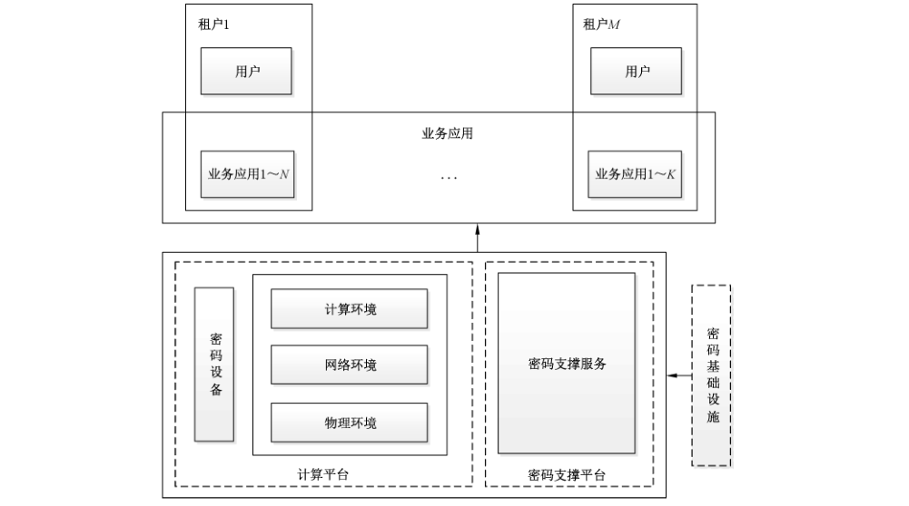

# GB/T 43207-2023 信息安全技术 信息系统密码应用设计指南

> 来源：[GB/T 43207-2023 国家标准详情](https://openstd.samr.gov.cn/bzgk/std/newGbInfo?hcno=851A7FC4DDC2F6E9BE2677127863CCF8)；发布日期：2023-09-07；实施日期：2024-04-01。
> 官方 PDF SHA-256：9be300dd2110dbbd6eb63cf61dacd9c56f41ebccc9405e047dd6cda172f5861c。
> 转写说明：依据官方 PDF 的全部 17 页图像转写；图示保留原页裁切，表格以可检索的 Markdown 重建，省略封面、目录、页眉和页脚，合并跨页段落。正式引用请核对原 PDF。

## 前言

本文件按照 GB/T 1.1—2020《标准化工作导则 第1部分：标准化文件的结构和起草规则》的规定起草。

请注意本文件的某些内容可能涉及专利。本文件的发布机构不承担识别专利的责任。

本文件由全国信息安全标准化技术委员会（SAC/TC 260）提出并归口。

本文件起草单位：鼎铉商用密码测评技术（深圳）有限公司、中国科学院信息工程研究所、哈尔滨工业大学（深圳）、中电科网络安全科技股份有限公司、北京海泰方圆科技股份有限公司、兴唐通信科技有限公司、北京数字认证股份有限公司、公安部第三研究所、国家信息技术安全研究中心、北京信安世纪科技股份有限公司、中科信息安全共性技术国家工程研究中心有限公司、北京市产品质量监督检验研究院、中国平安保险（集团）股份有限公司。

本文件主要起草人：李大为、陈磊、肖飞、马原、郑昉昱、周君平、王学进、蒋红宇、杨元原、傅大鹏、刘尚焱、王彦力、吴冬宇、汪宗斌、秦体红、徐根炜、胡建勋、李恒宇、李锐、贾世杰、陈天宇。

## 1 范围

本文件给出了信息系统密码应用设计指南，包括信息系统密码应用框架、密码应用方案设计原则、密码应用方案设计过程和密码应用方案设计指南。

本文件适用于指导信息系统密码应用方案的设计，也可作为信息系统密码保障建设、密码应用安全性评估和密码管理部门密码应用安全性评估备案工作的参考。

## 2 规范性引用文件

下列文件中的内容通过文中的规范性引用而构成本文件必不可少的条款。其中，注日期的引用文件，仅该日期对应的版本适用于本文件；不注日期的引用文件，其最新版本（包括所有的修改单）适用于本文件。

- GB/T 22240 信息安全技术 网络安全等级保护定级指南
- GB/T 25069 信息安全技术 术语
- GB/T 39786 信息安全技术 信息系统密码应用基本要求

## 3 术语和定义

GB/T 25069 和 GB/T 39786 界定的以及下列术语和定义适用于本文件。

### 3.1 密码应用方案 cryptography application scheme

用于指导信息系统责任主体合规、正确、有效地使用密码技术，部署密码保障系统的规划。

## 4 信息系统密码应用框架

使用密码保护的信息系统密码应用框架见图1。

信息系统密码应用框架中涉及的计算平台、密码支撑平台、业务应用、用户和租户如下。

a） 计算平台：是承载业务应用的物理环境、网络环境和计算环境。物理环境提供机房、供电、通风、空调、门禁和监控等保障条件；网络环境为业务应用提供数据传输通道和通信设备；计算环境提供承载业务应用运行和数据存储的设备或服务。计算平台中部署的密码设备（也可使用密码支撑平台提供的密码功能），为计算平台的运行安全和管理安全提供密码保障。

b） 密码支撑平台：为计算平台上运行的各类业务应用提供密码支撑服务，该服务以接口的形式提供密码功能，供各业务应用调用，以解决各业务应用的安全问题。密码基础设施为密码应用提供基础支撑。

c） 业务应用：是运行在计算平台上，实现业务功能的计算机程序。业务应用的密码应用安全对应GB/T 39786中的应用和数据安全。业务应用为解决安全问题需要使用的密码功能，由密码支撑平台提供。计算平台上可运行有多个业务应用，各个业务应用的安全需求各不相同，所以每个业务应用都需要有各自的密码应用设计。

d） 用户：是业务应用的使用者，用户端使用的计算机设备安全，属于计算平台安全，用户计算机上运行的业务系统客户端安全，属于应用安全。

e） 租户：是业务应用的所有者和用户的管理者。可有多个租户，每个租户可管理多个业务应用，各个业务应用可有不同的用户群。租户还承担着所属业务应用及其相应的密钥管理职责。

在逻辑上，一个信息系统有三种责任主体，分别是计算平台的运营方、密码支撑平台的服务提供方和租户。在现实中，逻辑上不同的责任主体可能归属于一个或多个现实主体。

信息系统的密码应用方案按照逻辑上责任主体的不同，分成三个部分分别设计，分别是计算平台密码应用方案、密码支撑平台方案和业务应用的密码应用方案，三种方案可按照现实责任主体整合设计，内容编排上按照三个部分分别描述。由于各个业务应用的业务功能不同，安全需求和管理对象也不相同，每个业务应用都需要设计相应的密码应用方案。方案模板依据附录 A设计。

## 5 密码应用方案设计原则

信息系统密码应用方案设计原则如下。

a） 总体性原则：按照GB/T 39786对信息系统密码应用的基本要求，以及信息系统的安全需求、责任单位的密码应用规划和密码管理需求，进行顶层设计。

b） 科学性原则：参考信息系统的密码需求、管理需求和整体规划，合理整合和部署密码资源，切实解决应用中的安全问题。

c） 完备性原则：依据法律、法规、标准等关于密码使用的要求，设计满足信息系统安全需求的密码应用方案。

d） 可行性原则：密码应用方案切合实际、便于实现，能作为信息系统密码应用建设、验收和密码应用安全性评估的依据。

e） 合规性原则：密码应用方案中使用的密码算法遵循国家有关法律法规的要求；使用的密码技术遵循国家及行业相关标准；涉及国家安全、国计民生、社会公共利益的信息系统，其使用的密码产品和服务经商用密码认证机构认证合格。

## 6 密码应用方案设计过程

### 6.1 概述

围绕具体开展的业务应用，设计使用密码技术来满足信息系统安全需求的密码应用方案。密码应用设计过程包括三项基本流程：密码应用需求分析、密码应用设计分析、安全与合规性分析。

### 6.2 密码应用需求分析

分析信息系统现状，明确需要保护的信息资源和所涉及的范围，确定信息系统的安全需求。依据GB/T 22240中等级保护定级，按照 GB/T 39786 中对不同等级的信息系统提出的密码应用基本要求，针对信息系统建设的安全策略和业务安全需求，明确密码应用技术要求和管理要求。对使用其他替代性风险控制措施而不采用密码技术的，做出相应的说明并在密码应用方案设计时进行风险评估和论证。

### 6.3 密码应用设计分析

参照 GB/T 22240中等级保护定级，根据被保护对象的密码需求和在GB/T 39786 中所处的层面以及对应等级下 GB/T 39786对该对象的密码应用基本要求，进行密码应用设计，包括计算平台密码应用方案设计、密码支撑平台方案设计和业务应用的密码应用方案设计，并从信息系统的管理制度、人员管理、建设运行和应急处置四个方面提出密码应用管理要求。方案设计过程中可能用到的标准参见附录B。

### 6.4 安全与合规性分析

逐条对照 GB/T 39786 对应等级下的各项密码应用技术要求，对方案的适用性进行检查。

a） 有下列情况时，对应的指标项可为“不适用”，对于不适用的项，做出相应的说明：

1） GB/T 39786中有“应”“宜”的指标项而实际信息系统中不存在对应对象，指标项可为“不适用”；

2） GB/T 39786中有“宜”的指标项，信息系统采用替代性风险控制措施满足风险控制需求，指标项可为“不适用”；

3） GB/T 39786 中有“可”的指标项，信息系统责任方自行决定是否采用密码技术保护指标涉及的保护对象，若决定不采用密码技术保护指标涉及的保护对象，指标项可为“不适用”。

b） 对于适用的项，逐条对照 GB/T 39786对应等级下的各项密码应用技术要求，对方案的安全控制措施进行分析与自评，若指标涉及的所有保护对象的相应安全控制措施（密码保障措施、缓解及替代性措施）有效、不存在高风险，且方案中描述的实施保障措施合理，则该指标的自评结果为通过；否则，该指标的自评结果为未通过。

## 7 密码应用方案设计指南

### 7.1 密码应用技术框架

密码应用技术框架包括计算平台、密码支撑平台和业务应用的密码应用架构等，综合描述各平台、系统之间的关系。根据信息系统密码应用需求设计密码应用技术框架。

### 7.2 计算平台密码应用方案

#### 7.2.1 物理和环境安全

计算平台的物理环境密码应用安全对应GB/T 39786中的物理和环境安全。物理和环境安全保护的对象是物理访问的身份鉴别、电子门禁记录数据和视频监控记录数据。按照GB/T 39786 中物理和环境安全对应等级的密码应用基本要求和实际环境的具体需求，对信息系统所在的机房等重要区域、电子门禁记录数据和视频监控记录数据进行密码应用设计，包括选择的密码技术和标准、采用的密码设备、密码设备的部署位置和方式、密码设备的使用和管理等内容。

#### 7.2.2 网络和通信安全

计算平台的网络环境密码应用安全对应GB/T 39786 中的网络和通信安全。网络和通信安全保护的对象是信息系统与外界交互的通信信道。按照GB/T 39786 中网络和通信安全对应等级的密码应用基本要求和实际环境的具体需求，对需要密码保护的每一条通信信道进行密码应用设计，包括选择的密码技术和标准、采用的密码设备、密码设备的部署位置和方式、密码设备的使用和管理等内容。需要接入认证的设备，根据具体情况选择使用的密码技术，确定在设备端和认证端部署的密码设备和部署位置，给出密码设备的使用和管理内容。

#### 7.2.3 设备和计算安全

计算平台的计算环境密码应用安全对应 GB/T 39786 中的设备和计算安全。设备和计算安全保护的对象是信息系统中承载业务应用的计算环境，包括信息技术产品（如通用设备、网络及安全设备、密码设备和各类虚拟设备等）。按照GB/T 39786中设备和计算安全对应等级的密码应用基本要求和实际具体需求，对需要保护的对象进行密码应用设计，包括选择的密码技术和标准、设计必要的数据结构、采用的密码设备或模块、密码设备的部署位置和方式、密码设备的使用和管理内容。

### 7.3 密码支撑平台方案

密码支撑平台为承载在计算平台上的各类业务应用提供密码功能服务，可选择采用经认证合格的密码支撑服务产品（如密码服务平台等），也可根据各类应用的密码需求、性能需求和责任主体的规划要求等，基于经认证合格的密码产品进行设计，设计的内容为：

a） 密码服务机构的确定、接入方式和服务策略；

b） 支持的密码体制和密码算法；

c） 接口和功能遵循的标准；

d） 提供的密码支撑方式（如租密码机方式、租密码服务器方式和租密码服务方式）；

e） 提供的密码功能及接口（如实体鉴别、签名验签和加密解密），也可提供密码应用服务（如时间戳、电子印章和安全认证网关）；

f） 部署的位置和方式（如部署的位置、部署的方式、使用和管理等内容），部署的方式包括全网统一部署和分租户分散部署；

g） 接入计算平台的方式（如独立的形态，不占用计算平台的任何资源；非独立的形态，借用或租用计算平台的计算资源和网络资源）；

h） 密钥管理方式，按责任主体的规划要求确定（如租户自行管理，支撑平台提供管理界面；租户委托管理，支撑平台代管密钥）；

i） 支撑平台的自身安全性，包括密钥安全、访问安全、管理安全和租户间的隔离安全等。

### 7.4 业务应用的密码应用方案

业务应用保护的对象是信息系统中的所有应用及其重要数据，按照 GB/T 39786 中应用和数据安全对应等级的密码应用基本要求和各业务系统实际需求，对需要保护的对象进行密码应用方案设计，具体内容如下：

a） 按照信息系统的规划、责任主体的需求、现有或规划的密码功能提供模式，确定密码体制；

b） 梳理业务流程，根据流程安全需求，为关键环节设计密码保护机制；

c） 梳理业务数据，根据数据安全需求，为重要数据设计密码保护机制；

d） 梳理业务对象（如文件、证照、票据、病历、采集的数据和控制指令等），根据安全需求，为其设计密码保护机制；

e） 根据角色和访问控制，为其权限和访问策略等设计密码保护机制；

f） 根据审计策略，为日志记录设计密码保护机制；

g） 为角色分配密钥，明确密钥载体，设计系统的密钥管理策略；

h） 使用加密功能的，需指明密码算法、加密模式、数据填充方式和密钥属性等；

i） 使用签名功能的，需指明签名算法和签名机制（如签名内容、签名主体和签名位置等）；

j） 使用完整性保护功能的，需指明使用的算法和校验机制；

k） 根据保护机制，修改被保护对象的数据结构，将上述内容添加到原数据结构中，使其成为带安全机制的数据结构；

l） 实现保护机制用到的密码功能和用户登录用到的身份鉴别功能，由密码支撑平台提供，数据传输和数据存储安全，由计算平台负责，有单独需求（如互通且长期保存）或计算平台没有提供的，可设计信源加密机制。

根据确定的密码体制和密码应用方案，设计密钥管理策略，内容包括密钥的种类和用途、密钥的载体和保管方式、密钥的使用和更新、密钥的备份和恢复等，分别针对上述内容所涉及的人员、责任、介质、材料和流程等设计管理机制。密钥管理策略参见附录C。

## 附录 A（规范性）密码应用方案模板

### A.1 背景

明确系统的建设规划、国家有关法律法规要求、与规划有关的前期情况概述和项目实施的必要性，以及信息系统相关的其他情况说明。

### A.2 系统概述

#### A.2.1 基本情况

系统基本情况包括系统名称、系统责任主体单位情况（名称、地址、所属密码管理部门和单位类型等）、系统上线运行时间、系统用户情况（使用单位、使用人员和使用场景等）、是否为关键信息基础设施、等级保护定级和备案情况、网络安全等级测评情况以及密码应用安全性评估情况等。

#### A.2.2 计算平台现状

如果密码应用方案包括计算平台密码应用方案设计，则包括以下具体描述。

a） 物理环境：包括机房或重要场所地点、系统部署位置、内外部环境和管理责任主体。

b） 网络环境：包括网络框架、网络边界划分、内外部数据交互情况、设备组成及实现功能、所采取的安全防护措施，并给出系统网络拓扑图。

c） 计算环境：包括系统软硬件构成（如服务器、用户终端、网络设备、存储设备、安全防护设备、密码设备等硬件资源和操作系统、数据库系统、应用中间件等软件资源）。

如果密码应用方案不包括计算平台密码应用方案设计，则描述计算平台的场所地点和密码应用安全性评估情况。

#### A.2.3 业务应用现状

业务应用现状包括以下具体描述。

a） 业务应用的基本情况，包括承载的业务情况和责任主体等。

b） 承载的业务情况，包括系统承载的业务应用、业务功能和关键数据类型等。

c） 对于多个子应用的信息系统，对每个子应用分别描述。

#### A.2.4 密码应用现状

信息系统部署密码设施设备的基本情况、责任主体和密码支撑情况（如密码中间件的部署情况和密码功能的提供模式）等。

#### A.2.5 密码应用管理现状

管理要求包括信息系统管理制度、人员管理、建设运行和应急处置等。

### A.3 密码应用需求分析

结合信息系统现状和 GB/T 39786 中对不同等级的信息系统提出的密码应用基本要求，对密码应用方案涉及的计算平台、业务应用、管理制度、人员管理、建设运行和应急处置进行安全风险分析，确定风险控制措施、密码应用基本需求分析和密码应用特殊需求分析。通过风险控制措施缓解信息系统存在的高风险。

### A.4 安全目标及设计原则

#### A.4.1 安全目标

提出密码应用方案所涉及对象的密码应用安全目标。

#### A.4.2 设计原则与依据

提出密码应用方案的设计原则，遵循的政策法规和相关标准。

### A.5 密码应用设计

#### A.5.1 密码应用技术框架

包括密码应用技术框架图及框架说明。密码应用技术框架包括计算平台、密码支撑平台和业务应用密码应用架构等，综合描述各平台、系统之间的关系，清晰展示密码应用整体技术框架。

#### A.5.2 计算平台密码应用方案

密码应用方案涉及计算平台安全，见 7.2 的内容设计。

#### A.5.3 密码支撑平台方案

密码应用方案涉及为业务应用提供密码功能，见 7.3 的内容设计。

#### A.5.4 业务应用的密码应用方案

密码应用方案涉及业务应用安全，见 7.4 的内容设计。

#### A.5.5 密码应用部署

包括软硬件设备清单（软硬件设备均需包括已有的密码产品清单）、部署示意图及说明等，新增加的密码设备需要明确标识。

### A.6 安全管理方案

参照 GB/T 22240 中等级保护定级，根据 GB/T 39786 对该等级的管理要求，根据部署的密码产品管理机制，设计安全管理方案，包括管理制度、人员管理、建设运行和应急处置方面的制度。

### A.7 安全与合规性分析

逐条对照 GB/T 39786 对应等级下的各项密码应用基本要求，对方案的适用情况、采取的密码保障措施、采取的缓解及替代性措施及自评结果进行说明：

a） 若指标为适用，说明采取的密码保障措施或未采取密码保障措施的情况（如采取的缓解及替代性措施）；

b） 针对适用的指标，存在部分保护对象不适用的情况，论证其不适用性；

c） 若指标为不适用，参考6.4，说明其不适用的理由。

根据 GB/T 39786 中要求和设计的密码应用方案，填写密码应用合规性对照表，自评估其密码应用的合规性。密码应用合规性对照如表 A.1 所示（以第三级别要求为例，可根据实际系统级别进行修改）。

**表 A.1 密码应用合规性对照表**

| 指标要求 | 密码技术应用点 | GB/T 39786 密码应用基本要求 | 适用情况（适用/不适用） | 采取的密码保障措施 | 说明（如采取的缓解及替代性措施） | 自评结果（通过/未通过） |
| --- | --- | --- | --- | --- | --- | --- |
| 物理和环境安全 | 身份鉴别 | 宜 | — | — | — | — |
| 物理和环境安全 | 电子门禁记录数据存储完整性 | 宜 | — | — | — | — |
| 物理和环境安全 | 视频监控记录数据存储完整性 | 宜 | — | — | — | — |
| 网络和通信安全 | 身份鉴别 | 应 | — | — | — | — |
| 网络和通信安全 | 通信数据完整性 | 宜 | — | — | — | — |
| 网络和通信安全 | 通信过程中重要数据的机密性 | 应 | — | — | — | — |
| 网络和通信安全 | 网络边界访问控制信息的完整性 | 宜 | — | — | — | — |
| 网络和通信安全 | 安全接入认证 | 可 | — | — | — | — |
| 设备和计算安全 | 身份鉴别 | 应 | — | — | — | — |
| 设备和计算安全 | 远程管理通道安全 | 应 | — | — | — | — |
| 设备和计算安全 | 系统资源访问控制信息完整性 | 宜 | — | — | — | — |
| 设备和计算安全 | 重要信息资源安全标记完整性 | 宜 | — | — | — | — |
| 设备和计算安全 | 日志记录完整性 | 宜 | — | — | — | — |
| 设备和计算安全 | 重要可执行程序完整性、重要可执行程序来源真实性 | 宜 | — | — | — | — |
| 应用和数据安全 | 身份鉴别 | 应 | — | — | — | — |
| 应用和数据安全 | 访问控制信息完整性 | 宜 | — | — | — | — |
| 应用和数据安全 | 重要信息资源安全标记完整性 | 宜 | — | — | — | — |
| 应用和数据安全 | 重要数据传输机密性 | 应 | — | — | — | — |
| 应用和数据安全 | 重要数据存储机密性 | 应 | — | — | — | — |
| 应用和数据安全 | 重要数据传输完整性 | 宜 | — | — | — | — |
| 应用和数据安全 | 重要数据存储完整性 | 宜 | — | — | — | — |
| 应用和数据安全 | 不可否认性 | 宜 | — | — | — | — |
| 管理制度 | 具备密码应用安全管理制度 | 应 | — | — | — | — |
| 管理制度 | 密钥管理规则 | 应 | — | — | — | — |
| 管理制度 | 建立操作规程 | 应 | — | — | — | — |
| 管理制度 | 定期修订安全管理制度 | 应 | — | — | — | — |
| 管理制度 | 明确管理制度发布流程 | 应 | — | — | — | — |
| 管理制度 | 制度执行过程记录留存 | 应 | — | — | — | — |
| 人员管理 | 了解并遵守密码相关法律法规和密码管理制度 | 应 | — | — | — | — |
| 人员管理 | 建立密码应用岗位责任制度 | 应 | — | — | — | — |
| 人员管理 | 建立上岗人员培训制度 | 应 | — | — | — | — |
| 人员管理 | 定期进行安全岗位人员考核 | 应 | — | — | — | — |
| 人员管理 | 建立关键岗位人员保密制度和调离制度 | 应 | — | — | — | — |
| 建设运行 | 制定密码应用方案 | 应 | — | — | — | — |
| 建设运行 | 制定密钥安全管理策略 | 应 | — | — | — | — |
| 建设运行 | 制定实施方案 | 应 | — | — | — | — |
| 建设运行 | 投入运行前进行密码应用安全性评估 | 应 | — | — | — | — |
| 建设运行 | 定期开展密码应用安全性评估及攻防对抗演习 | 应 | — | — | — | — |
| 应急处置 | 应急策略 | 应 | — | — | — | — |
| 应急处置 | 事件处置 | 应 | — | — | — | — |
| 应急处置 | 向有关主管部门上报处置情况 | 应 | — | — | — | — |

### A.8 实施保障方案

#### A.8.1 实施内容

描述实施对象的边界及密码应用的范围、任务要求等。

实施内容包括但不限于采购、软硬件开发或改造、系统集成、综合调试和试运行等。

分析项目实施的重难点问题，提出实施过程中可能存在的风险点及应对措施。

#### A.8.2 实施计划

包括实施路线图、进度计划和重要节点等。

按照施工进度计划确定实施步骤，并分阶段描述任务分工、实施主体、项目建设单位和阶段交付物等。

#### A.8.3 保障措施

包括项目实施过程中的组织保障、人员保障、经费保障、质量保障和监督检查等措施。

#### A.8.4 经费概算

按照经费使用要求，对密码应用项目建设和产生的相关费用进行概算。采购的密码产品和相关服务要描述产品名称、服务类型和数量等。

## 附录 B（资料性）密码标准使用指南

### B.1 密码支撑类标准

接口调用、实体鉴别协议、加解密、签名、验签和完整性计算以及基础标准遵循的密码支撑类标准见表 B.1。

**表 B.1 密码支撑类标准**

| 接口及功能类型 | 密码应用场景 | 可遵循的标准 |
| --- | --- | --- |
| 接口调用 | 密码支撑平台通过接口提供密码功能，业务应用通过接口调用密码功能 | GB/T 38629 信息安全技术 签名验签服务器技术规范 |
| 接口调用 | 密码支撑平台通过接口提供密码功能，业务应用通过接口调用密码功能 | GM/T 0019 通用密码服务接口规范 |
| 接口调用 | 密码支撑平台通过接口提供密码功能，业务应用通过接口调用密码功能 | GM/T 0020 证书应用综合服务接口规范 |
| 接口调用 | 密码支撑平台通过接口提供密码功能，业务应用通过接口调用密码功能 | GM/T 0033 时间戳接口规范 |
| 接口调用 | 密码支撑平台通过接口提供密码功能，业务应用通过接口调用密码功能 | GM/T 0067 基于数字证书的身份鉴别接口规范 |
| 实体鉴别协议 | 应用系统调用密码功能，按照标准实现身份鉴别协议 | GB/T 15843（所有部分）信息技术 安全技术 实体鉴别 |
| 实体鉴别协议 | 应用系统调用密码功能，按照标准实现身份鉴别协议 | GB/T 38556 信息安全技术 动态口令密码应用技术规范 |
| 实体鉴别协议 | 应用系统调用密码功能，按照标准实现身份鉴别协议 | GM/T 0067 基于数字证书的身份鉴别接口规范 |
| 实体鉴别协议 | 应用系统调用密码功能，按照标准实现身份鉴别协议 | GM/T 0069 开放的身份鉴别框架 |
| 实体鉴别协议 | 应用系统调用密码功能，按照标准实现身份鉴别协议 | GM/T 0113 在线快捷身份鉴别协议 |
| 加解密、签名、验签和完整性计算 | 应用系统调用密码功能，按照标准对数据加密、解密、签名、验签、计算消息鉴别码 | GB/T 15852（所有部分）信息技术 安全技术 消息鉴别码 |
| 加解密、签名、验签和完整性计算 | 应用系统调用密码功能，按照标准对数据加密、解密、签名、验签、计算消息鉴别码 | GB/T 17964 信息安全技术 分组密码算法的工作模式 |
| 加解密、签名、验签和完整性计算 | 应用系统调用密码功能，按照标准对数据加密、解密、签名、验签、计算消息鉴别码 | GB/T 35276 信息安全技术 SM2 密码算法使用规范 |
| 基础标准 | 应用系统调用密码功能时，指明算法和用法 | GB/T 33560 信息安全技术 密码应用标识规范 |
| 基础标准 | 应用系统管理用户实体时，关联用户的数字证书 | GB/T 20518 信息安全技术 公钥基础设施 数字证书格式 |
| 基础标准 | 应用系统对数据加密或签名时，对数据进行封装 | GB/T 35275 信息安全技术 SM2 密码算法加密签名消息语法规范 |

### B.2 密码应用类标准

业务应用、构建授权与访问控制机制、使用/验证电子印章、电子签章、部署密码产品或密码系统遵循的密码应用类标准见表 B.2。

**表 B.2 密码应用类标准**

| 密码应用场景 | 可遵循的标准 |
| --- | --- |
| 业务应用 | GB/T 38541 信息安全技术 电子文件密码应用指南 |
| 业务应用 | GB/T 39786 信息安全技术 信息系统密码应用基本要求 |
| 业务应用 | GM/T 0055 电子文件密码应用技术规范 |
| 业务应用 | GM/T 0099 开放式版式文档密码应用技术规范 |
| 业务应用 | GM/T 0111 区块链密码应用技术要求 |
| 业务应用 | GM/T 0112 PDF 格式文档的密码应用技术要求 |
| 构建授权与访问控制机制 | GM/T 0032 基于角色的授权与访问控制技术规范 |
| 使用/验证电子印章、电子签章 | GB/T 38540 信息安全技术 安全电子签章密码技术规范 |
| 部署密码产品或密码系统 | GB/T 32922 信息安全技术 IPSec VPN 安全接入基本要求与实施指南 |
| 部署密码产品或密码系统 | GB/T 38540 信息安全技术 安全电子签章密码技术规范 |
| 部署密码产品或密码系统 | GM/T 0023 IPSec VPN 网关产品规范 |
| 部署密码产品或密码系统 | GM/T 0025 SSL VPN 网关产品规范 |
| 部署密码产品或密码系统 | GM/T 0026 安全认证网关产品规范 |
| 部署密码产品或密码系统 | GM/T 0036 采用非接触卡的门禁系统密码应用技术指南 |
| 部署密码产品或密码系统 | GM/T 0096 射频识别防伪系统密码应用指南 |

### B.3 密码测评类标准

信息系统密码应用安全性评估遵循的密码测评类标准见表 B.3。

**表 B.3 密码测评类标准**

| 密码应用场景 | 可遵循的标准 |
| --- | --- |
| 信息系统密码应用安全性评估相关标准（含指导文件） | GM/T 0115 信息系统密码应用测评要求 |
| 信息系统密码应用安全性评估相关标准（含指导文件） | GM/T 0116 信息系统密码应用测评过程指南 |
| 信息系统密码应用安全性评估相关标准（含指导文件） | 业务指导部门发布的测评类指导文件 |

## 附录 C（资料性）密钥管理策略设计指南

### C.1 密钥产生

密钥在符合 GB/T 37092 规定的密码产品中产生。明确信息系统中密钥的产生方式和来源，密钥产生的同时记录密钥关联信息，包括密钥种类、长度、拥有者、使用起始时间和使用终止时间等。

### C.2 密钥分发

密钥分发时保证密钥的机密性、完整性以及分发者、接收者身份的真实性等，确定密钥与实体的关联关系，并建立密钥介质的管理规范。

### C.3 密钥存储

明确各类型密钥存储的位置和方式，如密钥在符合 GB/T 37092 的密码产品中存储，或者在对密钥进行机密性和完整性保护后，存储在通用设备或系统中。除公钥外，密钥不以明文方式存储在密码产品外部并采取严格的安全防护措施，防止密钥被非授权的访问或篡改。公钥可以明文方式存储在密码产品外部，但有必要采取安全防护措施，防止公钥被篡改。

### C.4 密钥使用

明确各类型密钥的使用要求并按要求使用密钥，包括使用条件、时间和用途等。密钥一般在符合 GB/T 37092 规定的密码产品内部产生，且每个密钥一般只有单一的用途。公钥使用前需要验证其完整性，以及与实体的关联关系，确保公钥来源的真实性。

### C.5 密钥更新

设定密钥更新策略，包括密钥的更新周期、更新机制、更新流程，以及保障密钥更新前后业务连续性的措施，并指定密钥更新人员。在密钥超过使用期限、泄露或存在泄露风险时，根据相应的密钥更新策略进行更新。

### C.6 密钥归档

如果信息系统有密钥归档需求，明确密钥归档的条件、人员和流程，并确定归档密钥的存储位置、存储方式以及管理者。根据安全需求采取有效的安全措施，保证归档密钥的安全性和正确性。归档密钥只能用于解密该密钥加密的历史信息或验证该密钥签名的历史信息。执行密钥归档时，生成审计信息，包括归档的密钥和归档的时间等。

### C.7 密钥撤销

明确密钥的撤销条件、撤销流程、撤销机制和撤销人等，以及撤销后密钥的处理方式等。

### C.8 密钥备份

指定备份操作人员、备份密钥管理人员、备份密钥管理机制、备份密钥恢复流程以及备份密钥存档要求等。明确密钥备份的机密性、完整性以及与实体和其他信息的关联关系。对密钥备份过程进行记录，并生成审计信息，审计信息包括备份的主体和备份的时间等。

### C.9 密钥恢复

制定密钥恢复要求与机制，确定密钥恢复流程，指定密钥恢复操作员。对密钥恢复过程进行记录，并生成审计信息，审计信息包括恢复的主体和恢复的时间等。

### C.10 密钥销毁

制定密钥销毁相关要求，根据密钥存储介质情况确定密钥销毁模式，明确密钥销毁机制、销毁启动条件（设备失控、丢弃时进行密钥销毁），以及销毁操作方法、操作流程和操作人员。

## 参考文献

- ［1］ GB/T 15843（所有部分）信息技术 安全技术 实体鉴别

- ［2］ GB/T 15852（所有部分）信息技术 安全技术 消息鉴别码

- ［3］ GB/T 17964 信息安全技术 分组密码算法的工作模式

- ［4］ GB/T 20518 信息安全技术 公钥基础设施 数字证书格式

- ［5］ GB/T 32922 信息安全技术 IPSec VPN 安全接入基本要求与实施指南

- ［6］ GB/T 33560 信息安全技术 密码应用标识规范

- ［7］ GB/T 35275 信息安全技术 SM2密码算法加密签名消息语法规范

- ［8］ GB/T 35276 信息安全技术 SM2密码算法使用规范

- ［9］ GB/T 37092 信息安全技术 密码模块安全要求

- ［10］ GB/T 38540 信息安全技术 安全电子签章密码技术规范

- ［11］ GB/T 38541 信息安全技术 电子文件密码应用指南

- ［12］ GB/T 38556 信息安全技术 动态口令密码应用技术规范

- ［13］ GB/T 38629 信息安全技术 签名验签服务器技术规范

- ［14］ GM/T 0019 通用密码服务接口规范

- ［15］ GM/T 0020 证书应用综合服务接口规范

- ［16］ GM/T 0023 IPSec VPN 网关产品规范

- ［17］ GM/T 0025 SSL VPN 网关产品规范

- ［18］ GM/T 0026 安全认证网关产品规范

- ［19］ GM/T 0032 基于角色的授权与访问控制技术规范

- ［20］ GM/T 0033 时间戳接口规范

- ［21］ GM/T 0036 采用非接触卡的门禁系统密码应用技术指南

- ［22］ GM/T 0055 电子文件密码应用技术规范

- ［23］ GM/T 0067 基于数字证书的身份鉴别接口规范

- ［24］ GM/T 0069 开放的身份鉴别框架

- ［25］ GM/T 0096 射频识别防伪系统密码应用指南

- ［26］ GM/T 0099 开放式版式文档密码应用技术规范

- ［27］ GM/T 0111 区块链密码应用技术要求

- ［28］ GM/T 0112 PDF 格式文档的密码应用技术要求

- ［29］ GM/T 0113 在线快捷身份鉴别协议

- ［30］ GM/T 0115 信息系统密码应用测评要求

- ［31］ GM/T 0116 信息系统密码应用测评过程指南
