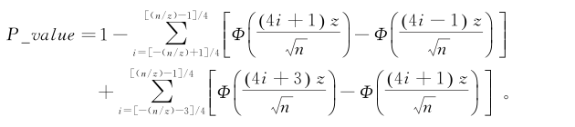
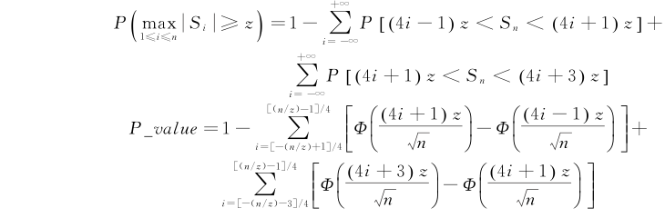

# GB/T 32915-2016 信息安全技术 二元序列随机性检测方法

> 来源：[GB/T 32915-2016 国家标准详情](https://openstd.samr.gov.cn/bzgk/std/newGbInfo?hcno=46D7E3E9C4B81DF460052FFEB706CAB0)；封面发布日期：2016-08-29；实施日期：2017-03-01。
> 官方 PDF SHA-256：5f47e2b6664cd6d558fb07c6286cba25f7cdecc8b087fc8fd18ca9f9aa33a3d7。
> 转写说明：对照官方 PDF 全部 23 页图像校正文字、公式和表格；省略封面、目录、页眉、页脚和页码。正式引用请核对原标准页面。
> 原文疑点：第 3 章对 $P\_value$ 与 $\operatorname{erfc}$ 的释义疑似互换；A.14 的 $n$ 计算式与紧随其后的 $L=6$ 数值示例不一致。下文均按原页保留。

> 转写注：4.13.2 与 A.13 的 $\pi_2=0.150\,00$、第 3 章的 $\varepsilon_i=(0,1)$ 保留原页写法。

## 前言

本标准按照 GB/T 1.1—2009 给出的规则起草。

请注意本文件的某些内容可能涉及专利。本文件的发布机构不承担识别这些专利的责任。

本标准由国家密码管理局提出。

本标准由全国信息安全标准化技术委员会（SAC/TC 260）归口。

本标准起草单位：国家密码管理局商用密码检测中心、中国科学院软件研究所、北京信息科学技术研究院。

本标准主要起草人：李大为、冯登国、陈华、张超、周永彬、董芳、范丽敏、许囡囡、邓开勇、罗鹏。

## 1 范围

本标准规定了商用密码应用中的随机性检测指标和检测方法。

本标准适用于对随机数发生器产生的二元序列的随机性检测。

## 2 术语和定义

下列术语和定义适用于本文件。

### 2.1 二元序列 binary sequence

由“0”和“1”组成的比特串。

### 2.2 随机数发生器 random number generator

产生随机二元序列的器件或程序。

### 2.3 随机性假设 randomness hypothesis

对二元序列做随机性检测时，首先假设该序列是随机的，这个假设称为原假设或零假设，记为 $H_0$。与原假设相反的假设，即这个序列是不随机的，称为备择假设，记为 $H_\alpha$。

### 2.4 随机性检测 randomness test

用于二元序列检测的一个函数或过程，可以通过它来判断是否接受随机性原假设。

### 2.5 显著性水平 significance level

随机性检测中错误地判断某一个随机序列为非随机序列的概率，用 $\alpha$ 来表示。

### 2.6 样本 sample

用于随机性检测的二元序列，称为样本。

### 2.7 样本长度 sample length

一个样本的比特个数。

### 2.8 样本数量 sample size

随机性检测的样本的个数。

### 2.9 检测参数 test parameter

随机性检测需要设定的参数。

### 2.10 游程 run

序列中由连续的“0”或者“1”组成的子序列，并且该子序列的前导与后继元素都与其本身的元素不同。

## 3 符号

下列符号适用于本文件。

| 符号 | 含义 |
| --- | --- |
| $\alpha$ | 显著性水平 |
| $H_0$ | 原假设（零假设） |
| $H_\alpha$ | 备择假设 |
| $\varepsilon$ | 待检序列 |
| $n$ | 待检序列的比特长度 |
| $\varepsilon_i$ | 待检序列中的某一个比特，$\varepsilon_i=(0,1)$ |
| $\varepsilon'$ | 在 $\varepsilon$ 的基础上按照一定的规则产生出的新序列 |
| $X_i$ | $2\varepsilon_i-1$ |
| $m$ | 子序列的比特长度 |
| $\sum$ | 求和符号 |
| $*$ | 乘法，有时省略 |
| $\ln(x)$ | $x$ 的自然对数 |
| $\log_2(x)$ | 以 2 为底的 $x$ 的对数 |
| $\lfloor x\rfloor$ | 不大于 $x$ 的最大整数 |
| $\max$ | 从若干个元素中取最大值 |
| $\Phi(x)$ | 标准正态分布函数 |
| $V$ | 统计值 |
| $P\_value$ | 余误差函数（Complementary Error Function） |
| $\operatorname{erfc}$ | 一种衡量样本随机性好坏的度量指标 |
| $\operatorname{igamc}$ | 不完全伽玛函数（Incomplete Gamma Function） |
| $\pi$ | 待检序列中 1 的比例 |
| $V_n(\mathrm{obs})$ | 待检序列中游程的总数 |
| $ApEn(m)$ | 待检序列的近似熵 |
| $K$ | 通用统计检测中待检序列 $L$ 位子序列个数 |
| $L$ | 通用统计中子序列长度 |
| $L_i$ | 线性复杂度检测中子序列的线性复杂度 |
| $M$ | 矩阵秩检测中矩阵的行数 |
| $N$ | 一个 $n$ 比特序列中 $m$ 位子序列的个数 |
| $Q$ | 矩阵秩检测中矩阵的列数，或者是通用统计检测中初始序列 $L$ 位子序列个数 |
| $d$ | 自相关检测中的时延 |
| $\operatorname{modulus}(x)$ | 用来计算复系数 $x$ 的模值的运算 |
| $\nabla\Psi_m^2$ | 重叠子序列检测中的第一个统计值 |
| $\nabla^2\Psi_m^2$ | 重叠子序列检测中的第二个统计值 |

## 4 随机性检测

### 4.1 单比特频数检测方法

#### 4.1.1 概述

单比特频数检测是最基本的检测，用来检测一个二元序列中 0 和 1 的个数是否相近。也就是说，若已知一个长度为 $n$ 的二元序列，检测该序列是否具有较好的 0、1 平衡性。

#### 4.1.2 检测步骤

单比特频数检测步骤如下：

第一步：该检测将待检序列 $\varepsilon$ 中的 0 和 1 分别转换成 $-1$ 和 1，$X_i=2\varepsilon_i-1$（$1\leq i\leq n$）。

第二步：累加求和计算得到 $S_n=\sum_{i=1}^{n}X_i$。

第三步：计算统计值 $V=\dfrac{|S_n|}{\sqrt n}$。

第四步：计算 $P\_value=\operatorname{erfc}\left(\dfrac{V}{\sqrt2}\right)$。

#### 4.1.3 结果判定

将 4.1.2 中计算得出的 $P\_value$ 结果与显著性水平 $\alpha$ 进行比较，如果 $P\_value\geq\alpha$，则认为待检序列通过单比特频数检测；否则认为该待检序列未通过单比特频数检测。

### 4.2 块内频数检测方法

#### 4.2.1 概述

块内频数检测用来检测待检序列的 $m$ 位子序列中 1 的个数是否接近 $m/2$。对随机序列来说，其任意长度的 $m$ 位子序列中 1 的个数都应该接近 $m/2$。

#### 4.2.2 检测步骤

块内频数检测步骤如下：

第一步：将待检序列 $\varepsilon$ 分成 $N=\lfloor n/m\rfloor$ 个长度为 $m$ 的非重叠子序列，将多余的比特舍弃。

第二步：计算每个子序列中 1 所占的比例 $\pi_i=\dfrac{\sum_{j=1}^{m}\varepsilon_{(i-1)m+j}}{m}$，$1\leq i\leq N$。

第三步：计算统计量 $V=4m\sum_{i=1}^{N}\left(\pi_i-\dfrac12\right)^2$。

第四步：计算 $P\_value=\operatorname{igamc}\left(\dfrac N2,\dfrac V2\right)$。

#### 4.2.3 结果判定

将 4.2.2 中计算得出的 $P\_value$ 结果与显著性水平 $\alpha$ 进行比较，如果 $P\_value\geq\alpha$，则认为待检序列通过块内频数检测；否则认为该待检序列未通过块内频数检测。

### 4.3 扑克检测方法

#### 4.3.1 概述

扑克检测用来检测长度为 $m$ 的 $2^m$ 种子序列类型的个数是否接近，对于随机的序列，$2^m$ 种子序列的个数应该接近。

#### 4.3.2 检测步骤

扑克检测步骤如下：

第一步：将待检序列 $\varepsilon$ 划分成 $N=\lfloor n/m\rfloor$ 个长度为 $m$ 的非重叠子序列，将多余的比特舍弃。统计第 $i$ 种子序列模式出现的频数，用 $n_i$（$1\leq i\leq2^m$）表示。

第二步：计算统计值 $V=\dfrac{2^m}{N}\sum_{i=1}^{2^m}n_i^2-N$。

第三步：计算 $P\_value=\operatorname{igamc}\left(\dfrac{2^m-1}{2},\dfrac V2\right)$。

#### 4.3.3 结果判定

将 4.3.2 中计算得出的 $P\_value$ 结果与显著性水平 $\alpha$ 进行比较，如果 $P\_value\geq\alpha$，则认为待检序列通过扑克检测；否则认为该待检序列未通过扑克检测。

### 4.4 重叠子序列检测方法

#### 4.4.1 概述

对任意的正整数 $m$，长度为 $m$ 的二元序列有 $2^m$ 种。重叠子序列检测将长度 $n$ 的待检序列划分成 $n$ 个可叠加的 $m$ 位子序列。对随机二元序列来说，由于其具有均匀性，故 $m$ 位可叠加子序列的每一种模式出现的概率应该接近。

#### 4.4.2 检测步骤

重叠子序列检测步骤如下：

第一步：由待检序列 $\varepsilon$ 构造一个新的序列 $\varepsilon'$，构造方法如下：将序列 $\varepsilon$ 最开始的 $m-1$ 位数据添加到序列 $\varepsilon$ 的结尾即可得到新序列 $\varepsilon'$，新序列 $\varepsilon'$ 的长度 $n'=n+m-1$。

第二步：计算 $\varepsilon'$ 中每一种 $m$ 位子序列模式（共有 $2^m$ 个）出现的频数，记 $m$ 位子序列模式 $i_1i_2\cdots i_m$ 的出现频数为 $v_{i_1i_2\cdots i_m}$。计算每一种 $m-1$ 位子序列模式（共有 $2^{m-1}$ 个）出现的频数，记 $m-1$ 位子序列模式 $i_1i_2\cdots i_{m-1}$ 的出现频数为 $v_{i_1i_2\cdots i_{m-1}}$。计算每一个 $m-2$ 位子序列模式（共有 $2^{m-2}$ 个）出现的频数，记 $m-2$ 位子序列模式 $i_1i_2\cdots i_{m-2}$ 的出现频数为 $v_{i_1i_2\cdots i_{m-2}}$。

第三步：计算

$$
\Psi_m^2=\frac{2^m}{n}\sum_{i_1i_2\cdots i_m}v_{i_1i_2\cdots i_m}^2-n,\quad
\Psi_{m-1}^2=\frac{2^{m-1}}{n}\sum_{i_1i_2\cdots i_{m-1}}v_{i_1i_2\cdots i_{m-1}}^2-n,\quad
\Psi_{m-2}^2=\frac{2^{m-2}}{n}\sum_{i_1i_2\cdots i_{m-2}}v_{i_1i_2\cdots i_{m-2}}^2-n.
$$

第四步：计算 $\nabla\Psi_m^2=\Psi_m^2-\Psi_{m-1}^2$，$\nabla^2\Psi_m^2=\Psi_m^2-2\Psi_{m-1}^2+\Psi_{m-2}^2$。

第五步：计算 $P\_value1=\operatorname{igamc}\left(2^{m-2},\dfrac{\nabla\Psi_m^2}{2}\right)$，$P\_value2=\operatorname{igamc}\left(2^{m-3},\dfrac{\nabla^2\Psi_m^2}{2}\right)$。

#### 4.4.3 结果判定

将 4.4.2 中计算得出的两个 $P\_value$ 结果与显著性水平 $\alpha$ 进行比较。如果 $P\_value1\geq\alpha$ 且 $P\_value2\geq\alpha$，则认为待检序列通过重叠子序列检测。

### 4.5 游程总数检测方法

#### 4.5.1 概述

游程是指序列中由连续的“0”或者“1”组成的子序列，并且该子序列的前导与后继元素都与其本身的元素不同。游程总数检测主要检测待检序列中游程的总数是否服从随机性要求。

#### 4.5.2 检测步骤

游程总数检测步骤如下：

第一步：对长度为 $n$ 的待检序列 $\varepsilon_1\varepsilon_2\cdots\varepsilon_n$，计算 $V_n(\mathrm{obs})=\sum_{i=1}^{n-1}r(i)+1$。其中，当 $\varepsilon_i=\varepsilon_{i+1}$ 时，$r(i)=0$；否则，$r(i)=1$。

第二步：计算序列中 1 的比例 $\pi=\dfrac{\sum_{i=1}^{n}\varepsilon_i}{n}$。

第三步：计算

$$
P\_value=\operatorname{erfc}\left[\frac{|V_n(\mathrm{obs})-2n\pi(1-\pi)|}{2\sqrt{2n}\pi(1-\pi)}\right].
$$

#### 4.5.3 结果判定

将 4.5.2 中计算得出的 $P\_value$ 结果与显著性水平 $\alpha$ 进行比较。如果 $P\_value\geq\alpha$，则认为待检序列通过游程总数检测。

### 4.6 游程分布检测方法

#### 4.6.1 概述

游程分布检测用于检测序列中相同长度游程分布是否均匀，随机的序列中，相同长度的游程数目应该接近一致。

#### 4.6.2 检测步骤

游程分布检测步骤如下：

第一步：计算 $e_i=\dfrac{n-i+3}{2^{i+2}}$，$1\leq i\leq n$，并求出满足 $e_i\geq5$ 的最大整数 $k$。

第二步：统计待检序列 $\varepsilon$ 中每一个游程的长度。变量 $b_i$、$g_i$ 分别记录一个二元序列中长度为 $i$ 的 1 游程和 0 游程的数目。

第三步：计算

$$
V=\sum_{i=1}^{k}\frac{(b_i-e_i)^2}{e_i}+\sum_{i=1}^{k}\frac{(g_i-e_i)^2}{e_i}.
$$

第四步：计算 $P\_value=\operatorname{igamc}\left(k-1,\dfrac V2\right)$。

#### 4.6.3 结果判定

将 4.6.2 中计算得出的 $P\_value$ 结果与显著性水平 $\alpha$ 进行比较。如果 $P\_value\geq\alpha$，则认为待检序列通过游程分布检测。

### 4.7 块内最大“1”游程检测方法

#### 4.7.1 概述

块内最大“1”游程检测将待检序列划分成 $N$ 个长度为 $m$ 的子序列，此时 $n=N\times m$。统计各个子序列中的最长“1”游程长度，并将其归入相应的集合，根据各个子序列中最大 1 游程的分布来评价待检序列的随机性。

#### 4.7.2 检测步骤

块内最大“1”游程的检测步骤如下：

第一步：将待检序列 $\varepsilon$ 划分成 $N=\lfloor n/m\rfloor$ 个长度为 $m$ 的非重叠子序列，舍弃多余的位不用。

第二步：计算每一个子序列中最大 1 游程的长度，并将其归入相应的集合 $\{v_0,v_1,\cdots,v_6\}$。

第三步：计算统计值 $V=\sum_{i=0}^{6}\dfrac{(v_i-N\pi_i)^2}{N\pi_i}$。其中，$v_i$ 和 $\pi_i$ 的定义参见 A.7。

第四步：计算 $P\_value=\operatorname{igamc}\left(3,\dfrac V2\right)$。

#### 4.7.3 结果判定

将 4.7.2 中计算得出的 $P\_value$ 结果与显著性水平 $\alpha$ 进行比较。如果 $P\_value\geq\alpha$，则认为待检序列通过块内最大“1”游程检测。

### 4.8 二元推导检测方法

#### 4.8.1 概述

二元推导检测的目的是判定第 $k$ 次二元推导序列中 0 和 1 的个数是否接近一致。一次二元推导序列是一个长度为 $n-1$ 的二元序列，它是通过依次将初始序列中两个相邻比特作异或操作所得的结果。长度 $n-k$ 的第 $k$ 次二元推导序列，是成功执行上述操作 $k$ 次所得的结果序列。二元推导检测用于检测 $k$ 次推导后 0、1 的个数是否接近一致，对于一个随机的序列，无论多少次推导之后其 0、1 的个数都应该接近一致。

#### 4.8.2 检测步骤

二元推导检测步骤如下：

第一步：对待检序列 $\varepsilon$，依次将初始序列中相邻两个比特作异或操作得到新序列 $\varepsilon'$，即 $\varepsilon_i'=\varepsilon_i\oplus\varepsilon_{i+1}$。

第二步：重复第一步操作 $k$ 次。

第三步：将新序列 $\varepsilon'$ 中的 0 和 1 分别转换成 $-1$ 和 1，然后对其累加求和得 $S_{n-k}=\sum_{i=1}^{n-k}(2\varepsilon_i'-1)$。

第四步：计算统计值 $V=\dfrac{|S_{n-k}|}{\sqrt{n-k}}$。

第五步：计算 $P\_value=\operatorname{erfc}\left(\dfrac{|V|}{\sqrt2}\right)$。

#### 4.8.3 结果判定

将 4.8.2 中计算得出的 $P\_value$ 结果与显著性水平 $\alpha$ 进行比较。如果 $P\_value\geq\alpha$，则认为待检序列通过二元推导检测。

### 4.9 自相关检测方法

#### 4.9.1 概述

自相关检测用来检测待检序列与将其左移（逻辑左移）$d$ 位后所得新序列的关联程度。一个随机序列应该和将其左移任意位所得的新序列都是独立的，故其关联程度也应该很低，即得到的新序列中 0、1 的个数应该接近一致。

#### 4.9.2 检测步骤

自相关检测步骤如下：

第一步：计算 $A(d)=\sum_{i=0}^{n-d-1}(\varepsilon_i\oplus\varepsilon_{i+d})$。

第二步：计算统计值 $V=\dfrac{2\{A(d)-\lfloor(n-d)/2\rfloor\}}{\sqrt{n-d}}$。

第三步：计算 $P\_value=\operatorname{erfc}\left(\dfrac{|V|}{\sqrt2}\right)$。

#### 4.9.3 结果判定

将 4.9.2 中计算得出的 $P\_value$ 结果与显著性水平 $\alpha$ 进行比较。如果 $P\_value\geq\alpha$，则认为待检序列通过自相关检测。

### 4.10 矩阵秩检测方法

#### 4.10.1 概述

矩阵秩检测用来检测待检序列中给定长度的子序列之间的线性独立性。由待检序列构造矩阵，然后检测矩阵的行或列之间的线性独立性，矩阵秩的偏移程度可以给出关于线性独立性的量的认识，从而影响对二元序列随机性好坏的评价。

#### 4.10.2 检测步骤

矩阵秩检测步骤如下：

第一步：将待检序列 $\varepsilon$ 分成大小为 $32\times32$ 的子序列，共有 $N=\lfloor n/(32\times32)\rfloor$ 个，舍弃多余的位不用。将每一个 $32\times32$ 的子序列组装成一个 $32\times32$ 的矩阵，此矩阵有 32 行 32 列，每一行则由序列 $\varepsilon$ 中连续的 32 位填充。

第二步：计算每一个矩阵的秩 $R_i$（$i=1,2,\cdots,N$）。

第三步：令 $F_M$ 为秩为 32 的矩阵的个数，令 $F_{M-1}$ 为秩为 31 的矩阵的个数，则 $N-F_M-F_{M-1}$ 为秩小于 31 的矩阵的个数。

第四步：计算统计值

$$
V=\frac{(F_M-0.288\,8N)^2}{0.288\,8N}
+\frac{(F_{M-1}-0.577\,6N)^2}{0.577\,6N}
+\frac{(N-F_M-F_{M-1}-0.133\,6N)^2}{0.133\,6N}.
$$

第五步：计算 $P\_value=\operatorname{igamc}\left(1,\dfrac V2\right)$。

#### 4.10.3 结果判定

将 4.10.2 中计算得出的 $P\_value$ 结果与显著性水平 $\alpha$ 进行比较。如果 $P\_value\geq\alpha$，则认为待检序列通过矩阵秩检测。

### 4.11 累加和检测方法

#### 4.11.1 概述

累加和检测通过判断待检序列的各个子序列中最大的偏移（与 0 之间），也就是最大累加和与一个随机序列应具有的最大偏移相比较，以判断待检序列的随机性。

#### 4.11.2 检测步骤

累加和检测步骤如下：

第一步：将待检序列 $\varepsilon$ 中的 0 和 1 分别转换为 $-1$ 和 1，$X_i=2\varepsilon_i-1$（$1\leq i\leq n$）。

第二步：计算 $S_i=S_{i-1}+X_i$，其中 $S_1=X_1$（$1\leq i\leq n$）。

第三步：计算 $Z=\max_{1\leq i\leq n}|S_i|$。

第四步：计算 $P\_value$：

#### 4.11.3 结果判定

将 4.11.2 中计算得出的 $P\_value$ 结果与显著性水平 $\alpha$ 进行比较。如果 $P\_value\geq\alpha$，则认为待检序列通过累加和检测。

### 4.12 近似熵检测方法

#### 4.12.1 概述

近似熵检测通过比较 $m$ 位可重叠子序列模式的频数和 $m+1$ 位可重叠子序列模式的频数来评价其随机性。近似熵检测是对两个相邻长度的可重叠子序列模式出现频数的检测。近似熵给出了当子序列长度 $m$ 增加 1 时，$m$ 位可重叠子序列模式和 $m+1$ 位可重叠子序列模式之间的频数之间的差异有多大。因此，小的差异值说明待检序列具有规则性和连续性；而大的差异值则表明待检序列具有不规则性和不连续性。对任意一个 $m$ 来说，随机序列的近似熵应该近似等于 $\ln2$。

#### 4.12.2 检测步骤

近似熵检测步骤如下：

第一步：由待检序列 $\varepsilon$ 构造一个新的序列 $\varepsilon'$，构造方法如下：将序列 $\varepsilon$ 最开始的 $m-1$ 位数据添加到序列 $\varepsilon$ 的结尾即可得到 $\varepsilon'$，新序列 $\varepsilon'$ 的长度为 $n'=n+m-1$。

第二步：计算 $\varepsilon'$ 中所有的 $2^m$ 个 $m$ 位子序列模式的出现频数，记 $m$ 位模式 $i_1i_2\cdots i_m$ 出现的频数为 $v_{i_1i_2\cdots i_m}$。

第三步：对于所有的 $j$（$0\leq j\leq2^m-1$），计算 $C_j^m=v_{i_1i_2\cdots i_m}/n$。

第四步：计算 $\varphi^{(m)}=\sum_{j=0}^{2^m-1}C_j^m\ln C_j^m$。

第五步：用 $m+1$ 代替 $m$，重复操作第一步至第四步，计算得到 $\varphi^{(m+1)}$。

第六步：计算 $ApEn(m)=\varphi^{(m)}-\varphi^{(m+1)}$，计算统计值 $V=2n[\ln2-ApEn(m)]$。

第七步：计算 $P\_value=\operatorname{igamc}\left(2^{m-1},\dfrac V2\right)$。

#### 4.12.3 结果判定

将 4.12.2 中计算得出的 $P\_value$ 结果与显著性水平 $\alpha$ 进行比较。如果 $P\_value\geq\alpha$，则认为待检序列通过近似熵检测。

### 4.13 线性复杂度检测方法

#### 4.13.1 概述

线性复杂度检测用于检测各等长子序列的线性复杂度分布是否符合随机性的要求。将待检序列划分成 $N$ 个长度为 $M$ 的子序列，此时 $n=N\times M$，然后利用 Berlekamp-Massey 算法计算每个子序列的线性复杂度 $L_i$，根据 $L_i$ 的分布情况判断待测序列的随机性。

#### 4.13.2 检测步骤

线性复杂度检测步骤如下：

第一步：将待检序列 $\varepsilon$ 划分为 $N=\lfloor n/m\rfloor$ 个长度为 $m$ 的非重叠子序列，将多余的比特舍弃。

第二步：计算每一个子序列的线性复杂度 $L_i$（$1\leq i\leq N$）。

第三步：计算

$$
\mu=\frac m2+\frac{9+(-1)^{m+1}}{36}-\frac{1}{2^m}\left(\frac m3+\frac29\right).
$$

第四步：对每一个子序列，计算 $T_i=(-1)^m(L_i-\mu)+\dfrac29$。

第五步：设置 7 个正整数 $v_0,v_1,\cdots,v_6$，将这 7 个正整数的初值都设为 0。对所有的 $1\leq i\leq N$ 有：

- $T_i\leq-2.5$，$v_0$ 加 1；
- $-2.5<T_i\leq-1.5$，$v_1$ 加 1；
- $-1.5<T_i\leq-0.5$，$v_2$ 加 1；
- $-0.5<T_i\leq0.5$，$v_3$ 加 1；
- $0.5<T_i\leq1.5$，$v_4$ 加 1；
- $1.5<T_i\leq2.5$，$v_5$ 加 1；
- $T_i>2.5$，$v_6$ 加 1。

第六步：计算统计值 $V=\sum_{i=0}^{6}\dfrac{(v_i-N\pi_i)^2}{N\pi_i}$。其中，$\pi_i$ 值为：$\pi_0=0.010\,417$，$\pi_1=0.031\,25$，$\pi_2=0.150\,00$，$\pi_3=0.500\,0$，$\pi_4=0.250\,00$，$\pi_5=0.062\,50$，$\pi_6=0.020\,833$。

第七步：计算 $P\_value=\operatorname{igamc}\left(3,\dfrac V2\right)$。

#### 4.13.3 结果判定

将 4.13.2 中计算得出的 $P\_value$ 结果与显著性水平 $\alpha$ 进行比较。如果 $P\_value\geq\alpha$，则认为待检序列通过线性复杂度检测。

### 4.14 Maurer 通用统计检测方法

#### 4.14.1 概述

Maurer 通用统计检测用于检测待检序列能否被无损压缩。因为随机序列是不能被显著压缩，因此如果待检序列能被显著地压缩，则认为该序列不随机。

#### 4.14.2 检测步骤

Maurer 通用统计检测步骤如下：

第一步：将待检序列 $\varepsilon$ 分成两部分：初始序列和测试序列。初始序列包括 $Q$ 个 $L$ 位的非重叠的子序列，测试序列包括 $K$ 个 $L$ 位的非重叠的子序列，将多余的位（不够组成一个完整的 $L$ 位子序列）舍弃，$K=\lfloor n/L\rfloor-Q$。

第二步：针对初始序列，创建一个表，它以 $L$ 位值作为表中的索引值，$T_j$（$1\leq j\leq2^L$）表示表中第 $j$ 个元素的值，计算 $T_j=i$（$1\leq i\leq Q$），其中 $j$ 是初始序列中第 $i$ 个 $L$ 位子序列的十进制表示。

第三步：计算 $sum=\sum_{i=Q+1}^{Q+K}\log_2(i-T_j)$，其中，遍历完第 $i$（$Q+1\leq i\leq Q+K$）个 $L$ 位子序列后，应更新 $T_j=i$。

第四步：计算 $V=\dfrac{sum/K-E(L)}{\sigma}$，$E(L)$ 和 $\sigma$ 的计算参见 A.14。

第五步：计算 $P\_value=\operatorname{erfc}\left(\dfrac{|V|}{\sqrt2}\right)$。

#### 4.14.3 结果判定

将 4.14.2 中计算得出的 $P\_value$ 结果与显著性水平 $\alpha$ 进行比较。如果 $P\_value\geq\alpha$，则认为待检序列通过 Maurer 通用统计检测。

### 4.15 离散傅立叶检测方法

#### 4.15.1 概述

离散傅立叶检测使用频谱的方法来检测序列的随机性。对待检序列进行傅立叶变换后可以得到尖峰高度，根据随机性的假设，这个尖峰高度不能超过某个门限值（与序列长度 $n$ 有关），否则将其归入不正常的范围；如果不正常的尖峰个数超过了允许值，即可认为待检序列是不随机的。

#### 4.15.2 检测步骤

离散傅立叶检测步骤如下：

第一步：将待检序列 $\varepsilon$ 中的 0 和 1 分别转换成 $-1$ 和 1，得到新序列 $X_1,X_2,\cdots,X_n$（$X_i=2\varepsilon_i-1$）。

第二步：对新序列进行傅立叶变换，得到一系列的复数 $f_1,f_2,\cdots,f_n$。

第三步：对每一个 $f_i$，计算其系数 $mod_i=\operatorname{modulus}(f_i)=|f_i|$，这里 $i\in[0,n/2-1]$。

第四步：计算门限值 $T=\sqrt{2.995\,732\,274n}$。

第五步：计算 $N_0=0.95\times\dfrac n2$。

第六步：计算系数 $f_i$ 小于门限值 $T$ 的复数个数，记作 $N_1$。

第七步：计算统计值 $V=(N_1-N_0)/\sqrt{0.95\times0.05\times n/4}$。

第八步：计算 $P\_value=\operatorname{erfc}\left(\dfrac{|V|}{\sqrt2}\right)$。

#### 4.15.3 结果判定

将 4.15.2 中计算得出的 $P\_value$ 结果与显著性水平 $\alpha$ 进行比较。如果 $P\_value\geq\alpha$，则认为待检序列通过离散傅立叶检测。

> 注：本章规定的检测方法说明性原理参见附录 A，检测参数设置参见附录 B。

## 5 随机数发生器检测

### 5.1 随机数发生器检测概述

对随机数发生器的检测，首先对采集到的二元序列进行随机性检测，在随机性检测的基础上对随机数发生器进行判断。随机性检测的方法利用第 4 章规定的 15 种随机性检测方法。

### 5.2 采集

本标准宜采集随机数样本数量不少于 1 000，每个样本长度不低于 $10^6$ 比特。

### 5.3 检测

对每一个样本按第 4 章描述的检测方法进行检测，分别得到每一个随机性检测项目的 $P\_value$ 值，记录这些结果。

### 5.4 判定

对于每一个随机性检测项目，统计 $P\_value$ 值不小于显著性水平 $\alpha$（表示该样本通过该项检测）的样本个数。记样本数量为 $s$，则通过检测的样本个数应不小于 $s\left(1-\alpha-3\sqrt{\alpha(1-\alpha)/s}\right)$。例如，当样本数量为 1 000 个，显著性水平 $\alpha$ 为 0.01 时，如果通过的样本个数不小于 981，则随机数发生器通过此项检测；否则，未通过此项检测。

如果随机数发生器通过本标准规定的所有检测项目，则随机数发生器通过本标准检测；否则，未通过本标准检测。

对于使用随机数发生器的各种装置或设备，其随机性检测可参照本标准。

## 附录 A（资料性附录）随机性检测原理

### A.1 单比特频数检测

单比特频数检测是最基本的检测，用来检测一个二元序列中 0 和 1 的个数是否相近。也就是说，若已知一个长度为 $n$ 的二元序列，检测该序列是否具有较好的 0、1 平衡性。令 $n_0$、$n_1$ 分别表示该序列中 0 和 1 的数目。对一个随机序列，当其长度充分大时，其统计值 $V$ 应该服从标准正态分布：

$$
V=2\sqrt n\left(\frac{n_1}{n}-\frac12\right).
$$

### A.2 块内频数检测

块内频数检测用来检测待检序列的 $m$ 位子序列中 1 的个数是否接近 $m/2$。对随机序列来说，其任意长度的 $m$ 位子序列中 1 的个数都应该接近 $m/2$。

块内频数检测将待检序列划分成 $N$ 个子序列，每个子序列的长度为 $m$，有 $n=N\times m$。当然，如果 $n$ 不能被 $m$ 整除，必然会有多余位，此时将多余的位舍弃。计算每一个子序列中 1 所占的比例，设为

$$
\pi_i=\frac{\sum_{j=1}^{m}\varepsilon_{(i-1)m+j}}{m},\quad1\leq i\leq N.
$$

将所有 $N$ 个子序列中 1 所占的比例的累加和作为统计值：

$$
V=4m\sum_{i=1}^{N}\left(\pi_i-\frac12\right)^2.
$$

该统计量应该服从自由度为 $N$ 的 $\chi^2$ 分布。

### A.3 扑克检测

对任意的正整数 $m$，长度为 $m$ 的二元序列有 $2^m$ 种。将待检序列划分成 $N=\lfloor n/m\rfloor$ 个长度为 $m$ 的非叠加的子序列，用 $n_i$（$1\leq i\leq2^m$）表示第 $i$ 种子序列类型的个数。扑克检测用来检测这 $2^m$ 种子序列类型的个数是否接近。

统计值

$$
V=\sum_{i=1}^{2^m}\frac{(n_i-N/2^m)^2}{N/2^m}
=\frac{2^m}{N}\sum_{i=1}^{2^m}n_i^2-N
$$

应该服从自由度为 $2^m-1$ 的 $\chi^2$ 分布。

### A.4 重叠子序列检测

对任意的正整数 $m$，长度为 $m$ 的二元序列有 $2^m$ 种。重叠子序列检测将长度为 $n$ 的待检序列划分成 $n$ 个可叠加的 $m$ 位子序列。对随机二元序列来说，由于其具有均匀性，故 $m$ 位可叠加子序列的每一种模式出现的概率应该接近。

在重叠子序列检测中，$m$ 位子序列共有 $2^m$ 种模式，记为 $i_1i_2\cdots i_m$。令 $v_{i_1i_2\cdots i_m}$ 表示模式为 $i_1i_2\cdots i_m$ 的子序列出现的个数。则统计值

$$
\Psi_m^2=\sum_{i_1i_2\cdots i_m}
\frac{(v_{i_1i_2\cdots i_m}-n/2^m)^2}{n/2^m}
=\frac{2^m}{n}\sum_{i_1i_2\cdots i_m}v_{i_1i_2\cdots i_m}^2-n
$$

应该服从 $\chi^2$ 类型的分布，但是并不服从 $\chi^2$ 分布，因为各 $v_{i_1i_2\cdots i_m}$ 之间并不独立。

令统计值 $\nabla\Psi_m^2$ 和 $\nabla^2\Psi_m^2$：

$$
\nabla\Psi_m^2=\Psi_m^2-\Psi_{m-1}^2,\quad
\nabla^2\Psi_m^2=\Psi_m^2-2\Psi_{m-1}^2+\Psi_{m-2}^2.
$$

其中，$\Psi_0^2=\Psi_{-1}^2=0$。则统计值 $\nabla\Psi_m^2$ 和 $\nabla^2\Psi_m^2$ 应该分别服从自由度为 $2^{m-1}$ 和 $2^{m-2}$ 的 $\chi^2$ 分布。

### A.5 游程总数检测

游程是二元序列的一个子序列，由连续的 0 或者 1 组成，并且其前导和后继元素都与其本身的元素不同。游程总数检测主要检测待检序列中游程的总数是否服从随机性要求。

令 $V_n(\mathrm{obs})$ 表示待检序列的游程总数，$\pi$ 表示该序列中 1 所占的比例，$\Phi(x)$ 为标准正态分布，则

$$
V=\frac{V_n(\mathrm{obs})-2n\pi(1-\pi)}{2\sqrt n\,\pi(1-\pi)}
$$

服从标准正态分布。

### A.6 游程分布检测

连续 1（或 0）的一个游程称为一个块（或一个间断）。如果待检二元序列是随机的，则相同长度游程的数目接近一致。一个长度为 $n$ 的随机二元序列中长度为 $i$ 的游程的数目的期望值为 $e_i=(n-i+3)/2^{i+2}$。

令 $k$ 为满足 $e_i\geq5$ 的最大整数 $i$。令 $b_i$、$g_i$ 分别表示一个二元序列中长度为 $i$ 的“1”游程和“0”游程的数目，对于每一个 $i$，$1\leq i\leq k$。统计值 $V$ 近似地服从自由度为 $2k-2$ 的 $\chi^2$ 分布：

$$
V=\sum_{i=1}^{k}\frac{(b_i-e_i)^2}{e_i}
+\sum_{i=1}^{k}\frac{(g_i-e_i)^2}{e_i}.
$$

### A.7 块内最大“1”游程检测

将待检序列划分成 $N$ 个等长的子序列，根据各个子序列中最大 1 游程的分布来评价待检序列的随机性。

将待检序列划分成 $N$ 个长度为 $m$ 的子序列，此时 $n=N\times m$。根据 $m$ 的大小，对应着 $K+1$ 个集合（与 $m$ 的大小有关），然后计算每个子序列的最大“1”游程的长度，并将其归入相应的集合。设这 $K+1$ 个集合中的元素个数分别为 $v_0,v_1,\cdots,v_K$（$v_0+v_1+\cdots+v_K=N$），统计值 $V$ 应该服从自由度为 $K$ 的 $\chi^2$ 分布：

$$
V=\sum_{i=0}^{K}\frac{(v_i-N\pi_i)^2}{N\pi_i}.
$$

$K$ 和 $\pi_i$ 的取值与 $m$ 有关，表 A.1、表 A.2 和表 A.3 分别给出了当 $m$ 取 8、128 和 10 000 时对应的 $K$ 值大小、$v_i$ 定义以及 $\pi_i$ 的取值。

**表 A.1**

| $m$ | 8 | 128 | 10 000 |
| --- | --- | --- | --- |
| $K$ | 3 | 5 | 6 |

**表 A.2**

| $v_i$ | $m=8$ | $m=128$ | $m=10\,000$ |
| --- | --- | --- | --- |
| $v_0$ | $\leq1$ | $\leq4$ | $\leq10$ |
| $v_1$ | 2 | 5 | 11 |
| $v_2$ | 3 | 6 | 12 |
| $v_3$ | $\geq4$ | 7 | 13 |
| $v_4$ |  | 8 | 14 |
| $v_5$ |  | $\geq9$ | 15 |
| $v_6$ |  |  | $\geq16$ |

**表 A.3**

| $\pi_i$ | $m=8$ | $m=128$ | $m=10\,000$ |
| --- | --- | --- | --- |
| $\pi_0$ | 0.214 8 | 0.117 4 | 0.088 2 |
| $\pi_1$ | 0.367 2 | 0.243 0 | 0.209 2 |
| $\pi_2$ | 0.230 5 | 0.249 3 | 0.248 3 |
| $\pi_3$ | 0.187 5 | 0.175 2 | 0.193 3 |
| $\pi_4$ |  | 0.102 7 | 0.120 8 |
| $\pi_5$ |  | 0.112 4 | 0.067 5 |
| $\pi_6$ |  |  | 0.072 7 |

### A.8 二元推导检测

二元推导序列是由初始序列生成的一个新的序列。第一次二元推导序列是一个长度为 $n-1$ 的二元序列，它是通过依次将初始序列中两个相邻比特作异或操作所得的结果。长度为 $n-k$ 的第 $k$ 次二元推导序列，是成功执行上述操作 $k$ 次所得的结果序列。

二元推导检测的目的是判定第 $k$ 次二元推导序列中 0 和 1 的个数是否接近一致。令 $p_k$ 为第 $k$ 次二元推导序列中 1 的比例。统计值

$$
V=2\sqrt{n-k}\left(\frac{p_k}{n-k}-\frac12\right)
$$

应该服从标准正态分布。

### A.9 自相关检测

自相关检测用来检测待检序列与将其左移（逻辑左移）$d$ 位后所得新序列的关联程度。一个随机序列应该和将其左移任意位所得的新序列都是独立的，故其关联程度也应该很低。

令 $A(d)=\sum_{i=0}^{n-d-1}(\varepsilon_i\oplus\varepsilon_{i+d})$ 表示待检序列与将其左移 $d$ 位后所得新序列之间不同元素的个数，称 $d$ 为时延。

统计值 $V=\dfrac{2[A(d)-(n-d)/2]}{\sqrt{n-d}}$ 应该服从标准正态分布。

### A.10 矩阵秩检测

矩阵秩检测用来检测待检序列中给定长度的子序列之间的线性独立性。由待检序列构造矩阵，然后检测矩阵的行或列之间的线性独立性，矩阵秩的偏移程度可以给出关于线性独立性的量的认识，从而影响对序列随机性好坏的评价。

对于一个 $M\times Q$ 矩阵来说，其秩（用 $R$ 表示）可以取 $r=0,1,2,\cdots,m$（$m=\min(M,Q)$）之间的数。对于一个由随机序列构造的 $M\times Q$ 矩阵来说，$R$ 取 $r$ 的概率 $p_r$ 应为：

$$
p_r=2^{r(Q+M-r)-MQ}\prod_{i=0}^{r-1}
\frac{(1-2^{i-Q})(1-2^{i-M})}{1-2^{i-r}}.
$$

令 $F_M$、$F_{M-1}$ 和 $N-F_M-F_{M-1}$ 分别表示秩为 $M$、$M-1$ 以及秩小于 $M-1$ 的矩阵个数，选取 $M=32$、$Q=32$，则统计值

$$
V=\frac{(F_M-0.288\,8N)^2}{0.288\,8N}
+\frac{(F_{M-1}-0.577\,6N)^2}{0.577\,6N}
+\frac{(N-F_M-F_{M-1}-0.133\,6N)^2}{0.133\,6N}
$$

应该服从自由度为 2 的 $\chi^2$ 分布。其中，0.288 8、0.577 6 和 0.133 6 分别为秩为 32、31 以及小于 31 的矩阵概率，$N$ 为由序列构造的矩阵的总个数。

### A.11 累加和检测

累加和检测将待检序列的各个子序列中最大的偏移（与 0 之间），也就是最大累加和与一个随机序列应具有的最大偏移相比较，以判断待检序列的最大偏移是过大还是过小。实际上，随机序列的最大偏移应该接近 0，所以累加和不能过大，也不能过小（累加和可以是负数）。根据最大偏移值来判断待检序列的随机程度。

构造随机变量 $X_i=2\varepsilon_i-1$，设 $S_i=X_1+\cdots+X_i=2(\varepsilon_1+\cdots+\varepsilon_i)-i$。累加和检测根据 $|S_i|$ 的最大值 $\max_{1\leq i\leq n}|S_i|$ 来检测待检序列的随机性。

根据以下方法计算 $P\_value$：

### A.12 近似熵检测

近似熵检测通过比较 $m$ 位可重叠子序列模式的频数和 $m+1$ 位可重叠子序列模式的频数来评价其随机性。近似熵检测是对两个相邻长度的可重叠子序列模式出现频数的检测，设 $Y_i(m)=(\varepsilon_{i+1},\varepsilon_{i+2},\cdots,\varepsilon_{i+m-1})$，令

$$
C_i^m=\frac{1}{n-m+1}\#\{j:1\leq j\leq n-m+1,\;Y_j(m)=Y_i(m)\}=\pi_i,
\qquad
\varphi^{(m)}=\sum_{i=1}^{2^m}\pi_i\ln\pi_i.
$$

式中：

- $C_i^m$ 表示模式 $Y_i(m)$ 在待检序列中出现的相对频数；
- $\pi_i$ 表示模式 $i=(i_1,i_2,\cdots,i_m)$ 在待检序列中出现的相对频数；
- $-\varphi^{(m)}$ 表示所有 $2^m$ 个 $m$ 位子序列模式相对频数分布的熵。

定义近似熵 $ApEn(m)$ 为 $ApEn(m)=\varphi^{(m)}-\varphi^{(m+1)}$。这里，$ApEn(0)=-\varphi^{(1)}$。

近似熵给出了当子序列长度 $m$ 增加 1 时，$m$ 位可重叠子序列模式和 $m+1$ 位可重叠子序列模式之间的频数之间的差异有多大。因此，小的 $ApEn(m)$ 值说明待检序列具有规则性和连续性；而大的 $ApEn(m)$ 值则表明待检序列具有不规则性和不连续性。

对任意一个 $m$ 来说，可以得到随机序列（不规则序列）的近似熵 $ApEn(m)$ 应该近似地等于 $\ln2$。所以，统计值 $V=2n[\ln2-ApEn(m)]$ 应该服从自由度为 $2^m$ 的 $\chi^2$ 分布。

### A.13 线性复杂度检测

将待检序列划分成 $N$ 个长度为 $M$ 的子序列，此时 $n=N\times M$，然后利用 Berlekamp-Massey 算法计算每个子序列的线性复杂度 $L_i$，计算 $T_i=(-1)^M(L_i-\mu)+\dfrac29$，其中

$$
\mu=\frac M2+\frac{9+(-1)^{M+1}}{36}
-\frac{1}{2^M}\left(\frac M3+\frac29\right).
$$

选择 $K+1$ 个不相交的独立的集合，然后将各个子序列的 $T_i$ 按集合分类，统计各个集合中出现的 $T_i$ 个数，分别记作 $v_0,v_1,\cdots,v_K$，显然 $v_0+v_1+\cdots+v_K=N$。

统计值 $V=\sum_{i=0}^{K}\dfrac{(v_i-N\pi_i)^2}{N\pi_i}$ 应该服从自由度为 $K$ 的 $\chi^2$ 分布。

本标准选择 $K=6$，设置 7 个正整数 $v_0,v_1,\cdots,v_6$，将这 7 个正整数的初值都设置为 0，对所有的 $i\in[1,N]$：

- 如果 $T_i\leq-2.5$，$v_0$ 加 1；
- $-2.5<T_i\leq-1.5$，$v_1$ 加 1；
- $-1.5<T_i\leq-0.5$，$v_2$ 加 1；
- $-0.5<T_i\leq0.5$，$v_3$ 加 1；
- $0.5<T_i\leq1.5$，$v_4$ 加 1；
- $1.5<T_i\leq2.5$，$v_5$ 加 1；
- $T_i>2.5$，$v_6$ 加 1。

其中，对应的 $\pi_i$ 值为：$\pi_0=0.010\,417$，$\pi_1=0.031\,25$，$\pi_2=0.150\,00$，$\pi_3=0.500\,0$，$\pi_4=0.250\,00$，$\pi_5=0.062\,50$，$\pi_6=0.020\,833$。

### A.14 Maurer 通用统计检测

Maurer 通用统计（简称通用统计）检测主要检测待检序列能否被无损压缩。如果待检序列能被显著地压缩，则认为该序列是不随机的，因为随机序列是不能被显著压缩的。

通用统计检测可以用来检测待检序列多方面的特性，但这并不意味着通用统计检测是前面几个检测的拼装，而是通用统计检测完全采取了和其他检测所不同的方法。一个序列可以通过通用统计检测当且仅当这个序列是不可压缩的。通用统计检测的目的是检测待检序列任何统计上的缺陷。

通用统计检测需要的数据量很大，它将序列分成长度为 $L$ 的子序列，然后将待检序列分成两部分：初始序列和检测序列。初始序列包括 $Q$ 个子序列，$Q$ 应该大于等于 $10\times2^L$；检测序列包括 $K$ 个子序列，$K$ 应该大于等于 $1\,000\times2^L$。因此，序列长度 $n$ 应为 $10\times2^L+1\,000\times2^L$，而 $L$ 的取值范围应为 $1\leq L\leq16$，建议 $L$ 取不小于 6 的值。显然，当 $L=6$ 时，有 $n=387\,840$。当序列长度 $n$ 一定时，宜选择 $K=\lfloor n/L\rfloor-Q$。$Q$ 的取值应该保证 $L$ 位子序列的所有 $2^L$ 个模式都在初始序列中至少出现一次。

首先，从头开始遍历初始序列（以块为单位），找到每一个 $L$ 位模式在初始序列中最后出现的位置（块号），如果一个 $L$ 位模式在初始序列中没有出现，那么将其位置设置 0；此后，从头开始遍历检测序列，每一次都会得到一个 $L$ 位子序列，计算这个子序列所在的位置与其前面最后一次出现的位置差，也就是块号相减，称相减结果为距离，那么再对距离求以 2 为底的对数；最后，将所有的求对数的结果相加。这样，就可以得到统计值：

$$
f_n=\frac1K\sum_{i=Q+1}^{Q+K}\log_2(\text{距离}).
$$

统计值 $f_n$ 应该渐近服从单边正态分布，本标准采用如下公式来计算该期望值：

$$
\mu=E(f_n)=2^{-L}\sum_{i=1}^{+\infty}(1-2^{-L})^{i-1}\log_2 i.
$$

实际上，$f_n$ 的期望值就是随机变量 $\log_2G$ 的期望值，其中 $G=G_L$ 是参数为 $1-2^{-L}$ 的几何分布。几何分布的定义为，设一个贝努里实验成功的概率为 $p$，取随机变量 $X$ 为成功以前进行的独立贝努里实验的次数，那么有：

$$
P(X=1)=p,\quad P(X=2)=(1-p)p,\quad
P(X=x)=(1-p)^{x-1}\times p\quad(x=1,2,\cdots).
$$

显然，对于几何分布有 $\sum_{x=1}^{\infty}P(X=x)=1$，$E(X)=1/p$。

方差 $\sigma$ 按如下计算：

$$
\sigma=Var(f_n)=c(L,K)\sqrt{\frac{Var(\log_2G)}{K}}.
$$

这里 $c(L,K)$ 是一个影响因子，因为必须要考虑到各个模式之间的独立性。本标准采用如下的公式来估计 $c(L,K)$：

$$
c(L,K)=0.7-\frac{0.8}{L}+\left(4+\frac{32}{L}\right)\frac{K^{-3/L}}{15}.
$$

统计值 $V=\dfrac{f_n-E(L)}{\sigma}$ 应该服从标准正态分布。

### A.15 离散傅立叶检测

离散傅立叶变换检测使用频谱的方法来检测序列的随机性。对待检序列进行傅立叶变换后可以得到尖峰高度，根据随机性的假设，这个尖峰高度不能超过某个门限值（与序列长度 $n$ 有关），否则将其归入不正常的范围；如果不正常的尖峰个数超过了允许值，即可以认为待检序列是不随机的。

首先，将待检序列中的 0 和 1 分别转换成 $-1$ 和 1，用 $X$ 代表新序列，并用 $x_k$ 代表新序列的第 $k$ 位，令

$$
f_j=\sum_{k=1}^{n}x_k\exp\left(\frac{2\pi i(k-1)j}{n}\right)
=\sum_{k=1}^{n}x_k\left[
\cos\left(\frac{2\pi(k-1)j}{n}\right)+i\sin\left(\frac{2\pi(k-1)j}{n}\right)
\right].
$$

式中：$j=0,1,\cdots,n-1$；$i=\sqrt{-1}$。

基于实数到复数变换的对称性，只需考虑一半的傅立叶系数即可，这样可以显著地加快检测速度，本标准考虑 $j=0,1,\cdots,n/2-1$。用 $mod_j$ 表示 $f_j$ 的系数，根据随机性假设，可以设置一个范围（例如 95%），也就是说，至少应该有 95% 的 $mod_j$ 应该小于某个门限值，此时门限值应为 $\sqrt{2.995\,732\,274n}$。

令 $N_1$ 代表 $mod_j$ 小于门限值的复数的个数，$N_0=0.95\times n/2$，统计值 $V=(N_1-N_0)/\sqrt{0.95\times0.05\times n/4}$ 应该服从标准正态分布。

## 附录 B（资料性附录）随机性检测参数设置表

随机性检测参数设置表见表 B.1。

**表 B.1**

| 序号 | 检测项目 | 序列长度及参数建议 | 序列长度 $n=1\,000\,000$ 比特时的参数推荐值 |
| --- | --- | --- | --- |
| 1 | 单比特频数检测 | $n>100$ | — |
| 2 | 块内频数检测 | $n\geq100,\;m\geq20$ | $m=100$ |
| 3 | 扑克检测 | $\lfloor n/m\rfloor\geq5\times2^m$ | $m=4,8$ |
| 4 | 重叠子序列检测 | $m<\lfloor\log_2n\rfloor-2$ | $m=2,5$ |
| 5 | 游程总数检测 | $n\geq100$ | — |
| 6 | 游程分布检测 | $n\geq100$ | — |
| 7 | 块内最大“1”游程检测 | 当 $M=8$ 时，$N\geq16,\;n=N\times M$ | $m=10\,000$ |
| 8 | 二元推导检测 | $n\geq100$ | $k=3,7$ |
| 9 | 自相关检测 | $1\leq d\leq\lfloor n/2\rfloor$；$(n-d)>10$ | $d=1,2,8,16$ |
| 10 | 矩阵秩检测 | $n\geq M\times Q$；$n-N\times M\times Q$ 要小 | $M=32,\;Q=32$ |
| 11 | 累加和检测 | $n>100$ | — |
| 12 | 近似熵检测 | $m<\lfloor\log_2n\rfloor-2$ | $m=5$ |
| 13 | 线性复杂度检测 | $n\geq10^6$；$M\in[500,5\,000]$；$N=n/M\geq200$ | $m=500$ |
| 14 | 通用统计检测 | $n=(Q+K)\times L$；$L\in[1,16]$；$Q\geq10\times2^L$；$K=\lfloor n/L\rfloor-Q\approx1\,000\times2^L$ | — |
| 15 | 离散傅立叶检测 | $n>1\,000$ | — |
