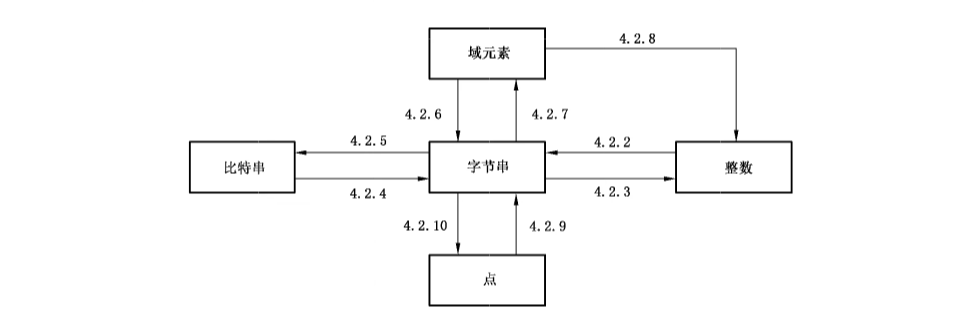

# GB/T 32918.1-2016 信息安全技术 SM2椭圆曲线公钥密码算法 第1部分：总则

> 来源：[GB/T 32918.1-2016 国家标准详情](https://openstd.samr.gov.cn/bzgk/std/newGbInfo?hcno=3EE2FD47B962578070541ED468497C5B)；封面发布日期：2016-08-29；实施日期：2017-03-01。
> 官方在线预览截图 SHA-256：4deb288d38153660b8ddc0a17eb84084a1057543d92e435e885639c16740dce0。
> 转写说明：对照官方在线预览全部 46 张页面图像校正文字、公式、图示、表格及附录示例；省略封面、目录、页眉、页脚和页码，合并跨页内容。数学上下标以 `x_i`、`x^n` 等可复制记法表示，表 A.1—A.7 已重建。原版疑似笔误和示例复算差异保留原值并在相应条款注明。正式引用请核对官方原文。

## 前言

GB/T 32918《信息安全技术 SM2 椭圆曲线公钥密码算法》分为以下 5 个部分：

— 第 1 部分：总则；

— 第 2 部分：数字签名算法；

— 第 3 部分：密钥交换协议；

— 第 4 部分：公钥加密算法；

— 第 5 部分：参数定义。

本部分为 GB/T 32918 的第 1 部分。

本部分按照 GB/T 1.1—2009 给出的规则起草。

本部分由国家密码管理局提出。

本部分由全国信息安全标准化技术委员会（SAC/TC 260）归口。

本部分起草单位：北京华大信安科技有限公司、中国人民解放军信息工程大学、中国科学院数据与通信保护研究教育中心。

本部分主要起草人：陈建华、祝跃飞、叶顶峰、胡磊、裴定一、彭国华、张亚娟、张振峰。

## 引言

N. Koblitz 和 V. Miller 在 1985 年各自独立地提出将椭圆曲线应用于公钥密码系统。椭圆曲线公钥密码所基于的曲线性质如下：

— 有限域上椭圆曲线在点加运算下构成有限交换群，且其阶与基域规模相近；

— 类似于有限域乘法群中的乘幂运算，椭圆曲线多倍点运算构成一个单向函数。

在多倍点运算中，已知多倍点与基点，求解倍数的问题称为椭圆曲线离散对数问题。对于一般椭圆曲线的离散对数问题，目前只存在指数级计算复杂度的求解方法。与大数分解问题及有限域上离散对数问题相比，椭圆曲线离散对数问题的求解难度要大得多。因此，在相同安全程度要求下，椭圆曲线密码较其他公钥密码所需的密钥规模要小得多。

SM2 是国家密码管理局组织制定并提出的椭圆曲线密码算法标准。GB/T 32918 的主要目标如下：

— GB/T 32918.1 定义和描述了 SM2 椭圆曲线密码算法的相关概念及数学基础知识，并概述了该部分同其他部分的关系。

— GB/T 32918.2 描述了一种基于椭圆曲线的签名算法，即 SM2 签名算法。

— GB/T 32918.3 描述了一种基于椭圆曲线的密钥交换协议，即 SM2 密钥交换协议。

— GB/T 32918.4 描述了一种基于椭圆曲线的公钥加密算法，即 SM2 加密算法，该算法需使用 GB/T 32905—2016 定义的 SM3 密码杂凑算法。

— GB/T 32918.5 给出了 SM2 算法使用的椭圆曲线参数，以及使用椭圆曲线参数进行 SM2 运算的示例结果。

本部分为 GB/T 32918 的第 1 部分，描述了必要的数学基础知识与一般技术，以帮助实现其他各部分所规定的密码机制。

## 1 范围

GB/T 32918 的本部分规定了 SM2 椭圆曲线公钥密码算法涉及的必要数学基础知识与相关密码技术，以帮助实现其他各部分所规定的密码机制。

本部分适用于基域为素域和二元扩域的椭圆曲线公钥密码算法的设计、开发、使用。

## 2 符号和缩略语

下列符号和缩略语适用于本文件。

| 符号 | 含义 |
| --- | --- |
| `B` | MOV 阈。正数 B，使得求取 `F_(q^B)` 上的离散对数至少与求取 `F_q` 上的椭圆曲线离散对数一样困难。 |
| `deg(f)` | 多项式 `f(x)` 的次数。 |
| `E` | 有限域上由 `a` 和 `b` 定义的一条椭圆曲线。 |
| `E(F_q)` | `F_q` 上椭圆曲线 `E` 的所有有理点（包括无穷远点 `O`）组成的集合。 |
| `ECDLP` | 椭圆曲线离散对数问题。 |
| `F_p` | 包含 `p` 个元素的素域。 |
| `F_q` | 包含 `q` 个元素的有限域。 |
| `F_q*` | 由 `F_q` 中所有非零元构成的乘法群。 |
| `F_(2^m)` | 包含 `2^m` 个元素的二元扩域。 |
| `G` | 椭圆曲线的一个基点，其阶为素数。 |
| `gcd(x,y)` | `x` 和 `y` 的最大公因子。 |
| `h` | 余因子，`h = #E(F_q)/n`，其中 `n` 是基点 `G` 的阶。 |
| `LeftRotate()` | 循环左移运算。 |
| `l_max` | 余因子 `h` 的最大素因子的上界。 |
| `m` | 二元扩域 `F_(2^m)` 关于 `F_2` 的扩张次数。 |
| `mod f(x)` | 模多项式 `f(x)` 的运算。若 `f(x)` 是二元域上的多项式，则所有系数执行模 2 运算。 |
| `mod n` | 模 `n` 运算。例如，`23 mod 7 = 2`。 |
| `n` | 基点 `G` 的阶［`n` 是 `#E(F_q)` 的素因子］。 |
| `O` | 椭圆曲线上的一个特殊点，称为无穷远点或零点，是椭圆曲线加法群的单位元。 |
| `P` | `P = (x_P, y_P)` 是椭圆曲线 `E` 上除 `O` 之外的一个点，其坐标 `x_P`、`y_P` 满足椭圆曲线方程。 |
| `P_1 + P_2` | 椭圆曲线 `E` 上两个点 `P_1` 与 `P_2` 的和。 |
| `p` | 大于 3 的素数。 |
| `q` | 有限域 `F_q` 中元素的数目。 |
| `a, b` | `F_q` 中的元素，它们定义 `F_q` 上的一条椭圆曲线 `E`。 |
| `r_min` | 基点 `G` 的阶 `n` 的下界。 |
| `Tr()` | 迹函数。 |
| `x_P` | 点 `P` 的 `x` 坐标。 |
| `x^(-1) mod n` | 使得 `x·y ≡ 1 (mod n)` 成立的唯一整数 `y`，`1 ≤ y ≤ n−1`，`gcd(x,n) = 1`。 |
| `x ∥ y` | `x` 与 `y` 的拼接，其中 `x` 和 `y` 是比特串或字节串。 |
| `x ≡ y (mod n)` | `x` 与 `y` 模 `n` 同余。亦即 `x mod n = y mod n`。 |
| `y_P` | 点 `P` 的 `y` 坐标。 |
| `ỹ_P` | `y_P` 的点压缩表示。 |
| `Z_p` | 整数模 `p` 的剩余类环。 |
| `⟨G⟩` | 基点 `G` 生成的循环群。 |
| `[k]P` | 椭圆曲线上点 `P` 的 `k` 倍点，即 `[k]P = P + P + ⋯ + P`（共 `k` 项），其中 `k` 是正整数。 |
| `[x,y]` | 大于或等于 `x` 且小于或等于 `y` 的整数的集合。 |
| `⌈x⌉` | 顶函数，大于或等于 `x` 的最小整数。例如，`⌈7⌉ = 7`，`⌈8.3⌉ = 9`。 |
| `⌊x⌋` | 底函数，小于或等于 `x` 的最大整数。例如，`⌊7⌋ = 7`，`⌊8.3⌋ = 8`。 |
| `#E(F_q)` | `E(F_q)` 上点的数目，称为椭圆曲线 `E(F_q)` 的阶。 |
| `⊕` | 长度相等的两个比特串按比特的异或运算。 |

## 3 域和椭圆曲线

### 3.1 有限域

#### 3.1.1 概述

本条给出有限域 `F_q` 的描述及其元素的表示，`q` 是一个奇素数或者是 2 的方幂。当 `q` 是奇素数 `p` 时，要求 `p > 2^191`；当 `q` 是 2 的方幂 `2^m` 时，要求 `m > 192` 且为素数。

#### 3.1.2 素域 `F_p`

当 `q` 是奇素数 `p` 时，素域 `F_p` 中的元素用整数 `0, 1, 2, ⋯, p−1` 表示。素域特性如下：

a） 加法单位元是整数0；

b） 乘法单位元是整数 1；

c） 域元素的加法是整数的模 `p` 加法，即若 `a,b ∈ F_p`，则 `a+b = (a+b) mod p`；

d） 域元素的乘法是整数的模 `p` 乘法，即若 `a,b ∈ F_p`，则 `a·b = (a·b) mod p`。

#### 3.1.3 二元扩域 `F_(2^m)`

当 `q` 是 2 的方幂 `2^m` 时，二元扩域 `F_(2^m)` 可以看成 `F_2` 上的 `m` 维向量空间，其元素可用长度为 `m` 的比特串表示。

`F_(2^m)` 中的元素有多种表示方法，其中最常用的两种方法是多项式基（PB）表示（参见 A.2.1.1）和正规基（NB）表示（参见 A.2.1.3）。基的选择原则是使得 `F_(2^m)` 中的运算效率尽可能高。本部分并不规定基的选择。下面以多项式基表示为例说明二元扩域 `F_(2^m)`。

设 `F_2` 上 `m` 次不可约多项式 `f(x) = x^m + f_(m−1)x^(m−1) + ⋯ + f_2x^2 + f_1x + f_0`（其中 `f_i ∈ F_2`，`i = 0, 1, ⋯, m−1`）是二元扩域 `F_(2^m)` 的约化多项式。`F_(2^m)` 由 `F_2` 上所有次数低于 `m` 的多项式构成。多项式集合 `{x^(m−1),x^(m−2),⋯,x,1}` 是 `F_(2^m)` 在 `F_2` 上的一组基，称为多项式基。`F_(2^m)` 中的任意一个元素 `a(x) = a_(m−1)x^(m−1) + a_(m−2)x^(m−2) + ⋯ + a_1x + a_0` 在 `F_2` 上的系数恰好构成了长度为 `m` 的比特串，用 `a = (a_(m−1), a_(m−2), ⋯, a_1, a_0)` 表示。多项式域特性如下：

a） 零元0用全0比特串表示；

b） 乘法单位元1用比特串00⋯001表示；

c） 两个域元素的加法为比特串的按比特异或运算；

d） 域元素 `a` 和 `b` 的乘法定义如下：设 `a` 和 `b` 对应的 `F_2` 上多项式为 `a(x)` 和 `b(x)`，则 `a·b` 定义为多项式 `(a(x)b(x)) mod f(x)` 对应的比特串。

### 3.2 有限域上的椭圆曲线

有限域 `F_q` 上的椭圆曲线是由点组成的集合。在仿射坐标系下，椭圆曲线上点 `P`（非无穷远点）的坐标表示为 `P = (x_P, y_P)`，其中 `x_P`、`y_P` 为满足一定方程的域元素，分别称为点 `P` 的 `x` 坐标和 `y` 坐标。在本部分中，称 `F_q` 为基域。

关于椭圆曲线更多的背景知识，参见附录A中 A.1 和 A.2。

在本部分中，如果不做特别说明，椭圆曲线上的点均采用仿射坐标表示。

#### 3.2.1 `F_p` 上的椭圆曲线

定义在 `F_p`（`p` 是大于 3 的素数）上的椭圆曲线方程为：

```text
y² = x³ + ax + b，a,b ∈ F_p，且 (4a³ + 27b²) mod p ≠ 0。        (1)
```

椭圆曲线 `E(F_p)` 定义为（参见 C.2）：

```text
E(F_p) = {(x,y) | x,y ∈ F_p，且满足方程 (1)} ∪ {O}，其中 O 是无穷远点。
```

椭圆曲线 `E(F_p)` 上的点的数目用 `#E(F_p)` 表示，称为椭圆曲线 `E(F_p)` 的阶。

#### 3.2.2 `F_(2^m)` 上的椭圆曲线

定义在 `F_(2^m)` 上的椭圆曲线方程为：

```text
y² + xy = x³ + ax² + b，a,b ∈ F_(2^m)，且 b ≠ 0。            (2)
```

椭圆曲线 `E(F_(2^m))` 定义为（参见 C.3）：

```text
E(F_(2^m)) = {(x,y) | x,y ∈ F_(2^m)，且满足方程 (2)} ∪ {O}，其中 O 是无穷远点。
```

椭圆曲线 `E(F_(2^m))` 上的点的数目用 `#E(F_(2^m))` 表示，称为椭圆曲线 `E(F_(2^m))` 的阶。

#### 3.2.3 椭圆曲线群

##### 3.2.3.1 `F_p` 上的椭圆曲线群

椭圆曲线 `E(F_p)` 上的点按照下面的加法运算规则，构成一个交换群：

a） `O + O = O`；

b） 对任意 `P = (x,y) ∈ E(F_p)\{O}`，`P + O = O + P = P`；

c） 对任意 `P = (x,y) ∈ E(F_p)\{O}`，`P` 的逆元 `−P = (x,−y)`，`P + (−P) = O`；

d） 两个非互逆的不同点相加的规则：设 `P_1 = (x_1,y_1) ∈ E(F_p)\{O}`，`P_2 = (x_2,y_2) ∈ E(F_p)\{O}`，且 `x_1 ≠ x_2`，设 `P_3 = (x_3,y_3) = P_1 + P_2`，则

```text
x_3 = λ² − x_1 − x_2，
y_3 = λ(x_1 − x_3) − y_1，
λ = (y_2 − y_1)/(x_2 − x_1)。
```

e） 倍点规则：设 `P_1 = (x_1,y_1) ∈ E(F_p)\{O}`，且 `y_1 ≠ 0`，`P_3 = (x_3,y_3) = P_1 + P_1`，则

```text
x_3 = λ² − 2x_1，
y_3 = λ(x_1 − x_3) − y_1，
λ = (3x_1² + a)/(2y_1)。
```

##### 3.2.3.2 `F_(2^m)` 上的椭圆曲线群

椭圆曲线 `E(F_(2^m))` 上的点按照下面的加法运算规则，构成一个交换群：

a） `O + O = O`；

b） 对任意 `P = (x,y) ∈ E(F_(2^m))\{O}`，`P + O = O + P = P`；

c） 对任意 `P = (x,y) ∈ E(F_(2^m))\{O}`，`P` 的逆元 `−P = (x,x+y)`，`P + (−P) = O`；

d） 两个非互逆的不同点相加的规则：设 `P_1 = (x_1,y_1) ∈ E(F_(2^m))\{O}`，`P_2 = (x_2,y_2) ∈ E(F_(2^m))\{O}`，且 `x_1 ≠ x_2`，设 `P_3 = (x_3,y_3) = P_1 + P_2`，则

```text
x_3 = λ² + λ + x_1 + x_2 + a，
y_3 = λ(x_1 + x_3) + x_3 + y_1，
λ = (y_1 + y_2)/(x_1 + x_2)。
```

e） 倍点规则：设 `P_1 = (x_1,y_1) ∈ E(F_(2^m))\{O}`，且 `x_1 ≠ 0`，`P_3 = (x_3,y_3) = P_1 + P_1`，则

```text
x_3 = λ² + λ + a，
y_3 = x_1² + (λ + 1)x_3，
λ = x_1 + y_1/x_1。
```

#### 3.2.4 椭圆曲线多倍点运算

椭圆曲线上同一个点的多次加称为该点的多倍点运算。设 `k` 是一个正整数，`P` 是椭圆曲线上的点，称点 `P` 的 `k` 次加为点 `P` 的 `k` 倍点运算，记为 `Q = [k]P = P + P + ⋯ + P`（共 `k` 项）。因为 `[k]P = [k−1]P + P`，所以 `k` 倍点可以递归求得。

多倍点运算的输出有可能是无穷远点 `O`。

多倍点运算也可以通过一些技巧更有效地实现，参见附录 A 中A.3。

#### 3.2.5 椭圆曲线离散对数问题（ECDLP）

已知椭圆曲线 `E(F_q)`、阶为 `n` 的点 `G ∈ E(F_q)` 及 `Q ∈ ⟨G⟩`，椭圆曲线离散对数问题是指确定整数 `l ∈ [0,n−1]`，使得 `Q = [l]G` 成立。

椭圆曲线离散对数问题关系到椭圆曲线密码系统的安全，因此应选择安全的椭圆曲线。关于如何选择安全椭圆曲线，参见附录 A中 A.4。

#### 3.2.6 弱椭圆曲线

若某椭圆曲线存在优于 `n^(1/2)` 级（`n` 是基点的阶）计算复杂度的攻击方法，则称此曲线为弱椭圆曲线。

在本部分中禁止使用弱椭圆曲线。

`F_q` 上的超奇异曲线［有限域 `F_q` 的特征整除 `q+1−#E(F_q)`］和 `F_p` 上的异常（Anomalous）曲线［`#E(F_p)=p`］都是弱椭圆曲线。

## 4 数据类型及其转换

### 4.1 数据类型

在本部分中，数据类型包括比特串、字节串、域元素、椭圆曲线上的点和整数。

比特串：有序的 0 和 1 的序列。

字节串：有序的字节序列，其中 8 比特为 1 个字节。

域元素：有限域 `F_q` 中的元素。

椭圆曲线上的点：椭圆曲线上的点 `P ∈ E(F_q)`，或者是一对域元素 `(x_P,y_P)`，其中域元素 `x_P` 和 `y_P` 满足椭圆曲线方程，或者是无穷远点 `O`。

点的字节串表示有多种形式，用一个字节 `PC` 加以标识。无穷远点 `O` 的字节串表示是单一的零字节 `PC=00`。非无穷远点 `P=(x_P,y_P)` 有如下三种字节串表示形式：

a） 压缩表示形式，`PC=02` 或 `03`；

b） 未压缩表示形式，`PC=04`；

c） 混合表示形式，`PC=06` 或 `07`。

> 注：混合表示形式既包含压缩表示形式又包含未压缩表示形式。在实现中，它允许转换到压缩表示形式或者未压缩表示形式。

对于椭圆曲线上点的压缩表示形式和混合表示形式，本部分中定为可选形式。椭圆曲线上点的压缩表示形式参见附录 A中A.5。

### 4.2 数据类型转换

#### 4.2.1 数据类型转换关系

图 1 提供了各种数据类型之间的转换关系，线上的标志是相应数据转换方法所在的条。



#### 4.2.2 整数到字节串的转换

输入：非负整数 `x`，以及字节串的目标长度 `k`（其中 `k` 满足 `2^(8k) > x`）。

输出：长度为 `k` 的字节串 `M`。

a） 设 `M_(k−1), M_(k−2), ⋯, M_0` 是 `M` 的从最左边到最右边的字节；

b） `M` 的字节满足：`x = Σ_(i=0)^(k−1) 2^(8i) M_i`。

#### 4.2.3 字节串到整数的转换

输入：长度为 `k` 的字节串 `M`。

输出：整数 `x`。

a） 设 `M_(k−1), M_(k−2), ⋯, M_0` 是 `M` 的从最左边到最右边的字节；

b） 将 `M` 转换为整数 `x`：`x = Σ_(i=0)^(k−1) 2^(8i) M_i`。

#### 4.2.4 比特串到字节串的转换

输入：长度为 `m` 的比特串 `s`。

输出：长度为 `k` 的字节串 `M`，其中 `k = ⌈m/8⌉`。

a） 设 `s_(m−1), s_(m−2), ⋯, s_0` 是 `s` 从最左边到最右边的比特；

b） 设 `M_(k−1), M_(k−2), ⋯, M_0` 是 `M` 从最左边到最右边的字节，则 `M_i = s_(8i+7) s_(8i+6) ⋯ s_(8i+1) s_(8i)`；其中 `0 ≤ i < k`，当 `8i+j ≥ m`、`0 ≤ j ≤ 7` 时，`s_(8i+j)=0`。

#### 4.2.5 字节串到比特串的转换

输入：长度为 `k` 的字节串 `M`。

输出：长度为 `m` 的比特串 `s`，其中 `m=8k`。

a） 设 `M_(k−1), M_(k−2), ⋯, M_0` 是 `M` 从最左边到最右边的字节；

b） 设 `s_(m−1), s_(m−2), ⋯, s_0` 是 `s` 从最左边到最右边的比特，则 `s_i` 是 `M_j` 右起第 `i−8j+1` 比特，其中 `j=⌊i/8⌋`。

#### 4.2.6 域元素到字节串的转换

输入：`F_q` 中的元素 `α`。

输出：长度 `l=⌈t/8⌉` 的字节串 `S`，其中 `t=⌈log₂q⌉`。

a） 若 `q` 为奇素数，则 `α` 必为区间 `[0,q−1]` 中的整数，按 4.2.2 的方法把 `α` 转换成长度为 `l` 的字节串 `S`；

b） 若 `q=2^m`，则 `α` 必为长度为 `m` 的比特串，按 4.2.4 的方法把 `α` 转换成长度为 `l` 的字节串 `S`。

#### 4.2.7 字节串到域元素的转换

输入：基域 `F_q` 的类型，长度为 `l=⌈t/8⌉` 的字节串 `S`，其中 `t=⌈log₂q⌉`。

输出：`F_q` 中的元素 `α`。

a） 若 `q` 是奇素数，则按 4.2.3 的方法将 `S` 转换为整数 `α`，若 `α ∉ [0,q−1]`，则报错；

b） 若 `q=2^m`，则按 4.2.5 的方法将 `S` 转换为长度为 `m` 的比特串 `α`。

#### 4.2.8 域元素到整数的转换

输入：域 `F_q` 中的元素 `α`。

输出：整数 `x`。

a） 若 `q` 为奇素数，则 `x=α`（不需要转换）；

b） 若 `q=2^m`，则 `α` 必为长度为 `m` 的比特串，设 `s_(m−1), s_(m−2), ⋯, s_0` 是 `α` 的从最左边到最右边的比特，将 `α` 转化为整数 `x`：`x=Σ_(i=0)^(m−1) 2^i s_i`。

#### 4.2.9 点到字节串的转换

输入：椭圆曲线上的点 `P=(x_P,y_P)`，且 `P≠O`。

输出：字节串 `S`。若选用未压缩表示形式或混合表示形式，则输出字节串长度为 `2l+1`；若选用压缩表示形式，则输出字节串长度为 `l+1`（`l=⌈(log₂q)/8⌉`）。

a） 按 4.2.6 中的方法把域元素 `x_P` 转换成长度为 `l` 的字节串 `X_1`；

b） 若选用压缩表示形式，则：

1） 计算比特 `ỹ_P`（参见附录 A 中 A.5）；

2） 若 `ỹ_P=0`，则令 `PC=02`；若 `ỹ_P=1`，则令 `PC=03`；

3） 字节串 `S=PC∥X_1`；

c） 若选用未压缩表示形式，则：

1） 按 4.2.6 的方法把域元素 `y_P` 转换成长度为 `l` 的字节串 `Y_1`；

2） 令 `PC=04`；

3） 字节串 `S=PC∥X_1∥Y_1`；

d） 若选用混合表示形式，则：

1） 按 4.2.6 的方法把域元素 `y_P` 转换成长度为 `l` 的字节串 `Y_1`；

2） 计算比特 `ỹ_P`（参见附录 A 中 A.5）；

3） 若 `ỹ_P=0`，则令 `PC=06`；若 `ỹ_P=1`，则令 `PC=07`；

4） 字节串 `S=PC∥X_1∥Y_1`。

#### 4.2.10 字节串到点的转换

输入：定义 `F_q` 上椭圆曲线的域元素 `a、b`，字节串 `S`。若选用未压缩表示形式或混合表示形式，则字节串 `S` 长度为 `2l+1`；若选用压缩表示形式，则字节串 `PO` 长度为 `l+1`（`l=⌈(log₂q)/8⌉`）。

输出：椭圆曲线上的点 `P=(x_P,y_P)`，且 `P≠O`。

a） 若选用压缩表示形式，则 `S=PC∥X_1`；若选用未压缩表示形式或混合表示形式，则 `S=PC∥X_1∥Y_1`，其中 `PC` 是单一字节，`X_1` 和 `Y_1` 都是长度为 `l` 的字节串；

b） 按 4.2.7 的方法把字节串 `X_1` 转换成域元素 `x_P`；

c） 若选用压缩表示形式，则：

1） 检验 `PC=02` 或者是 `PC=03`，若不是这种情形，则报错；

2） 若 `PC=02`，则令 `ỹ_P=0`；若 `PC=03`，则令 `ỹ_P=1`；

3） 将 `(x_P,ỹ_P)` 转换为椭圆曲线上的一个点 `(x_P,y_P)`（参见附录 A 中 A.5）；

d） 若选用未压缩表示形式，则：

1） 检验 `PC=04`，若不是这种情形，则报错；

2） 按 4.2.7 的方法把字节串 `Y_1` 转换成域元素 `y_P`；

e） 若选用混合表示形式，则：

1） 检验 `PC=06` 或者 `PC=07`，若不是这种情形，则报错；

2） 执行步骤如下：

   - 按 4.2.7 的细节把字节串 `Y_1` 转换成域元素 `y_P`；
   - 若 `PC=06`，则令 `ỹ_P=0`，否则令 `ỹ_P=1`；

3） 将 `(x_P,ỹ_P)` 转换为椭圆曲线上的一个点 `(x_P,y_P)`（参见附录 A 中 A.5）；

f） 若 `q` 为奇素数，则验证 `y_P²≡y_P³+a x_P+b (mod q)`，若不是这种情形，则报错；

若 `q=2^m`，则在 `F_(2^m)` 中验证 `y_P²+x_P y_P=x_P³+a x_P²+b`，若不是这种情形，则报错；

g） `P=(x_P,y_P)`。

> 转写注：本条输入中的 `PO` 及 f）奇素数验证式右侧的 `y_P³` 均按官方图像原样保留，原版疑有笔误。

## 5 椭圆曲线系统参数及其验证

### 5.1 一般要求

椭圆曲线系统参数是可以公开的，系统的安全性不依赖于对这些参数的保密。本部分不规定椭圆曲线系统参数的生成方法，但规定了系统参数的验证方法。椭圆曲线阶的计算和基点的选取方法可参见附录 B 中 B.3，曲线参数的生成方法可参见附录 D。

椭圆曲线系统参数按照基域的不同可以分为两种情形：

- 当基域是 `F_p`（`p` 为大于 3 的素数）时，`F_p` 上的椭圆曲线系统参数；
- 当基域是 `F_(2^m)` 时，`F_(2^m)` 上的椭圆曲线系统参数。

### 5.2 F_p 上椭圆曲线系统参数及其验证

#### 5.2.1 F_p 上椭圆曲线系统参数

`F_p` 上椭圆曲线系统参数包括：

a） 域的规模 `q=p`，`p` 是大于 3 的素数；

b） （选项）一个长度至少为 192 的比特串 `SEED`（若按照附录 D 描述的方法产生椭圆曲线）；

c） `F_p` 中的两个元素 `a` 和 `b`，它们定义椭圆曲线 `E` 的方程：`y²=x³+ax+b`；

d） 基点 `G=(x_G,y_G)∈E(F_p)`，`G≠O`；

e） 基点 `G` 的阶 `n`（要求：`n>2^191` 且 `n>4p^(1/2)`）；

f） （选项）余因子 `h=#E(F_p)/n`。

#### 5.2.2 F_p 上椭圆曲线系统参数的验证

椭圆曲线系统参数的生成者应验证下面的条件。椭圆曲线系统参数的用户可选择验证这些条件。

输入：`F_p` 上椭圆曲线系统参数的集合。

输出：若椭圆曲线系统参数是有效的，则输出“有效”；否则输出“无效”。

a） 验证 `q=p` 是奇素数（参见附录 B 中 B.1.10）；

b） 验证 `a、b、x_G` 和 `y_G` 是区间 `[0,p−1]` 中的整数；

c） 若按照附录 D 描述的方法拟随机产生椭圆曲线，验证 `SEED` 是长度至少为 192 的比特串，且 `a、b` 由 `SEED` 派生得到；

d） 验证 `(4a³+27b²) mod p≠0`；

e） 验证 `y_G²≡x_G³+ax_G+b (mod p)`；

f） 验证 `n` 是素数，`n>2^191` 且 `n>4p^(1/2)`（参见附录 B 中 B.1.10）；

g） 验证 `[n]G=O`（参见附录 A 中 A.3）；

h） （选项）计算 `h'=⌊(p^(1/2)+1)²/n⌋`，并验证 `h=h'`；

i） 验证抗 MOV 攻击条件和抗异常曲线攻击条件成立（参见附录 A 中 A.4.2.1 和 A.4.2.2）；

j） 若以上任何一个验证失败，则输出“无效”；否则，输出“有效”。

### 5.3 F_(2^m) 上椭圆曲线系统参数及其验证

#### 5.3.1 F_(2^m) 上椭圆曲线系统参数

`F_(2^m)` 上的椭圆曲线系统参数包括：

a） 域的规模 `q=2^m`，对 `F_(2^m)` 中元素表示法（三项式基 TPB、五项式基 PPB 或高斯正规基 GNB）的标识，一个 `F_2` 上的 `m` 次约化多项式（若所用的基是 TPB 或 PPB）；

b） （选项）一个长度至少为 192 的比特串 `SEED`（若按照附录 D 描述的方法拟随机产生椭圆曲线）；

c） `F_(2^m)` 中的两个元素 `a` 和 `b`，它们定义椭圆曲线 `E` 的方程：`y²+xy=x³+ax²+b`；

d） 基点 `G=(x_G,y_G)∈E(F_(2^m))`，`G≠O`；

e） 基点 `G` 的阶 `n`（要求：`n>2^191` 且 `n>2^(2+m/2)`）；

f） （选项）余因子 `h=#E(F_(2^m))/n`。

#### 5.3.2 F_(2^m) 上椭圆曲线系统参数的验证

下面的条件椭圆曲线系统参数的生成者应加以验证。这些条件椭圆曲线系统参数的用户可选择验证。

输入：`F_(2^m)` 上椭圆曲线系统参数的集合。

输出：若椭圆曲线系统参数是有效的，则输出“有效”；否则输出“无效”。

a） 对某个 `m`，验证 `q=2^m`；若所用的是 TPB，则验证约化多项式是 `F_2` 上的不可约三项式（参见表 A.3）；若所用的是 PPB，则验证不存在 `m` 次不可约三项式，且约化多项式是 `F_2` 上的不可约五项式（参见表 A.4）；若所用的是 GNB，则验证 `m` 不能被 8 整除；

b） 验证 `a、b、x_G` 和 `y_G` 是长度为 `m` 的比特串；

c） 若按照附录 D 描述的方法拟随机产生椭圆曲线，验证 `SEED` 是长度至少为 192 的比特串，且 `a、b` 由 `SEED` 派生得到；

d） 验证 `b≠0`；

e） 在 `F_(2^m)` 中验证 `y_G²+x_G y_G=x_G³+ax_G²+b`；

f） 验证 `n` 是一个素数，`n>2^191` 且 `n>2^(2+m/2)`（参见附录 B 中 B.1.10）；

g） 验证 `[n]G=O`（参见附录 A.3.2）；

h） （选项）计算 `h'=⌊(2^(m/2)+1)²/n⌋`，验证 `h=h'`；

i） 验证抗 MOV 攻击条件成立（参见附录 A 中 A.4.2.1）；

j） 若以上任何一个验证失败，则输出“无效”；否则输出“有效”。

## 6 密钥对的生成与公钥的验证

### 6.1 密钥对的生成

输入：一个有效的 `F_q`（`q=p` 且 `p` 为大于 3 的奇素数，或 `q=2^m`）上椭圆曲线系统参数的集合。

输出：与椭圆曲线系统参数相关的一个密钥对 `(d,P)`。

a） 用随机数发生器产生整数 `d∈[1,n−2]`；

b） `G` 为基点，计算点 `P=(x_P,y_P)=[d]G`（参见附录 A 中 A.3.2）；

c） 密钥对是 `(d,P)`，其中 `d` 为私钥，`P` 为公钥。

### 6.2 公钥的验证

#### 6.2.1 F_p 上椭圆曲线公钥的验证

输入：一个有效的 `F_p`（`p>3` 且 `p` 为素数）上椭圆曲线系统参数集合及一个相关的公钥 `P`。

输出：对于给定的椭圆曲线系统参数，若公钥 `P` 是有效的，则输出“有效”；否则输出“无效”。

a） 验证 `P` 不是无穷远点 `O`；

b） 验证公钥 `P` 的坐标 `x_P` 和 `y_P` 是域 `F_p` 中的元素（即验证 `x_P` 和 `y_P` 是区间 `[0,p−1]` 中的整数）；

c） 验证 `y_P²≡x_P³+ax_P+b (mod p)`；

d） 验证 `[n]P=O`；

e） 若通过了所有验证，则输出“有效”；否则输出“无效”。

#### 6.2.2 F_(2^m) 上椭圆曲线公钥的验证

输入：一个有效的 `F_(2^m)` 上椭圆曲线系统参数集合及一个相关的公钥 `P`。

输出：对于给定的椭圆曲线系统参数，若公钥 `P` 是有效的，则输出“有效”；否则输出“无效”。

a） 验证 `P` 不是无穷远点 `O`；

b） 验证公钥 `P` 的坐标 `x_P` 和 `y_P` 是域 `F_(2^m)` 中的元素（即验证 `x_P` 和 `y_P` 是长度为 `m` 的比特串）；

c） 在 `F_(2^m)` 中验证 `y_P²+x_P y_P=x_P³+ax_P²+b`；

d） 验证 `[n]P=O`；

e） 若通过了所有验证，则输出“有效”；否则输出“无效”。

> 注：公钥的验证是可选项。

## 附录 A（资料性附录）关于椭圆曲线的背景知识

### A.1 素域 F_p

#### A.1.1 素域 F_p 的定义

设 `p` 是一个素数，`F_p` 由 `{0,1,2,⋯,p−1}` 中 `p` 个元素构成，称 `F_p` 为素域。加法单位元是整数 0，乘法单位元是整数 1，`F_p` 的元素满足如下运算法则：

- **加法**：设 `a,b∈F_p`，则 `a+b=r`，其中 `r=(a+b) mod p`，`r∈[0,p−1]`。
- **乘法**：设 `a,b∈F_p`，则 `a·b=s`，其中 `s=(a·b) mod p`，`s∈[0,p−1]`。

记 `F_p*` 是由 `F_p` 中所有非零元构成的乘法群，由于 `F_p*` 是循环群，所以在 `F_p` 中至少存在一个元素 `g`，使得 `F_p` 中任一非零元都可以由 `g` 的一个方幂表示，称 `g` 为 `F_p*` 的生成元（或本原元），即 `F_p*={g^i | 0≤i≤p−2}`。设 `a=g^i∈F_p*`，其中 `0≤i≤p−2`，则 `a` 的乘法逆元为：`a^(−1)=g^(p−1−i)`。

**示例 1：素域 `F_2`，`F_2={0,1}`**

`F_2` 的加法表如表 A.1，乘法表如表 A.2：

**表 A.1**

| + | 0 | 1 |
| --- | --- | --- |
| 0 | 0 | 1 |
| 1 | 1 | 0 |

**表 A.2**

| · | 0 | 1 |
| --- | --- | --- |
| 0 | 0 | 0 |
| 1 | 0 | 1 |

**示例 2：素域 `F_19`，`F_19={0,1,2,⋯,18}`**

`F_19` 中加法的示例：`10,14∈F_19`，`10+14=24`，`24 mod 19=5`，则 `10+14=5`。

`F_19` 中乘法的示例：`7,8∈F_19`，`7×8=56`，`56 mod 19=18`，则 `7·8=18`。

13 是 `F_19*` 的一个生成元，则 `F_19*` 中元素可由 13 的方幂表示出来：

```text
13^0=1, 13^1=13, 13^2=17, 13^3=12, 13^4=4, 13^5=14,
13^6=11, 13^7=10, 13^8=16, 13^9=18, 13^10=6, 13^11=2,
13^12=7, 13^13=15, 13^14=5, 13^15=8, 13^16=9, 13^17=3, 13^18=1。
```

#### A.1.2 F_p 上椭圆曲线的定义

##### A.1.2.1 概述

`F_p` 上椭圆曲线常用的表示形式有两种：仿射坐标表示和射影坐标表示。

##### A.1.2.2 仿射坐标表示

当 `p` 是大于 3 的素数时，`F_p` 上椭圆曲线方程在仿射坐标系下可以简化为 `y²=x³+ax+b`，其中 `a,b∈F_p`，且使得 `(4a³+27b²) mod p≠0`。椭圆曲线上的点集记为 `E(F_p)={(x,y) | x,y∈F_p 且满足曲线方程 y²=x³+ax+b}∪{O}`，其中 `O` 是椭圆曲线的无穷远点。

`E(F_p)` 上的点按照下面的加法运算规则，构成一个阿贝尔群：

a） `O+O=O`；

b） `∀P=(x,y)∈E(F_p)\{O}`，`P+O=O+P=P`；

c） `∀P=(x,y)∈E(F_p)\{O}`，`P` 的逆元素 `−P=(x,−y)`，`P+(−P)=O`；

d） 点 `P_1=(x_1,y_1)∈E(F_p)\{O}`，`P_2=(x_2,y_2)∈E(F_p)\{O}`，`P_3=(x_3,y_3)=P_1+P_2≠O`，则

```text
x_3=λ²−x_1−x_2，
y_3=λ(x_1−x_3)−y_1，
其中
λ=(y_2−y_1)/(x_2−x_1)，若 x_1≠x_2，
λ=(3x_1²+a)/(2y_1)，若 x_1=x_2 且 P_2≠−P_1。
```

**示例 3：有限域 `F_19` 上一条椭圆曲线**

`F_19` 上方程：`y²=x³+x+1`，其中 `a=1,b=1`。则 `F_19` 上曲线的点为：

```text
(0,1), (0,18), (2,7), (2,12), (5,6), (5,13), (7,3), (7,16),
(9,6), (9,13), (10,2), (10,17), (13,8), (13,11), (14,2), (14,17),
(15,3), (15,16), (16,3), (16,16)。
```

则 `E(F_19)` 有 21 个点（包括无穷远点 `O`）。

a） 取 `P_1=(10,2)`，`P_3=(9,6)`，计算 `P_3=P_1+P_2`：

```text
λ=(y_2−y_1)/(x_2−x_1)=(6−2)/(9−10)=4/(−1)=−4≡15 (mod 19)，
x_3=15²−10−9=225−10−9≡16−10−9=−3≡16 (mod 19)，
y_3=15×(10−16)−2=15×(−6)−2≡3 (mod 19)，
所以 P_3=(16,3)。
```

b） 取 `P_1=(10,2)`，计算 `[2]P_1`：

```text
λ=(3x_1²+a)/(2y_1)=(3×10²+1)/(2×2)=(3×5+1)/4=16/4≡4 (mod 19)，
x_3=4²−10−10=−4≡15 (mod 19)，
y_3=4×(10−15)−2=−22≡16 (mod 19)，
所以 [2]P_1=(15,16)。
```

##### A.1.2.3 射影坐标表示

###### A.1.2.3.1 标准射影坐标系

当 `p` 是大于 3 的素数时，`F_p` 上椭圆曲线方程在标准射影坐标系下可以简化为 `y²z=x³+axz²+bz³`，其中 `a,b∈F_p`，且 `4a³+27b²≢0 mod p`。椭圆曲线上的点集记为 `E(F_p)={(x,y,z) | x,y,z∈F_p 且满足曲线方程 y²z=x³+axz²+bz³}`。对于 `(x_1,y_1,z_1)` 和 `(x_2,y_2,z_2)`，若存在某个 `u∈F_p` 且 `u≠0`，使得：`x_1=ux_2,y_1=uy_2,z_1=uz_2`，则称这两个三元组等价，表示同一个点。

若 `z≠0`，记 `X=x/z,Y=y/z`，则可从标准射影坐标表示转化为仿射坐标表示：`Y²=X³+aX+b`；

若 `z=0`，`(0,1,0)` 对应的仿射坐标系下的点即无穷远点 `O`。

标准射影坐标系下，`E(F_p)` 上点的加法运算定义如下：

a） `O+O=O`；

b） `∀P=(x,y,z)∈E(F_p)\{O}`，`P+O=O+P=P`；

c） `∀P=(x,y,z)∈E(F_p)\{O}`，`P` 的逆元素 `−P=(ux,−uy,uz)`，`u∈F_p` 且 `u≠0`，`P+(−P)=O`；

d） 设点 `P_1=(x_1,y_1,z_1)∈E(F_p)\{O}`，`P_2=(x_2,y_2,z_2)∈E(F_p)\{O}`，`P_3=P_1+P_2=(x_3,y_3,z_3)≠O`，

若 `P_1≠P_2`，则：

```text
λ_1=x_1z_2, λ_2=x_2z_1, λ_3=λ_1−λ_2, λ_4=y_1z_2, λ_5=y_2z_1,
λ_6=λ_4−λ_5, λ_7=λ_1+λ_2, λ_8=z_1z_2, λ_9=λ_3²,
λ_10=λ_3λ_9, λ_11=λ_8λ_6²−λ_7λ_9,
x_3=λ_3λ_11, y_3=λ_6(λ_9λ_1−λ_11)−λ_4λ_10, z_3=λ_10λ_8；
```

若 `P_1=P_2`，则：

```text
λ_1=3x_1²+az_1², λ_2=2y_1z_1, λ_3=y_1²,
λ_4=λ_3x_1z_1, λ_5=λ_2², λ_6=λ_1²−8λ_4,
x_3=λ_2λ_6, y_3=λ_1(4λ_4−λ_6)−2λ_5λ_3, z_3=λ_2λ_5。
```

###### A.1.2.3.2 Jacobian 加重射影坐标系

`F_p` 上椭圆曲线方程在 Jacobian 加重射影坐标系下可以简化为 `y²=x³+axz⁴+bz⁶`。其中 `a,b∈F_p`，且 `4a³+27b²≢0 mod p`。椭圆曲线上的点集记为 `E(F_p)={(x,y,z) | x,y,z∈F_p 且满足曲线方程 y²=x³+axz⁴+bz⁶}`。对于 `(x_1,y_1,z_1)` 和 `(x_2,y_2,z_2)`，若存在某个 `u∈F_p` 且 `u≠0`，使得：`x_1=u²x_2,y_1=u³y_2,z_1=uz_2`，则称这两个三元组等价，表示同一个点。

若 `z≠0`，记 `X=x/z²,Y=y/z²`，则可从 Jacobian 加重射影坐标表示转化为仿射坐标表示：`Y²=X³+aX+b`；

若 `z=0`，`(1,1,0)` 对应的仿射坐标系下的点即无穷远点 `O`。

Jacobian 加重射影坐标系下，`E(F_p)` 上点的加法运算定义如下：

a） `O+O=O`；

b） `∀P=(x,y,z)∈E(F_p)\{O}`，`P+O=O+P=P`；

c） `∀P=(x,y,z)∈E(F_p)\{O}`，`P` 的逆元素 `−P=(u²x,−u³y,uz)`，`u∈F_p` 且 `u≠0`，`P+(−P)=O`；

d） 设点 `P_1=(x_1,y_1,z_1)∈E(F_p)\{O}`，`P_2=(x_2,y_2,z_2)∈E(F_p)\{O}`，`P_3=P_1+P_2=(x_3,y_3,z_3)≠O`，

若 `P_1≠P_2`，则：

```text
λ_1=x_1z_2², λ_2=x_2z_1², λ_3=λ_1−λ_2, λ_4=y_1z_2³, λ_5=y_2z_1³,
λ_6=λ_4−λ_5, λ_7=λ_1+λ_2, λ_8=λ_4+λ_5,
x_3=λ_6²−λ_7λ_3²,
y_3=λ_6(λ_1λ_3²−x_3)−λ_4λ_3³, z_3=z_1z_2λ_3；
```

若 `P_1=P_2`，则：

```text
λ_1=3x_1²+az_1⁴, λ_2=4x_1y_1², λ_3=8y_1⁴,
x_3=λ_1²−2λ_2, y_3=λ_1(λ_2−x_3)−λ_3, z_3=2y_1z_1。
```

#### A.1.3 F_p 上椭圆曲线的阶

`F_p`（`p` 为大于 3 的素数）上一条椭圆曲线的阶是指点集 `E(F_p)` 中元素的个数，记为 `#E(F_p)`。由 Hasse 定理知：`p+1−2p^(1/2)≤#E(F_p)≤p+1+2p^(1/2)`。

若一条曲线的阶 `#E(F_p)=p+1`，则称此曲线为超奇异的，否则为非超奇异的。

### A.2 二元扩域 F_(2^m)

#### A.2.1 二元扩域 F_(2^m) 的定义

由 `2^m` 个元素构成的有限域 `F_(2^m)` 是 `F_2` 的 `m` 次扩张，称为 `m` 次二元扩域。`F_(2^m)` 可以看成 `F_2` 上维数为 `m` 的向量空间，也就是说，在 `F_(2^m)` 中存在 `m` 个元素 `α_0,α_1,⋯,α_(m−1)`，使得 `∀α∈F_(2^m)`，`α` 可以唯一表示为：`α=a_0α_0+a_1α_1+⋯+a_(m−1)α_(m−1)`，其中 `a_i∈F_2`，称 `{α_0,α_1,⋯,α_(m−1)}` 为 `F_(2^m)` 在 `F_2` 上的一组基。给定这样一组基，就可以由向量 `(a_0,a_1,⋯,a_(m−1))` 来表示域元素 `α`。`F_(2^m)` 在 `F_2` 上的基有多种选择，域元素的加法在不同的基下的运算规则是一致的，都可以通过向量按分量异或运算得到；域元素的乘法在不同的基下有不同的运算规则（如用多项式基表示和用正规基表示时其运算规则就不一致）。

##### A.2.1.1 多项式基

设 `F_2` 上 `m` 次不可约多项式 `f(x)=x^m+f_(m−1)x^(m−1)+⋯+f_2x²+f_1x+f_0`（其中 `f_i∈F_2,i=0,1,⋯,m−1`）是二元扩域 `F_(2^m)` 的约化多项式。`F_(2^m)` 由 `F_2` 上所有次数低于 `m` 的多项式构成，即：

```text
F_(2^m)={a_(m−1)x^(m−1)+a_(m−2)x^(m−2)+⋯+a_1x+a_0 | a_i∈F_2,i=0,1,⋯,m−1}。
```

多项式集合 `{x^(m−1),x^(m−2),⋯,x,1}` 是 `F_(2^m)` 作为向量空间在 `F_2` 上的一组基，称为多项式基。

域元素 `a_(m−1)x^(m−1)+a_(m−2)x^(m−2)+⋯+a_1x+a_0` 相对多项式基可以由长度为 `m` 的比特串 `(a_(m−1)a_(m−2)⋯a_1a_0)` 来表示，所以

```text
F_(2^m)={(a_(m−1)a_(m−2)⋯a_1a_0) | a_i∈F_2,i=0,1,⋯,m−1}。
```

乘法单位元 1 由 `(00⋯01)` 表示，零元由 `(00⋯00)` 表示。域元素的加法和乘法定义如下：

**加法运算**

`∀(a_(m−1)a_(m−2)⋯a_1a_0),(b_(m−1)b_(m−2)⋯b_1b_0)∈F_(2^m)`，则 `(a_(m−1)a_(m−2)⋯a_1a_0)+(b_(m−1)b_(m−2)⋯b_1b_0)=(c_(m−1)c_(m−2)⋯c_1c_0)`，其中 `c_i=a_i⊕b_i,i=0,1,⋯,m−1`，亦即，加法运算按分位异或运算执行。

**乘法运算**

`∀(a_(m−1)a_(m−2)⋯a_1a_0),(b_(m−1)b_(m−2)⋯b_1b_0)∈F_(2^m)`，则 `(a_(m−1)a_(m−2)⋯a_1a_0)·(b_(m−1)b_(m−2)⋯b_1b_0)=(r_(m−1)r_(m−2)⋯r_1r_0)`，其中多项式 `(r_(m−1)x^(m−1)+r_(m−2)x^(m−2)+⋯+r_1x+r_0)` 是 `(a_(m−1)x^(m−1)+a_(m−2)x^(m−2)+⋯+a_1x+a_0)·(b_(m−1)x^(m−1)+b_(m−2)x^(m−2)+⋯+b_1x+b_0)` 在 `F_2` 上 `mod f(x)` 的余式。

**注意**，`F_(2^m)` 恰包含 `2^m` 个元素。记 `F_(2^m)*` 是由 `F_(2^m)` 中所有非零元构成的乘法群，`F_(2^m)*` 是循环群，在 `F_(2^m)` 中至少存在一个元素 `g`，使得 `F_(2^m)` 中任一非零元都可以由 `g` 的一个方幂表示，称 `g` 为 `F_(2^m)*` 的生成元（或本原元），即：`F_(2^m)*={g^i | 0≤i≤2^m−2}`。设 `a=g^i∈F_(2^m)*`，其中 `0≤i≤2^m−2`，则 `a` 的乘法逆元为：`a^(−1)=g^(2^m−1−i)`。

**示例 4：二元扩域 `F_(2^5)` 的多项式基表示**

取 `F_2` 上的一个不可约多项式 `f(x)=x^5+x²+1`，则 `F_(2^5)` 中的元素是：

```text
(00000), (00001), (00010), (00011), (00100), (00101), (00110),
(00111), (01000), (01001), (01010), (01011), (01100), (01101),
(01110), (01111), (10000), (10001), (10010), (10011), (10100),
(10101), (10110), (10111), (11000), (11001), (11010), (11011),
(11100), (11101), (11110), (11111)。
```

**加法**：`(11011)+(10011)=(01000)`

**乘法**：`(11011)·(10011)=(00100)`

```text
(x⁴+x³+x+1)·(x⁴+x+1)=x⁸+x⁷+x⁴+x³+x²+1
                      =(x⁵+x²+1)·(x³+x²+1)+x²
                      ≡x² (mod f(x))
```

即 `x²` 是 `(x⁴+x³+x+1)·(x⁴+x+1)` 除以 `f(x)` 的余式。

乘法单位元是 `(00001)`，`α=x` 是 `F_(2^5)*` 的一个生成元，则 `α` 的方幂为：

```text
α^0=(00001), α^1=(00010), α^2=(00100), α^3=(01000),
α^4=(10000), α^5=(00101), α^6=(01010), α^7=(10100),
α^8=(01101), α^9=(11010), α^10=(10001), α^11=(00111),
α^12=(01110), α^13=(11100), α^14=(11101), α^15=(11111),
α^16=(11011), α^17=(10011), α^18=(00011), α^19=(00110),
α^20=(01100), α^21=(11000), α^22=(10101), α^23=(01111),
α^24=(11110), α^25=(11001), α^26=(10111), α^27=(01011),
α^28=(10110), α^29=(01001), α^30=(10010), α^31=(00001)。
```

##### A.2.1.2 三项式和五项式基

###### A.2.1.2.1 概述

三项式基（TPB）和五项式基（PPB）是特殊的多项式基。

###### A.2.1.2.2 三项式基

`F_2` 上的三项式是形如 `x^m+x^k+1` 的多项式，其中 `1≤k≤m−1`。

`F_(2^m)` 的一个三项式基表示是由 `F_2` 上一个 `m` 次不可约三项式决定的，只有某些特定的 `m` 值存在这样的三项式。上述示例 4 即为 `F_(2^5)` 的三项式基表示。

对 `192≤m≤512`，表 A.3 给出了存在 `m` 次不可约三项式的每一个 `m` 值；并对每个这样的 `m`，给出了最小的 `k`，使得三项式 `x^m+x^k+1` 在 `F_2` 上是不可约的。

**表 A.3**

| m,k | m,k | m,k | m,k | m,k | m,k |
| --- | --- | --- | --- | --- | --- |
| 193,15 | 194,87 | 196,3 | 198,9 | 199,34 | 201,14 |
| 202,55 | 204,27 | 207,43 | 209,6 | 210,7 | 212,105 |
| 214,73 | 215,23 | 217,45 | 218,11 | 220,7 | 223,33 |
| 225,32 | 228,113 | 231,26 | 233,74 | 234,31 | 236,5 |
| 238,73 | 239,36 | 241,70 | 242,95 | 244,111 | 247,82 |
| 249,35 | 250,103 | 252,15 | 253,46 | 255,52 | 257,12 |
| 258,71 | 260,15 | 263,93 | 265,42 | 266,47 | 268,25 |
| 270,53 | 271,58 | 273,23 | 274,67 | 276,63 | 278,5 |
| 279,5 | 281,93 | 282,35 | 284,53 | 286,69 | 287,71 |
| 289,21 | 292,37 | 294,33 | 295,48 | 297,5 | 300,5 |
| 302,41 | 303,1 | 305,102 | 308,15 | 310,93 | 313,79 |
| 314,15 | 316,63 | 318,45 | 319,36 | 321,31 | 322,67 |
| 324,51 | 327,34 | 329,50 | 330,99 | 332,89 | 333,2 |
| 337,55 | 340,45 | 342,125 | 343,75 | 345,22 | 346,63 |
| 348,103 | 350,53 | 351,34 | 353,69 | 354,99 | 358,57 |
| 359,68 | 362,63 | 364,9 | 366,29 | 367,21 | 369,91 |
| 370,139 | 372,111 | 375,16 | 377,41 | 378,43 | 380,47 |
| 382,81 | 383,90 | 385,6 | 386,83 | 388,159 | 390,9 |
| 391,28 | 393,7 | 394,135 | 396,25 | 399,26 | 401,152 |
| 402,171 | 404,65 | 406,141 | 407,71 | 409,87 | 412,147 |
| 414,13 | 415,102 | 417,107 | 418,199 | 420,7 | 422,149 |
| 423,25 | 425,12 | 426,63 | 428,105 | 431,120 | 433,33 |
| 436,165 | 438,65 | 439,49 | 441,7 | 444,81 | 446,105 |
| 447,73 | 449,134 | 450,47 | 455,38 | 457,16 | 458,203 |
| 460,19 | 462,73 | 463,93 | 465,31 | 468,27 | 470,9 |
| 471,1 | 473,200 | 474,191 | 476,9 | 478,121 | 479,104 |
| 481,138 | 484,105 | 486,81 | 487,94 | 489,83 | 490,219 |
| 492,7 | 494,17 | 495,76 | 497,78 | 498,155 | 500,27 |
| 503,3 | 505,156 | 506,23 | 508,9 | 510,69 | 511,10 |

###### A.2.1.2.3 五项式基

`F_2` 上的五项式是形如 `x^m+x^(k_3)+x^(k_2)+x^(k_1)+1` 的多项式，其中 `1≤k_1<k_2<k_3≤m−1`。`F_(2^m)` 的五项式基表示是由 `F_2` 上一个 `m` 次不可约五项式决定的。对 `4≤m≤512`，均存在这样的五项式。

对 `192≤m≤512` 且不存在不可约三项式的 `m`，表 A.4 列出了其不可约五项式的 `m` 值；并对每一个这样的 `m`，列出三元组 `(k_1,k_2,k_3)`，满足：

a） `x^m+x^(k_3)+x^(k_2)+x^(k_1)+1` 在 `F_2` 上不可约；

b） `k_1` 尽可能地小；

c） 对这个选定的 `k_1`，`k_2` 尽可能地小；

d） 对选定的 `k_1` 和 `k_2`，`k_3` 尽可能地小。

**表 A.4**

| m (k₁,k₂,k₃) | m (k₁,k₂,k₃) | m (k₁,k₂,k₃) | m (k₁,k₂,k₃) |
| --- | --- | --- | --- |
| 192 (1,2,7) | 195 (1,2,37) | 197 (1,2,21) | 200 (1,2,81) |
| 203 (1,2,45) | 205 (1,2,21) | 206 (1,2,63) | 208 (1,2,83) |
| 211 (1,2,165) | 213 (1,2,62) | 216 (1,2,107) | 219 (1,2,65) |
| 221 (1,2,18) | 222 (1,2,73) | 224 (1,2,159) | 226 (1,2,30) |
| 227 (1,2,21) | 229 (1,2,21) | 230 (1,2,13) | 232 (1,2,23) |
| 235 (1,2,45) | 237 (1,2,104) | 240 (1,3,49) | 243 (1,2,17) |
| 245 (1,2,37) | 246 (1,2,11) | 248 (1,2,243) | 251 (1,2,45) |
| 254 (1,2,7) | 256 (1,2,155) | 259 (1,2,254) | 261 (1,2,74) |
| 262 (1,2,207) | 264 (1,2,169) | 267 (1,2,29) | 269 (1,2,117) |
| 272 (1,3,56) | 275 (1,2,28) | 277 (1,2,33) | 280 (1,2,113) |
| 283 (1,2,200) | 285 (1,2,77) | 288 (1,2,191) | 290 (1,2,70) |
| 291 (1,2,76) | 293 (1,3,154) | 296 (1,2,123) | 298 (1,2,78) |
| 299 (1,2,21) | 301 (1,2,26) | 304 (1,2,11) | 306 (1,2,106) |
| 307 (1,2,93) | 309 (1,2,26) | 311 (1,3,155) | 312 (1,2,83) |
| 315 (1,2,142) | 317 (1,3,68) | 320 (1,2,7) | 323 (1,2,21) |
| 325 (1,2,53) | 326 (1,2,67) | 328 (1,2,51) | 331 (1,2,134) |
| 334 (1,2,5) | 335 (1,2,250) | 336 (1,2,77) | 338 (1,2,112) |
| 339 (1,2,26) | 341 (1,2,57) | 344 (1,2,7) | 347 (1,2,96) |
| 349 (1,2,186) | 352 (1,2,263) | 355 (1,2,138) | 356 (1,2,69) |
| 357 (1,2,28) | 360 (1,2,49) | 361 (1,2,44) | 363 (1,2,38) |
| 365 (1,2,109) | 368 (1,2,85) | 371 (1,2,156) | 373 (1,3,172) |
| 374 (1,2,109) | 376 (1,2,77) | 379 (1,2,222) | 381 (1,2,5) |
| 384 (1,2,299) | 387 (1,2,146) | 389 (1,2,159) | 392 (1,2,145) |
| 395 (1,2,333) | 397 (1,2,125) | 398 (1,3,23) | 400 (1,2,245) |
| 403 (1,2,80) | 405 (1,2,38) | 408 (1,2,323) | 410 (1,2,16) |
| 411 (1,2,50) | 413 (1,2,33) | 416 (1,3,76) | 419 (1,2,129) |
| 421 (1,2,81) | 424 (1,2,177) | 427 (1,2,245) | 429 (1,2,14) |
| 430 (1,2,263) | 432 (1,2,103) | 434 (1,2,64) | 435 (1,2,166) |
| 437 (1,2,6) | 440 (1,2,37) | 442 (1,2,32) | 443 (1,2,57) |
| 445 (1,2,225) | 448 (1,3,83) | 451 (1,2,33) | 452 (1,2,10) |
| 453 (1,2,88) | 454 (1,2,195) | 456 (1,2,275) | 459 (1,2,332) |
| 461 (1,2,247) | 464 (1,2,310) | 466 (1,2,78) | 467 (1,2,210) |
| 469 (1,2,149) | 472 (1,2,33) | 475 (1,2,68) | 477 (1,2,121) |
| 480 (1,2,149) | 482 (1,2,13) | 483 (1,2,352) | 485 (1,2,70) |
| 488 (1,2,123) | 491 (1,2,270) | 493 (1,2,171) | 496 (1,3,52) |
| 499 (1,2,174) | 501 (1,2,332) | 502 (1,2,99) | 504 (1,3,148) |
| 507 (1,2,26) | 509 (1,2,94) | 512 (1,2,51) |  |

###### A.2.1.2.4 选择多项式基的规则

`F_(2^m)` 的不同多项式基表示取决于约化多项式的选择：

a） 若存在 `F_2` 上的 `m` 次不可约三项式，则约化多项式 `f(x)` 选用不可约三项式 `x^m+x^k+1`，为了使实现的效果更好，`k` 的取值应尽可能小（这样的多项式在表 A.3 给出）；

b） 若不存在 `F_2` 上的 `m` 次不可约三项式，则约化多项式 `f(x)` 选用不可约五项式 `x^m+x^(k_3)+x^(k_2)+x^(k_1)+1`，为了使实现的效果更好：

1） `k_1` 应尽可能小；

2） 对这个选定的 `k_1`，`k_2` 应尽可能小；

3） 对选定的 `k_1` 和 `k_2`，`k_3` 应尽可能小（这样的多项式在表 A.4 给出）。

##### A.2.1.3 正规基

形如 `{β,β²,β^(2²),⋯,β^(2^(m−1))}` 的基是 `F_(2^m)` 在 `F_2` 上的一组正规基，其中 `β∈F_(2^m)`。这样的基总是存在的。

`∀α∈F_(2^m)`，则 `α=a_0β^(2^0)+a_1β^(2^1)+⋯+a_(m−1)β^(2^(m−1))`，其中 `a_i∈F_2,(i=0,1,⋯,m−1)`，并记为 `α=(a_0a_1a_2⋯a_(m−2)a_(m−1))`，域元素 `α` 由长度为 `m` 的比特串表示。所以 `F_(2^m)={(a_0a_1a_2⋯a_(m−2)a_(m−1)) | a_i∈F_2,0≤i≤m−1}`，乘法单位元 1 由 `m` 个 1 的比特串 `(11⋯1)` 表示，零元由 `m` 个 0 的比特串 `(00⋯0)` 表示。

> 注：通过约定，正规基表示的比特排序同多项式基表示的比特排序是不一样的（参见 A.2.1.1）。

在正规基表示下，`F_(2^m)` 中求平方运算是循环右移位运算：

```text
∀α∈F_(2^m)，
α=a_0β^(2^0)+a_1β^(2^1)+⋯+a_(m−1)β^(2^(m−1))
 =(a_0a_1a_2⋯a_(m−2)a_(m−1))，
α²=(Σ_(i=0)^(m−1) a_iβ^(2^i))²
  =Σ_(i=0)^(m−1) a_i²β^(2^(i+1))
  =Σ_(i=0)^(m−1) a_(i−1)β^(2^i)
  =(a_(m−1)a_0⋯a_(m−2))。
```

在这种情况下，求平方运算只是长度为 `m` 的比特串的循环移位，便于在硬件上实现。

##### A.2.1.4 高斯正规基

由 A.2.1.3 可知，`F_(2^m)` 在 `F_2` 上的正规基是形式为 `N={β,β²,β^(2²),⋯,β^(2^(m−1))}` 的一组基，其中 `β∈F_(2^m)`。

正规基表示在求取元素的平方时有计算优势，但对于一般意义下的不同元素的乘法运算不太方便。因此，通常专用一种称为高斯正规基的基，对这样的基，乘法既简单又有效。

当 `m` 不能被 8 整除时 `F_(2^m)` 存在高斯正规基。高斯正规基的类型 `T` 是指在此基下度量乘法运算复杂度的一个正整数。一般情况下，类型 `T` 愈小，乘法效率愈高。对于给定的 `m` 和 `T`，域 `F_(2^m)` 至多有一个类型 `T` 的高斯正规基。在所有正规基中，类型 1 和类型 2 的高斯正规基有最有效的乘法运算，因而也称它们为最优正规基。类型 1 的高斯正规基称为 I 型最优正规基，类型 2 的高斯正规基称为 II 型最优正规基。

有限域 `F_(2^m)` 中的元素 `a` 在高斯正规基下可以由长度为 `m` 的比特串 `(a_(m−1)a_(m−2)⋯a_1a_0)` 来表示。

a） 乘法单位元 1 由 `m` 个 1 的比特串表示；

b） 零元 0 由 `m` 个 0 的比特串表示；

c） 两个域元素的加法由比特串对位异或运算完成；

d） 域元素的乘法在 A.2.1.4.3 中描述。

###### A.2.1.4.1 选择正规基的规则

选择 `F_(2^m)` 存在的最小类型的高斯正规基。

表 A.5 列出 `[192,512]` 中素数 `m` 的 `F_(2^m)` 上高斯正规基的类型。

**表 A.5**

| m 类型 | m 类型 | m 类型 | m 类型 | m 类型 | m 类型 |
| --- | --- | --- | --- | --- | --- |
| 193 4 | 197 18 | 199 4 | 211 10 | 223 12 | 227 24 |
| 229 12 | 233 2 | 239 2 | 241 6 | 251 2 | 257 6 |
| 263 6 | 269 8 | 271 6 | 277 4 | 281 2 | 283 6 |
| 293 2 | 307 4 | 311 6 | 313 6 | 317 26 | 331 6 |
| 337 10 | 347 6 | 349 10 | 353 14 | 359 2 | 367 6 |
| 373 4 | 379 12 | 383 12 | 389 24 | 397 6 | 401 8 |
| 409 4 | 419 2 | 421 10 | 431 2 | 433 4 | 439 10 |
| 443 2 | 449 8 | 457 30 | 461 6 | 463 12 | 467 6 |
| 479 8 | 487 4 | 491 2 | 499 4 | 503 6 | 509 2 |

###### A.2.1.4.2 高斯正规基的检验

给定类型 `T`，利用下述算法可以检验 `F_(2^m)`（`m` 大于 1 且不能被 8 整除）中类型 `T` 的高斯正规基的存在性。

输入：大于 1 且不被 8 整除的整数 `m`，正整数 `T`。

输出：若 `F_(2^m)` 存在一个类型 `T` 的高斯正规基，输出“正确”；否则输出“错误”。

a） 计算 `p=T·m+1`；

b） 若 `p` 不是素数，则输出“错误”并停止；

c） 计算 2 模 `p` 的阶 `k`（参见 B.1.8）；

d） 计算 `u=T·m/k`；

e） 计算 `d=gcd(u,m)`；

f） 若 `d=1`，则输出“正确”；否则输出“错误”。

###### A.2.1.4.3 高斯正规基下的乘法算法

对于任意给定的高斯正规基，其乘法运算包含三部分：乘法预运算；给定两个元素后，其乘积的第一项 `c_0` 的公式；利用两个元素乘积的第一项 `c_0` 的公式，计算两个元素的乘积。下面对这三部分进行详细描述：

**乘法预运算：**

输入：大于 1 的整数 `m`，正整数 `T`，其中在 `F_(2^m)` 上存在类型 `T` 的高斯正规基 B。

输出：相对于 B 的序列 `f(1),f(2),⋯,f(p−1)`。

a） 计算 `p=T·m+1`；

b） 产生模 `p` 阶为 `T` 的整数 `u`（参见 B.1.9）；

c） 计算序列 `f(1),f(2),⋯,f(p−1)`：

1） 置 `w=1`；

2） 从 `j=0` 到 `T−1` 执行：

   - 置 `n=w`；
   - 从 `i=0` 到 `m−1` 执行：
     - 置 `f(n)=i`；
     - 置 `n=2n mod p`；
     - 置 `w=u·w mod p`；

d） 输出序列 `f(1),f(2),⋯,f(p−1)`。

**给定在高斯正规基 B 表示下的两个域元素 a 和 b，其乘积的第一项 c₀ 的公式：**

记 `c_0=F(a,b)`。

输入：大于 1 的整数 `m`，正整数 `T`（其中在 `F_(2^m)` 上存在类型 `T` 的高斯正规基 B）及在高斯正规基 B 表示下的两个域元素 `a、b`。

输出：在高斯正规基 B 表示下的两个域元素 `a、b` 乘积的第一项 `c_0` 的公式。

a） 利用乘法预运算得到输出序列 `f(1),f(2),⋯,f(p−1)`；

b） `T` 为偶数，则 `J=0`，否则

```text
J=Σ_(k=1)^m (a_(k−1)b_(m/2+k−1)+a_(m/2+k−1)b_(k−1))；
```

c） 输出公式

```text
c_0=J+Σ_(k=1)^(p−2) a_(f(k+1))b_(f(p−k))。
```

**利用域元素 a 和 b 乘积的第一项 c₀ 的公式，计算域元素 a 和 b 的乘积：**

对 `u=(u_0u_1⋯u_(m−1)),v=(v_0v_1⋯v_(m−1))`，设 `F(u,v)` 是以 `c_0=F(a,b)` 导出的表达式。

输入：大于 1 的整数 `m`，正整数 `T`（其中在 `F_(2^m)` 上存在类型 `T` 的高斯正规基 B）及在高斯正规基 B 表示下的两个域元素 `a、b`。

输出：积 `(c_0c_1⋯c_(m−1))=(a_0a_1⋯a_(m−1))×(b_0b_1⋯b_m)`。

a） 置 `(u_0u_1⋯u_(m−1))=(a_0a_1⋯a_(m−1))`；

b） 置 `(v_0v_1⋯v_(m−1))=(b_0b_1⋯b_(m−1))`；

c） 对 `k` 从 0 到 `m−1` 执行：

1） 计算 `c_k=F(u,v)`；

2） 置 `u=LeftRotate(u)`，并置 `v=LeftRotate(v)`，其中 `LeftRotate()` 表示循环左移 1 位运算，即 `LeftRotate(u)=LeftRotate(u_0u_1⋯u_(m−2)u_(m−1))=(u_1u_2⋯u_(m−1)u_0)`；

d） 输出 `c=(c_0c_1⋯c_(m−1))`。

在示例 4 中，用多项式乘法和带余除法描述了 `F_(2^5)`，下面的示例 5 用高斯正规基表示 `F_(2^5)`。

**示例 5：二元扩域 `F_(2^5)` 的高斯正规基表示**

`F_(2^5)` 域元素为比特五位组：

```text
(00000), (00001), (00010), (00011), (00100), (00101), (00110), (00111),
(01000), (01001), (01010), (01011), (01100), (01101), (01110), (01111),
(10000), (10001), (10010), (10011), (10100), (10101), (10110), (10111),
(11000), (11001), (11010), (11011), (11100), (11101), (11110), (11111)。
```

**域加法**：`(a_0a_1a_2a_3a_4)+(b_0b_1b_2b_3b_4)=(c_0c_1c_2c_3c_4)`，其中 `c_i=a_i⊕b_i,0≤i<5`，也就是域加法通过向量表示按分量异或运算来实现。

**域乘法**：

因为 `2×5+1=11`，11 是一素数，则 `T=2`，2 模 11 的阶为 10，且 `gcd(5,(11−1)/10)=1`，所以 `F_(2^5)` 有第 2 类高斯正规基。10 模 11 的阶为 2，取 `u=10`，则可计算出 `f` 的值如下：

```text
f(1)=0,  f(2)=1, f(4)=2, f(8)=3, f(5)=4，
f(10)=0, f(9)=1, f(7)=2, f(3)=3, f(6)=4。
```

`a=(10000),b=(11001)`，由 `T=2` 为偶数，则有 `J=0`。

则有

```text
F(a,b)=Σ_(k=1)^(11−2) a_(f(k+1))b_(f(11−k))
      =a_0b_1+a_1(b_0+b_3)+a_2(b_3+b_4)+a_3(b_1+b_2)+a_4(b_2+b_4)。
c_0=a_0b_1+a_1(b_0+b_3)+a_2(b_3+b_4)+a_3(b_1+b_2)+a_4(b_2+b_4)，
c_1=a_1b_2+a_2(b_1+b_4)+a_3(b_4+b_0)+a_4(b_2+b_3)+a_0(b_3+b_0)，
c_2=a_2b_3+a_3(b_2+b_0)+a_4(b_0+b_1)+a_0(b_3+b_4)+a_1(b_4+b_1)，
c_3=a_3b_4+a_4(b_3+b_1)+a_0(b_1+b_2)+a_1(b_4+b_0)+a_2(b_0+b_2)，
c_4=a_4b_0+a_0(b_4+b_2)+a_1(b_2+b_3)+a_2(b_0+b_1)+a_3(b_1+b_3)。
```

可以得出：

```text
c_0=F((10000),(11001))=1，
c_1=F((00001),(10011))=1，
c_2=F((00010),(00111))=1，
c_3=F((00100),(01110))=1，
c_4=F((01000),(11100))=1，
```

记 `c=(c_0c_1c_2c_3c_4)`，所以 `c=a·b=(11111)`。

#### A.2.2 F_(2^m) 上椭圆曲线的定义

##### A.2.2.1 概述

`F_(2^m)` 上椭圆曲线常用的表示形式有两种：仿射坐标表示和射影坐标表示。

##### A.2.2.2 仿射坐标表示

`F_(2^m)` 上非超奇异椭圆曲线方程在仿射坐标系下可以简化为 `y²+xy=x³+ax²+b`，其中 `a,b∈F_(2^m)`，且 `b≠0`。椭圆曲线上的点集记为 `E(F_(2^m))={(x,y) | x,y∈F_(2^m) 且满足曲线方程 y²+xy=x³+ax²+b}∪{O}`，其中 `O` 是椭圆曲线的无穷远点，又称为零点。

`E(F_(2^m))` 上的点按照下面的加法运算规则，构成一个阿贝尔群：

a） `O+O=O`；

b） `∀P=(x,y)∈E(F_(2^m))\{O}`，`P+O=O+P=P`；

c） `∀P=(x,y)∈E(F_(2^m))\{O}`，`P` 的逆元素 `−P=(x,x+y)`，`P+(−P)=O`；

d） 两个非互逆的不同点相加的规则：

设 `P_1=(x_1,y_1)∈E(F_(2^m))\{O}`，`P_2=(x_2,y_2)∈E(F_(2^m))\{O}`，且 `x_1≠x_2`，设 `P_3=(x_3,y_3)=P_1+P_2`，则：

```text
x_3=λ²+λ+x_1+x_2+a，
y_3=λ(x_1+x_3)+x_3+y_1，
其中 λ=(y_1+y_2)/(x_1+x_2)；
```

e） 倍点规则：

设 `P_1=(x_1,y_1)∈E(F_(2^m))\{O}` 且 `x_1≠0`，`P_3=(x_3,y_3)=P_1+P_1`，则：

```text
x_3=λ²+λ+a，
y_3=x_1²+(λ+1)x_3，
其中 λ=x_1+y_1/x_1。
```

下面给出 `F_(2^5)` 上椭圆曲线的两个示例。示例 6 用三项式基表示 `F_(2^5)`，示例 7 用一种最优正规基表示 `F_(2^5)`。

**示例 6：用三项式基表示 `F_(2^5)` 的椭圆曲线**

取不可约三项式 `f(x)=x^5+x²+1`，取其一个根 `α=x`，则 `F_(2^5)*` 可由 `α` 生成：

```text
α^0=(00001), α^1=(00010), α^2=(00100), α^3=(01000),
α^4=(10000), α^5=(00101), α^6=(01010), α^7=(10100),
α^8=(01101), α^9=(11010), α^10=(10001), α^11=(00111),
α^12=(01110), α^13=(11100), α^14=(11101), α^15=(11111),
α^16=(11011), α^17=(10011), α^18=(00011), α^19=(00110),
α^20=(01100), α^21=(11000), α^22=(10101), α^23=(01111),
α^24=(11110), α^25=(11001), α^26=(10111), α^27=(01011),
α^28=(10110), α^29=(01001), α^30=(10010), α^31=α^0=(00001)。
```

取一条非超奇异曲线，方程为：`y²+xy=x³+x²+1`，其中 `a=1,b=1`。此方程可以表示如下：

```text
(00001)y²+(00001)xy=(00001)x³+(00001)x²+(00001)
```

这是因为乘法单位元为 `(00001)`。

`F_(2^5)` 上此曲线的点为：

```text
(0,1), (α^3,α^15), (α^3,α^26), (α^6,α^21), (α^6,α^30), (α^7,α^8), (α^7,α^25),
(α^12,α^11), (α^12,α^29), (α^14,α^16), (α^14,α^19), (α^17,α^13), (α^17,α^23), (α^19,α^4),
(α^19,α^28), (α^24,α^22), (α^24,α^27), (α^25,α^2), (α^25,α^14), (α^28,α), (α^28,α^7)，
```

则 `E(F_(2^5))` 有 22 个点（包括无穷远点 `O`）。

a） 取 `P_1=(x_1,y_1)=(α^6,α^21)`，`P_2=(x_2,y_2)=(α^3,α^15)`，计算 `P_3=(x_3,y_3)=P_1+P_2`：

```text
λ=(y_2+y_1)/(x_2+x_1)=(α^15+α^21)/(α^3+α^6)=α^11/α=α^10，
x_3=λ²+λ+x_1+x_2+a=α^20+α^10+α^6+α^3+1=α^24，
y_3=λ(x_1+x_3)+x_3+y_1=α^10(α^6+α^24)+α^24+α^21=α^22，
P_3=(α^24,α^22)。
```

b） `P_1=(α^6,α^21)`，计算 `[2]P_1=(x_3,y_3)`：

```text
λ=x_1+y_1/x_1=α^6+α^21/α^6=α^22，
x_3=λ²+λ+a=α^44+α^22+1=α^3，
y_3=x_1²+(λ+1)x_3=α^12+(α^22+1)α^3=α^15，
[2]P_1=(α^3,α^15)。
```

**示例 7：用 II 型最优正规基表示 `F_(2^5)` 的椭圆曲线**

取生成元 `α=(11000)`，`(11111)` 是其乘法单位元，则 `F_(2^5)*` 可由 `α` 生成：

```text
α^1=(11000), α^2=(01100), α^3=(11100), α^5=(10111), α^6=(01110),
α^7=(00001), α^9=(11110), α^10=(11011), α^11=(10010), α^13=(10100),
α^14=(10000), α^15=(11010), α^17=(11001), α^18=(01111), α^19=(00010),
α^21=(00101), α^22=(01001), α^23=(10101), α^25=(00100), α^26=(01010),
α^27=(01011), α^28=(01000), α^29=(10110), α^30=(01101), α^31=α^0=(11111)。
```

取一非超奇异曲线，方程为：`y²+xy=x³+1`，其中 `a=0,b=1`。此方程可以表示如下：

```text
(11111)y²+(11111)xy=(11111)x³+(11111)
```

这是因为乘法单位元为 `(11111)`。

`F_(2^5)` 上此曲线的点为：

```text
(0,α^0), (α^0,α^0), (α^0,0), (α^3,α^17), (α^3,α^21), (α^5,α^8), (α^5,α^13), (α^6,α^3),
(α^6,α^11), (α^7,α^21), (α^7,α^25), (α^9,α^2), (α^9,α^11), (α^10,α^16), (α^10,α^26), (α^11,α^8),
(α^11,α^16), (α^12,α^6), (α^12,α^22), (α^13,α^1), (α^13,α^2), (α^14,α^11), (α^14,α^19), (α^17,α^24),
(α^17,α^26), (α^18,α^4), (α^18,α^22), (α^19,α^26), (α^19,α^28), (α^20,α^1), (α^20,α^21), (α^21,α^4),
(α^21,α^8), (α^22,α^1), (α^22,α^16), (α^24,α^12), (α^24,α^13), (α^25,α^13), (α^25,α^14), (α^26,α^2),
(α^26,α^4), (α^28,α^7), (α^28,α^22)。
```

则 `E(F_(2^5))` 有 44 个点（包括无穷远点 `O`），且 `E(F_(2^5))` 是循环群。

取 `P=(α^3,α^17)`，按加法运算规则，有：

```text
[1]P=(α^3,α^17),   [2]P=(α^26,α^2),   [3]P=(α^14,α^19),  [4]P=(α^9,α^2),
[5]P=(α^12,α^6),   [6]P=(α^13,α^1),   [7]P=(α^6,α^11),   [8]P=(α^10,α^26),
[9]P=(α^24,α^12),  [10]P=(α^11,α^8),  [11]P=(α^0,α^0),   [12]P=(α^20,α^1),
[13]P=(α^7,α^21),  [14]P=(α^21,α^8),  [15]P=(α^25,α^14), [16]P=(α^18,α^4),
[17]P=(α^19,α^26), [18]P=(α^22,α^16), [19]P=(α^17,α^26), [20]P=(α^5,α^8),
[21]P=(α^28,α^22), [22]P=(0,α^0),     [23]P=(α^28,α^7),  [24]P=(α^5,α^13),
[25]P=(α^17,α^24), [26]P=(α^22,α^1),  [27]P=(α^19,α^28), [28]P=(α^18,α^22),
[29]P=(α^25,α^13), [30]P=(α^21,α^4),  [31]P=(α^7,α^25),  [32]P=(α^20,α^21),
[33]P=(α^0,0),     [34]P=(α^11,α^16), [35]P=(α^24,α^13), [36]P=(α^10,α^16),
[37]P=(α^6,α^3),   [38]P=(α^13,α^2),  [39]P=(α^12,α^22), [40]P=(α^9,α^11),
[41]P=(α^14,α^11), [42]P=(α^26,α^4),  [43]P=(α^3,α^21),  [44]P=O。
```

##### A.2.2.3 射影坐标表示

###### A.2.2.3.1 标准射影坐标系

`F_(2^m)` 上非超奇异椭圆曲线方程在标准射影坐标系下可以简化为 `y²z+xyz=x³+ax²z+bz³`，其中 `a,b∈F_(2^m)`，且 `b≠0`。`E(F_(2^m))={(x,y,z) | x,y,z∈F_(2^m) 且满足曲线方程 y²z+xyz=x³+ax²z+bz³}`。对于 `(x_1,y_1,z_1)` 和 `(x_2,y_2,z_2)`，若存在某个 `u∈F_(2^m)` 且 `u≠0`，使得：`x_1=ux_2,y_1=uy_2,z_1=uz_2`，则称这两个三元组等价，表示同一个点。

若 `z≠0`，记 `X=x/z,Y=y/z`，则可从标准射影坐标表示转化为仿射坐标表示：`Y²+XY=X³+aX²+b`；

若 `z=0`，则 `(0,1,0)` 对应的仿射坐标系下的点即无穷远点 `O`。

标准射影坐标系下，`E(F_(2^m))` 上点的加法运算定义如下：

椭圆曲线 `E(F_(2^m))` 上的点按照下面的加法运算规则，构成一个交换群：

a） `O+O=O`；

b） `∀P=(x,y,z)∈E(F_(2^m))\{O}`，则 `P+O=O+P=P`；

c） `∀P=(x,y,z)∈E(F_(2^m))\{O}`，`P` 的逆元素 `−P=(ux,u(x+y),uz)`，`u∈F_(2^m)` 且 `u≠0`，`P+(−P)=O`；

d） 设点 `P_1=(x_1,y_1,z_1)∈E(F_(2^m))\{O}`，`P_2=(x_2,y_2,z_2)∈E(F_(2^m))\{O}`，`P_3=P_1+P_2=(x_3,y_3,z_3)≠O`，

若 `P_1≠P_2`，则：

```text
λ_1=x_1z_2, λ_2=x_2z_1, λ_3=λ_1+λ_2, λ_4=y_1z_2, λ_5=y_2z_1,
λ_6=λ_4+λ_5, λ_7=z_1z_2, λ_8=λ_3², λ_9=λ_8λ_7, λ_10=λ_3λ_8,
λ_11=λ_6λ_7(λ_6+λ_3)+λ_10+aλ_9,
x_3=λ_3λ_11, y_3=λ_6(λ_1λ_8+λ_11)+x_3+λ_10λ_4, z_3=λ_3λ_9；
```

若 `P_1=P_2`，则：

```text
λ_1=x_1z_1, λ_2=x_1², λ_3=λ_2+y_1z_1, λ_4=λ_1²,
λ_5=λ_3(λ_1+λ_3)+aλ_4,
x_3=λ_1λ_5, y_3=λ_2²λ_1+λ_3λ_5+x_3, z_3=λ_1λ_4。
```

###### A.2.2.3.2 Jacobian 加重射影坐标系

`F_(2^m)` 上非超奇异椭圆曲线方程在 Jacobian 加重射影坐标系下可以简化为 `y²+xyz=x³+ax²z²+bz⁶`，其中 `a,b∈F_(2^m)`，且 `b≠0`。`E(F_(2^m))={(x,y,z) | x,y,z∈F_(2^m) 且满足曲线方程 y²+xyz=x³+ax²z²+bz⁶}`。对于 `(x_1,y_1,z_1)` 和 `(x_2,y_2,z_2)`，若存在某个 `u∈F_(2^m)` 且 `u≠0`，使得：`x_1=u²x_2,y_1=u³y_2,z_1=uz_2`，则称这两个三元组等价，表示同一个点。

若 `z≠0`，记 `X=x/z²,Y=y/z³`，则可从 Jacobian 加重射影坐标表示转化为仿射坐标表示：`Y²+XY=X³+aX²+b`；

若 `z=0`，则 `(1,1,0)` 对应的仿射坐标系下的点即无穷远点 `O`。

Jacobian 加重射影坐标系下，`E(F_(2^m))` 上点的加法运算定义如下：

椭圆曲线 `E(F_(2^m))` 上的点按照下面的加法运算规则，构成一个交换群：

a） `O+O=O`；

b） `∀P=(x,y,z)∈E(F_(2^m))\{O}`，则 `P+O=O+P=P`；

c） `∀P=(x,y,z)∈E(F_(2^m))\{O}`，`P` 的逆元素 `−P=(u²x,u²x+u³y,uz)`，`u∈F_(2^m)` 且 `u≠0`，`P+(−P)=O`；

d） 设点 `P_1=(x_1,y_1,z_1)∈E(F_(2^m))\{O}`，`P_2=(x_2,y_2,z_2)∈E(F_(2^m))\{O}`，`P_3=P_1+P_2=(x_3,y_3,z_3)≠O`，

若 `P_1≠P_2`，则：

```text
λ_1=x_1z_2², λ_2=x_2z_1², λ_3=λ_1+λ_2, λ_4=y_1z_2³, λ_5=y_2z_1³,
λ_6=λ_4+λ_5, λ_7=z_1λ_3, λ_8=λ_6x_2+λ_7y_2,
z_3=λ_7z_2, λ_9=λ_6+z_3,
x_3=az_3²+λ_6λ_9+λ_3³, y_3=λ_9x_3+λ_8λ_7²；
```

若 `P_1=P_2`，则：

```text
z_3=x_1z_1², x_3=x_1⁴+bz_1⁸, λ=z_3+x_1²+y_1z_1, y_3=x_1⁴z_3+λx_3。
```

#### A.2.3 F_(2^m) 上椭圆曲线的阶

`F_(2^m)` 上的一条椭圆曲线 `E` 的阶是指点集 `E(F_(2^m))` 中元素的个数，记为 `#E(F_(2^m))`。

由 Hasse 定理知：`2^m+1−2^(1+m/2)≤#E(F_(2^m))≤2^m+1+2^(1+m/2)`。

### A.3 椭圆曲线多倍点运算

#### A.3.1 概述

设 `P` 是椭圆曲线 `E` 上阶为 `N` 的点，`k` 为正整数，`P` 的 `k` 倍点为 `Q`，即 `Q=[k]P=P+P+⋯+P`（共 `k` 项）。

#### A.3.2 椭圆曲线多倍点运算的实现

椭圆曲线多倍点运算的实现有多种方法，这里给出三种方法，以下都假设 `1≤k<N`。

**算法一：二进制展开法**

输入：点 `P`，`l` 比特的整数 `k=Σ_(j=0)^(l−1) k_j2^j,k_j∈{0,1}`。

输出：`Q=[k]P`。

a） 置 `Q=O`；

b） `j` 从 `l−1` 下降到 0 执行：

1） `Q=[2]Q`；

2） 若 `k_j=1`，则 `Q=Q+P`；

c） 输出 `Q`。

**算法二：加减法**

输入：点 `P`，`l` 比特的整数 `k=Σ_(j=0)^(l−1) k_j2^j,k_j∈{0,1}`。

输出：`Q=[k]P`。

a） 设 `3k` 的二进制表示是 `h_rh_(r−1)⋯h_1h_0`，其中最高位 `h_r` 为 1；

b） 设 `k` 的二进制表示是 `k_rk_(r−1)⋯k_1k_0`，显然 `r=l` 或 `l+1`；

c） 置 `Q=P`；

d） 对 `i` 从 `r−1` 下降到 1 执行：

1） `Q=[2]Q`；

2） 若 `h_i=1`，且 `k_i=0`，则 `Q=Q+P`；

3） 若 `h_i=0`，且 `k_i=1`，则 `Q=Q−P`；

e） 输出 `Q`。

> 注：减去点 `(x,y)`，只要加上 `(x,−y)`（对域 `F_p`），或者 `(x,x+y)`（对域 `F_(2^m)`）。有多种不同的变种可以加速这一运算。

**算法三：滑动窗法**

输入：点 `P`，`l` 比特的整数 `k=Σ_(j=0)^(l−1) k_j2^j,k_j∈{0,1}`。

输出：`Q=[k]P`。

设窗口长度 `r>1`。

预计算

a） `P_1=P,P_2=[2]P`；

b） `i` 从 1 到 `2^(r−1)−1` 计算 `P_(2i+1)=P_(2i−1)+P_2`；

c） 置 `j=l−1,Q=O`；

主循环

d） 当 `j≥0` 执行：

1） 若 `k_j=0`，则 `Q=[2]Q,j=j−1`；

2） 否则

   - 令 `t` 是使 `j−t+1≤r` 且 `k_t=1` 的最小整数；
   - `h_j=Σ_(i=0)^(j−t) k_(t+i)2^i`；
   - `Q=[2^(j−t+1)]Q+P_(h_j)`；
   - 置 `j=t−1`；

e） 输出 `Q`。

#### A.3.3 椭圆曲线多倍点运算复杂度估计

不同坐标系下椭圆曲线点加运算和倍点运算的复杂度如表 A.6 和表 A.7。

**表 A.6 素域上椭圆曲线加法运算复杂度**

| 运算 | 坐标系：仿射坐标 | 坐标系：标准射影坐标 | 坐标系：Jacobian 加重射影坐标 |
| --- | --- | --- | --- |
| 一般加法 | 1I+2M+1S | 13M+2S | 12M+4S |
| 倍点 | 1I+2M+2S | 8M+5S | 4M+6S |

**表 A.7 二元扩域上椭圆曲线加法运算复杂度**

| 运算 | 坐标系：仿射坐标 | 坐标系：标准射影坐标 | 坐标系：Jacobian 加重射影坐标 |
| --- | --- | --- | --- |
| 一般加法（a≠0） | 1I+2M+1S | 15M+1S | 15M+5S |
| 倍点 | 1I+2M+2S | 8M+3S | 5M+5S |

> 注：表中 I、M 和 S 分别表示有限域中的求逆运算、乘法运算和平方运算。

计算多倍点 `Q=[k]P`，设 `k` 的比特数为 `l`，`k` 的 Hamming 重量为 `W`，则算法一需要 `l−1` 次椭圆曲线 2 倍点和 `W−1` 次点加运算；算法二需要 `l` 次椭圆曲线 2 倍点和 `l/3` 次点加运算；算法三分两部分：预计算时需要一次 2 倍点运算和 `2^(r−1)−1` 次点加运算，主循环部分需要 `l−1` 次 2 倍点运算和 `l/(r+1)−1` 次点加运算，共需要 `l` 次 2 倍点运算和 `2^(r−1)+l/(r+1)−2` 次点加运算。一般有 `W≈l/2`，则多倍点运算的复杂度如下（基域为二元扩域时，假设 `a≠0`，当 `a=0` 时，少一次乘法运算）：

**算法一：**

基域为素域：

- 仿射坐标下的复杂度：`1.5lI+3lM+2.5lS`
- 标准射影坐标下的复杂度：`14.5lM+6lS`
- Jacobian 加重射影坐标下的复杂度：`10lM+8lS`

基域为二元扩域：

- 仿射坐标下的复杂度：`1.5lI+3lM+2.5lS`
- 标准射影坐标下的复杂度：`15.5lM+3.5lS`
- Jacobian 加重射影坐标下的复杂度：`12.5lM+7.5lS`

**算法二：**

基域为素域：

- 仿射坐标下的复杂度：`1.33lI+2.67lM+2.33lS`
- 标准射影坐标下的复杂度：`12.33lM+5.67lS`
- Jacobian 加重射影坐标下的复杂度：`8lM+7.33lS`

基域为二元扩域：

- 仿射坐标下的复杂度：`1.33lI+2.67lM+2.33lS`
- 标准射影坐标下的复杂度：`13lM+3.33lS`
- Jacobian 加重射影坐标下的复杂度：`10lM+6.67lS`

**算法三：**

基域为素域：

- 仿射坐标下的复杂度：`(l+l/(r+1)+2^(r−1)−2)(2M+I+S)+lS`
- 标准射影坐标下的复杂度：`(l/(r+1)+2^(r−1)−2)(13M+2S)+l(8M+5S)`
- Jacobian 加重射影坐标下的复杂度：`(l/(r+1)+2^(r−1)−2)(12M+4S)+l(4M+6S)`

基域为二元扩域：

- 仿射坐标下的复杂度：`(l+l/(r+1)+2^(r−1)−2)(2M+I+S)+lS`
- 标准射影坐标下的复杂度：`(l/(r+1)+2^(r−1)−2)(15M+1S)+l(8M+3S)`
- Jacobian 加重射影坐标下的复杂度：`(l/(r+1)+2^(r−1)−2)(15M+5S)+l(5M+5S)`

### A.4 求解椭圆曲线离散对数问题的方法

#### A.4.1 椭圆曲线离散对数求解方法

已知椭圆曲线 `E(F_q)`，阶为 `n` 的点 `P∈E(F_q)` 及 `Q∈〈P〉`，椭圆曲线离散对数问题是指确定整数 `k∈[0,n−1]`，使得 `Q=[k]P` 成立。

ECDLP 现有攻击方法有：

- Pohlig-Hellman 方法：设 `l` 是 `n` 的最大素因子，则算法复杂度为 `O(l^(1/2))`；
- BSGS 方法：时间复杂度与空间复杂度均为 `(πn/2)^(1/2)`；
- Pollard 方法：算法复杂度为 `(πn/2)^(1/2)`；
- 并行 Pollard 方法：设 `r` 为并行处理器个数，算法复杂度降至 `(πn/2)^(1/2)/r`；
- MOV-方法：把超奇异椭圆曲线及具有相似性质的曲线的 ECDLP 降到 `F_q` 的小扩域上的离散对数问题（亚指数级计算复杂度算法）；
- 异常曲线离散对数求解方法：对异常曲线［`#E(F_p)=p` 的曲线］的有效攻击方法（多项式级计算复杂度算法）；
- GHS-方法：利用 Weil 下降技术求解扩张次数为合数的二元扩域上椭圆曲线离散对数问题，将 ECDLP 转化为超椭圆曲线离散对数问题，而求解高亏格的超椭圆曲线离散对数存在亚指数级计算复杂度算法。

对于一般曲线的离散对数问题，目前的求解方法都为指数级计算复杂度，未发现有效的亚指数级计算复杂度的一般攻击方法；而对于某些特殊曲线的离散对数问题，存在多项式级计算复杂度或者亚指数级计算复杂度算法。

选择曲线时，应避免使用易受上述方法攻击的密码学意义上的弱椭圆曲线。

#### A.4.2 安全椭圆曲线满足的条件

##### A.4.2.1 抗 MOV 攻击条件

A.Menezes、T.Okamoto、S.Vanstone、G.Frey 和 H.Rück 的约化攻击将有限域 `F_q` 上的椭圆曲线离散对数问题约化为 `F_(q^B)`（`B>1`）上的离散对数问题。这个攻击方法只有在 `B` 较小时是实用的，大多数椭圆曲线不符合这种情况。抗 MOV 攻击条件确保一条椭圆曲线不易受此约化方法攻击。多数 `F_q` 上的椭圆曲线确实满足抗 MOV 攻击条件。

在验证抗 MOV 攻击条件之前，应选择一个 MOV 阈，它是使得求取 `F_(q^B)` 上的离散对数问题至少与求取 `F_q` 上的椭圆曲线离散对数问题同样难的一个正整数 `B`。对于 `q>2^191` 的标准，要求 `B≥27`。选择 `B≥27` 也限制了对非超奇异椭圆曲线的选取。

下述算法用于验证椭圆曲线系统参数是否满足抗 MOV 攻击条件。

输入：MOV 阈 `B`，素数幂 `q` 和素数 `n`［`n` 是 `#E(F_q)` 的素因子，其中 `E(F_q)` 是 `F_q` 上的椭圆曲线］。

输出：若 `F_q` 上包含 `n` 阶基点的椭圆曲线满足抗 MOV 攻击条件，则输出“正确”；否则输出“错误”。

a） 置 `t=1`；

b） 对 `i` 从 1 到 `B` 执行：

1） 置 `t=(t·q) mod n`；

2） 若 `t=1`，则输出“错误”并结束；

c） 输出“正确”。

##### A.4.2.2 抗异常曲线攻击条件

设 `E(F_p)` 为定义在素域 `F_p` 上的椭圆曲线，若 `#E(F_p)=p`，则称椭圆曲线 `E(F_p)` 为异常曲线。N.Smart、T.Satoh 和 K.Araki 证明可在多项式时间内求解异常曲线的离散对数。抗异常曲线攻击条件为 `#E(F_p)≠p`，满足此条件确保椭圆曲线不受异常曲线攻击。`F_p` 上的绝大多数椭圆曲线确实满足抗异常曲线攻击条件。

下述算法用于验证椭圆曲线系统参数是否满足抗异常曲线攻击条件。

输入：`F_p` 上的椭圆曲线 `E(F_p)`，阶 `N=#E(F_p)`。

输出：若 `E(F_p)` 满足抗异常曲线攻击条件，则输出消息“正确”；否则输出消息“错误”。

a） 若 `N=p`，则输出“错误”；否则输出“正确”。

##### A.4.2.3 其他条件

为避免 Pohlig-Hellman 方法和 Pollard 方法的攻击，基点的阶 `n` 应是一个足够大的素数；为避免 GHS 方法的攻击，`F_(2^m)` 中的 `m` 应该选择素数。

### A.5 椭圆曲线上点的压缩

#### A.5.1 概述

对于椭圆曲线 `E(F_q)` 上的任意非无穷远点 `P=(x_P,y_P)`，该点能由仅存储 `x`—坐标 `x_P∈F_q` 以及由 `x_P` 和 `y_P` 导出的一个特定比特简洁地表示，称为点的压缩表示。

#### A.5.2 F_p 上椭圆曲线点的压缩与解压缩方法

设 `P=(x_P,y_P)` 是定义在 `F_p` 上椭圆曲线 `E:y²=x³+ax+b` 上的一个点，`ỹ_P` 为 `y_P` 的最右边的一个比特，则点 `P` 可由 `x_P` 和比特 `ỹ_P` 表示。

由 `x_P` 和 `ỹ_P` 恢复 `y_P` 的方法如下：

a） 计算域元素 `α=(x_P³+ax_P+b) mod p`；

b） 计算 `α mod p` 的平方根 `β`（参见 B.1.4），若输出是“不存在平方根”，则报错；

c） 若 `β` 的最右边比特等于 `ỹ_P`，则置 `y_P=β`；否则置 `y_P=p−β`。

#### A.5.3 F_(2^m) 上椭圆曲线点的压缩与解压缩方法

设 `P=(x_P,y_P)` 是定义在 `F_(2^m)` 上的椭圆曲线 `E:y²+xy=x³+ax²+b` 上的一个点。若 `x_P=0`，则令 `ỹ_P` 为 0；若 `x_P≠0`，则令 `ỹ_P` 为域元素 `y_P·x_P^(−1)` 的最右边一个比特。

由 `x_P` 和 `ỹ_P` 恢复 `y_P` 的方法如下：

a） 若 `x_P=0`，则 `y_P=b^(2^(m−1))`（`y_P` 是 `b` 在 `F_(2^m)` 中的平方根）；

b） 若 `x_P≠0`，则执行：

1） 在 `F_(2^m)` 中计算域元素 `β=x_P+a+bx_P^(−2)`；

2） 寻找一个域元素 `z`，使得 `z²+z=β`（参见 B.1.6），若输出是“解不存在”，则报错；

3） 设 `z̃` 为 `z` 的最后一个比特；

4） 若 `ỹ_P≠z̃`，则置 `z=z+1`，其中 1 是乘法单位元；

计算 `y_P=x_P·z`。

## 附录 B（资料性附录）数论算法

### B.1 有限域和模运算

#### B.1.1 有限域中的指数运算

设 `a` 是正整数，`g` 是域 `F_q` 上的元素，指数运算是计算 `g^a` 的运算过程。通过以下概述的二进制方法可以有效地执行指数运算。

输入：正整数 `a`，域 `F_q`，域元素 `g`。

输出：`g^a`。

a） 置 `e=a mod (q−1)`，若 `e=0`，则输出 1；

b） 设 `e` 的二进制表示是 `e=e_re_(r−1)⋯e_1e_0`，其最高位 `e_r` 为 1；

c） 置 `x=g`；

d） 对 `i` 从 `r−1` 下降到 0 执行：

1） 置 `x=x²`；

2） 若 `e_i=1`，则置 `x=g·x`；

e） 输出 `x`。

其他加速算法参见 Brickell et al.1993、Knuth 1981。

#### B.1.2 有限域中的逆运算

设 `g` 是域 `F_q` 上的非零元素，则逆元素 `g^(−1)` 是使得 `g·c=1` 成立的域元素 `c`。由于 `c=g^(q−2)`，因此求逆可通过指数运算实现。注意到，若 `q` 是素数，`g` 是满足 `1≤g≤q−1` 的整数，则 `g^(−1)` 是整数 `c`，`1≤c≤q−1`，且 `g·c≡1 (mod q)`。

输入：域 `F_q`，`F_q` 中的非零元素 `g`。

输出：逆元素 `g^(−1)`。

a） 计算 `c=g^(q−2)`（参见 B.1.1）；

b） 输出 `c`。

更为有效的方法是扩展的欧几里德算法，参见 Knuth 1981。

#### B.1.3 Lucas 序列的生成

令 `X` 和 `Y` 是非零整数，`X` 和 `Y` 的 Lucas 序列 `U_k、V_k` 的定义如下：

```text
U_0=0,U_1=1，当 k≥2 时，U_k=X·U_(k−1)−Y·U_(k−2)；
V_0=2,V_1=X，当 k≥2 时，V_k=X·V_(k−1)−Y·V_(k−2)。
```

上述递归式适于计算 `k` 值较小的 `U_k` 和 `V_k`。对大整数 `k`，下面的算法可有效地计算 `U_k mod p` 和 `V_k mod p`。

输入：奇素数 `p`，整数 `X` 和 `Y`，正整数 `k`。

输出：`U_k mod p` 和 `V_k mod p`。

a） 置 `Δ=X²−4Y`；

b） 设 `k` 的二进制表示是 `k=k_rk_(r−1)⋯k_1k_0`，其中最高位 `k_r` 为 1；

c） 置 `U=1,V=X`；

d） 对 `i` 从 `r−1` 下降到 0 执行：

1） 置 `(U,V)=((U·V) mod p,((V²+Δ·U²)/2) mod p)`；

2） 若 `k_i=1`，则置 `(U,V)=(((X·U+V)/2) mod p,((X·V+Δ·U)/2) mod p)`；

e） 输出 `U` 和 `V`。

#### B.1.4 模素数平方根的求解

设 `p` 是奇素数，`g` 是满足 `0≤g<p` 的整数，`g` 的平方根（`mod p`）是整数 `y`，`0≤y<p`，且 `y²≡g (mod p)`。

若 `g=0`，则只有一个平方根，即 `y=0`；若 `g≠0`，则 `g` 有 0 个或 2 个平方根（`mod p`），若 `y` 是其中一个平方根，则另一个平方根就是 `p−y`。

下面的算法可以确定 `g` 是否有平方根（`mod p`），若有，就计算其中一个根。

输入：奇素数 `p`，整数 `g`，`0<g<p`。

输出：若存在 `g` 的平方根，则输出一个平方根 `mod p`，否则输出“不存在平方根”。

**算法 1**：对 `p≡3 (mod 4)`，即存在正整数 `u`，使得 `p=4u+3`。

a） 计算 `y=g^(u+1) mod p`（参见 B.1.1）；

b） 计算 `z=y² mod p`；

c） 若 `z=g`，则输出 `y`；否则输出“不存在平方根”。

**算法 2**：对 `p≡5 (mod 8)`，即存在正整数 `u`，使得 `p=8u+5`。

a） 计算 `z=g^(2u+1) mod p`（参见 B.1.1）；

b） 若 `z≡1 (mod p)`，计算 `y=g^(u+1) mod p`，输出 `y`，终止算法；

c） 若 `z≡−1 (mod p)`，计算 `y=(2g·(4g)^u) mod p`，输出 `y`，终止算法；

d） 输出“不存在平方根”。

**算法 3**：对 `p≡1 (mod 8)`，即存在正整数 `u`，使得 `p=8u+1`。

a） 置 `Y=g`；

b） 生成随机数 `X`，`0<X<p`；

c） 计算 Lucas 序列元素（参见 B.1.3）：`U=U_(4u+1) mod p,V=V_(4u+1) mod p`；

d） 若 `V²≡4Y (mod p)`，则输出 `y=(V/2) mod p`，并终止；

e） 若 `U mod p≠1` 且 `U mod p≠p−1`，则输出“不存在平方根”，并终止；

f） 返回步骤 b）。

#### B.1.5 迹函数和半迹函数

设 `α` 是 `F_(2^m)` 中的元素，`α` 的迹是：`Tr(α)=α+α²+α^(2²)+⋯+α^(2^(m−1))`。

`F_(2^m)` 中有一半元素的迹是 0，一半元素的迹是 1。迹的计算方法如下：

若 `F_(2^m)` 中的元素用正规基表示：

设 `α=(α_0α_1⋯α_(m−1))`，则 `Tr(α)=α_0⊕α_1⊕⋯⊕α_(m−1)`。

若 `F_(2^m)` 中元素用多项式基表示：

a） 置 `T=α`；

b） 对 `i` 从 1 到 `m−1` 执行：

1） `T=T²+α`；

c） 输出 `Tr(α)=T`。

若 `m` 是奇数，则 `α` 的半迹是：`α+α^(2²)+α^(2⁴)+⋯+α^(2^(m−1))`。

若 `F_(2^m)` 中元素用多项式基表示，则半迹可通过下面的方法计算：

a） 置 `T=α`；

b） 对 `i` 从 1 到 `(m−1)/2` 执行：

1） `T=T²`；

2） `T=T²+α`；

c） 输出半迹 `T`。

#### B.1.6 F_(2^m) 上二次方程的求解

设 `β` 是 `F_(2^m)` 中元素，则方程 `z²+z=β` 在 `F_(2^m)` 上有 `2−2Tr(β)` 个解，因此方程有 0 个或 2 个解。若 `β=0`，则解是 0 和 1；若 `β≠0`，`z` 是方程的解，则 `z+1` 也是方程的解。

给定 `β`，利用下面的算法可确定解 `z` 是否存在，若存在，则算出一个解。

输入：`F_(2^m)` 及表示其元素的一组基，以及元素 `β≠0`。

输出：若存在解，则输出元素 `z`，使 `z²+z=β`；否则输出“无解”。

**算法 1**：对正规基表示

a） 设 `(β_0β_1⋯β_(m−1))` 是 `β` 的表示；

b） 置 `z_0=0`；

c） 对 `i` 从 1 到 `m−1` 执行：

1） `z_i=z_(i−1)⊕β_i`；

d） 置 `z=(z_0z_1⋯z_(m−1))`；

e） 计算 `γ=z²+z`；

f） 若 `γ=β`，则输出 `z`；否则输出“无解”。

**算法 2**：对多项式基（`m` 是奇数）表示

a） 计算 `z=β` 的半迹（参见 B.1.5）；

b） 计算 `γ=z²+z`；

c） 若 `γ=β`，则输出 `z`；否则输出“无解”。

**算法 3**：对任意基

a） 选择 `τ∈F_(2^m)`，使得 `τ+τ²+⋯+τ^(2^(m−1))=1`；

b） 置 `z=0,w=β`；

c） 对 `i` 从 1 到 `m−1` 执行：

1） `z=z²+w²·τ`；

2） `w=w²+β`；

d） 若 `w≠0`，则输出“无解”，并终止；

e） 输出 `z`。

#### B.1.7 整数模素数阶的检查

设 `p` 是一个素数，整数 `g` 满足 `1<g<p`，`g mod p` 的阶是指最小正整数 `k`，使得 `g^k≡1 (mod p)`。以下算法测试 `g mod p` 的阶是否为 `k`。

输入：素数 `p`，整除 `p−1` 的正整数 `k`，整数 `g` 满足 `1<g<p`。

输出：若 `k` 是 `g mod p` 的阶，则输出为“正确”，否则输出“错误”。

a） 确定 `k` 的素因子；

b） 若 `g^k mod p≠1`，则输出“错误”，终止；

c） 对 `k` 的每一个素因子 `l`，执行：

1） 若 `g^(k/l) mod p=1`，则输出“错误”，终止；

d） 输出“正确”。

#### B.1.8 整数模素数阶的计算

设 `p` 是素数，整数 `g` 满足 `1<g<p`。下面的算法确定 `g mod p` 的阶，此算法只在 `p` 较小时有效。

输入：素数 `p` 和满足 `1<g<p` 的整数 `g`。

输出：`g mod p` 的阶 `k`。

a） 置 `b=g,j=1`；

b） `b=(g·b) mod p,j=j+1`；

c） 若 `b>1`，则返回步骤 b）；

d） 输出 `k=j`。

#### B.1.9 模素数的阶为给定值的整数的构造

设 `p` 是素数且 `T` 整除 `p−1`，下面的算法可求出 `F_p` 中阶为 `T` 的元素。此算法只在 `p` 值较小时有效。

输入：素数 `p` 和整除 `p−1` 的整数 `T`。

输出：模 `p` 的阶为 `T` 的整数 `u`。

a） 随机生成整数 `g`，`1<g<p`；

b） 计算 `g mod p` 的阶 `k`（参见 B.1.8）；

c） 若 `T` 不整除 `k`，则返回步骤 a）；

d） 输出 `u=g^(k/T) mod p`。

#### B.1.10 概率素性检测

`u` 是一个大的正整数，下面的概率算法（Miller-Rabin 检测）将确定 `u` 是素数还是合数。

输入：一个大的奇数 `u` 和一个大的正整数 `T`。

输出：“概率素数”或“合数”。

a） 计算 `v` 和奇数 `w`，使得 `u−1=2^v·w`；

b） 对 `j` 从 1 到 `T` 执行：

1） 在区间 `[2,u−1]` 中选取随机数 `a`；

2） 置 `b=a^w mod u`；

3） 若 `b=1` 或 `u−1`，转到步骤 6）；

4） 对 `i` 从 1 到 `v−1` 执行：

   - 置 `b=b² mod u`；
   - 若 `b=u−1`，转到步骤 6）；
   - 若 `b=1`，输出“合数”并终止；
   - 下一个 `i`；

5） 输出“合数”，并终止；

6） 下一个 `j`；

c） 输出“概率素数”。

若算法输出“合数”，则 `u` 是一个合数。若算法输出“概率素数”，则 `u` 是合数的概率小于 `2^(−2T)`。这样，通过选取足够大的 `T`，误差可以忽略。

#### B.1.11 近似素性检测

给定一个试除的界 `l_max`，若正整数 `h` 的每个素因子都不超过 `l_max`，则称 `h` 为 `l_max`-光滑的。给定一个正整数 `r_min`，若存在某个素数 `v≥r_min`，使得正整数 `u=h·v`，且整数 `h` 是 `l_max`-光滑的，则称 `u` 为近似素数。下面的算法检查 `u` 的近似素性。

输入：正整数 `u、l_max` 和 `r_min`。

输出：若 `u` 是近似素数则输出 `h` 和 `v`，否则输出“不是近似素数”。

a） 置 `v=u,h=1`；

b） 对 `l` 从 2 到 `l_max` 执行：

1） 若 `l` 是合数，则转到步骤 3）；

2） 当 `l` 整除 `v` 时，循环执行：

   - 置 `v=v/l` 和 `h=h·l`；
   - 若 `v<r_min`，则输出“不是近似素数”并终止；

3） 下一个 `l`；

c） 若 `v` 是概率素数，则输出 `h` 和 `v` 且终止；

d） 输出“不是近似素数”。

### B.2 有限域上的多项式

#### B.2.1 最大公因式

若 `f(t)≠0` 和 `g(t)≠0` 是系数在域 `F_q` 中的两个多项式，则唯一地存在系数也在域 `F_q` 中的次数最高的首一多项式 `d(t)`，它同时整除 `f(t)` 和 `g(t)`。多项式 `d(t)` 称为 `f(t)` 和 `g(t)` 的最大公因子，记为 `gcd(f(t),g(t))`。下面的算法（欧几里德算法）计算两个多项式的最大公因子。

输入：有限域 `F_q`，`F_q` 上的两个非零多项式 `f(t)≠0,g(t)≠0`。

输出：`d(t)=gcd(f(t),g(t))`。

a） 置 `a(t)=f(t),b(t)=g(t)`；

b） 当 `b(t)≠0` 时，循环执行：

1） 置 `c(t)=a(t) mod b(t)`；

2） 置 `a(t)=b(t)`；

3） 置 `b(t)=c(t)`；

c） 设 `α` 是 `a(t)` 的首项系数并输出 `α^(−1)a(t)`。

#### B.2.2 F_2 上不可约多项式在 F_(2^m) 中根的求解

设 `f(t)` 是 `F_2` 上 `m` 次不可约多项式，则 `f(t)` 在域 `F_(2^m)` 中有 `m` 个不同的根。利用以下的算法可有效地求解一个根。

输入：`F_2` 上 `m` 次不可约多项式 `f(t)`，域 `F_(2^m)`。

输出：`f(t)` 在 `F_(2^m)` 中的一个根。

a） 置 `g(t)=f(t)`；

b） 当 `deg(g)>1` 时，循环执行：

1） 随机选择 `u∈F_(2^m)`；

2） 置 `c(t)=ut`；

3） 对 `i` 从 1 到 `m−1` 执行：

   - `c(t)=(c(t)²+ut) mod g(t)`；

4） 置 `h(t)=gcd(c(t),g(t))`；

5） 若 `h(t)` 是常数，或者 `deg(g)=deg(h)`，则返回步骤 1）；

6） 若 `deg(h)>deg(g)`，则置 `g(t)=g(t)/h(t)`；否则，置 `g(t)=h(t)`；

c） 输出 `g(0)`。

> 注：上述多项式运算皆在 `F_(2^m)` 中进行。

#### B.2.3 基的转换

给定域 `F_(2^m)`，以及在 `F_2` 上两组基（多项式基或正规基）`B_1` 和 `B_2`，下面的算法可在基 `B_1` 和 `B_2` 之间进行转换。

a） 令 `f(t)` 是 `B_2` 的域多项式，即：

1） 若 `B_2` 是多项式基，设 `f(t)` 是 `F_2` 上 `m` 次约化多项式；

2） 若 `B_2` 是 I 型最优正规基，设 `f(t)=t^m+t^(m−1)+⋯+t+1`；

3） 若 `B_2` 是 II 型最优正规基，设

```text
f(t)=Σ_(0≤j≤m 且 m−j≺m+j) t^j，
```

其中 `a,b` 的二进制表示为：`a=Σu_i2^i,b=Σw_i2^i`，则 `a≺b` 表示对所有的 `i`，都有 `u_i≤w_i`；

4） 若 `B_2` 是类型 `T≥3` 的高斯正规基，则：

   - 置 `p=T·m+1`；
   - 生成模 `p` 的阶为 `T` 的整数 `u`（参见 B.1.9）；
   - 对 `k` 从 1 到 `m` 执行：`e_k=Σ_(j=0)^(T−1) exp(2^k u^j πi/p)`，其中 `i` 为虚数单位；
   - 计算多项式 `g(t)=∏_(k=1)^m (t−e_k)`；［多项式 `g(t)` 的系数为整数］
   - 输出 `f(t)=g(t) mod 2`。

复数 `e_k` 的计算必须足够精确才能与 `g(t)` 的每一个系数保持一致。由于每一个系数都是整数，这就意味着计算系数过程中的偏差必须小于 `1/2`。

b） 设 `γ` 是相对于 `B_1` 的 `f(t)` 的根（`γ` 可通过 B.2.2 中的方法计算）。

c） 令 `Γ` 是如下矩阵：

```text
    ⎛ γ_(0,0)     γ_(0,1)     ⋯  γ_(0,m−1)     ⎞
Γ = ⎜ γ_(1,0)     γ_(1,1)     ⋯  γ_(1,m−1)     ⎟，
    ⎜    ⋮           ⋮       ⋱       ⋮        ⎟
    ⎝ γ_(m−1,0)   γ_(m−1,1)   ⋯  γ_(m−1,m−1) ⎠
```

其中的项 `γ_(i,j)` 定义如下：

1） 若 `B_2` 是多项式基，则相对于 `B_1` 有：

```text
1=(γ_(0,0)γ_(0,1)⋯γ_(0,m−1))，
γ=(γ_(1,0)γ_(1,1)⋯γ_(1,m−1))，
γ²=(γ_(2,0)γ_(2,1)⋯γ_(2,m−1))，
……
γ^(m−1)=(γ_(m−1,0)γ_(m−1,1)⋯γ_(m−1,m−1))。
```

（通过不断地乘以 `γ` 得到项 `γ_(i,j)`）

2） 若 `B_2` 是高斯正规基（类型 `T≥1`），则相对于 `B_1` 有：

```text
γ=(γ_(0,0)γ_(0,1)⋯γ_(0,m−1))，
γ²=(γ_(1,0)γ_(1,1)⋯γ_(1,m−1))，
γ⁴=(γ_(2,0)γ_(2,1)⋯γ_(2,m−1))，
……
γ^(2^(m−1))=(γ_(m−1,0)γ_(m−1,1)⋯γ_(m−1,m−1))。
```

（通过不断求 `γ` 的平方得到项 `γ_(i,j)`）

d） 若一个元素相对于 `B_2` 的表示是 `(β_0β_1⋯β_(m−1))`，则它相对于 `B_1` 的表示为：

```text
(α_0α_1⋯α_(m−1))=(β_0β_1⋯β_(m−1))Γ；
```

若一个元素相对于 `B_1` 的表示是 `(α_0α_1⋯α_(m−1))`，则它相对于 `B_2` 的表示为：

```text
(β_0β_1⋯β_(m−1))=(α_0α_1⋯α_(m−1))Γ^(−1)，
```

其中 `Γ^(−1)` 表示 `Γ` 的模 2 逆。

**示例：**

假定 `B_1` 是 `F_(2^5)` 的多项式基，其域多项式为 `t^5+t²+1`，`B_2` 是 `F_(2^5)` 的 II 型最优正规基，则域多项式为 `f(t)=t^5+t⁴+t²+t+1`，`f(t)` 相对于 `B_1` 的一个根为 `γ=(01100)`，则：

```text
γ=(01100)，
γ²=(11010)，
γ⁴=(00011)，
γ⁸=(00101)，
γ^16=(10001)。
```

因此

```text
    ⎛ 0 1 1 0 0 ⎞            ⎛ 1 1 1 1 0 ⎞
    ⎜ 1 1 0 1 0 ⎟            ⎜ 0 1 1 0 1 ⎟
Γ = ⎜ 0 0 0 1 1 ⎟，Γ^(−1) = ⎜ 1 1 1 0 1 ⎟。
    ⎜ 0 0 1 0 1 ⎟            ⎜ 1 1 0 1 1 ⎟
    ⎝ 1 0 0 0 1 ⎠            ⎝ 1 1 1 1 1 ⎠
```

若 `λ` 相对于 `B_2` 的表示为 `λ=(11001)`，则 `λ` 相对于 `B_1` 的表示是：`(00011)=(11001)Γ`；

若 `λ` 相对于 `B_1` 的表示为 `λ=(10110)`，则 `λ` 相对于 `B_2` 的表示是：`(11000)=(10110)Γ^(−1)`。

> 转写注：按本示例给出的矩阵 `Γ` 复算，`(11001)Γ=(00111)`，与原文印刷值 `(00011)` 不一致；上文保留原值。矩阵 `Γ` 与 `Γ^(−1)` 的模 2 互逆关系及第二个转换示例复算一致。

#### B.2.4 F_2 上多项式不可约性的检测

设 `f(x)` 是 `F_2` 上的多项式，利用下面的算法可以有效地检测 `f(x)` 的不可约性。

输入：`F_2` 上的多项式 `f(x)`。

输出：若 `f(x)` 在 `F_2` 上不可约，则输出“正确”；否则，输出“错误”。

a） 置 `d=deg(f(x))`；

b） 置 `u(x)=x`；

c） 对 `i` 从 1 到 `⌊d/2⌋` 执行：

1） 置 `u(x)=u(x)² mod f(x)`；

2） 置 `g(x)=gcd(u(x)+x,f(x))`；

3） 若 `g(x)≠1`，则输出“错误”并终止；

d） 输出“正确”。

### B.3 椭圆曲线算法

#### B.3.1 椭圆曲线阶的计算

对于有限域上随机的椭圆曲线，其阶的计算是一个相当复杂的问题。目前有效的计算方法有 SEA 算法和 Satoh 算法。关于计算椭圆曲线阶的详细描述参见 Lehmann et al.1994、Müller 1995、Satoh 2000、Satoh 2002、Satoh et al.2003、Schoof 1985 和 Schoof 1995。

#### B.3.2 椭圆曲线上点的寻找

给定有限域上的椭圆曲线，利用下面的算法可有效地找出曲线上任意一个非无穷远点。

##### B.3.2.1 F_p 上的椭圆曲线

输入：素数 `p`，`F_p` 上一条椭圆曲线 `E` 的参数 `a、b`。

输出：`E` 上一个非无穷远点。

a） 选取随机整数 `x`，`0≤x<p`；

b） 置 `α=(x³+ax+b) mod p`；

c） 若 `α=0`，则输出 `(x,0)` 并终止；

d） 求 `α mod p` 的平方根（参见 B.1.4）；

e） 若步骤 d）的输出是“不存在平方根”，则返回步骤 a）；

否则，步骤 d）的输出是整数 `y`，`0<y<p`，且 `y²≡α (mod p)`；

f） 输出 `(x,y)`。

##### B.3.2.2 F_(2^m) 上的椭圆曲线

输入：二元扩域 `F_(2^m)`，`F_(2^m)` 上的椭圆曲线 `E` 的参数 `a、b`。

输出：`E` 上一个非无穷远点。

a） 在 `F_(2^m)` 中选取随机元素 `x`；

b） 若 `x=0`，则输出 `(0,b^(2^(m−1)))` 并终止；

c） 置 `α=x³+ax²+b`；

d） 若 `α=0`，则输出 `(x,0)` 并终止；

e） 置 `β=x^(−2)α`；

f） 求 `z`，使得 `z²+z=β`（参见 B.1.6）；

g） 若步骤 f）的输出是“无解”，则返回步骤 a）；否则，步骤 f）的输出是解 `z`；

h） 置 `y=x·z`；

i） 输出 `(x,y)`。

## 附录 C（资料性附录）曲线示例

### C.1 一般要求

在此附录中所有值均以 16 进制表示，左边为高位，右边为低位。

### C.2 F_p 上椭圆曲线

椭圆曲线方程为：`y²=x³+ax+b`

**示例 1：F_p-192 曲线**

```text
素数 p：BDB6F4FE 3E8B1D9E 0DA8C0D4 6F4C318C EFE4AFE3 B6B8551F
系数 a：BB8E5E8F BC115E13 9FE6A814 FE48AAA6 F0ADA1AA 5DF91985
系数 b：1854BEBD C31B21B7 AEFC80AB 0ECD10D5 B1B3308E 6DBF11C1
```

基点 `G=(x,y)`，其阶记为 `n`。

```text
坐标 x：4AD5F704 8DE709AD 51236DE6 5E4D4B48 2C836DC6 E4106640
坐标 y：02BB3A02 D4AAADAC AE24817A 4CA3A1B0 14B52704 32DB27D2
阶 n：  BDB6F4FE 3E8B1D9E 0DA8C0D4 0FC96219 5DFAE76F 56564677
```

**示例 2：F_p-256 曲线**

```text
素数 p：8542D69E 4C044F18 E8B92435 BF6FF7DE 45728391 5C45517D 722EDB8B 08F1DFC3
系数 a：787968B4 FA32C3FD 2417842E 73BBFEFF 2F3C848B 6831D7E0 EC65228B 3937E498
系数 b：63E4C6D3 B23B0C84 9CF84241 484BFE48 F61D59A5 B16BA06E 6E12D1DA 27C5249A
```

基点 `G=(x,y)`，其阶记为 `n`。

```text
坐标 x：421DEBD6 1B62EAB6 746434EB C3CC315E 32220B3B ADD50BDC 4C4E6C14 7FEDD43D
坐标 y：0680512B CBB42C07 D47349D2 153B70C4 E5D7FDFC BFA36EA1 A85841B9 E46E09A2
阶 n：  8542D69E 4C044F18 E8B92435 BF6FF7DD 29772063 0485628D 5AE74EE7 C32E79B7
```

### C.3 F_(2^m) 上椭圆曲线

椭圆曲线方程为：`y²+xy=x³+ax²+b`

**示例 3：F_(2^m)-193 曲线**

基域生成多项式：`x^193+x^15+1`

```text
系数 a：0
系数 b：00 2FE22037 B624DBEB C4C618E1 3FD998B1 A18E1EE0 D05C46FB
```

基点 `G=(x,y)`，其阶记为 `n`。

```text
坐标 x：00 D78D47E8 5C936440 71BC1C21 2CF994E4 D21293AA D8060A84
坐标 y：00 615B9E98 A31B7B2F DDEEECB7 6B5D8755 86293725 F9D2FC0C
阶 n：  80000000 00000000 00000000 43E9885C 46BF45D8 C5EBF3A1
```

**示例 4：F_(2^m)-257 曲线**

基域生成多项式：`x^257+x^12+1`

```text
系数 a：0
系数 b：00 E78BCD09 746C2023 78A7E72B 12BCE002 66B9627E CB0B5A25 367AD1AD 4CC6242B
```

基点 `G=(x,y)`，其阶记为 `n`。

```text
坐标 x：00 CDB9CA7F 1E6B0441 F658343F 4B10297C 0EF9B649 1082400A 62E7A748 5735FADD
坐标 y：01 3DE74DA6 5951C4D7 6DC89220 D5F7777A 611B1C38 BAE260B1 75951DC8 060C2B3E
阶 n：  7FFFFFFF FFFFFFFF FFFFFFFF FFFFFFFF BC972CF7 E6B6F900 945B3C6A 0CF6161D
```

## 附录 D（资料性附录）椭圆曲线方程参数的拟随机生成及验证

### D.1 椭圆曲线方程参数的拟随机生成

#### D.1.1 F_p 上椭圆曲线方程参数的拟随机生成

**方式 1：**

输入：素域的规模 `p`。

输出：比特串 `SEED` 及 `F_p` 中的元素 `a、b`。

a） 任意选择长度至少为 192 的比特串 `SEED`；

b） 计算 `H=H_256(SEED)`，并记 `H=(h_255,h_254,⋯,h_0)`；

c） 置 `R=Σ_(i=0)^255 h_i2^i`；

d） 置 `r=R mod p`；

e） 任意选择 `F_p` 中的元素 `a` 和 `b`，使 `r·b²≡a³ (mod p)`；

f） 若 `(4a³+27b²) mod p=0`，则转步骤 a）；

g） 所选择的 `F_p` 上的椭圆曲线为 `E:y²=x³+ax+b`；

h） 输出 `(SEED,a,b)`。

**方式 2：**

输入：素域的规模 `p`。

输出：比特串 `SEED` 及 `F_p` 中的元素 `a、b`。

a） 任意选择长度至少为 192 的比特串 `SEED`；

b） 计算 `H=H_256(SEED)`，并记 `H=(h_255,h_254,⋯,h_0)`；

c） 置 `R=Σ_(i=0)^255 h_i2^i`；

d） 置 `r=R mod p`；

e） 置 `b=r`；

f） 取 `F_p` 中的元素 `a` 为某固定值；

g） 若 `(4a³+27b²) mod p=0`，则转步骤 a）；

h） 所选择的 `F_p` 上的椭圆曲线为 `E:y²=x³+ax+b`；

i） 输出 `(SEED,a,b)`。

#### D.1.2 F_(2^m) 上椭圆曲线方程参数的拟随机生成

输入：域的规模 `q=2^m`，`F_(2^m)` 的约化多项式 `f(x)=x^m+f_(m−1)x^(m−1)+⋯+f_2x²+f_1x+f_0`（其中 `f_i∈F_2,i=0,1,⋯,m−1`）。

输出：比特串 `SEED` 及 `F_(2^m)` 中的元素 `a、b`。

a） 任意选择至少 192 比特长的比特串 `SEED`；

b） 计算 `H=H_256(SEED)`，并记 `H=(h_255,h_254,⋯,h_0)`；

c） 若 `i≥256`，令 `h_i=1`，置比特串 `HH=(h_(m−1),h_(m−2),⋯,h_0)`，`b` 为与 `HH` 对应的 `F_(2^m)` 中的元素；

d） 若 `b=0`，则转步骤 a）；

e） 取 `a` 为 `F_(2^m)` 中的任意元素；

f） 所选择的 `F_(2^m)` 上的椭圆曲线为 `E:y²+xy=x³+ax²+b`；

g） 输出 `(SEED,a,b)`。

### D.2 椭圆曲线方程参数的验证

#### D.2.1 F_p 上椭圆曲线方程参数的验证

**方式 1**

输入：比特串 `SEED` 及 `F_p` 中的元素 `a、b`。

输出：输入参数“有效”或“无效”。

a） 计算 `H'=H_256(SEED)`，并记 `H'=(h_255,h_254,⋯,h_0)`；

b） 置 `R'=Σ_(i=0)^255 h_i2^i`；

c） 置 `r'=R' mod p`；

d） 若 `r'·b²≡a³ (mod p)`，则输出“有效”；否则输出“无效”。

**方式 2**

输入：比特串 `SEED` 及 `F_p` 中的元素 `b`。

输出：输入参数“有效”或“无效”。

a） 计算 `H'=H_256(SEED)`，并记 `H'=(h_255,h_254,⋯,h_0)`；

b） 置 `R'=Σ_(i=0)^255 h_i2^i`；

c） 置 `r'=R' mod p`；

d） 若 `r'=b`，则输出“有效”；否则输出“无效”。

#### D.2.2 F_(2^m) 上椭圆曲线方程参数的验证

输入：比特串 `SEED` 及 `F_(2^m)` 中的元素 `b`。

输出：输入参数“有效”或“无效”。

a） 计算 `H'=H_256(SEED)`，并记 `H'=(h_255,h_254,⋯,h_0)`；

b） 若 `i≥256`，令 `h_i=1`，置比特串 `HH'=(h_(m−1),h_(m−2),⋯,h_0)`，`b'` 为与 `HH'` 对应的 `F_(2^m)` 中的元素；

c） 若 `b'=b`，则输出“有效”；否则输出“无效”。

> 注：本附录中的函数 `H_256()` 是输出长度 256 比特的密码杂凑算法。

## 参考文献

- ［1］ GB/T 15843.1—1999 信息技术 安全技术 实体鉴别 第 1 部分：概述
- ［2］ GB/T 25069—2010 信息安全技术 术语
- ［3］ Agnew G, Beth T, Mullin R, et al.1993.Arithmetic operations in GF(2^m).Journal of Cryptology,(6):3～13
- ［4］ Agnew G, Mullin R, Onyszchuk I, et al.1991.An implementation for a fast public-key cryptosystem.Journal of Cryptology,(3):63～79
- ［5］ ANSI X9.62—1999 Public Key Cryptography For The Financial Services Industry: The Elliptic Curve Digital Signature Algorithm(ECDSA).American National Standards Institute
- ［6］ ANSI X9.63—2001 Public Key Cryptography for the Financial Services Industry: Key Agreement and key Transport Using Elliptic Curve Cryptography.American Nation Standard Institute
- ［7］ Brickell E, Gordon D, Mccurley K, et al.1993.Fast Exponentiation with precomputation.Advances in Cryptology-EUROCRYPT’92.LNCS 658.Berlin:Springer-Verlag.200～207
- ［8］ Blake I, Seroussi G, Smart N.1999.Elliptic Curves in Cryptography.Cambridge:Cambridge University Press
- ［9］ ISO/IEC 15946-1:2002 Information technology—Security techniques—Cryptographic techniques based on elliptic curves—Part 1:General
- ［10］ ISO/IEC 15946-2:2002 Information technology—Security techniques—Cryptographic techniques based on elliptic curves—Part 2:Digital signatures
- ［11］ ISO/IEC 15946-3:2002 Information technology—Security techniques—Cryptographic techniques based on elliptic curves—Part 3:Key establishment
- ［12］ ISO/IEC 15946-4:2003 Information technology—Security techniques—Cryptographic techniques based on elliptic curves—Part 4:Digital signatures giving message recovery
- ［13］ ITU-T Recommendation X.680 Information Technology—Abstract Syntax Notation One(ASN.1):Specification of Basic Notation(eqv ISO/IEC 8824-1)
- ［14］ ITU-T Recommendation X.681 Information Technology—Abstract Syntax Notation One(ASN.1):Information Object Specification(eqv ISO/IEC 8824-2)
- ［15］ ITU-T Recommendation X.682 Information Technology—Abstract Syntax Notation One(ASN.1):Constraint Specification(eqv ISO/IEC 8824-3)
- ［16］ ITU-T Recommendation X.683 Information Technology—Abstract Syntax Notation One(ASN.1):Parametrization of ASN.1 Specifications(eqv ISO/IEC 8824-4)
- ［17］ ITU-T Recommendation X.690 Information Technology—ASN.1 Encoding Rules:Specification of Basic Encoding Rules(BER),Canonical Encoding Rules(CER)and Distinguished Encoding Rules(DER)(eqv ISO/IEC 8825-1)
- ［18］ ITU-T Recommendation X.691 Information Technology—ASN.1 Encoding Rules:Specification of Packed Encoding Rules(PER)(eqv ISO/IEC 8825-2)
- ［19］ Knuth D.1981.The Art of Computer Programming.v.2.2nd ed, Reading(MA):Addison-Wesley
- ［20］ Koblitz N.1987.Elliptic curve cryptosystems.Mathematics of Computation,(48)203～209
- ［21］ Lehmann F, Maurer M, Müller V, et al.1994.Counting the number of points on elliptic curves over finite field of characteristic greater than three.In:Adleman L, Huang M D, ed.Algorithmic Number Theory.LNCS 877.Berlin:Springer-Verlag.60～70
- ［22］ Lidl R, Niederreiter H.1987.Finite Fields.Cambridge:Cambridge University Press
- ［23］ Mceliece R.1987.Finite Fields for Computer Scientists and Engineers.Boston:Kluwer Academic Publishers
- ［24］ Menezes A.1993.Elliptic Curve Public Key Cryptosystems.Boston:Kluwer Academic Publishers
- ［25］ Menezes A, Okamoto T, Vanstone S.1993.Reducing elliptic curve logarithms to logarithms in a finite field.IEEE Transactions on Information Theory,39:1639～1646
- ［26］ Müller V.1995.Counting the number of points on elliptic curves over finite fields of characteristic greater than three:[Doctorate Dissertation].Saarlandes:University of Saarlandes
- ［27］ Pollard J.1978.Monte Carlo methods for index computation mod p.Mathematics of Computation,32:918-924
- ［28］ Satoh T, Araki K.1998.Fermat quotients and the polynomial time discrete log algorithm for anomalous elliptic curves.Comment.Math.Univ.St.Paul.,47(1):81～92
- ［29］ Satoh T.2000.The canonical lift of an ordinary elliptic curve over a finite fields and its point counting.J.Ramanuijan Math.Soc.,15:247～270
- ［30］ Satoh T.2002.On p-adic point counting algorithms for elliptic curves over finite fields.In:Fieker C, Kohel D R, eds.Algorithmic Number Theory,LNCS 2369,Berlin:Springer-Verlag,43～66
- ［31］ Satoh T, Skjernaa B, Taguchi Y.2003.Fast computation of canonical lifts of elliptic curves and its application to point counting.Finite Fields Appl.,9:89～101
- ［32］ Schoof R.1985.Elliptic curves over finite fields and the computation of square roots mod p.Mathematics of Computation,44(170):483～494
- ［33］ Schoof R.1995.Counting Points on Elliptic Curves over Finite Fields.Jl.de Theorie des Nombres de Bordeaux,7:219～254
- ［34］ Silverman J.1986.The Arithmetic of Elliptic Curves.Berlin:Springer-Verlag,GTM 106
- ［35］ Smart N.1999.The discrete logarithm problem on elliptic curves of trace one.Journal of Cryptology,12(3):193～196
- ［36］ ГОСТ Р 34.10—2001 ИНФОРМАЦИОННАЯ ТЕХНОЛОГИЯ—КРИПТОГРАФИЧЕСКАЯ ЗАЩИТА ИНФОРМАЦИИ—Процессы формирования и проверки электронной цифровой подписи. ГОСУДАРСТВЕННЫЙ СТАНДАРТ РОССИЙСКОЙ ФЕДЕРАЦИИ
