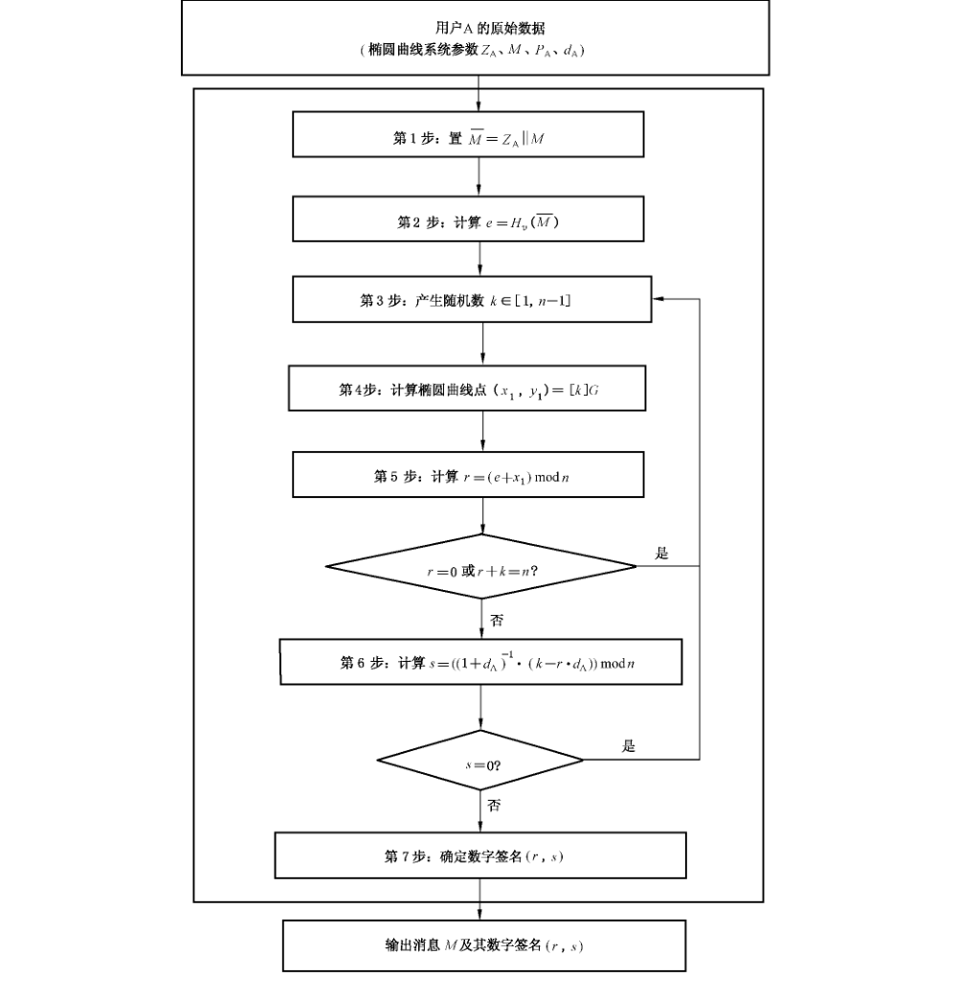
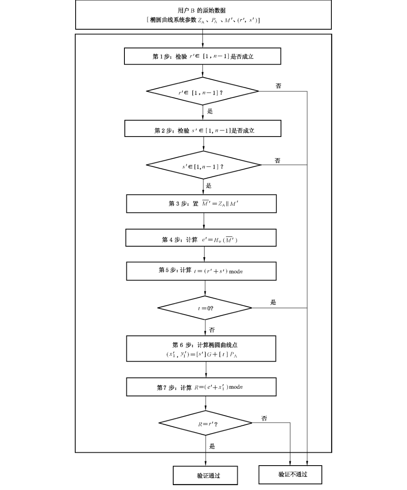

# GB/T 32918.2-2016 信息安全技术 SM2 椭圆曲线公钥密码算法 第 2 部分：数字签名算法

> 来源：[GB/T 32918.2-2016 国家标准详情](https://openstd.samr.gov.cn/bzgk/std/newGbInfo?hcno=6F1FAEB62F9668F25F38E0BF0291D4AC)；封面发布日期：2016-08-29；实施日期：2017-03-01。
> PDF SHA-256：2dcc42479512d5b497ce2b5e2515d97d491dcc965784261ce383d06181bff618。
> 转写说明：对照官方 PDF 全部 14 页的页面图像校正文字、公式、图示及附录 A 测试向量；省略封面、目录、页眉、页脚和页码，合并跨页内容。正式引用请核对原 PDF。

## 前言

GB/T 32918《信息安全技术 SM2 椭圆曲线公钥密码算法》分为 5 个部分：

- 第 1 部分：总则；
- 第 2 部分：数字签名算法；
- 第 3 部分：密钥交换协议；
- 第 4 部分：公钥加密算法；
- 第 5 部分：参数定义。

本部分为 GB/T 32918 的第 2 部分。

本部分按照 GB/T 1.1—2009 给出的规则起草。

本部分由国家密码管理局提出。

本部分由全国信息安全标准化技术委员会（SAC/TC 260）归口。

本部分起草单位：北京华大信安科技有限公司、中国人民解放军信息工程大学、中国科学院数据与通信保护研究教育中心。

本部分主要起草人：陈建华、祝跃飞、叶顶峰、胡磊、裴定一、彭国华、张亚娟、张振峰。

## 引言

N. Koblitz 和 V. Miller 在 1985 年各自独立地提出将椭圆曲线应用于公钥密码系统。椭圆曲线公钥密码所基于的曲线性质如下：

- 有限域上椭圆曲线在点加运算下构成有限交换群，且其阶与基域规模相近；
- 类似于有限域乘法群中的乘幂运算，椭圆曲线多倍点运算构成一个单向函数。

在多倍点运算中，已知多倍点与基点，求解倍数的问题称为椭圆曲线离散对数问题。对于一般椭圆曲线的离散对数问题，目前只存在指数级计算复杂度的求解方法。与大数分解问题及有限域上离散对数问题相比，椭圆曲线离散对数问题的求解难度要大得多。因此，在相同安全程度要求下，椭圆曲线密码较其他公钥密码所需的密钥规模要小得多。

SM2 是国家密码管理局组织制定并提出的椭圆曲线密码算法标准。GB/T 32918 的主要目标如下：

- GB/T 32918.1 定义和描述了 SM2 椭圆曲线密码算法的相关概念及数学基础知识，并概述了该部分同其他部分的关系。
- GB/T 32918.2 描述了一种基于椭圆曲线的签名算法，即 SM2 签名算法。
- GB/T 32918.3 描述了一种基于椭圆曲线的密钥交换协议，即 SM2 密钥交换协议。
- GB/T 32918.4 描述了一种基于椭圆曲线的公钥加密算法，即 SM2 加密算法，该算法需使用 GB/T 32905—2016 定义的 SM3 密码杂凑算法。
- GB/T 32918.5 给出了 SM2 算法使用的椭圆曲线参数，以及使用椭圆曲线参数进行 SM2 运算的示例结果。

本部分为 GB/T 32918 的第 2 部分，描述了基于椭圆曲线的数字签名算法。

## 1 范围

GB/T 32918 的本部分规定了 SM2 椭圆曲线公钥密码算法的数字签名算法，包括数字签名生成算法和验证算法，并给出了数字签名与验证示例及其相应的流程。

本部分适用于商用密码应用中的数字签名和验证，可满足多种密码应用中的身份鉴别和数据完整性、真实性的安全需求。

## 2 规范性引用文件

下列文件对于本文件的应用是必不可少的。凡是注日期的引用文件，仅注日期的版本适用于本文件。凡是不注日期的引用文件，其最新版本（包括所有的修改单）适用于本文件。

- GB/T 32918.1—2016 信息安全技术 SM2 椭圆曲线公钥密码算法 第 1 部分：总则
- GB/T 32905—2016 信息安全技术 SM3 密码杂凑算法

## 3 术语和定义

下列术语和定义适用于本文件。

### 3.1 消息 message

任意有限长度的比特串。

### 3.2 签名消息 signed message

由消息以及该消息的签名部分所组成的一组数据项。

### 3.3 签名密钥 signature key

在数字签名生成过程中由签名者专用的秘密数据项，即签名者的私钥。

### 3.4 签名生成过程 signature generation process

输入消息、签名密钥和椭圆曲线系统参数，并输出数字签名的过程。

### 3.5 可辨别标识 distinguishing identifier

可以无歧义辨别某一实体身份的信息。

## 4 符号和缩略语

下列符号和缩略语适用于本文件。

- `A, B`：使用公钥密码系统的两个用户。
- `d_A`：用户 A 的私钥。
- `E(F_q)`：`F_q` 上椭圆曲线 `E` 的所有有理点（包括无穷远点 `O`）组成的集合。
- `e`：密码杂凑算法作用于消息 `M̄` 的输出值。
- `e′`：密码杂凑算法作用于消息 `M̄′` 的输出值。
- `F_q`：包含 `q` 个元素的有限域。
- `G`：椭圆曲线的一个基点，其阶为素数。
- `H_v( )`：消息摘要长度为 `v` 比特的密码杂凑算法。
- `ID_A`：用户 A 的可辨别标识。
- `M`：待签名消息。
- `M′`：待验证消息。
- `mod n`：模 `n` 运算。例如，23 mod 7 = 2。
- `n`：基点 `G` 的阶（`n` 是 `#E(F_q)` 的素因子）。
- `O`：椭圆曲线上的一个特殊点，称为无穷远点或零点，是椭圆曲线加法群的单位元。
- `P_A`：用户 A 的公钥。
- `q`：有限域 `F_q` 中元素的数目。
- `a, b`：`F_q` 中的元素，它们定义 `F_q` 上的一条椭圆曲线 `E`。
- `x ∥ y`：`x` 与 `y` 的拼接，其中 `x`、`y` 可以是比特串或字节串。
- `Z_A`：关于用户 A 的可辨别标识、部分椭圆曲线系统参数和用户 A 公钥的杂凑值。
- `(r, s)`：发送的签名。
- `(r′, s′)`：收到的签名。
- `[k]P`：椭圆曲线上点 `P` 的 `k` 倍点，即 `[k]P = P + P + ⋯ + P`（`k` 个 `P`），`k` 是正整数。
- `[x, y]`：大于或等于 `x` 且小于或等于 `y` 的整数的集合。

## 5 数字签名算法

### 5.1 综述

数字签名算法由一个签名者对数据产生数字签名，并由一个验证者验证签名的可靠性。每个签名者有一个公钥和一个私钥，其中私钥用于产生签名，验证者用签名者的公钥验证签名。在签名的生成过程之前，要用密码杂凑算法对 `M̄`（包含 `Z_A` 和待签消息 `M`）进行压缩；在验证过程之前，要用密码杂凑算法对 `M̄′`（包含 `Z_A` 和待验证消息 `M′`）进行压缩。

### 5.2 椭圆曲线系统参数

椭圆曲线系统参数包括有限域 `F_q` 的规模 `q`（当 `q = 2^m` 时，还包括元素表示法的标识和约化多项式）；定义椭圆曲线 `E(F_q)` 的方程的两个元素 `a`、`b ∈ F_q`；`E(F_q)` 上的基点 `G = (x_G, y_G)`（`G ≠ O`），其中 `x_G` 和 `y_G` 是 `F_q` 中的两个元素；`G` 的阶 `n` 及其他可选项（如 `n` 的余因子 `h` 等）。

椭圆曲线系统参数及其验证应符合 GB/T 32918.1—2016 第 5 章的规定。

### 5.3 用户密钥对

用户 A 的密钥对包括其私钥 `d_A` 和公钥 `P_A = [d_A]G = (x_A, y_A)`。

用户密钥对的生成算法与公钥验证算法应符合 GB/T 32918.1—2016 第 6 章的规定。

### 5.4 辅助函数

#### 5.4.1 概述

在本部分规定的椭圆曲线数字签名算法中，涉及两类辅助函数：密码杂凑算法与随机数发生器。

#### 5.4.2 密码杂凑算法

本部分规定使用国家密码管理局批准的密码杂凑算法，如 SM3 密码杂凑算法。

#### 5.4.3 随机数发生器

本部分规定使用国家密码管理局批准的随机数发生器。

### 5.5 用户其他信息

作为签名者的用户 A 具有长度为 `entlen_A` 比特的可辨别标识 `ID_A`，记 `ENTL_A` 是由整数 `entlen_A` 转换而成的两个字节，在本部分规定的椭圆曲线数字签名算法中，签名者和验证者都需要用密码杂凑算法求得用户 A 的杂凑值 `Z_A`。按 GB/T 32918.1—2016 中 4.2.6 和 4.2.5 给出的方法，将椭圆曲线方程参数 `a`、`b`、`G` 的坐标 `x_G`、`y_G` 和 `P_A` 的坐标 `x_A`、`y_A` 的数据类型转换为比特串，`Z_A = H_256(ENTL_A ∥ ID_A ∥ a ∥ b ∥ x_G ∥ y_G ∥ x_A ∥ y_A)`。

## 6 数字签名的生成算法及流程

### 6.1 数字签名的生成算法

设待签名的消息为 `M`，为了获取消息 `M` 的数字签名 `(r, s)`，作为签名者的用户 A 应实现以下运算步骤：

- A₁：置 `M̄ = Z_A ∥ M`；
- A₂：计算 `e = H_v(M̄)`，按 GB/T 32918.1—2016 中 4.2.4 和 4.2.3 给出的方法将 `e` 的数据类型转换为整数；
- A₃：用随机数发生器产生随机数 `k ∈ [1, n - 1]`；
- A₄：计算椭圆曲线点 `(x₁, y₁) = [k]G`，按 GB/T 32918.1—2016 中 4.2.8 给出的方法将 `x₁` 的数据类型转换为整数；
- A₅：计算 `r = (e + x₁) mod n`，若 `r = 0` 或 `r + k = n` 则返回 A₃；
- A₆：计算 `s = ((1 + d_A)^(-1) · (k - r · d_A)) mod n`，若 `s = 0` 则返回 A₃；
- A₇：按 GB/T 32918.1—2016 中 4.2.2 给出的细节将 `r`、`s` 的数据类型转换为字节串，消息 `M` 的签名为 `(r, s)`。

> 注：数字签名生成过程的示例参见附录 A。

### 6.2 数字签名生成算法流程

数字签名生成算法流程见图 1。

## 7 数字签名的验证算法及流程

### 7.1 数字签名的验证算法

为了检验收到的消息 `M′` 及其数字签名 `(r′, s′)`，作为验证者的用户 B 应实现以下运算步骤：

- B₁：检验 `r′ ∈ [1, n - 1]` 是否成立，若不成立则验证不通过；
- B₂：检验 `s′ ∈ [1, n - 1]` 是否成立，若不成立则验证不通过；
- B₃：置 `M̄′ = Z_A ∥ M′`；
- B₄：计算 `e′ = H_v(M̄′)`，按 GB/T 32918.1—2016 中 4.2.4 和 4.2.3 给出的方法将 `e′` 的数据类型转换为整数；
- B₅：按 GB/T 32918.1—2016 中 4.2.3 给出的方法将 `r′`、`s′` 的数据类型转换为整数，计算 `t = (r′ + s′) mod n`，若 `t = 0`，则验证不通过；
- B₆：计算椭圆曲线点 `(x₁′, y₁′) = [s′]G + [t]P_A`；
- B₇：按 GB/T 32918.1—2016 中 4.2.8 给出的方法将 `x₁′` 的数据类型转换为整数，计算 `R = (e′ + x₁′) mod n`，检验 `R = r′` 是否成立，若成立则验证通过；否则验证不通过。

> 注：如果 `Z_A` 不是用户 A 所对应的杂凑值，验证自然通不过。数字签名验证过程的示例参见附录 A。

### 7.2 数字签名验证算法流程

数字签名验证算法流程见图 2。

## 附录 A（资料性附录）数字签名与验证示例

### A.1 综述

本附录选用 GB/T 32905—2016 给出的密码杂凑算法，其输入是长度小于 `2^64` 的消息比特串，输出是长度为 256 比特的杂凑值，记为 `H_256( )`。

本附录中，所有用 16 进制表示的数，左边为高位，右边为低位。

本附录中，消息采用 GB/T 1988 给出的编码。

设用户 A 的身份是：`ALICE123@YAHOO.COM`。用 GB/T 1988 给出的编码 `ID_A`：`414C 49434531 32334059 41484F4F 2E434F4D`。`ENTL_A = 0090`。

### A.2 `F_p` 上的椭圆曲线数字签名

椭圆曲线方程为：`y² = x³ + ax + b`。

示例 1：`F_p-256`。

- 素数 `p`：`8542D69E 4C044F18 E8B92435 BF6FF7DE 45728391 5C45517D 722EDB8B 08F1DFC3`
- 系数 `a`：`787968B4 FA32C3FD 2417842E 73BBFEFF 2F3C848B 6831D7E0 EC65228B 3937E498`
- 系数 `b`：`63E4C6D3 B23B0C84 9CF84241 484BFE48 F61D59A5 B16BA06E 6E12D1DA 27C5249A`

基点 `G = (x_G, y_G)`，其阶记为 `n`。

- 坐标 `x_G`：`421DEBD6 1B62EAB6 746434EB C3CC315E 32220B3B ADD50BDC 4C4E6C14 7FEDD43D`
- 坐标 `y_G`：`0680512B CBB42C07 D47349D2 153B70C4 E5D7FDFC BFA36EA1 A85841B9 E46E09A2`
- 阶 `n`：`8542D69E 4C044F18 E8B92435 BF6FF7DD 29772063 0485628D 5AE74EE7 C32E79B7`

待签名的消息 `M`：`message digest`。

- 私钥 `d_A`：`128B2FA8 BD433C6C 068C8D80 3DFF7979 2A519A55 171B1B65 0C23661D 15897263`
- 公钥 `P_A = (x_A, y_A)` 的坐标 `x_A`：`0AE4C779 8AA0F119 471BEE11 825BE462 02BB79E2 A5844495 E97C04FF 4DF2548A`
- 公钥 `P_A` 的坐标 `y_A`：`7C0240F8 8F1CD4E1 6352A73C 17B7F16F 07353E53 A176D684 A9FE0C6B B798E857`

杂凑值 `Z_A = H_256(ENTL_A ∥ ID_A ∥ a ∥ b ∥ x_G ∥ y_G ∥ x_A ∥ y_A)`：

`F4A38489 E32B45B6 F876E3AC 2168CA39 2362DC8F 23459C1D 1146FC3D BFB7BC9A`

签名各步骤中的有关值：

- `M̄ = Z_A ∥ M`：`F4A38489 E32B45B6 F876E3AC 2168CA39 2362DC8F 23459C1D 1146FC3D BFB7BC9A 6D657373 61676520 64696765 7374`
- 密码杂凑函数值 `e = H_256(M̄)`：`B524F552 CD82B8B0 28476E00 5C377FB1 9A87E6FC 682D48BB 5D42E3D9 B9EFFE76`
- 产生随机数 `k`：`6CB28D99 385C175C 94F94E93 4817663F C176D925 DD72B727 260DBAAE 1FB2F96F`

计算椭圆曲线点 `(x₁, y₁) = [k]G`：

- 坐标 `x₁`：`110FCDA5 7615705D 5E7B9324 AC4B856D 23E6D918 8B2AE477 59514657 CE25D112`
- 坐标 `y₁`：`1C65D68A 4A08601D F24B431E 0CAB4EBE 084772B3 817E8581 1A8510B2 DF7ECA1A`

- 计算 `r = (e + x₁) mod n`：`40F1EC59 F793D9F4 9E09DCEF 49130D41 94F79FB1 EED2CAA5 5BACDB49 C4E755D1`
- `(1 + d_A)^(-1)`：`79BFCF30 52C80DA7 B939E0C6 914A18CB B2D96D85 55256E83 122743A7 D4F5F956`
- 计算 `s = ((1 + d_A)^(-1) · (k - r · d_A)) mod n`：`6FC6DAC3 2C5D5CF1 0C77DFB2 0F7C2EB6 67A45787 2FB09EC5 6327A67E C7DEEBE7`

消息 `M` 的签名为 `(r, s)`：

- 值 `r`：`40F1EC59 F793D9F4 9E09DCEF 49130D41 94F79FB1 EED2CAA5 5BACDB49 C4E755D1`
- 值 `s`：`6FC6DAC3 2C5D5CF1 0C77DFB2 0F7C2EB6 67A45787 2FB09EC5 6327A67E C7DEEBE7`

验证各步骤中的有关值：

- 密码杂凑算法值 `e′ = H_256(M̄′)`：`B524F552 CD82B8B0 28476E00 5C377FB1 9A87E6FC 682D48BB 5D42E3D9 B9EFFE76`
- 计算 `t = (r′ + s′) mod n`：`2B75F07E D7ECE7CC C1C8986B 991F441A D324D6D6 19FE06DD 63ED32E0 C997C801`

计算椭圆曲线点 `(x₀′, y₀′) = [s′]G`：

- 坐标 `x₀′`：`7DEACE5F D121BC38 5A3C6317 249F413D 28C17291 A60DFD83 B835A453 92D22B0A`
- 坐标 `y₀′`：`2E49D5E5 279E5FA9 1E71FD8F 693A64A3 C4A94611 15A4FC9D 79F34EDC 8BDDEBD0`

计算椭圆曲线点 `(x₀″, y₀″) = [t]P_A`：

- 坐标 `x₀″`：`1657FA75 BF2ADCDC 3C1F6CF0 5AB7B45E 04D3ACBE 8E4085CF A669CB25 64F17A9F`
- 坐标 `y₀″`：`19F0115F 21E16D2F 5C3A485F 8575A128 BBCDDF80 296A62F6 AC2EB842 DD058E50`

计算椭圆曲线点 `(x₁′, y₁′) = [s′]G + [t]P_A`：

- 坐标 `x₁′`：`110FCDA5 7615705D 5E7B9324 AC4B856D 23E6D918 8B2AE477 59514657 CE25D112`
- 坐标 `y₁′`：`1C65D68A 4A08601D F24B431E 0CAB4EBE 084772B3 817E8581 1A8510B2 DF7ECA1A`
- 计算 `R = (e′ + x₁′) mod n`：`40F1EC59 F793D9F4 9E09DCEF 49130D41 94F79FB1 EED2CAA5 5BACDB49 C4E755D1`

### A.3 `F_(2^m)` 上的椭圆曲线数字签名

椭圆曲线方程为：`y² + xy = x³ + ax² + b`。

示例 2：`F_(2^m)-257`。

- 基域生成多项式：`x^257 + x^12 + 1`
- 系数 `a`：`0`
- 系数 `b`：`00 E78BCD09 746C2023 78A7E72B 12BCE002 66B9627E CB0B5A25 367AD1AD 4CC6242B`

基点 `G = (x_G, y_G)`，其阶记为 `n`。

- 坐标 `x_G`：`00 CDB9CA7F 1E6B0441 F658343F 4B10297C 0EF9B649 1082400A 62E7A748 5735FADD`
- 坐标 `y_G`：`01 3DE74DA6 5951C4D7 6DC89220 D5F7777A 611B1C38 BAE260B1 75951DC8 060C2B3E`
- 阶 `n`：`7FFFFFFF FFFFFFFF FFFFFFFF FFFFFFFF BC972CF7 E6B6F900 945B3C6A 0CF6161D`

待签名的消息 `M`：`message digest`。

- 私钥 `d_A`：`771EF3DB FF5F1CDC 32B9C572 93047619 1998B2BF 7CB981D7 F5B39202 645F0931`
- 公钥 `P_A = (x_A, y_A)` 的坐标 `x_A`：`01 65961645 281A8626 607B917F 657D7E93 82F1EA5C D931F40F 6627F357 542653B2`
- 公钥 `P_A` 的坐标 `y_A`：`01 68652213 0D590FB8 DE635D8F CA715CC6 BF3D05BE F3F75DA5 D5434544 48166612`

杂凑值 `Z_A = H_256(ENTL_A ∥ ID_A ∥ a ∥ b ∥ x_G ∥ y_G ∥ x_A ∥ y_A)`：

`26352AF8 2EC19F20 7BBC6F94 74E11E90 CE0F7DDA CE03B27F 801817E8 97A81FD5`

签名各步骤中的有关值：

- `M̄ = Z_A ∥ M`：`26352AF8 2EC19F20 7BBC6F94 74E11E90 CE0F7DDA CE03B27F 801817E8 97A81FD5 6D657373 61676520 64696765 7374`
- 密码杂凑算法值 `e = H_256(M̄)`：`AD673CBD A3114171 29A9EAA5 F9AB1AA1 633AD477 18A84DFD 46C17C6F A0AA3B12`
- 产生随机数 `k`：`36CD79FC 8E24B735 7A8A7B4A 46D454C3 97703D64 98158C60 5399B341 ADA186D6`

计算椭圆曲线点 `(x₁, y₁) = [k]G`：

- 坐标 `x₁`：`00 3FD87D69 47A15F94 25B32EDD 39381ADF D5E71CD4 BB357E3C 6A6E0397 EEA7CD66`
- 坐标 `y₁`：`00 80771114 6D73951E 9EB373A6 58214054 B7B56D1D 50B4CD6E B32ED387 A65AA6A2`

- 计算 `r = (e + x₁) mod n`：`6D3FBA26 EAB2A105 4F5D1983 32E33581 7C8AC453 ED26D339 1CD4439D 825BF25B`
- `(1 + d_A)^(-1)`：`73AF2954 F951A9DF F5B4C8F7 119DAA1C 230C9BAD E60568D0 5BC3F432 1E1F4260`
- 计算 `s = ((1 + d_A)^(-1) · (k - r · d_A)) mod n`：`3124C568 8D95F0A1 0252A9BE D033BEC8 4439DA38 4621B6D6 FAD77F94 B74A9556`

消息 `M` 的签名为 `(r, s)`：

- 值 `r`：`6D3FBA26 EAB2A105 4F5D1983 32E33581 7C8AC453 ED26D339 1CD4439D 825BF25B`
- 值 `s`：`3124C568 8D95F0A1 0252A9BE D033BEC8 4439DA38 4621B6D6 FAD77F94 B74A9556`

验证各步骤中的有关值：

- 密码杂凑算法值 `e′ = H_256(M̄′)`：`AD673CBD A3114171 29A9EAA5 F9AB1AA1 633AD477 18A84DFD 46C17C6F A0AA3B12`
- 计算 `t = (r′ + s′) mod n`：`1E647F8F 784891A6 51AFC342 0316F44A 042D7194 4C91910F 835086C8 2CB07194`

计算椭圆曲线点 `(x₀′, y₀′) = [s′]G`：

- 坐标 `x₀′`：`00 252CF6B6 3A044FCE 553EAA77 3E1E9264 44E0DAA1 0E4B8873 89D11552 EA6418F7`
- 坐标 `y₀′`：`00 776F3C5D B3A0D312 9EAE44E0 21C28667 92E4264B E1BEEBCA 3B8159DC A382653A`

计算椭圆曲线点 `(x₀″, y₀″) = [t]P_A`：

- 坐标 `x₀″`：`00 07DA3F04 0EFB9C28 1BE107EC C389F56F E76A680B B5FDEE1D D554DC11 EB477C88`
- 坐标 `y₀″`：`01 7BA2845D C65945C3 D48926C7 0C953A1A F29CE2E1 9A7EEE6B E0269FB4 803CA68B`

计算椭圆曲线点 `(x₁′, y₁′) = [s′]G + [t]P_A`：

- 坐标 `x₁′`：`00 3FD87D69 47A15F94 25B32EDD 39381ADF D5E71CD4 BB357E3C 6A6E0397 EEA7CD66`
- 坐标 `y₁′`：`00 80771114 6D73951E 9EB373A6 58214054 B7B56D1D 50B4CD6E B32ED387 A65AA6A2`
- 计算 `R = (e′ + x₁′) mod n`：`6D3FBA26 EAB2A105 4F5D1983 32E33581 7C8AC453 ED26D339 1CD4439D 825BF25B`

## 参考文献

- ［1］ GB/T 1988—1998 信息技术 信息交换用七位编码字符集
