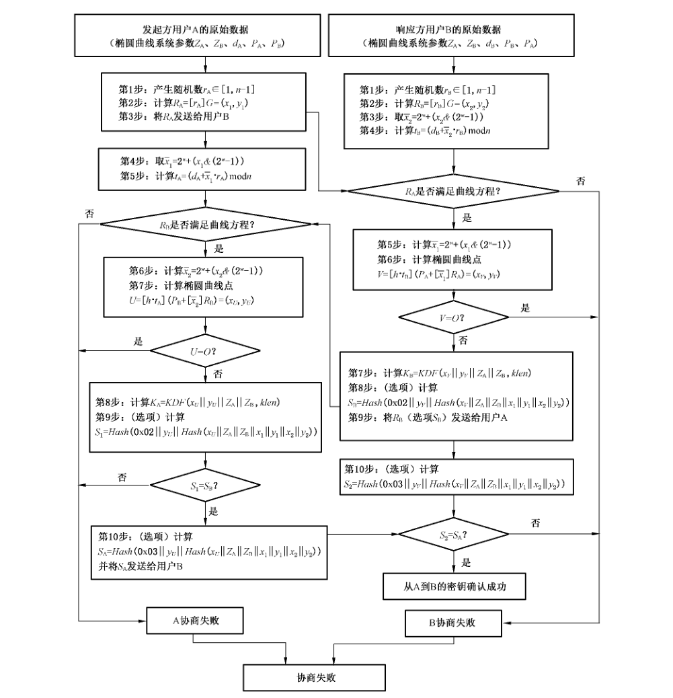

# GB/T 32918.3-2016 信息安全技术 SM2 椭圆曲线公钥密码算法 第 3 部分：密钥交换协议

> 来源：[GB/T 32918.3-2016 国家标准详情](https://openstd.samr.gov.cn/bzgk/std/newGbInfo?hcno=66A89DD6DA64F49C49456B757BA0624F)；封面发布日期：2016-08-29；实施日期：2017-03-01。
> PDF SHA-256：03acaa8aad1385305628e0569ac308dcf2352214965117cdad626dd365e3a6ad。
> 转写说明：对照官方 PDF 全部 17 页的页面图像校正文字、公式、图示及附录 A 测试向量；省略封面、目录、页眉、页脚和页码，合并跨页内容。附录中重复列出的拼接输入以各字段和拼接顺序表示。正式引用请核对原 PDF。
> 转写校验：附录 A.3 所列 `Z_A` 与同一示例列出的输入值按 `H_256` 公式复算不一致；此处保留原页印刷值，未擅自改动。

## 前言

GB/T 32918《信息安全技术 SM2 椭圆曲线公钥密码算法》分为 5 个部分：

- 第 1 部分：总则；
- 第 2 部分：数字签名算法；
- 第 3 部分：密钥交换协议；
- 第 4 部分：公钥加密算法；
- 第 5 部分：参数定义。

本部分为 GB/T 32918 的第 3 部分。

本部分按照 GB/T 1.1—2009 给出的规则起草。

本部分由国家密码管理局提出。

本部分由全国信息安全标准化技术委员会（SAC/TC 260）归口。

本部分起草单位：北京华大信安科技有限公司、中国人民解放军信息工程大学、中国科学院数据与通信保护研究教育中心。

本部分主要起草人：陈建华、祝跃飞、叶顶峰、胡磊、裴定一、彭国华、张亚娟、张振峰。

## 引言

N. Koblitz 和 V. Miller 在 1985 年各自独立地提出将椭圆曲线应用于公钥密码系统。椭圆曲线公钥密码所基于的曲线性质如下：

- 有限域上椭圆曲线在点加运算下构成有限交换群，且其阶与基域规模相近；
- 类似于有限域乘法群中的乘幂运算，椭圆曲线多倍点运算构成一个单向函数。

在多倍点运算中，已知多倍点与基点，求解倍数的问题称为椭圆曲线离散对数问题。对于一般椭圆曲线的离散对数问题，目前只存在指数级计算复杂度的求解方法。与大数分解问题及有限域上离散对数问题相比，椭圆曲线离散对数问题的求解难度要大得多。因此，在相同安全程度要求下，椭圆曲线密码较其他公钥密码所需的密钥规模要小得多。

SM2 是国家密码管理局组织制定并提出的椭圆曲线密码算法标准。GB/T 32918 的主要目标如下：

- GB/T 32918.1 定义和描述了 SM2 椭圆曲线密码算法的相关概念及数学基础知识，并概述了该部分同其他部分的关系。
- GB/T 32918.2 描述了一种基于椭圆曲线的签名算法，即 SM2 签名算法。
- GB/T 32918.3 描述了一种基于椭圆曲线的密钥交换协议，即 SM2 密钥交换协议。
- GB/T 32918.4 描述了一种基于椭圆曲线的公钥加密算法，即 SM2 加密算法，该算法需使用 GB/T 32905—2016 定义的 SM3 密码杂凑算法。
- GB/T 32918.5 给出了 SM2 算法使用的椭圆曲线参数，以及使用椭圆曲线参数进行 SM2 运算的示例结果。

本部分为 GB/T 32918 的第 3 部分，规定了 SM2 椭圆曲线密码系统的密钥交换过程。

## 1 范围

GB/T 32918 的本部分规定了 SM2 椭圆曲线公钥密码算法的密钥交换协议，并给出了密钥交换与验证示例及其相应的流程。

本部分适用于商用密码应用中的密钥交换，可满足通信双方经过两次或可选三次信息传递过程，计算获取一个由双方共同决定的共享秘密密钥（会话密钥）。

## 2 规范性引用文件

下列文件对于本文件的应用是必不可少的。凡是注日期的引用文件，仅注日期的版本适用于本文件。凡是不注日期的引用文件，其最新版本（包括所有的修改单）适用于本文件。

- GB/T 32918.1—2016 信息安全技术 SM2 椭圆曲线公钥密码算法 第 1 部分：总则
- GB/T 32905—2016 信息安全技术 SM3 密码杂凑算法

## 3 术语和定义

下列术语和定义适用于本文件。

### 3.1 从 A 到 B 的密钥确认 key confirmation from A to B

使用户 B 确信用户 A 拥有特定秘密密钥的保证。

### 3.2 密钥派生函数 key derivation function

通过作用于共享秘密和双方都知道的其他参数，产生一个或多个共享秘密密钥的函数。

### 3.3 发起方 initiator

在一个协议的操作过程中发送首轮交换信息的用户。

### 3.4 响应方 responder

在一个协议的操作过程中不是发送首轮交换信息的用户。

### 3.5 可辨别标识 distinguishing identifier

可以无歧义辨别某一实体身份的信息。

## 4 符号和缩略语

下列符号适用于本文件。

- `A, B`：使用公钥密码系统的两个用户。
- `d_A, d_B`：用户 A 和用户 B 的私钥。
- `E(F_q)`：`F_q` 上椭圆曲线 `E` 的所有有理点（包括无穷远点 `O`）组成的集合。
- `F_q`：包含 `q` 个元素的有限域。
- `G`：椭圆曲线的一个基点，其阶为素数。
- `Hash( )`：密码杂凑算法。
- `H_v( )`：消息摘要长度为 `v` 比特的密码杂凑算法。
- `h`：余因子，`h = #E(F_q)/n`，其中 `n` 是基点 `G` 的阶。
- `ID_A, ID_B`：用户 A 和用户 B 的可辨别标识。
- `K, K_A, K_B`：密钥交换协议商定的共享秘密密钥。
- `KDF( )`：密钥派生函数。
- `mod n`：模 `n` 运算。例如，23 mod 7 = 2。
- `n`：基点 `G` 的阶（`n` 是 `#E(F_q)` 的素因子）。
- `O`：椭圆曲线上的一个特殊点，称为无穷远点或零点，是椭圆曲线加法群的单位元。
- `P_A, P_B`：用户 A 和用户 B 的公钥。
- `q`：有限域 `F_q` 中元素的数目。
- `a, b`：`F_q` 中的元素，它们定义 `F_q` 上的一条椭圆曲线 `E`。
- `r_A, r_B`：密钥交换中用户 A 和用户 B 产生的临时密钥值。
- `x ∥ y`：`x` 与 `y` 的拼接，其中 `x`、`y` 可以是比特串或字节串。
- `Z_A, Z_B`：关于用户 A 和用户 B 的可辨别标识、部分椭圆曲线系统参数和各自公钥的杂凑值。
- `#E(F_q)`：`E(F_q)` 上点的数目，称为椭圆曲线 `E(F_q)` 的阶。
- `[k]P`：椭圆曲线上点 `P` 的 `k` 倍点，即 `[k]P = P + P + ⋯ + P`（`k` 个 `P`），`k` 是正整数。
- `[x, y]`：大于或等于 `x` 且小于或等于 `y` 的整数的集合。
- `⌈x⌉`：顶函数，大于或等于 `x` 的最小整数。例如，`⌈7⌉ = 7`，`⌈8.3⌉ = 9`。
- `⌊x⌋`：底函数，小于或等于 `x` 的最大整数。例如，`⌊7⌋ = 7`，`⌊8.3⌋ = 8`。
- `&`：两个整数的按比特与运算。

## 5 算法参数与辅助函数

### 5.1 综述

密钥交换协议是两个用户 A 和 B 通过交互的信息传递，用各自的私钥和对方的公钥来商定一个只有他们知道的秘密密钥。这个共享的秘密密钥通常用在某个对称密码算法中。该密钥交换协议能够用于密钥管理和协商。

### 5.2 椭圆曲线系统参数

椭圆曲线系统参数包括有限域 `F_q` 的规模 `q`（当 `q = 2^m` 时，还包括元素表示法的标识和约化多项式）；定义椭圆曲线 `E(F_q)` 的方程的两个元素 `a, b ∈ F_q`；`E(F_q)` 上的基点 `G = (x_G, y_G)`（`G ≠ O`），其中 `x_G` 和 `y_G` 是 `F_q` 中的两个元素；`G` 的阶 `n` 及其他可选项（如 `n` 的余因子 `h` 等）。

椭圆曲线系统参数及其验证应符合 GB/T 32918.1—2016 第 5 章的规定。

### 5.3 用户密钥对

用户 A 的密钥对包括其私钥 `d_A` 和公钥 `P_A = [d_A]G = (x_A, y_A)`，用户 B 的密钥对包括其私钥 `d_B` 和公钥 `P_B = [d_B]G = (x_B, y_B)`。

用户密钥对的生成算法与公钥验证算法应符合 GB/T 32918.1—2016 第 6 章的规定。

### 5.4 辅助函数

#### 5.4.1 概述

在本部分规定的椭圆曲线密钥交换协议中，涉及三类辅助函数：密码杂凑算法、密钥派生函数与随机数发生器。这三类辅助函数的强弱直接影响密钥交换协议的安全性。

#### 5.4.2 密码杂凑算法

本部分规定使用国家密码管理局批准的密码杂凑算法，如 SM3 密码杂凑算法。

#### 5.4.3 密钥派生函数

密钥派生函数的作用是从一个共享的秘密比特串中派生出密钥数据。在密钥协商过程中，密钥派生函数作用在密钥交换所获共享的秘密比特串上，从中产生所需的会话密钥或进一步加密所需的密钥数据。

密钥派生函数需要调用密码杂凑算法。

设密码杂凑算法 `H_v( )`，其输出是长度恰为 `v` 比特的杂凑值。

密钥派生函数 `KDF(Z, klen)`：

- 输入：比特串 `Z`，整数 `klen`〔表示要获得的密钥数据的比特长度，要求该值小于 `(2^32 - 1)v`〕。
- 输出：长度为 `klen` 的密钥数据比特串 `K`。

a) 初始化一个 32 比特构成的计数器 `ct = 0x00000001`；

b) 对 `i` 从 1 到 `⌈klen/v⌉` 执行：

1. 计算 `Ha_i = H_v(Z ∥ ct)`；
2. `ct++`；

c) 若 `klen/v` 是整数，令 `Ha'_{⌈klen/v⌉} = Ha_{⌈klen/v⌉}`，否则令 `Ha'_{⌈klen/v⌉}` 为 `Ha_{⌈klen/v⌉}` 最左边的 `klen - v × ⌊klen/v⌋` 比特；

d) 令 `K = Ha_1 ∥ Ha_2 ∥ ⋯ ∥ Ha_{⌈klen/v⌉ - 1} ∥ Ha'_{⌈klen/v⌉}`。

#### 5.4.4 随机数发生器

本部分规定使用国家密码管理局批准的随机数发生器。

### 5.5 用户其他信息

用户 A 具有长度为 `entlen_A` 比特的可辨别标识 `ID_A`，记 `ENTL_A` 是由整数 `entlen_A` 转换而成的两个字节；用户 B 具有长度为 `entlen_B` 比特的可辨别标识 `ID_B`，记 `ENTL_B` 是由整数 `entlen_B` 转换而成的两个字节。在本部分规定的椭圆曲线密钥交换协议中，参与密钥协商的 A、B 双方都需要用密码杂凑算法求得用户 A 的杂凑值 `Z_A` 和用户 B 的杂凑值 `Z_B`。按 GB/T 32918.1—2016 中 4.2.5 和 4.2.6 给出的方法，将椭圆曲线方程参数 `a`、`b`、`G` 的坐标 `x_G`、`y_G` 和 `P_A` 的坐标 `x_A`、`y_A` 的数据类型转换为比特串，`Z_A = H_256(ENTL_A ∥ ID_A ∥ a ∥ b ∥ x_G ∥ y_G ∥ x_A ∥ y_A)`；按 GB/T 32918.1—2016 中 4.2.5 和 4.2.6 给出的方法，将椭圆曲线方程参数 `a`、`b`、`G` 的坐标 `x_G`、`y_G` 和 `P_B` 的坐标 `x_B`、`y_B` 的数据类型转换为比特串，`Z_B = H_256(ENTL_B ∥ ID_B ∥ a ∥ b ∥ x_G ∥ y_G ∥ x_B ∥ y_B)`。

## 6 密钥交换协议及流程

### 6.1 密钥交换协议

设用户 A 和 B 协商获得密钥数据的长度为 `klen` 比特，用户 A 为发起方，用户 B 为响应方。

用户 A 和 B 双方为了获得相同的密钥，应实现如下运算步骤：记 `w = ⌈⌈log₂(n)⌉/2⌉ - 1`。

用户 A：

- A₁：用随机数发生器产生随机数 `r_A ∈ [1, n - 1]`；
- A₂：计算椭圆曲线点 `R_A = [r_A]G = (x₁, y₁)`；
- A₃：将 `R_A` 发送给用户 B。

用户 B：

- B₁：用随机数发生器产生随机数 `r_B ∈ [1, n - 1]`；
- B₂：计算椭圆曲线点 `R_B = [r_B]G = (x₂, y₂)`；
- B₃：从 `R_B` 中取出域元素 `x₂`，按 GB/T 32918.1—2016 中 4.2.8 给出的方法将 `x₂` 的数据类型转换为整数，计算 `x̄₂ = 2^w + (x₂ & (2^w - 1))`；
- B₄：计算 `t_B = (d_B + x̄₂ · r_B) mod n`；
- B₅：验证 `R_A` 是否满足椭圆曲线方程，若不满足则协商失败；否则从 `R_A` 中取出域元素 `x₁`，按 GB/T 32918.1—2016 中 4.2.8 给出的方法将 `x₁` 的数据类型转换为整数，计算 `x̄₁ = 2^w + (x₁ & (2^w - 1))`；
- B₆：计算椭圆曲线点 `V = [h · t_B](P_A + [x̄₁]R_A) = (x_V, y_V)`，若 `V` 是无穷远点，则 B 协商失败；否则按 GB/T 32918.1—2016 中 4.2.6 和 4.2.5 给出的方法将 `x_V`、`y_V` 的数据类型转换为比特串；
- B₇：计算 `K_B = KDF(x_V ∥ y_V ∥ Z_A ∥ Z_B, klen)`；
- B₈：（选项）按 GB/T 32918.1—2016 中 4.2.6 和 4.2.5 给出的方法将 `R_A` 的坐标 `x₁`、`y₁` 和 `R_B` 的坐标 `x₂`、`y₂` 的数据类型转换为比特串，计算 `S_B = Hash(0x02 ∥ y_V ∥ Hash(x_V ∥ Z_A ∥ Z_B ∥ x₁ ∥ y₁ ∥ x₂ ∥ y₂))`；
- B₉：将 `R_B`、（选项 `S_B`）发送给用户 A。

用户 A：

- A₄：从 `R_A` 中取出域元素 `x₁`，按 GB/T 32918.1—2016 中 4.2.8 给出的方法将 `x₁` 的数据类型转换为整数，计算 `x̄₁ = 2^w + (x₁ & (2^w - 1))`；
- A₅：计算 `t_A = (d_A + x̄₁ · r_A) mod n`；
- A₆：验证 `R_B` 是否满足椭圆曲线方程，若不满足则协商失败；否则从 `R_B` 中取出域元素 `x₂`，按 GB/T 32918.1—2016 中 4.2.8 给出的方法将 `x₂` 的数据类型转换为整数，计算 `x̄₂ = 2^w + (x₂ & (2^w - 1))`；
- A₇：计算椭圆曲线点 `U = [h · t_A](P_B + [x̄₂]R_B) = (x_U, y_U)`，若 `U` 是无穷远点，则 A 协商失败；否则按 GB/T 32918.1—2016 中 4.2.6 和 4.2.5 给出的方法将 `x_U`、`y_U` 的数据类型转换为比特串；
- A₈：计算 `K_A = KDF(x_U ∥ y_U ∥ Z_A ∥ Z_B, klen)`；
- A₉：（选项）按 GB/T 32918.1—2016 中 4.2.6 和 4.2.5 给出的方法将 `R_A` 的坐标 `x₁`、`y₁` 和 `R_B` 的坐标 `x₂`、`y₂` 的数据类型转换为比特串，计算 `S₁ = Hash(0x02 ∥ y_U ∥ Hash(x_U ∥ Z_A ∥ Z_B ∥ x₁ ∥ y₁ ∥ x₂ ∥ y₂))`，并检验 `S₁ = S_B` 是否成立，若等式不成立则从 B 到 A 的密钥确认失败；
- A₁₀：（选项）计算 `S_A = Hash(0x03 ∥ y_U ∥ Hash(x_U ∥ Z_A ∥ Z_B ∥ x₁ ∥ y₁ ∥ x₂ ∥ y₂))`，并将 `S_A` 发送给用户 B。

用户 B：

- B₁₀：（选项）计算 `S₂ = Hash(0x03 ∥ y_V ∥ Hash(x_V ∥ Z_A ∥ Z_B ∥ x₁ ∥ y₁ ∥ x₂ ∥ y₂))`，并检验 `S₂ = S_A` 是否成立，若等式不成立则从 A 到 B 的密钥确认失败。

> 注：如果 `Z_A`、`Z_B` 不是用户 A 和 B 所对应的杂凑值，则自然不能达成一致的共享秘密值。密钥交换协议过程的示例参见附录 A。

### 6.2 密钥交换协议流程

密钥交换协议流程见图 1。

## 附录 A（资料性附录）密钥交换及验证示例

### A.1 综述

本附录选用 GB/T 32905—2016 给出的密码杂凑算法，其输入是长度小于 `2^64` 的消息比特串，输出是长度为 256 比特的杂凑值，记为 `H_256( )`。

本附录中，所有用 16 进制表示的数，左边为高位，右边为低位。

设用户 A 的身份是：`ALICE123@YAHOO.COM`。用 GB/T 1988 编码记 `ID_A`：`414C 49434531 32334059 41484F4F 2E434F4D`。`ENTL_A = 0090`。

设用户 B 的身份是：`BILL456@YAHOO.COM`。用 GB/T 1988 编码记 `ID_B`：`42 494C4C34 35364059 41484F4F 2E434F4D`。`ENTL_B = 0088`。

### A.2 `F_p` 上椭圆曲线密钥交换协议

椭圆曲线方程为：`y² = x³ + ax + b`。

**示例 1：`F_p-256`**

- 素数 `p`：`8542D69E 4C044F18 E8B92435 BF6FF7DE 45728391 5C45517D 722EDB8B 08F1DFC3`
- 系数 `a`：`787968B4 FA32C3FD 2417842E 73BBFEFF 2F3C848B 6831D7E0 EC65228B 3937E498`
- 系数 `b`：`63E4C6D3 B23B0C84 9CF84241 484BFE48 F61D59A5 B16BA06E 6E12D1DA 27C5249A`
- 余因子 `h`：`1`
- 基点 `G = (x_G, y_G)`，其阶记为 `n`。
- 坐标 `x_G`：`421DEBD6 1B62EAB6 746434EB C3CC315E 32220B3B ADD50BDC 4C4E6C14 7FEDD43D`
- 坐标 `y_G`：`0680512B CBB42C07 D47349D2 153B70C4 E5D7FDFC BFA36EA1 A85841B9 E46E09A2`
- 阶 `n`：`8542D69E 4C044F18 E8B92435 BF6FF7DD 29772063 0485628D 5AE74EE7 C32E79B7`
- 用户 A 的私钥 `d_A`：`6FCBA2EF 9AE0AB90 2BC3BDE3 FF915D44 BA4CC78F 88E2F8E7 F8996D3B 8CCEEDEE`
- 用户 A 的公钥 `P_A = (x_A, y_A)`：
  - `x_A`：`3099093B F3C137D8 FCBBCDF4 A2AE50F3 B0F216C3 122D7942 5FE03A45 DBFE1655`
  - `y_A`：`3DF79E8D AC1CF0EC BAA2F2B4 9D51A4B3 87F2EFAF 48233908 6A27A8E0 5BAED98B`
- 用户 B 的私钥 `d_B`：`5E35D7D3 F3C54DBA C72E6181 9E730B01 9A84208C A3A35E4C 2E353DFC CB2A3B53`
- 用户 B 的公钥 `P_B = (x_B, y_B)`：
  - `x_B`：`245493D4 46C38D8C C0F11837 4690E7DF 633A8A4B FB3329B5 ECE604B2 B4F37F43`
  - `y_B`：`53C0869F 4B9E1777 3DE68FEC 45E14904 E0DEA45B F6CECF99 18C85EA0 47C60A4C`
- 杂凑值 `Z_A = H_256(ENTL_A ∥ ID_A ∥ a ∥ b ∥ x_G ∥ y_G ∥ x_A ∥ y_A)`：`E4D1D0C3 CA4C7F11 BC8FF8CB 3F4C02A7 8F108FA0 98E51A66 8487240F 75E20F31`
- 杂凑值 `Z_B = H_256(ENTL_B ∥ ID_B ∥ a ∥ b ∥ x_G ∥ y_G ∥ x_B ∥ y_B)`：`6B4B6D0E 276691BD 4A11BF72 F4FB501A E309FDAC B72FA6CC 336E6656 119ABD67`

密钥交换 A₁～A₃ 步骤中的有关值：

- 产生随机数 `r_A`：`83A2C9C8 B96E5AF7 0BD480B4 72409A9A 327257F1 EBB73F5B 073354B2 48668563`
- 计算椭圆曲线点 `R_A = [r_A]G = (x₁, y₁)`：
  - `x₁`：`6CB56338 16F4DD56 0B1DEC45 8310CBCC 6856C095 05324A6D 23150C40 8F162BF0`
  - `y₁`：`0D6FCF62 F1036C0A 1B6DACCF 57399223 A65F7D7B F2D9637E 5BBBEB85 7961BF1A`

密钥交换 B₁～B₉ 步骤中的有关值：

- 产生随机数 `r_B`：`33FE2194 0342161C 55619C4A 0C060293 D543C80A F19748CE 176D8347 7DE71C80`
- 计算椭圆曲线点 `R_B = [r_B]G = (x₂, y₂)`：
  - `x₂`：`1799B2A2 C7782953 00D9A232 5C686129 B8F2B533 7B3DCF45 14E8BBC1 9D900EE5`
  - `y₂`：`54C9288C 82733EFD F7808AE7 F27D0E73 2F7C73A7 D9AC98B7 D8740A91 D0DB3CF4`
- `x̄₂ = 2^127 + (x₂ & (2^127 - 1))`：`B8F2B533 7B3DCF45 14E8BBC1 9D900EE5`
- `t_B = (d_B + x̄₂ · r_B) mod n`：`2B2E11CB F03641FC 3D939262 FC0B652A 70ACAA25 B5369AD3 8B375C02 65490C9F`
- `x̄₁ = 2^127 + (x₁ & (2^127 - 1))`：`E856C095 05324A6D 23150C40 8F162BF0`
- `[x̄₁]R_A = (x_A0, y_A0)`：
  - `x_A0`：`2079015F 1A2A3C13 2B67CA90 75BB2803 1D6F2239 8DD8331E 72529555 204B495B`
  - `y_A0`：`6B3FE6FB 0F5D5664 DCA16128 B5E7FCFD AFA5456C 1E5A914D 1300DB61 F37888ED`
- `P_A + [x̄₁]R_A = (x_A1, y_A1)`：
  - `x_A1`：`1C006A3B FF97C651 B7F70D0D E0FC09D2 3AA2BE7A 8E9FF7DA F32673B4 16349B92`
  - `y_A1`：`5DC74F8A CC114FC6 F1A75CB2 86864F34 7F9B2CF2 9326A270 79B7D37A FC1C145B`
- `V = [h · t_B](P_A + [x̄₁]R_A) = (x_V, y_V)`：
  - `x_V`：`47C82653 4DC2F6F1 FBF28728 DD658F21 E174F481 79ACEF29 00F8B7F5 66E40905`
  - `y_V`：`2AF86EFE 732CF12A D0E09A1F 2556CC65 0D9CCCE3 E249866B BB5C6846 A4C4A295`
- `klen = 128`，`K_B = KDF(x_V ∥ y_V ∥ Z_A ∥ Z_B, klen)`：`55B0AC62 A6B927BA 23703832 C853DED4`
- `Hash(x_V ∥ Z_A ∥ Z_B ∥ x₁ ∥ y₁ ∥ x₂ ∥ y₂)`：`FF49D95B D45FCE99 ED54A8AD 7A709110 9F513944 42916BD1 54D1DE43 79D97647`
- 选项 `S_B = Hash(0x02 ∥ y_V ∥ Hash(x_V ∥ Z_A ∥ Z_B ∥ x₁ ∥ y₁ ∥ x₂ ∥ y₂))`：`284C8F19 8F141B50 2E81250F 1581C7E9 EEB4CA69 90F9E02D F388B454 71F5BC5C`

密钥交换 A₄～A₁₀ 步骤中的有关值：

- `x̄₁`：`E856C095 05324A6D 23150C40 8F162BF0`
- `t_A = (d_A + x̄₁ · r_A) mod n`：`236CF0C7 A177C65C 7D55E12D 361F7A6C 174A7869 8AC099C0 874AD065 8A4743DC`
- `x̄₂`：`B8F2B533 7B3DCF45 14E8BBC1 9D900EE5`
- `[x̄₂]R_B = (x_B0, y_B0)`：
  - `x_B0`：`66864274 6BFC066A 1E731ECF FF51131B DC81CF60 9701CB8C 657B25BF 55B7015D`
  - `y_B0`：`1988A7C6 81CE1B50 9AC69F49 D72AE60E 8B71DB6C E087AF84 99FEEF4C CD523064`
- `P_B + [x̄₂]R_B = (x_B1, y_B1)`：
  - `x_B1`：`7D2B4435 10886AD7 CA3911CF 2019EC07 078AFF11 6E0FC409 A9F75A39 01F306CD`
  - `y_B1`：`331F0C6C 0FE08D40 5FFEDB30 7BC255D6 8198653B DCA68B9C BA100E73 197E5D24`
- `U = [h · t_A](P_B + [x̄₂]R_B) = (x_U, y_U)`：
  - `x_U`：`47C82653 4DC2F6F1 FBF28728 DD658F21 E174F481 79ACEF29 00F8B7F5 66E40905`
  - `y_U`：`2AF86EFE 732CF12A D0E09A1F 2556CC65 0D9CCCE3 E249866B BB5C6846 A4C4A295`
- `klen = 128`，`K_A = KDF(x_U ∥ y_U ∥ Z_A ∥ Z_B, klen)`：`55B0AC62 A6B927BA 23703832 C853DED4`
- `Hash(x_U ∥ Z_A ∥ Z_B ∥ x₁ ∥ y₁ ∥ x₂ ∥ y₂)`：`FF49D95B D45FCE99 ED54A8AD 7A709110 9F513944 42916BD1 54D1DE43 79D97647`
- 选项 `S₁ = Hash(0x02 ∥ y_U ∥ Hash(x_U ∥ Z_A ∥ Z_B ∥ x₁ ∥ y₁ ∥ x₂ ∥ y₂))`：`284C8F19 8F141B50 2E81250F 1581C7E9 EEB4CA69 90F9E02D F388B454 71F5BC5C`
- 选项 `S_A = Hash(0x03 ∥ y_U ∥ Hash(x_U ∥ Z_A ∥ Z_B ∥ x₁ ∥ y₁ ∥ x₂ ∥ y₂))`：`23444DAF 8ED75343 66CB901C 84B3BDBB 63504F40 65C1116C 91A4C006 97E6CF7A`

密钥交换 B₁₀ 步骤中的有关值：

- 选项 `S₂ = Hash(0x03 ∥ y_V ∥ Hash(x_V ∥ Z_A ∥ Z_B ∥ x₁ ∥ y₁ ∥ x₂ ∥ y₂))`：`23444DAF 8ED75343 66CB901C 84B3BDBB 63504F40 65C1116C 91A4C006 97E6CF7A`

### A.3 `F_{2^m}` 上椭圆曲线密钥交换协议

椭圆曲线方程为：`y² + xy = x³ + ax² + b`。

**示例 2：`F_{2^m}-257`**

- 基域生成多项式：`x^257 + x^12 + 1`
- 系数 `a`：`0`
- 系数 `b`：`00 E78BCD09 746C2023 78A7E72B 12BCE002 66B9627E CB0B5A25 367AD1AD 4CC6242B`
- 余因子 `h`：`4`
- 基点 `G = (x_G, y_G)`，其阶记为 `n`。
- 坐标 `x_G`：`00 CDB9CA7F 1E6B0441 F658343F 4B10297C 0EF9B649 1082400A 62E7A748 5735FADD`
- 坐标 `y_G`：`01 3DE74DA6 5951C4D7 6DC89220 D5F7777A 611B1C38 BAE260B1 75951DC8 060C2B3E`
- 阶 `n`：`7FFFFFFF FFFFFFFF FFFFFFFF FFFFFFFF BC972CF7 E6B6F900 945B3C6A 0CF6161D`
- 用户 A 的私钥 `d_A`：`4813903D 254F2C20 A94BC570 42384969 54BB5279 F861952E F2C5298E 84D2CEAA`
- 用户 A 的公钥 `P_A = (x_A, y_A)`：
  - `x_A`：`00 8E3BDB2E 11F91933 88F1F901 CCC857BF 49CFC065 FB38B906 9CAAE6D5 AFC3592F`
  - `y_A`：`00 4555122A AC0075F4 2E0A8BBD 2C0665C7 89120DF1 9D77B4E3 EE4712F5 98040415`
- 用户 B 的私钥 `d_B`：`08F41BAE 0922F47C 212803FE 681AD52B 9BF28A35 E1CD0EC2 73A2CF81 3E8FD1DC`
- 用户 B 的公钥 `P_B = (x_B, y_B)`：
  - `x_B`：`00 34297DD8 3AB14D5B 393B6712 F32B2F2E 938D4690 B095424B 89DA880C 52D4A7D9`
  - `y_B`：`01 99BBF11A C95A0EA3 4BBD00CA 50B93EC2 4ACB6833 5D20BA5D CFE3B33B DBD2B62D`
- 杂凑值 `Z_A = H_256(ENTL_A ∥ ID_A ∥ a ∥ b ∥ x_G ∥ y_G ∥ x_A ∥ y_A)`：`ECF00802 15977B2E 5D6D61B9 8A99442F 03E8803D C39E349F 8DCA5621 A9ACDF2B`
- 杂凑值 `Z_B = H_256(ENTL_B ∥ ID_B ∥ a ∥ b ∥ x_G ∥ y_G ∥ x_B ∥ y_B)`：`557BAD30 E183559A EEC3B225 6E1C7C11 F870D22B 165D015A CF9465B0 9B87B527`

密钥交换 A₁～A₃ 步骤中的有关值：

- 产生随机数 `r_A`：`54A3D667 3FF3A6BD 6B02EBB1 64C2A3AF 6D4A4906 229D9BFC E68CC366 A2E64BA4`
- 计算椭圆曲线点 `R_A = [r_A]G = (x₁, y₁)`：
  - `x₁`：`01 81076543 ED19058C 38B313D7 39921D46 B80094D9 61A13673 D4A5CF8C 7159E304`
  - `y₁`：`01 D8CFFF7C A27A01A2 E88C1867 3748FDE9 A74C1F9B 45646ECA 0997293C 15C34DD8`

密钥交换 B₁～B₉ 步骤中的有关值：

- 产生随机数 `r_B`：`1F219333 87BEF781 D0A8F7FD 708C5AE0 A56EE3F4 23DBC2FE 5BDF6F06 8C53F7AD`
- 计算椭圆曲线点 `R_B = [r_B]G = (x₂, y₂)`：
  - `x₂`：`00 2A4832B4 DCD399BA AB3FFFE7 DD6CE6ED 68CC43FF A5F2623B 9BD04E46 8D322A2A`
  - `y₂`：`00 16599BB5 2ED9EAFA D01CFA45 3CF3052E D60184D2 EECFD42B 52DB7411 0B984C23`
- `x̄₂ = 2^127 + (x₂ & (2^127 - 1))`：`E8CC43FF A5F2623B 9BD04E46 8D322A2A`
- `t_B = (d_B + x̄₂ · r_B) mod n`：`3D51D331 14A453A0 5791DB63 5B45F8DB C54686D7 E2212D49 E4A717C6 B10DEDB0`
- `h · t_B mod n`：`75474CC4 52914E81 5E476D8D 6D17E36F 5882EE67 A1CDBC26 FE4122B0 B741A0A3`
- `x̄₁ = 2^127 + (x₁ & (2^127 - 1))`：`B80094D9 61A13673 D4A5CF8C 7159E304`
- `[x̄₁]R_A = (x_A0, y_A0)`：
  - `x_A0`：`01 98AB5F14 349B6A46 F77FBFCB DDBFCD34 320DC1F4 C546D13C 3A9F0E83 0C39B579`
  - `y_A0`：`00 BFB49224 ACCE2F51 04CD4519 C0CBE3AD 0C19BF11 805BE108 59069AA6 9317A2B7`
- `P_A + [x̄₁]R_A = (x_A1, y_A1)`：
  - `x_A1`：`00 24A92F64 66A37C5C 12A2C68D 58BFB0F0 32F2B976 60957CB0 5E63F961 F160FE57`
  - `y_A1`：`00 F74A4F17 DC560A55 FDE0F1AB 168BCBF7 6502E240 BA2D6BD6 BE6E5D79 16B288FC`
- `V = [h · t_B](P_A + [x̄₁]R_A) = (x_V, y_V)`：
  - `x_V`：`00 DADD0874 06221D65 7BC3FA79 FF329BB0 22E9CB7D DFCFCCFE 277BE8CD 4AE9B954`
  - `y_V`：`01 F0464B1E 81684E5E D6EF281B 55624EF4 6CAA3B2D 37484372 D91610B6 98252CC9`
- `klen = 128`，`K_B = KDF(x_V ∥ y_V ∥ Z_A ∥ Z_B, klen)`：`4E587E5C 66634F22 D973A7D9 8BF8BE23`
- `Hash(x_V ∥ Z_A ∥ Z_B ∥ x₁ ∥ y₁ ∥ x₂ ∥ y₂)`：`E05FE287 B73B0CE6 639524CD 86694311 562914F4 F6A34241 01D885F8 8B05369C`
- 选项 `S_B = Hash(0x02 ∥ y_V ∥ Hash(x_V ∥ Z_A ∥ Z_B ∥ x₁ ∥ y₁ ∥ x₂ ∥ y₂))`：`4EB47D28 AD3906D6 244D01E0 F6AEC73B 0B51DE15 74C13798 184E4833 DBAE295A`

密钥交换 A₄～A₁₀ 步骤中的有关值：

- `x̄₁`：`B80094D9 61A13673 D4A5CF8C 7159E304`
- `t_A = (d_A + x̄₁ · r_A) mod n`：`18A1C649 B94044DF 16DC8634 993F1A4A EE3F6426 DFE14AC1 3644306A A5A94187`
- `h · t_A mod n`：`62871926 E501137C 5B7218D2 64FC692B B8FD909B 7F852B04 D910C1AA 96A5061C`
- `x̄₂`：`E8CC43FF A5F2623B 9BD04E46 8D322A2A`
- `[x̄₂]R_B = (x_B0, y_B0)`：
  - `x_B0`：`01 0AA3BAC9 7786B629 22F93414 57AC64F7 2552AA15 D9321677 A10C7021 33B16735`
  - `y_B0`：`00 C10837F4 8F53C46B 714BCFBF AA1AD627 11FCB03C 0C25B366 BF176A2D C7B8E62E`
- `P_B + [x̄₂]R_B = (x_B1, y_B1)`：
  - `x_B1`：`00 C7A446E1 98DB4278 60C3BB50 ED2197DE B8161973 9141CA61 03745035 9FAD9A99`
  - `y_B1`：`00 602E5A42 17427EAB C5E3917D E81BFFA1 D806591A F949DD7C 97EF90FD 4CF0A42D`
- `U = [h · t_A](P_B + [x̄₂]R_B) = (x_U, y_U)`：
  - `x_U`：`00 DADD0874 06221D65 7BC3FA79 FF329BB0 22E9CB7D DFCFCCFE 277BE8CD 4AE9B954`
  - `y_U`：`01 F0464B1E 81684E5E D6EF281B 55624EF4 6CAA3B2D 37484372 D91610B6 98252CC9`
- `klen = 128`，`K_A = KDF(x_U ∥ y_U ∥ Z_A ∥ Z_B, klen)`：`4E587E5C 66634F22 D973A7D9 8BF8BE23`
- `Hash(x_U ∥ Z_A ∥ Z_B ∥ x₁ ∥ y₁ ∥ x₂ ∥ y₂)`：`E05FE287 B73B0CE6 639524CD 86694311 562914F4 F6A34241 01D885F8 8B05369C`
- 选项 `S₁ = Hash(0x02 ∥ y_U ∥ Hash(x_U ∥ Z_A ∥ Z_B ∥ x₁ ∥ y₁ ∥ x₂ ∥ y₂))`：`4EB47D28 AD3906D6 244D01E0 F6AEC73B 0B51DE15 74C13798 184E4833 DBAE295A`
- 选项 `S_A = Hash(0x03 ∥ y_U ∥ Hash(x_U ∥ Z_A ∥ Z_B ∥ x₁ ∥ y₁ ∥ x₂ ∥ y₂))`：`588AA670 64F24DC2 7CCAA1FA B7E27DFF 811D500A D7EF2FB8 F69DDF48 CC0FECB7`

密钥交换 B₁₀ 步骤中的有关值：

- 选项 `S₂ = Hash(0x03 ∥ y_V ∥ Hash(x_V ∥ Z_A ∥ Z_B ∥ x₁ ∥ y₁ ∥ x₂ ∥ y₂))`：`588AA670 64F24DC2 7CCAA1FA B7E27DFF 811D500A D7EF2FB8 F69DDF48 CC0FECB7`

## 参考文献

[1] GB/T 1988—1998 信息技术 信息交换用七位编码字符集
