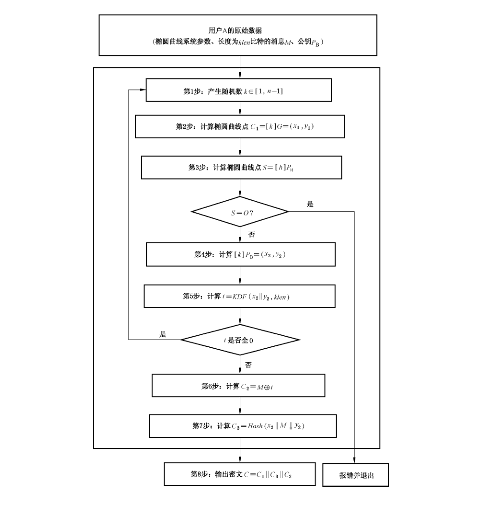
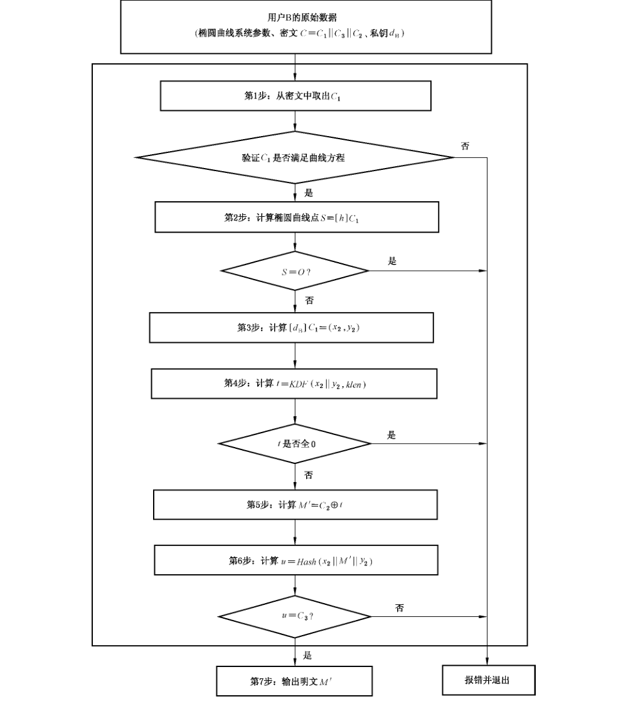

# GB/T 32918.4-2016 信息安全技术 SM2 椭圆曲线公钥密码算法 第 4 部分：公钥加密算法

> 来源：[GB/T 32918.4-2016 国家标准详情](https://openstd.samr.gov.cn/bzgk/std/newGbInfo?hcno=370AF152CB5CA4A377EB4D1B21DECAE0)；封面发布日期：2016-08-29；实施日期：2017-03-01。
> PDF SHA-256：04a2948dcaaea299170c4777e665ced86a0d998c0a6d23f32e5c8e25e353156d。
> 转写说明：对照官方 PDF 全部 16 页的页面图像校正文字、公式、图示及附录 A 测试向量；省略封面、目录、页眉、页脚和页码，合并跨页内容。正式引用请核对原 PDF。

## 前言

GB/T 32918《信息安全技术 SM2 椭圆曲线公钥密码算法》分为 5 个部分：

- 第 1 部分：总则；
- 第 2 部分：数字签名算法；
- 第 3 部分：密钥交换协议；
- 第 4 部分：公钥加密算法；
- 第 5 部分：参数定义。

本部分为 GB/T 32918 的第 4 部分。

本部分按照 GB/T 1.1—2009 给出的规则起草。

本部分由国家密码管理局提出。

本部分由全国信息安全标准化技术委员会（SAC/TC 260）归口。

本部分起草单位：北京华大信安科技有限公司、中国人民解放军信息工程大学、中国科学院数据与通信保护研究教育中心。

本部分主要起草人：陈建华、祝跃飞、叶顶峰、胡磊、裴定一、彭国华、张亚娟、张振峰。

## 引言

N. Koblitz 和 V. Miller 在 1985 年各自独立地提出将椭圆曲线应用于公钥密码系统。椭圆曲线公钥密码所基于的曲线性质如下：

- 有限域上椭圆曲线在点加运算下构成有限交换群，且其阶与基域规模相近；
- 类似于有限域乘法群中的乘幂运算，椭圆曲线多倍点运算构成一个单向函数。

在多倍点运算中，已知多倍点与基点，求解倍数的问题称为椭圆曲线离散对数问题。对于一般椭圆曲线的离散对数问题，目前只存在指数级计算复杂度的求解方法。与大数分解问题及有限域上离散对数问题相比，椭圆曲线离散对数问题的求解难度要大得多。因此，在相同安全程度要求下，椭圆曲线密码较其他公钥密码所需的密钥规模要小得多。

SM2 是国家密码管理局组织制定并提出的椭圆曲线密码算法标准。GB/T 32918 的主要目标如下：

- GB/T 32918.1 定义和描述了 SM2 椭圆曲线密码算法的相关概念及数学基础知识，并概述了该部分同其他部分的关系。
- GB/T 32918.2 描述了一种基于椭圆曲线的签名算法，即 SM2 签名算法。
- GB/T 32918.3 描述了一种基于椭圆曲线的密钥交换协议，即 SM2 密钥交换协议。
- GB/T 32918.4 描述了一种基于椭圆曲线的公钥加密算法，即 SM2 加密算法，该算法需使用 GB/T 32905—2016 定义的 SM3 密码杂凑算法。
- GB/T 32918.5 给出了 SM2 算法使用的椭圆曲线参数，以及使用椭圆曲线参数进行 SM2 运算的示例结果。

本部分为 GB/T 32918 的第 4 部分，规定了 SM2 椭圆曲线密码系统的加密解密过程。

## 1 范围

GB/T 32918 的本部分规定了 SM2 椭圆曲线公钥密码算法的公钥加密算法，并给出了消息加解密示例和相应的流程。

本部分适用于商用密码应用中的消息加解密，消息发送者可以利用接收者的公钥对消息进行加密，接收者用对应的私钥进行解密，获取消息。

## 2 规范性引用文件

下列文件对于本文件的应用是必不可少的。凡是注日期的引用文件，仅注日期的版本适用于本文件。凡是不注日期的引用文件，其最新版本（包括所有的修改单）适用于本文件。

- GB/T 32918.1—2016 信息安全技术 SM2 椭圆曲线公钥密码算法 第 1 部分：总则
- GB/T 32905—2016 信息安全技术 SM3 密码杂凑算法

## 3 术语和定义

下列术语和定义适用于本文件。

### 3.1 秘密密钥 secret key

在密码体制中收发双方共同拥有的、而第三方不知道的一种密钥。

### 3.2 消息 message

任意有限长度的比特串。

### 3.3 密钥派生函数 key derivation function

通过作用于共享秘密和双方都知道的其他参数，产生一个或多个共享秘密密钥的函数。

## 4 符号和缩略语

下列符号和缩略语适用于本文件。

- `A, B`：使用公钥密码系统的两个用户。
- `d_B`：用户 B 的私钥。
- `E(F_q)`：`F_q` 上椭圆曲线 `E` 的所有有理点（包括无穷远点 `O`）组成的集合。
- `F_q`：包含 `q` 个元素的有限域。
- `G`：椭圆曲线的一个基点，其阶为素数。
- `Hash( )`：密码杂凑算法。
- `H_v( )`：消息摘要长度为 `v` 比特的密码杂凑算法。
- `KDF( )`：密钥派生函数。
- `h`：余因子，`h = #E(F_q)/n`，其中 `n` 是基点 `G` 的阶。
- `M`：待加密的消息。
- `M′`：解密得到的消息。
- `n`：基点 `G` 的阶（`n` 是 `#E(F_q)` 的素因子）。
- `O`：椭圆曲线上的一个特殊点，称为无穷远点或零点，是椭圆曲线加法群的单位元。
- `P_B`：用户 B 的公钥。
- `q`：有限域 `F_q` 中元素的数目。
- `a, b`：`F_q` 中的元素，它们定义 `F_q` 上的一条椭圆曲线 `E`。
- `x ∥ y`：`x` 与 `y` 的拼接，`x`、`y` 是比特串或字节串。
- `[k]P`：椭圆曲线上点 `P` 的 `k` 倍点，即 `[k]P = P + P + ⋯ + P`（`k` 个 `P`），`k` 是正整数。
- `[x, y]`：大于或等于 `x` 且小于或等于 `y` 的整数的集合。
- `⌈x⌉`：顶函数，大于或等于 `x` 的最小整数。例如，`⌈7⌉ = 7`，`⌈8.3⌉ = 9`。
- `⌊x⌋`：底函数，小于或等于 `x` 的最大整数。例如，`⌊7⌋ = 7`，`⌊8.3⌋ = 8`。
- `#E(F_q)`：`E(F_q)` 上点的数目，称为椭圆曲线 `E(F_q)` 的阶。

## 5 算法参数与辅助函数

### 5.1 综述

公钥加密算法规定发送者用接收者的公钥将消息加密成密文，接收者用自己的私钥对收到的密文进行解密还原成原始消息。

### 5.2 椭圆曲线系统参数

椭圆曲线系统参数包括有限域 `F_q` 的规模 `q`（当 `q = 2^m` 时，还包括元素表示法的标识和约化多项式）；定义椭圆曲线 `E(F_q)` 的方程的两个元素 `a, b ∈ F_q`；`E(F_q)` 上的基点 `G = (x_G, y_G)`（`G ≠ O`），其中 `x_G` 和 `y_G` 是 `F_q` 中的两个元素；`G` 的阶 `n` 及其他可选项（如 `n` 的余因子 `h` 等）。

椭圆曲线系统参数及其验证应符合 GB/T 32918.1—2016 第 5 章的规定。

### 5.3 用户密钥对

用户 B 的密钥对包括其私钥 `d_B` 和公钥 `P_B = [d_B]G`。

用户密钥对的生成算法与公钥验证算法应符合 GB/T 32918.1—2016 第 6 章的规定。

### 5.4 辅助函数

#### 5.4.1 概述

本部分规定的椭圆曲线公钥加密算法涉及三类辅助函数：密码杂凑算法、密钥派生函数和随机数发生器。这三类辅助函数的强弱直接影响加密算法的安全性。

#### 5.4.2 密码杂凑算法

本部分规定使用国家密码管理局批准的密码杂凑算法，如 SM3 密码杂凑算法。

#### 5.4.3 密钥派生函数

密钥派生函数的作用是从一个共享的秘密比特串中派生出密钥数据。在密钥协商过程中，密钥派生函数作用在密钥交换所获共享的秘密比特串上，从中产生所需的会话密钥或进一步加密所需的密钥数据。

密钥派生函数需要调用密码杂凑算法。

设密码杂凑算法为 `H_v( )`，其输出是长度恰为 `v` 比特的杂凑值。

密钥派生函数 `KDF(Z, klen)`：

- 输入：比特串 `Z`，整数 `klen`〔表示要获得的密钥数据的比特长度，要求该值小于 `(2^32 - 1)v`〕。
- 输出：长度为 `klen` 的密钥数据比特串 `K`。

a) 初始化一个 32 比特构成的计数器 `ct = 0x00000001`；

b) 对 `i` 从 1 到 `⌈klen/v⌉` 执行：

1. 计算 `Ha_i = H_v(Z ∥ ct)`；
2. `ct++`；

c) 若 `klen/v` 是整数，令 `Ha'_{⌈klen/v⌉} = Ha_{⌈klen/v⌉}`，否则令 `Ha'_{⌈klen/v⌉}` 为 `Ha_{⌈klen/v⌉}` 最左边的 `klen - v × ⌊klen/v⌋` 比特；

d) 令 `K = Ha_1 ∥ Ha_2 ∥ ⋯ ∥ Ha_{⌈klen/v⌉ - 1} ∥ Ha'_{⌈klen/v⌉}`。

#### 5.4.4 随机数发生器

本部分规定使用国家密码管理局批准的随机数发生器。

## 6 加密算法及流程

### 6.1 加密算法

设需要发送的消息为比特串 `M`，`klen` 为 `M` 的比特长度。

为了对明文 `M` 进行加密，作为加密者的用户 A 应实现以下运算步骤：

- A₁：用随机数发生器产生随机数 `k ∈ [1, n - 1]`；
- A₂：计算椭圆曲线点 `C₁ = [k]G = (x₁, y₁)`，按 GB/T 32918.1—2016 中 4.2.9 和 4.2.5 给出的方法，将 `C₁` 的数据类型转换为比特串；
- A₃：计算椭圆曲线点 `S = [h]P_B`，若 `S` 是无穷远点，则报错并退出；
- A₄：计算椭圆曲线点 `[k]P_B = (x₂, y₂)`，按 GB/T 32918.1—2016 中 4.2.6 和 4.2.5 给出的方法，将坐标 `x₂`、`y₂` 的数据类型转换为比特串；
- A₅：计算 `t = KDF(x₂ ∥ y₂, klen)`，若 `t` 为全 0 比特串，则返回 A₁；
- A₆：计算 `C₂ = M ⊕ t`；
- A₇：计算 `C₃ = Hash(x₂ ∥ M ∥ y₂)`；
- A₈：输出密文 `C = C₁ ∥ C₃ ∥ C₂`。

> 注：加密过程的示例参见附录 A。

### 6.2 加密算法流程

加密算法流程见图 1。



## 7 解密算法及流程

### 7.1 解密算法

设 `klen` 为密文中 `C₂` 的比特长度。

为了对密文 `C = C₁ ∥ C₃ ∥ C₂` 进行解密，作为解密者的用户 B 应实现以下运算步骤：

- B₁：从 `C` 中取出比特串 `C₁`，按 GB/T 32918.1—2016 中 4.2.4 和 4.2.10 给出的方法，将 `C₁` 的数据类型转换为椭圆曲线上的点，验证 `C₁` 是否满足椭圆曲线方程，若不满足则报错并退出；
- B₂：计算椭圆曲线点 `S = [h]C₁`，若 `S` 是无穷远点，则报错并退出；
- B₃：计算 `[d_B]C₁ = (x₂, y₂)`，按 GB/T 32918.1—2016 中 4.2.6 和 4.2.5 给出的方法，将坐标 `x₂`、`y₂` 的数据类型转换为比特串；
- B₄：计算 `t = KDF(x₂ ∥ y₂, klen)`，若 `t` 为全 0 比特串，则报错并退出；
- B₅：从 `C` 中取出比特串 `C₂`，计算 `M′ = C₂ ⊕ t`；
- B₆：计算 `u = Hash(x₂ ∥ M′ ∥ y₂)`，从 `C` 中取出比特串 `C₃`，若 `u ≠ C₃`，则报错并退出；
- B₇：输出明文 `M′`。

> 注：解密过程的示例参见附录 A。

### 7.2 解密算法流程

解密算法流程见图 2。



## 附录 A（资料性附录）消息加解密示例

### A.1 综述

本附录选用 GB/T 32905—2016 给出的密码杂凑算法，其输入是长度小于 `2^64` 的消息比特串，输出是长度为 256 比特的杂凑值，记为 `H_256( )`。

本附录中，所有用 16 进制表示的数，左边为高位，右边为低位。

本附录中，明文采用 GB/T 1988 编码。

### A.2 `F_p` 上椭圆曲线消息加解密

椭圆曲线方程为：`y² = x³ + ax + b`。

**示例 1：`F_p-192`**

- 素数 `p`：`BDB6F4FE 3E8B1D9E 0DA8C0D4 6F4C318C EFE4AFE3 B6B8551F`
- 系数 `a`：`BB8E5E8F BC115E13 9FE6A814 FE48AAA6 F0ADA1AA 5DF91985`
- 系数 `b`：`1854BEBD C31B21B7 AEFC80AB 0ECD10D5 B1B3308E 6DBF11C1`
- 基点 `G = (x_G, y_G)`，其阶记为 `n`。
- 坐标 `x_G`：`4AD5F704 8DE709AD 51236DE6 5E4D4B48 2C836DC6 E4106640`
- 坐标 `y_G`：`02BB3A02 D4AAADAC AE24817A 4CA3A1B0 14B52704 32DB27D2`
- 阶 `n`：`BDB6F4FE 3E8B1D9E 0DA8C0D4 0FC96219 5DFAE76F 56564677`
- 待加密的消息 `M`：`encryption standard`
- 消息 `M` 的 16 进制表示：`656E63 72797074 696F6E20 7374616E 64617264`
- 私钥 `d_B`：`58892B80 7074F53F BF67288A 1DFAA1AC 313455FE 60355AFD`
- 公钥 `P_B = (x_B, y_B)`：
  - `x_B`：`79F0A954 7AC6D100 531508B3 0D30A565 36BCFC81 49F4AF4A`
  - `y_B`：`AE38F2D8 890838DF 9C19935A 65A8BCC8 994BC792 4672F912`

加密各步骤中的有关值：

- 产生随机数 `k`：`384F3035 3073AEEC E7A16543 30A96204 D37982A3 E15B2CB5`
- 计算椭圆曲线点 `C₁ = [k]G = (x₁, y₁)`：
  - `x₁`：`23FC680B 124294DF DF34DBE7 6E0C38D8 83DE4D41 FA0D4CF5`
  - `y₁`：`70CF14F2 0DAF0C4D 777F738D 16B16824 D31EEFB9 DE31EE1F`
- 在此 `C₁` 选用未压缩的表示形式，点转换成字节串的形式为 `PC ∥ x₁ ∥ y₁`，其中 `PC` 为单一字节且 `PC = 04`，仍记为 `C₁`。
- 计算椭圆曲线点 `[k]P_B = (x₂, y₂)`：
  - `x₂`：`57E7B636 23FAE5F0 8CDA468E 872A20AF A03DED41 BF140377`
  - `y₂`：`0E040DC8 3AF31A67 991F2B01 EBF9EFD8 881F0A04 93000603`
- 消息 `M` 的比特长度 `klen = 152`。
- `t = KDF(x₂ ∥ y₂, klen)`：`046B04 A9ADF53B 389B9E2A AFB47D90 F4D08978`
- `C₂ = M ⊕ t`：`610567 DBD4854F 51F4F00A DCC01CFE 90B1FB1C`
- `C₃ = Hash(x₂ ∥ M ∥ y₂)`：`6AFB3BCE BD76F82B 252CE5EB 25B57996 86902B8C F2FD8753 6E55EF76 03B09E7C`
- 输出密文 `C = C₁ ∥ C₃ ∥ C₂`：

```text
04 23FC680B 124294DF DF34DBE7 6E0C38D8 83DE4D41 FA0D4CF5
   70CF14F2 0DAF0C4D 777F738D 16B16824 D31EEFB9 DE31EE1F
   6AFB3BCE BD76F82B 252CE5EB 25B57996 86902B8C F2FD8753 6E55EF76 03B09E7C
   610567 DBD4854F 51F4F00A DCC01CFE 90B1FB1C
```

解密各步骤中的有关值：

- 计算椭圆曲线点 `[d_B]C₁ = (x₂, y₂)`：
  - `x₂`：`57E7B636 23FAE5F0 8CDA468E 872A20AF A03DED41 BF140377`
  - `y₂`：`0E040DC8 3AF31A67 991F2B01 EBF9EFD8 881F0A04 93000603`
- `t = KDF(x₂ ∥ y₂, klen)`：`046B04 A9ADF53B 389B9E2A AFB47D90 F4D08978`
- `M′ = C₂ ⊕ t`：`656E63 72797074 696F6E20 7374616E 64617264`
- `u = Hash(x₂ ∥ M′ ∥ y₂)`：`6AFB3BCE BD76F82B 252CE5EB 25B57996 86902B8C F2FD8753 6E55EF76 03B09E7C`
- 明文 `M′`：`656E63 72797074 696F6E20 7374616E 64617264`，即为 `encryption standard`。

**示例 2：`F_p-256`**

- 素数 `p`：`8542D69E 4C044F18 E8B92435 BF6FF7DE 45728391 5C45517D 722EDB8B 08F1DFC3`
- 系数 `a`：`787968B4 FA32C3FD 2417842E 73BBFEFF 2F3C848B 6831D7E0 EC65228B 3937E498`
- 系数 `b`：`63E4C6D3 B23B0C84 9CF84241 484BFE48 F61D59A5 B16BA06E 6E12D1DA 27C5249A`
- 基点 `G = (x_G, y_G)`，其阶记为 `n`。
- 坐标 `x_G`：`421DEBD6 1B62EAB6 746434EB C3CC315E 32220B3B ADD50BDC 4C4E6C14 7FEDD43D`
- 坐标 `y_G`：`0680512B CBB42C07 D47349D2 153B70C4 E5D7FDFC BFA36EA1 A85841B9 E46E09A2`
- 阶 `n`：`8542D69E 4C044F18 E8B92435 BF6FF7DD 29772063 0485628D 5AE74EE7 C32E79B7`
- 待加密的消息 `M`：`encryption standard`
- 消息 `M` 的 16 进制表示：`656E63 72797074 696F6E20 7374616E 64617264`
- 私钥 `d_B`：`1649AB77 A00637BD 5E2EFE28 3FBF3535 34AA7FTC B89463F2 08DDBC29 20BB0DA0`
- 公钥 `P_B = (x_B, y_B)`：
  - `x_B`：`435B39CC A8F3B508 C1488AFC 67BE491A 0F7BA07E 581A0E48 49A5CF70 628A7E0A`
  - `y_B`：`75DDBA78 F15FEECB 4C7895E2 C1CDF5FE 01DEBB2C DBADF453 99CCF77B BA076A42`

加密各步骤中的有关值：

- 产生随机数 `k`：`4C62EEFD 6ECFC2B9 5B92FD6C 3D957514 8AFA1742 5546D490 18E5388D 49DD7B4F`
- 计算椭圆曲线点 `C₁ = [k]G = (x₁, y₁)`：
  - `x₁`：`245C26FB 68B1DDDD B12C4B6B F9F2B6D5 FE60A383 B0D18D1C 4144ABF1 7F6252E7`
  - `y₁`：`76CB9264 C2A7E88E 52B19903 FDC47378 F605E368 11F5C074 23A24B84 400F01B8`
- 在此 `C₁` 选用未压缩的表示形式，点转换成字节串的形式为 `PC ∥ x₁ ∥ y₁`，其中 `PC` 为单一字节且 `PC = 04`，仍记为 `C₁`。
- 计算椭圆曲线点 `[k]P_B = (x₂, y₂)`：
  - `x₂`：`64D20D27 D0632957 F8028C1E 024F6B02 EDF23102 A566C932 AE8BD613 A8E865FE`
  - `y₂`：`58D225EC A784AE30 0A81A2D4 8281A828 E1CEDF11 C4219099 84026537 5077BF78`
- 消息 `M` 的比特长度 `klen = 152`。
- `t = KDF(x₂ ∥ y₂, klen)`：`006E30 DAE231B0 71DFAD8A A379E902 64491603`
- `C₂ = M ⊕ t`：`650053 A89B41C4 18B0C3AA D00D886C 00286467`
- `C₃ = Hash(x₂ ∥ M ∥ y₂)`：`9C3D7360 C30156FA B7C80A02 76712DA9 D8094A63 4B766D3A 285E0748 0653426D`
- 输出密文 `C = C₁ ∥ C₃ ∥ C₂`：

```text
04 245C26FB 68B1DDDD B12C4B6B F9F2B6D5 FE60A383 B0D18D1C 4144ABF1 7F6252E7
   76CB9264 C2A7E88E 52B19903 FDC47378 F605E368 11F5C074 23A24B84 400F01B8
   9C3D7360 C30156FA B7C80A02 76712DA9 D8094A63 4B766D3A 285E0748 0653426D
   650053 A89B41C4 18B0C3AA D00D886C 00286467
```

解密各步骤中的有关值：

- 计算椭圆曲线点 `[d_B]C₁ = (x₂, y₂)`：
  - `x₂`：`64D20D27 D0632957 F8028C1E 024F6B02 EDF23102 A566C932 AE8BD613 A8E865FE`
  - `y₂`：`58D225EC A784AE30 0A81A2D4 8281A828 E1CEDF11 C4219099 84026537 5077BF78`
- `t = KDF(x₂ ∥ y₂, klen)`：`006E30 DAE231B0 71DFAD8A A379E902 64491603`
- `M′ = C₂ ⊕ t`：`656E63 72797074 696F6E20 7374616E 64617264`
- `u = Hash(x₂ ∥ M′ ∥ y₂)`：`9C3D7360 C30156FA B7C80A02 76712DA9 D8094A63 4B766D3A 285E0748 0653426D`
- 明文 `M′`：`656E63 72797074 696F6E20 7374616E 64617264`，即为 `encryption standard`。

### A.3 `F_{2^m}` 上椭圆曲线消息加解密

椭圆曲线方程为：`y² + xy = x³ + ax² + b`。

**示例 3：`F_{2^m}-193`**

- 基域生成多项式为：`x^193 + x^15 + 1`
- 系数 `a`：`0`
- 系数 `b`：`00 2FE22037 B624DBEB C4C618E1 3FD998B1 A18E1EE0 D05C46FB`
- 基点 `G = (x_G, y_G)`，其阶记为 `n`。
- 坐标 `x_G`：`D78D47E8 5C936440 71BC1C21 2CF994E4 D21293AA D8060A84`
- 坐标 `y_G`：`615B9E98 A31B7B2F DDEEECB7 6B5D8755 86293725 F9D2FC0C`
- 阶 `n`：`80000000 00000000 00000000 43E9885C 46BF45D8 C5EBF3A1`
- 待加密的消息 `M`：`encryption standard`
- 消息 `M` 的 16 进制表示：`656E63 72797074 696F6E20 7374616E 64617264`
- 私钥 `d_B`：`6C205C15 89087376 C2FE5FEE E153D4AC 875D643E B8CAF6C5`
- 公钥 `P_B = (x_B, y_B)`：
  - `x_B`：`00 E788F191 C5591636 FA992CE6 7CDC8D3B 16E4F4D4 6AF267B8`
  - `y_B`：`00 BD6E7E5E 4113D790 20ED5A10 287C14B7 A6767C4D 814ADBFD`

加密各步骤中的有关值：

- 产生随机数 `k`：`6E51C537 3D5B4705 DC9B94FA 9BCF30A7 37ED8D69 1E76D9F0`
- 计算椭圆曲线点 `C₁ = [k]G = (x₁, y₁)`：
  - `x₁`：`00 95A8B866 7ACF097F 65CE96EB FE53422F CF15876D 16446B8A`
  - `y₁`：`01 7A1EC7C9 BAB0DE07 0522311E 75CD31C3 C4D74150 E84E0A95`
- 在此 `C₁` 选用未压缩的表示形式，点转换成字节串的形式为 `PC ∥ x₁ ∥ y₁`，其中 `PC` 为单一字节且 `PC = 04`，仍记为 `C₁`。
- 计算椭圆曲线点 `[k]P_B = (x₂, y₂)`：
  - `x₂`：`01 C6271B31 F6BE396A 4166C061 6CF4A8AC DA5BEF4D CBF2DD42`
  - `y₂`：`01 47AF35DF A1BFE2F1 61521BCF 59BAB835 64868D92 95881735`
- 消息 `M` 的比特长度 `klen = 152`。
- `t = KDF(x₂ ∥ y₂, klen)`：`BC5F0D 50F2B2BC F2DC3027 0BAA5249 3B8A67A4`
- `C₂ = M ⊕ t`：`D9316E 228BC2C8 9BB35E07 78DE3327 5FEB15C0`
- `C₃ = Hash(x₂ ∥ M ∥ y₂)`：`F0A41F6F 48AC723C ECFC4B76 7299A5E2 5C064167 9FBD2D4D 20E9FFD5 B9F0DAB8`
- 输出密文 `C = C₁ ∥ C₃ ∥ C₂`：

```text
04 0095A8B8 667ACF09 7F65CE96 EBFE5342 2FCF1587 6D16446B 8A
   017A1EC7 C9BAB0DE 07052231 1E75CD31 C3C4D741 50E84E0A 95
   F0A41F6F 48AC723C ECFC4B76 7299A5E2 5C064167 9FBD2D4D 20E9FFD5 B9F0DAB8
   D9316E 228BC2C8 9BB35E07 78DE3327 5FEB15C0
```

解密各步骤中的有关值：

- 计算椭圆曲线点 `[d_B]C₁ = (x₂, y₂)`：
  - `x₂`：`01 C6271B31 F6BE396A 4166C061 6CF4A8AC DA5BEF4D CBF2DD42`
  - `y₂`：`01 47AF35DF A1BFE2F1 61521BCF 59BAB835 64868D92 95881735`
- `t = KDF(x₂ ∥ y₂, klen)`：`BC5F0D 50F2B2BC F2DC3027 0BAA5249 3B8A67A4`
- `M′ = C₂ ⊕ t`：`656E63 72797074 696F6E20 7374616E 64617264`
- `u = Hash(x₂ ∥ M′ ∥ y₂)`：`F0A41F6F 48AC723C ECFC4B76 7299A5E2 5C064167 9FBD2D4D 20E9FFD5 B9F0DAB8`
- 明文 `M′`：`656E63 72797074 696F6E20 7374616E 64617264`，即为 `encryption standard`。

**示例 4：`F_{2^m}-257`**

- 基域生成多项式为：`x^257 + x^12 + 1`
- 系数 `a`：`0`
- 系数 `b`：`00 E78BCD09 746C2023 78A7E72B 12BCE002 66B9627E CB0B5A25 367AD1AD 4CC6242B`
- 基点 `G = (x_G, y_G)`，其阶记为 `n`。
- 坐标 `x_G`：`00 CDB9CA7F 1E6B0441 F658343F 4B10297C 0EF9B649 1082400A 62E7A748 5735FADD`
- 坐标 `y_G`：`01 3DE74DA6 5951C4D7 6DC89220 D5F7777A 611B1C38 BAE260B1 75951DC8 060C2B3E`
- 阶 `n`：`7FFFFFFF FFFFFFFF FFFFFFFF FFFFFFFF BC972CF7 E6B6F900 945B3C6A 0CF6161D`
- 待加密的消息 `M`：`encryption standard`
- 消息 `M` 的 16 进制表示：`656E63 72797074 696F6E20 7374616E 64617264`
- 私钥 `d_B`：`56A270D1 7377AA9A 367CFA82 E46FA526 7713A9B9 1101D077 7B07FCE0 18C757EB`
- 公钥 `P_B = (x_B, y_B)`：
  - `x_B`：`00 A67941E6 DE8A6180 5F7BCFF0 985BB3BE D986F1C2 97E4D888 0D82B821 C624EE57`
  - `y_B`：`01 93ED5A67 07B59087 81B86084 1085F52E EFA7FE32 9A5C8118 43533A87 4D027271`

加密各步骤中的有关值：

- 产生随机数 `k`：`6D3B4971 53E3E925 24E5C122 682DBDC8 705062E2 0B917A5F 8FCDB8EE 4C66663D`
- 计算椭圆曲线点 `C₁ = [k]G = (x₁, y₁)`：
  - `x₁`：`01 9D236DDB 305009AD 52C51BB9 32709BD5 34D476FB B7B0DF95 42A8A4D8 90A3F2E1`
  - `y₁`：`00 B23B938D C0A94D1D F8F42CF4 5D2D6601 BF638C3D 7DE75A29 F02AFB7E 45E91771`
- 在此 `C₁` 选用未压缩的表示形式，点转换成字节串的形式为 `PC ∥ x₁ ∥ y₁`，其中 `PC` 为单一字节且 `PC = 04`，仍记为 `C₁`。
- 计算椭圆曲线点 `[k]P_B = (x₂, y₂)`：
  - `x₂`：`00 83E628CF 701EE314 1E8873FE 55936ADF 24963F5D C9C64805 66C80F8A 1D8CC51B`
  - `y₂`：`01 524C647F 0C0412DE FD468BDA 3AE0E5A8 0FCC8F5C 990FEE11 60292923 2DCD9F36`
- 消息 `M` 的比特长度 `klen = 152`。
- `t = KDF(x₂ ∥ y₂, klen)`：`983BCF 106AB2DC C92F8AEA C6C60BF2 98BB0117`
- `C₂ = M ⊕ t`：`FD55AC 6213C2A8 A040E4CA B5B26A9C FCDA7373`
- `C₃ = Hash(x₂ ∥ M ∥ y₂)`：`73A48625 D3758FA3 7B3EAB80 E9CFCABA 665E3199 EA15A1FA 8189D96F 579125E4`
- 输出密文 `C = C₁ ∥ C₃ ∥ C₂`：

```text
04 019D236D DB305009 AD52C51B B932709B D534D476 FBB7B0DF 9542A8A4 D890A3F2 E1
   00B23B93 8DC0A94D 1DF8F42C F45D2D66 01BF638C 3D7DE75A 29F02AFB 7E45E917 71
   73A48625 D3758FA3 7B3EAB80 E9CFCABA 665E3199 EA15A1FA 8189D96F 579125E4
   FD55AC 6213C2A8 A040E4CA B5B26A9C FCDA7373
```

解密各步骤中的有关值：

- 计算椭圆曲线点 `[d_B]C₁ = (x₂, y₂)`：
  - `x₂`：`00 83E628CF 701EE314 1E8873FE 55936ADF 24963F5D C9C64805 66C80F8A 1D8CC51B`
  - `y₂`：`01 524C647F 0C0412DE FD468BDA 3AE0E5A8 0FCC8F5C 990FEE11 60292923 2DCD9F36`
- `t = KDF(x₂ ∥ y₂, klen)`：`983BCF 106AB2DC C92F8AEA C6C60BF2 98BB0117`
- `M′ = C₂ ⊕ t`：`656E63 72797074 696F6E20 7374616E 64617264`
- `u = Hash(x₂ ∥ M′ ∥ y₂)`：`73A48625 D3758FA3 7B3EAB80 E9CFCABA 665E3199 EA15A1FA 8189D96F 579125E4`
- 明文 `M′`：`656E63 72797074 696F6E20 7374616E 64617264`，即为 `encryption standard`。

## 参考文献

[1] GB/T 1988—1998 信息技术 信息交换用七位编码字符集
