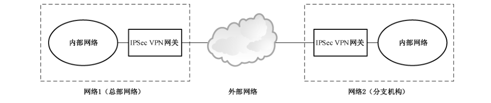
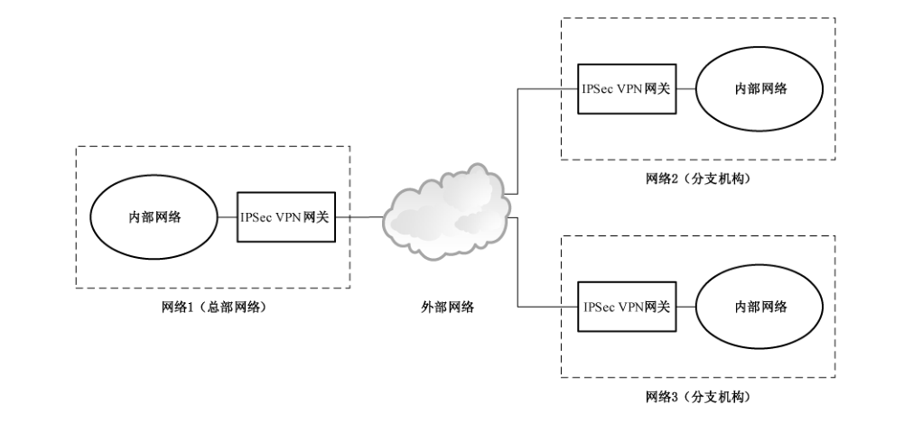
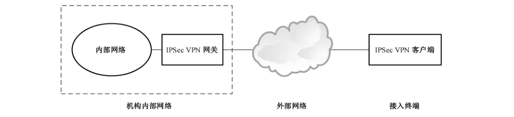
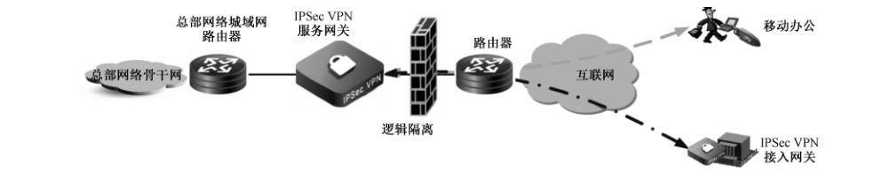
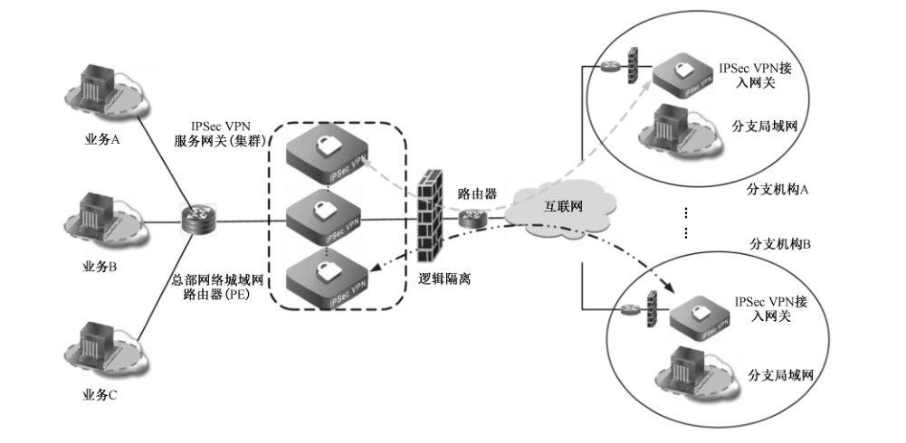
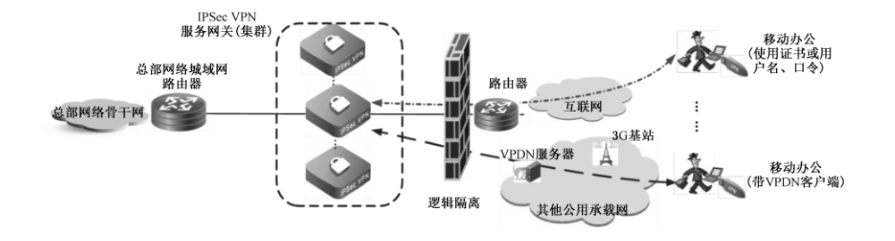
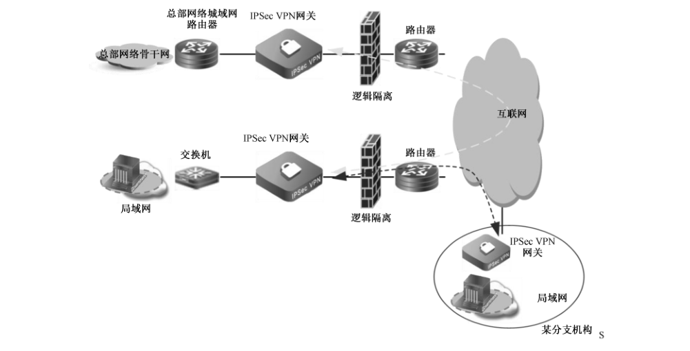
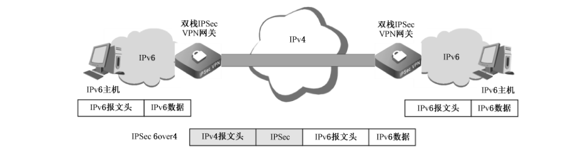

# GB/T 32922-2023 信息安全技术 IPSec VPN安全接入基本要求与实施指南

> 来源：[GB/T 32922-2023 国家标准详情](https://openstd.samr.gov.cn/bzgk/std/newGbInfo?hcno=4ADDF54B813937DFF8AD734BE21D0A57)；发布日期：2023-03-17；实施日期：2023-10-01。
> PDF SHA-256：f299952ea0c0086c767ec82ced4452ac649d122bfa89ca86a9049639e38f76bc。
> 转写说明：依据官方 PDF 页面图像逐页核对，省略封面、目录、页眉、页脚和页码，合并跨页内容；图示按原图保留。正式引用请核对原 PDF。

## 前言

本文件按照 GB/T 1.1—2020《标准化工作导则 第1部分：标准化文件的结构和起草规则》的规定起草。

本文件代替 GB/T 32922—2016《信息安全技术 IPSec VPN 安全接入基本要求与实施指南》，与 GB/T 32922—2016 相比，除结构调整和编辑性改动外，主要技术变化如下：

- 增加了 IPSec VPN 安全接入点到多点场景（见 5.1.2）；
- 更改了 IPSec VPN 安全接入场景的示意图（见第 5 章，2016 年版的第 5 章）；
- 更改了 IPSec VPN 网关密码算法的使用要求（见 6.1.1，2016 年版的 6.1.1）；
- 更改了 IPSec VPN 网关 VPN 功能要求的描述（见 6.1.2，2016 年版的 6.1.2）；
- 更改了 IPSec VPN 网关可靠性功能要求的描述（见 6.1.2，2016 年版的 6.1.2）；
- 增加了 IPSec VPN 网关在分支多出口场景支持动态选路功能的描述（见 6.1.2）；
- 更改了 IPSec VPN 网关互通兼容性功能要求的描述（见 6.1.2，2016 年版的 6.1.2）；
- 更改了 IPSec VPN 网关 IPv6 兼容性功能要求的描述（见 6.1.2，2016 年版的 6.1.2）；
- 增加了 IPSec VPN 网关易用性功能要求的描述（见 6.1.2）；
- 更改了 IPSec VPN 网关证书认证功能要求的描述（见 6.1.2，2016 年版的 6.1.2）；
- 更改了 IPSec VPN 网关产品的性能要求（见 6.1.3，2016 年版的 6.1.3）；
- 更改了 IPSec VPN 客户端技术要求，合并软硬件要求子章节（见 6.2，2016 年版的 6.2）；
- 更改了 IPSec VPN 网关和客户端功能要求中 IPSec 安全协议类型的要求（见 6.1.2 和 6.2，2016 年版的 6.1.2 和 6.2）；
- 更改了 IPSec VPN 网关及客户端设备管理要求（见 6.3.1，2016 年版的 6.3.1）；
- 更改了 IPSec VPN 网关和客户端证书管理要求的描述（见 6.3.2，2016 年版的 6.3.2）；
- 增加了“密码要求”（见 6.4）；
- 更改了实施指南相关描述（见第 7 章，2016 年版的第 7 章）；
- 更改了典型应用场景的描述（见附录 A，2016 年版的附录 A）；
- 增加了“常见的 IPSec VPN 功能”附录（见附录 B），并调整原附录 B 为附录 C；
- 删除了传输模式 IPSec 6over4 隧道场景（见 2016 年版的附录 C.2）。

请注意本文件的某些内容可能涉及专利。本文件的发布机构不承担识别专利的责任。

本文件由全国信息安全标准化技术委员会（SAC/TC 260）提出并归口。

本文件起草单位：国家信息中心、华为技术有限公司、奇安信网神信息技术（北京）股份有限公司、北京天融信网络安全技术有限公司、深信服科技股份有限公司、成都卫士通信息产业股份有限公司、深圳奥联信息安全技术有限公司、深圳市数元信安科技有限公司、中国科学院信息工程研究所、公安部第一研究所、新华三技术有限公司、西安交大捷普网络科技有限公司、鼎铉商用密码测评技术（深圳）有限公司、中国电力科学研究院有限公司。

本文件主要起草人：徐春学、焦迪、罗海宁、潘伟、王伟、曹金、李金国、万志宇、程子栋、王鹏彪、赵国全、罗俊、但波、翟鹏、任飞、田之泮、何建锋、万晓兰、姜敏、邹超、刘松、李海涛。

本文件及其所代替文件的历次版本发布情况为：

- 2016 年首次发布为 GB/T 32922—2016；
- 本次为第一次修订。

## 1 范围

本文件规定了 IPSec VPN 安全接入应用过程中网关、客户端、安全管理以及密码应用等方面的基本要求，提供了采用 IPSec VPN 技术实现安全接入的典型场景和实施过程指南。

本文件适用于采用 IPSec VPN 技术开展安全接入应用的机构，指导其基于 IPSec VPN 技术开展安全接入平台或系统的需求分析、方案设计、方案验证、配置实施、运行管理。

## 2 规范性引用文件

下列文件中的内容通过文中的规范性引用而构成本文件必不可少的条款。其中，注日期的引用文件，仅该日期对应的版本适用于本文件；不注日期的引用文件，其最新版本（包括所有的修改单）适用于本文件。

- GB/T 15843（所有部分）信息技术 安全技术 实体鉴别

- GB/T 19713 信息技术 安全技术 公钥基础设施 在线证书状态协议

- GB/T 20518 信息安全技术 公钥基础设施 数字证书格式

- GB/T 25069 信息安全技术 术语

- GB/T 32915 信息安全技术 二元序列随机性检测方法

- GB/T 36968 信息安全技术 IPSec VPN技术规范

- GB/T 37092 信息安全技术 密码模块安全要求

- GB/T 38636 信息安全技术 传输层密码协议（TLCP）

- GM/T 0023 IPSec VPN 网关产品规范
- GM/T 0050 密码设备管理 设备管理技术规范
- GM/T 0062 密码产品随机数检测要求
- GM/T 0089 简单证书注册协议规范

## 3 术语和定义

GB/T 25069、GB/T 36968 界定的以及下列术语和定义适用于本文件。

### 3.1 IPSec 协议 Internet Protocol Security

一种开放标准的框架结构，通过使用加密的安全服务以确保在公开网络上进行保密而安全的通信，可在端至端的层面上提供数据完整性保护、数据源鉴别、载荷机密性和抗重放攻击等安全服务。

［来源：GB/T 36968—2018,3.4，有修改］

### 3.2 虚拟专用网 virtual private network

使用密码技术在通信网络中构建安全通道的技术。

［来源：GB/T 36968—2018,3.7］

### 3.3 封装安全载荷 encapsulating security payload

IPSec 的一种协议，用于提供 IP 数据包的机密性、数据完整性以及对数据源鉴别以及抗重放攻击的功能。

［来源：GB/T 36968—2018,3.6］

### 3.4 安全联盟 security association

两个通信实体经协商建立起来的一种协定，它描述了实体如何利用安全服务来进行安全的通信。

［来源：GB/T 36968—2018,3.1］

### 3.5 密码模块 cryptographic module

实现了安全功能的硬件、软件和/或固件的集合，并且被包含在密码边界内。

［来源：GB/T 37092—2018,3.5］

## 4 缩略语

下列缩略语适用于本文件。

| 缩略语 | 含义 |
| --- | --- |
| CPU | 中央处理单元（Central Processing Unit） |
| CRL | 证书撤销列表（Certificate Revocation List） |
| DHCP | 动态主机配置协议（Dynamic Host Configuration Protocol） |
| DN | 可识别名（Distinguished Name） |
| DPD | 失效对端检测（Dead Peer Detection） |
| ESP | 封装安全载荷（Encapsulating Security Payload） |
| GRE | 通用路由封装协议（Generic Routing Encapsulation） |
| IP | 互联网通信协议（Internet Protocol） |
| IPSec | IP 安全协议（Internet Protocol Security） |
| IPv4 | 互联网通信协议第四版（Internet Protocol version 4） |
| IPv6 | 互联网通信协议第六版（Internet Protocol version 6） |
| L2TP | 二层隧道协议（Layer 2 Tunneling Protocol） |
| LDAP | 轻量级目录访问协议（Light Directory Access Protocol） |
| MPLS | 多协议标签交换（Multiprotocol Label Switching） |
| NAT | 网络地址转换（Network Address Translation） |
| NAT64 | IPv6 到 IPv4 的网络地址转换（Network Address Translation from IPv6 to IPv4） |
| OCSP | 在线证书状态协议（Online Certificate Status Protocol） |
| SA | 安全联盟（Security Association） |
| SCEP | 简单证书注册协议（Simple Certificate Enrollment Protocol） |
| Syslog | 系统日志（System Log） |
| TCP | 传输控制协议（Transmission Control Protocol） |
| TLCP | 传输层密码协议（Transport Layer Cryptography Protocol） |
| VPDN | 虚拟专用拨号网（Virtual Private Dial-up Networks） |
| VPN | 虚拟专用网（Virtual Private Network） |

## 5 IPSec VPN安全接入场景

### 5.1 网关到网关的安全接入场景

#### 5.1.1 点到点

IPSec VPN 网关到网关的点到点安全接入场景见图 1，该场景适用于分支机构安全接入到总部网络。典型应用案例见附录 A。

图1中网络1和网络2分别部署 IPSec VPN 网关，通过IPSec VPN 网关建立网络之间的安全传输通道。

外部网络包括互联网网络、运营商提供的无线接入网络或专线网络等。

#### 5.1.2 点到多点

IPSec VPN 网关到网关的点到多点安全接入场景见图2，该场景适用于多个分支机构安全接入到总部网络。典型应用案例见附录 A。

图2中网络1、网络2和网络3分别部署 IPSec VPN 网关，通过IPSec VPN 网关建立网络之间的安全传输通道。

外部网络包括互联网网络、运营商提供的无线接入网络或专线网络等。

### 5.2 终端到网关的安全接入场景

终端到 IPSec VPN 网关的安全接入场景见图 3，该场景适用于移动办公用户或者公众用户安全接入到机构内部网络。典型应用案例见附录 A。

图 3 中机构内部网络部署 IPSec VPN 网关，接入终端通过 IPSec VPN 客户端和 IPSec VPN 网关建立安全传输通道。IPSec VPN 客户端包含在接入终端上部署的连接网关的软件以及密码模块，接入终端可是计算机，也可是智能手机、平板电脑等移动智能终端设备，密码模块可是智能密码钥匙等产品。

外部网络包括互联网网络、运营商提供的无线网络等。

## 6 IPSec VPN 安全接入基本要求

### 6.1 IPSec VPN 网关技术要求

#### 6.1.1 产品要求

IPSec VPN 网关产品选择的基本要求如下：

a） 符合 GB/T 36968、GM/T 0023 的相关规定；

b） 支持使用 SM4分组密码算法、SM2椭圆曲线公钥密码算法、SM3密码杂凑算法；

c） 支持隧道模式；

d） 具备 NAT 穿越功能，能双向穿透 NAT设备。

#### 6.1.2 功能要求

IPSec VPN 网关功能要求如下。

a） VPN功能：

1） 宜支持 IPSec 承载的 GRE（GRE over IPSec），见附录 B；

2） 可支持 IPSec 承载的 L2TP（L2TP over IPSec）、GRE 承载的 IPSec（IPSec over GRE），见附录 B。

b） 可靠性功能：

1） 具备 DPD功能，在检测到对等体异常时可重新发起协商；

2） 具备基于链路质量动态选路的功能，在分支机构或总部网络有多个外部网络出口时能基于链路质量动态选择最优的 IPSec VPN 隧道进行传输；

3） 宜具备热备功能，当支持热备功能时应具备IPSec VPN 配置同步、安全联盟（SA）同步等功能。

c） 互通兼容性功能：应具备符合GB/T 36968 相关规定的网关对接过程，选择一致的协商属性，包括加密算法、密码杂凑算法、身份鉴别方式、NAT 穿越、封装模式等。

d） IPv6 兼容性功能：应支持 IPv6 基本协议，可支持IPv4/IPv6 双栈、隧道、NAT64、双栈精简技术等IPv6 过渡技术。IPv6 过渡技术见附录C。

e） 易用性功能：应具备与地址动态变化的 IPSec VPN 网关建立 IPSec VPN 隧道的功能。

f） 证书认证功能：

1） 具备在线或离线验证证书有效性的功能，在线验证方式可采用 LDAP、OCSP 等，离线验证方式可采用CRL 查询等，使用 OCSP 方式时应符合 GB/T 19713 的相关规定；

2） 具备符合 GM/T 0089 相关规定的 SCEP 证书更新管理功能；

3） 可具备对认证用户分组授权的功能。

g） 运维管理功能：

1） 具备对 VPN隧道状态、在线用户状态、CPU 利用率、内存利用率等关键运行指标的监测和管理功能；

2） 具备 Syslog 等格式的日志输出功能，并提供采集与配置管理接口；

3） 宜具备被集中管理平台集中配置管理的功能。

#### 6.1.3 性能要求

根据 IPSec VPN 网关的性能不同，分成 A 类（12 万隧道数）、B 类（6 万隧道数）、C 类（15000 隧道数）、D 类（7000 隧道数）、E 类（4000 隧道数）和 F 类（500 隧道数）六类网关，以适配不同的应用场景。

各类网关的性能要求应满足表1的规定。

**表1 IPSec VPN 网关性能要求**

| 性能指标 | A 类 | B 类 | C 类 | D 类 | E 类 | F 类 |
| --- | ---: | ---: | ---: | ---: | ---: | ---: |
| 加解密吞吐率a/Gb/s | 100 | 50 | 20 | 10 | 1 | 0.1 |
| 加解密时延b/ms | ＜1 | ＜1 | ＜1 | ＜1 | ＜20 | ＜100 |
| 每秒新建隧道数c | 500 | 300 | 150 | 80 | 30 | 10 |
| 最大并发隧道数d | 120 000 | 60 000 | 15 000 | 7 000 | 4 000 | 500 |
| 单隧道最大并发连接数e | 10 000 000 | 2 000 000 | 500 000 | 200 000 | 50 000 | 10 000 |

a：在 1 428 字节（IPv6 是 1 408 字节）以太帧长时，IPSec VPN 网关在丢包率为 0 的条件下内网口上达到的双向数据最大流量。

b：在 1 428 字节（IPv6 是 1 408 字节）以太帧长时，IPSec VPN 网关在丢包率为 0 的条件下，一个明文数据流经加密变为密文，再由密文解密还原为明文所消耗的平均时间。

c：IPSec VPN 网关在一秒钟的时间单位内能建立 IPSec VPN 隧道数目的最大值。

d：IPSec VPN 网关支持同时并存的 IPSec VPN 隧道数目的最大值。

e：IPSec VPN 网关单条 IPSec VPN 隧道最大能并发建立的 TCP 连接数目。

### 6.2 IPSec VPN 客户端技术要求

IPSec VPN 客户端技术要求如下。

a） 支持符合GB/T 36968相关规定的密钥交换协议和安全报文协议。

b）具备从智能密码钥匙、电子文件证书等获取证书并利用证书连接 IPSec VPN 网关的功能。

c） 支持 IPv4、IPv6 网络协议。

d） 具备 IPSec VPN 穿越 NAT功能。

e） 具备IPSec VPN隧道分离功能，允许用户使用相同或不同的网络连接同时接入到不同的安全域中，例如公共网络（互联网）、VPN、局域网、广域网等。

f） 客户端接入 IPSec VPN 网关时：

1） 支持封装安全载荷（ESP）协议；

2） 可具备对 IPSec VPN 接入用户的身份鉴别功能；

3） 可具备采用 DHCP over IPSec 协议获取IP地址的功能。

g） 使用符合 GB/T37092 规定的密码模块实现密码运算和密钥管理。

### 6.3 安全管理要求

#### 6.3.1 设备管理要求

IPSec VPN 网关及客户端设备管理要求如下：

a） 账户管理：

1） 具备默认账户管理功能，允许删除或重命名默认账户，允许修改默认账户的默认口令；

2） 具备及时删除或停用多余及过期账户的功能；

3） 具备账户权限管理功能，允许设置操作员、管理员和审计员三类管理用户，授予每个管理用户所需的最小权限，实现不同管理用户的权限分离和相互制约。

b） 用户身份鉴别：

1） 具备对登录用户进行身份标识和鉴别的功能，用户身份标识应具有全局唯一性；

2） 具备检查身份鉴别信息复杂度和有效期的功能；

3） 具备双因素身份鉴别功能，对管理用户身份鉴别采取两种或两种以上组合鉴别技术，其中至少一种鉴别技术使用符合GB/T 15843（所有部分）的密码技术来实现。

c） 用户登录管理：

1） 具备用户登录地址限制功能，阻止来自非授权区域的用户登录；

2） 具备用户登录失败处理功能，允许设置结束会话、限制非法登录次数、锁定账户和网络登录连接超时自动退出等措施。

d）日志：

1） 具备日志记录功能，对运行状况、告警与错误、调试与操作等记录日志；

2） 具备日志存储功能，避免日志记录受到未预期的删除、修改、或覆盖，日志记录存储时间在6个月以上。

e） 远程运维管理：

1） 宜具备符合 GM/T 0050 相关规定的远程运维管理功能；

2） 宜具备采用 TLCP 等安全方式保护传输安全的功能，采用 TLCP 时应满足 GB/T 38636的相关规定。

#### 6.3.2 证书管理要求

##### 6.3.2.1 证书管理通用要求

应使用符合 GB/T 20518相关规定的证书。

##### 6.3.2.2 网关证书管理要求

IPSec VPN 网关证书管理要求如下：

a） IPSec VPN 网关证书应将单位、区域等关键信息在证书DN 中列出；

b） IPSec VPN 网关证书部署时不宜使用自签证书。

##### 6.3.2.3 客户端证书管理要求

IPSec VPN 客户端证书管理要求如下：

a） 客户端证书宜采用符合 GB/T 37092 相关规定的介质来承载；

b）客户端证书应将用户、单位、区域等关键信息在证书 DN 中列出；

c） 客户端证书丢失或损坏时，应及时到证书颁发部门办理挂失、吊销、重新注册等手续。

#### 6.3.3 地址管理要求

##### 6.3.3.1 地址规划

应对 IPSec VPN 网关及客户端地址进行统一规划，遵循唯一性、连续性和可扩展性原则。

##### 6.3.3.2 地址分配

IPSec VPN 网关与外部网络相连的外网口地址宜采用对外服务地址，IPSec VPN 网关与内部网络相连的内网口地址宜采用内部互联地址。

### 6.4 密码应用要求

#### 6.4.1 算法配用要求

IPSec VPN 网关及客户端使用的密码算法包括非对称密码算法、对称密码算法、密码杂凑算法，对算法的使用应符合 GB/T 36968 的相关规定。

#### 6.4.2 随机数安全要求

IPSec VPN 网关及客户端使用的随机数应符合 GB/T 32915 的相关规定，并应按照 GM/T 0062 的相关规定进行随机数检测。

#### 6.4.3 密钥管理要求

IPSec VPN 网关及客户端使用的密钥种类应包括设备密钥、工作密钥和会话密钥，应对各类密钥的生成、分发、存储、使用、更新、备份、恢复、销毁全生命周期进行管理，其过程应符合GB/T 36968 的相关规定。

#### 6.4.4 密码协议要求

IPSec VPN 网关及客户端采用密钥交换协议协商产生工作密钥和会话密钥，采用安全报文协议提供报文数据的机密性和数据源鉴别服务。密钥交换协议和安全报文协议应符合GB/T 36968 的相关规定，安全报文协议应采用 ESP协议，默认密码套件应使用 SM2 算法、SM3算法和SM4算法。

#### 6.4.5 算法合规性管理要求

IPSec VPN 网关可提供协议和接口接受对其密码算法合规性的远程验证，该协议和接口应对验证者身份进行鉴别，并通过安全通道传输命令和数据。

## 7 实施指南

### 7.1 概述

基于 IPSec VPN 技术建设安全接入平台或系统的实施过程可划分为五个阶段：

a） 需求分析；

b） 方案设计；

c） 方案验证；

d） 配置实施；

e） 运行管理。

### 7.2 需求分析

#### 7.2.1 技术需求

根据业务系统数量、业务流量、用户数量、网络架构等现状，进行技术需求分析，包括：

a） 明确 IPSec VPN 安全接入的应用场景需求；

b） 明确对 IPSec VPN 协议、算法的需求；

c） 明确互通兼容性的需求；

d） 明确性能需求。

#### 7.2.2 管理需求

从设备管理、密钥管理、证书管理、权限管理、配置管理、日志管理等方面提出相应的管理需求：

a） 设备管理：对设备组网、设备状态、CPU/内存/磁盘使用率、版本号等设备信息的管理，以及对设备资源不足、授权异常、网络异常等设备异常状态的管理；

b） 密钥管理和证书管理：对密钥及证书的生成、使用、更新等过程的管理；

c） 权限管理：对操作员、管理员和审计员三类管理用户权限的管理，需为不同管理用户赋予最小管理权限；

d） 配置管理：对配置的下发、变更、备份等过程的管理；

e） 日志管理：对信息日志、告警日志、错误日志、调试日志、操作日志等日志信息的记录、存储等过程的管理。

### 7.3 方案设计

#### 7.3.1 概述

方案设计是在需求分析基础上，对建设实施方案进行设计，并完成方案设计文档。

#### 7.3.2 部署设计

根据用户的网络现状，部署设计可分为新建网络及改造网络两种场景。

对于新建网络场景，部署设计包括：

a） 依据需求分析结果，结合业务系统整体网络建设目标，参考5.1、5.2的 IPSec VPN典型安全接入场景设计网络拓扑架构，确认 IPSec VPN 安全接入的实现方式；

b） 对通信链路进行统一规划，对重要业务系统的通信链路进行备份；

c） 对带宽资源进行统一规划，各个部分的网络通信带宽要能满足业务高峰期需要；

d） 明确 IPSec VPN 网关、IPSec VPN 客户端、IPSec VPN 集中管理平台的部署位置、链路拓扑、连接方式等；

e） 关键接入节点的IPSec VPN 网关考虑硬件冗余，保证系统的可用性；

f） 对IPSec VPN 网关、IPSec VPN 客户端的IP地址进行统一规划。

对于改造网络场景，在按照新建网络场景下的部署设计开展工作前，需优先完成以下内容：

a） 梳理当前网络的网络架构，改造网络的部署设计方案需包含改造网络的平滑过渡方案；

b） 如果当前网络中已部署有 IPSec VPN 网关，需考虑可继续利用的已有 IPSec VPN 网关与新增的 IPSec VPN 网关之间的兼容性；

c） 梳理当前网络中使用的IP 地址，避免新规划IP地址与已使用IP 地址冲突。

#### 7.3.3 功能设计与性能设计

依据用户业务需求，对 IPSec VPN 安全接入系统的功能与性能进行设计，包括：

a） 功能设计：明确VPN功能、可靠性功能、互通兼容性功能、IP 协议兼容性功能、证书认证功能、管理功能，明确随机数生成、密码算法、工作模式、密钥交换、安全报文封装、NAT穿越、身份鉴别方式、IP 协议版本支持、抗重放攻击、密钥更新等指标要求；

b） 性能设计：明确加解密吞吐率、加解密时延、最大并发隧道数、每秒新建隧道数等指标要求。

#### 7.3.4 安全性设计

依据用户业务安全性要求，对 IPSec VPN 安全接入系统自身的安全性进行设计，包括：

a） 根据安全管理要求，明确 IPSec VPN 网关、IPSec VPN 客户端、集中管理平台间的身份鉴别和授权措施，为不同的 IPSec VPN 网关及客户端设计不同的身份鉴别信息；

b） 根据密码要求，明确 IPSec VPN 网关及客户端的协议、算法、密钥管理等指标要求；

c） 明确 IPSec VPN 网关及客户端的密钥及证书更新周期等指标要求；

d） 明确对 IPSec VPN 网关进行远程管理时所采用的加密措施。

### 7.4 方案验证

在方案设计完成后需对方案进行验证测试，测试通过后方可进行配置实施。测试工作包括测试方案制定、测试环境准备、测试实施、结论审定、报告出具等主要过程，具体包括：

a） 制定测试方案，按照对应的安全接入场景和部署设计搭建仿真环境，连接测试工具仪器设备；

b）设备部署后对 IPSec VPN 网关和客户端的功能、性能、安全性等进行测试；

c） 测试完成后，对部署包、初始配置、详细测试过程文档、测试结果、测试报告等进行归档。

### 7.5 配置实施

#### 7.5.1 实施准备

在部署实施前，需做好以下准备工作。

a） 设备选型包括：

1） 根据7.2 需求分析结果，按6.1要求对 IPSec VPN 网关进行选型，如使用IPSec VPN 客户端，则按 6.2要求对 IPSec VPN 客户端进行选型；

2） 选用由具备资格的机构安全认证合格或者安全检测符合要求的产品。

b） 设备检查：对 IPSec VPN 网关及客户端外观、附件进行检查，确保设备完好、附件齐全。

c） 证书申请：向受信任的证书认证机构申请相应的 IPSec VPN 网关及客户端证书、管理员证书等。

d） IP 地址申请：申请 IPSec VPN 网关地址池、对外服务IP地址及设备管理IP地址。

e） 备份链路申请：根据业务系统重要性，向网络运营商申请备份链路。

f） 带外管理网络申请：根据管理需求规划，申请带外管理网络线路。

g） 访问控制策略制定：确定允许或拒绝用户通过 IPSec VPN访问业务系统对应的IP地址、服务端口、协议类型、访问时间等，并制定详细的访问控制策略。

h） 上线与回退方案制定：在实施前，制定网络割接和设备上线方案，以及失败时恢复到原有网络状态的回退方案。

#### 7.5.2 设备部署

在 IPSec VPN 网关及客户端部署时，需做好以下操作：

a） 理解接入方案并按方案要求完成 IPSec VPN 网关和客户端的部署；

b） 进入机房部署 IPSec VPN 网关时遵守机房管理制度；

c） 对用于 IPSec VPN 网关部署的操作终端进行安全状态检查；

d） IPSec VPN 网关上电后进行设备状态检查，按照设备操作手册核查指示灯、声音等状态指示以确认设备的工作状态；

e） IPSec VPN 网关一般部署在网络出口，外网口连接外部网络，内网口连接内部网络，在 IPSec VPN 网关接入外部网络前，配备安全防护设备或系统进行安全防护；

f） 在 IPSec VPN 网关导入实施准备步骤中申请的证书；

g） 在接入终端上使用 IPSec VPN 客户端时，导入实施准备步骤中申请的证书；

h） IPSec VPN 网关部署完成后，在集中管理平台上完成 IPSec VPN网关的统一配置、管理、隧道状态监控。

#### 7.5.3 设备配置

IPSec VPN 网关及客户端部署完成后，需做好以下配置：

a） 网络参数：配置网络接口 IP地址、缺省网关地址、VPN 主机和子网路由、域名等；

b）管理参数：配置 IPSec VPN 网关用于接受远程运维管理的IP 地址和协议端口、集中管理平台的IP 地址和协议端口、管理用户账户及其身份鉴别方式、用户登录失败锁定策略等；

c） 业务参数：配置 IPSec VPN业务所需的隧道封装地址、密码算法、工作模式、密钥交换、安全报文封装、NAT 穿越、身份鉴别方式等参数，配置需进行 IPSec处理的IP数据报文五元组及处理对应的 SA；

d） 安全参数：配置密钥更新周期、访问控制地址和端口列表、访问控制时间段和资源列表等；

e） 客户端用户参数：当使用客户端模式时，在 IPSec VPN 客户端中配置用户名和口令、用户身份鉴别方式、用户授权信息、用户配置信息、身份鉴别和授权服务器的IP 地址和协议端口、用户有效期等，其中用户配置信息包括接入用户IP 地址、网关IP 地址、域名服务器地址和 DHCP服务器地址等。

#### 7.5.4 系统联调

IPSec VPN 网关及客户端配置完成，需组织 IPSec VPN 网关与网关、网关与客户端的对接调试，并根据需要与集中管理平台等其他系统进行联调，包括：

a） 网关与网关的对接调试：包括网关与网关直接连接、网关与网关通过路由器连接、网关与网关之间存在 NAT 等情况，需调试密钥协商、双向加密隧道建立和双向流量加密互通等功能，并进行加密流量的性能测试；

b）网关与客户端的对接调试：包括密钥协商、加密隧道建立、流量加密、用户身份鉴别与授权、用户访问控制等功能的调试，以及客户端与网关加密流量的性能测试；

c） 网关与集中管理平台的调试：包括 IPSec VPN 网关与集中管理平台之间的网关注册功能、网关连接功能、网关配置功能以及配置数据是否生效等内容。

### 7.6 运行管理

#### 7.6.1 系统维护管理

系统维护管理包括：

a） IPSec VPN 网关及客户端正式投入运行前，及时清除设备中的临时数据及临时参数等，关闭不需要的系统服务、默认共享和高危端口；

b） 建立针对IPSec VPN 网关及客户端日常维护的安全管理制度和系统维护制度；

c）按7.6.2定期检查 IPSec VPN 网关及客户端的网络状况、设备状况、业务状况、系统状况等；

d） 按7.6.3登记并归档保存与 IPSec VPN 实施和维护过程中的资源信息；

e） 按7.6.4制定数据备份与恢复策略，制定应急预案并定期开展应急演练；

f）按 7.6.5 建立 IPSec VPN 业务变更与撤销的流程。

#### 7.6.2 运行监测

运行监测包括：

a） 网络状况：网络链路状况、网络性能状况、IP地址情况等；

b）设备状况：VPN 隧道状况、CPU与内存等可用资源、策略有效性等；

c） 业务状况：业务告警状态、业务发送/接收速率、隧道持续时间、最近一次建立时间、最近一次断开时间、断开原因、当日断开次数、关键事件和错误记录等；

d） 系统状况：业务系统有效性、密钥及证书使用状况、证书到期状况等；

e） 用户行为：用户在线情况、访问对象、访问过程、历史登录信息等；

f） 管理员行为：管理员登录信息、操作记录、历史登录信息等。

当监测到告警信息时，记录告警发生时间、告警类型、告警内容等信息，并及时处理和跟踪。

定期检查 IPSec VPN 网关及客户端的密钥及证书有效性，确保密钥及证书及时更新。

定期检查 IPSec VPN 网关及客户端的系统版本，确保漏洞及时修复。

#### 7.6.3 资源管理

资源管理包括以下内容。

a） 对 IPSec VPN 实施和维护过程中产生的电子文档、纸质文档、配置信息、程序文件等资源信息进行统一登记、集中归档保存。资源信息包括：

1） IPSec VPN 需求分析、方案设计过程中产生的相关方案及过程文档；

2） IPSec VPN 配置实施过程中产生的部署拓扑图、资产信息、网络配置、管理配置、安全配置、用户配置等过程信息；

3） IPSec VPN 使用的密钥、证书、承载业务情况等；

4） IPSec VPN测试过程中产生的测试文档、测试结果、测试报告等；

5） IPSec VPN运行管理过程中产生的制度文件、监测记录、配置变更记录等。

b） 定期对归档保存的资源信息进行检查，保证资源信息的正确性、一致性和可用性。

c） 资源信息存放在安全可控的存储环境中，并定期对存储环境进行安全检查。

d） IPSec VPN 维护过程中需对系统资源的授权、审批、登记等使用情况统一管理。安排特定人员依据本单位管理制度对 IPSec VPN 进行系统资源变更及资源信息管理，对发生变化的资源信息及时进行更新归档。

#### 7.6.4 备份与恢复

备份与恢复管理包括如下内容：

a） 对VPN业务执行所依赖的数据（包括配置、权限、用户信息、证书及密钥等）进行识别评估，对需备份的数据形成备份清单，制定数据备份策略，明确备份方式、备份频率、存储介质等信息；

b） 定期对备份清单对应的数据进行备份，并对备份过程进行详细记录，包括备份日期、备份过程、参与人员及备份结果等相关信息；

c） 备份对象多副本保存，并存储在安全可控的环境中；

d） IPSec VPN产生或使用的密钥多副本备份存储，保证存储密钥环境的安全性，定期对密钥存储环境进行检查，并及时解决检查中发现的安全隐患；

e） 结合 IPSec VPN运维及业务需求制定数据恢复策略，保证备份数据的完整性、有效性及可用性；

f） 制定应急恢复预案，定期开展应急演练。预案启动后，按照应急流程组织响应及系统恢复，应急结束后，及时整理报告并备案，必要时应追究事件责任。

#### 7.6.5 变更与撤销

建立 IPSec VPN 网关配置修改、客户端增减、应用资源授权范围调整、接入链路调整、业务撤销等变更与撤销事项的业务流程。流程包括审批、实施和反馈三个方面，具体包括：

a） 建立变更与撤销审批流程：审批内容包括变更与撤销操作人员、操作对象、操作内容、审批人员及意见、时间等要素，审批数据需妥善保存；

b） 按照审批通过的内容实施变更与撤销事项：在撤销 IPSec VPN 安全接入业务时，清除接入设备的配置信息、用户数据、系统日志等，并回收为用户分配的 IP 地址；

c） 建立变更与撤销实施完成反馈制度：在 IPSec VPN 网关配置变更与撤销完成后，对相关人员进行汇报与反馈。

## 附录 A（资料性）典型应用案例

### A.1 概述

本附录描述了 IPSec VPN 的典型应用案例，各行业可参照实施。

通过部署 IPSec VPN 安全接入系统，为分支机构提供从互联网等公众网络可信接入总部网络的安全隧道。

使用 IPSec VPN 的典型应用见图 A.1。

IPSec VPN 网关的部署要点包括。

a） 部署位置：IPSec VPN 服务网关的外联接口一般连接到防火墙等与互联网逻辑隔离的安全设备，内联接口连接到总部网络内部区域。IPSec VPN 服务网关支持与总部网络 MPLS VPN 等多业务域环境的对接。外部接入的 IPSec VPN 接入网关一般部署在远端待接入的局域网互联网出口处。

b） IP 地址：IPSec VPN 服务网关外联接口 IP 地址使用互联网地址，IPSec VPN 服务网关内联接口 IP 地址采用总部网络统一分配的地址。远端接入的 IPSec VPN 接入网关外联口 IP 地址为互联网地址，内联口 IP 地址采用地址池内的地址或者远端局域网地址。IPSec VPN 客户端的 IP 地址一般由 IPSec VPN 服务网关分配。

c） 接入方式：IPSec VPN 服务网关一般要求支持网关和客户端两种接入方式。

d） 性能考虑：IPSec VPN 服务网关的性能需满足实际的带宽及同时接入 IPSec VPN 接入网关和客户端数量要求。根据需要可部署 IPSec VPN 网关集群。

### A.2 典型应用场景一：不具备专线条件的分支机构接入到总部网络

不具备专线条件接入总部网络的分支机构使用 IPSec VPN 网关通过互联网链路接入总部网络，见图 A.2。

场景一中的部署要点包括。

a） 对于分支机构存在多条互联网出口线路的情况，分支机构 IPSec VPN 网关可建立多条 VPN 隧道接入总部网络，当其中一条互联网链路出现拥堵、中断等故障时，业务流量可通过其他 VPN 隧道正常传输，从而保障业务可用。

b） IPSec VPN 网关按照就近接入原则，通过互联网接入到本级总部网络的 IPSec VPN 服务网关，例如本级总部网络无 IPSec VPN 服务网关，可申请接入上一级总部网络的 IPSec VPN 服务网关。

c） 分支机构 IPSec VPN 网关支持接入集中管理，状态检测、策略下发、版本升级等操作。

### A.3 典型应用场景二：移动办公用户接入总部网络

移动办公用户以 IPSec VPN 客户端方式接入 IPSec VPN 服务网关，访问总部网络移动办公应用等业务系统，见图 A.3。

场景二中的部署要点包括。

a） 针对需通过互联网实时接入总部网络访问的移动终端用户，使用 IPSec VPN 方式连接到 IPSec VPN 服务网关，提供移动接入终端到 IPSec VPN 网关的身份鉴别、传输加密、访问控制等能力。

b） 移动办公用户采用用户名/口令方式、支持国密算法的证书或密码模块等主身份鉴别方式，另外可选择结合短信码、动态令牌码等辅助身份鉴别方式连接到 IPSec VPN 服务网关。一般所访问的应用系统安全保护等级为第二级的，可使用用户名/口令＋辅助身份鉴别的方式连接 IPSec VPN 服务网关；应用系统安全保护等级为第三级的，采用（国密）证书＋辅助身份鉴别方式连接到 IPSec VPN 服务网关。

c） 证书一般采用由总部网络信任的证书认证机构所颁发的证书。

d） 在VPDN拨号、4G/5G 网络等其他公众网络连接情况下，移动办公用户需先连通 VPDN或以其他形式连通网络，再通过 IPSec VPN 方式连接 IPSec VPN服务网关。

### A.4 典型应用场景三：分支机构 VPN 组网

不具备专线组网条件的分支机构可基于互联网搭建 IPSec VPN 专网，分支机构通过互联网搭建 IPSec VPN 加密隧道接入专网，实现业务数据安全互访，见图 A.4。

场景三中的部署要点包括。

a） 分支机构的IPSec VPN 网关基于互联网建立IPSec VPN加密传输通道与专网 IPSec VPN网关对接完成基本的安全组网功能。IPSec VPN 网关支持基于互联网链路、运营商提供的无线接入链路或专线链路等方式建立加密通道，实现灵活组网。

b） IPSec VPN 网关根据组网要求支持所需的密码算法。

## 附录 B（资料性）常见的 IPSec VPN 功能

### B.1 GRE over IPSec

GRE 是一种三层 VPN 封装技术。GRE 可对某些网络层协议（例如：IPX、Apple Talk、IP 等）的报文进行封装，使封装后的报文能在另一种网络中（例如：IPv4）传输，从而解决了跨越异种网络的报文传输问题。

GRE over IPSec 可利用GRE 和 IPSec 的优势，通过GRE将组播、广播和非IP 报文封装成普通的IP报文，通过 IPSec 为封装后的IP报文提供安全的通信，进而可提供在总部和分支之间安全地传送广播、组播的业务，例如：视频会议或动态路由协议消息等。

### B.2 L2TP over IPSec

L2TP 是一种虚拟隧道协议，通常用于虚拟专用网。L2TP 协议自身不提供加密与可靠性验证的功能，可和安全协议搭配使用，从而实现数据的加密传输。经常与 L2TP 协议搭配的加密协议是 IPSec，当这两个协议搭配使用时，通常合称 L2TP/IPSec。

L2TP over IPSec 可利用 L2TP 和 IPSec 的优势，通过 L2TP 封装二层数据，通过 IPSec 为封装后的数据提供安全的通信。L2TP 是一个数据链路层协议。其报文分为数据消息和控制消息。

a） 数据消息用以投递PPP帧，该帧作为L2TP 报文的数据区。L2TP 不保证数据消息的可靠投递，若数据报文丢失不予重传，不支持对数据消息的流量控制和拥塞控制。

b） 控制消息用以建立、维护和终止控制连接及会话，L2TP 确保其可靠投递，并支持对控制消息的流量控制和拥塞控制。

## 附录 C（资料性）IPv6 过渡技术

### C.1 概述

实现 IPv4 与 IPv6 共存期的应用互访和平滑演进是实现 IPv4 向 IPv6 成功过渡的基础。在整个网络过渡时期，将会有多种不同技术得到应用，以满足过渡时期的不同需求。根据实现机制的不同，过渡技术主要包括双栈、隧道技术和翻译技术。在实际应用中，一般会综合考虑网络、用户、业务、升级成本等诸多因素，将三种过渡技术结合使用，以制定合理的网络过渡解决方案。

### C.2 隧道模式 IPSec 6over4 隧道

隧道模式 IPSec 保护 IPv4 承载的 IPv6（IPv6 over IPv4）隧道可同时实现 IPv4 承载的 IPv6（IPv6 over IPv4）隧道和 IPSec 隧道，增强了传输隧道的安全性。

如图 C.1 所示，IPv6 报文到达 IPSec VPN 网关后，设备会利用 IPSec 6over4 技术为报文封装新的 IPv4 报文头，并插入 IPSec 报文头。封装后的报文可安全穿越 IPv4 网络，到达对端设备后再进行解封装，然后 IPv6 报文会被继续转发到目的端，从而实现了隔离 IPv6 网络安全地互通。

隧道模式 IPSec 6over4 隧道同时为 IPv6 报文增加 IPv4 报文头和 IPSec 报文头。隧道的两端为隧道（Tunnel）接口，不同物理接口的流量可按照静态路由或策略路由找到对应的 Tunnel 接口，经过加密或解密处理后继续转发。

## 参考文献

- ［1］ GB/T 20269—2006 信息安全技术 信息系统安全管理要求

- ［2］ GB/T 20270—2006 信息安全技术 网络基础安全技术要求

- ［3］ GB/T 20271—2006 信息安全技术 信息系统通用安全技术要求

- ［4］ GB/T 20272—2019 信息安全技术 操作系统安全技术要求

- ［5］ GB/T 20282—2006 信息安全技术 信息系统安全工程管理要求

- ［6］ GB/T 22239—2019 信息安全技术 网络安全等级保护基本要求

- ［7］ GB/T 22240—2020 信息安全技术 网络安全等级保护定级指南

- ［8］ GB/T 25068.1—2020 信息技术 安全技术 网络安全 第1部分：综述和概念

- ［9］ GB/T 25068.2—2020 信息技术 安全技术 网络安全 第 2 部分：网络安全设计和实现指南

- ［10］ GB/T 25068.3—2022 信息技术 安全技术 网络安全 第 3 部分：面向网络接入场景的威胁、设计技术和控制

- ［11］ GB/T 25068.4—2022 信息技术 安全技术 网络安全 第 4 部分：使用安全网关的网间通信安全保护

- ［12］ GB/T 25068.5—2021 信息技术 安全技术 网络安全 第 5 部分：使用虚拟专用网的跨网通信安全保护

- ［13］ GB/T 29240—2012 信息安全技术 终端计算机通用安全技术要求与测试评价方法
