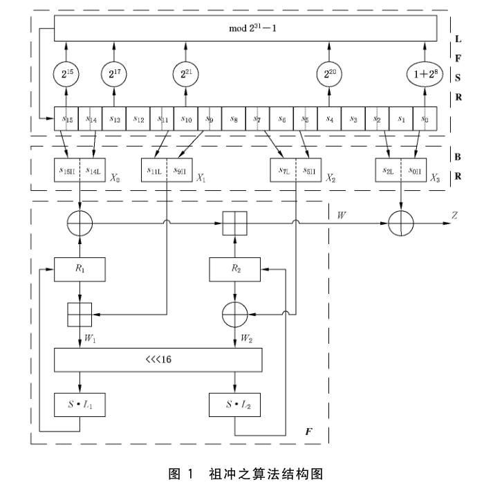

# GB/T 33133.1-2016 信息安全技术 祖冲之序列密码算法 第 1 部分：算法描述

> 来源：[GB/T 33133.1-2016 国家标准详情](https://openstd.samr.gov.cn/bzgk/std/newGbInfo?hcno=8C41A3AEECCA52B5C0011C8010CF0715)；封面发布日期：2016-10-13；实施日期：2017-05-01。
> 官方 PDF SHA-256：8fc9bbfb192bcc8a856a30c913fc947eda9fe04e06cb3ae38f7844fbffe14cbc。
> 转写说明：对照官方 PDF 全部 17 页的页面图像校正文字、公式、图示、两张 S 盒表及附录 C 的三组测试向量；省略封面、目录、页眉、页脚和页码，合并跨页内容。正式引用请核对原 PDF。

## 前言

GB/T 33133《信息安全技术 祖冲之序列密码算法》分为以下 3 部分：

- 第 1 部分：算法描述；
- 第 2 部分：保密性算法；
- 第 3 部分：完整性算法。

本部分为 GB/T 33133 的第 1 部分。

本部分按照 GB/T 1.1—2009 给出的规则起草。

本部分由国家密码管理局提出。

本部分由全国信息安全标准化技术委员会（SAC/TC 260）归口。

本部分起草单位：北京信息科学技术研究院、中国科学院软件研究所、中国科学院数据与通信保护研究教育中心、北京创原天地科技有限公司。

本部分主要起草人：冯登国、林东岱、冯秀涛、周春芳、刘辛越。

## 引言

本部分的目标是保证祖冲之序列密码算法使用的正确性，为国内企业正确研发使用祖冲之算法的相关设备提供指导。

本部分修改采用如下国际标准：

- ETSI/SAGE TS 35.221. Specification of the 3GPP Confidentiality and Integrity Algorithms 128-EEA3 & 128-EIA3. Document 1: 128-EEA3 and 128-EIA3 Specification.
- ETSI/SAGE TS 35.222. Specification of the 3GPP Confidentiality and Integrity Algorithms 128-EEA3 & 128-EIA3. Document 2: ZUC Specification.
- ETSI/SAGE TS 35.223. Specification of the 3GPP Confidentiality and Integrity Algorithms 128-EEA3 & 128-EIA3. Document 3: Implementor's Test Data.
- ETSI/SAGE TR 35.924. Specification of the 3GPP Confidentiality and Integrity Algorithms 128-EEA3 & 128-EIA3. Document 4: Design and Evaluation Report.

本文件的发布机构请注意，声明符合本文件时，可能涉及《一种序列密码实现方法和装置》（专利号：ZL200910086409.9）和《一种完整性认证方法》（专利号：ZL200910243440.9）相关专利的使用。

本文件的发布机构对于该专利的真实性、有效性和范围无任何立场。

该专利的持有人已向本文件的发布机构保证，他愿意同任何申请人在合理且无歧视的条款和条件下，就该专利授权许可进行谈判。该专利的持有人已在本文件的发布机构备案。相关信息可以通过以下联系方式获得：

专利持有人姓名：中国科学院数据与通信保护研究教育中心、中国科学院软件研究所

地址：北京市海淀区闵庄路甲 89 号，邮编：100093；北京市中关村南四街 4 号，邮编：100190

请注意除上述专利外，本文件的某些内容仍可能涉及专利。本文件的发布机构不承担识别这些专利的责任。

## 1 范围

GB/T 33133 的本部分给出了祖冲之序列密码算法的一般结构，基于该结构可实现本标准其他各部分所规定的密码机制。

本部分适用于祖冲之序列密码算法相关产品的研制、检测和使用，可应用于涉及非国家秘密范畴的商业应用领域。

## 2 规范性引用文件

下列文件对于本文件的应用是必不可少的。凡是注日期的引用文件，仅注日期的版本适用于本文件。凡是不注日期的引用文件，其最新版本（包括所有的修改单）适用于本文件。

- GB/T 25069—2010 信息安全技术 术语

## 3 术语和定义

GB/T 25069—2010 界定的以及下列术语和定义适用于本文件。

### 3.1 祖冲之序列密码算法 ZUC Stream Cipher

祖冲之序列密码算法是中国自主研制的流密码算法，是运用于下一代移动通信 4G 网络中的国际标准密码算法，该算法包括祖冲之算法、保密性算法和完整性算法三个部分。

### 3.2 位 bit

二进制数字（binary digit）。

二进制计数制中使用的数字 0 或 1。

### 3.3 字节 byte

一种由若干位组成的串，视作一个单位，通常代表一个字符或字符的一部分。

> 注 1：对一个给定的数据处理系统，一个字节中的位数是固定的。
> 注 2：一个字节通常是 8 位。

### 3.4 字 word

由 2 个以上（包含 2 个）比特组成的比特串。

本部分主要使用 31 比特字和 32 比特字。

### 3.5 字表示 word representation

本部分字默认采用十进制表示。当字采用其他进制表示时，总是在字的表示之前或之后添加指示符。例如，前缀 `0x` 指示该字采用十六进制表示，后缀下角标 2 指示该字采用二进制表示。

### 3.6 高低位顺序 bit ordering

本部分规定字的最高位总是位于字表示中的最左边，最低位总是位于字表示中的最右边。

## 4 符号和缩略语

### 4.1 运算符

下列运算符适用于本文件：

- `+`：算术加法运算。
- `ab`：整数 `a` 和 `b` 的乘积。
- `=`：赋值操作符。
- `mod`：整数模运算。
- `⊕`：按比特位逐位异或运算。
- `⊞`：模 `2^32` 加法运算。
- `∥`：字符串或字节串连接符。
- `·_H`：取字的最高 16 比特。
- `·_L`：取字的最低 16 比特。
- `<<< k`：32 比特字循环左移 `k` 位。
- `>> k`：32 比特字右移 `k` 位。
- `a → b`：向量 `a` 赋值给向量 `b`，即按分量逐分量赋值。

### 4.2 符号

下列符号适用于本文件：

- `s₀, s₁, s₂, …, s₁₅`：线性反馈移位寄存器的 16 个 31 比特寄存器单元变量。
- `X₀, X₁, X₂, X₃`：比特重组输出的 4 个 32 比特字。
- `R₁, R₂`：非线性函数 `F` 的 2 个 32 比特记忆单元变量。
- `W`：非线性函数 `F` 输出的 32 比特字。
- `W₁`：`R₁` 与 `X₁` 进行模 `2^32` 加法运算输出的 32 比特字。
- `W₂`：`R₂` 与 `X₂` 按比特位逐位异或运算输出的 32 比特字。
- `Z`：算法每拍输出的 32 比特密钥字。
- `k`：初始种子密钥。
- `iv`：初始向量。
- `dᵢ`：15 比特的字符串常量，`i = 0, 1, 2, …, 15`。
- `F`：非线性函数。
- `L`：输出密钥字长度。

### 4.3 缩略语

下列缩略语适用于本文件：

- LFSR：线性反馈移位寄存器（Linear Feedback Shift Register）。
- BR：比特重组（Bit Reorganization）。

## 5 算法流程

### 5.1 算法结构

祖冲之算法由线性反馈移位寄存器（LFSR）、比特重组（BR）和非线性函数 `F` 组成，见图 1。



### 5.2 线性反馈移位寄存器 LFSR

#### 5.2.1 概述

LFSR 包括 16 个 31 比特寄存器单元变量 `s₀, s₁, …, s₁₅`。

LFSR 的运行模式有 2 种：初始化模式和工作模式。

#### 5.2.2 初始化模式

LFSR 接收 1 个 31 比特字 `u` 的输入，对寄存器单元变量 `s₀, s₁, …, s₁₅` 进行更新，计算过程如下：

```text
LFSRWithInitialisationMode(u)
v = (2^15 s15 + 2^17 s13 + 2^21 s10 + 2^20 s4 + (1 + 2^8) s0) mod (2^31 - 1)
s16 = (v + u) mod (2^31 - 1)
如果 s16 = 0，则置 s16 = 2^31 - 1
(s1, s2, …, s15, s16) → (s0, s1, …, s14, s15)
```

模 `2^31 - 1` 乘法和模 `2^31 - 1` 加法的实现参见附录 B。

#### 5.2.3 工作模式

LFSR 无输入，直接对寄存器单元变量 `s₀, s₁, …, s₁₅` 进行更新，计算过程如下：

```text
LFSRWithWorkMode()
s16 = (2^15 s15 + 2^17 s13 + 2^21 s10 + 2^20 s4 + (1 + 2^8) s0) mod (2^31 - 1)
如果 s16 = 0，则置 s16 = 2^31 - 1
(s1, s2, …, s15, s16) → (s0, s1, …, s14, s15)
```

### 5.3 比特重组 BR

输入为 LFSR 寄存器单元变量 `s₀, s₂, s₅, s₇, s₉, s₁₁, s₁₄, s₁₅`，输出为 4 个 32 比特字 `X₀, X₁, X₂, X₃`。计算过程如下：

```text
BitReconstruction()
X0 = s15H ∥ s14L
X1 = s11L ∥ s9H
X2 = s7L ∥ s5H
X3 = s2L ∥ s0H
```

### 5.4 非线性函数 F

`F` 包含 2 个 32 比特记忆单元变量 `R₁` 和 `R₂`。

`F` 的输入为 3 个 32 比特字 `X₀, X₁, X₂`，输出为一个 32 比特字 `W`。计算过程如下：

```text
F(X0, X1, X2)
W = (X0 ⊕ R1) ⊞ R2
W1 = R1 ⊞ X1
W2 = R2 ⊕ X2
R1 = S[L1(W1L ∥ W2H)]
R2 = S[L2(W2L ∥ W1H)]
```

其中 `S` 为 32 比特的 S 盒变换，S 盒定义见附录 A；`L₁` 和 `L₂` 为 32 比特线性变换，定义如下：

- `L₁(X) = X ⊕ (X <<< 2) ⊕ (X <<< 10) ⊕ (X <<< 18) ⊕ (X <<< 24)`；
- `L₂(X) = X ⊕ (X <<< 8) ⊕ (X <<< 14) ⊕ (X <<< 22) ⊕ (X <<< 30)`。

### 5.5 密钥装入

将初始密钥 `k` 和初始向量 `iv` 分别扩展为 16 个 31 比特字作为 LFSR 寄存器单元变量 `s₀, s₁, …, s₁₅` 的初始状态。步骤如下：

a) 设 `k` 和 `iv` 分别为 `k₀ ∥ k₁ ∥ … ∥ k₁₅` 和 `iv₀ ∥ iv₁ ∥ … ∥ iv₁₅`，其中 `kᵢ` 和 `ivᵢ` 均为 8 比特字节，`0 ≤ i ≤ 15`。

b) 对 `0 ≤ i ≤ 15`，有 `sᵢ = kᵢ ∥ dᵢ ∥ ivᵢ`。这里 `dᵢ` 为 15 比特的常量，定义如下：

| `i` | `dᵢ`（二进制） | `dᵢ`（十六进制） |
| --- | --- | --- |
| 0 | `100010011010111` | `44D7` |
| 1 | `010011010111100` | `26BC` |
| 2 | `110001001101011` | `626B` |
| 3 | `001001101011110` | `135E` |
| 4 | `101011110001001` | `5789` |
| 5 | `011010111100010` | `35E2` |
| 6 | `111000100110101` | `7135` |
| 7 | `000100110101111` | `09AF` |
| 8 | `100110101111000` | `4D78` |
| 9 | `010111100010011` | `2F13` |
| 10 | `110101111000100` | `6BC4` |
| 11 | `001101011110001` | `1AF1` |
| 12 | `101111000100110` | `5E26` |
| 13 | `011110001001101` | `3C4D` |
| 14 | `111100010011010` | `789A` |
| 15 | `100011110101100` | `47AC` |

### 5.6 算法运行

#### 5.6.1 概述

祖冲之算法的输入参数为初始密钥 `k`、初始向量 `iv` 和正整数 `L`，输出参数为 `L` 个密钥字 `Z`。算法运行过程包含初始化步骤和工作步骤。

#### 5.6.2 初始化步骤

a) 按照 5.5 将初始密钥 `k` 和初始向量 `iv` 装入到 LFSR 的寄存器单元变量 `s₀, s₁, …, s₁₅` 中，作为 LFSR 的初态。

b) 令 32 比特记忆单元变量 `R₁` 和 `R₂` 为 0。

c) 重复执行下述过程 32 次：

1. `BitReconstruction()`；
2. `W = F(X₀, X₁, X₂)`；
3. 输出 32 比特字 `W`；
4. `LFSRWithInitialisationMode(W >> 1)`。

#### 5.6.3 工作步骤

a) 执行下述过程：

1. `BitReconstruction()`；
2. `F(X₀, X₁, X₂)`；
3. `LFSRWithWorkMode()`。

b) 重复计算 `L` 次下述过程：

1. `BitReconstruction()`；
2. `Z = F(X₀, X₁, X₂) ⊕ X₃`；
3. 输出 32 比特密钥字 `Z`；
4. `LFSRWithWorkMode()`。

算法计算实例参见附录 C。

## 附录 A（规范性附录）S 盒

32 比特 S 盒 `S` 由 4 个小的 `8×8` 的 S 盒并置而成，即 `S = (S₀, S₁, S₂, S₃)`，其中 `S₀ = S₂`，`S₁ = S₃`。`S₀` 和 `S₁` 的定义分别见表 A.1 和表 A.2。设 `S₀`（或 `S₁`）的 8 比特输入为 `x`。将 `x` 视作两个 16 进制数的连接，即 `x = h ∥ l`，则表 A.1（或表 A.2）中第 `h` 行和第 `l` 列交叉的元素即为 `S₀`（或 `S₁`）的输出 `S₀(x)`〔或 `S₁(x)`〕。

设 S 盒 `S` 的 32 比特输入 `X` 和 32 比特输出 `Y` 分别为：

```text
X = x0 ∥ x1 ∥ x2 ∥ x3
Y = y0 ∥ y1 ∥ y2 ∥ y3
```

其中，`xᵢ` 和 `yᵢ` 均为 8 比特字节，`i = 0, 1, 2, 3`。则有 `yᵢ = Sᵢ(xᵢ)`，`i = 0, 1, 2, 3`。

**表 A.1 S₀ 盒**：每行左侧为高 4 位，行内从左到右对应低 4 位 `0` 至 `F`。

```text
0  3E 72 5B 47 CA E0 00 33 04 D1 54 98 09 B9 6D CB
1  7B 1B F9 32 AF 9D 6A A5 B8 2D FC 1D 08 53 03 90
2  4D 4E 84 99 E4 CE D9 91 DD B6 85 48 8B 29 6E AC
3  CD C1 F8 1E 73 43 69 C6 B5 BD FD 39 63 20 D4 38
4  76 7D B2 A7 CF ED 57 C5 F3 2C BB 14 21 06 55 9B
5  E3 EF 5E 31 4F 7F 5A A4 0D 82 51 49 5F BA 58 1C
6  4A 16 D5 17 A8 92 24 1F 8C FF D8 AE 2E 01 D3 AD
7  3B 4B DA 46 EB C9 DE 9A 8F 87 D7 3A 80 6F 2F C8
8  B1 B4 37 F7 0A 22 13 28 7C CC 3C 89 C7 C3 96 56
9  07 BF 7E F0 0B 2B 97 52 35 41 79 61 A6 4C 10 FE
A  BC 26 95 88 8A B0 A3 FB C0 18 94 F2 E1 E5 E9 5D
B  D0 DC 11 66 64 5C EC 59 42 75 12 F5 74 9C AA 23
C  0E 86 AB BE 2A 02 E7 67 E6 44 A2 6C C2 93 9F F1
D  F6 FA 36 D2 50 68 9E 62 71 15 3D D6 40 C4 E2 0F
E  8E 83 77 6B 25 05 3F 0C 30 EA 70 B7 A1 E8 A9 65
F  8D 27 1A DB 81 B3 A0 F4 45 7A 19 DF EE 78 34 60
```

**表 A.2 S₁ 盒**：每行左侧为高 4 位，行内从左到右对应低 4 位 `0` 至 `F`。

```text
0  55 C2 63 71 3B C8 47 86 9F 3C DA 5B 29 AA FD 77
1  8C C5 94 0C A6 1A 13 00 E3 A8 16 72 40 F9 F8 42
2  44 26 68 96 81 D9 45 3E 10 76 C6 A7 8B 39 43 E1
3  3A B5 56 2A C0 6D B3 05 22 66 BF DC 0B FA 62 48
4  DD 20 11 06 36 C9 C1 CF F6 27 52 BB 69 F5 D4 87
5  7F 84 4C D2 9C 57 A4 BC 4F 9A DF FE D6 8D 7A EB
6  2B 53 D8 5C A1 14 17 FB 23 D5 7D 30 67 73 08 09
7  EE B7 70 3F 61 B2 19 8E 4E E5 4B 93 8F 5D DB A9
8  AD F1 AE 2E CB 0D FC F4 2D 46 6E 1D 97 E8 D1 E9
9  4D 37 A5 75 5E 83 9E AB 82 9D B9 1C E0 CD 49 89
A  01 B6 BD 58 24 A2 5F 38 78 99 15 90 50 B8 95 E4
B  D0 91 C7 CE ED 0F B4 6F A0 CC F0 02 4A 79 C3 DE
C  A3 EF EA 51 E6 6B 18 EC 1B 2C 80 F7 74 E7 FF 21
D  5A 6A 54 1E 41 31 92 35 C4 33 07 0A BA 7E 0E 34
E  88 B1 98 7C F3 3D 60 6C 7B CA D3 1F 32 65 04 28
F  64 BE 85 9B 2F 59 8A D7 B0 25 AC AF 12 03 E2 F2
```

注：`S₀` 盒和 `S₁` 盒数据均为十六进制表示。

## 附录 B（资料性附录）模 `2^31 - 1` 乘法和模 `2^31 - 1` 加法的实现

### B.1 模 `2^31 - 1` 乘法

两个 31 比特字模 `2^31 - 1` 乘法可以快速实现。特别地，当其中一个字具有较低的汉明重量时，可以通过 31 比特的循环移位运算和模 `2^31 - 1` 加法运算实现。例如，计算 `ab mod (2^31 - 1)`，其中 `b = 2^i + 2^j + 2^k`。则

`ab mod (2^31 - 1) = ((a <<<₃₁ i) + (a <<<₃₁ j) + (a <<<₃₁ k)) mod (2^31 - 1)`。（B.1）

式中：`<<<₃₁` 表示 31 比特左循环移位运算。

### B.2 模 `2^31 - 1` 加法

在 32 位处理平台上，两个 31 比特字 `a` 和 `b` 模 `2^31 - 1` 加法运算 `c = a + b mod (2^31 - 1)` 可以通过下面的两步计算实现：

a) `c = a + b`；

b) `c = (c & 0x7FFFFFFF) + (c >> 31)`。

## 附录 C（资料性附录）算法计算实例

### C.1 测试向量 1（全 0）

输入：密钥 `k = 00 00 00 00 00 00 00 00 00 00 00 00 00 00 00 00`；初始向量 `iv = 00 00 00 00 00 00 00 00 00 00 00 00 00 00 00 00`。

输出：`z₁ = 27bede74`，`z₂ = 018082da`。

初始化时线性反馈移位寄存器初态：

| `i` | `S₀₊ᵢ` | `S₁₊ᵢ` | `S₂₊ᵢ` | `S₃₊ᵢ` | `S₄₊ᵢ` | `S₅₊ᵢ` | `S₆₊ᵢ` | `S₇₊ᵢ` |
| --- | --- | --- | --- | --- | --- | --- | --- | --- |
| 0 | 0044d700 | 0026bc00 | 00626b00 | 00135e00 | 00578900 | 0035e200 | 00713500 | 0009af00 |
| 8 | 004d7800 | 002f1300 | 006bc400 | 001af100 | 005e2600 | 003c4d00 | 00789a00 | 0047ac00 |

初始化过程中的状态：

| `t` | `X₀` | `X₁` | `X₂` | `X₃` | `R₁` | `R₂` | `W` | `S₁₅` |
| --- | --- | --- | --- | --- | --- | --- | --- | --- |
| 0 | 008f9a00 | f100005e | af00006b | 6b000089 | 67822141 | 62a3a55f | 008f9a00 | 4563cb1b |
| 1 | 8ac7ac00 | 260000d7 | 780000e2 | 5e00004d | 474a2e7e | 119e94bb | 4fe932a0 | 28652a0f |
| 2 | 50cacb1b | 4d000035 | 13000013 | 890000c4 | c29687a5 | e9b6eb51 | 291f7a20 | 7464f744 |
| 3 | e8c92a0f | 9a0000bc | c400009a | e2000026 | 29c272f3 | 8cac7f5d | 141698fb | 3f5644ba |
| 4 | 7eacf744 | ac000078 | f100005e | 350000af | 2c85a655 | 24259cb0 | e41b0514 | 006a144c |
| 5 | 00d444ba | cb1b00f1 | 260000d7 | af00006b | cbfbc5c0 | 44c10b3a | 50777f9f | 07038b9b |
| 6 | 0e07144c | 2a0f008f | 4d000035 | 780000e2 | e083c8d3 | 7abf7679 | 0abddcc6 | 69b90e2b |
| 7 | d3728b9b | f7448ac7 | 9a0000bc | 13000013 | 147e14f4 | b669e72d | aeb0b9c1 | 62a913ea |
| 8 | c5520e2b | 44ba50ca | ac000078 | c400009a | 982834a0 | f095d694 | 8796020c | 7b591cc0 |
| 9 | f6b213ea | 144ce8c9 | cb1b00f1 | f100005e | e14727d6 | d0225869 | 5f2ffdde | 70e21147 |

初始化后线性反馈移位寄存器状态：

| `i` | `S₀₊ᵢ` | `S₁₊ᵢ` | `S₂₊ᵢ` | `S₃₊ᵢ` | `S₄₊ᵢ` | `S₅₊ᵢ` | `S₆₊ᵢ` | `S₇₊ᵢ` |
| --- | --- | --- | --- | --- | --- | --- | --- | --- |
| 0 | 7ce15b8b | 747ca0c4 | 6259dd0b | 47a94c2b | 3a89c82e | 32b433fc | 231ea13f | 31711e42 |
| 8 | 4ccce955 | 3fb6071e | 161d3512 | 7114b136 | 5154d452 | 78c69a74 | 4f26ba6b | 3e1b8d6a |

有限状态机内部状态：`R₁ = 14cfd44c`，`R₂ = 8c6de800`。

密钥流：

| `t` | `X₀` | `X₁` | `X₂` | `X₃` | `R₁` | `R₂` | `z` | `S₁₅` |
| --- | --- | --- | --- | --- | --- | --- | --- | --- |
| 0 | 7c37ba6b | b1367f6c | 1e426568 | dd0bf9c2 | 3512bf50 | a0920453 | 286dafe5 | 7f08e141 |
| 1 | fe118d6a | d4522c3a | e955463d | 4c2be8f9 | c7ee7f13 | 0c0fa817 | 27bede74 | 3d383d04 |
| 2 | 7a70e141 | 9a74e229 | 071e62e2 | c82ec4b3 | dde63da7 | b9dd6a41 | 018082da | 13d6d780 |

### C.2 测试向量 2（全 1）

输入：密钥 `k = ff ff ff ff ff ff ff ff ff ff ff ff ff ff ff ff`；初始向量 `iv = ff ff ff ff ff ff ff ff ff ff ff ff ff ff ff ff`。

输出：`z₁ = 0657cfa0`，`z₂ = 7096398b`。

初始化时线性反馈移位寄存器初态：

| `i` | `S₀₊ᵢ` | `S₁₊ᵢ` | `S₂₊ᵢ` | `S₃₊ᵢ` | `S₄₊ᵢ` | `S₅₊ᵢ` | `S₆₊ᵢ` | `S₇₊ᵢ` |
| --- | --- | --- | --- | --- | --- | --- | --- | --- |
| 0 | 7fc4d7ff | 7fa6bcff | 7fe26bff | 7f935eff | 7fd789ff | 7fb5e2ff | 7ff135ff | 7f89afff |
| 8 | 7fcd78ff | 7faf13ff | 7febc4ff | 7f9af1ff | 7fde26ff | 7fbc4dff | 7ff89aff | 7fc7acff |

初始化过程中的状态：

| `t` | `X₀` | `X₁` | `X₂` | `X₃` | `R₁` | `R₂` | `W` | `S₁₅` |
| --- | --- | --- | --- | --- | --- | --- | --- | --- |
| 0 | ff8f9aff | f1ffff5e | afffff6b | 6bffff89 | b51c2110 | 30a3629a | ff8f9aff | 76e49a1a |
| 1 | edc9acff | 26ffffd7 | 78ffffe2 | 5effff4d | a75b6f4b | 1a079628 | 8978f089 | 5e2d8983 |
| 2 | bc5b9a1a | 4dffff35 | 13ffff13 | 89ffffc4 | 9810b315 | 99296735 | 35088b79 | 5b9484b8 |
| 3 | b7298983 | 9affffbc | c4ffff9a | e2ffff26 | 4c5bd8eb | 2d577790 | c862a1cb | 2db5c755 |
| 4 | 5b6b84b8 | acffff78 | f1ffff5e | 35ffffaf | a13dcb66 | 21d0939f | 4487d3e3 | 60579232 |
| 5 | c0afc755 | 9a1afff1 | 26ffffd7 | afffff6b | cc5ce260 | 0c50a8e2 | 83629fd2 | 29d4e960 |
| 6 | 53a99232 | 8983ff8f | 4dffff35 | 78ffffe2 | dada0730 | b516b128 | ac461934 | 5e02d9e5 |
| 7 | bc05e960 | 84b8edc9 | 9affffbc | 13ffff13 | 2bbe53a4 | 12a8a16e | 1bf69f78 | 7904dddc |
| 8 | f209d9e5 | c755bc5b | acffff78 | c4ffff9a | 4a90d661 | d9c744b4 | ec602baf | 0c3c9016 |
| 9 | 1879dddc | 9232b729 | 9a1afff1 | f1ffff5e | 76bc13d7 | a49ea404 | 2cb05071 | 0b9d257b |

初始化后线性反馈移位寄存器状态：

| `i` | `S₀₊ᵢ` | `S₁₊ᵢ` | `S₂₊ᵢ` | `S₃₊ᵢ` | `S₄₊ᵢ` | `S₅₊ᵢ` | `S₆₊ᵢ` | `S₇₊ᵢ` |
| --- | --- | --- | --- | --- | --- | --- | --- | --- |
| 0 | 09a339ad | 1291d190 | 25554227 | 36c09187 | 0697773b | 443cf9cd | 6a4cd899 | 49e34bd0 |
| 8 | 56130b14 | 20e8f24c | 7a5b1dcc | 0c3cc2d1 | 1cc082c8 | 7f5904a2 | 55b61ce8 | 1fe46106 |

有限状态机内部状态：`R₁ = b8017bd5`，`R₂ = 9ce2de5c`。

密钥流：

| `t` | `X₀` | `X₁` | `X₂` | `X₃` | `R₁` | `R₂` | `z` | `S₁₅` |
| --- | --- | --- | --- | --- | --- | --- | --- | --- |
| 0 | 3fc81ce8 | c2d141d1 | 4bd08879 | 42271346 | aa131b11 | 09d7706c | 668b56df | 13f56dbf |
| 1 | 27ea6106 | 82c8f4b6 | 0b14d499 | 91872523 | 251e7804 | caac5d66 | 0657cfa0 | 0c0fe353 |
| 2 | 181f6dbf | 04a21879 | f24c93c6 | 773b4aaa | d94e9228 | 91d88fba | 7096398b | 10f1eecf |

### C.3 测试向量 3（随机）

输入：密钥 `k = 3d 4c 4b e9 6a 82 fd ae b5 8f 64 1d b1 7b 45 5b`；初始向量 `iv = 84 31 9a a8 de 69 15 ca 1f 6b da 6b fb d8 c7 66`。

输出：`z₁ = 14f1c272`，`z₂ = 3279c419`。

初始化时线性反馈移位寄存器初态：

| `i` | `S₀₊ᵢ` | `S₁₊ᵢ` | `S₂₊ᵢ` | `S₃₊ᵢ` | `S₄₊ᵢ` | `S₅₊ᵢ` | `S₆₊ᵢ` | `S₇₊ᵢ` |
| --- | --- | --- | --- | --- | --- | --- | --- | --- |
| 0 | 1ec4d784 | 2626bc31 | 25e26b9a | 74935ea8 | 355789de | 4135e269 | 7ef13515 | 5709afca |
| 8 | 5acd781f | 47af136b | 326bc4da | 0e9af16b | 58de26fb | 3dbc4dd8 | 22f89ac7 | 2dc7ac66 |

初始化过程中的状态：

| `t` | `X₀` | `X₁` | `X₂` | `X₃` | `R₁` | `R₂` | `W` | `S₁₅` |
| --- | --- | --- | --- | --- | --- | --- | --- | --- |
| 0 | 5b8f9ac7 | f16b8f5e | afca826b | 6b9a3d89 | 9c62829f | 5df00831 | 5b8f9ac7 | 3c7b93c0 |
| 1 | 78f7ac66 | 26fb64d7 | 781ffde2 | 5ea84c4d | 3d533f3a | 80ff1faf | 4285372a | 41901ee9 |
| 2 | 832093c0 | 4dd81d35 | 136bae13 | 89de4bc4 | 2ca57e9d | d1db72f9 | 3f72cca9 | 411efa99 |
| 3 | 823d1ee9 | 9ac7b1bc | c4dab59a | e269e926 | 0e8dc40f | 60921a4f | 8073d36d | 24b3f49f |
| 4 | 4967fa99 | ac667b78 | f16b8f5e | 35156aaf | 16c81467 | da8e7d8a | a87c58e5 | 74265785 |
| 5 | e84cf49f | 93c045f1 | 26fb64d7 | afca826b | 50c9eaa4 | 3c3b2dfd | d9135e82 | 481c5b9d |
| 6 | 90385785 | 1ee95b8f | 4dd81d35 | 781ffde2 | 59857b80 | be0fbdc1 | fd2ceb1e | 4b7f87ed |
| 7 | 96ff5b9d | fa9978f7 | 9ac7b1bc | 136bae13 | 9528f8ea | bcc7f7eb | 8d89ddde | 0e633ce7 |
| 8 | 1cc687ed | f49f8320 | ac667b78 | c4dab59a | c59d2932 | e1098a64 | 46b676f2 | 643ae5a6 |
| 9 | c8753ce7 | 5785823d | 93c045f1 | f16b8f5e | 755ebae8 | 3f9e6e86 | eef1a039 | 625ac5d7 |

初始化后线性反馈移位寄存器状态：

| `i` | `S₀₊ᵢ` | `S₁₊ᵢ` | `S₂₊ᵢ` | `S₃₊ᵢ` | `S₄₊ᵢ` | `S₅₊ᵢ` | `S₆₊ᵢ` | `S₇₊ᵢ` |
| --- | --- | --- | --- | --- | --- | --- | --- | --- | --- |
| 0 | 10da5941 | 5b6acbf6 | 17060ce1 | 35368174 | 5cf4385a | 479943df | 2753bab2 | 73775d6a |
| 8 | 43930a37 | 77b4af31 | 15b2e89f | 24ff6e20 | 740c40b9 | 026a5503 | 194b2a57 | 7a9a1cff |

有限状态机内部状态：`R₁ = 860a7dfa`，`R₂ = bf0e0ffc`。

密钥流：

| `t` | `X₀` | `X₁` | `X₂` | `X₃` | `R₁` | `R₂` | `z` | `S₁₅` |
| --- | --- | --- | --- | --- | --- | --- | --- | --- |
| 0 | f5342a57 | 6e20ef69 | 5d6a8f32 | 0ce121b4 | 129d8b39 | 2d7cdce1 | 3ead461d | 3d4aa9e7 |
| 1 | 7a951cff | 40b92b65 | 0a374ea7 | 8174b6d5 | ab7cf688 | c1598aa6 | 14f1c272 | 71db1828 |
| 2 | e3b6a9e7 | 550349fe | af31e6ee | 385a2e0c | 3cec1a4a | 9053cc0e | 3279c419 | 258937da |

> 注：上述祖冲之算法计算实例中数据全部采用十六进制表示。

## 参考文献

[1] ETSI/SAGE TS 35.221. Specification of the 3GPP Confidentiality and Integrity Algorithms 128-EEA3 & 128-EIA3. Document 1: 128-EEA3 and 128-EIA3 Specification.

[2] ETSI/SAGE TS 35.222. Specification of the 3GPP Confidentiality and Integrity Algorithms 128-EEA3 & 128-EIA3. Document 2: ZUC Specification.

[3] ETSI/SAGE TS 35.223. Specification of the 3GPP Confidentiality and Integrity Algorithms 128-EEA3 & 128-EIA3. Document 3: Implementor's Test Data.

[4] ETSI/SAGE TR 35.924. Specification of the 3GPP Confidentiality and Integrity Algorithms 128-EEA3 & 128-EIA3. Document 4: Design and Evaluation Report.
