# GB/T 36968-2018 信息安全技术 IPSec VPN技术规范

> 来源：[GB/T 36968-2018 国家标准详情](https://openstd.samr.gov.cn/bzgk/std/newGbInfo?hcno=CA3229731973C4A5F3E8C1C583A022BF)；封面发布日期：2018-12-28；实施日期：2019-07-01。
> PDF SHA-256：98d7d8e8dc96ce08bc95ec2a4c862c13154ed9add1528c690ecc9bea9866f76c。
> 依据官方 PDF 全部 52 页的页面图像转写与核对；省略封面、目录、页眉、页脚和分页，合并印刷折行；36 张结构图保留为从原文页面裁出的图像。

## 前言

本标准按照 GB/T 1.1—2009给出的规则起草。

请注意本文件的某些内容可能涉及专利。本文件的发布机构不承担识别这些专利的责任。

本标准由全国信息安全标准化技术委员会（SAC/TC 260）提出并归口。

本标准起草单位：无锡江南信息安全工程技术中心、国家密码管理局商用密码检测中心、上海格尔软件股份有限公司、北京数字认证股份有限公司、山东得安信息技术有限公司、北京天融信网络安全技术有限公司、华为技术有限公司、深信服科技股份有限公司、深圳奥联信息安全技术有限公司、成都卫士通信息产业股份有限公司、北京三未信安科技发展有限公司。

本标准主要起草人：刘平、徐文耀、周国良、郑强、李述胜、马洪富、罗鹏、李金国、王雨晨、林国强、但波、罗俊、许永欣。

## 1 范围

本标准规定了 IPSec VPN 的技术协议、产品要求和检测方法。

本标准适用于 IPSec VPN 产品的研制、检测、使用和管理。

## 2 规范性引用文件

下列文件对于本文件的应用是必不可少的。凡是注日期的引用文件，仅注日期的版本适用于本文件。凡是不注日期的引用文件，其最新版本（包括所有的修改单）适用于本文件。

- GB/T 20518 信息安全技术 公钥基础设施 数字证书格式

- GB/T 25056 信息安全技术 证书认证系统密码及其相关安全技术规范

- GB/T 32905 信息安全技术 SM3密码杂凑算法

- GB/T 32907 信息安全技术 SM4分组密码算法

- GB/T 32915 信息安全技术 二元序列随机性检测方法

- GB/T 32918（所有部分）信息安全技术 SM2椭圆曲线公钥密码算法

- GB/T 35276 信息安全技术 SM2密码算法使用规范

- RFC 2408 互联网安全联盟和密钥管理协议（Internet Security Association and Key Management Protocol）
- RFC 3947 密钥交换过程中 NAT 穿越协商（Negotiation of NAT-Traversal in the IKE）
- RFC 3948 IPSec ESP 包的 UDP 封装（UDP Encapsulation of IPsec ESP Packets）

## 3 术语和定义

下列术语和定义适用于本文件。

### 3.1 安全联盟 security association

两个通信实体经协商建立起来的一种协定，它描述了实体如何利用安全服务来进行安全的通信。

> 注：安全联盟包括了执行各种网络安全服务所需要的所有信息，例如 IP 层服务（如头鉴别和载荷封装）、传输层和应用层服务或者协商通信的自我保护。

### 3.2 互联网安全联盟和密钥管理协议 internet security association and key management protocol

一个在互联网环境中建立安全联盟和进行密钥管理的协议。它定义了建立、协商、修改和删除安全联盟的过程和报文格式，以及交换密钥产生和鉴别数据的载荷格式。这些格式为传输密钥和鉴别信息提供了一致的框架。

### 3.3 载荷 payload

ISAKMP 通信双方交换消息的数据格式，是构造 ISAKMP 消息的基本单位。

### 3.4 IPSec 协议 Internet Protocol Security

一种开放标准的框架结构，通过使用加密的安全服务以确保在公开网络上进行保密而安全的通信，可以端至端的层面上提供数据完整性保护、数据源鉴别、载荷机密性和抗重放攻击等安全服务。

### 3.5 鉴别头 authentication header

IPSec 的一种协议，用于提供IP 数据包的数据完整性、数据源鉴别以及抗重放攻击的功能，但不提供数据机密性的功能。

### 3.6 封装安全载荷 encapsulating security payload

IPSec 的一种协议，用于提供IP数据包的机密性、数据完整性以及对数据源鉴别以及抗重放攻击的功能。

### 3.7 虚拟专用网 virtual private network

使用密码技术在通信网络中构建安全通道的技术。

## 4 缩略语

下列缩略语适用于本文件。

- AH：鉴别头（Authentication Header）
- CBC：（密码分组的）密码分组链接（工作方式）（Cipher Block Chaining）
- ESP：封装安全载荷（Encapsulating Security Payload）
- HMAC：带密钥的杂凑运算（Keyed-Hash Message Authentication Code）
- IPSec：IP 安全协议（Internet Protocol Security）
- IPv4：互联网通信协议第四版（Internet Protocol version 4）
- IPv6：互联网通信协议第六版（Internet Protocol version 6）
- ISAKMP：互联网安全联盟和密钥管理协议（Internet Security Association and Key Management Protocol）
- IV：初始化向量（Initialization Vector）
- MAC：消息认证码（Message Authentication Code）
- NAT：网络地址转换（Network Address Translation）
- SA：安全联盟（Security Association）
- UDP：用户数据报协议（User Datagram Protocol）
- VPN：虚拟专用网（Virtual Private Network）

## 5 密码算法和密钥种类

### 5.1 密码算法

IPSec VPN 应支持国家密码管理主管部门批准的非对称密码算法、对称密码算法、密码杂凑算法和随机数生成算法。各算法及使用要求如下：

- 非对称密码算法应当支持 SM2 椭圆曲线密码算法，用于实体鉴别、数字签名和数字信封等。SM2 算法的使用要求见 GB/T 32918。
- 对称密码算法应当支持 SM4 分组密码算法，用于密钥交换数据的加密保护和报文数据的加密保护。算法的工作模式应当支持 CBC 模式。SM4 算法的使用要求见 GB/T 32907。
- 密码杂凑算法应当支持 SM3 密码杂凑算法，用于完整性校验。SM3 算法的使用要求见 GB/T 32905。
- 随机数生成算法生成的随机数应能通过 GB/T 32915 规定的检测。

### 5.2 密钥种类

IPSec VPN 使用下列密钥：

- 设备密钥：非对称算法使用的公私钥对，包括签名密钥对和加密密钥对，用于实体验证、数字签名和数字信封等。
- 工作密钥：在密钥交换第一阶段得到的密钥，用于会话密钥交换过程的保护。
- 会话密钥：在密钥交换第二阶段得到的密钥，用于数据报文及报文 MAC 的加密。

## 6 协议

### 6.1 密钥交换协议

#### 6.1.1 概述

密钥交换协议定义了协商、建立、修改、删除安全联盟的过程和报文格式。协议报文使用UDP协议500端口进行传输。

本章用到的符号如下：

HDR：一个 ISAKMP 头。

HDR *：表示 ISAKMP 头后面的载荷是加密的。

IDi：发起方的标识载荷。

IDr：响应方的标识载荷。

HASHi：发起方的杂凑载荷。

HASHr：响应方的杂凑载荷。

HASH_&lt;n&gt;：双方进行协商交互时的中间 Hash 数据。

SIGi：发起方的签名载荷。

SIGr：响应方的签名载荷。

CERT_sig_r：签名证书载荷。

CERT_enc_r：加密证书载荷。

MsgID：消息标识号。

Ni：发起方的 Nonce 载荷。

Nr：响应方的 Nonce 载荷。

&lt;p&gt;_b：载荷 &lt;p&gt; 的主体，就是没有 ISAKMP 通用头的载荷。

pub_i：发起方公钥。

pub_r：响应方公钥。

prv_i：发起方私钥。

prv_r：响应方私钥。

CKY-I：ISAKMP 头中的发起方 cookie。

CKY-R：ISAKMP 头中的响应方 cookie。

x | y：x 与 y 串接。

［x］：x为可选。

Asymmetric_Encrypt（msg,Pub_key）：使用非对称算法 Asymmetric,pub_key 作为密钥对输入信息msg_b 进行加密，其输出为 msg 的通用载荷头和密文串接。如 SM2_Encrypt（Ski,pub_key）表示使用SM2算法，使用公钥 pub_key 对 Ski_b 进行加密，其输出为 Ski的通用载荷头和密文串接。

Asymmetric_Sign （msg,priv_key）：使用非对称算法 Asymmetric,priv_key 作密钥对 msg进行数字签名。

Symmetric_Encrypt（msg, key）：使用对称算法 Symmetric,key 作为密钥对输入信息 msg_b 进行加密，其输出为 msg 的通用载荷头和密文串接。如 SM4_Encrypt（Ni, key）表示使用SM4算法，使用key 作为密钥对 Ni_b 进行加密，其输出为 Ni 的通用载荷头和密文串接。

HASH（msg）：使用密码杂凑算法对 msg 进行数据摘要运算。

PRF（key,msg）：使用密钥 key 对消息 msg 进行数据摘要运算。

#### 6.1.2 交换阶段及模式

密钥交换协议包括第一阶段和第二阶段。

在第一阶段交换中，通信双方建立了一个 ISAKMP 安全联盟。该安全联盟是协商双方为保护它们之间的通信而使用的共享策略和密钥。用这个安全联盟来保护 IPSec 安全联盟的协商过程。一个ISAKMP 安全联盟可以用于建立多个 IPSec 安全联盟。该阶段使用主模式实现通信双方的身份鉴别和密钥交换，得到工作密钥，该工作密钥用于保护第二阶段的协商过程。

在第二阶段交换中，通信双方使用第一阶段 ISAKMP 安全联盟协商建立 IPSec 安全联盟，IPSec 安全联盟是为保护它们之间的数据通信而使用的共享策略和密钥。该阶段使用快速模式实现通信双方IPSec 安全联盟的协商，确定通信双方的 IPSec 安全策略及会话密钥。

#### 6.1.3 交换

##### 6.1.3.1 概述

交换使用标准 ISAKMP 载荷语法、属性编码、消息的超时和重传以及通知消息。

SA 载荷采用的载荷封装形式为：变换载荷封装在建议载荷中，建议载荷封装在 SA 载荷中。本标准不限制发起方可以发给响应方的提议数量，如果第一阶段交换中有多个变换载荷，应将多个变换载荷封装在一个建议载荷中，然后再将它们封装在一个 SA 载荷中。安全联盟的定义参见附录A，有关变换载荷、建议载荷、SA 载荷等的具体定义见 6.1.5。

在安全联盟的协商期间，响应方不能修改发起方发送的任何提议的属性。否则，交换的发起方应终止协商。

##### 6.1.3.2 第一阶段——主模式

主模式是一个身份保护的交换，其交换过程由6个消息组成。双方身份的鉴别采用数字证书的方式。

本阶段涉及的消息头及载荷的具体内容见 6.1.5。

主模式的交换过程如下：

| 消息序列 | 发起方 i | 方向 | 响应方 R |
| --- | --- | --- | --- |
| 1 | HDR, SA | → | |
| 2 | | ← | HDR, SA, CERT_sig_r, CERT_enc_r |
| 3 | HDR, XCHi, SIGi | → | |
| 4 | | ← | HDR, XCHr, SIGr |
| 5 | HDR*, HASHi | → | |
| 6 | | ← | HDR*, HASHr |

消息 1：发起方向响应方发送一个封装有建议载荷的 SA 载荷，而建议载荷中又封装有变换载荷。

消息2：响应方发送一个 SA 载荷以及响应方的签名证书和加密证书，该载荷表明它所接受的发起方发送的SA 提议。SA 载荷的具体内容见6.1.5.6。

消息3和消息4：发起方和响应方交换数据，交换的数据内容包括 Nonce、身份标识（ID）等载荷。

Nonce是生成加密密钥和认证密钥所必需的参数；ID是发起方或响应方的标识。这些数据使用临时密钥 Sk 进行加密保护，Sk 用对方加密证书中的公钥加密保护，并且，双方各自对数据进行数字签名。使用SM2算法进行加解密和数字签名验签的具体要求见 GB/T 35276。

发起方交换的数据如下：

```text
XCHi = Asymmetric_Encrypt(Ski, pub_r) | Symmetric_Encrypt(Ni, Ski) | Symmetric_Encrypt(IDi, Ski) | CERT_sig_i | CERT_enc_i
SIGi_b = Asymmetric_Sign(Ski_b | Ni_b | IDi_b | CERT_enc_i_b, priv_i)
```

响应方交换的数据如下：

```text
XCHr = Asymmetric_Encrypt(Skr, pub_i) | Symmetric_Encrypt(Nr, Skr) | Symmetric_Encrypt(IDr, Skr)
SIGr_b = Asymmetric_Sign(Skr_b | Nr_b | IDr_b | CERT_enc_r_b, priv_r)
```

上述过程中使用的非对称密码算法、对称密码算法和密码杂凑算法均由消息 1 和消息 2 确定。临时密钥 Sk 由发起方和响应方各自随机生成，其长度应符合对称密码算法对密钥长度的要求。

对称密码运算使用 CBC模式，第一个载荷的IV 值为0；后续的IV 使用前面载荷的最后一组密文。

加密前的交换数据应进行填充，使其长度等于对称密码算法分组长度的整数倍。所有的填充字节的值除最后一个字节外都是0，最后一个填充字节的值为不包括它自己的填充字节数。

IDi 和 IDr 的类型应使用ID_DER_ASN1_DN。

如果对方证书已经在撤销列表中，系统应发送 INVALID_CERTIFICATE 通知消息。

消息 3 和消息 4 交互完成后，参与通信的双方生成基本密钥参数 SKEYID，以生成后续密钥 SKEYID_d、SKEYID_a、SKEYID_e，计算方法分别如下：

```text
SKEYID = PRF(HASH(Ni_b | Nr_b), CKY-I | CKY-R)
SKEYID_d = PRF(SKEYID, CKY-I | CKY-R | 0)
SKEYID_a = PRF(SKEYID, SKEYID_d | CKY-I | CKY-R | 1)
SKEYID_e = PRF(SKEYID, SKEYID_a | CKY-I | CKY-R | 2)
```

上述计算公式中的值 0、1、2 是单个字节的数值。

SKEYID_e 是ISAKMP SA 用来保护其消息机密性所使用的工作密钥。SKEYID_a 是 ISAKMP SA 用来验证其消息完整性以及数据源身份所使用的工作密钥。SKEYID_d 用于会话密钥的产生。

所有 SKEYID 的长度都由 PRF 函数的输出长度决定。如果 PRF 函数的输出长度太短，不能作为一个密钥来使用，则 SKEYID_e 应进行扩展。例如，HMAC 的一个 PRF 可产生 128 比特的输出，但密码算法要求用到大于 128 比特的密钥的时候，SKEYID_e 就需要利用反馈及连接方法加以扩展，直到满足对密钥长度的要求为止。反馈及连接方法如下：

```text
K = K1 | K2 | K3 ...
K1 = PRF(SKEYID_e, 0)
K2 = PRF(SKEYID_e, K1)
K3 = PRF(SKEYID_e, K2)
...
```

最后从 K 的起始位置开始取密码算法的密钥所需要的位数。

消息 5 和消息 6 发起方和响应方鉴别前面的交换过程。这两个消息中传递的信息使用对称密码算法加密。对称密码算法由消息 1 和消息 2 确定，密钥使用 SKEYID_e。对称密码运算使用 CBC 模式，初始化向量 IV 是消息 3 中的 Ski 和消息 4 中的 Skr 串连起来经过 Hash 运算得到的，即：

```text
IV = HASH(Ski_b | Skr_b)
```

Hash 算法由消息 1 和消息 2 确定。

加密前的消息应进行填充，使其长度等于对称密码算法分组长度的整数倍。所有的填充字节的值都是0。报头中的消息长度应包括填充字节的长度，因为这反映了密文的长度。

为了鉴别交换，发起方产生 HASHi，响应方产生 HASHr，计算公式如下：

```text
HASHi = PRF(SKEYID, CKY-I | CKY-R | SAi_b | IDi_b)
HASHr = PRF(SKEYID, CKY-R | CKY-I | SAr_b | IDr_b)
```

##### 6.1.3.3 第二阶段——快速模式

快速模式交换依赖于第一阶段主模式交换，作为IPSec SA 协商过程的一部分协商 IPSec SA 的安全策略并衍生会话密钥。快速模式交换的信息由 ISAKMP SA 来保护，即除了ISAKMP 头外所有的载荷都要加密。在快速模式中，一个 Hash 载荷应紧跟在 ISAKMP 头之后，这个 Hash 用于消息的完整性校验以及数据源身份验证。

在第二阶段，载荷的加密使用对称密码算法的 CBC 工作模式，第 1 个消息的 IV 是第一阶段的最后一组密文和第二阶段的 MsgID 进行 Hash 运算所得到的，即：

```text
IV = HASH(第一阶段的最后一组密文 | MsgID)
```

后续的 IV 是前一个消息的最后一组密文。消息的填充和第一阶段中的填充方式相同。

在ISAKMP头中的 MsgID 唯一标识了一个正在进行中的快速模式，而该ISAKMP SA 本身又由ISAKMP 头中的cookie来标识。因为快速模式的每个实例使用一个唯一的IV，这就有可能基于一个ISAKMP SA 的多个快速模式在任一时间内同时进行。

在快速模式协商中，身份标识 ID 缺省定义为ISAKMP 双方的IP 地址，并且没有强制规定允许的协议或端口号。如果协商双方需要指定ID，则双方的身份应作为IDi和IDr被依次传递。响应方的本地安全策略将决定是否接受对方的身份标识ID。如果发起方的身份标识 ID 由于安全策略或其他原因没有被响应方所接受，则响应方应该发送一个通知消息类型为 INVALID_ID_INFORMATION（18）的通知载荷。

在通信双方之间有多条隧道同时存在的情况下，身份标识 ID 为对应的 IPSec SA 标识并规定通信数据流进入对应的隧道。

本阶段涉及的消息头及载荷的具体内容见6.1.5。

快速模式的交换过程如下：

| 消息序列 | 发起方 | 方向 | 响应方 |
| --- | --- | --- | --- |
| 1 | HDR*, HASH_1, SA, Ni [, IDci, IDcr] | → | |
| 2 | | ← | HDR*, HASH_2, SA, Nr [, IDci, IDcr] |
| 3 | HDR*, HASH_3 | → | |

消息 1：发起方向响应方发送一个杂凑载荷、一个 SA 载荷（其中封装了一个或多个建议载荷，而每个建议载荷中又封装一个或多个变换载荷）、一个 Nonce 载荷和标识载荷。

杂凑载荷中消息摘要的计算方法如下：

```text
HASH_1 = PRF(SKEYID_a, MsgID | Ni_b | SA [ | IDi | IDr])
```

消息 2：响应方向发起方发送一个杂凑载荷、一个 SA 载荷、一个 Nonce 载荷和标识载荷。

杂凑载荷中消息摘要的计算方法如下：

```text
HASH_2 = PRF(SKEYID_a, MsgID | Ni_b | SA | Nr_b [ | IDi | IDr])
```

消息 3：发起方向响应方发送一个杂凑载荷，用于对前面的交换进行鉴别。

杂凑载荷中消息摘要的计算方法如下：

```text
HASH_3 = PRF(SKEYID_a, 0 | MsgID | Ni_b | Nr_b)
```

最后，会话密钥素材定义为：

```text
KEYMAT = PRF(SKEYID_d, protocol | SPI | Ni_b | Nr_b)
```

其中，protocol 和 SPI 从协商得到的 ISAKMP 建议载荷中选取。

用于加密的会话密钥和用于完整性校验的会话密钥按照算法要求的长度从 KEYMAT 中依次选取。先选取用于加密的会话密钥，后选取用于完整性校验的会话密钥。

当 PRF 函数的输出长度小于 KEYMAT 需要的密钥素材长度时，需要利用反馈及连接方法加以扩展，直到满足对密钥长度的要求为止。即：

```text
KEYMAT = K1 | K2 | K3 ...
K1 = PRF(SKEYID_d, protocol | SPI | Ni_b | Nr_b)
K2 = PRF(SKEYID_d, K1 | protocol | SPI | Ni_b | Nr_b)
K3 = PRF(SKEYID_d, K2 | protocol | SPI | Ni_b | Nr_b)
...
```

单个 SA 协商产生两个安全联盟，一个入、一个出。每个 SA（一个由发起方选择，另一个由响应方选择）的不同的 SPI 保证了每个方向都有一个不同的 KEYMAT。由 SA 的目的地选择的 SPI，被用于衍生该 SA 的 KEYMAT。

##### 6.1.3.4 ISAKMP 信息交换

如果安全联盟已经建立，则 ISAKMP 信息交换过程如下所示：

| 发起方 | 方向 | 响应方 |
| --- | --- | --- |
| HDR*, HASH_1, N/D | → | |

其中，N/D 是一个 ISAKMP 通知载荷，或是一个 ISAKMP 删除载荷。HASH_1 的计算方法为：

```text
HASH_1 = PRF(SKEYID_a, MsgID | N/D)
```

其中，MsgID 不能与同一个 ISAKMP SA 保护的其他第二阶段交换的 MsgID 相同。

这个消息的加密使用对称密码算法的 CBC 工作模式，其密钥使用 SKEYID_e，初始化向量 IV 是第一阶段的最后一组密文和 MsgID 进行 Hash 运算所得到的，即：

```text
IV = HASH(第一阶段的最后一组密文 | MsgID)
```

消息的填充和第一阶段中的填充方式相同。

如果 ISAKMP 安全联盟在信息交换时还没有建立，则消息以明文发送，即：

| 发起方 | 方向 | 响应方 |
| --- | --- | --- |
| HDR, N | → | |

#### 6.1.4 NAT 穿越

IPSec 穿越 NAT 特性让 IPSec 数据流能够穿越网络中的 NAT 设备。NAT 穿越由 3 个部分组成：首先判断通信的双方是否支持 NAT 穿越，其次检测双方之间的路径上是否存在 NAT，最后决定如何使用 UDP 封装来处理 NAT 穿越。

实现 NAT 穿越的 NAT_D 载荷分别添加在第一阶段交换过程中消息 3 和消息 4 的载荷之后，这些载荷是独立的，不参与交换过程的所有密码运算。支持 NAT 穿越的第一阶段交换过程如下：

| 消息序列 | 发起方 | 方向 | 响应方 |
| --- | --- | --- | --- |
| 1 | HDR, SA, VID | → | |
| 2 | | ← | HDR, SA, VID |
| 3 | HDR, XCHi, SIGi, NAT_D, NAT_D | → | |
| 4 | | ← | HDR, XCHr, SIGr, NAT_D, NAT_D |
| 5 | HDR*#, HASHi | → | |
| 6 | | ← | HDR*#, HASHr |

> 注：# 标志说明如果 NAT 存在，这些包将被发送到修改后的端口。

如果需要，NAT_OA载荷分别添加在第二阶段交换过程中消息1和消息2的载荷之后，同第二阶段的消息载荷一起参与密码运算。

实现 NAT 穿越的处理过程和消息格式按 RFC 3947 的规定执行。

#### 6.1.5 密钥交换的载荷格式

##### 6.1.5.1 消息头格式

密钥交换协议消息由一个定长的消息头和不定数量的载荷组成。消息头包含密钥交换协议用来保持状态并处理载荷所必须的信息。

ISAKMP 的头格式如图1所示。

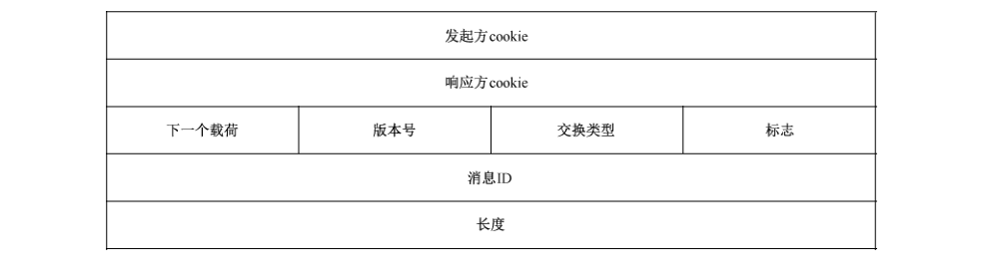

发起方 cookie：这个字段是一个唯一的 8 字节比特串，由发起方随机生成。

响应方 cookie：这个字段是一个唯一的 8 字节比特串，由响应方随机生成。

cookie 的生成方法应依据 RFC 2408 中 2.5.3 要求生成。

下一个载荷：这个字段为 1 个字节，说明消息中的第一个载荷的类型。载荷类型的定义如表 1 所示。

**表1 载荷类型的定义**

| 下一个载荷 | 值 |
| --- | --- |
| 无（None） | 0 |
| 安全联盟（Security Association） | 1 |
| 建议（Proposal） | 2 |
| 变换（Transform） | 3 |

| 密钥交换（Key Exchange） | 4 |
| 标识（Identification） | 5 |
| 证书（Certificate） | 6 |
| 证书请求（Certificate Request） | 7 |
| 杂湊（Hash） | 8 |
| 签名（Signature） | 9 |
| Nonce | 10 |
| 通知（Norigication） | 11 |
| 删除（Delete） | 12 |
| 厂商（Vendor） | 13 |
| 属性载荷 | 14 |
| NAT_D | 20 |
| NAT_OA | 21 |
| 对称密钥载荷（SK） | 128 |
| 保留（Reserved） | 15~19,22~127 |
| 私有使用（PrivateUse） | 129~255 |

版本号：这个字段为 1 个字节，其中 0～3 位表示主版本号，4～7 位表示次版本号。本标准规定主版本号为 1，次版本号为 1。

交换类型：这个字段为 1 个字节，说明组成消息的交换的类型。交换类型的定义如表 2 所示。

**表2 交换类型的定义**

| 交换类型 | 分配的值 |
| --- | --- |
| 无（None） | 0 |
| 基本（Base） | 1 |
| 身份保护（Identity Protection） | 2 |
| 仅鉴别（Authentication Only） | 3 |
| 信息（Informational） | 5 |
| 将来使用（Future Use） | 6~31 |
| DOI 具体使用（DOI Specific Use） | 32～239 |
| 私有使用（Private Use） | 240~255 |

本标准规定密钥交换第一阶段使用的交换类型为身份保护类型即主模式，其值为2。第二阶段交换使用的快速模式所分配的值为32。

标志：这个字段的长度为 1 个字节，说明为密钥交换协议设置的具体选项。目前使用了这个域的前 3 个比特，其他比特在传输前被置为 0。具体定义如下：

- 加密比特：这是标志字段中的最低有效比特。当这个比特被置为 1 时，该消息头后面所有的载荷都采用 ISAKMP SA 中指定的密码算法加密。当这个比特被置为 0 时，载荷不加密。
- 提交比特：这是标志字段的第 2 个比特，本标准中其值为 0。
- 仅鉴别比特：这是标志字段的第 3 个比特，本标准中其值为 0。

消息ID：这个字段的长度4字节，第一阶段中该字段0，在第二阶段为发起方生成的随机数。

它作为唯一的消息标志，用于在第二阶段的协商中标识协议状态。

长度：这个字段的长度为4字节，长度数值以字节为单位，计算范围包含消息头和载荷在内的整个消息。

##### 6.1.5.2 通用载荷头

每个载荷由通用载荷头开始。通用载荷头定义了载荷的边界，所以就可以联接不同的载荷。通用载荷头的定义如图2所示。


下一个载荷：这个字段的长度为1个字节，标识了本载荷后下一个载荷的类型。如果当前载荷是最后一个，则该字段将被置0。载荷类型由表1定义。

保留：这个字段的长度为1个字节，其值为0。

载荷长度：这个字段的长度为2个字节，长度数值以字节为单位，计算范围包含通用载荷头在内的整个载荷。

##### 6.1.5.3 SA 载荷

SA 载荷用于协商安全联盟，并且指定协商所基于的解释域 DOI。载荷的格式依赖于它使用的DOI，本载荷的类型值为1。SA 载荷的格式如图3所示。


下一个载荷：这个字段的长度为1个字节，标识了本载荷后下一个载荷的类型。如果当前载荷是最后一个，则该字段将被置为0。载荷类型由表1定义。

保留：这个字段的长度为1个字节，其值为0。

载荷长度：这个字段的长度为2个字节，长度数值以字节为单位，计算范围包括SA 载荷、所有建议载荷和所有与被提议的安全联盟有关的变换载荷。

解释域（DOI）：这个字段长度为4个字节，其值为无符号整数，它指定协商所基于的DOI，这个字段的值为1。

情形：这个字段长度为 4 个字节，表明协商发生时的情形，用来决定需要的安全服务的信息。定义如下：

- SIT_IDENTITY_ONLY：其值为 1。表明 SA 将由一个相关的标识载荷中的源标识信息来标识。
- SIT_SECRECY：其值为 2。表明 SA 正在一个需经标记的秘密的环境中协商。
- SIT_INTEGRITY：其值是 4。表明 SA 正在一个需经标记的完整性环境中协商。

本标准默认采用 SIT_IDENTITY_ONLY 情形。

##### 6.1.5.4 建议载荷

建议载荷用于密钥交换的发起方告知响应方它优先选择的安全协议以及希望协商中的SA采用的相关安全机制，本载荷的类型值为2。建议载荷的格式如图4所示。

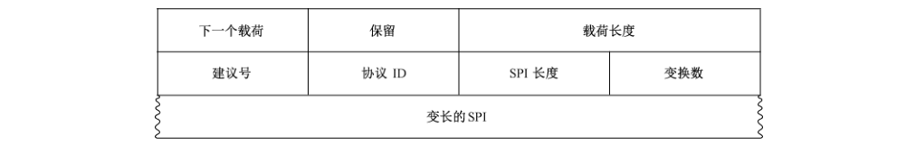

下一个载荷：这个字段的长度为1个字节，如果后面还有建议载荷，其值为2，否则应为0。

保留：这个字段的长度为1个字节，其值为0。

载荷长度：这个字段的长度为2个字节，长度数值以字节为单位，用于表示整个建议载荷的长度，计算范围包括通用载荷头、建议载荷所有与该建议有关的变换载荷，该长度仅用于标示本建议载荷的长度。

建议号：这个字段的长度为1个字节，用于表示本建议载荷的建议编号。多个建议的建议号相同表示这些建议是“逻辑与”的关系，不同表示这些建议是“逻辑或”的关系；单调递增的建议号表示对建议的优先选择顺序，建议号越小优先权越高。

协议 ID：这个字段的长度为1个字节，用于表示协议标识符。协议标识符的定义如表3所示。

**表3 协议标识符的定义**

| 协议标识符 | 描述 | 值 |
| --- | --- | --- |
| RESERVED | 未分配 | 0 |
| PROTO_ISAKMP | ISAKMP 的协议标识符 | 1 |
| PROTO_IPSec_AH | AH 的协议标识符 | 2 |
| PROTO_IPSec_ESP | ESP 的协议标识符 | 3 |
| PROTO_IPCOMP | IP压缩的协议标识符 | 4 |

SPI 长度：这个字段的长度为1个字节，长度数值以字节为单位，用于表示 SPI 的长度。在第一阶段该长度为0，在第二阶段该长度为4。

变换数：这个字段的长度为1个字节，标示建议的变换载荷个数。

变长的SPI：在第一阶段没有这个字段，在第二阶段这个字段的长度为4个字节，其内容是该建议的提出者产生的随机数。

##### 6.1.5.5 变换载荷

变换载荷用于密钥交换的发起方告知响应方为一个指定的协议提供不同的安全机制，本载荷的类型值为3。变换载荷的格式如图5所示。

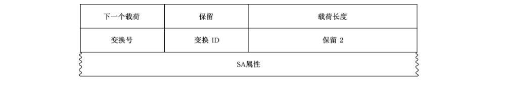

下一个载荷：这个字段的长度为1个字节，如果后面还有变换载荷，其值为3，否则应为0。

保留：这个字段的长度为1个字节，其值为0。

载荷长度：这个字段的长度为2个字节，长度数值以字节为单位，用于表示本变换载荷的长度。计算范围包括通用载荷头、变换载荷和所有的SA 属性载荷。

变换号：这个字段的长度为1个字节，用于表示本变换载荷的变换编号。单调递增的变换号表示对变换的优先选择顺序，变换号越小优先权越高。

变换 ID：这个字段的长度为1个字节，用于表示建议协议的变换标识符。在第一阶段该字段的值为1，在第二阶段根据不同的协议选用不同的变换ID。AH协议的变换ID 的定义如表4所示，ESP 协议的变换 ID 的定义如表5所示。

**表4 AH 协议的变换 ID 的定义**

| 变换 ID | 描述 | 值 |
| --- | --- | --- |
| RESERVED | 未使用 | 0,1 |
| AH_SM3 | 使用带 256 比特 SM3 密码杂凑算法的 HMAC | 20 |

**表5 ESP 协议的变换 ID 的定义**

| 变换 ID | 描述 | 值 |
| --- | --- | --- |
| RESERVED | 未使用 | 0 |
| ESP_SM4 | SM4分组密码算法 | 129 |

保留 2：这个字段的长度为2个字节，其值为0。

SA 属性：该字段的长度是可变的，用于表示本变换的SA 属性。该字段的具体定义见 6.1.5.6。

##### 6.1.5.6 SA 属性载荷

SA 属性载荷只能用于变换载荷之后，并且没有通用载荷头，用于描述SA属性的数据结构，本载荷的类型值为14。SA属性载荷的格式如图6所示。

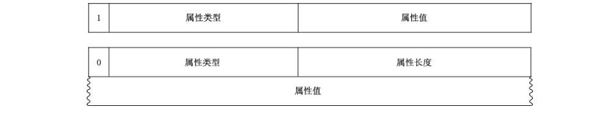

属性类型：这个字段的长度为2个字节，用于表示属性类型。该字段的最高有效比特（比特0）如果为0，属性值是变长的，并且本载荷有3个字段，分别是属性类型、属性长度和属性值。如果属性类型最高有效比特为1，属性值是定长的并且本载荷仅有2个字段，分别是属性类型和属性值。如果属性类型是变长的，并且属性值能在两个字节中表示，那么变长的属性可以用定长表示。

第一阶段密钥交换属性类型的定义如表6所示。

**表6 第一阶段密钥交换属性类型的定义**

| 分类 | 值 | 长度 |
| --- | --- | --- |
| 加密算法 | 1 | 定长 |
| Hash 算法 | 2 | 定长 |
| 鉴别方式 | 3 | 定长 |
| 交换群描述 | 4 | 定长 |
| 交换群类型 | 5 | 定长 |
| 群素数/不可约多项式 | 6 | 变长 |
| 群产生器1 | 7 | 变长 |
| 群产生器2 | 8 | 变长 |
| 群曲线 A | 9 | 变长 |
| 群曲线B | 10 | 变长 |
| SA 生存期类型 | 11 | 定长 |
| SA 生存期（SA Life Duration） | 12 | 变长 |
| 伪随机函数（PRF） | 13 | 定长 |
| 密钥长度 | 14 | 定长 |
| 字段大小 | 15 | 定长 |
| 群顺序 | 16 | 变长 |
| 块大小 | 17 | 定长 |
| 非对称算法类型 | 20 | 定长 |

第二阶段密钥交换属性类型的定义如表7所示。

**表7 第二阶段密钥交换属性类型的定义**

| 分类 | 值 | 长度 |
| --- | --- | --- |
| SA 生存类型（SA Life Type） | 1 | 定长 |
| SA 生存期（SA Life Duration） | 2 | 变长 |
| 组描述（Group Description） | 3 | 定长 |
| 封装模式（Encapsulation Mode） | 4 | 定长 |
| 鉴别算法（Authentication Algorithm） | 5 | 定长 |
| 密钥长度（Key Length） | 6 | 定长 |
| 密钥轮数（Key Rounds） | 7 | 定长 |
| 压缩字典长度（Compress Dictionary Size） | 8 | 定长 |
| 私有压缩算法（Compress Private Algorithm） | 9 | 变长 |

属性值：这个字段如果是定长的，其长度为2个字节。如果是变长的，其长度由属性长度字段指定。

属性长度：当属性值是变长时，该字段用于表示属性值的长度。

第一阶段加密算法属性值的定义如表8所示。

**表8 第一阶段加密算法属性值的定义**

| 可选择算法的名称 | 描述 | 值 |
| --- | --- | --- |
| ENC_ALG_SM4 | SM4 分组密码算法 | 129 |

第一阶段密码杂凑算法属性值的定义如表9所示。

**表9 第一阶段密码杂凑算法属性值的定义**

| 名称 | 描述 | 值 |
| --- | --- | --- |
| HASH_ALG_SM3 | SM3密码杂凑算法 | 20 |

第一阶段鉴别方式属性值的定义如表10所示。

**表10 第一阶段鉴别方式属性值的定义**

| 名称 | 描述 | 值 |
| --- | --- | --- |
| AUTH_METHOD_DE | 公钥数字信封鉴别方式 | 10 |

SA 生存期类型属性值的定义适用于第一阶段和第二阶段，如表11所示。

**表11 SA 生存期类型属性值的定义**

| 名称 | 描述 | 值 |
| --- | --- | --- |
| SA_LD_TYPE_SEC | 秒 | 1 |
| SA_LD_TYPE_KB | 千字节 | 2 |

第一阶段公钥算法类型属性值的定义如表12所示。

**表12 第一阶段公钥算法类型属性值的定义**

| 名称 | 描述 | 值 |
| --- | --- | --- |
| ASYMMETRIC_SM2 | SM2 椭圆曲线密码算法 | 2 |

第二阶段封装模式属性值的定义如表13所示。

**表13 第二阶段封装模式属性值的定义**

| 名称 | 描述 | 值 |
| --- | --- | --- |
| RESERVED | 使用 | 0 |
| ENC_MODE_TUNNEL | 隧道模式 | 1 |
| ENC_MODE_TRNS | 传输模式 | 2 |
| ENC_MODE_UDPTUNNEL_RFC | NAT 穿越隧道模式 | 3 |
| ENC_MODE_UDPTRNS_RFC | NAT 穿越传输模式 | 4 |

第二阶段鉴别算法属性值的定义如表14所示。

**表14 第二阶段鉴别算法属性值的定义**

| 名称 | 描述 | 值 |
| --- | --- | --- |
| RESERVED | 使用 | 0 |
| HMAC_SM3 | SM3 密码杂凑算法的 HMAC | 20 |

##### 6.1.5.7 标识载荷

标识载荷用于通信双方交换身份信息，该信息用于确认通信双方的身份，本载荷的类型值为5。标识载荷的格式如图7所示。

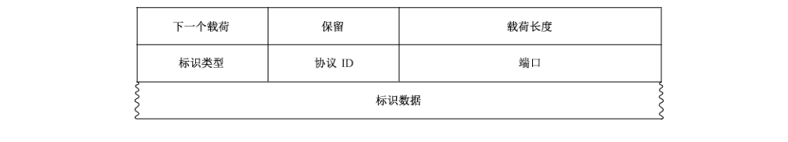

下一个载荷：这个字段的长度为1个字节，标识了本载荷后下一个载荷的类型。如果当前载荷是最后一个，则该字段将被置为0。载荷类型由表1定义。

保留：这个字段的长度为1个字节，其值0。

载荷长度：这个字段的长度为2个字节，长度数值以字节为单位，用于包含通用载荷头在内的整个载荷长度。

标识类型：这个字段的长度为1个字节，用于表示标识数据字段中的身份信息类型。标识类型的定义如表15所示。

**表15 标识类型的定义**

| ID 类型 | 描述 | 值 |
| --- | --- | --- |
| RESERVED | 未使用 | 0 |
| ID_IPv4_ADDR | 一个单独的4字节IPv4地址 | 1 |
| ID_FQDN | 完全合格的域名字符串 | 2 |
| ID_USER_FQDN | 完全合格的用户名字符串 | 3 |
| ID_IPv4_ADDR_SUBNET | 带有4字节子网掩码的 IPv4地址 | 4 |
| ID_IPv6_ADDR | 一个单独的 16 字节 IPv6 地址 | 5 |
| ID_IPv6_ADDR_SUBNET | 一个带有16字节子网掩码的 IPv6地址 | 6 |
| ID_IPv4_ADDR_RANGE | 一个 IPv4 的地址范围 | 7 |
| ID_IPv6_ADDR_RANGE | 一个 IPv6 的地址范围 | 8 |
| ID_DER_ASN1_DN | 一个 ASN.1 X.500 的文本编码 | 9 |
| ID_DER_ASN1_GN | 一个 ASN.1 X.500 的二进制编码 | 10 |
| ID_KEY_ID | 用于传递特定厂商信息的字节流 | 11 |

在第一阶段可以使用的标识类型为：

- ID_IPv4_ADDR
- ID_IPv6_ADDR
- ID_DER_ASN1_DN
- ID_DER_ASN1_GN
- ID_FQDN
- ID_USER_FQDN
- ID_KEY_ID

在第二阶段可以使用的标识类型为：

- ID_IPv4_ADDR
- ID_IPv6_ADDR
- ID_IPv4_ADDR_SUBNET
- ID_IPv6_ADDR_SUBNET
- ID_IPv4_ADDR_RANGE
- ID_IPv6_ADDR_RANGE

协议 ID：这个字段的长度为 1 个字节，用于表示一个 IP 协议的上层协议号。值为 0 表明忽略这个字段，在第一阶段这个值应为 0。在第二阶段是用户配置的安全策略五元组的协议，值为 0 表明忽略这个字段。

端口：这个字段的长度为 2 个字节，用于表示一个上层协议的端口。值为 0 表明忽略这个字段，在第一阶段这个值应为 0。在第二阶段是用户配置的安全策略五元组的端口，值为 0 表明忽略这个字段。

标识数据：这个字段是变长的，用于表示与ID 类型字段相对应的标识信息。

##### 6.1.5.8 证书载荷

证书载荷用于通信双方交换证书以及证书相关信息，本载荷的类型值为6。

证书载荷的格式如图8所示。

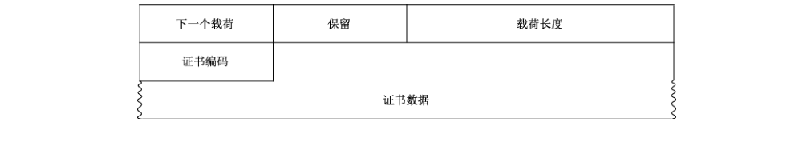

下一个载荷：这个字段的长度为1个字节，标识了本载荷后下一个载荷的类型。如果当前载荷是最后一个，则该字段将被置为0。载荷类型由表1定义。

保留：这个字段的长度为1个字节，其值为0。

载荷长度：这个字段的长度为2个字节，长度数值以字节为单位，用于表示包含通用载荷头在内的整个载荷长度。

证书编码：这个字段的长度为1个字节，用于表示证书数据字段的证书编码类型。证书编码类型定义如表16所示。

**表 16 证书编码类型定义**

| 证书类型 | 值 |
| --- | --- |
| X.509签名证书 | 4 |
| X.509 加密证书 | 5 |

在本标准中，只能使用X.509格式的签名证书和加密证书。

证书数据：这个字段是变长字段，证书的结构及定义见 GB/T 20518。

##### 6.1.5.9 杂凑载荷

杂凑载荷的内容是在 SA 协商过程中选定的密码杂凑算法生成的数据，本载荷的类型值为 8。杂凑载荷的格式如图 9 所示。


下一个载荷：这个字段的长度为 1 个字节，标识了本载荷后下一个载荷的类型。如果当前载荷是最后一个，则该字段将被置为 0。载荷类型由表 1 定义。

保留：这个字段的长度为1个字节，其值为0。

载荷长度：这个字段的长度为2个字节，长度数值以字节为单位，用于表示包含通用载荷头在内的整个载荷长度。

杂凑数据：这个字段的长度是变长的，其内容为密码杂凑算法生成的数据。

##### 6.1.5.10 签名载荷

签名载荷的内容是在SA 协商过程中的数字签名算法生成的数据，本载荷的类型值为9。签名载荷的格式如图10所示。


下一个载荷：这个字段的长度为1个字节，标识了本载荷后下一个载荷的类型。如果当前载荷是最后一个，则该字段将被置为0。载荷类型由表1定义。

保留：这个字段的长度为1个字节，其值为0。

载荷长度：这个字段的长度为2个字节，数值长度以字节为单位，用于表示包含通用载荷头在内的整个载荷长度。

签名数据：这个字段的长度是变长的，其内容为签名算法生成的数据。

##### 6.1.5.11 Nonce 载荷

Nonce载荷的内容是用于保护交换数据的随机数据，本载荷的类型值为10。Nonce 载荷的格式如图11所示。


下一个载荷：这个字段的长度为1个字节，标识了本载荷后下一个载荷的类型。如果当前载荷是最后一个，则该字段将被置为0。载荷类型由表1定义。

保留：这个字段的长度为1个字节，其值为0。

载荷长度：这个字段的长度为2个字节，数值长度以字节为单位，用于表示包含通用载荷头在内的整个载荷长度。

Nonce 数据：这个字段的长度是变长的，其内容为随机数。

##### 6.1.5.12 通知载荷

通知载荷用于传送通知数据，本载荷的类型值为11，通知载荷的格式如图12所示。

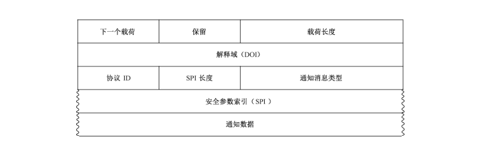

下一个载荷：这个字段的长度为1个字节，标识了本载荷后下一个载荷的类型。如果当前载荷是最后一个，则该字段将被置为0。载荷类型由表1定义。

保留：这个字段的长度为1个字节，其值为0。

载荷长度：这个字段的长度2个字节，长度数值以字节为单位，用于表示包含通用载荷头在内的整个载荷长度。

解释域（DOI）：这个字段的长度4个字节，这个字段的值为1。

协议 ID：这个字段的长度为1个字节，用于表示协议标识符。协议标识符的定义如表3所示。

SPI 长度：这个字段的长度为1个字节，长度数值以字节为单位，用于表示 SPI 的长度。在第一阶段该长度为0，在第二阶段该长度为4。

通知消息类型：这个字段的长度为2个字节，用于表示通知消息类型。通知消息的错误类型如表17所示，通知消息的状态类型如表18所示。

**表17 通知消息的错误类型**

| 通知类型 | 描述 | 值 |
| --- | --- | --- |
| INVALID_PAYLOAD_TYPE | 无效的载荷类型 | 1 |
| DOI_NOT_SUPPORTED | 不支持的 DOI | 2 |
| SITUATION_NOT_SUPPORTED | 不支持的 SITUATION | 3 |
| INVALID_COOKIE | 无效的 cookie | 4 |
| INVALID_MAJOR_VERSION | 无效的主版本 | 5 |
| INVALID_MINOR_VERSION | 无效的微版本 | 6 |
| INVALID_EXCHANGE_TYPE | 无效的交换类型 | 7 |
| INVALID_FLAGS | 无效的标志 | 8 |
| INVALID_MESSAGE_ID | 无效的消息 ID | 9 |
| INVALID_PROTOCOL_ID | 无效的协议号 | 10 |
| INVALID_SPI | 无效的 SPI | 11 |
| INVALID_TRANSFORM_ID | 无效的变换号 | 12 |
| ATTRIBUTES_NOT_SUPPORTED | 不支持的属性 | 13 |
| NO_PROPOSAL_CHOSEN | 建议不被接受 | 14 |
| BAD_PROPOSAL_SYNTAX | 错误的建议语法 | 15 |
| PAYLOAD_MALFORMED | 错误的载荷格式 | 16 |
| INVALID_KEY_INFORMATION | 无效的密钥信息 | 17 |
| INVALID_ID_INFORMATION | 无效的 ID 信息 | 18 |
| INVALID_CERT_ENCODING | 无效的证书编码 | 19 |
| INVALID_CERTIFICATE | 无效的证书 | 20 |
| CERT_TYPE_UNSUPPORTED | 不支持的证书类型 | 21 |
| INVALID_CERT_AUTHORITY | 无效的证书机构 | 22 |

| INVALID_HASH_INFORMATION | 无效的 Hash 信息 | 23 |
| AUTHENTICATION_FALIED | 失败的鉴别 | 24 |
| INVALID_SIGNATURE | 无效的签名 | 25 |
| ADDRESS_NOTIFICATION | 地址通知 | 26 |
| NOTIFY_SA_LIFETIME | 安全联盟生存周期通知 | 27 |
| CERTFICATE_UNAVAILABLE | 证书不可用 | 28 |
| UNSUPPORTED_EXCHANGE_TYPE | 不支持的交换类型 | 29 |
| UNEQUAL_PAYLOAD_LENGTHS | 错误的载荷长度 | 30 |
| RESERVED | 保留 | 31～8 191 |
| PRIVATE | 私有 | 8 192～16 383 |

**表18 通知消息的状态类型**

| 通知类型 | 值 |
| --- | --- |
| 已连接 | 16 384 |
| 保留（将来使用） | 16 385～24 575 |
| 特定于 DOI 的编码 | 24 576～32 767 |
| 私有（将来使用） | 32 768～40 959 |
| 保留（将来使用） | 40 960～65 535 |

SPI：在第一阶段没有这个字段。在第二阶段这个字段的长度为4个字节，其内容是接收方建议载荷中的SPI 值。

通知数据：这个字段是变长的，用于传送通知消息类型对应的通知数据。

##### 6.1.5.13 删除载荷

删除载荷用于通知对方某个 SA 已经取消，本载荷的类型值为12。删除载荷的格式如图13所示。

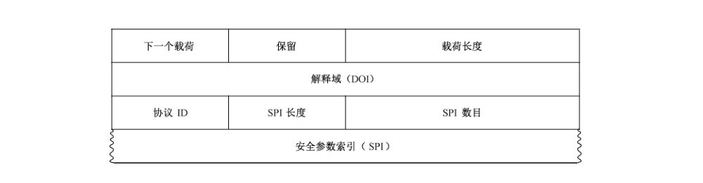

下一个载荷：这个字段的长度为1个字节，标识了本载荷后下一个载荷的类型。如果当前载荷是最后一个，则该字段将被置为0。载荷类型由表1定义。

保留：这个字段的长度为1个字节，其值为0。

载荷长度：这个字段的长度为2个字节，长度数值以字节为单位，用于表示包含通用载荷头在内的整个载荷长度。

解释域（DOI）：这个字段的长度为4个字节，其值为1。

协议 ID：这个字段的长度为1个字节，用于表示要删除的 SA 的协议标识符。协议标识符的定义如表3所示。

SPI 长度：这个字段的长度为1个字节，长度数值以字节为单位，用于表示 SPI 的长度。删除第一阶段的 SA 时该长度为16，删除第二阶段的 SA 时该长度为4。

SPI 数目：这个字段的长度为2个字节，用于表示本载荷中包含的SPI数目。

安全参数索引（SPI）：这个字段是变长的，用于表示被删除SA的SPI。这个字段的长度由SPI 长度字段和 SPI数目字段的值决定。

##### 6.1.5.14 厂商 ID 载荷

厂商 ID 载荷用于传递厂商自定义的常量，本载荷的类型值为13。厂商 ID 载荷的格式如图14所示。


下一个载荷：这个字段的长度为1个字节，标识了本载荷后下一个载荷的类型。如果当前载荷是最后一个，则该字段将被置为0。载荷类型由表1定义。

保留：这个字段的长度为1个字节，其值为0。

载荷长度：这个字段的长度为2个字节，长度数值以字节为单位，用于表示包含通用载荷头在内的整个载荷长度。

厂商 ID（VID）：这个字段是变长的，其内容为厂商 ID 串的杂凑值。

##### 6.1.5.15 NAT_D 载荷

NAT_D 载荷用于检测两个密钥交换通信方之间是否存在 NAT 设备，以及检测 NAT 设备的确切位置，本载荷的类型值20。NAT_D 载荷的格式如图15所示。


下一个载荷：这个字段的长度为1个字节，标识了本载荷后下一个载荷的类型。如果当前载荷是最后一个，则该字段将被置为0。载荷类型由表1定义。

保留：这个字段的长度为1个字节，其值为0。

载荷长度：这个字段的长度为2个字节，长度数值以字节为单位，用于表示包含通用载荷头在内的整个载荷长度。

载荷内容：这个字段是变长的，其内容为：HASH（CKY-I | CKY-R | IP | Port）

##### 6.1.5.16 NAT_OA 载荷

NAT_OA 载荷用于密钥交换第二阶段中，当使用传输模式穿越 NAT时需要传送这个载荷，本载荷的类型值为21。NAT_OA 载荷的载荷格式如图16所示。

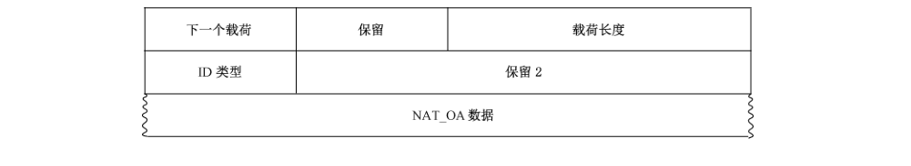

下一个载荷：这个字段的长度为1个字节，标识了本载荷后下一个载荷的类型。如果当前载荷是最后一个，则该字段将被置为0。载荷类型由表1定义。

保留：这个字段的长度为1个字节，其值为0。

载荷长度：这个字段的长度为2个字节，长度数值以字节为单位，用于表示包含通用载荷头在内的整个载荷长度。

ID 类型：这个字段的长度为1个字节，其值为表15中的 ID_IPV4_ADDR 的值或 ID_IPv6_ADDR 的值。

保留 2：这个字段的长度为3个字节，其值为0。

NAT_OA 数据：这个字段的值是4字节IPv4地址或16字节IPv6地址。

##### 6.1.5.17 对称密钥载荷

对称密钥载荷用于在密钥交换第一阶段时，传递数字信封中的对称密钥，本载荷的类型值为128。

对称密钥载荷的格式如图17所示。


下一个载荷：这个字段的长度为1个字节，标识了本载荷后下一个载荷的类型。如果当前载荷是最后一个，则该字段将被置为0。载荷类型由表1定义。

保留：这个字段的长度为1个字节，其值为0。

载荷长度：这个字段的长度为2个字节，长度数值以字节为单位，用于表示包含通用载荷头在内的整个载荷长度。

对称密钥密文：这个字段的长度是可变的，其内容为由公钥加密的对称密钥。

#### 6.1.6 密钥交换的数据包格式

##### 6.1.6.1 概述

密钥交换消息是基于 UDP 传输的，使用 UDP 500端口或者4 500端口。在 UDP 500端口上发送的密钥交换消息直接跟在 UDP 报头后面。在 UDP 4 500端口上发送的密钥交换消息，需要在 UDP 头与密钥交换消息之间插入4个全0的字节。

每一条密钥交换消息以消息头 HDR 作为开始标志。每个 HDR 后可以有一个或者多个载荷。如果有多个载荷，则用每一个载荷内的“下一个载荷”字段进行标识，如果“下一个载荷”字段为0，说明消息结束。

在本条的所有图中，“下一载荷”用“NP”来表示。

##### 6.1.6.2 主模式消息1的数据包格式

主模式消息1的数据包的格式如图18所示，其中 SA 载荷中应当支持 SM4-SM3变换载荷。

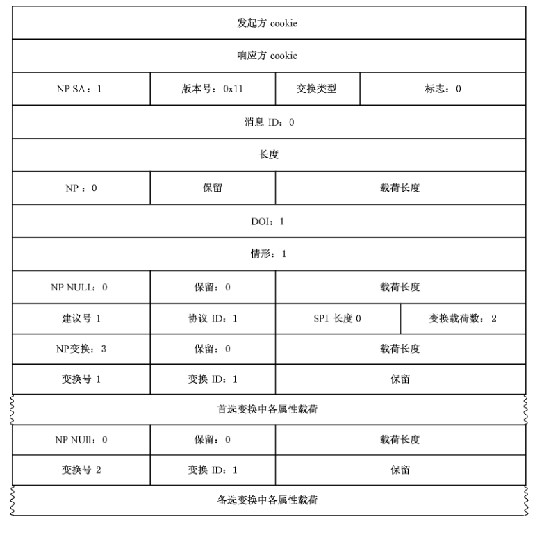

##### 6.1.6.3 主模式消息2的数据包格式

主模式消息2的数据包的格式如图19所示。

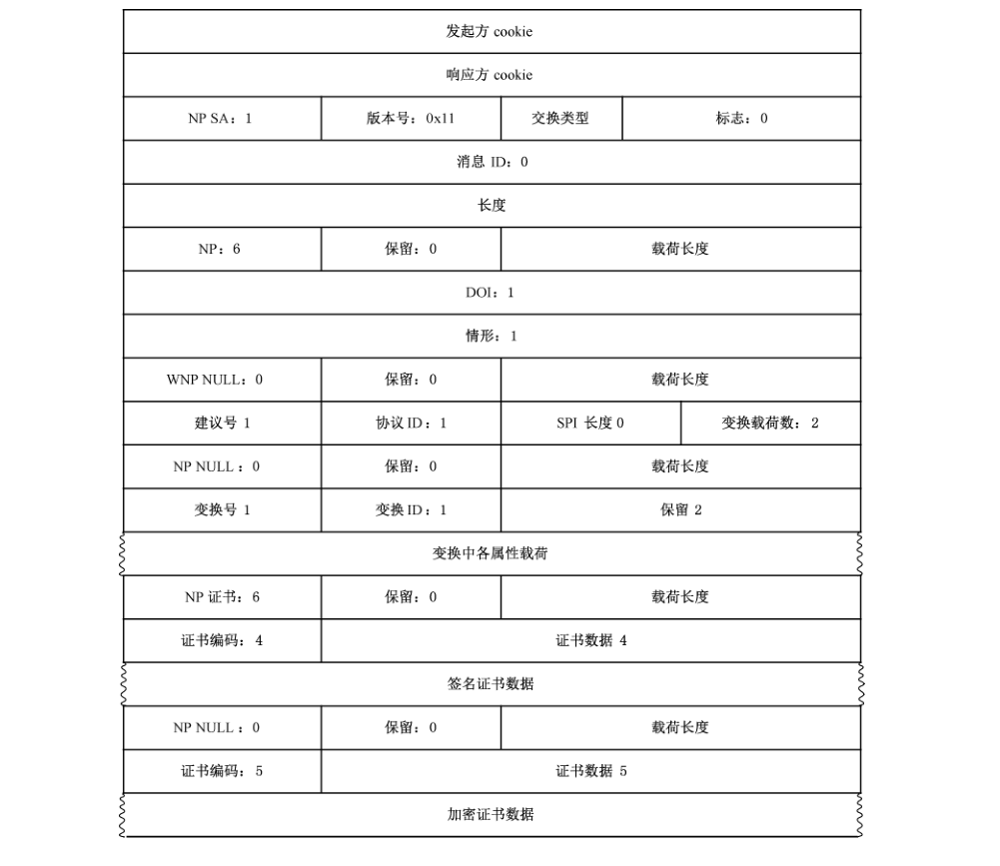

##### 6.1.6.4 主模式消息3的数据包格式

使用证书鉴别的主模式消息3数据包的格式如图20所示。

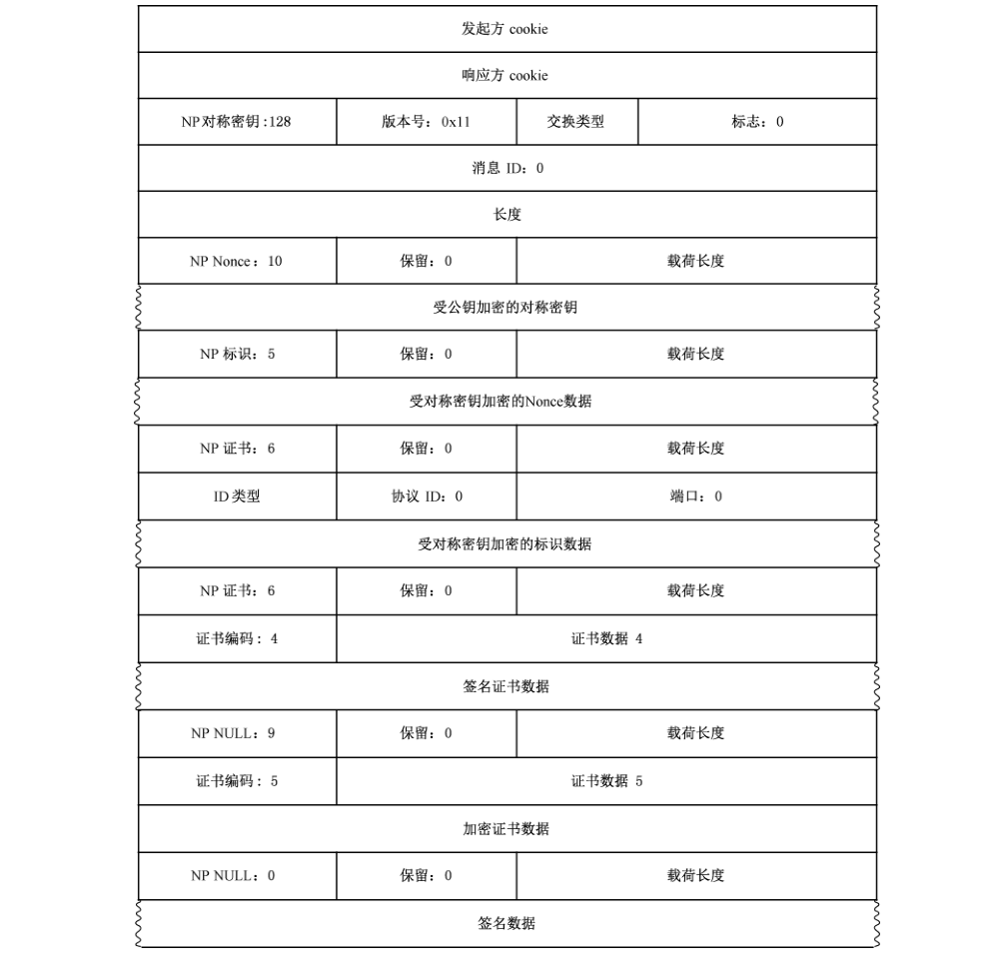

##### 6.1.6.5 主模式消息4的数据包格式

主模式消息4数据包的格式如图21所示。

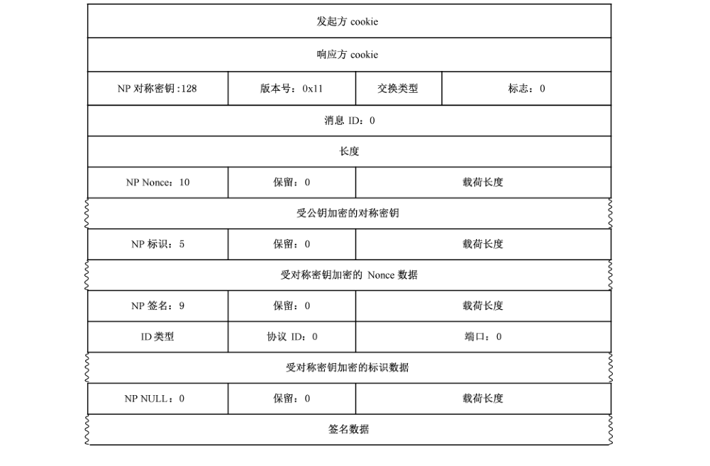

##### 6.1.6.6 主模式消息5的数据包格式

主模式消息5的数据包的格式如图22所示。

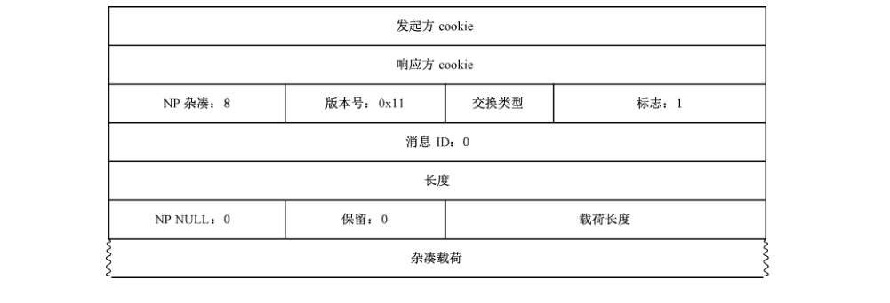

##### 6.1.6.7 主模式消息6的数据包格式

主模式消息6的数据包的格式如图23所示。

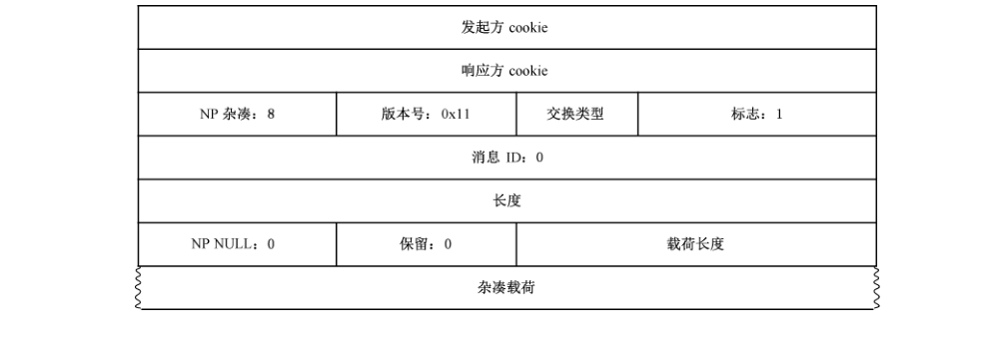

##### 6.1.6.8 快速模式消息1的数据包格式

快速模式消息1的数据包的格式如图24所示，其中 SA 载荷中有一个 ESP 协议建议，建议中有两种变换。

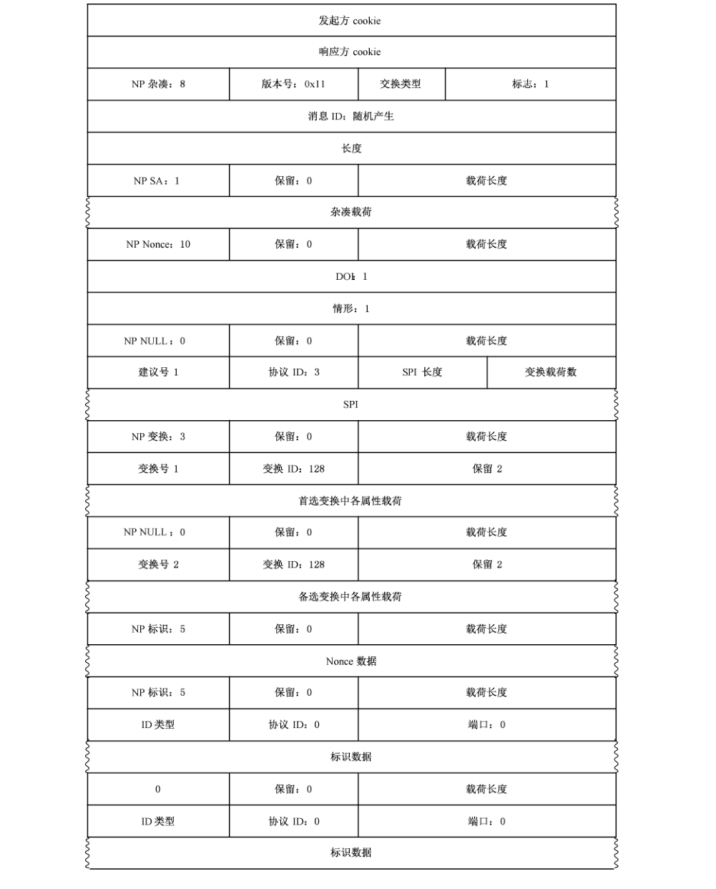

##### 6.1.6.9 快速模式消息2的数据包格式

快速模式消息2的数据包的格式如图25所示，其中选择了一种变换。

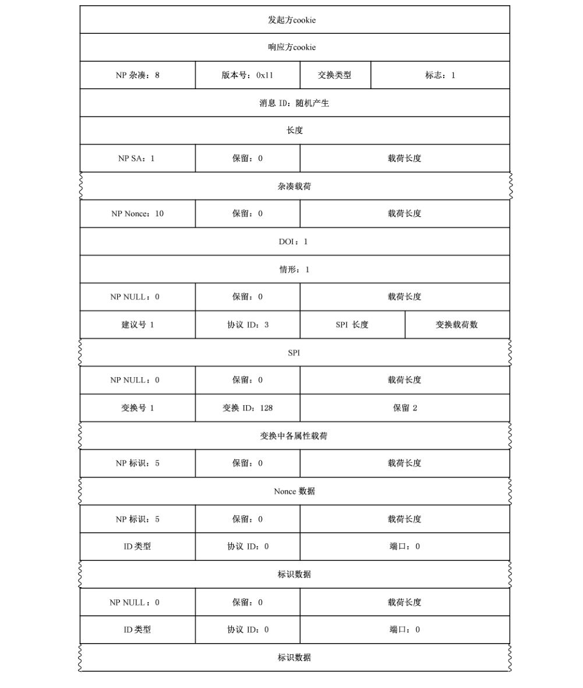

##### 6.1.6.10 快速模式消息3的数据包格式

快速模式消息3的数据包的格式如图 26 所示。

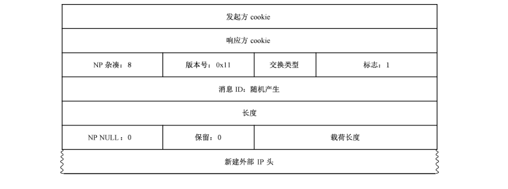

### 6.2 安全报文协议

#### 6.2.1 鉴别头协议 AH

##### 6.2.1.1 概述

鉴别头协议 AH 用于为 IP 数据报文提供无连接的完整性、数据源鉴别和抗重放攻击服务。AH为IP 头提供尽可能多的鉴别，同时为上层协议数据提供鉴别。对于抗重放攻击服务，AH依靠一个单调递增的抗重放攻击序列号来完成。AH 不能提供机密性服务，因此本标准规定AH 不能单独使用，而应和封装安全载荷协议 ESP 嵌套使用。

##### 6.2.1.2 AH 头格式

AH 头格式见图27，该格式里的所有字段都是强制的，并且被包括在完整性校验值（ICV）计算中。

AH头紧跟在IP 协议头（IPv4、IPv6，或者扩展）之后，在IP 协议头中的协议字段（IPv4）或者下一个头（IPv6、扩展）字段的值是51。

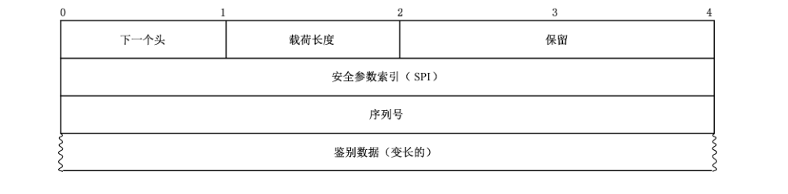

下一个头：下一个头是一个1字节的字段，该字段指定了鉴别头后面下一个载荷的类型。这个字段的值是由 Internet 分配数字机构（IANA）的最新“分配数字”［STD-2］中定义的 IP 协议数字集合分配的。

载荷长度：载荷长度是一个1字节的字段，该字段的值是 AH 头的长度减去2，长度值以4字节单位。

保留：保留字段是一个2字节的字段，留给将来使用。该字段应被设置成0，并且参与完整性校验值 ICV 的计算。

安全参数索引（SPI）：安全参数索引 SPI是一个4字节值，它与目的IP地址和安全协议共同标识了这个数据报文的安全联盟。从1至255范围内的SPI 值是保留给将来使用的，0值保留给本地的特定实现使用并且不能在网络上传送，通信协商得到的 SPI 值不能小于 256。

序列号：序列号是一个无符号的4字节单调递增计数器，发送方对使用该SA 的每个数据报文进行计数，接收方应检测这个字段来实现 SA的抗重放攻击服务。发送方的计数器和接收方的计数器在建立一个 SA时被初始化为0，该序列号在一个 SA生存期内不能循环使用，在这个计数器溢出之前，通信的双方应协商出一个新的SA 来使这个字段复位为0。

鉴别数据：鉴别数据是一个变长字段，它是一个完整性校验值 ICV，用于校验整个 IP报文的完整性（可变字段除外）。该字段的长度应是4字节的整数倍，具体长度取决于所使用的完整性校验算法。

##### 6.2.1.3 鉴别头 AH 的处理

###### 6.2.1.3.1 AH 头的位置

AH 头在传输模式和隧道模式中分别有不同的放置位置。

在IPv4 环境中使用传输模式，AH 头应放在原IP 头之后，上层协议 ESP 之前，如图28所示。

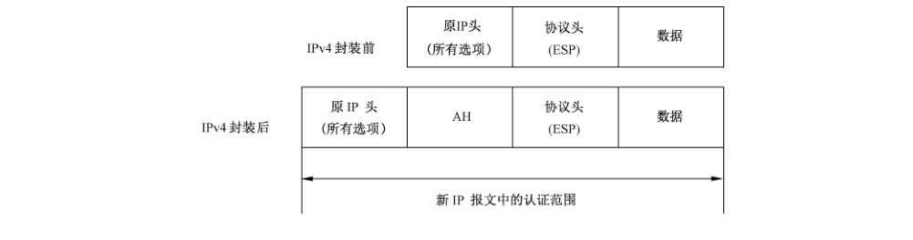

在 IPv6 环境中使用传输模式，AH 头被看作是一个端到端的载荷，因而应该出现在逐跳（Hop-by-Hop）、路由（Routing）和分片扩展头（Fragmentation Extensionheaders）之后。目的选项扩展头（Destination Options Extension Header）既可以出现在 AH 头之前，也可以在 AH 头之后。如图29所示。

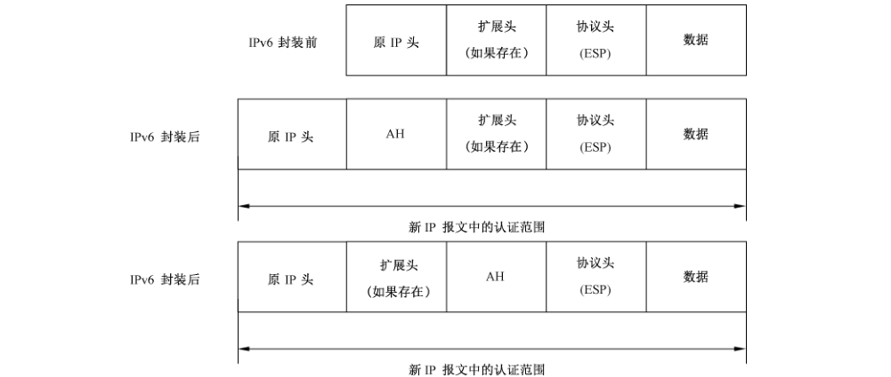

在隧道模式中，AH头保护整个 IP 报文，包括整个原 IP 报文以及新建外部IP 头的部分字段。

图30和图31分别表示了隧道模式中典型的 IPv4 和 IPv6 报文的 AH 头的位置。

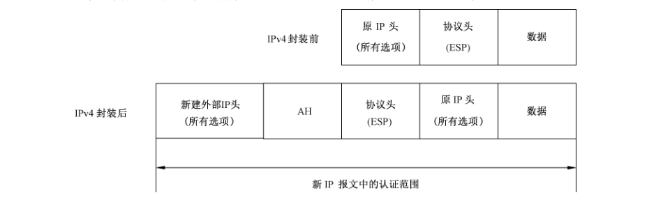

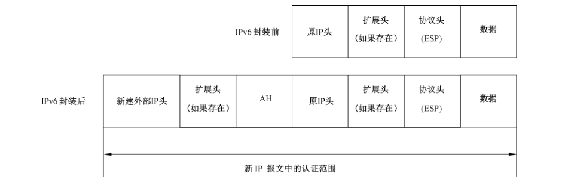

###### 6.2.1.3.2 出站报文处理

###### 6.2.1.3.2.1 概述

出站报文的处理包括查找SA、产生序列号、计算完整性校验值、鉴别数据字段的填充和分片等过程。

###### 6.2.1.3.2.2 查找 SA

应根据本地策略查找SA，只有当一个 IPSec 实现确定了报文与该 SA 相关联后，AH 才应用于一个出站报文。否则应开始新的密钥交换过程，建立 SA。

###### 6.2.1.3.2.3 产生序列号

当建立一个 SA时，发送方的序列号计数器初始化为0，每发送一个报文之前，该计数器加1，并且把这个计数器值赋予序列号字段。当该计数器计数达到最大值前，应生成新的SA。

###### 6.2.1.3.2.4 计算完整性校验值 ICV

接收方采用指定的完整性校验算法对报文计算ICV。IPv4 和 IPv6 的ICV 计算方法分别如下所述：

a）IPv4 中的 ICV 计算

IPv4 基本头字段、IPv4 头的选项、AH 头和上层协议数据都参与 ICV 计算。

IPv4基本头字段中，直接参与计算的字段：版本（Version）、IPv4 头长度（Header Length）、总长度（Total Length）、标识（Identification）、协议（Protocol）、源地址（Source Address）、目的地址 （Destination Address）。

IPv4 基本头字段中，在计算 ICV 之前设置为“0”的字段为：服务类型（TOS）、标志（Flags）、片偏移（Fragment Offset）、生存时间（TTL）、首部校验和（Header Checksum）。

IPv4 头的整个选项被看作一个单元，选项中的类型和长度字段在传送中是不变的，但如果有一个字段是属于可变的，则整个选项用于计算 ICV 时都要清“0”。

整个 AH 头参与ICV 计算，其中完整性校验值字段在计算ICV之前置“0”，在计算后，将计算得到的值赋于该字段。

整个上层协议数据直接参与ICV 计算。

b）IPv6 中的 ICV 计算

IPv6 基本头字段、IPv6 扩展头、AH 头和上层协议数据都参与 ICV 计算。

IPv6 基本头字段中，直接参与计算的字段为：版本（Version）、载荷长度（Payload Length）、下一个头（Next Header）、源地址（Source Address）、没有路由扩展头的目的地址（Destination Address）。

IPv6 基本头字段中，在计算 ICV 之前设置为“0”的字段为：类别（Class）、流标签（Flow Label）、跳极限（Hop Limit）。

IPv6 的扩展头中，在逐跳（Hop-by-Hop）和目的扩展头（Destination Extension Headers）中的 IPv6 选项包含有一个比特，该比特指出选项在传送过程期间是否会改变。对于在路由过程中内容可能变换的任何选项，整个“选项数据（Option Data）”字段在计算和校验 ICV 时应被当作零值的字节串对待。选项类型（Option Type）和选项数据长度（Opt Data Len）被包括进 ICV 计算。由比特位确定为不变的所有选项都被包括进 ICV 计算。

整个 AH 头参与 ICV 计算，其中鉴别数据字段在计算 ICV 之前置“0”，在计算后，将计算得到的值赋于该字段。

整个上层协议数据直接参与ICV 计算。

###### 6.2.1.3.2.5 鉴别数据的填充

鉴别数据字段应确保是4字节（IPv4）或8字节（IPv6）的整数倍，否则需要填充。填充应放在鉴别数据字段的最末端，其内容由发送方任意选择，并且参与ICV计算。

###### 6.2.1.3.2.6 分片

一个 IPSec 实现在 AH 处理之后，如果发现IP数据报文长度超过输出接口的MTU 值，则对处理后的数据报文进行分片。

###### 6.2.1.3.3 入站报文处理

###### 6.2.1.3.3.1 概述

入站报文的处理包括重组、查找SA、验证序列号和验证完整性校验值等过程。

###### 6.2.1.3.3.2 重组

如果需要，在AH 处理之前要进行IP 数据报文重组。AH 不处理分片报文，如果提供给AH处理的一个报文是一个分片的IP 数据报文，接收方应丢弃该报文。

###### 6.2.1.3.3.3 查找 SA

当收到一个包含AH 头的报文时，接收方应根据目的IP 地址、AH 和 SPI来查找SA，查找失败则丢弃该报文。

###### 6.2.1.3.3.4 验证序列号

所有AH 实现应支持抗重放攻击服务，在SA 建立时，接收方序列号计数器应初始化为0。对于每个接收到的报文，接收方应确认报文包含一个序列号，并且该序列号在这个 SA 生命期中不重复，否则应丢弃该报文。

如果该序列号超出接收窗口有效检查范围的高端值，则对报文进行完整性校验。如果校验通过，接收窗口应相应调整；如果校验不通过则丢弃该报文。

接收窗口的大小默认为64。

###### 6.2.1.3.3.5 验证完整性校验值

接收方采用指定的完整性校验算法对报文计算ICV，计算方法和参与计算的内容与出站报文计算ICV的一致。计算的结果与报文中的ICV进行比较。如果一致，则接收到的数据报文是有效的，否则接收方应将收到的数据报文丢弃。

###### 6.2.1.3.3.6 匹配安全策略

检查数据包是否符合设置的安全策略要求。

#### 6.2.2 封装安全载荷 ESP

##### 6.2.2.1 概述

封装安全载荷 ESP 提供了机密性、数据源鉴别、无连接的完整性、抗重放攻击服务和有限信息流量的保护。当ESP单独使用时，应同时选择机密性和数据源鉴别服务，当ESP 和 AH 结合使用时不应选择数据源鉴别服务。

##### 6.2.2.2 ESP 头

###### 6.2.2.2.1 ESP头格式

ESP 头格式见图32，其位置紧接在IPv4、IPv6或者扩展协议之后，在头中的协议（IPv4）字段或者下一个头（IPv6、扩展）字段的值是 50。

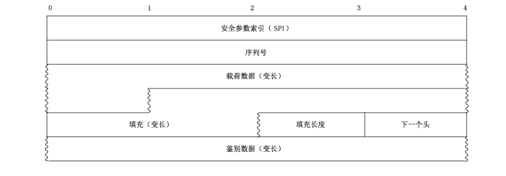

###### 6.2.2.2.2 安全参数索引 SPI

安全参数索引 SPI是一个4字节值，它与目的IP 地址和安全协议共同标识了这个数据报文的安全联盟。从1至255范围内的SPI 值是保留给将来使用的，0值保留给本地的特定实现使用并且不能在网络上传送，通信协商得到的SPI 值不能小于256。

###### 6.2.2.2.3 序列号

序列号是一个无符号的4字节单调递增计数器，发送方对使用该SA 的每个数据报文进行计数，接收方应检测这个字段来实现SA 的抗重放攻击服务。发送方的计数器和接收方的计数器在建立一个SA 时被初始化为0，该序列号在一个 SA 生存期内不能循环使用，在这个计数器溢出之前，通信的双方应协商出一个新的SA 来使这个字段复位为0。

###### 6.2.2.2.4 载荷数据

载荷数据是一个变长的字段，它包含初始化向量 IV 和下一个头字段所描述的数据，其长度单位为字节。

IV 应置于载荷数据首部。

###### 6.2.2.2.5 填充字段

如果载荷数据的长度不是加密算法的分组长度的整数倍，则需要对不足的部分进行填充，填充以字节为单位。如果需要，也可以提供更多的填充数据，但应符合加密算法分组长度的要求。

填充的方法和内容应由指定的加密算法规定。如果加密算法没有规定，则附加在报文之后的第一个字节为1，后续的填充字节按单调递增的顺序拼凑。

###### 6.2.2.2.6 填充长度

填充长度字段指出了填充字节的个数。有效值范围是0至255，其中0表明没有填充字节。

###### 6.2.2.2.7 下一个头

下一个头是一个1字节的字段，该字段指定了 ESP 头后面下一个载荷的类型。这个字段的值是由Internet 分配数字机构（IANA）的最新“分配数字”［STD-2］中定义的IP 协议数字集合分配的。

###### 6.2.2.2.8 鉴别数据

鉴别数据是一个变长字段，它是一个完整性校验值 ICV，是对 ESP 报文去掉ICV 外的其余部分进行完整性校验计算所得的值。该字段的长度由选择的完整性校验算法决定。鉴别数据字段是可选的，只有当SA 选择了完整性校验服务时才包含鉴别数据字段。

##### 6.2.2.3 封装安全载荷 ESP 的处理

###### 6.2.2.3.1 ESP 头的位置

ESP头在传输模式和隧道模式中分别有不同的放置位置。

在IPv4 环境中使用传输模式，ESP 应放在IP 头和它包含的所有选项之后和上层协议之前，如图33 所示，图中“数据”包含“载荷数据”和“填充”，“ESP尾”包含“填充长度”和“下一个头”字段。

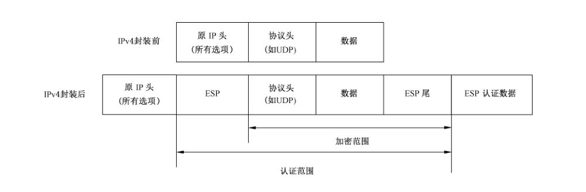

在IPv6 环境中使用传输模式，ESP被看作是一个端到端的载荷，因而应该出现在逐跳（Hop-by- Hop）、路由（Routing）和分片扩展头（Fragmentation Extensionheaders）之后，如图34所示，图中“数据”包含“载荷数据”和“填充”，“ESP 尾”包含“填充长度”和“下一个头”字段。

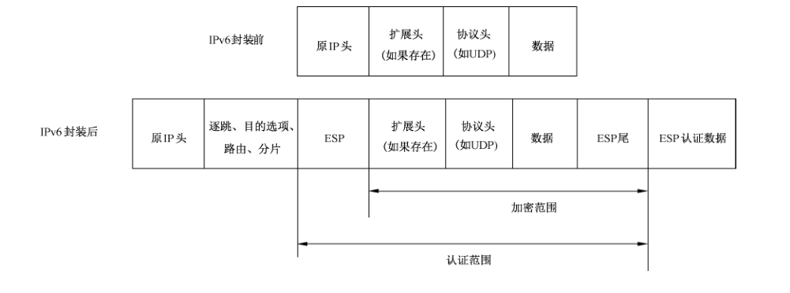

在 IPv4 和 IPv6 中使用隧道模式，ESP 保护包括原内部 IP 头在内的整个原 IP 报文，分别如图35和图36所示，图中“数据”包含“载荷数据”和“填充”，“ESP尾”包含“填充长度”和“下一个头”字段。

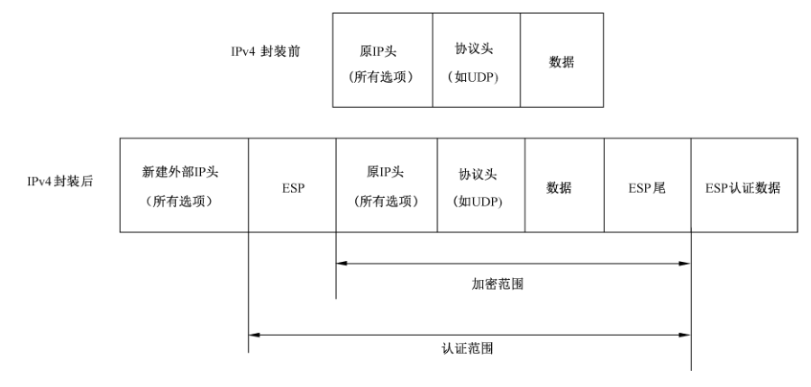

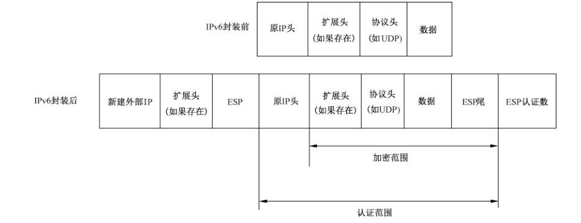

###### 6.2.2.3.2 出站报文处理

###### 6.2.2.3.2.1 概述

出站报文的处理包括查找SA、封装、加密报文、产生序列号、计算完整性校验值和分片等过程，并按照由 6.2.2.3.2.2至6.2.2.3.2.7的顺序进行处理。

###### 6.2.2.3.2.2 查找 SA

应根据本地策略查找SA，只有当一个 IPSec 实现确定了报文与该 SA 相关联后，ESP 才应用于一个出站报文。否则应开始新的密钥交换过程，建立 SA。

###### 6.2.2.3.2.3 封装

在传输模式中，将原始上层协议封装到 ESP 载荷字段中。

在隧道模式中，将整个原始IP 数据报文封装到 ESP 载荷字段中。

###### 6.2.2.3.2.4 加密报文

首先对报文添加所有需要的填充，然后使用由 SA 指定的密钥、加密算法、算法模式和IV 进行加密，加密范围包括载荷数据、填充、填充长度和下一个头。

###### 6.2.2.3.2.5 产生序列号

当建立一个 SA时，发送方的序列号计数器初始化为0，每发送一个报文之前，该计数器加1，并且把这个计数器值插入到序列号字段中。当该计数器计数达到最大值前，应生成新的SA。

###### 6.2.2.3.2.6 计算完整性校验值

如果 SA 提供完整性校验服务，发送方在除去鉴别数据字段的 ESP 报文上计算ICV。将计算后得到的值赋于鉴别数据字段。

###### 6.2.2.3.2.7 分片

一个 IPSec 实现在 ESP 处理之后，如果发现 IP 数据报文长度超过输出接口的 MTU 值，则对处理后的数据报文进行分片。

###### 6.2.2.3.3 入站报文处理

###### 6.2.2.3.3.1 概述

入站报文的处理包括重组、查找SA、验证序列号、验证完整性校验值、解密报文和重构等过程，并按由 6.2.2.3.3.2 至6.2.2.3.3.7的顺序进行处理。

###### 6.2.2.3.3.2 重组

如果需要，在 ESP处理之前要进行IP 数据报文重组。ESP 不处理分片报文，如果提供给ESP处理的一个报文是一个分片的IP 数据报文，接收方应丢弃该报文。

###### 6.2.2.3.3.3 查找 SA

当收到一个包含 ESP 头的报文时，接收方应根据目的IP地址、ESP 和SPI来查找SA，查找失败则丢弃该报文。

###### 6.2.2.3.3.4 验证序列号

所有 ESP 实现应支持抗重放攻击服务，在SA 建立时，接收方序列号计数器应初始化为0。对于每个接收到的报文，接收方应确认报文包含一个序列号，并且该序列号在这个 SA 生命期中不重复任何已接收的其他报文的序列号，否则应丢弃该报文。

如果该序列号超出接收窗口有效检查范围的高端值，则对报文进行完整性校验。如果校验通过，接收窗口应相应调整；如果校验不通过则丢弃该报文。

接收窗口的大小默认为64。

###### 6.2.2.3.3.5 验证完整性校验值

接收方采用指定的完整性校验算法对报文计算ICV，计算方法和参与计算的内容与出站报文计算ICV 的一致。计算的结果与报文中的ICV 进行比较。如果一致，则接收到的数据报文是有效的，否则接收方应将收到的数据报文丢弃。

###### 6.2.2.3.3.6 解密报文

使用SA 指定的密钥、加密算法、算法模式和 IV，对接收报文的加密部分进行解密。根据解密后报文中填充数据的长度及内容判断是否解密成功，解密失败则丢弃该报文。

###### 6.2.2.3.3.7 重构

对解密成功的报文，重构原始IP数据报文。

#### 6.2.3 NAT 穿越

为了穿越 NAT，在 UDP报文中封装和解封装 ESP报文的方法按 RFC 3948的要求实现。

#### 6.2.4 匹配安全策略

检查数据包是否符合设置的安全策略要求。

## 7 IPSec VPN 产品要求

### 7.1 产品功能要求

#### 7.1.1 随机数生成

IPSec VPN 产品应具有随机数生成功能，在使用随机数前能对生成的随机数进行偏“0”、偏“1”、“0、1”平衡等常规检测，并提供检测接口，能通过检测接口对 IPSec VPN 产品所生成的随机数进行样本采集，随机数检验应符合 GB/T 32915 的要求。

#### 7.1.2 密码算法

IPSec VPN 产品应支持国密SM2、SM3、SM4算法，并将国密算法作为默认密码套件使用。

#### 7.1.3 工作模式

IPSec VPN 产品工作模式应支持隧道模式和传输模式，其中隧道模式是必备功能，用于主机和网关实现，传输模式是可选功能，仅用于主机实现。

#### 7.1.4 密钥交换

IPSec VPN 产品应具有密钥交换功能，通过协商产生工作密钥和会话密钥。

密钥交换协议应按照6.1 的要求进行。

#### 7.1.5 安全报文封装

安全报文封装协议分为 AH 协议和 ESP协议。

AH 协议应与ESP 协议嵌套使用，这种情况下不启用ESP 协议中的验证操作。

ESP 协议可单独使用，这种情况下应启用 ESP 协议中的验证操作。

安全报文封装协议应按照6.2的要求进行。

#### 7.1.6 NAT 穿越

IPSec VPN 产品应支持 ESP 单独使用时 NAT穿越。

NAT 穿越协议应按照6.2.3 的要求进行。

#### 7.1.7 鉴别方式

IPSec VPN产品应具有实体鉴别的功能，身份鉴别数据应支持数字证书方式。

#### 7.1.8 IP 协议版本支持

IPSec VPN 产品应支持IPv4协议或IPv6 协议。

#### 7.1.9 抗重放攻击

IPSec VPN 产品在安全报文传输阶段应具有对抗重放攻击的功能。

#### 7.1.10 密钥更新

IPSec VPN 产品应具有根据时间周期和报文流量两种条件进行工作密钥和会话密钥的更新功能，其中根据时间周期条件进行密钥更新为必备功能，根据报文流量条件进行密钥更新为可选功能。

工作密钥的最大更新周期不大于24h。

会话密钥的最大更新周期不大于1h。

### 7.2 产品性能参数

#### 7.2.1 加解密吞吐率

加解密吞吐率是指分别在64 字节以太帧长和1 428字节（IPv6是1408字节）以太帧长时，IPSec VPN产品在丢包率为0的条件下内网口上达到的双向数据最大流量。产品应满足用户网络环境对网络数据加解密吞吐性能的要求。

#### 7.2.2 加解密时延

加解密时延是指分别在64字节以太帧长和1 428字节（IPv6是1 408字节）以太帧长时，IPSec VPN产品在丢包率为0的条件下，一个明文数据流经加密变密文，再由密文解密还原为明文所消耗的平均时间。产品应满足用户网络环境对网络数据加解密时延性能的要求。

#### 7.2.3 加解密丢包率

加解密丢包率是指分别在 64 字节以太帧长和1 428字节（IPv6 是1 408字节）以太帧长时，在IPSec VPN产品内网口处于线速情况下，单位时间内错误或丢失的数据包占总发数据包数量的百分比。产品应满足用户网络环境对网络数据加解密丢包率性能的要求。

#### 7.2.4 每秒新建连接数

每秒新建连接数是指 IPSec VPN产品在1s的时间单位内能够建立隧道数目的最大值。产品应满足用户网络环境对每秒新建连接数性能的要求。

### 7.3 安全管理要求

#### 7.3.1 密钥管理

##### 7.3.1.1 设备密钥

设备密钥是非对称密钥，包括签名密钥对和加密密钥对。

签名密钥对由 IPSec VPN 产品自身产生，其公钥应能被导出，由外部认证机构签发签名证书。

加密密钥对由外部密钥管理机构产生并由外部认证机构签发加密证书。加密密钥对的私钥保护方法见 GB/T 25056。

签名证书、加密证书和加密密钥对的私钥应能被导入 IPSec VPN产品中。

在 IPSec VPN产品中，设备密钥的私钥应有安全保护措施。

设备密钥应按设定的安全策略进行更新。

设备密钥可以安全形式进行备份，并在需要时能够恢复。

##### 7.3.1.2 工作密钥

工作密钥在密钥交换的第一阶段产生，产生后应保存在易失性存储器中，达到其更新条件后应立即更换，在连接断开、设备断电时应销毁。

##### 7.3.1.3 会话密钥

会话密钥在密钥交换的第二阶段产生，产生后应保存在易失性存储器中，达到其更新条件后应立即更换，在连接断开、设备断电时应销毁。

#### 7.3.2 数据管理

##### 7.3.2.1 配置数据管理

所有的配置数据应保证其在设备中的完整性、可靠性。应有管理界面对配置数据进行配置和管理，管理员进入管理界面应通过身份鉴别。

##### 7.3.2.2 日志管理

IPSec VPN 产品应提供日志功能，日志可被查看、导出。

日志内容包括：

a） 操作行为，包括登录认证、参数配置、策略配置、密钥管理等操作。

b）安全事件，安全联盟的协商成功、协商失败、过期等事件。

c） 异常事件，解密失败、完整性校验失败等异常事件的统计。

#### 7.3.3 管理员角色管理

IPSec VPN 产品应设置管理员，进行设备参数配置、策略配置、设备密钥的生成、导入、备份和恢复等操作。管理员应持有表征用户身份（如证书、公私钥对等）信息的硬件装置，与登录口令相结合登录系统，进行管理操作前应通过身份鉴别。

登录口令长度应不小于8个字符。登录失败重试次数不应超过8次。

#### 7.3.4 设备管理

##### 7.3.4.1 硬件安全

IPSec VPN 产品应提供安全措施，保证密码算法、密钥、关键数据的存储安全。

所有密码运算应在独立的密码部件中进行。

除必需的通信接口和管理接口以外，不提供任何可供调试、跟踪的外部接口。内部的调试、检测接口应在产品定型后封闭。

##### 7.3.4.2 软件安全

所有的安全协议及管理软件应自主实现。

操作系统应进行安全加固，裁减一切不需要的模块，关闭所有不需要的端口和服务。

任何操作指令及其任意组合，不能泄露密钥和敏感信息。

##### 7.3.4.3 设备初始化

IPSec VPN 产品的初始化，除必须由厂商进行的操作外，参数的配置、安全策略的配置、密钥的生成和管理、管理员的产生等均应由用户完成。

##### 7.3.4.4 注册和监控

IPSec VPN 产品可具有向管理中心进行注册的功能，同时接受管理中心对其运行状态的实时监控管理。

与管理中心的通信应采用加密通道和身份鉴别等安全措施。

##### 7.3.4.5 设备自检

应对密码运算部件等关键部件进行正确性检查。

应对存储的密钥等敏感信息进行完整性检查。

在检查不通过时应报警并停止工作。

##### 7.3.4.6 设备物理安全防护

在工艺设计、硬件配置等方面要采取相应的保护措施，保证设备基本的物理安全防护功能。

## 8 IPSec VPN产品检测

### 8.1 产品功能检测

#### 8.1.1 随机数功能

按照 GB/T 32915 的要求提取样本，并按照该标准的相关要求进行检测，检测结果应合格。

#### 8.1.2 密码算法

测试设备在出厂状态下，建立一条 IPSec 配置，查看其密码套件配置选项，默认使用的算法应当为国密算法。

#### 8.1.3 工作模式

将测试设备与被测设备均设置为隧道模式，应能成功完成密钥交换，建立 IPSec 隧道进行通信。

被测设备支持传输模式时，将测试设备与被测设备均设置为传输模式，应能成功完成密钥交换，进行通信。

将测试设备与被测设备一方设置为隧道模式，另一方设置为传输模式，密钥交换应失败，无法建立IPSec 隧道进行通信。

#### 8.1.4 密钥交换

密钥交换的检测按8.1.3的方法进行。对密钥交换过程进行网络数据截获，查看其过程应符合 6.1的要求，应能正确进行加解密通信。该项测试通过，可以间接证明设备采用的对称密码算法、非对称密码算法和密码杂凑算法的实现正确性。

#### 8.1.5 安全报文封装协议

将测试设备与被测设备的安全报文封装协议均配置 ESP 协议，对通信的报文进行网络数据截获，查看其封装格式应符合6.2的要求，应能正确进行加解密通信。

将测试设备与被测设备的安全报文封装协议均配置为 AH协议嵌套ESP 协议，对通信的报文进行网络数据截获，查看其封装格式应符合6.2 的要求，应能正确进行加解密通信。

#### 8.1.6 NAT 穿越

将待检测设备放在 NAT 下，与检测中心设备进行隧道测试，建立 ESP 协议的隧道模式的 IPSec VPN，测其功能是否完成，该项检测是必备检测。

按6.2.3的方法进行密钥交换。对密钥交换过程进行网络数据截获，查看其过程应符合7.1.4的要求，应能正确进行加解密通信；对加密通信的报文进行网络数据截获，查看其封装格式应符合7.1.5的要求。

#### 8.1.7 鉴别方式

按产品提供的鉴别方式，按7.1.4的方法进行密钥交换，应能成功完成协商过程，建立 IPSec 隧道进行通信。产品应支持基于数字证书进行鉴别的方式。

#### 8.1.8 IP 协议版本支持

在IPv4或者IPv6的环境下，按7.1.4的方法进行密钥交换，应能成功完成协商过程，建立 IPSec隧道进行通信。

#### 8.1.9 抗重放攻击

利用测试设备或网络报文截获工具重放报文传输阶段的安全报文，在被测设备的内网口应不能检测到重放的数据报文。

#### 8.1.10 密钥更新

在被测设备上分别设定工作密钥和会话密钥的更新周期，当满足更新条件时，使用网络报文截获工具应能分别看到相应的第一阶段和第二阶段的密钥的协商过程。

如果设备具有根据流量更新密钥的功能，在被测设备上设定会话密钥的流量更新条件，当满足更新条件时，使用网络报文截获工具应能看到第二阶段的密钥的协商过程。

### 8.2 产品性能检测

#### 8.2.1 加解密吞吐率

按7.2.1的要求进行测试，记录测试结果。

#### 8.2.2 加解密时延

按7.2.2的要求进行测试，记录测试结果。

#### 8.2.3 加解密丢包率

按7.2.3的要求进行测试，记录测试结果。

#### 8.2.4 每秒新建连接数

按7.2.4的要求进行测试，统计1 min 时间内建立的IPSec 隧道数，得到每秒新建连接数，并记录结果。

### 8.3 安全管理检测

#### 8.3.1 密钥管理

在被测设备的管理界面上进行设备密钥的产生或导入、备份和恢复以及更新操作。应符合7.3.1.1的要求。

#### 8.3.2 数据管理

##### 8.3.2.1 配置数据管理

通过管理界面对配置数据进行配置和管理，结果应符合7.3.2.1 的要求。

##### 8.3.2.2 日志管理

查看并导出日志记录，结果应符合7.3.2.2的要求。

#### 8.3.3 管理员角色管理

用非法的身份或错误的口令登录，系统应拒绝；当连续重试次数到达系统设定的限制值时系统应锁定。

用合法的身份和正确口令登录，应能进入管理界面，进行相应的管理操作。

#### 8.3.4 设备管理

##### 8.3.4.1 硬件安全

审查厂商提供的设计文档和厂商提交的产品安全性承诺，应符合7.3.4.1 的要求。

##### 8.3.4.2 软件安全

使用扫描工具探测系统的端口和服务，并审查厂商提供的设计文档和厂商提交的产品安全性承诺，应符合7.3.4.2的要求。

##### 8.3.4.3 设备初始化

对设备进行初始化操作，结果应符合7.3.4.3的要求。

##### 8.3.4.4 注册和监控

当系统有管理中心时，进行设备的注册、状态监控等管理操作。结果应符合7.3.4.4 的要求。

##### 8.3.4.5 设备自检

对设备进行自检操作，结果应符合 7.3.4.5 的要求。

## 附录 A（资料性附录）IPSec VPN 概述

### A.1 概述

本附录概要介绍了 IPSec 基础构架、基本概念和基本内容，详细内容参见 RFC 4301。

IPSec 是为 IPv4 和 IPv6 数据报文提供高质量的、可互操作的、基于密码学安全性的协议。IPSec 通过使用鉴别头（AH）和封装安全载荷（ESP）两种安全协议，以及密钥交换协议来实现这些目标。

AH 协议提供数据源鉴别、数据完整性以及抗重放服务。ESP 协议提供数据保密性、数据源鉴别、数据完整性以及抗重放服务。对于 AH和ESP，都有传输和隧道两种封装模式。密钥交换协议用于协商 AH 和ESP 协议所使用的密码算法和密钥。

IPSec 允许系统或网络的用户和管理员控制安全服务提供的服务范围。例如，一个组织的安全策略可能规定来自特定子网的数据流应该使用 AH 和 ESP 保护，并使用SM4 分组密码算法加密。另一方面，策略可能规定来自另一个站点的数据流应该只用 ESP保护，并使用SM4 分组密码算法加密。通过使用安全联盟（SA），IPSec能够区分不同的数据流，并提供相应的安全服务。

### A.2 安全联盟及安全联盟数据库

#### A.2.1 概述

安全联盟（SA）是 IPSec VPN 的基础。AH 和 ESP 都使用了安全联盟，而且密钥交换协议的一个主要功能就是建立和维护安全联盟。所有 AH 和 ESP 的实现都应支持安全联盟。下面分别描述了安全联盟管理的各个方面，定义了安全联盟策略管理、通信处理、安全联盟管理技术所需的特性。

#### A.2.2 定义和范围

一个安全联盟为一个方向上传输的数据流提供 AH 或 ESP 协议的一种安全服务。如果 AH 和 ESP 同时被用于保护一个数据流，那么应该创建多个 SA 来提供对数据流的保护。为了保护两台主机之间或两个安全网关之间的双向通信，需要两个安全联盟，每个方向一个。安全联盟由三元组唯一标识，该三元组包括安全参数索引（SPI）、目的 IP 地址（单播地址）和安全协议（AH 或 ESP）标识符。

SA 有传输和隧道两种模式。传输模式 SA 是两台主机间的一个安全联盟。在IPv4 环境中，一个传输模式安全协议头紧接在IP 头和任意选项之后，且在任何更高层协议之前（例如 TCP或UDP）。在IPv6 环境中，安全协议头出现在基本IP 头和扩展之后，但可能出现在目的地选项之前或之后，并在更高层协议之前。在ESP 的情况下，一个传输模式SA 仅为那些更高层协议提供安全服务，而并不为ESP 头之前的IP 头或任意扩展头提供服务。在AH 情况下，这种保护也被扩展到IP 头的可选部分、扩展头的可选部分和可选项（包含在 IPv4头、IPv6 逐跳扩展头，或IPv6 目的扩展头中）。

隧道模式 SA是运用于一个IP隧道的SA，只要一个安全联盟的任意一端是一个安全网关，SA 就应是隧道模式。这里有一个指定了IPSec 处理目的地的“外部”IP头，加上一个指定了报文最终目的地的内部IP头。安全协议头出现在外部IP 头之后和内部IP头之前。如果在隧道模式中使用AH，部分外部IP 头将受到保护，同样所有隧道里的IP 报文也受到保护。如果使用 ESP，则仅对隧道里的报文给予保护，而不保护外部头。

#### A.2.3 安全联盟的功能

一个 SA 所提供的安全服务集依赖于所选择的安全协议、SA 模式、SA 端点和对协议范围内可选服务的选择。

ESP 为数据流提供加密服务，同时也提供鉴别服务。ESP所提供的鉴别范围比 AH所提供的要窄，即ESP头“外面”的IP 头不受保护。

如果使用 ESP，则两个安全网关之间的 ESP（隧道模式）SA能提供数据流保密。隧道模式的使用允许内部IP 头被加密，也就隐藏了通信源和目的地的标识。而且，也可以使用 ESP 载荷填充来隐藏报文的大小，进一步隐藏通信的外部特性。保护范围较小的SA比保护范围更大的SA更容易受到流量分析的攻击。

#### A.2.4 安全联盟的组合

当单一的 SA 不能满足有更高安全要求的数据流时，需要采用多个 SA 的组合来实现必要的安全策略，这个组合称为安全联盟束或 SA 束。安全联盟可以通过两种方式组合成束：传输邻接和迭代隧道。传输邻接指的是对同一个 IP 数据包使用多于一个传输模式的安全协议。这种联合 AH 和 ESP 的方法只允许一级的联合，更多的嵌套并不能产生更多的好处。迭代隧道指的是通过 IP 隧道实现的安全协议的多层次应用。这种方法允许多重嵌套。

这两种方式也可以再组合，例如，一个 SA 束可以由一个隧道模式 SA 和一个或两个传输模式SA依次应用而构成。迭代隧道也能发生在任何隧道源或目的端点都不相同的地方。

### A.3 安全联盟数据库

#### A.3.1 概述

在 IPSec VPN 实现中，处理 IP 通信的大量细节主要是一个本地事情，本标准并不做细节上的规定。但是本标准规定了一套 SPD 元素集标准，以保证实现的可操作性和最低限度的管理能力，这对于保证使用本标准的 IPSec VPN 设备之间的互通是必须的。下面描述了处理 IP 数据流的一个通用模式，该模式仅作参考，服从本标准的实现并不需要在细节上和这个模式相一致，但是应实现该模式所描述的所有功能。

这一模型中有两个名义上的数据库：安全策略数据库和安全联盟数据库。前者定义策略，这些策略决定所有 IPSec 实现入站和出站的IP通信的处理。后者包括和每一个安全联盟有关的参数。本章定义了选择符、IP 集和高层协议域值的概念，策略数据库通过使用这些值来把通信映射到一个策略，也就是一个 SA 或SA束。因为用作选择符的许多字段具有方向性，所以每一个激活了 IPSec 的接口要求名义上分开入站和出站数据库。

#### A.3.2 安全策略数据库

安全策略数据库（SPD）定义了哪些服务以何种方式提供给 IP 数据包。本标准并不强制规定安全策略数据库以及其接口的实现方式。但是，任何服从本标准的实现应提供本条描述的最小管理功能，以保证系统管理员能正确配置 IPSec 策略。

对于实现了 IPSec 的设备上，所有的数据包处理过程中都应查阅SPD。因此，SPD 要求对于入站和出站数据包要有不同的入口。另外，对于每个激活了 IPSec 的接口，应提供一个名义上独立的SPD，它应区分受 IPSec 保护的数据包和允许绕过 IPSec 的数据包。对于任何出站或入站的数据包，这里有三种可能的处理选择：丢弃、绕过 IPSec或使用IPSec 处理。第一种选择是指根本不准许数据包离开主机、穿过VPN网关。第二种选择指的是允许数据包通过但不受 IPSec 保护。第三种选择指对数据包使用 IPSec保护，在这种情况下，SPD应指出对数据流提供的安全服务、采用的协议、使用的算法等。

对于 IPSec 实现，应要有一个管理接口，该接口允许用户或系统管理员管理SPD。管理接口应允许用户定义进入或离开系统的数据流的处理方法。SPD 的管理接口应允许创建与6.1.5.7定义的选择符一致的入口，并且应支持这些入口的排序。

SPD 包括一个有序的策略入口列表。策略入口由一个或多个选择符标识，这些选择符定义了哪些数据流应该应用该策略。每个入口包括一个标识，该标识指出匹配这一策略的通信是否允许绕过、丢弃或进行 IPSec 处理。如果需要进行 IPSec 处理，则入口应包括一个 SA 或 SA 束的详细说明，其列举了 IPSec 的协议、模式和使用的算法，以及是否需要嵌套使用 SA。策略入口还应规定如何从 SPD 和报文中的值衍生得到一个新的安全联盟数据库入口值，可以有：

a） 使用报文自身拥有的值；

b） 使用和策略入口相关的值两种选择。

如果策略入口相关的值是个单值，则 a）和 b）没什么区别。但是，如果选择符的允许值是一个范围（对 IP 地址）或通配符时，那么在一个范围的情况下 b）将激活对任何在该选择符范围值之内拥有一个选择符值的报文使用这个 SA，而不仅仅是带有触发创建 SA 的选择符值的报文。在通配符的情况下，b）允许对有该选择符任何值的报文使用这个 SA。

SPD 入口应被排序，并且总以相同顺序进行搜索，因此第一个相匹配的入口始终都会被选择。当一个安全策略要求按照一定的顺序，对数据流序应用多个 SA 时，SPD 中的策略入口应规定如何使用这些SA的顺序。

#### A.3.3 选择符

SA 或 SA 束可以是细致的或者是粗略的。例如，一对 VPN 网关之间的所有数据流可以基于单个 SA 来传输，也可以为每一对通信主机指派一个 SA，SA 管理应支持下面的选择符参数：

a） 目的IP 地址（IPv4 或IPv6）：这可以是单个 IP 地址（单播）、一个地址范围（包含高值和低值）、地址加掩码、或一个通配符地址。注意这一选择符同SA的＜目的IP 地址、IPSec 协议、SPI>三元组中的“目的IP地址”字段有概念上的不同。当一个封装在隧道中的报文到达了隧道的终点时，它的SPI/目的地址/协议被用来在SAD 中寻找这个报文的SA。这一目的地址来自于封装的外部IP头。

b） 源IP 地址（IPv4 或 IPv6）：这可以是一个单一IP 单播地址、一个地址范围（包含高值和低值）、地址加掩码，或一个通配符地址。

c） 名字（Name）：域名字符串如：foo.bar.com 或者用户名字符串如：mozart@foo.bar.com。

d） 传输层协议：是从IPv4 的“协议”或者IPv6的“下一个头”字段得到的。其可以是一个单独的协议号。

e） 源和目的（如 TCP/IP）端口：这些可能是特殊的UDP/TCP 端口值或是一个通配的端口。注意，在收到一个具有ESP 头的报文的情况下有可能无法得到源端口和目的端口。因此，应该支持一个不透明的值。

#### A.3.4 安全联盟数据库

每个 IPSec 实现都有一个名义上的安全联盟数据库（SAD），它的每个入口都定义了与一个 SA 相关的参数。每个 SA 在 SAD 中都有一个入口，对于出站处理，SAD 入口可以从 SPD 的入口得到。如果一个 SPD 入口现在没有指向一个适合该报文的 SA，实现就应为该 SPD 入口创建一个适当的 SA 或 SA 束，并把 SPD 入口和该 SAD 入口关联到一起。对于入站处理，SAD 中的每个入口根据一个目的 IP 地址、IPSec 协议类型和 SPI 进行索引。

对于入站处理，下面的报文字段用于在 SAD查找SA：

a） 外部头中的目的IP地址：IPv4或IPv6 目的地址。

b）IPSec 协议：AH 或ESP，用作一个在这个数据库中查找SA 的索引。

c） SPI:4字节的值，用于区别有相同的目的地和相同的 IPSec 协议不同的SA。

对于每个选择符，SAD中的SA入口应包含一个或多个在创建SA 时协商的值。对于发送者，这些值用于决定哪个 SA 应该被使用，对于响应方，这些值用于核对入站报文中的选择符值是否与SA的选择符值相匹配。

下面的SA 字段用在进行 IPSec 的处理中：

a） 序列号计数器：用于产生 AH或ESP 头中的序列号。

b） 序列号计数器溢出标志：用于指示序列号计数器的溢出是否应该产生一个日志记录，并且阻止用该 SA 继续传输报文。

c）抗重放窗口：包括一个计数器和一个检测窗口，用于判断一个入站 AH 或 ESP 报文是否是一个重放报文。

d） AH 鉴别算法和密钥。

e） ESP 加密算法、密钥、IV 模式和IV。

f） ESP 鉴别算法和密钥，如果不选择鉴别服务，该字段为空。

g） 安全联盟生存期：可使用秒或千字节作为单位。

h） IPSec 协议模式：隧道模式或者传输模式。

## 参考文献

- ［1］ RFC 4301 Security Architecture for the Internet Protocol

- ［2］ RFC 4302 IP Authentication Header

- ［3］ RFC 4303 IP Encapsulating Security Payload

- ［4］ RFC 4308 Cryptographic Suites for IPsec

- ［5］ RFC 4309 Using Advanced Encryption Standard (AES) CCM Mode with IPsec Encapsulating Security Payload (ESP)
