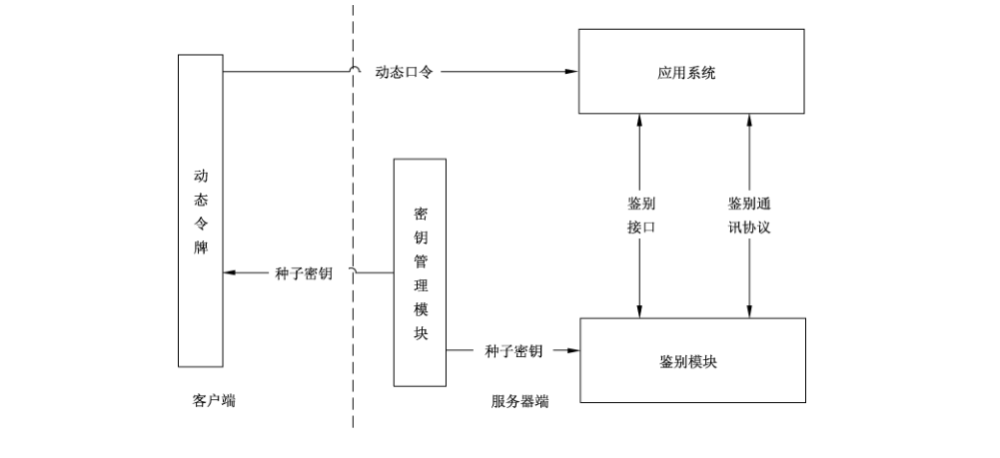
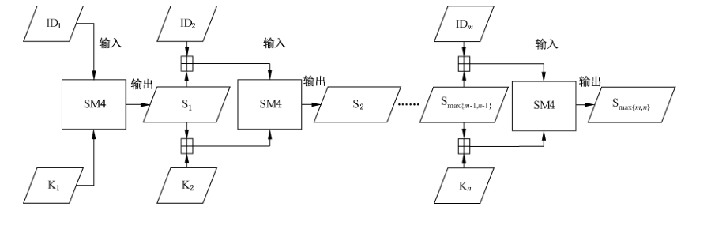
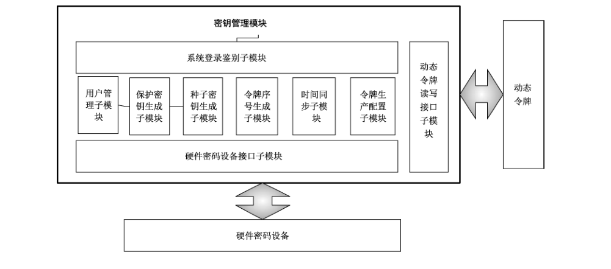
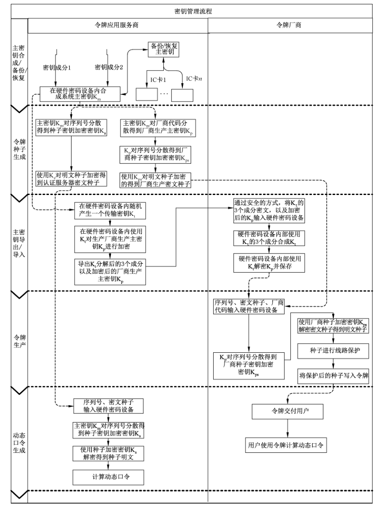
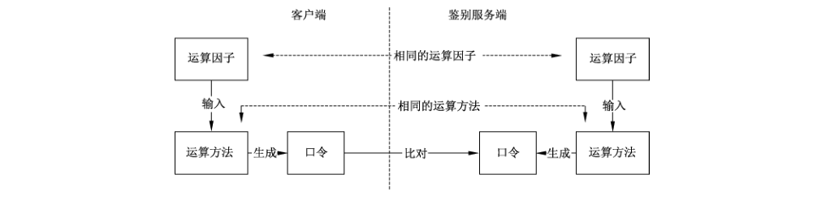

# GB/T 38556-2020 信息安全技术 动态口令密码应用技术规范

> 来源：[GB/T 38556-2020 国家标准详情](https://openstd.samr.gov.cn/bzgk/std/newGbInfo?hcno=FBCA58A4BF07DD668D7480D5A3C8DFE4)；封面发布日期：2020-03-06；实施日期：2020-10-01。
> PDF SHA-256：a773b4c1e872e42fa6275cd732a5a3d9579f393f5edbb5af54f495e4d3a7d5f0。
> 转写说明：对照官方 PDF 全部 44 页的页面图像校正文字、表格、代码和图示；省略封面、目录、页眉、页脚和页码，合并跨页内容。正式引用请核对原 PDF。

## 前言

本标准按照 GB/T 1.1—2009给出的规则起草。

请注意本文件的某些内容可能涉及专利。本文件的发布机构不承担识别这些专利的责任。

本标准由全国信息安全标准化技术委员会（SAC/TC 260）提出并归口。

本标准起草单位：上海众人网络安全技术有限公司、上海复旦微电子股份有限公司、飞天诚信科技股份有限公司、国家密码管理局商用密码检测中心、北京集联网络技术有限公司、上海华虹集成电路有限责任公司、紫光同芯微电子有限公司、上海林果实业股份有限公司北京科技分公司、格尔软件股份有限公司。

本标准主要起草人：谈剑锋、尤磊、李坤、柳逊、郑强、朱鹏飞、田敏求、吕春梅、郭思健、陈岩、李阗、周学庆、王凤珍。

## 1 范围

本标准规定了动态口令技术框架，动态口令生成算法、鉴别和密钥管理等的相关内容。

本标准适用于动态口令相关产品的研制、生产、应用，也可用于指导相关产品的检测。

## 2 规范性引用文件

下列文件对于本文件的应用是必不可少的。凡是注日期的引用文件，仅注日期的版本适用于本文件，凡是不注日期的引用文件，其最新版本（包括所有的修改单）适用于本文件。

- GB/T 2423.1—2008 电工电子产品环境试验 第2部分：试验方法 试验 A：低温

- GB/T 2423.2—2008 电工电子产品环境试验 第2部分：试验方法 试验 B：高温

- GB/T 2423.3—2016 环境试验 第2部分：试验方法 试验 Cab：恒定湿热试验

- GB/T 2423.7—2018 环境试验 第2部分：试验方法 试验 Ec：粗率操作造成的冲击（主要用于设备型样品）

- GB/T 2423.10—2019 环境试验 第2部分：试验方法 试验 Fc：振动（正弦）

- GB/T 2423.21—2008 电工电子产品环境试验 第2部分：试验方法 试验 M：低气压

- GB/T 2423.22—2012 环境试验 第2部分：试验方法 试验 N：温度变化

- GB/T 2423.53—2005 电工电子产品环境试验 第2部分：试验方法 试验 Xb：由手的摩擦造成标记和印刷文字的磨损

- GB/T 4208—2017 外壳防护等级（IP 代码）

- GB/T 17626.2—2018 电磁兼容 试验和测量技术 静电放电抗扰度试验

- GB/T 18336.1 信息技术 安全技术 信息技术安全性评估准则 第1部分：简介和一般模型

- GB/T 18336.2 信息技术 安全技术 信息技术安全性评估准则 第2部分：安全功能组件

- GB/T 18336.3 信息技术 安全技术 信息技术安全性评估准则 第3部分：安全保障组件

- GB/T 32905 信息安全技术 SM3密码杂凑算法

- GB/T 32907 信息安全技术 SM4分组密码算法

- GB/T 32915 信息安全技术 二元序列随机性检测方法

## 3 术语和定义

下列术语和定义适用于本文件。

### 3.1 动态口令 one-time-password; dynamic password

由种子密钥与其他数据，通过特定算法，运算生成的一次性口令。

### 3.2 动态令牌 one-time-password token; dynamic token

生成并显示动态口令的载体。

### 3.3 种子密钥 seed key

计算动态口令的密钥。

> 注：种子密钥即令牌种子密钥。

### 3.4 静态口令 static password

用户设置的，除非用户主动修改，否则不会发生变化的口令。

### 3.5 挑战码 challenge code

可参与到动态口令生成过程中的一种数据。

> 注：挑战码即挑战因子。

### 3.6 大端 big-endian

数据在内存中的一种表示格式，规定左边为高有效位，右边为低有效位。

> 注：数的高阶字节放在存储器的低地址，数的低阶字节放在存储器的高地址。

### 3.7 鉴别模块 authentication system

能够为应用系统提供动态口令身份鉴别服务的系统。

### 3.8 服务报表 service list

系统提供的，对于令牌和系统不同时间段对应的状态和结果的统计报表。

### 3.9 主密钥 master key

用于生成种子密钥、种子密钥加密密钥、厂商生产主密钥等的系统根密钥。

### 3.10 种子密钥加密密钥 encryption key for seed key

用于对种子密钥进行加密的密钥。

### 3.11 厂商生产主密钥 main key for manufacturer production

生成令牌生产时所需的种子密钥加密密钥。

### 3.12 厂商代码 manufacturer code

用于标识厂商的代码，可以是数字、英文字母、数字与英文字母的混合。

### 3.13 内部挑战鉴别 internal challenge authentication

一种由用户主动解除令牌异常状态时采用的挑战鉴别方式。

## 4 符号

下列符号适用于本文件。

bitN：一个字节当中的第 N+1 个比特位（从低位计起）。

C：参与运算的事件因子。

F（）：算法函数。

ID：杂凑及分组算法的输入信息。

IP44：防护等级第一特性 4（防尘），防护等级第二特性4（防水）。

K：长度不少于 128 比特的运算密钥。

K_m：主密钥。

K_t：传输密钥。

K_p：厂商生产主密钥。

K_s：种子密钥加密密钥。

N：令牌或其他终端显示口令的位数。

OD：输出结果。

PIN：用于使令牌工作并显示动态口令的一种口令，是一个至少6位长度的十进制数。

Q：鉴别双方通过协商输入的挑战因子。

S：算法函数输出结果。

T：参与运算的时间因子。

T_0：以 UTC 时间为标准的一个长度为 8 字节的整数。

T_c：以秒为单位的口令变化周期。

Truncate()：截位函数。

UTC：距1970年1月1日00:00时（格林尼治标准时间）的秒数。

^：幂运算符，即 2^n 代表 2 的 n 次方。

%：求余运算，即 5%3=2。

||：连接符，将两组数据根据左右顺序拼接。

⊞：算术加符号，且不进位。

## 5 技术框架

### 5.1 总体框架

动态口令系统为应用系统提供动态口令鉴别服务。由动态令牌、鉴别模块和密钥管理模块组成。

动态令牌生成动态口令，鉴别模块验证动态口令的正确性，密钥管理模块负责动态口令的密钥管理，应用系统将动态口令按照指定的协议（报文）发送至鉴别模块进行鉴别。动态口令系统架构如图1所示。



### 5.2 系统组成

#### 5.2.1 动态令牌

动态令牌产生动态口令，作为用户身份鉴别依据。硬件动态令牌产品的要求见附录 A。

#### 5.2.2 鉴别模块

鉴别模块用于执行动态口令鉴别和令牌同步，以及令牌相关状态的管理及配置等功能。鉴别模块通过鉴别通讯协议与应用系统进行通讯，或支持调用鉴别接口的方式，用以完成动态口令的鉴别、同步等功能。动态口令鉴别原理参见附录B。

#### 5.2.3 密钥管理模块

密钥管理模块用于动态令牌种子密钥的生成、传输和存储进行安全管理，包括系统登录鉴别子模块、用户管理子模块、保护密钥生成子模块、种子密钥生成子模块、令牌序号生成子模块、时间同步子模块（可选）、令牌生产配置子模块、密码机接口模块和动态令牌读写接口等。

#### 5.2.4 应用系统

应用系统是指集成了将动态口令按照鉴别通讯协议（或鉴别接口）与鉴别模块交互完成动态口令鉴别的应用程序集合，应用系统可以是软件系统，可以是硬件设备，也可以是软件和硬件相结合的形式。

#### 5.2.5 鉴别接口

鉴别接口是鉴别模块提供的用于连接应用系统与鉴别模块的接口集合。应用系统通过调用接口，可以完成动态口令鉴别、同步等功能。鉴别模块的接口参见附录C。

#### 5.2.6 鉴别通讯协议

鉴别通讯协议是鉴别服务通过标准的通讯协议和应用系统进行通讯的依据。应用系统通过发送报文的形式完成动态口令的鉴别、同步等功能。

## 6 动态口令生成

### 6.1 口令生成方式

#### 6.1.1 计算时间因子

T = T_0 / T_c

T 是参与运算的时间因子，是一个 8 字节整数。T_0 是以 UTC 时间或用户选择的时间标准为计量标准的一个 8 字节整数。T_c 是以秒为单位的口令变化周期，最大值为 60。

#### 6.1.2 组装输入序列

ID = {T || C || Q}

ID 是杂凑或分组算法的输入序列。T 是 6.1.1 的计算结果。C 是参与运算的事件因子，是一个 4 字节整数。Q 是鉴别双方通过协商输入的挑战因子或其他类型需要参与运算的因子，使用 ASCII 码表示，最小长度为 4 字节。

ID 最小长度为 128 比特，至少需要包含 T、C 的其中一个参数，Q 为可选参数，并按照 T || C || Q 的顺序进行数据组装。未包含的参数位置，由下一个参数进行补充。如 ID 由 T、Q 组成，则数据组装方式为 T || Q。如 ID 由 C、Q 组成，则数据组装方式为 C || Q。如组成 ID 的数据不足 128 比特，ID 的数据末端填零至 128 比特。

#### 6.1.3 计算一次性中间值

S = F(K, ID)

K 是长度不小于 128 比特的种子密钥，只有鉴别双方持有；F() 是算法函数，使用分组算法 SM4 或者杂凑算法 SM3，其中使用 SM4 时 S 的输出长度为 128 比特，使用 SM3 时 S 的输出长度为 256 比特。

#### 6.1.4 截位计算

OD = Truncate(S)

输入为 6.1.3 的输出。Truncate() 是截位函数，OD 是其输出结果，长度为 32 比特。

选用 SM3 作为 F 运算时，定义 S1、S2、S3、S4、S5、S6、S7、S8 为 8 个 4 字节整数，通过如下方法赋值：

```text
S = S1 || S2 || S3 || S4 || S5 || S6 || S7 || S8
OD = (S1 + S2 + S3 + S4 + S5 + S6 + S7 + S8) % (2^32)
```

使用 SM4 作为 F 运算时，定义 S1、S2、S3、S4 为 4 个 4 字节整数，通过如下方法赋值：

```text
S = S1 || S2 || S3 || S4
OD = (S1 + S2 + S3 + S4) % (2^32)
```

#### 6.1.5 计算动态口令

P = OD % (10^N)

N 是令牌或其他终端显示口令的位数，N 不小于 6。P 是最终显示的动态口令。

### 6.2 算法使用说明

#### 6.2.1 使用要求

算法使用应满足以下要求：

- 分组密码算法应采用 SM4 算法，应满足 GB/T 32907 的要求。分组长度为 128 比特，密钥长度为 128 比特，运算方式选用 ECB 加密的工作模式，加密结果长度为 128 比特。

- 密码杂凑算法应采用 SM3 算法，应满足 GB/T 32905 的要求。

- 涉及随机数生成的算法，应满足 GB/T 32915 的要求。

#### 6.2.2 杂凑算法使用说明

在 S = F(K，ID) 环节，当使用 SM3 算法时，K || ID 为输入参数。

#### 6.2.3 分组算法使用说明

在 S = F(K，ID) 环节，当使用 SM4 算法时，K 为运算密钥，ID 为输入参数，K 或 ID 大于 128 比特时，运算过程如下：

K 大于 128 比特时，记 K 的长度为 L1 比特。n 为不小于 L1/128 的最小整数，在 K 末端填充 128 × n - L1 个比特 0。再将 K 以 128 比特长度进行分组，高位在前，分别为 K1、K2、K3、…、Kn。

ID 大于 128 比特时，记 ID 的长度为 L2 比特。m 为不小于 L2/128 的最小整数，在 ID 末端填充 128 × m - L2 个比特 0。再将 ID 以 128 比特长度进行分组，高位在前，分别为 ID1、ID2、ID3、…、IDm。

运算过程如图2所示。



ID1 和 K1 作为第一个分组运算的输入，通过 SM4 运算生成 S1。将 S1 分别与 ID2 和 K2 进行算术加运算（高位溢出舍去），获得 ID2′ 和 K2′，用于第二个分组的输入，通过 SM4 运算生成 S2。之后的运算以此类推。

如 Kn 和 IDm 中，n>m，则 m 次运算以后，使用 IDm 与 Si（m-1<i<n）算术加运算（高位溢出舍去）生成 IDi+1，参与后续运算。

如 Kn 和 IDm 中，n<m，则 n 次运算以后，使用 Kn 与 Si（n-1<i<m）算术加运算（高位溢出舍去）生成 Ki+1，参与后续运算。

如图2中所示，S = Smax{m,n}。

#### 6.2.4 数据格式和输入输出用例

数据运算与存储，应采用大端（big-endian）格式。见附录 D。

动态口令生成算法的C语言实现用例参见附录 E，输入输出的用例数据见附录F。

## 7 鉴别

### 7.1 鉴别模块说明

#### 7.1.1 鉴别模块构成

鉴别模块是为应用系统提供动态令牌鉴别及管理的服务系统，由两个部分构成：

a） 鉴别服务子模块对应用提供鉴别和管理服务。

b）管理子模块对鉴别模块的运行进行管理。

#### 7.1.2 令牌的状态

令牌的状态为鉴别模块内保存的令牌工作状态见表1。

**表1 令牌工作状态表**

| 状态 | 描述 | 说明 |
| --- | --- | --- |
| 未激活 | 令牌出厂时的状态，应激活后令牌才能进入就绪状态 | 未激活令牌不能提供正常的口令鉴别 |
| 就绪 | 令牌正常工作状态 | 就绪状态下令牌可用于口令鉴别 |
| 锁定 | 令牌因连续错误、重放攻击、人工方式等原因被锁定后处于锁定状态 | 锁定状态的令牌不能提供正常的口令鉴别 |
| 挂起 | 令牌被人为挂起后，处于挂起状态 | 挂起状态的令牌不能提供正常的口令鉴别 |
| 作废 | 令牌执行作废操作后，进入作废状态 | 作废的令牌不能提供正常的口令鉴别 |

#### 7.1.3 令牌的数据

令牌的数据应包括：令牌序列号、密钥数据、令牌状态、上次使用时间、连续错误次数、令牌偏移量、其他配置参数等，其中：

a） 密钥数据应加密存放。

b） 其他数据应采用校验机制保证完整性。

#### 7.1.4 令牌的同步

鉴别模块应提供对令牌的内部计数器与系统的令牌计数器之间的同步处理。对于时间型令牌，使用双向时间窗口；对于事件型令牌，使用单向事件窗口。

窗口指用于令牌时间与系统时间同步的窗口。时间型令牌根据不同的令牌同步需求，分别采用大窗口、中窗口、小窗口进行同步。

使用各种窗口时，要求如下：

a）大窗口，窗口大小不应超过 ±10 min。使用大窗口同步时，要求下一个连续的动态口令匹配，同时调整系统的令牌偏移量。大窗口要求使用受限的同步服务，即进一步身份鉴别或需要更高权限才能执行大窗口的同步服务。大窗口可由鉴别模块的授权运维人员使用，并应与应用系统的验证码机制同时使用。

b）中窗口，窗口大小不应超过 ±5 min。使用中窗口同步时，要求下一个连续的动态口令匹配，同时调整系统的令牌偏移量。中窗口可由令牌用户或鉴别模块的运维人员使用，并应与应用系统的验证码机制同时使用。

c）小窗口，窗口大小不应超过 ±2 min。使用小窗口同步时，鉴别模块通过动态口令鉴别，同时调整系统的令牌偏移量。小窗口可由鉴别模块自动调用，在令牌用户使用动态口令进行身份鉴别时使用。

d） 事件型令牌的大窗口、中窗口、小窗口的大小，可由用户与厂商协商制定，但应保证其鉴别的安全性和有效性。

#### 7.1.5 自动锁定和自动解锁

令牌在使用过程中若连续多次验证错误超过最大次数后，鉴别模块会自动将该令牌状态修改为“锁定”。在超过设定的自动解锁时间后，鉴别模块会自动解除该令牌的锁定状态。

自动解锁只能解除被自动锁定的令牌。

### 7.2 鉴别模块服务

#### 7.2.1 安全服务

##### 7.2.1.1 动态口令鉴别

对提交的动态口令进行鉴别的服务，鉴别方式包括：静态口令＋动态口令、动态口令。其中静态口令为与该动态令牌绑定的静态口令。

##### 7.2.1.2 挑战应答鉴别

对提交的挑战应答码进行鉴别的服务，鉴别方式包括：挑战鉴别、内部挑战鉴别。

挑战鉴别是用户采用向令牌输入应用服务提供的挑战码的方式，获取相应的动态口令，完成鉴别。

内部挑战鉴别是用户通过向令牌输入 PIN、静态口令等用户私有数据，获取相应的动态口令，完成鉴别。

##### 7.2.1.3 产生挑战码

根据应用的请求产生挑战码，生成的挑战码格式包括：数字型、字符型、数字＋字符型。其中数字为阿拉伯数字 0～9，字符为英文字符或符号字符，区分大小写。挑战码的最小长度和最大长度可由鉴别模块进行设置。

#### 7.2.2 管理服务

##### 7.2.2.1 激活

将未激活的令牌设为可用状态。激活动态口令令牌的方法如下：

a） 激活时验证动态口令的窗口使用大窗口；

b） 令牌成功激活后，状态设置为就绪；

c） 激活不成功，记录激活错误次数，但不锁定令牌。

##### 7.2.2.2 锁定

令牌在连续错误、重放攻击等操作下将就绪状态的令牌设置锁定状态。令牌被锁定后解决方法如下：

a） 令牌被锁定后，应通过解锁服务回到就绪状态；

b） 令牌被锁定后，应通过废止服务设置为废止状态。

##### 7.2.2.3 解锁

通过静态口令、静态口令＋动态口令将锁定状态的令牌解锁，设置就绪状态。令牌解锁方法如下：

a） 解锁时，要求当前的动态口令；

b） 若设置了静态口令，要求验证静态口令；

c） 若静态口令的验证方式是内部挑战方式，使用内部挑战鉴别；

d）若静态口令的验证方式是静动态混合方式，使用静态口令＋动态口令鉴别。

##### 7.2.2.4 挂起

将动态令牌设置为挂起状态方法如下：

a） 只有就绪或锁定状态的令牌应被设置为挂起状态；

b）令牌被挂起后，应通过废止服务设置为废止状态。

##### 7.2.2.5 解挂

解除令牌的挂起状态步骤如下：

a） 解挂成功后令牌的状态设置为就绪状态；

b） 要求验证当前的动态口令；

c） 若设置了静态口令，要求验证静态口令；

d） 若静态口令的验证方式是内部挑战方式，使用内部挑战鉴别；

e）若静态口令的验证方式是普通方式，使用静态口令＋动态口令鉴别。

##### 7.2.2.6 设置静态口令

设置动态令牌绑定的静态口令步骤如下：

a） 要求验证原有的静态口令；

b） 若静态口令的验证方式是内部挑战方式，使用内部挑战鉴别；

c）若静态口令的验证方式是静动态混合方式，使用静态口令＋动态口令鉴别。

##### 7.2.2.7 远程解 PIN

鉴别模块可提供远程解 PIN 的功能（针对具有 PIN 保护的令牌）。根据应用请求，鉴别模块生成当前的远程解 PIN 密码，应从以下几个方法来设置：

a） 解PIN的密码为0~9的数字串，长度最少为6位；

b）解PIN 的操作最大尝试次数不可超过5次，若超过最大尝试次数，应至少等待1h 才可继续尝试；

c） 超过最大尝试次数的情况不可超过5次，否则令牌应永久锁定，不可再使用。

##### 7.2.2.8 同步与窗口要求

鉴别模块提供令牌的同步服务有以下几种：

a） 在大窗口、中窗口内验证令牌的连续2个动态口令，若成功，调整令牌的系统偏移量；

b） 在小窗口内验证令牌的当前动态口令，若成功，调整令牌的系统偏移量；

c） 令牌的同步服务不改变令牌状态。

##### 7.2.2.9 废止

令牌损坏或失效后，可使用鉴别模块的废止服务将其废止。废止的令牌不可再用于用户的身份鉴别和交易验证。系统仅保留该令牌的使用历史记录。

##### 7.2.2.10 令牌信息查询

鉴别模块应提供令牌的信息查询服务，包括：令牌的当前状态、上次使用时间、当前累计错误次数等。

信息查询服务不改变令牌状态。

### 7.3 鉴别模块管理功能

#### 7.3.1 权限管理

鉴别模块应对访问人员采取权限控制，不同角色的访问人员赋予不同的操作权限。

#### 7.3.2 参数配置

鉴别模块应能对鉴别和管理功能参数进行配置。

#### 7.3.3 日志管理

日志管理包括日志的写入、查询等功能，每条日志至少记录事件的日期和时间、事件类型、主体身份、事件的结果（成功或失败）、日志级别。以下事件应记录日志：

a） 动态口令鉴别，同步的结果；

b） 令牌系统状态的变更；

c） 日志应保留至少2年。

#### 7.3.4 服务报表

鉴别模块应提供对令牌和系统不同时间段对应的状态和结果的统计报表。

#### 7.3.5 种子导入

鉴别模块应能导入令牌的种子密钥，并设置令牌的初始状态。

#### 7.3.6 备份恢复

鉴别模块应能对敏感信息进行备份和恢复。

### 7.4 安全要求

#### 7.4.1 接入端控制

鉴别模块应具有控制应用系统安全接入的方法和措施。

#### 7.4.2 通讯敏感字段加密

为了防止网络监听的形式对鉴别数据进行窃听和分析，应在鉴别模块和应用系统之间的通讯数据上做加密处理。

#### 7.4.3 种子密钥存储加密

鉴别模块中的种子密钥是加密存储的，当鉴别模块接收到鉴别请求时，鉴别模块应首先解密种子密钥加密密钥密文，然后读通过种子密钥和时间因子等信息生成对应的动态口令，并与接收到的动态口令进行比较，从而完成动态口令身份鉴别。

#### 7.4.4 令牌安全性控制

##### 7.4.4.1 锁定及解锁

提供锁定机制，当一个令牌连续尝试鉴别失败次数累计达到上限，应对令牌进行锁定，应提供人工解锁和自动解锁机制。

##### 7.4.4.2 防重复鉴别

对于已经通过鉴别的动态口令，鉴别模块将予以作废，通过鉴别的动态口令，不能再次通过鉴别。

##### 7.4.4.3 日志安全

日志信息应具有校验码，用户对日志信息进行修改可通过校验码检查出来。

敏感数据应具有备份恢复机制。

鉴别模块针对日志访问应具备相应的访问控制策略，对日志的操作应有记录，以保证日志的完整性和安全性。

##### 7.4.4.4 接入端控制

鉴别模块应具有时间校准的处理方法和措施。

##### 7.4.4.5 鉴别模块安全

鉴别模块安全应符合目标应用服务或系统的安全需求。

## 8 密钥管理

### 8.1 概述

密钥管理主要是指对种子密钥的生成、传输和存储的安全管理，种子密钥是否安全直接影响到整个鉴别模块是否安全。应从以下几个方面来保护：

a） 生成的安全性；

b） 传输的安全性；

c） 存储的安全性；

d） 使用的安全性。

### 8.2 模块架构

#### 8.2.1 模块组成

##### 8.2.1.1 密钥管理模块组成

密钥管理模块主要由系统登录鉴别子模块、用户管理子模块、保护密钥生成子模块、种子密钥生成子模块、令牌序号生成子模块、时间同步子模块（可选）、令牌生产配置子模块、硬件密码设备接口子模块和动态令牌读写接口子模块组成，如图3所示。



##### 8.2.1.2 系统登录鉴别子模块

该模块负责密钥管理模块的用户登录鉴别。

##### 8.2.1.3 用户管理子模块

该模块负责密钥管理模块操作员的管理（新建、删除和修改）和权限分配。

##### 8.2.1.4 保护密钥生成子模块

该模块主要用于生成密钥系统的根密钥及传输密钥。

##### 8.2.1.5 种子密钥生成子模块

该模块的功能是调用硬件密码设备接口生成动态令牌的种子密钥，同时将生成的种子密钥加密后写入导出数据文件。

##### 8.2.1.6 令牌序号生成子模块

该模块的功能是根据序号生成规则生成动态令牌的唯一序列号。

##### 8.2.1.7 时间同步子模块（可选）

该模块的功能是同步密钥系统的系统时间，以保证种子密钥生成系统与动态口令鉴别模块的时间一致。

##### 8.2.1.8 令牌生产配置子模块

该模块的功能是将令牌序列号和种子密钥通过动态令牌读写接口子模块写入动态令牌。

##### 8.2.1.9 硬件密码设备接口子模块

该模块的功能是完成软件与硬件密码设备之间的通讯。

##### 8.2.1.10 动态令牌读写接口子模块

该模块的功能是完成软件和令牌之间的通讯。

#### 8.2.2 系统安全

系统安全的主要目标是保障网络、主机系统、应用系统及数据库运行的安全。应采取防火墙、病毒防治、漏洞扫描、入侵监测、数据备份、灾难恢复等安全防护措施。

### 8.3 功能要求

#### 8.3.1 模块功能

##### 8.3.1.1 系统登录鉴别

系统登录鉴别是指密钥管理模块的使用应在系统合法用户登录以后才能使用，且系统对用户分权限管理，不同的用户授权使用不同的功能。用户登录系统一段时间未操作后，系统应能够自动锁定。

##### 8.3.1.2 用户管理

用户管理的功能包括用户账号和角色的分配、修改和删除。系统角色包括：系统管理员、密钥管理操作员、种子生成操作员和令牌生成操作员。密码管理系统的用户应通过身份鉴别后才能登录系统。

##### 8.3.1.3 保护密钥管理

保护密钥管理是指主密钥、传输密钥的生成、备份和更新。密钥的备用载体应使用国家密码管理部门定型的硬件。

##### 8.3.1.4 令牌序列号管理

令牌序列号管理功能包括：令牌序列号模板的定义、修改和删除；令牌序列号的生成。

##### 8.3.1.5 种子密钥生成

种子密钥管理功能包括：种子密钥的生成和加密导出。

##### 8.3.1.6 令牌生产配置

令牌生成配置功能主要是指将种子密钥、序列号和时间（可选）写入动态令牌。

##### 8.3.1.7 时间同步

时间同步功能是指生产时间同步令牌时，应预先校对生产电脑的时间。

##### 8.3.1.8 日志

日志功能记录密钥管理模块的所有操作及运行日志。

#### 8.3.2 兼容性

兼容性有以下几种：

a） 算法兼容性：能够支持多种分组密码算法来对密钥的管理。

b） 硬件密码设备兼容性：能够兼容多种密码硬件设备，如密码机、密码卡、IC卡等。

### 8.4 系统安全性设计

#### 8.4.1 密钥管理的目的

密钥管理的目的是保障系统中所使用的密钥，在其生成、存储、使用等生命周期中的安全性。

#### 8.4.2 密钥管理的原则

本系统中密钥安全设计应遵循以下原则：

a） 采用国家密码管理局批准的硬件密码设备。

b） 主密钥的生成、存储在硬件密码设备中，并且无法导出。

c） 所有密钥的运算都在硬件密码设备中完成。

d） 种子加密密钥由主密钥对令牌序号分散得到。

e） 主密钥管理机制和灾难恢复机制。

#### 8.4.3 密钥管理的机制

##### 8.4.3.1 对称算法密钥

采用非对称算法进行密钥管理保护种子密钥安全时应符合8.4.2的原则。

对称算法密钥管理模块管理的密钥包括以下6种：

a）主密钥 K_m：在令牌应用服务商（如银行、电信公司、企业等）的硬件密码设备中生成与存储、使用。

b）种子密钥：由硬件密码设备生成。

c）种子密钥加密密钥 K_s：由主密钥 K_m 对令牌序列号分散获得，用于加密给鉴别模块使用的种子密钥。

d）厂商生产主密钥 K_p：由主密钥 K_m 对厂商代码分散获得，通过 K_t 加密提供给厂商使用。

e）厂商种子密钥加密密钥 K_ps：由厂商生产主密钥 K_p 对令牌序列号分散获得，用于加密给动态令牌使用的种子密钥。

f）传输密钥 K_t：由令牌应用服务商的硬件密码设备随机生成，可分拆成多个分量，交付给令牌厂商使用。

对称算法密钥管理的示例流程如图4所示。



##### 8.4.3.2 主密钥

主密钥 K_m 是在令牌应用服务商（如银行、电信公司、企业等）的硬件密码设备中生成与存储，使用时不离开该硬件密码设备。有严格的主密钥管理机制和灾难恢复机制。

##### 8.4.3.3 厂商生产主密钥

厂商生产主密钥 K_p 由主密钥 K_m 分散厂商代码后得到，通过 K_t 加密提供给厂商使用，存储在令牌应用服务商的硬件密码设备中。

##### 8.4.3.4 传输密钥 K_t

用于加密保护厂商生产主密钥 K_p 的交换。

传输密钥 K_t 随机产生，可分拆成多个分量。解密厂商生产主密钥 K_p 时，输入传输密钥的多个分量及厂商生产主密钥 K_p 密文，内部合成传输密钥并解密出厂商生产主密钥 K_p 保存。

##### 8.4.3.5 种子密钥加密密钥

系统中有两种类型的种子密钥加密密钥分别是鉴别硬件密码设备中的种子密钥加密密钥 K_s 和生产所用的硬件密码设备中的 K_ps。K_s 由主密钥 K_m 对令牌序号分散后生成。K_ps 由厂商生产主密钥 K_p 对令牌序号分散后生成。硬件密码设备内部使用 SM4 算法负责密钥的分散过程，分散出的种子密钥加密密钥不向硬件密码设备以外导出，不在硬件密码设备内部保存。

#### 8.4.4 种子密钥的安全

##### 8.4.4.1 种子密钥的生成安全

种子密钥采用国家密码管理部门批准的随机数发生器生成。

##### 8.4.4.2 种子密钥的传输安全

种子密钥的传输安全主要是指种子密钥在生成以后，写入令牌和导入鉴别模块过程中种子密钥的安全。

##### 8.4.4.3 种子密钥写入动态令牌过程的安全

该过程应在安全的生产环境中进行，具有安全的管理机制，保证其写入线路的安全性。

##### 8.4.4.4 种子密钥导入鉴别模块过程的安全

通过硬件传输方式导入到相关鉴别模块中。

数据文件命名规则：`otp_[厂商代码]_yyyymmdd_[数量].data`。

数据文件内容格式如图5所示。


##### 8.4.4.5 种子密钥的存储安全

种子密钥的存储安全是指种子密钥在鉴别模块中的存储安全。当种子密钥在鉴别模块中以 SM4 算法加密后的密文方式存储时，种子密钥具体的加密流程如下：

a）硬件密码设备使用主密钥 K_m 对令牌的序列号填充数据到 16 字节（填充数据为 0x00），然后使用 SM4 算法进行分散，得到种子密钥加密密钥 K_s。

b）对刚刚生成种子密钥进行填充到 16 字节的整数倍，填充数据的规则遵循 PKCS#5 中定义的规范（即：对输入数据 MSG，在 MSG 的右端添加 16-(||MSG|| % 16) 个取值为 16-(||MSG|| % 10) 的 PAD 字符；也就是说，对 MSG，最右端数据块，缺 n 个字节则补充 n 个数值 n，最少补 1 个 0x01，最多补 16 个 0x10（当 MSG 长度为 16 字节的整数倍时）。

c）使用种子密钥加密密钥 K_s 对填充后的种子密钥数据进行 SM4 加密。

d）加密完成后，将种子密钥加密密钥 K_s 和明文种子密钥数据销毁。

e）采用上述加密过程好处是每个令牌的种子密钥加密密钥发生重复情况为小概率事件。即便意外失窃一份加密后的令牌种子密钥，并对其破译，对系统内其他令牌的种子密钥安全性也不会造成影响。

种子密钥存储时，应包含但不限于以下属性：令牌序列号、密文种子、密钥索引、校验值、创建时间。

##### 8.4.4.6 种子密钥的使用安全

种子密钥的使用安全是指使用种子密钥计算动态口令过程中的安全。种子密钥的使用过程全部在硬件密码设备内完成，杜绝了种子密钥在使用过程中泄密的可能。具体使用流程如下：

a）将令牌序号和密文种子密钥发送到硬件密码设备中，硬件密码设备对加密的种子密钥根据令牌序号进行“种子密钥存储”相同运算，即使用令牌序号由主密钥 K_m 分散得到种子密钥加密密钥 K_s。

b） 对种子密钥密文进行 SM4解密获得种子密钥的原文。

c） 使用明文种子密钥和其他相应的参数运算得到动态口令，对客户端发送的鉴别请求进行甄别。

d）解密完成后，将种子密钥加密密钥 K_s 和明文种子密钥数据销毁。

### 8.5 硬件密码设备接口说明

#### 8.5.1 硬件密码设备应用接口

动态口令计算功能：使用种子密钥密文，计算动态口令。

#### 8.5.2 鉴别模块密钥管理接口

鉴别模块包含以下接口：

a） 种子密钥的生成接口应具备功能：随机产生或运算产生指定长度的种子密钥，根据令牌序号产生种子密钥加密密钥，返回加密后的种子密钥密文。

b） 向令牌导入种子密钥应具备功能：将种子明文写入令牌中。

c） 合成主密钥接口应具备功能：根据密钥成分合成主密钥。

d） 主密钥的备份接口应具备功能：将主密钥备份成多个密文密钥成分。

e） 主密钥的恢复接口应具备功能：将备份的密钥成分，在硬件设备内恢复成主密钥。

f） 传输密钥保护导出主密钥接口应具备功能：将主密钥从硬件密码设备中密文导出。

g）传输密钥保护导入主密钥接口应具备功能：将密文主密要导入硬件密码设备。

#### 8.5.3 接口使用权限控制机制

建立接口使用权限机制，以达到控制管理接口使用权限的目的。

## 附录 A（规范性附录）硬件动态令牌要求

### A.1 令牌硬件要求

#### A.1.1 高温

按照 GB/T 2423.2—2008 中试验方法 Bb，严酷等级选择温度：+50 ℃，持续时间：2 h。

#### A.1.2 低温

按照 GB/T 2423.1—2008 中试验方法 Ab，严酷等级选择温度：-10 ℃，持续时间：2 h。

#### A.1.3 高低温冲击

按照 GB/T 2423.22—2012，严酷等级选择高温温度：+50 ℃，低温温度：-10 ℃，暴露试验时间：10 min，转换时间：2 min～3 min，循环次数：3 次。

#### A.1.4 湿度

按照 GB/T 2423.3—2016，严酷等级选择温度：30 ℃±2 ℃，相对湿度（93±3）%，试验时间：2 h。

#### A.1.5 工作海拔

按照 GB/T 2423.21—2008，严酷等级选择气压：55 kPa，持续时间：2 h。

#### A.1.6 跌落

按照 GB/T 2423.7—2018 中方法一，严酷等级选择跌落高度：1 000 mm。

#### A.1.7 防尘防水

按照 GB/T 4208—2017 中 IP44 的要求。

#### A.1.8 标记和印刷

按照 GB/T 2423.53—2005，试验液体：人工合成汗液，力的大小：（1±0.2）N，循环次数：1 000 次。

产品应具备标记文字为：“序列号”和“有效期”。

#### A.1.9 振动

按照 GB/T 2423.10—2019，严酷等级选择频率范围：10 Hz～300 Hz，振动幅值：3.5 mm，持续时间：60 min。

#### A.1.10 静电放电

不低于 GB/T 17626.2—2018 中试验等级 3 的标准，即满足外壳端口接触放电 ±6 kV，空气放电 ±8 kV。

#### A.1.11 试验过程中试验样品是否处于工作状态的判断标准

样品带电运行，目视检查，提供最少 12 个显示相同动态口令的样品，6 个一组为参与试验样品，6 个一组为不参与试验样品，参与试验的样品显示动态口令与不参与试验样品一致即为合格。

### A.2 令牌安全要求

#### A.2.1 种子密钥安全

种子密钥为令牌重要安全要素，令牌应保证产品内的种子密钥的完整性，且种子密钥为单向导入令牌（或在令牌内生成），种子密钥不能被导出产品外部。

令牌应拥有种子密钥的保护功能。令牌种子密钥加密、存储、使用在令牌芯片的安全区域内实现。

#### A.2.2 令牌芯片安全

本标准涉及的令牌芯片，应是国家密码管理部门批准产品型号证书的安全芯片。

#### A.2.3 令牌物理安全

令牌具有低电压检测功能。

令牌完成种子密钥导入后，通讯 I/O 端口应失效，不能再输入或输出信息，包括但不限于内部参与口令生成运算的 K、T、C 信息。

令牌应防范通过物理攻击的手段获取设备内的敏感信息，物理攻击的手段包括但不限于开盖、搭线、复制等。

令牌芯片应具备令牌掉电后，会自动销毁种子密钥的措施。

令牌芯片应保证种子密钥无法通过外部或内部的方式读出，包括但不限于：调试接口、改编的程序。

令牌芯片可防范通过物理攻击的手段获取芯片内的敏感信息，确保种子密钥和算法程序的安全性。

令牌芯片应具备抵抗旁路攻击的能力，包括但不限于：抗 SPA/DPA 攻击能力、抗 SEMA/DEMA 攻击能力。

在外部环境发生变化时，令牌芯片不应泄露敏感信息或影响安全功能。外部环境的变化包含但不限于：高低电压、高低温、强光干扰、电磁干扰、紫外线干扰、静电干扰。

#### A.2.4 使用安全

具有数字和功能按键的令牌应具有 PIN 保护功能，PIN 长度不少于 6 位，并具有 PIN 防暴力穷举功能。令牌可具有 PIN 找回功能，即令牌用户如果忘记令牌 PIN，可通过安全有效的环境与机制找回令牌 PIN，或对令牌 PIN 进行重新设置（如远程解 PIN）。

PIN 输入错误的次数不可超过 5 次，若超过，应至少等待 1 h 才可继续尝试。

PIN 输入超过最大尝试次数的情况不可超过 5 次，否则令牌应永久锁定，不可再使用。

令牌基本使用寿命为 3 年，令牌产品最长使用不超过 5 年。

室温环境下，令牌时间偏差小于 2 min/年。

#### A.2.5 安全评估

动态令牌产品安全评估按照 GB/T 18336.1、GB/T 18336.2 和 GB/T 18336.3 的规定进行评估。

## 附录 B（资料性附录）动态口令鉴别原理

动态口令的鉴别原理是通过客户端（动态令牌）与鉴别服务端（鉴别模块），以相同的运算因子，采用相同的运算方法，生成相同的口令，并进行比对来完成整个鉴别过程。通常，口令的比对是由鉴别服务提供端完成。具体如图 B.1 所示。



## 附录 C（资料性附录）鉴别模块接口

### C.1 服务报文格式

#### C.1.1 报文格式

鉴别模块的服务报文由＜报头＞＋＜报体＞构成。其中报头定义报文类型和选项，报体为具体的服务请求或服务响应数据。

报头的格式见表C.1。

**表C.1 鉴别模块的报头格式**

| 偏移量 | 名称 | 长度（字节） | 描述 | 说明 |
| --- | --- | --- | --- | --- |
| 0 | 报头长度 | 1 | 标识报头长度 |  |
| 1 | 报文类型 | 1 | 标识报文类型 | x0：请求报文；x1：响应报文；0x：不需要校验 MAC；8x：需要校验 MA |
| 2 | 版本 | 1 | 标识报文版本 | 01：版本1 |
| 3 | 调用者 | 8 | 标识调用者 | 为调用者分配的标识，缺省可为 8 个 00 |
| 11 | 调用号 | 8 | 标识本次调用/响应 | 由调用者产生的调用号，调用号应每次不同 |
| 19 | 报体长度 | 2 | 标识报体长度 | 不包含报头的报文长度 |
| 21 | MAC | 4 | MAC 校验值 | 如果报文类型 bit7 设置为 1，即需要 MAC 校验，有本数据项。将报头（不含本项）与报文，使用 SM3 算法运算，取低位的 4 个字节，作为 MAC 校验值 |

#### C.1.2 服务请求报文

当报头的报文类型标识的 bit0 是 0 时，为服务请求报文。服务请求报文的格式为：＜请求头＞＋＜数据体＞。

请求头的格式见表C.2。

**表C.2 请求头格式**

| 偏移量 | 名称 | 长度（字节） | 描述 | 说明 |
| --- | --- | --- | --- | --- |
| 0 | 服务标识 | 2 | 标识请求的鉴别模块服务 | 鉴别模块提供的服务。其中 1000 以上为自定义服务 |
| 2 | 服务选项 | 2 | 标识服务请求的参数 | 根据具体服务的不同设置参数 |
| 4 | 数据项个数 | 1 | 标识服务请求的数据项个数 | 数据体包含的数据项个数 |

#### C.1.3 服务响应报文

当报头的报文类型标识的 bit0 是 1 时，为服务响应报文。服务响应报文的格式为：＜响应头＞＋＜数据体＞。

响应头的格式见表C.3。

**表C.3 响应头格式**

| 偏移量 | 名称 | 长度（字节） | 描述 | 说明 |
| --- | --- | --- | --- | --- |
| 0 | 服务标识 | 2 | 标识响应的服务请求 | 鉴别模块提供的服务。其中 8000 以上为自定义服务 |
| 2 | 结果标识 | 2 | 标识服务响应的结果 | 其中 8000 以上标识服务请求错误。第 1 个字节标识具体的结果代码 |
| 4 | 数据项个数 | 1 | 标识服务响应的数据项个数 | 数据体包含的数据项个数 |

#### C.1.4 数据体及数据项格式

数据体由请求头或响应头设定的数据项个数的数据单元组成，其格式为：＜数据项 1＞＋＜数据项 2＞＋…＋＜数据项 n＞。

每个数据项的格式见表 C.4。

**表C.4 数据项格式**

| 偏移量 | 名称 | 长度（字节） | 描述 | 说明 |
| --- | --- | --- | --- | --- |
| 0 | 数据属性 | 1 | 标识数据属性 | bit7 为 1，加密数据；bit7 为 0，明文数据 |
| 1 | 数据标识 | 2 | 标识数据的含义 | 数据项的含义，其中 8000 以上为自定义数据项 |
| 4 | 数据长度 | 1 | 标识数据项的长度 |  |
| 0 | 数据内容 | 数据长度 | 由数据长度规定的数据内容 |  |

### C.2 服务标识

鉴别模块的服务标识见表 C.5。

**表C.5 鉴别模块服务标识**

| 名称 | 值 | 描述 | 说明 |
| --- | --- | --- | --- |
| 动态口令鉴别 | 0001 | 动态口令鉴别请求 |  |
| 挑战应答鉴别 | 0002 | 挑战应答鉴别请求 |  |
| 产生挑战码 | 0003 | 请求一个挑战码 |  |
| 激活 | 0101 | 激活令牌 |  |
| 锁定 | 0102 | 锁定令牌 |  |
| 解锁 | 0103 | 解锁令牌 |  |
| 挂起 | 0104 | 挂起令牌 |  |
| 解挂 | 0105 | 解除令牌挂起 |  |
| 设置静态口令 | 0106 | 设置令牌绑定的静态口令 |  |
| 远程解 PIN | 0107 | 请求远程解 PIN 密码 |  |
| 同步 | 0108 | 强制令牌同步 |  |
| 更新 | 0109 | 更新令牌密钥 |  |
| 废止 | 010a | 将令牌废止 |  |
| 令牌信息查询 | 010b | 查询令牌信息 |  |

### C.3 数据标识

鉴别模块的数据标识见表 C.6。

**表C.6 鉴别模块的数据标识**

| 名称 | 标识 | 描述 | 说明 |
| --- | --- | --- | --- |
| 厂商标识 | 0001 | 令牌的厂商标识 |  |
| 序列号 | 0002 | 令牌序列号 |  |
| 动态口令 | 0003 | 动态口令 |  |
| 下一口令 | 0004 | 下一个动态口令 |  |
| 交易内容 | 0005 | 交易内容 | 用于计算挑战码或校验挑战应答口令 |
| 挑战码 | 0006 | 根据交易内容产生的挑战码 |  |
| 应答码 | 0007 | 应答码 | 用于验证的应答码 |
| PIN码 | 0008 | 与令牌绑定的 PIN码 |  |
| 新 PIN码 | 0009 | 设置的新 PIN 码 |  |
| 更新码 | 000a | 更新令牌的更新码 |  |
| 初次激活时间 | 0101 | 初次激活时间 |  |
| 最近使用时间 | 0102 | 最近使用时间 |  |
| 过期时间 | 0103 | 过期时间 |  |

| 错误次数 | 0104 | 错误次数 |  |
| 令牌状态 | 0105 | 令牌状态 | 未激活、就绪、锁定、挂起、作废 |
| 令牌型号 | 0106 | 令牌型号 |  |

### C.4 返回码

鉴别模块的返回码见表 C.7。

**表C.7 鉴别模块的返回码**

| 名称 | Byte1 | Byte0 | 描述 | 说明 |
| --- | --- | --- | --- | --- |
| 安全服务成功 | 00 | xx | 安全服务成功 |  |
| 安全服务成功 | 00 | 01 | 动态口令鉴别成功 |  |
| 安全服务成功 | 00 | 02 | 挑战应答鉴别成功 |  |
| 安全服务成功 | 00 | 03 | 挑战码成功 |  |
| 安全服务失败 | 80 | xx | 安全服务失败 |  |
| 安全服务失败 | 80 | 01 | 要求下一个口令 |  |
| 安全服务失败 | 80 | 02 | 动态口令错 |  |
| 安全服务失败 | 80 | 03 | PIN 码失败 |  |
| 安全服务失败 | 80 | 04 | 口令已被验证过 |  |
| 管理服务成功 | 01 | XX | 管理服务成功 | xx 标识对应的管理服务 |
| 管理服务失败 | 81 | xx | 管理服务失败 |  |
| 管理服务失败 | 81 | 01 | 要求下一个口令 |  |
| 管理服务失败 | 81 | 02 | 动态口令错 |  |
| 管理服务失败 | 81 | 03 | PIN码失败 |  |
| 管理服务失败 | 81 | 04 | 口令已被验证过 |  |
| 管理服务失败 | 81 | 05 | 同步失败 |  |
| 令牌错误 | 84 | xx | 令牌错误 |  |
| 令牌错误 | 84 | 01 | 没有厂商号 |  |
| 令牌错误 | 84 | 02 | 没有这个令牌 |  |
| 令牌错误 | 84 | 03 | 令牌记录错误 |  |
| 令牌错误 | 84 | 04 | 令牌被锁定 |  |
| 令牌错误 | 84 | 05 | 令牌被挂起 |  |
| 令牌错误 | 84 | 06 | 令牌未激活 |  |
| 令牌错误 | 84 | 07 | 令牌已被废止 |  |
| 令牌错误 | 84 | 08 | 令牌已过期 |  |
| 报文错误 | 90 | xx | 报文错误 |  |
| 报文错误 | 90 | 01 | 报文不正确 |  |
| 报文错误 | 90 | 02 | 报文校验错 |  |
| 报文错误 | 90 | 03 | 未授权的访问 |  |
| 报文错误 | 90 | 04 | 没有指定的服务 |  |
| 报文错误 | 90 | 05 | 服务参数错误 |  |

### C.5 应用接口

鉴别模块应提供 WEB Service 接口和 Socket 接口。

## 附录 D（规范性附录）运算参数与数据说明用例

采用 SM3 和 SM4 的运算参数与数据说明用例，K 为种子密钥，T_c 为 1 s，T = T_0 为 UTC 时间表示的时间因子，C 为事件因子，Q 为挑战数据，SM4 和 SM3 输出结果分别是 128 比特和 256 比特，截位结果是截位运算后的输出数据。具体见表 D.1 和表 D.2。

**表D.1 SM3 算法产生动态口令的中间结果实例表**

| SM3 | 输入 | 参与运算的值（HEX） |
| --- | --- | --- |
| K | 1234567890abcdef1234567890abcdef | 12 34 56 78 90 ab cd ef 12 34 56 78 90 ab cd ef |
| T | 1313655030 | 00 00 00 00 4E 4C C8 F6 |
| C | 1234 | 00 00 04 d2 |
| Q | 5678 | 35 36 37 38 |
| SM3 输出结果 |  | 25 e0 b0 0d 75 0e b0 12 58 ef 7d b5 37 56 26 41 4a cf e7 fd 82 6a c0 7e 3e 5e b3 e8 d8 eb ba 4b |
| 截位结果 |  | 0f ba 1a c3 |

**表D.2 SM4 算法产生动态口令的中间结果实例表**

| SM4 | 输入 | 参与运算的值（HEX） |
| --- | --- | --- |
| K | 1234567890abcdef1234567890abcdef | 12 34 56 78 90 ab cd ef 12 34 56 78 90 ab cd ef |
| T | 1340783053 | 00 00 00 00 4f ea b9 cd |
| C | 1234 | 00 00 04 d2 |
| Q | 5678 | 35 36 37 38 |
| SM4 输出结果 |  | 88 0d 6a e7 7e cf 8e e5 23 5c 71 98 e1 3f 15 9c |
| 截位结果 |  | 0b 78 81 00 |

## 附录 E（资料性附录）动态口令生成算法 C 语言实现用例

### E.1 采用 SM3 的动态口令生成算法用例

```cpp
#include <stdio.h>
#include <string.h>
#include <math.h>
#include "sm3.h"
#include "sm_dpwd.h"

#ifdef __cplusplus
# define INLINE inline
#else
# define INLINE
#endif

INLINE bool IsBigEndian()
{
    union T
    {
        char c[2];
        short s;
    };

    T t;
    t.s = 0x0031;
    if (t.c[1] == 0x31)
    {
        return true;
    }
    return false;
}

INLINE bool IsLittleEndian()
{
    return ! IsBigEndian();
}

INLINE uint32 Reverse32(uint32 x)
{
    return ((x & 0x000000ff) << 24)
         | ((x & 0x0000ff00) << 8)
         | ((x & 0x00ff0000) >> 8)
         | ((x & 0xff000000) >> 24);
}

INLINE uint64 Reverse64(uint64 x)
{
    uint32 nTemp[3] = {0};
    memcpy(nTemp+1, &x, sizeof(uint64));
    nTemp[0] = Reverse32(nTemp[2]);
    nTemp[1] = Reverse32(nTemp[1]);
    return *(uint64 *)nTemp;
}

INLINE sm_word ML(byte X, uint8 j)
{
    if (IsBigEndian())
    {
        return (sm_word)(X << (j%32));
    }
    else
    {
        return Reverse32((sm_word)(X << (j%32)));
    }
}

INLINE sm_word SUM(sm_word X, sm_word Y)
{
    if (IsBigEndian())
    {
        return (X + Y);
    }
    else
    {
        return Reverse32(Reverse32(X) + Reverse32(Y));
    }
}

int TruncateSM3(IN byte pSrc[32], IN int nSrcLen, OUT byte pDst[4], IN int nDstSize)
{
    if (nSrcLen != 32 || nDstSize < 4)
    {
        return -1;
    }
    memset(pDst, 0, nDstSize);

    byte *S = (byte *)pSrc;
    sm_word S1 = ML(S[0], 24) | ML(S[1], 16) | ML(S[2], 8) | ML(S[3], 0);
    sm_word S2 = ML(S[4], 24) | ML(S[5], 16) | ML(S[6], 8) | ML(S[7], 0);
    sm_word S3 = ML(S[8], 24) | ML(S[9], 16) | ML(S[10], 8) | ML(S[11], 0);
    sm_word S4 = ML(S[12], 24) | ML(S[13], 16) | ML(S[14], 8) | ML(S[15], 0);
    sm_word S5 = ML(S[16], 24) | ML(S[17], 16) | ML(S[18], 8) | ML(S[19], 0);
    sm_word S6 = ML(S[20], 24) | ML(S[21], 16) | ML(S[22], 8) | ML(S[23], 0);
    sm_word S7 = ML(S[24], 24) | ML(S[25], 16) | ML(S[26], 8) | ML(S[27], 0);
    sm_word S8 = ML(S[28], 24) | ML(S[29], 16) | ML(S[30], 8) | ML(S[31], 0);

    sm_word OD = SUM(SUM(SUM(SUM(SUM(SUM(SUM(S1, S2), S3), S4), S5), S6), S7), S8);
    memcpy(pDst, &OD, sizeof(sm_word));

    return 0;
}

#define SM_DPWD_KEY_LEN_MIN (128/8)
#define SM_DPWD_CHALLENGE_LEN_MIN (4)
#define SM_DPWD_LEN_MAX (10)
#define SM_HASH_OUT_LEN (32)

int SM3_DPasswd(IN byte *pKey, IN int nKeyLen, IN uint64 *pTime, IN uint64 *pInterval,
                IN uint32 *pCounter, IN char *pChallenge, IN int nGenLen,
                OUT char *pDynPwd, IN int nDynPwdSize)
{
    if (pKey == NULL || (pTime == NULL && pCounter == NULL && pChallenge == NULL)
        || pDynPwd == NULL || nKeyLen < SM_DPWD_KEY_LEN_MIN || nGenLen > SM_DPWD_LEN_MAX
        || (pChallenge != NULL && strlen(pChallenge) < SM_DPWD_CHALLENGE_LEN_MIN)
        || nDynPwdSize < nGenLen + 1)
    {
        return SM_DPWD_PARAM_ERROR;
    }
    memset(pDynPwd, 0, nDynPwdSize);

    // T=To/Tc
    if (pTime != NULL && pInterval != NULL && *pInterval != 0)
    {
        *pTime = (*pTime)/(*pInterval);
    }

    // Convert to big-endian.
    if (! IsBigEndian())
    {
        if (pTime != NULL)
        {
            *pTime = Reverse64(*pTime);
        }
        if (pCounter != NULL)
        {
            *pCounter = Reverse32(*pCounter);
        }
    }

    int offset = 0;
    byte *sm_i = NULL;
    byte sm_o[SM_HASH_OUT_LEN] = {0};
    int sm_i_len = 0;
    int sm_o_len = sizeof(sm_o);
    uint32 pwd = {0};

    // ID(T|C|Q) Length at least 128 bits
    sm_i_len = (pTime ? sizeof(uint64) : 0) + (pCounter ? sizeof(uint32) : 0)
             + (pChallenge ? strlen(pChallenge) : 0);
    if (sm_i_len < 16)
    {
        // Fill ID to 128 bits with 0 at the end.
        sm_i_len = 16;
    }
    sm_i_len += nKeyLen;

    // Allocate IN-Data memory.
    sm_i = new byte[sm_i_len];
    if (sm_i == NULL)
    {
        return SM_DPWD_NO_MEMORY;
    }
    memset(sm_i, 0, sm_i_len);

    // 1. KEY|ID(T|C|Q)
    memcpy(sm_i, pKey, nKeyLen);
    offset = nKeyLen;
    if (pTime != NULL)
    {
        memcpy(sm_i+offset, pTime, sizeof(uint64));
        offset += sizeof(uint64);
    }
    if (pCounter != NULL)
    {
        memcpy(sm_i+offset, pCounter, sizeof(uint32));
        offset += sizeof(uint32);
    }
    if (pChallenge != NULL)
    {
        memcpy(sm_i+offset, pChallenge, strlen(pChallenge));
    }

    // 2. SM3
    SM3(sm_i, sm_i_len, sm_o, sm_o_len);

    // 3. Truncate
    TruncateSM3(sm_o, sm_o_len, (byte *)&pwd, sizeof(pwd));

#ifdef __SM_DBG_OUT
    ___DInit();
    ___DAdd("    K :[%s]\r\n", ___S2M(pKey, nKeyLen));
    ___DAdd("    T :[%016s]\r\n", ___S2M(pTime, 8));
    ___DAdd("    C :[%08s]\r\n", ___S2M(pCounter, 4));
    ___DAdd("    Q :[%s]\r\n", ___S2M(pChallenge, pChallenge == NULL ? 0 : strlen(pChallenge)));
    ___DAdd("SM3-IN :[%s]\r\n", ___S2M(sm_i, sm_i_len));
    ___DAdd("SM3-OUT:[%s]\r\n", ___S2M(sm_o, sm_o_len));
    ___DAdd("  Cut :[%s]\r\n", ___S2M(&pwd, sizeof(pwd)));
#endif //__SM_DBG_OUT

    // 4. MOD
    if (! IsBigEndian())
    {
        pwd = Reverse32(pwd);
    }
    pwd = pwd % (int)pow(10, nGenLen);

    // Output
    char szFmt[32] = {0};
    sprintf(szFmt, "%%0%dd", nGenLen);
    sprintf(pDynPwd, szFmt, pwd);

    delete [] sm_i;
    return 0;
}
```
### E.2 采用 SM4 的动态口令生成算法用例

```cpp
#include <stdio.h>
#include <string.h>
#include <math.h>
#include "sm4.h"
#include "sm_dpwd.h"

#ifdef __cplusplus
# define INLINE inline
#else
# define INLINE
#endif

#ifndef max
#define max(a,b) (((a) > (b)) ? (a) : (b))
#endif
#ifndef min
#define min(a,b) (((a) < (b)) ? (a) : (b))
#endif

INLINE bool IsBigEndian()
{
    union T
    {
        char c[2];
        short s;
    };

    T t;
    t.s = 0x0031;
    if (t.c[1] == 0x31)
    {
        return true;
    }
    return false;
}

INLINE bool IsLittleEndian()
{
    return ! IsBigEndian();
}

INLINE uint32 Reverse32(uint32 x)
{
    return ((x & 0x000000ff) << 24)
         | ((x & 0x0000ff00) << 8)
         | ((x & 0x00ff0000) >> 8)
         | ((x & 0xff000000) >> 24);
}

INLINE uint64 Reverse64(uint64 x)
{
    uint32 nTemp[3] = {0};
    memcpy(nTemp+1, &x, sizeof(uint64));
    nTemp[0] = Reverse32(nTemp[2]);
    nTemp[1] = Reverse32(nTemp[1]);
    return *(uint64 *)nTemp;
}

INLINE sm_word ML(byte X, uint8 j)
{
    if (IsBigEndian())
    {
        return (sm_word)(X << (j%32));
    }
    else
    {
        return Reverse32((sm_word)(X << (j%32)));
    }
}

INLINE sm_word SUM(sm_word X, sm_word Y)
{
    if (IsBigEndian())
    {
        return (X + Y);
    }
    else
    {
        return Reverse32(Reverse32(X) + Reverse32(Y));
    }
}

int TruncateSM4(IN byte pSrc[16], IN int nSrcLen, OUT byte pDst[4], IN int nDstSize)
{
    if (nSrcLen != 16 || nDstSize < 4)
    {
        return -1;
    }
    memset(pDst, 0, nDstSize);

    byte *S = (byte *)pSrc;
    sm_word S1 = ML(S[0], 24) | ML(S[1], 16) | ML(S[2], 8) | ML(S[3], 0);
    sm_word S2 = ML(S[4], 24) | ML(S[5], 16) | ML(S[6], 8) | ML(S[7], 0);
    sm_word S3 = ML(S[8], 24) | ML(S[9], 16) | ML(S[10], 8) | ML(S[11], 0);
    sm_word S4 = ML(S[12], 24) | ML(S[13], 16) | ML(S[14], 8) | ML(S[15], 0);

    sm_word OD = SUM(SUM(SUM(S1, S2), S3), S4);
    memcpy(pDst, &OD, sizeof(sm_word));

    return 0;
}

#define SM_DPWD_KEY_LEN_MIN (128/8)
#define SM_DPWD_CHALLENGE_LEN_MIN (4)
#define SM_DPWD_LEN_MAX (10)
#define SM_HASH_OUT_LEN (32)

int SM4_DPasswd(IN byte *pKey, IN int nKeyLen, IN uint64 *pTime, IN uint64 *pInterval,
                IN uint32 *pCounter, IN char *pChallenge, IN int nGenLen,
                OUT char *pDynPwd, IN int nDynPwdSize)
{
    if (pKey == NULL || (pTime == NULL && pCounter == NULL && pChallenge == NULL)
        || pDynPwd == NULL || nKeyLen < SM_DPWD_KEY_LEN_MIN || nGenLen > SM_DPWD_LEN_MAX
        || (pChallenge != NULL && strlen(pChallenge) < SM_DPWD_CHALLENGE_LEN_MIN)
        || nDynPwdSize < nGenLen + 1)
    {
        return SM_DPWD_PARAM_ERROR;
    }
    memset(pDynPwd, 0, nDynPwdSize);

    // T=To/Tc
    if (pTime != NULL && pInterval != NULL && *pInterval != 0)
    {
        *pTime = (*pTime)/(*pInterval);
    }

    // Convert to big-endian.
    if (! IsBigEndian())
    {
        if (pTime != NULL)
        {
            *pTime = Reverse64(*pTime);
        }
        if (pCounter != NULL)
        {
            *pCounter = Reverse32(*pCounter);
        }
    }

    int offset = 0;
    byte *sm_buf = NULL;
    byte *sm_k = NULL;
    byte *sm_i = NULL;
    byte sm_o[16] = {0};
    int sm_k_len = 0;
    int sm_i_len = 0;
    int sm_o_len = sizeof(sm_o);
    uint32 pwd = {0};

    // If length of Key is not multiple of 128 bits, extend it to multiple of 128 with 0.
    sm_k_len = nKeyLen;
    if (sm_k_len % 16 != 0)
    {
        sm_k_len += 16 - sm_k_len % 16;
    }

    // If length of ID(T|C|Q) is not multiple of 128 bits, extend it to multiple of 128 with 0.
    sm_i_len = (pTime ? sizeof(uint64) : 0) + (pCounter ? sizeof(uint32) : 0)
             + (pChallenge ? strlen(pChallenge) : 0);
    if (sm_i_len % 16 != 0)
    {
        sm_i_len += 16 - sm_i_len % 16;
    }

    // Allocate SM4 buffer(KEY and ID) memory.
    sm_buf = new byte[sm_k_len+sm_i_len];
    if (sm_buf == NULL)
    {
        return SM_DPWD_NO_MEMORY;
    }
    memset(sm_buf, 0, sm_k_len+sm_i_len);
    sm_k = sm_buf;
    sm_i = sm_buf + sm_k_len;

    // KEY
    memcpy(sm_k, pKey, nKeyLen);

    // ID = T|C|Q
    if (pTime != NULL)
    {
        memcpy(sm_i, pTime, sizeof(uint64));
        offset += sizeof(uint64);
    }
    if (pCounter != NULL)
    {
        memcpy(sm_i+offset, pCounter, sizeof(uint32));
        offset += sizeof(uint32);
    }
    if (pChallenge != NULL)
    {
        memcpy(sm_i+offset, pChallenge, strlen(pChallenge));
    }

    int k_cnt = sm_k_len/16;
    int i_cnt = sm_i_len/16;
    int _cnt = max(k_cnt, i_cnt);

#ifdef __SM_DBG_OUT
    ___Dump("    K :[%s]\r\n", ___S2M(pKey, nKeyLen));
    ___Dump("    T :[%016s]\r\n", ___S2M(pTime, 8));
    ___Dump("    C :[%08s]\r\n", ___S2M(pCounter, 4));
    ___Dump("    Q :[%s]\r\n", ___S2M(pChallenge, pChallenge == NULL ? 0 : strlen(pChallenge)));
#endif //__SM_DBG_OUT

    for (int i = 0; i < _cnt; ++i)
    {
        int rc = SM4_Encrypt(sm_k, 16, sm_i, 16, sm_o, sm_o_len);
        if (rc < 0)
        {
            return rc;
        }

#ifdef __SM_DBG_OUT
        ___Dump("SM4-IN :[%s]\r\n", ___S2M(sm_i, 16));
        ___Dump("SM4-OUT:[%s]\r\n", ___S2M(sm_o, sm_o_len));
#endif //__SM_DBG_OUT

        int j, k;
        uint8 overflow;

        // 'out' + next 16 bytes 'key'.
        overflow = 0;
        k = min(i+1, k_cnt-1);
        for (j = 15; j >= 0; --j)
        {
            uint16 sum = sm_o[j] + sm_k[16*k+j] + overflow;
            sm_k[j] = (uint8)sum;
            overflow = (uint8)(sum >> 8);
        }

        // 'out' + next 16 bytes 'in'.
        overflow = 0;
        k = min(i+1, i_cnt-1);
        for (j = 15; j >= 0; --j)
        {
            uint16 sum = sm_o[j] + sm_i[16*k+j] + overflow;
            sm_i[j] = (uint8)sum;
            overflow = (uint8)(sum >> 8);
        }
    }

    TruncateSM4(sm_o, sm_o_len, (byte *)&pwd, sizeof(pwd));

#ifdef __SM_DBG_OUT
    ___Dump("  Cut :[%s]\r\n", ___S2M(&pwd, sizeof(pwd)));
#endif //__SM_DBG_OUT

    if (! IsBigEndian())
    {
        pwd = Reverse32(pwd);
    }
    pwd = pwd % (int)pow(10, nGenLen);

    char szFmt[32] = {0};
    sprintf(szFmt, "%%0%dd", nGenLen);
    sprintf(pDynPwd, szFmt, pwd);

    delete [] sm_buf;
    return 0;
```

> 原件在 `return 0;` 后直接进入附录 F，未印出该函数的结束右花括号。

## 附录 F（规范性附录）动态口令生成算法计算输入输出用例

### F.1 采用 SM3 的动态口令生成算法输入输出用例

K 为种子密钥，T<sub>c</sub> 为 1 s，T = T<sub>0</sub> 为 UTC 时间表示的时间因子，C 为事件因子，Q 为挑战数据，P 为最终显示的 6 位长度动态口令。具体见表 F.1。

**表F.1 SM3 算法产生动态口令的输入输出实例表**

| K | T | C | Q | P（SM3） |
| --- | --- | --- | --- | --- |
| 1234567890abcdef1234567890abcdef | 1313998979 | 1234 | 5678 | 814095 |
| 1234567890abcdefabcdef1234567890 | 1313998995 | 5621 | 3698 | 959691 |
| 1234567890abcdef0987654321abcdef | 1313999014 | 5621 | 3698 | 063014 |
| 1234567890abcdefabcdef0987654321 | 1313999047 | 2053 | 6984 | 302593 |
| 87524138025adcfe2584376195abfedc | 1313999067 | 2058 | 3024 | 657337 |
| 87524138025adcfeabfedc2584376195 | 1313999098 | 2056 | 2018 | 345821 |
| adcfe87524138025abfedc2584376195 | 1313999131 | 2358 | 1036 | 629660 |
| 58ade3698fe280cb6925010dd236caef | 1313999155 | 2547 | 2058 | 479821 |
| 58ade365201d80cbdd236caef6925010 | 1313999174 | 6031 | 2058 | 893826 |
| 65201d80cb58ade3dd236caef6925010 | 1313999189 | 6580 | 1047 | 607614 |

### F.2 采用 SM4 的动态口令生成算法输入输出用例

K 为种子密钥，T<sub>c</sub> 为 1 s，T = T<sub>0</sub> 为 UTC 时间表示的时间因子，C 为事件因子，Q 为挑战数据，P 为最终显示的 6 位长度动态口令。具体见表 F.2。

**表 F.2 SM4 算法产生动态口令的输入输出实例表**

| K | T | C | Q | P（SM4） |
| --- | --- | --- | --- | --- |
| 1234567890abcdef1234567890abcdef | 1340783053 | 1234 | 5678 | 446720 |
| 1234567890abcdefabcdef1234567890 | 1340783416 | 5621 | 3698 | 049845 |
| 1234567890abcdef0987654321abcdef | 1340783476 | 2584 | 2105 | 717777 |
| 87524138025adcfeabfedc2584376195 | 1340783509 | 2053 | 6984 | 037000 |
| 87524138025adcfe2584376195abfedc | 1340783588 | 2058 | 3024 | 502206 |
| 1234567890abcdefabcdef0987654321 | 1340783624 | 2056 | 2018 | 692843 |
| adcfe87524138025abfedc2584376195 | 1340783652 | 2358 | 1036 | 902690 |
| 58ade3698fe280cb6925010dd236caef | 1340783729 | 2547 | 2058 | 499811 |
| 58ade365201d80cbdd236caef6925010 | 1340783771 | 6031 | 2058 | 565180 |
| 65201d80cb58ade3dd236caef6925010 | 1340783815 | 6580 | 1047 | 724654 |
