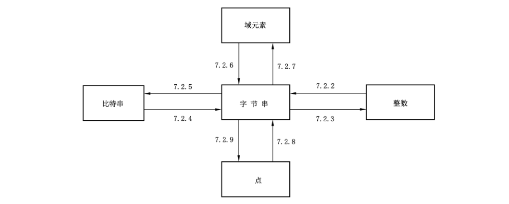

# GB/T 38635.1-2020 信息安全技术 SM9标识密码算法 第1部分：总则

> 来源：[GB/T 38635.1-2020 国家标准详情](https://openstd.samr.gov.cn/bzgk/std/newGbInfo?hcno=B7A0D7DFF411CD0AAE76135ADE91886A)；封面发布日期：2020-04-28；实施日期：2020-11-01。
> PDF SHA-256：444fad30e5e38fce05a9ba586bbfb5560d2e89c5f2b8f997f1b65be3c75638e2。
> 转写说明：对照官方 PDF 全部 40 页的页面图像校正文字与公式；省略封面、目录、页眉、页脚和页码，合并跨页内容。正式引用请核对原 PDF。

## 前言

GB/T 38635《信息安全技术 SM9 标识密码算法》分为两个部分：

- 第 1 部分：总则；
- 第 2 部分：算法。

本部分为 GB/T 38635的第1部分。

本部分按照GB/T 1.1—2009给出的规则起草。

请注意本文件的某些内容可能涉及专利。本文件的发布机构不承担识别这些专利的责任。

本部分由全国信息安全标准化技术委员会（SAC/TC 260）提出并归口。

本部分起草单位：国家信息安全工程技术研究中心、北京国脉信安科技有限公司、深圳奥联信息安全技术有限公司、中国科学院软件研究所、武汉大学、中科院信息工程研究所。

本部分主要起草人：陈晓、程朝辉、张振峰、叶顶峰、胡磊、陈建华、季庆光、袁文恭、刘平、马宁、袁峰、李增欣、王学进、杨恒亮、张青坡、马艳丽、浦雨三、唐英、孙移盛、安萱、封维端、张立圆。

## 引言

A.Shamir 在1984年提出了标识密码（Identity-based cryptography）的概念，在标识密码系统中，用户的私钥由密钥生成中心（KGC）根据主密钥和用户标识计算得出，用户的公钥由用户标识唯一确定，由标识管理者保证标识的真实性。与基于证书的公钥密码系统相比，标识密码系统中的密钥管理环节可以得到适当简化。

1999年，K.Ohgishi、R.Sakai 和 M.Kasahara 在日本提出了用椭圆曲线对（pairing）构造基于标识的密钥共享方案；2001年，D.Boneh 和 M.Franklin，以及 R.Sakai、K.Ohgishi 和 M.Kasahara 等人独立提出了用椭圆曲线对构造标识公钥加密算法。这些工作引发了标识密码的新发展，出现了一批用椭圆曲线对实现的标识密码算法，其中包括数字签名算法、密钥交换协议、密钥封装机制和公钥加密算法等。

椭圆曲线对具有双线性的性质，它在椭圆曲线的循环子群与扩域的乘法循环子群之间建立联系，构成了双线性 DH、双线性逆 DH、判定性双线性逆 DH、τ-双线性逆 DH 和 τ-Gap-双线性逆 DH 等难题，当椭圆曲线离散对数问题和扩域离散对数问题的求解难度相当时，可用椭圆曲线对构造出安全性和实现效率兼顾的标识密码。

## 1 范围

GB/T 38635 的本部分规定了SM9标识密码算法涉及的必要相关数学基础知识、密码技术和具体参数。

本部分适用于 SM9标识密码的实现和应用。

## 2 规范性引用文件

下列文件对于本文件的应用是必不可少的。凡是注日期的引用文件，仅注日期的版本适用于本文件。凡是不注日期的引用文件，其最新版本（包括所有的修改单）适用于本文件。

- GB/T 32905 信息安全技术 SM3密码杂凑算法

- GB/T 32907 信息安全技术 SM4分组密码算法

## 3 术语和定义

下列术语和定义适用于本文件。

### 3.1 标识 identity

由实体无法否认的信息组成，如实体的可识别名称、电子邮箱、身份证号、电话号码、街道地址等，可唯一确定一个实体的身份。

### 3.2 主密钥 master key

处于标识密码密钥分层结构最顶层的密钥，包括主私钥和主公钥，其中主公钥公开，主私钥由 KGC秘密保存。KGC用主私钥和用户的标识生成用户的私钥。在标识密码中，主私钥一般由 KGC通过随机数发生器产生，主公钥由主私钥结合系统参数产生。

### 3.3 密钥生成中心 key generation center;KGC

在SM9标识密码中，负责选择系统参数，生成主密钥并产生用户私钥的可信机构。

### 3.4 SM3 算法 SM3 algorithm

由 GB/T 32905定义的一种杂凑算法。

### 3.5 SM4 算法 SM4 algorithm

由GB/T 32907定义的一种分组加密算法。

## 4 符号

下列符号适用于本文件。

- $cf$：椭圆曲线阶相对于 $N$ 的余因子。
- $cid$：用一个字节表示的曲线识别符，用以区分所用曲线的类型。
- $\deg(f)$：多项式 $f(x)$ 的次数。
- $d_1$、$d_2$：$k$ 的两个因子。
- $E$：定义在有限域上的椭圆曲线。
- ECDLP：椭圆曲线离散对数问题。
- $E(F_q)$：有限域 $F_q$ 上椭圆曲线 $E$ 的所有有理点（包括无穷远点 $O$）组成的集合。
- $E(F_q)[r]$：$E(F_q)$ 上 $r$-扭点的集合［即曲线 $E(F_q)$ 上的 $r$ 阶扭子群］。
- $e$：从 $G_1\times G_2$ 到 $G_T$ 的双线性对。
- $eid$：用一个字节表示的双线性对 $e$ 的识别符，用以区分所用双线性对的类型。
- FDLP：有限域上离散对数问题。
- $F_p$：包含 $p$ 个元素的素域。
- $F_q$：包含 $q$ 个元素的有限域。
- $F_q^*$：由 $F_q$ 中所有非零元构成的乘法群。
- $F_{q^m}$：有限域 $F_q$ 的 $m$ 次扩域。
- $G_T$：阶为素数 $N$ 的乘法循环群。
- $G_1$：阶为素数 $N$ 的加法循环群。
- $G_2$：阶为素数 $N$ 的加法循环群。
- $\gcd(x,y)$：$x$ 和 $y$ 的最大公因子。
- $k$：曲线 $E(F_q)$ 相对于 $N$ 的嵌入次数，其中 $N$ 是 $\#E(F_q)$ 的素因子。
- $m$：有限域 $F_{q^m}$ 关于 $F_q$ 的扩张次数。
- $\operatorname{mod}f(x)$：模多项式 $f(x)$ 的运算。
- $\operatorname{mod}n$：模 $n$ 运算。示例：$23\operatorname{mod}7=2$。
- $N$：循环群 $G_1$、$G_2$ 和 $G_T$ 的阶，为大于 $2^{191}$ 的素数。
- $O$：椭圆曲线上的一个特殊点，称为无穷远点或零点，是椭圆曲线加法群的单位元。
- $P$：$P=(x_P,y_P)$ 是椭圆曲线上除 $O$ 之外的一个点，其坐标 $x_P$、$y_P$ 满足椭圆曲线方程。
- $P_1$：$G_1$ 的生成元。
- $P_2$：$G_2$ 的生成元。
- $P+Q$：椭圆曲线 $E$ 上两个点 $P$ 与 $Q$ 的和。
- $p$：大于 $2^{191}$ 的素数。
- $q$：有限域 $F_q$ 中元素的数目。
- $x_P$：点 $P$ 的 $x$ 坐标。
- $x\parallel y$：$x$ 与 $y$ 的拼接，其中 $x$ 和 $y$ 是比特串或字节串。
- $x\equiv y\pmod q$：$x$ 与 $y$ 模 $q$ 同余。即 $x\operatorname{mod}q=y\operatorname{mod}q$。
- $y_P$：点 $P$ 的 $y$ 坐标。
- $\#E(K)$：$E(K)$ 上点的数目，称为椭圆曲线群 $E(K)$ 的阶，其中 $K$ 为有限域（包括 $F_q$ 和 $F_{q^k}$）。
- $\langle P\rangle$：由椭圆曲线上点 $P$ 生成的循环群。
- $[u]P$：椭圆曲线上点 $P$ 的 $u$ 倍点。
- $[x,y]$：不小于 $x$ 且不大于 $y$ 的整数的集合。
- $\lceil x\rceil$：顶函数，不小于 $x$ 的最小整数。例如，$\lceil7\rceil=7$，$\lceil8.3\rceil=9$。
- $\lfloor x\rfloor$：底函数，不大于 $x$ 的最大整数。例如，$\lfloor7\rfloor=7$，$\lfloor8.3\rfloor=8$。
- $\beta$：扭曲线参数。
- $\psi$：$G_2$ 到 $G_1$ 的同态映射，满足 $P_1=\psi(P_2)$。
- $\oplus$：长度相等的两个比特串按比特的模 2 加运算。

## 5 有限域和椭圆曲线

### 5.1 有限域

#### 5.1.1 概述

域由一个非空集合 $F$ 和两种运算共同组成，这两种运算分别为加法（用“$+$”表示）和乘法（用“$\cdot$”表示），并且满足下列算术特性：

a）$(F,+)$ 对于加法运算构成加法交换群，单位元用 $0$ 表示；

b）$(F\setminus\{0\},\cdot)$ 对于乘法运算构成乘法交换群，单位元用 $1$ 表示；

c）分配律成立：对于所有的 $a,b,c\in F$，都有 $(a+b)\cdot c=a\cdot c+b\cdot c$。

若集合 $F$ 是有限集合，则称域为有限域。有限域的元素个数称为有限域的阶。

#### 5.1.2 素域 $F_p$

阶为素数的有限域是素域。

设 $p$ 是一个素数，则整数模 $p$ 的全体余数的集合 $\{0,1,2,\ldots,p-1\}$ 关于模 $p$ 的加法和乘法构成一个 $p$ 阶素域，用符号 $F_p$ 表示。

$F_p$ 具有如下性质：

a）加法单位元是 $0$；

b）乘法单位元是 $1$；

c）域元素的加法是整数的模 $p$ 加法，即若 $a,b\in F_p$，则 $a+b=(a+b)\operatorname{mod}p$；

d）域元素的乘法是整数的模 $p$ 乘法，即若 $a,b\in F_p$，则 $a\cdot b=(a\cdot b)\operatorname{mod}p$。

#### 5.1.3 有限域 $F_q$ 的 $m$ 次扩域 $F_{q^m}$

设 $q$ 是一个素数或素数方幂，$f(x)$ 是多项式环 $F_q[x]$ 上的一个 $m$（$m>1$）次不可约多项式（称为约化多项式或域多项式），商环 $F_q[x]/(f(x))$ 是含 $q^m$ 个元素的有限域（记为 $F_{q^m}$），称 $F_{q^m}$ 是有限域 $F_q$ 的扩域，域 $F_q$ 为域 $F_{q^m}$ 的子域，$m$ 为扩张次数。$F_{q^m}$ 可以看成 $F_q$ 上的 $m$ 维向量空间。$F_{q^m}$ 的每一个元可以唯一地写成 $a_0\beta_0+a_1\beta_1+\cdots+a_{m-1}\beta_{m-1}$ 的形式，其中 $a_i\in F_q$，而 $\beta_0,\beta_1,\ldots,\beta_{m-1}$ 是向量空间 $F_{q^m}$ 在 $F_q$ 上的一组基。

$F_{q^m}$ 中的元素可以用多项式基或正规基表示。在本部分中，如果不作特别说明，$F_{q^m}$ 中元素均采用多项式基表示。

不可约多项式 $f(x)$ 可取为首一的多项式 $f(x)=x^m+f_{m-1}x^{m-1}+\cdots+f_2x^2+f_1x+f_0$（其中 $f_i\in F_q$，$i=0,1,\ldots,m-1$）。$F_{q^m}$ 中的元素由多项式环 $F_q[x]$ 中所有次数低于 $m$ 的多项式构成。多项式集合 $\{x^{m-1},x^{m-2},\ldots,x,1\}$ 是 $F_{q^m}$ 在 $F_q$ 上的一组基，称为多项式基。域 $F_{q^m}$ 上的任意一个元素 $a(x)=a_{m-1}x^{m-1}+a_{m-2}x^{m-2}+\cdots+a_1x+a_0$，在 $F_q$ 上的系数恰好构成了一个 $m$ 维向量，用 $a=(a_{m-1},a_{m-2},\ldots,a_1,a_0)$ 表示，其中分量 $a_i\in F_q$，$i=0,1,\ldots,m-1$。

$F_{q^m}$ 具有如下性质：

a）零元 $0$ 用 $m$ 维向量 $(0,\ldots,0,0)$ 表示；

b）乘法单位元 $1$ 用 $m$ 维向量 $(0,\ldots,0,1)$ 表示；

c）两个域元素的加法为向量加法，各个分量用域 $F_q$ 的加法；

d）域元素 $a$ 和 $b$ 的乘法定义如下：设 $a$ 和 $b$ 对应的 $F_q$ 上多项式为 $a(x)$ 和 $b(x)$，则 $a\cdot b$ 定义为多项式 $(a(x)\cdot b(x))\operatorname{mod}f(x)$ 对应的向量；

e）逆元：设 $a$ 对应的 $F_q$ 上多项式为 $a(x)$，$a$ 的逆元 $a^{-1}$ 对应的 $F_q$ 上多项式为 $a^{-1}(x)$，那么有 $a(x)\cdot a^{-1}(x)\equiv1\operatorname{mod}f(x)$。

本部分使用 $F_q$ 上的 12 次扩域见附录 A。

关于有限域的扩域 $F_{q^m}$ 更多细节，参见附录 B 中的 B.1。

### 5.2 有限域上的椭圆曲线

有限域 $F_{p^m}$（$m\geq1$）上的椭圆曲线是由点组成的集合。在仿射坐标系下，椭圆曲线上点 $P$（非无穷远点）用满足一定方程的两个域元素 $x_P$ 和 $y_P$ 表示，$x_P$、$y_P$ 分别称为点 $P$ 的 $x$ 坐标和 $y$ 坐标，并记 $P=(x_P,y_P)$。

本部分描述特征为大素数 $p$ 的域上的曲线。

本部分如果不作特别说明，椭圆曲线上的点均采用仿射坐标表示。

定义在 $F_{p^m}$ 上的椭圆曲线方程见式（1）：

$$y^2=x^3+ax+b,\quad a,b\in F_{p^m},\quad 4a^3+27b^2\ne0 \tag{1}$$

椭圆曲线 $E(F_{p^m})$ 定义为 $E(F_{p^m})=\{(x,y)\mid x,y\in F_{p^m}\text{，且满足式（1）}\}\cup\{O\}$，其中 $O$ 是无穷远点。椭圆曲线 $E(F_{p^m})$ 上的点的数目用 $\#E(F_{p^m})$ 表示，称为椭圆曲线 $E(F_{p^m})$ 的阶。

本部分规定素数 $p>2^{191}$。

设 $E$ 和 $E'$ 是定义在 $F_q$ 上的椭圆曲线，如果存在一个同构映射 $\phi_d:E'(F_{q^d})\to E(F_{q^d})$，其中 $d$ 是使映射存在的最小整数，则称 $E'$ 为 $E$ 的 $d$ 次扭曲线。当 $p\geq5$ 时，$d$ 的取值有三种情况：

a）若 $a=0,b\ne0$，那么 $d=6$，$E':y^2=x^3+\beta b$，$\phi_6:E'\to E:(x,y)\mapsto(\beta^{-1/3}x,\beta^{-1/2}y)$；

b）若 $b=0,a\ne0$，那么 $d=4$，$E':y^2=x^3+\beta ax$，$\phi_4:E'\to E:(x,y)\mapsto(\beta^{-1/2}x,\beta^{-3/4}y)$；

c）若 $a\ne0,b\ne0$，那么 $d=2$，$E':y^2=x^3+\beta^2ax+\beta^3b$，$\phi_2:E'\to E:(x,y)\mapsto(\beta^{-1}x,\beta^{-3/2}y)$。

### 5.3 椭圆曲线群

椭圆曲线 $E(F_{p^m})$（$m\geq1$）上的点按照下面的加法运算规则，构成一个交换群：

a）$O+O=O$。

b）$\forall P=(x,y)\in E(F_{p^m})\setminus\{O\}$，$P+O=O+P=P$。

c）$\forall P=(x,y)\in E(F_{p^m})\setminus\{O\}$，$P$ 的逆元素 $-P=(x,-y)$，$P+(-P)=O$。

d）两个非互逆的不同点相加的规则：设 $P_1=(x_1,y_1)\in E(F_{p^m})\setminus\{O\}$，$P_2=(x_2,y_2)\in E(F_{p^m})\setminus\{O\}$，且 $x_1\ne x_2$，设 $P_3=(x_3,y_3)=P_1+P_2$，则：

$$\begin{cases}x_3=\lambda^2-x_1-x_2\\y_3=\lambda(x_1-x_3)-y_1\end{cases},\qquad\lambda=\frac{y_2-y_1}{x_2-x_1}.$$

e）倍点规则：设 $P_1=(x_1,y_1)\in E(F_{p^m})\setminus\{O\}$，且 $y_1\ne0$，$P_3=(x_3,y_3)=P_1+P_1$，则：

$$\begin{cases}x_3=\lambda^2-2x_1\\y_3=\lambda(x_1-x_3)-y_1\end{cases},\qquad\lambda=\frac{3x_1^2+a}{2y_1}.$$

### 5.4 椭圆曲线多倍点运算

椭圆曲线上同一个点的重复相加称为该点的多倍点运算。设 $u$ 是一个正整数，$P$ 是椭圆曲线上的点，其 $u$ 倍点 $Q=[u]P=P+P+\cdots+P$。

多倍点运算可以扩展到 0 倍点运算和负数倍点运算：$[0]P=O$，$[-u]P=[u](-P)$。

多倍点运算可以通过一些技巧有效地实现，参见 B.2。

### 5.5 椭圆曲线子群上点的验证

输入：定义 $F_{q^m}$ 上（$q$ 为奇素数，$m\geq1$）椭圆曲线方程的参数 $a$、$b$，椭圆曲线 $E(F_{q^m})$ 上子群 $G$ 的阶 $N$，$F_{q^m}$ 上的一对元素 $(x,y)$。

输出：若 $(x,y)$ 是群 $G$ 中的元素，则输出“有效”；否则输出“无效”。

计算步骤为：

a）在 $F_{q^m}$ 上验证 $(x,y)$ 是否满足椭圆曲线方程 $y^2=x^3+ax+b$；

b）令 $Q=(x,y)$，验证 $[N]Q=O$。

若以上任何一项验证失败，则输出“无效”；否则，输出“有效”。

### 5.6 离散对数问题

#### 5.6.1 有限域上离散对数问题（FDLP）

有限域 $F_{q^m}$（$q$ 为奇素数，$m\geq1$）的全体非零元素构成一个乘法循环群，记为 $F_{q^m}^{*}$。$F_{q^m}^{*}$ 中存在元素 $g$，使得 $F_{q^m}^{*}=\{g^i\mid0\leq i\leq q^m-2\}$，称 $g$ 为生成元。$F_{q^m}^{*}$ 中元素 $a$ 的阶是满足 $a^t=1$ 的最小正整数 $t$。群 $F_{q^m}^{*}$ 的阶为 $q^m-1$，因此 $t\mid q^m-1$。

设乘法循环群 $F_{q^m}^{*}$ 的生成元为 $g$，$y\in F_{q^m}^{*}$，有限域上离散对数问题是指确定整数 $x\in[0,q^m-2]$，使得 $y=g^x$ 在 $F_{q^m}^{*}$ 上成立。

#### 5.6.2 椭圆曲线离散对数问题（ECDLP）

已知椭圆曲线 $E(F_{q^m})$（$m\geq1$），阶为 $n$ 的点 $P\in E(F_{q^m})$ 及 $Q\in\langle P\rangle$，椭圆曲线离散对数问题是指确定整数 $l\in[0,n-1]$，使得 $Q=[l]P$ 成立。

## 6 双线性对及安全曲线

### 6.1 双线性对

设 $(G_1,+)$、$(G_2,+)$ 和 $(G_T,\cdot)$ 是三个循环群，$G_1$、$G_2$ 和 $G_T$ 的阶均为素数 $N$，$P_1$ 是 $G_1$ 的生成元，$P_2$ 是 $G_2$ 的生成元，存在 $G_2$ 到 $G_1$ 的同态映射 $\psi$ 使得 $\psi(P_2)=P_1$。

双线性对 $e$ 是 $G_1\times G_2\rightarrow G_T$ 的映射，满足以下条件：

a）双线性性：对任意的 $P\in G_1$、$Q\in G_2$、$a,b\in\mathbb{Z}_N$，有 $e([a]P,[b]Q)=e(P,Q)^{ab}$；

b）非退化性：$e(P_1,P_2)\ne1_{G_T}$；

c）可计算性：对任意的 $P\in G_1$、$Q\in G_2$，存在有效的算法计算 $e(P,Q)$。

所用的双线性对定义在椭圆曲线群上，主要有 Weil 对、Tate 对、Ate 对、R-ate 对等，相关描述参见附录 C。

### 6.2 安全性

双线性对的安全性主要建立在以下几个问题的难解性基础之上：

**问题 1［双线性逆 DH（BIDH）］** 对 $a,b\in[1,N-1]$，给定 $([a]P_1,[b]P_2)$，计算 $e(P_1,P_2)^{b/a}$ 是困难的。

**问题 2［判定性双线性逆 DH（DBIDH）］** 对 $a,b,r\in[1,N-1]$，区分 $(P_1,P_2,[a]P_1,[b]P_2,e(P_1,P_2)^{b/a})$ 和 $(P_1,P_2,[a]P_1,[b]P_2,e(P_1,P_2)^r)$ 是困难的。

**问题 3［$\tau$-双线性逆 DH（$\tau$-BDHI）］** 对正整数 $\tau$ 和 $x\in[1,N-1]$，给定 $(P_1,[x]P_1,P_2,[x]P_2,[x^2]P_2,\cdots,[x^\tau]P_2)$，计算 $e(P_1,P_2)^{1/x}$ 是困难的。

**问题 4［$\tau$-Gap-双线性逆 DH（$\tau$-Gap-BDHI）］** 对正整数 $\tau$ 和 $x\in[1,N-1]$，给定 $(P_1,[x]P_1,P_2,[x]P_2,[x^2]P_2,\cdots,[x^\tau]P_2)$ 和 DBIDH 确定算法，计算 $e(P_1,P_2)^{1/x}$ 是困难的。

上述问题的难解性是 SM9 标识密码的安全性的重要基础，这些问题的难解性都意味着 $G_1$、$G_2$ 和 $G_T$ 上的离散对数问题难解，选取的椭圆曲线应首先使得离散对数问题难解。

### 6.3 嵌入次数及安全曲线

设 $G$ 是椭圆曲线 $E(F_q)$ 的 $N$ 阶子群，使 $N\mid q^k-1$ 成立的最小正整数 $k$ 称为子群 $G$ 相对于 $N$ 的嵌入次数，也称为曲线 $E(F_q)$ 相对于 $N$ 的嵌入次数。

设 $G_1$ 是 $E(F_{q^{d_1}})$（$d_1$ 整除 $k$）的 $N$ 阶子群，$G_2$ 是 $E(F_{q^{d_2}})$（$d_2$ 整除 $k$）的 $N$ 阶子群，则椭圆曲线双线性对的值域 $G_T$ 是 $F_{q^k}^{*}$ 的子群，因此椭圆曲线双线性对可将椭圆曲线离散对数问题转化为有限域 $F_{q^k}^{*}$ 上离散对数问题。嵌入次数越大安全性越高，但双线性对的计算越困难，因而需要采用嵌入次数适中且达到安全性标准的椭圆曲线。本部分规定 $q^k>2^{1536}$。

本部分规定选用如下的曲线：

a）基域 $q$ 为大于 $2^{191}$ 的素数、嵌入次数 $k=2^i3^j$ 的常曲线，其中 $i>0$，$j\geq0$；

b）基域 $q$ 为大于 $2^{768}$ 的素数、嵌入次数 $k=2$ 的超奇异曲线。

对小于 $2^{360}$ 的 $N$，建议：

a）$N-1$ 含有大于 $2^{190}$ 的素因子；

b）$N+1$ 含有大于 $2^{120}$ 的素因子。

## 7 数据类型及其转换

### 7.1 数据类型

本部分规定的数据类型包括比特串、字节串、域元素、椭圆曲线上的点和整数。

**比特串**：有序的 0 和 1 的序列。

**字节串**：有序的字节序列，其中 8 比特为 1 个字节，最左边的比特为最高位。

**域元素**：有限域 $F_{q^m}$（$m\geq1$）中的元素。

**椭圆曲线上的点**：椭圆曲线 $E(F_{q^m})$（$m\geq1$）上的点 $P$ 或者是无穷远点 $O$，或者是一对域元素 $(x_P,y_P)$，其中域元素 $x_P$ 和 $y_P$ 满足椭圆曲线方程。

点的字节串表示有多种形式，用一个字节 $PC$ 加以标识。无穷远点 $O$ 的字节串表示是单一的零字节 $PC=00$。非无穷远点 $P=(x_P,y_P)$ 有以下三种字节串表示形式：

a）压缩表示形式，$PC=02$ 或 $03$；

b）未压缩表示形式，$PC=04$；

c）混合表示形式，$PC=06$ 或 $07$。

> 注：混合表示形式既包含压缩表示形式又包含未压缩表示形式。在实现中，它允许转换到压缩表示形式或者未压缩表示形式。对于椭圆曲线上点的压缩表示形式和混合表示形式，本部分定为可选形式。椭圆曲线上点的压缩表示形式参见B.4。

### 7.2 数据类型转换

#### 7.2.1 数据类型转换关系

图1表示了各种数据类型之间的转换关系，线上的标志是相应数据转换方法所在的条号。

#### 7.2.2 整数到字节串的转换

输入：非负整数 $x$，以及字节串的目标长度 $l$（其中 $l$ 满足 $2^{8l}>x$）。

输出：长度为 $l$ 的字节串 $M$。

计算步骤为：

a）设 $M_{l-1},M_{l-2},\ldots,M_0$ 是 $M$ 从最左边到最右边的字节；

b）$M$ 的字节满足：

$$x=\sum_{i=0}^{l-1}2^{8i}M_i。$$

#### 7.2.3 字节串到整数的转换

输入：长度为 $l$ 的字节串 $M$。

输出：整数 $x$。

计算步骤为：

a）设 $M_{l-1},M_{l-2},\ldots,M_0$ 是 $M$ 从最左边到最右边的字节；

b）将 $M$ 转换为整数 $x$：

$$x=\sum_{i=0}^{l-1}2^{8i}M_i。$$

#### 7.2.4 比特串到字节串的转换

输入：长度为 $n$ 的比特串 $s$。

输出：长度为 $l$ 的字节串 $M$，其中 $l=\lceil n/8\rceil$。

计算步骤为：

a）设 $s_{n-1},s_{n-2},\ldots,s_0$ 是 $s$ 从最左边到最右边的比特；

b）设 $M_{l-1},M_{l-2},\ldots,M_0$ 是 $M$ 从最左边到最右边的字节，则：

$$M_i=s_{8i+7}s_{8i+6}\cdots s_{8i+1}s_{8i}，$$

其中 $0\leq i<l$，当 $8i+j\geq n$，$0<j\leq7$ 时，$s_{8i+j}=0$。

#### 7.2.5 字节串到比特串的转换

输入：长度为 $l$ 的字节串 $M$。

输出：长度为 $n$ 的比特串 $s$，其中 $n=8l$。

计算步骤为：

a）设 $M_{l-1},M_{l-2},\ldots,M_0$ 是 $M$ 从最左边到最右边的字节；

b）设 $s_{n-1},s_{n-2},\ldots,s_0$ 是 $s$ 从最左边到最右边的比特，则 $s_i$ 是 $M_j$ 右起第 $i-8j+1$ 比特，其中 $j=\lfloor i/8\rfloor$。

#### 7.2.6 域元素到字节串的转换

输入：$F_{q^m}$（$m\geq1$）中的元素 $\alpha=(a_{m-1},a_{m-2},\ldots,a_1,a_0)$，$q=p$。

输出：长度 $l$ 的字节串 $S$，其中 $l=\lceil\log_2q/8\rceil\times m$。

计算步骤为：

a）若 $m=1$，则 $\alpha=a_0$（$q=p$），$\alpha$ 必为区间 $[0,q-1]$ 中的整数，按 7.2.2 的细节把 $\alpha$ 转换成长度为 $l$ 的字节串 $S$；

b）若 $m>1$，则 $\alpha=(a_{m-1},a_{m-2},\ldots,a_1,a_0)$（$q=p$），其中 $a_i\in F_q$，$i=0,1,\ldots,m-1$；

1）置 $r=\lceil\log_2q/8\rceil$；

2）对 $i$ 从 $m-1$ 到 0 执行：按 7.2.2 的细节把 $a_i$（$q=p$）转换成长度为 $r$ 的字节串 $S_i$；

3）$S=S_{m-1}\parallel S_{m-2}\parallel\cdots\parallel S_0$。

#### 7.2.7 字节串到域元素的转换

**情形 1：转换为基域中元素**

输入：域 $F_q$，$q=p$，长度为 $l$ 的字节串 $S$，$l=\lceil\log_2q/8\rceil$。

输出：$F_q$ 中的元素 $\alpha$。

若 $q=p$，则按 7.2.3 的细节将 $S$ 转换为整数 $\alpha$，若 $\alpha\notin[0,q-1]$，则报错。

**情形 2：转换为扩域中元素**

输入：域 $F_{q^m}$（$m\geq2$），$q=p$，长度为 $l$ 的字节串 $S$，其中 $l=\lceil\log_2q/8\rceil\times m$。

输出：$F_{q^m}$ 中的元素 $\alpha$。

计算步骤为：

a）将字节串 $S$ 平均分成 $m$ 段，每段长度为 $l/m$，记作 $S=(S_{m-1},S_{m-2},\ldots,S_1,S_0)$；

b）对 $i$ 从 $m-1$ 到 0 执行：按 7.2.3 的细节将 $S_i$ 转换为整数 $a_i$，若 $a_i\notin[0,q-1]$，则报错；

c）若 $q=p$，输出 $\alpha=(a_{m-1},a_{m-2},\ldots,a_1,a_0)$。

#### 7.2.8 点到字节串的转换

点到字节串的转换分为两种情形：一种是在计算过程中，将椭圆曲线点转换为字节串后才能作为某个函数（如杂凑函数）的输入，这种情况下只需直接将点转换为字节串；一种是在传输或存储椭圆曲线点时，为了减少传输的量或存储空间，可采用点的压缩或混合压缩表示形式，这种情况下需要加入一个字节的识别符 PC 来指点的表示形式。下面分两种情况说明详细的转换过程。

**情形 1：直接转换**

输入：椭圆曲线 $E(F_{q^m})$（$m\geq1$）上的点 $P=(x_P,y_P)$，且 $P\ne O$。

输出：长度为 $2l$ 的字节串 $X_1\parallel Y_1$。（当 $m=1$ 时，$l=\lceil\log_2q/8\rceil$；当 $m>1$ 时，$l=\lceil\log_2q/8\rceil\times m$。）

计算步骤为：

a）按 7.2.6 中的细节把域元素 $x_P$ 转换成长度为 $l$ 的字节串 $X_1$；

b）按 7.2.6 中的细节把域元素 $y_P$ 转换成长度为 $l$ 的字节串 $Y_1$；

c）输出字节串 $X_1\parallel Y_1$。

**情形 2：添加一字节识别符 $PC$ 的转换**

输入：椭圆曲线 $E(F_{q^m})$（$m\geq1$）上的点 $P=(x_P,y_P)$，且 $P\ne O$。

输出：字节串 $PO$。若选用未压缩表示形式或混合表示形式，则输出字节串长度为 $2l+1$；若选用压缩表示形式，则输出字节串长度为 $l+1$。（当 $m=1$ 时，$l=\lceil\log_2q/8\rceil$；当 $m>1$ 时，$l=\lceil\log_2q/8\rceil\times m$。）

计算步骤为：

a）按 7.2.6 中的细节把域元素 $x_P$ 转换成长度为 $l$ 的字节串 $X_1$。

b）若选用压缩表示形式，则：

1）计算比特 $\tilde y_P$（参见 B.4）；

2）若 $\tilde y_P=0$，则令 $PC=02$；若 $\tilde y_P=1$，则令 $PC=03$；

3）字节串 $PO=PC\parallel X_1$。

c）若选用未压缩表示形式，则：

1）按 7.2.6 的细节把域元素 $y_P$ 转换成长度为 $l$ 的字节串 $Y_1$；

2）令 $PC=04$；

3）字节串 $PO=PC\parallel X_1\parallel Y_1$。

d）若选用混合表示形式，则：

1）按 7.2.6 的细节把域元素 $y_P$ 转换成长度为 $l$ 的字节串 $Y_1$；

2）计算比特 $\tilde y_P$（参见 B.4）；

3）若 $\tilde y_P=0$，则令 $PC=06$；若 $\tilde y_P=1$，则令 $PC=07$；

4）字节串 $PO=PC\parallel X_1\parallel Y_1$。

#### 7.2.9 字节串到点的转换

字节串到点的转换是7.2.8的逆过程。下面也分两种情况加以说明。

**情形 1：直接转换**

输入：定义 $F_{q^m}$（$m\geq1$）上椭圆曲线的域元素 $a$、$b$，长度为 $2l$ 的字节串 $X_1\parallel Y_1$，$X_1$、$Y_1$ 的长度均为 $l$（当 $m=1$ 时，$l=\lceil\log_2q/8\rceil$；当 $m>1$ 时，$l=\lceil\log_2q/8\rceil\times m$）。

输出：椭圆曲线上的点 $P=(x_P,y_P)$，且 $P\ne O$。

计算步骤为：

a）按 7.2.7 的细节把字节串 $X_1$ 转换成域元素 $x_P$；

b）按 7.2.7 的细节把字节串 $Y_1$ 转换成域元素 $y_P$。

**情形 2：包含一字节识别符 $PC$ 的字节串的转换**

输入：定义 $F_{q^m}$（$m\geq1$）上椭圆曲线的域元素 $a$、$b$，字节串 $PO$。若选用未压缩表示形式或混合表示形式，则字节串 $PO$ 长度为 $2l+1$；若选用压缩表示形式，则字节串 $PO$ 长度为 $l+1$（当 $m=1$ 时，$l=\lceil\log_2q/8\rceil$；当 $m>1$ 时，$l=\lceil\log_2q/8\rceil\times m$）。

输出：椭圆曲线上的点 $P=(x_P,y_P)$，且 $P\ne O$。

计算步骤为：

a）若选用压缩表示形式，则 $PO=PC\parallel X_1$；若选用未压缩表示形式或混合表示形式，则 $PO=PC\parallel X_1\parallel Y_1$，其中 $PC$ 是单一字节，$X_1$ 和 $Y_1$ 都是长度为 $l$ 的字节串。

b）按 7.2.7 的细节把字节串 $X_1$ 转换成域元素 $x_P$。

c）若选用压缩表示形式，则：

1）检验 $PC=02$ 或者 $PC=03$，若不是这种情形，则报错；

2）若 $PC=02$，则令 $\tilde y_P=0$；若 $PC=03$，则令 $\tilde y_P=1$；

3）将 $(x_P,\tilde y_P)$ 转换为椭圆曲线上的一个点 $(x_P,y_P)$（参见 B.4）。

d）若选用未压缩表示形式，则：

1）检验 $PC=04$，若不是这种情形，则报错；

2）按 7.2.7 的细节把字节串 $Y_1$ 转换成域元素 $y_P$。

e）若选用混合表示形式，则：

1）检验 $PC=06$ 或者 $PC=07$，若不是这种情形，则报错；

2）执行以下步骤：

- 按 7.2.7 的细节把字节串 $Y_1$ 转换成域元素 $y_P$；
- 若 $PC=06$，则令 $\tilde y_P=0$，否则令 $\tilde y_P=1$；

将 $(x_P,\tilde y_P)$ 转换为椭圆曲线上的一个点 $(x_P,y_P)$（参见 B.4）。

f）验证 $(x_P,y_P)$ 是否满足曲线方程，若不满足，则报错。

g）$P=(x_P,y_P)$。

## 8 系统参数及其验证

### 8.1 系统参数

系统参数包括：

a）曲线的识别符 $cid$，用一个字节表示：0x10 表示 $F_q$（素数 $q>3$）上常曲线，0x11 表示 $F_q$ 上超奇异曲线，0x12 表示 $F_q$ 上常曲线及其扭曲线。

b）椭圆曲线基域 $F_q$ 的参数：基域参数为大于 3 的素数 $q$。

c）$F_q$ 中的两个元素 $a$ 和 $b$，它们定义椭圆曲线 $E$ 的方程：$y^2=x^3+ax+b$；扭曲线参数 $\beta$（若 $cid$ 的低 4 位为 2）。

d）余因子 $cf$ 和素数 $N$，其中 $cf\times N=\#E(F_q)$，$N>2^{191}$ 且 $N$ 不整除 $cf$，如果 $N$ 小于 $2^{360}$，建议 $N-1$ 含有大于 $2^{190}$ 的素因子，$N+1$ 含有大于 $2^{120}$ 的素因子。

e）曲线 $E(F_q)$ 相对于 $N$ 的嵌入次数 $k$（$N$ 阶循环群 $(G_T,\cdot)\subset F_{q^k}^{*}$），规定 $q^k>2^{1536}$。

f）$N$ 阶循环群 $(G_1,+)$ 的生成元 $P_1=(x_{P_1},y_{P_1})$，$P_1\ne O$。

g）$N$ 阶循环群 $(G_2,+)$ 的生成元 $P_2=(x_{P_2},y_{P_2})$，$P_2\ne O$。

h）双线性对用一个字节的识别符 $eid$ 表示：0x01 表示 Tate 对，0x02 表示 Weil 对，0x03 表示 Ate 对，0x04 表示 R-ate 对。本部分采用 R-ate 对。

i）（选项）参数 $d_1,d_2$，其中 $d_1,d_2$ 整除 $k$。

j）（选项）$G_2$ 到 $G_1$ 的同态映射 $\psi$，使得 $P_1=\psi(P_2)$。

k）（选项）BN 曲线的基域特征 $q$，曲线阶 $r$，Frobenius 映射的迹 $tr$ 可通过参数 $t$ 来确定，$t$ 至少达到 63 比特。

具体参数，见附录 A。

### 8.2 系统参数的验证

下面的条件应由系统参数的生成者加以验证。这些条件也能由系统参数的用户验证。

输入：系统参数集合。

输出：若所有参数有效，则输出“有效”；否则输出“无效”。

计算步骤为：

a）验证 $q$ 是大于 3 的素数（参见附录 D 中的 D.1.5）；

b）验证 $a,b$ 是区间 $[0,q-1]$ 中的整数；

c）验证在 $F_q$ 上 $4a^3+27b^2\ne0$；若 $cid$ 的低 4 位为 2，验证 $\beta$ 是非平方元（参见 D.1.4.3.1）；

d）验证 $N$ 为大于 $2^{191}$ 的素数且 $N$ 不整除 $cf$，如果 $N$ 小于 $2^{360}$，验证 $N-1$ 含有大于 $2^{190}$ 的素因子，$N+1$ 含有大于 $2^{120}$ 的素因子；

e）验证 $|q+1-cf\times N|<2q^{1/2}$；

f）验证 $q^k>2^{1536}$，且 $k$ 为使 $N\mid(q^m-1)$ 成立的最小正整数 $m$；

g）验证 $(x_{P_1},y_{P_1})$ 是群 $G_1$ 中的元素；

h）验证 $(x_{P_2},y_{P_2})$ 是群 $G_2$ 中的元素；

i）验证 $e(P_1,P_2)\in F_{q^k}^{*}\setminus\{1\}$，且 $e(P_1,P_2)^N=1$；

j）（选项）验证 $d_1,d_2$ 整除 $k$；

k）（选项）验证 $P_1=\psi(P_2)$；

l）（选项）验证 $t$ 至少达到 63 比特。

若以上任何一项验证失败，则输出“无效”；否则，输出“有效”。

## 附录 A（规范性附录）参数定义

### A.1 系统参数

本部分使用 256 位的 BN 曲线。

椭圆曲线方程：$y^2=x^3+b$。

曲线参数：

- 参数 $t$：60000000 0058F98A
- 迹 $tr(t)=6t^2+1$：D8000000 019062ED 0000B98B 0CB27659
- 基域特征 $q(t)=36t^4+36t^3+24t^2+6t+1$：B6400000 02A3A6F1 D603AB4F F58EC745 21F2934B 1A7AEEDB E56F9B27 E351457D
- 方程参数 $b$：05
- 群的阶 $N(t)=36t^4+36t^3+18t^2+6t+1$：B6400000 02A3A6F1 D603AB4F F58EC744 49F2934B 18EA8BEE E56EE19C D69ECF25
- 余因子 $cf$：1
- 嵌入次数 $k$：12
- 扭曲线的参数 $\beta$：$\sqrt{-2}$
- $k$ 的因子 $d_1=1,d_2=2$
- 曲线识别符 $cid$：0x12
- 群 $G_1$ 的生成元 $P_1=(x_{P_1},y_{P_1})$：
  - 坐标 $x_{P_1}$：93DE051D 62BF718F F5ED0704 487D01D6 E1E40869 09DC3280 E8C4E481 7C66DDDD
  - 坐标 $y_{P_1}$：21FE8DDA 4F21E607 63106512 5C395BBC 1C1C00CB FA602435 0C464CD7 0A3EA616
- 群 $G_2$ 的生成元 $P_2=(x_{P_2},y_{P_2})$：
  - 坐标 $x_{P_2}$：
    (85AEF3D0 78640C98 597B6027 B441A01F F1DD2C19 0F5E93C4 54806C11 D8806141，
    37227552 92130B08 D2AAB97F D34EC120 EE265948 D19C17AB F9B7213B AF82D65B)
  - 坐标 $y_{P_2}$：
    (17509B09 2E845C12 66BA0D26 2CBEE6ED 0736A96F A347C8BD 856DC76B 84FBEB96，
    A7CF28D5 19BE3DA6 5F317015 3D278FF2 47EFBA98 A71A0811 6215BBA5 C999A7C7)
- 双线性对的识别符 $eid$：0x04

### A.2 扩域元素的表示

$F_{q^{12}}$ 的 1-2-4-12 塔式扩张：

1. $F_{q^2}=F_q[u]/(u^2-\alpha)$，$\alpha=-2$；
2. $F_{q^4}=F_{q^2}[v]/(v^2-\xi)$，$\xi=u$；
3. $F_{q^{12}}=F_{q^4}[w]/(w^3-v)$，$v^2=\xi$。

其中：

第（1）步进行二次扩张的约化多项式为：$x^2-\alpha$，$\alpha=-2$；

第（2）步进行二次扩张的约化多项式为：$x^2-u$，$u^2=\alpha$，$u=\sqrt{-2}$；

第（3）步进行三次扩张的约化多项式为：$x^3-v$，$v^2=u$，$v=\sqrt{\sqrt{-2}}$；

$u$ 属于 $F_{q^2}$，表示为 $(1,0)$，左边是第 1 维（高维），右边是第 0 维（低维）。

$v$ 属于 $F_{q^4}$，表示为 $(0,1,0,0)$，其中左边 $(0,1)$ 是 $F_{q^4}$ 中元素以 $F_{q^2}$ 表示的第 1 维（高维），右边 $(0,0)$ 是 $F_{q^4}$ 中元素以 $F_{q^2}$ 表示的第 0 维（低维）。

$F_{q^{12}}$ 中元素有三种表示方法：

a）$F_{q^{12}}$ 中元素 $A$ 用 $F_{q^4}$ 中元素表示：

$$A=aw^2+bw+c=(a,b,c)。$$

$a,b,c$ 用 $F_{q^2}$ 中元素表示：

$$a=a_1v+a_0=(a_1,a_0),\quad b=b_1v+b_0=(b_1,b_0),\quad c=c_1v+c_0=(c_1,c_0)。$$

其中：$a_1,a_0,b_1,b_0,c_1,c_0\in F_{q^2}$。

b）$F_{q^{12}}$ 中元素 $A$ 用 $F_{q^2}$ 中的元素表示：

$$A=(a_1,a_0,b_1,b_0,c_1,c_0)。$$

$a_1,a_0,b_1,b_0,c_1,c_0$ 用基域 $F_q$ 中的元素表示：

$$\begin{aligned}
a_0&=a_{0,1}u+a_{0,0}=(a_{0,1},a_{0,0}),&
a_1&=a_{1,1}u+a_{1,0}=(a_{1,1},a_{1,0}),\\
b_0&=b_{0,1}u+b_{0,0}=(b_{0,1},b_{0,0}),&
b_1&=b_{1,1}u+b_{1,0}=(b_{1,1},b_{1,0}),\\
c_0&=c_{0,1}u+c_{0,0}=(c_{0,1},c_{0,0}),&
c_1&=c_{1,1}u+c_{1,0}=(c_{1,1},c_{1,0}).
\end{aligned}$$

其中：$a_{0,1},a_{0,0},a_{1,1},a_{1,0},b_{0,1},b_{0,0},b_{1,1},b_{1,0},c_{0,1},c_{0,0},c_{1,1},c_{1,0}\in F_q$。

c）$F_{q^{12}}$ 中元素 $A$ 用基域 $F_q$ 中的元素表示：

$$A=(a_{0,1},a_{0,0},a_{1,1},a_{1,0},b_{0,1},b_{0,0},b_{1,1},b_{1,0},c_{0,1},c_{0,0},c_{1,1},c_{1,0})。$$

其中各分量均属于 $F_q$。

$F_{q^2}$ 中单位元的表示为 $(0,1)$。

$F_{q^4}$ 中单位元的表示为 $(0,0,0,1)$。

$F_{q^{12}}$ 中单位元的表示为 $(0,0,0,0,0,0,0,0,0,0,0,1)$。

各种扩域中分量序为：左边是高维，右边是低维。

示例数据中，扩域中的元素均用基域中的元素表示。

## 附录 B（资料性附录）关于椭圆曲线的背景知识

### B.1 有限域

#### B.1.1 素域 $F_p$

设 $p$ 是一个素数，整数模 $p$ 的全体余数的集合 $\{0,1,2,\ldots,p-1\}$ 关于模 $p$ 的加法和乘法构成一个 $p$ 阶素域，用符号 $F_p$ 表示。加法单位元是 0，乘法单位元是 1。$F_p$ 的元素满足如下运算法则：

- 加法：设 $a,b\in F_p$，则 $a+b=r$，其中 $r=(a+b)\bmod p$，$r\in[0,p-1]$。
- 乘法：设 $a,b\in F_p$，则 $a\cdot b=s$，其中 $s=(a\cdot b)\bmod p$，$s\in[0,p-1]$。

记 $F_p^*$ 是由 $F_p$ 中所有非零元构成的乘法群。由于 $F_p^*$ 是循环群，所以在 $F_p$ 中至少存在一个元素 $g$，使得 $F_p$ 中任一非零元都可以由 $g$ 的一个方幂表示，称 $g$ 为 $F_p^*$ 的生成元（或本原元），即 $F_p^*=\{g^i\mid0\leq i\leq p-2\}$。设 $a=g^i\in F_p^*$，其中 $0\leq i\leq p-2$，则 $a$ 的乘法逆元为：$a^{-1}=g^{p-1-i}$。

**示例**：素域 $F_{19}$，$F_{19}=\{0,1,2,\ldots,18\}$。

$F_{19}$ 中加法的示例：$10,14\in F_{19}$，$10+14=24$，$24\bmod19=5$，则 $10+14=5$。

$F_{19}$ 中乘法的示例：$7,8\in F_{19}$，$7\times8=56$，$56\bmod19=18$，则 $7\cdot8=18$。

13 是 $F_{19}^*$ 的一个生成元，则 $F_{19}^*$ 中元素可由 13 的方幂表示出来：

$13^0=1$，$13^1=13$，$13^2=17$，$13^3=12$，$13^4=4$，$13^5=14$，$13^6=11$，$13^7=10$，$13^8=16$，$13^9=18$，$13^{10}=6$，$13^{11}=2$，$13^{12}=7$，$13^{13}=15$，$13^{14}=5$，$13^{15}=8$，$13^{16}=9$，$13^{17}=3$，$13^{18}=1$。

#### B.1.2 有限域 $F_{q^m}$

设 $q$ 是一个素数或素数方幂，$f(x)$ 是多项式环 $F_q[x]$ 上的一个 $m$（$m>1$）次不可约多项式（称为约化多项式或域多项式），商环 $F_q[x]/(f(x))$ 是含 $q^m$ 个元素的有限域（记为 $F_{q^m}$），称 $F_{q^m}$ 是有限域 $F_q$ 的扩域，域 $F_q$ 为域 $F_{q^m}$ 的子域，$m$ 为扩张次数。$F_{q^m}$ 可以看成 $F_q$ 上的 $m$ 维向量空间，也就是说，在 $F_{q^m}$ 中存在 $m$ 个元素 $\alpha_0,\alpha_1,\ldots,\alpha_{m-1}$，使得 $\forall a\in F_{q^m}$，$a$ 可以唯一表示为：

$$a=a_{m-1}\alpha_{m-1}+\cdots+a_1\alpha_1+a_0\alpha_0，$$

其中 $a_i\in F_q$，称 $\{\alpha_{m-1},\ldots,\alpha_1,\alpha_0\}$ 为 $F_{q^m}$ 在 $F_q$ 上的一组基。给定这样一组基，就可以由向量 $(a_{m-1},a_{m-2},\ldots,a_1,a_0)$ 来表示域元素 $a$。

$F_{q^m}$ 在 $F_q$ 上的基有多种选择：多项式基和正规基等。

不可约多项式 $f(x)$ 可取为首一的多项式 $f(x)=x^m+f_{m-1}x^{m-1}+\cdots+f_2x^2+f_1x+f_0$（其中 $f_i\in F_q$，$i=0,1,\ldots,m-1$），$F_{q^m}$ 中的元素由多项式环 $F_q[x]$ 中所有次数低于 $m$ 的多项式构成，即：

$$F_{q^m}=\{a_{m-1}x^{m-1}+a_{m-2}x^{m-2}+\cdots+a_1x+a_0\mid a_i\in F_q,\ i=0,1,\ldots,m-1\}。$$

多项式集合 $\{x^{m-1},x^{m-2},\ldots,x,1\}$ 是 $F_{q^m}$ 作为向量空间在 $F_q$ 上的一组基，称多项式基。当 $m$ 含有因子 $d$（$1<d<m$）时，$F_{q^m}$ 可以由 $F_{q^d}$ 扩张生成，从 $F_{q^d}[x]$ 中选取一个合适的 $m/d$ 次不可约多项式作为 $F_{q^m}$ 在 $F_{q^d}$ 上的约化多项式，$F_{q^m}$ 可以由塔式扩张方法（towering method）得到，这种扩张的基本形式仍是由 $F_q$ 中元素组成的向量。例如当 $m=6$ 时，可以先由 $F_q$ 经过 3 次扩张得扩域 $F_{q^3}$，再由 $F_{q^3}$ 经过 2 次扩张得到扩域 $F_{q^6}$；也可以先由 $F_q$ 经过 2 次扩张得扩域 $F_{q^2}$，再由 $F_{q^2}$ 经过 3 次扩张得到扩域 $F_{q^6}$。

$F_{q^m}$ 在 $F_q$ 上形如 $\{\beta,\beta^q,\beta^{q^2},\ldots,\beta^{q^{m-1}}\}$ 的一组基称为正规基，其中 $\beta\in F_{q^m}$。$\forall a\in F_{q^m}$，$a$ 可以唯一表示为：$a=a_0\beta+a_1\beta^q+\cdots+a_{m-1}\beta^{q^{m-1}}$，其中 $a_i\in F_q$，$i=0,1,\ldots,m-1$。对于任意有限域 $F_q$ 及其扩域 $F_{q^m}$，这样的基总是存在的。

如果不作特别说明，$F_{q^m}$ 中元素均采用多项式基表示。域元素 $a_{m-1}x^{m-1}+a_{m-2}x^{m-2}+\cdots+a_1x+a_0$ 相对于多项式基可以由向量 $(a_{m-1},a_{m-2},\ldots,a_1,a_0)$ 表示，所以：

$$F_{q^m}=\{(a_{m-1},a_{m-2},\ldots,a_1,a_0)\mid a_i\in F_q,\ i=0,1,\ldots,m-1\}。$$

乘法单位元 1 由 $(0,\ldots,0,1)$ 表示，零元由 $(0,\ldots,0,0)$ 表示。域元素的加法和乘法定义如下：

- 加法运算：$\forall(a_{m-1},\ldots,a_0),(b_{m-1},\ldots,b_0)\in F_{q^m}$，则 $(a_{m-1},\ldots,a_0)+(b_{m-1},\ldots,b_0)=(c_{m-1},\ldots,c_0)$，其中 $c_i=a_i+b_i\in F_q$，$i=0,1,\ldots,m-1$，即加法运算按分量执行域 $F_q$ 的加法运算。
- 乘法运算：$\forall(a_{m-1},\ldots,a_0),(b_{m-1},\ldots,b_0)\in F_{q^m}$，则 $(a_{m-1},\ldots,a_0)\cdot(b_{m-1},\ldots,b_0)=(r_{m-1},\ldots,r_0)$，其中多项式 $r_{m-1}x^{m-1}+\cdots+r_1x+r_0$ 是 $(a_{m-1}x^{m-1}+\cdots+a_1x+a_0)\cdot(b_{m-1}x^{m-1}+\cdots+b_1x+b_0)$ 在 $F_q[x]$ 中模 $f(x)$ 的余式。

$F_{q^m}$ 恰包含 $q^m$ 个元素。记 $F_{q^m}^*$ 是由 $F_{q^m}$ 中所有非零元构成的乘法群。$F_{q^m}^*$ 是循环群，在 $F_{q^m}$ 中至少存在一个元素 $g$，使得 $F_{q^m}$ 中任一非零元都可以由 $g$ 的一个方幂表示，称 $g$ 为 $F_{q^m}^*$ 的生成元（或本原元），即 $F_{q^m}^*=\{g^i\mid0\leq i\leq q^m-2\}$。设 $a=g^i\in F_{q^m}^*$，其中 $0\leq i\leq q^m-2$，则 $a$ 的乘法逆元为 $a^{-1}=g^{q^m-1-i}$。

**示例：$F_{3^2}$ 的多项式基表示**

取 $F_3$ 上的一个不可约多项式 $f(x)=x^2+1$，则 $F_{3^2}$ 中的元素是：

$(0,0)$，$(0,1)$，$(0,2)$，$(1,0)$，$(1,1)$，$(1,2)$，$(2,0)$，$(2,1)$，$(2,2)$。

加法：$(2,1)+(2,0)=(1,1)$。

乘法：$(2,1)\cdot(2,0)=(2,2)$，因为：

$$(2x+1)\cdot2x=4x^2+2x=x^2+2x\equiv2x+2\pmod{f(x)}。$$

即 $2x+2$ 是 $(2x+1)\cdot2x$ 除以 $f(x)$ 的余式。

乘法单位元是 $(0,1)$，$\alpha=x+1$ 是 $F_{3^2}^*$ 的一个生成元，则 $\alpha$ 的方幂为：

$\alpha^0=(0,1)$，$\alpha^1=(1,1)$，$\alpha^2=(2,0)$，$\alpha^3=(2,1)$，$\alpha^4=(0,2)$，$\alpha^5=(2,2)$，$\alpha^6=(1,0)$，$\alpha^7=(1,2)$，$\alpha^8=(0,1)$。

#### B.1.3 有限域上的椭圆曲线

##### B.1.3.1 概述

有限域上椭圆曲线常用的表示形式有两种：仿射坐标表示和射影坐标表示。

##### B.1.3.2 仿射坐标表示

设 $p$ 是大于 3 的素数，$F_{p^m}$ 上椭圆曲线方程在仿射坐标系下可以简化为 $y^2=x^3+ax+b$，其中 $a,b\in F_{p^m}$，且使得 $4a^3+27b^2\ne0$。椭圆曲线上的点集记为 $E(F_{p^m})=\{(x,y)\mid x,y\in F_{p^m}$，且满足曲线方程 $y^2=x^3+ax+b\}\cup\{O\}$，其中 $O$ 是椭圆曲线的无穷远点，又称为零点。

$E(F_{p^m})$（$m\geq1$）上的点按照下面的加法运算规则，构成一个交换群：

a）$O+O=O$；

b）$\forall P=(x,y)\in E(F_{p^m})\setminus\{O\}$，$P+O=O+P=P$；

c）$\forall P=(x,y)\in E(F_{p^m})\setminus\{O\}$，$P$ 的逆元素 $-P=(x,-y)$，$P+(-P)=O$；

d）点 $P_1=(x_1,y_1)\in E(F_{p^m})\setminus\{O\}$，$P_2=(x_2,y_2)\in E(F_{p^m})\setminus\{O\}$，$P_3=(x_3,y_3)=P_1+P_2\ne O$，则：

$$\begin{cases}x_3=\lambda^2-x_1-x_2,\\y_3=\lambda(x_1-x_3)-y_1,\end{cases}$$

其中：

$$\lambda=\begin{cases}\dfrac{y_2-y_1}{x_2-x_1},&x_1\ne x_2,\\[6pt]\dfrac{3x_1^2+a}{2y_1},&x_1=x_2\text{ 且 }P_2\ne-P_1.\end{cases}$$

**示例：有限域 $F_{19}$ 上一条椭圆曲线**

$F_{19}$ 上方程：$y^2=x^3+x+1$，其中 $a=1$，$b=1$。则 $F_{19}$ 上曲线的点为：

$(0,1)$，$(0,18)$，$(2,7)$，$(2,12)$，$(5,6)$，$(5,13)$，$(7,3)$，$(7,16)$，$(9,6)$，$(9,13)$，$(10,2)$，$(10,17)$，$(13,8)$，$(13,11)$，$(14,2)$，$(14,17)$，$(15,3)$，$(15,16)$，$(16,3)$，$(16,16)$。

则 $E(F_{19})$ 有 21 个点（包括无穷远点 $O$）。

a）取 $P_1=(10,2)$，$P_2=(9,6)$，计算 $P_3=P_1+P_2$：

$$\lambda=\frac{y_2-y_1}{x_2-x_1}=\frac{6-2}{9-10}=\frac{4}{-1}=-4\equiv15\pmod{19},$$

$$x_3=15^2-10-9=225-10-9\equiv16-10-9=-3\equiv16\pmod{19},$$

$$y_3=15(10-16)-2=15(-6)-2\equiv3\pmod{19}。$$

所以 $P_3=(16,3)$。

b）取 $P_1=(10,2)$，计算 $[2]P_1$：

$$\lambda=\frac{3x_1^2+a}{2y_1}=\frac{3\cdot10^2+1}{2\cdot2}=\frac{3\cdot5+1}{4}=\frac{16}{4}=4\pmod{19},$$

$$x_3=4^2-10-10=-4\equiv15\pmod{19},$$

$$y_3=4(10-15)-2=-22\equiv16\pmod{19}。$$

所以 $[2]P_1=(15,16)$。

##### B.1.3.3 射影坐标表示

设 $p$ 是大于 3 的素数，$F_{p^m}$ 上椭圆曲线方程在标准射影坐标系下可以简化为 $y^2z=x^3+axz^2+bz^3$，其中 $a,b\in F_{p^m}$，且 $4a^3+27b^2\ne0$。椭圆曲线上的点集记为 $E(F_{p^m})=\{(x,y,z)\mid x,y,z\in F_{p^m}$ 且满足曲线方程 $y^2z=x^3+axz^2+bz^3\}$。对于 $(x_1,y_1,z_1)$ 和 $(x_2,y_2,z_2)$，若存在某个 $u\in F_{p^m}$ 且 $u\ne0$，使得 $x_1=ux_2$，$y_1=uy_2$，$z_1=uz_2$，则称这两个三元组等价，表示同一个点。

若 $z\ne0$，记 $X=x/z$，$Y=y/z$，则可从标准射影坐标表示转化为仿射坐标表示：$Y^2=X^3+aX+b$；

若 $z=0$，$(0,1,0)$ 对应的仿射坐标系下的点即无穷远点 $O$。

标准射影坐标系下，$E(F_{p^m})$ 上点的加法运算定义如下：

a）$O+O=O$；

b）$\forall P=(x,y,z)\in E(F_{p^m})\setminus\{O\}$，$P+O=O+P=P$；

c）$\forall P=(x,y,z)\in E(F_{p^m})\setminus\{O\}$，$P$ 的逆元素 $-P=(ux,-uy,uz)$，$u\in F_{p^m}$ 且 $u\ne0$，$P+(-P)=O$；

d）设点 $P_1=(x_1,y_1,z_1)\in E(F_{p^m})\setminus\{O\}$，$P_2=(x_2,y_2,z_2)\in E(F_{p^m})\setminus\{O\}$，$P_3=P_1+P_2=(x_3,y_3,z_3)\ne O$，

若 $P_1\ne P_2$，则：

$$\begin{aligned}
\lambda_1&=x_1z_2,&\lambda_2&=x_2z_1,&\lambda_3&=\lambda_1-\lambda_2,\\
\lambda_4&=y_1z_2,&\lambda_5&=y_2z_1,&\lambda_6&=\lambda_4-\lambda_5,\\
\lambda_7&=\lambda_1+\lambda_2,&\lambda_8&=z_1z_2,&\lambda_9&=\lambda_3^3,\\
\lambda_{10}&=\lambda_3\lambda_9,&\lambda_{11}&=\lambda_8\lambda_6^2-\lambda_7\lambda_9,\\
x_3&=\lambda_3\lambda_{11},&
y_3&=\lambda_6(\lambda_9\lambda_1-\lambda_{11})-\lambda_4\lambda_{10},&
z_3&=\lambda_{10}\lambda_8。
\end{aligned}$$

若 $P_1=P_2$，则：

$$\begin{aligned}
\lambda_1&=3x_1^2+az_1^2,&\lambda_2&=2y_1z_1,&\lambda_3&=y_1^2,\\
\lambda_4&=\lambda_3x_1z_1,&\lambda_5&=\lambda_2^2,&\lambda_6&=\lambda_1^2-8\lambda_4,\\
x_3&=\lambda_2\lambda_6,&
y_3&=\lambda_1(4\lambda_4-\lambda_6)-2\lambda_5\lambda_3,&
z_3&=\lambda_2\lambda_5。
\end{aligned}$$

##### B.1.3.4 Jacobian 加重射影坐标系

设 $p$ 是大于 3 的素数，$F_{p^m}$ 上椭圆曲线方程在 Jacobian 加重射影坐标系下可以简化为 $y^2=x^3+axz^4+bz^6$。其中 $a,b\in F_{p^m}$，且 $4a^3+27b^2\ne0$。椭圆曲线上的点集记为 $E(F_{p^m})=\{(x,y,z)\mid x,y,z\in F_{p^m}$ 且满足曲线方程 $y^2=x^3+axz^4+bz^6\}$。对于 $(x_1,y_1,z_1)$ 和 $(x_2,y_2,z_2)$，若存在某个 $u\in F_{p^m}$ 且 $u\ne0$，使得 $x_1=u^2x_2$，$y_1=u^3y_2$，$z_1=uz_2$，则称这两个三元组等价，表示同一个点。

若 $z\ne0$，记 $X=x/z^2$，$Y=y/z^3$，则可从 Jacobian 加重射影坐标表示转化为仿射坐标表示：$Y^2=X^3+aX+b$。

若 $z=0$，$(1,1,0)$ 对应的仿射坐标系下的点即无穷远点 $O$。

Jacobian 加重射影坐标系下，$E(F_{p^m})$ 上点的加法运算定义如下：

a）$O+O=O$；

b）$\forall P=(x,y,z)\in E(F_{p^m})\setminus\{O\}$，$P+O=O+P=P$；

c）$\forall P=(x,y,z)\in E(F_{p^m})\setminus\{O\}$，$P$ 的逆元素 $-P=(u^2x,-u^3y,uz)$，$u\in F_{p^m}$ 且 $u\ne0$，$P+(-P)=O$；

d）设点 $P_1=(x_1,y_1,z_1)\in E(F_{p^m})\setminus\{O\}$，$P_2=(x_2,y_2,z_2)\in E(F_{p^m})\setminus\{O\}$，$P_3=P_1+P_2=(x_3,y_3,z_3)\ne O$，

若 $P_1\ne P_2$，则：

$$\begin{aligned}
\lambda_1&=x_1z_2^2,&\lambda_2&=x_2z_1^2,&\lambda_3&=\lambda_1-\lambda_2,\\
\lambda_4&=y_1z_2^3,&\lambda_5&=y_2z_1^3,&\lambda_6&=\lambda_4-\lambda_5,\\
\lambda_7&=\lambda_1+\lambda_2,&\lambda_8&=\lambda_4+\lambda_5,&\lambda_9&=\lambda_7\lambda_3^2,\\
x_3&=\lambda_6^2-\lambda_9,&\lambda_{10}&=\lambda_9-2x_3,\\
y_3&=(\lambda_{10}\lambda_6-\lambda_8\lambda_3^3)/2,&z_3&=z_1z_2\lambda_3。
\end{aligned}$$

若 $P_1=P_2$，则：

$$\begin{aligned}
\lambda_1&=3x_1^2+az_1^4,&\lambda_2&=4x_1y_1^2,&\lambda_3&=8y_1^4,\\
x_3&=\lambda_1^2-2\lambda_2,&y_3&=\lambda_1(\lambda_2-x_3)-\lambda_3,&z_3&=2y_1z_1。
\end{aligned}$$

#### B.1.4 有限域上椭圆曲线的阶

有限域 $F_{q^m}$ 上一条椭圆曲线的阶是指点集 $E(F_{q^m})$ 中元素的个数，记为 $\#E(F_{q^m})$。由 Hasse 定理知：$q^m+1-2q^{m/2}\leq\#E(F_{q^m})\leq q^m+1+2q^{m/2}$，即 $\#E(F_{q^m})=q^m+1-t$，其中 $t$ 称为 Frobenius 迹且 $|t|\leq2q^{m/2}$。

若 $F_{q^m}$ 的特征整除 Frobenius 迹 $t$，则称此曲线为超奇异的，否则为非超奇异的。

设 $E(F_{q^m})$ 是 $F_{q^m}$ 上的椭圆曲线，$r$ 是与 $q^m$ 互素的整数，则 $E(F_{q^m})$ 的 $r$ 阶扭子群 $E(F_{q^m})[r]=\{P\in E(F_{q^m})\mid[r]P=O\}$，$E(F_{q^m})[r]$ 中的点称为 $r$-扭点。

### B.2 椭圆曲线多倍点运算

椭圆曲线上同一个点的重复相加称为该点的多倍点运算。设 $u$ 是一个正整数，$P$ 是椭圆曲线上的点，其 $u$ 倍点 $Q=[u]P=P+P+\cdots+P$。

多倍点运算可以扩展到 0 倍点运算和负数倍点运算：$[0]P=O$，$[-u]P=[u](-P)$。

椭圆曲线多倍点运算的实现有多种方法，这里只介绍最基本的三种方法，以下都假设 $1\leq u<N$。

**算法一：二进制展开法**

输入：点 $P$，$l$ 比特的整数 $u=\sum_{j=0}^{l-1}u_j2^j$，$u_j\in\{0,1\}$。

输出：$Q=[u]P$。

a）置 $Q=O$。

b）对 $j$ 从 $l-1$ 降至 0 执行：

1）$Q=[2]Q$；

2）若 $u_j=1$，则 $Q=Q+P$。

c）输出 $Q$。

**算法二：加减法**

输入：点 $P$，$l$ 比特的整数 $u=\sum_{j=0}^{l-1}u_j2^j$，$u_j\in\{0,1\}$。

输出：$Q=[u]P$。

a）设 $3u$ 的二进制表示是 $h_rh_{r-1}\cdots h_1h_0$，其中最高位 $h_r$ 为 1，显然 $r=l$ 或 $l+1$。

b）设 $u$ 的二进制表示是 $u_ru_{r-1}\cdots u_1u_0$。

c）置 $Q=P$。

d）对 $i$ 从 $r-1$ 降至 1 执行：

1）$Q=[2]Q$；

2）若 $h_i=1$，且 $u_i=0$，则 $Q=Q+P$；

3）若 $h_i=0$，且 $u_i=1$，则 $Q=Q-P$。

e）输出 $Q$。

> 注：减去点 $(x,y)$，只要加上 $(x,-y)$。有多种不同的变种可以加速这一运算。

**算法三：滑动窗法**

输入：点 $P$，$l$ 比特的整数 $u=\sum_{j=0}^{l-1}u_j2^j$，$u_j\in\{0,1\}$。

输出：$Q=[u]P$。

设窗口长度 $r>1$。

预计算：

a）$P_1=P$，$P_2=[2]P$。

b）$i$ 从 1 至 $(2^{r-1}-1)$ 计算 $P_{2i+1}=P_{2i-1}+P_2$。

c）置 $j=l-1$，$Q=O$。

主循环：

d）当 $j\geq0$ 执行：

1）若 $u_j=0$，则 $Q=[2]Q$，$j=j-1$；

2）否则：

- 令 $t$ 是使 $j-t+1\leq r$ 且 $u_t=1$ 的最小整数；
- $h_j=\sum_{i=0}^{j-t}u_{t+i}2^i$；
- $Q=[2^{j-t+1}]Q+P_{h_j}$；
- 置 $j=t-1$。

e）输出 $Q$。

### B.3 离散对数问题

#### B.3.1 求解有限域上离散对数问题的方法

有限域 $F_q$ 的全体非零元素构成一个乘法循环群，记为 $F_q^*$。$F_q^*$ 中存在一个元素 $g$，$g$ 称为生成元，使得 $F_q^*=\{g^i\mid0\leq i\leq q-2\}$。$a\in F_q^*$ 的阶是满足 $a^t=1$ 的最小正整数 $t$。循环群 $F_q^*$ 的阶为 $q-1$，因此 $t\mid q-1$。

设乘法循环群 $F_q^*$ 的生成元为 $g$，$y\in F_q^*$，有限域上离散对数问题是指确定整数 $x\in[0,q-2]$，使得 $y=g^x\bmod q$ 成立。

有限域上离散对数问题现有攻击方法有：

a）Pohlig-Hellman 方法：设 $l$ 是 $q-1$ 的最大素因子，则时间复杂度为 $O(l^{1/2})$；

b）BSGS 方法：时间复杂度与空间复杂度均为 $(\pi q/2)^{1/2}$；

c）Pollard 方法：时间复杂度为 $(\pi q/2)^{1/2}$；

d）并行 Pollard 方法：设 $s$ 为并行处理器个数，时间复杂度为 $(\pi q/2)^{1/2}/s$；

e）线性筛法（对素域 $F_q$）：时间复杂度为 $\exp((1+o(1))(\log q)^{1/2}(\log\log q)^{1/2})$；

f）Gauss 整数法（对素域 $F_q$）：时间复杂度为 $\exp((1+o(1))(\log q)^{1/2}(\log\log q)^{1/2})$；

g）剩余列举筛法（对素域 $F_q$）：时间复杂度为 $\exp((1+o(1))(\log q)^{1/2}(\log\log q)^{1/2})$；

h）数域筛法（对素域 $F_q$）：时间复杂度为 $\exp(((64/9)^{1/3}+o(1))(\log q)^{1/3}(\log\log q)^{2/3})$；

i）函数域筛法（对小特征域）：时间复杂度为 $\exp(c(\log q(\log\log q)^2)^{1/4+o(1)})$ 和拟多项式时间。

从以上列举的求解离散对数问题的方法及其时间复杂度可知：对于一般的大特征域上的离散对数问题，存在亚指数级计算复杂度的攻击方法；对小特征域上的离散对数问题，目前已经有拟多项式时间的攻击方法。

#### B.3.2 求解椭圆曲线离散对数问题的方法

已知椭圆曲线 $E(F_q)$，阶为 $n$ 的点 $P\in E(F_q)$ 及 $Q\in\langle P\rangle$，椭圆曲线离散对数问题是指确定整数 $u\in[0,n-1]$，使得 $Q=[u]P$ 成立。

ECDLP 现有攻击方法有：

a）Pohlig-Hellman 方法：设 $l$ 是 $n$ 的最大素因子，则时间复杂度为 $O(l^{1/2})$；

b）BSGS 方法：时间复杂度与空间复杂度均为 $(\pi n/2)^{1/2}$；

c）Pollard 方法：时间复杂度为 $(\pi n/2)^{1/2}$；

d）并行 Pollard 方法：设 $r$ 为并行处理器个数，时间复杂度为 $(\pi n/2)^{1/2}/r$；

e）MOV-方法：把超奇异椭圆曲线及具有相似性质的曲线的 ECDLP 降到 $F_q$ 的小扩域上的离散对数问题（亚指数级计算复杂度算法）；

f）Anomalous 方法：对 Anomalous 曲线（$\#E(F_q)=q$ 的曲线）的有效攻击方法（多项式级计算复杂度算法）；

g）GHS-方法：利用 Weil 下降技术求解扩张次数为合数的二元扩域上椭圆曲线离散对数问题，将 ECDLP 转化为超椭圆曲线离散对数问题，而求解高亏格的超椭圆曲线离散对数存在亚指数级计算复杂度算法；

h）DGS-点分解方法：对低次扩域上的椭圆曲线离散对数利用的指标计算方法，在某些特殊情况下，其求解复杂度低于平方根时间复杂度。

从上述对椭圆曲线离散对数问题解法的描述与分析可知：对于一般曲线的离散对数问题，目前的求解方法都为指数级计算复杂度，未发现亚指数级计算复杂度的一般攻击方法；而对于某些特殊曲线的离散对数问题，存在多项式级或者亚指数级计算复杂度算法。

### B.4 点的压缩

#### B.4.1 概述

对于椭圆曲线 $E(F_q)$ 上的任意非无穷远点 $P=(x_P,y_P)$，该点能由坐标 $x_P$ 及由 $x_P$ 和 $y_P$ 导出的一个特定比特简洁地表示，称为点的压缩表示。

#### B.4.2 $F_p$ 上椭圆曲线点的压缩与解压缩方法

设 $P=(x_P,y_P)$ 是定义在 $F_p$ 上椭圆曲线 $E:y^2=x^3+ax+b$ 上的一个点，$\tilde y_P$ 为 $y_P$ 的最右边的一个比特，则点 $P$ 可由 $x_P$ 和比特 $\tilde y_P$ 表示。

由 $x_P$ 和 $\tilde y_P$ 恢复 $y_P$ 的方法如下：

a）在 $F_p$ 上计算域元素 $\alpha=x_P^3+ax_P+b$；

b）计算 $\alpha$ 在 $F_p$ 上的平方根 $\beta$（参见 D.1.4），若输出是“不存在平方根”，则报错；

c）若 $\beta$ 的最右边比特等于 $\tilde y_P$，则置 $y_P=\beta$；否则置 $y_P=p-\beta$。

#### B.4.3 $F_{q^m}$（$q$ 为奇素数，$m\geq2$）上椭圆曲线点的压缩与解压缩方法

设 $P=(x_P,y_P)$ 是定义在 $F_{q^m}$ 上椭圆曲线 $E:y^2=x^3+ax+b$ 上的一个点，则 $y_P$ 可表示为 $(y_{m-1},y_{m-2},\ldots,y_1,y_0)$，$\tilde y_P$ 为 $y_0$ 的最右边的一个比特，则点 $P$ 可由 $x_P$ 和比特 $\tilde y_P$ 表示。

由 $x_P$ 和 $\tilde y_P$ 恢复 $y_P$ 的方法如下：

a）在 $F_{q^m}$ 上计算域元素 $\alpha=x_P^3+ax_P+b$；

b）计算 $\alpha$ 在 $F_{q^m}$ 上的平方根 $\beta$（参见 D.1.4），若输出是“不存在平方根”，则报错。

若 $\beta$ 的表示 $(\beta_{m-1},\beta_{m-2},\ldots,\beta_1,\beta_0)$ 中 $\beta_0$ 的最右边比特等于 $\tilde y_P$，则置 $y_P=\beta$；否则置 $y_P=(\beta'_{m-1},\beta'_{m-2},\ldots,\beta'_1,\beta'_0)$，其中 $\beta'_i=(q-\beta_i)\in F_q$，$i=0,1,\ldots,m-1$。

## 附录 C（资料性附录）椭圆曲线上双线性对的计算

### C.1 概述

设有限域 $F_q$ 上椭圆曲线为 $E(F_q)$，若 $\#E(F_q)=cf\times r$，$r$ 是素数且 $\gcd(r,q)=1$，$cf$ 为余因子，则使 $r\mid q^k-1$ 的最小正整数 $k$ 称为椭圆曲线相对于 $r$ 的嵌入次数。若 $G$ 是 $E(F_q)$ 的 $r$ 阶子群，则 $G$ 的嵌入次数也是 $k$。

设 $\bar F_q$ 是有限域 $F_q$ 的代数闭包，$E[r]$ 表示 $E(\bar F_q)$ 中所有 $r$ 阶点的集合。

### C.2 Miller 算法

设 $F_{q^k}$ 上椭圆曲线 $E(F_{q^k})$ 的方程为 $y^2=x^3+ax+b$，定义过 $E(F_{q^k})$ 上点 $U$ 和 $V$ 的直线为 $g_{U,V}:E(F_{q^k})\rightarrow F_{q^k}^{*}$，若过 $U,V$ 两点的直线方程为 $\lambda x+\delta y+\tau=0$，则令函数 $g_{U,V}(Q)=\lambda x_Q+\delta y_Q+\tau$，其中 $Q=(x_Q,y_Q)$。当 $U=V$ 时，$g_{U,V}$ 定义为过点 $U$ 的切线；若 $U$ 和 $V$ 中有一个点为无穷远点 $O$，$g_{U,V}$ 就是过另一个点且垂直于 $x$ 轴的直线。一般用 $g_U$ 作为 $g_{U,-U}$ 的简写。

记 $U=(x_U,y_U)$，$V=(x_V,y_V)$，$Q=(x_Q,y_Q)$，$\lambda_1=(3x_V^2+a)/(2y_V)$，$\lambda_2=(y_U-y_V)/(x_U-x_V)$，则有以下性质：

a）$g_{U,V}(O)=g_{U,O}(Q)=g_{O,V}(Q)=1$；

b）$g_{V,V}(Q)=\lambda_1(x_Q-x_V)-y_Q+y_V$，$Q\ne O$；

c）$g_{U,V}(Q)=\lambda_2(x_Q-x_V)-y_Q+y_V$，$Q\ne O$，$U\ne\pm V$；

d）$g_{V,-V}(Q)=x_Q-x_V$，$Q\ne O$。

Miller 算法是计算双线性对的有效算法。

输入：曲线 $E$，$E$ 上两点 $P$ 和 $Q$，整数 $c$。

输出：$f_{P,c}(Q)$。

a）设 $c$ 的二进制表示是 $c_j\cdots c_1c_0$，其最高位 $c_j$ 为 1。

b）置 $f=1$，$V=P$。

c）对 $i$ 从 $j-1$ 降至 0，执行：

1）计算 $f=f^2\cdot g_{V,V}(Q)/g_{2V}(Q)$，$V=[2]V$；

2）若 $c_i=1$，令 $f=f\cdot g_{V,P}(Q)/g_{V+P}(Q)$，$V=V+P$。

d）输出 $f$。

一般，称 $f_{P,c}(Q)$ 为 Miller 函数。

### C.3 Weil 对的计算

设 $E$ 是 $F_q$ 上的椭圆曲线，$r$ 是与 $q$ 互素的正整数，设 $\mu_r$ 是 $r$ 次单位根集合，$k$ 是相对于 $r$ 的嵌入次数，即 $r\mid q^k-1$，则 $\mu_r\subset F_{q^k}^{*}$。

令 $G_1=E[r]$，$G_2=E[r]$，$G_T=\mu_r$，则 Weil 对是从 $G_1\times G_2$ 到 $G_T$ 的双线性映射，记为 $e_r$。

设 $P\in G_1$，$Q\in G_2$，若 $P=O$ 或 $Q=O$，则 $e_r(P,Q)=1$；如果 $P\ne O$ 且 $Q\ne O$，随机选取非无穷远点 $T\in G_1$，$U\in G_2$，使得 $P+T$ 和 $T$ 均不等于 $U$ 或 $U+Q$，则 Weil 对为：

$$e_r(P,Q)=\frac{f_{P+T,r}(Q+U)f_{T,r}(U)f_{U,r}(P+T)f_{Q+U,r}(T)}{f_{T,r}(Q+U)f_{P+T,r}(U)f_{Q+U,r}(P+T)f_{U,r}(T)}。$$

$f_{P+T,r}(Q+U)$、$f_{T,r}(Q+U)$、$f_{P+T,r}(U)$、$f_{T,r}(U)$、$f_{Q+U,r}(P+T)$、$f_{Q+U,r}(T)$、$f_{U,r}(P+T)$ 和 $f_{U,r}(T)$ 均可用 Miller 算法计算。在计算过程中，若出现分母为 0 的情况，则更换点 $T$ 或 $U$ 重新计算。

### C.4 Tate 对的计算

设 $E$ 是 $F_q$ 上的椭圆曲线，$r$ 是与 $q$ 互素的正整数，$k$ 是相对于 $r$ 的嵌入次数。设 $Q$ 是 $E(F_{q^k})[r]$ 上的 $r$ 阶点，由 $Q$ 生成的循环群记为 $\langle Q\rangle$。$(F_{q^k}^{*})^r$ 为 $F_{q^k}^{*}$ 中每一个元素的 $r$ 次幂构成的集合，$(F_{q^k}^{*})^r$ 是 $F_{q^k}^{*}$ 的子群，$F_{q^k}^{*}$ 关于 $(F_{q^k}^{*})^r$ 的商群记为 $F_{q^k}^{*}/(F_{q^k}^{*})^r$。

令 $G_1=E(F_q)[r]$，$G_2=\langle Q\rangle$，$G_T=F_{q^k}^{*}/(F_{q^k}^{*})^r$，则 Tate 对是从 $G_1\times G_2$ 到 $G_T$ 的双线性映射，记为 $t_r$。

设 $P\in G_1$，$Q\in G_2$，若 $P=O$ 或 $Q=O$，则 $t_r=1$；若 $P\ne O$ 且 $Q\ne O$，随机选择非无穷远点 $U\in E(F_{q^k})$，使得 $P\ne U$、$P\ne Q+U$、$U\ne-Q$，则 Tate 对为：

$$t_r(P,Q)=\frac{f_{P,r}(Q+U)}{f_{P,r}(U)}。$$

$f_{P,r}(Q+U)$ 和 $f_{P,r}(U)$ 可通过 Miller 算法计算。在计算过程中，若出现分母为 0 的情况，则更换点 $U$ 重新计算。

在实际应用中，一般使用约化 Tate 对：

$$t_r(P,Q)=\begin{cases}f_{P,r}(Q)^{(q^k-1)/r},&Q\ne O,\\1,&Q=O。\end{cases}$$

约化 Tate 对比一般 Tate 对的计算量减少了一半。若相对于 $r$ 的嵌入次数 $k$ 是偶数时，约化 Tate 对的计算方法可以进一步优化。算法 1 描述的是一般约化 Tate 对的计算方法，算法 2、3、4 均指 $k=2d$ 的情况。

**算法 1**

输入：与 $q$ 互素的整数 $r$，$P\in E(F_q)[r]$，$Q\in E(F_{q^k})[r]$。

输出：$t_r(P,Q)$。

a）设 $r$ 的二进制表示是 $r_j\cdots r_1r_0$，其最高位 $r_j$ 为 1。

b）置 $f=1$，$V=P$。

c）对 $i$ 从 $j-1$ 降至 0，执行：

1）计算 $f=f^2\cdot g_{V,V}(Q)/g_{2V}(Q)$，$V=[2]V$；

2）若 $r_i=1$，则计算 $f=f\cdot g_{V,P}(Q)/g_{V+P}(Q)$，$V=V+P$。

d）计算 $f=f^{(q^k-1)/r}$。

e）输出 $f$。

**算法 2**

输入：与 $q$ 互素的整数 $r$，$P\in E(F_q)[r]$，$Q\in E(F_{q^k})[r]$。

输出：$t_r(P,Q)$。

a）设 $r$ 的二进制表示是 $r_j\cdots r_1r_0$，其最高位 $r_j$ 为 1。

b）置 $f=1$，$V=P$。

c）对 $i$ 从 $j-1$ 降至 0，执行：

1）计算 $f=f^2\cdot g_{V,V}(Q)/g_{2V}(Q)$，$V=[2]V$；

2）若 $r_i=1$，则计算 $f=f\cdot g_{V,P}(Q)/g_{V+P}(Q)$，$V=V+P$。

d）计算 $f=f^{q^d-1}$。

e）计算 $f=f^{(q^d+1)/r}$。

f）输出 $f$。

**算法 3**

如果将 $F_{q^k}$（$k=2d$）看成 $F_{q^d}$ 的二次扩域，则 $F_{q^k}$ 上元素可表示成 $w=w_0+iw_1$ 的形式，其中 $w_0,w_1\in F_{q^d}$，则 $w$ 的共轭 $\bar w=w_0-iw_1$，此时算法 1 中的求逆运算可用共轭代替。

输入：与 $q$ 互素的整数 $r$，$P\in E(F_q)[r]$，$Q\in E(F_{q^k})[r]$。

输出：$t_r(P,Q)$。

a）设 $r$ 的二进制表示是 $r_j\cdots r_1r_0$，其最高位 $r_j$ 为 1。

b）置 $f=1$，$V=P$。

c）对 $i$ 从 $j-1$ 降至 0，执行：

1）计算 $f=f^2\cdot g_{V,V}(Q)\cdot\overline{g_{2V}(Q)}$，$V=[2]V$；

2）若 $r_i=1$，令 $f=f\cdot g_{V,P}(Q)\cdot\overline{g_{V+P}(Q)}$，$V=V+P$。

d）计算 $f=f^{q^d-1}$。

e）计算 $f=f^{(q^d+1)/r}$。

f）输出 $f$。

**算法 4**

当 $q$ 为大于 3 的素数时，点 $Q\in E'$，$E'$ 是 $E$ 的扭曲线，此时算法可进一步优化。

输入：$P\in E(F_q)[r]$，$Q\in E'(F_{q^d})[r]$，整数 $r$。

输出：$t_r(P,Q)$。

a）设 $r$ 的二进制表示是 $r_j\cdots r_1r_0$，其最高位 $r_j$ 为 1。

b）置 $f=1$，$V=P$。

c）对 $i$ 从 $j-1$ 降至 0，执行：

1）计算 $f=f^2\cdot g_{V,V}(Q)$，$V=[2]V$；

2）若 $r_i=1$，则计算 $f=f\cdot g_{V,P}(Q)$，$V=V+P$。

d）计算 $f=f^{q^d-1}$。

e）计算 $f=f^{(q^d+1)/r}$。

f）输出 $f$。

### C.5 Ate 对的计算

#### C.5.1 概述

设 $\pi_q$ 为 Frobenius 自同态，即 $\pi_q:E\rightarrow E:(x,y)\mapsto(x^q,y^q)$；$[q]$ 为映射：$E\rightarrow E:Q\mapsto[q]Q$；$[1]$ 为单位映射；$\pi_q$ 的对偶为 $\pi'_q$，满足 $\pi_q\cdot\pi'_q=[q]$；$\operatorname{Ker}(\ )$ 表示映射的核；设椭圆曲线 $E(F_q)$ 的 Frobenius 迹为 $t$，令 $T=t-1$。

下面给出不同结构下的 Ate 对的计算方法。

#### C.5.2 定义在 $G_2\times G_1$ 上 Ate 对的计算

设 $G_1=E[r]\cap\operatorname{Ker}(\pi_q-[1])$，$G_2=E[r]\cap\operatorname{Ker}(\pi_q-[q])$，$P\in G_1$，$Q\in G_2$。定义 $G_2\times G_1$ 上 Ate 对：

$$\mathrm{Ate}:G_2\times G_1\rightarrow F_{q^k}^{*}/(F_{q^k}^{*})^r,\qquad (Q,P)\mapsto f_{Q,T}(P)^{(q^k-1)/r}。$$

下面给出 $G_2\times G_1$ 上 Ate 对的计算方法：

输入：$G_1=E[r]\cap\operatorname{Ker}(\pi_q-[1])$，$G_2=E[r]\cap\operatorname{Ker}(\pi_q-[q])$，$P\in G_1$，$Q\in G_2$，整数 $T=t-1$。

输出：$\mathrm{Ate}(Q,P)$。

a）设 $T$ 的二进制表示是 $t_j\cdots t_1t_0$，其最高位 $t_j$ 为 1。

b）置 $f=1$，$V=Q$。

c）对 $i$ 从 $j-1$ 降至 0，执行：

1）计算 $f=f^2\cdot g_{V,V}(P)$，$V=[2]V$；

2）若 $t_i=1$，计算 $f=f\cdot g_{V,Q}(P)/g_{V+Q}(P)$，$V=V+Q$。

d）计算 $f=f^{(q^k-1)/r}$。

e）输出 $f$。

#### C.5.3 定义在 $G_1\times G_2$ 上 Ate 对的计算

对于超奇异椭圆曲线来说，以上 Ate 对的定义与技术可以直接应用；而对于常曲线来说，需要把 $G_2$ 转换到扭曲线上才可以定义 Ate 对。

**超奇异椭圆曲线上 Ate 对：**

设 $E$ 为定义在 $F_q$ 上的超奇异椭圆曲线，$G_1=E[r]\cap\operatorname{Ker}(\pi'_q-[q])$，$G_2=E[r]\cap\operatorname{Ker}(\pi'_q-[1])$，$G_T=F_{q^k}^{*}/(F_{q^k}^{*})^r$，$P\in G_1$，$Q\in G_2$。定义 $G_1\times G_2$ 上的 Ate 对：

$$\mathrm{Ate}:G_1\times G_2\rightarrow F_{q^k}^{*}/(F_{q^k}^{*})^r,\qquad(P,Q)\mapsto f_{P,T}(Q)^{(q^k-1)/r}。$$

下面给出 $G_1\times G_2$ 上 Ate 对的计算方法：

输入：$G_1=E[r]\cap\operatorname{Ker}(\pi'_q-[q])$，$G_2=E[r]\cap\operatorname{Ker}(\pi'_q-[1])$，$P\in G_1$，$Q\in G_2$，整数 $T=t-1$。

输出：$\mathrm{Ate}(P,Q)$。

a）设 $T$ 的二进制表示是 $t_j\cdots t_1t_0$，其最高位 $t_j$ 为 1。

b）置 $f=1$，$V=P$。

c）对 $i$ 从 $j-1$ 降至 0，执行：

1）计算 $f=f^2\cdot g_{V,V}(Q)$，$V=[2]V$；

2）若 $t_i=1$，计算 $f=f\cdot g_{V,P}(Q)/g_{V+P}(Q)$，$V=V+P$。

d）计算 $f=f^{(q^k-1)/r}$。

e）输出 $f$。

**常曲线上的 Ate 对：**

对于常曲线来说，存在一个整数 $e$，使得 $(\pi'_q)^e$ 成为 $G_1$ 上的自同构，这样可以用扭曲线理论在 $\mathrm{Ate}(P,Q)$ 和 $f_{P,T^e}(Q)$ 之间建立起联系，其中 $T=t-1$，$t$ 为迹。

设 $E$ 是定义在 $F_q$ 上的椭圆曲线，$E'$ 为 $E$ 的 $d$ 次扭曲线。$k$ 为嵌入次数，$m=\gcd(k,d)$，$e=k/m$，$\zeta_m$ 是 $m$ 次本原单位根，当 $p\geq5$ 时，$d$ 的取值有三种情况：

a）$d=6$，$\beta=\zeta_m^{-6}$，$E':y^2=x^3+\beta b$，$\phi_6:E'\rightarrow E:(x,y)\mapsto(\beta^{-1/3}x,\beta^{-1/2}y)$，$G_1=E[r]\cap\operatorname{Ker}(\pi_q-[1])$，$G_2=E'[r]\cap\operatorname{Ker}([\beta^{-1/6}]\pi_q^e-[1])$；

b）$d=4$，$\beta=\zeta_m^{-4}$，$E':y^2=x^3+\beta ax$，$\phi_4:E'\rightarrow E:(x,y)\mapsto(\beta^{-1/2}x,\beta^{-3/4}y)$，$G_1=E[r]\cap\operatorname{Ker}(\pi_q-[1])$，$G_2=E'[r]\cap\operatorname{Ker}([\beta^{-1/4}]\pi_q^e-[1])$；

c）$d=2$，$\beta=\zeta_m^{-2}$，$E':y^2=x^3+\beta^2 ax+\beta^3 b$，$\phi_2:E'\rightarrow E:(x,y)\mapsto(\beta^{-1}x,\beta^{-3/2}y)$，$G_1=E[r]\cap\operatorname{Ker}(\pi_q-[1])$，$G_2=E'[r]\cap\operatorname{Ker}([\beta^{-1/2}]\pi_q^e-[1])$。

设 $P\in G_1$，$Q\in G_2$。定义 $G_1\times G_2$ 上 Ate 对：

$$\mathrm{Ate}:G_1\times G_2\rightarrow F_{q^k}^{*}/(F_{q^k}^{*})^r,\qquad(P,Q)\mapsto f_{P,T^e}(Q)^{(q^k-1)/r}。$$

下面给出具体算法描述：

输入：$G_1$，$G_2$，$P\in G_1$，$Q\in G_2$，整数 $T=t-1$。

输出：$\mathrm{Ate}(P,Q)$。

a）计算 $u=T^e$。

b）设 $u$ 的二进制表示是 $t_j\cdots t_1t_0$，其最高位 $t_j$ 为 1。

c）置 $f=1$，$V=P$。

d）对 $i$ 从 $j-1$ 降至 0，执行：

1）计算 $f=f^2\cdot g_{V,V}(Q)$，$V=[2]V$；

2）若 $t_i=1$，计算 $f=f\cdot g_{V,P}(Q)/g_{V+P}(Q)$，$V=V+P$。

e）计算 $f=f^{(q^k-1)/r}$。

f）输出 $f$。

如果定义在 $G_1\times G_2$ 上的 Ate 对所基于的椭圆曲线是超奇异的，则容易看出它比 Tate 对有更高的效率。但对于常曲线来说，只有当 $|T^e|\leq r$ 时它的运算效率才会比 Tate 对高，所以只有在 $t$ 值较小时才推荐使用 Ate 对。

### C.6 R-ate 对的计算

#### C.6.1 R-ate 对的定义

R-ate 对中的“R”可视为两个对的比值，也可以看成是 Tate 对的某固定幂次。

令 $A,B,a,b\in\mathbb{Z}$，$A=aB+b$。Miller 函数 $f_{Q,A}(P)$ 有如下性质：

$$\begin{aligned}
f_{Q,A}(P)
&=f_{Q,aB+b}(P)\\
&=f_{Q,aB}(P)\cdot f_{Q,b}(P)\cdot\frac{g_{[aB]Q,[b]Q}(P)}{g_{[A]Q}(P)}\\
&=f_{Q,B}^{a}(P)\cdot f_{[B]Q,a}(P)\cdot f_{Q,b}(P)\cdot
\frac{g_{[aB]Q,[b]Q}(P)}{g_{[A]Q}(P)}。
\end{aligned}$$

定义 R-ate 对为：

$$\begin{aligned}
R_{A,B}(Q,P)
&=\left(f_{[B]Q,a}(P)\cdot f_{Q,b}(P)\cdot
\frac{g_{[aB]Q,[b]Q}(P)}{g_{[A]Q}(P)}\right)^{(q^k-1)/n}\\
&=\left(\frac{f_{Q,A}(P)}{f_{Q,B}^{a}(P)}\right)^{(q^k-1)/n}。
\end{aligned}$$

如果 $f_{Q,A}(P)$ 和 $f_{Q,B}(P)$ 是非退化对的 Miller 函数，则 $R_{A,B}(Q,P)$ 也是非退化对。

令 $L_1,L_2,M_1,M_2\in\mathbb{Z}$，使得：

$$e_n^{L_1}(Q,P)=f_{Q,A}(P)^{M_1(q^k-1)/n},\qquad
e_n^{L_2}(Q,P)=f_{Q,B}(P)^{M_2(q^k-1)/n}。$$

令 $M=\operatorname{lcm}(M_1,M_2)$，$m=(M/M_1)\cdot L_1-a\cdot(M/M_2)\cdot L_2$。

为了非退化，$n$ 不能整除 $m$，有：

$$\begin{aligned}
e_n^m(Q,P)
&=e_n^{(M/M_1)L_1-a(M/M_2)L_2}(Q,P)\\
&=\frac{e_n(Q,P)^{L_1M/M_1}}{e_n(Q,P)^{aL_2M/M_2}}\\
&=\left(\frac{f_{Q,A}(P)}{f_{Q,B}^{a}(P)}\right)^{M(q^k-1)/n}。
\end{aligned}$$

易见 $e_n^m(Q,P)=R_{A,B}(Q,P)^M$。

一般来说，不是任意整数对 $(A;B)$ 都能给出非退化对，$(A;B)$ 有四种选择：

a）$(A;B)=(q^i;n)$；

b）$(A;B)=(q;T_1)$；

c）$(A;B)=(T_i;T_j)$；

d）$(A;B)=(n;T_i)$。

其中 $T_i=q^i\pmod n$，$i\in\mathbb{Z}$，$0<i<k$。

**情形 1：**$(A;B)=(q^i;n)$，由于 $A=aB+b$，即 $q^i=an+b$，因此 $b\equiv q^i\pmod n$，又：

$$\left(\frac{f_{Q,q^i}(P)}{f_{Q,n}^{a}(P)}\right)^{(q^k-1)/n}
=R_{A,B}(Q,P)
=\left(f_{[n]Q,a}(P)f_{Q,b}(P)
\frac{g_{[an]Q,[b]Q}(P)}{g_{[q^i]Q}(P)}\right)^{(q^k-1)/n}。$$

因为 $b\equiv q^i\pmod n$，所以 $g_{[an]Q,[b]Q}(P)=g_{[q^i]Q}(P)$。更进一步，$f_{[n]Q,a}(P)=1$，因此：

$$R_{A,B}(Q,P)=f_{Q,q^i}(P)^{(q^k-1)/n}。$$

**情形 2：**$(A;B)=(q;T_1)$，即 $q=aT_1+b$，则：

$$\left(\frac{f_{Q,q}(P)}{f_{Q,T_1}^{a}(P)}\right)^{(q^k-1)/n}
=R_{A,B}(Q,P)
=\left(f_{[T_1]Q,a}(P)f_{Q,b}(P)
\frac{g_{[aT_1]Q,[b]Q}(P)}{g_{[q]Q}(P)}\right)^{(q^k-1)/n}。$$

由于 $f_{[T_1]Q,a}(P)=f_{Q,a}^{q}(P)$，因此：

$$R_{A,B}(Q,P)=\left(f_{Q,a}^{q}(P)f_{Q,b}(P)
\frac{g_{[aT_1]Q,[b]Q}(P)}{g_{[q]Q}(P)}\right)^{(q^k-1)/n}。$$

**情形 3：**$(A;B)=(T_i;T_j)$，即 $T_i=aT_j+b$，有：

$$\left(\frac{f_{Q,T_i}(P)}{f_{Q,T_j}^{a}(P)}\right)^{(q^k-1)/n}
=R_{A,B}(Q,P)
=\left(f_{[T_j]Q,a}(P)f_{Q,b}(P)
\frac{g_{[aT_j]Q,[b]Q}(P)}{g_{[q^i]Q}(P)}\right)^{(q^k-1)/n}。$$

同样，因为 $f_{[T_j]Q,a}(P)=f_{Q,a}^{q^j}(P)$，因此：

$$R_{A,B}(Q,P)=\left(f_{Q,a}^{q^j}(P)f_{Q,b}(P)
\frac{g_{[aT_j]Q,[b]Q}(P)}{g_{[q^i]Q}(P)}\right)^{(q^k-1)/n}。$$

**情形 4：**$(A;B)=(n;T_i)$，即 $n=aT_i+b$，因此：

$$\left(\frac{f_{Q,n}(P)}{f_{Q,T_i}^{a}(P)}\right)^{(q^k-1)/n}
=R_{A,B}(Q,P)
=\left(f_{[T_i]Q,a}(P)f_{Q,b}(P)
\frac{g_{[aT_i]Q,[b]Q}(P)}{g_{[n]Q}(P)}\right)^{(q^k-1)/n}。$$

同样，由 $f_{[T_i]Q,a}(P)=f_{Q,a}^{q^i}(P)$ 得：

$$R_{A,B}(Q,P)=\left(f_{Q,a}^{q^i}(P)f_{Q,b}(P)
\frac{g_{[aT_i]Q,[b]Q}(P)}{g_{[n]Q}(P)}\right)^{(q^k-1)/n}。$$

情形 1 的 R-ate 对也称 Ate$_i$ 对。情形 2、情形 3、情形 4 的对计算需要两个长度为 $\log a$ 和 $\log b$ 的 Miller 循环。情形 2 和情形 4 只能改变一个参数 $i$ 来获得有效对，情形 3 可以改变两个参数。因此，一般都选择情形 3 的 R-ate 对，这时 $(A;B)=(T_i;T_j)$。

为了降低 Miller 循环次数，可以尝试不同的 $i$ 和 $j$，使整数 $a$ 和 $b$ 足够小，从而使 Miller 循环次数减至 $\log(r^{1/\varphi(k)})$。

#### C.6.2 BN 曲线上 R-ate 对的计算

Barreto 和 Naehrig 提出了一种构造素域 $F_q$ 上适合对的常曲线的方法，通过此方法构造的曲线称为 BN 曲线。BN 曲线方程为 $E:y^2=x^3+b$，其中 $b\ne0$。嵌入次数 $k=12$，曲线阶 $r$ 也是素数。

基域特征 $q$，曲线阶 $r$，Frobenius 映射的迹 $tr$ 可通过参数 $t$ 来确定：

$$q(t)=36t^4+36t^3+24t^2+6t+1，$$

$$r(t)=36t^4+36t^3+18t^2+6t+1，$$

$$tr(t)=6t^2+1。$$

其中 $t\in\mathbb{Z}$ 是任意使得 $q=q(t)$ 和 $r=r(t)$ 均为素数的整数，为了达到一定的安全级别，$t$ 应足够大，至少达到 63 比特。

BN 曲线存在定义在 $F_{q^2}$ 上的 6 次扭曲线 $E':y^2=x^3+\beta b$，其中 $\beta\in F_{q^2}$，并且在 $F_{q^2}$ 上既不是二次元也不是三次元，选择 $\beta$ 使得 $r\mid\#E'(F_{q^2})$，$G_2$ 中点可用扭曲线 $E'$ 上的点来表示。$\phi_6:E'\rightarrow E:(x,y)\mapsto(\beta^{-1/3}x,\beta^{-1/2}y)$。因此对的计算限制在 $E(F_q)$ 上点 $P$ 和 $E'(F_{q^2})$ 上点 $Q'$。

$\pi_q$ 为 Frobenius 自同态，$\pi_q:E\rightarrow E$，$\pi_q(x,y)=(x^q,y^q)$。

$\pi_{q^2}:E\rightarrow E$，$\pi_{q^2}(x,y)=(x^{q^2},y^{q^2})$。

R-ate 对的计算：

输入：$P\in E(F_q)[r]$，$Q\in E'(F_{q^2})[r]$，$a=6t+2$。

输出：$R_a(Q,P)$。

a）设 $a=\sum_{i=0}^{L-1}a_i2^i$，$a_{L-1}=1$。

b）置 $T=Q$，$f=1$。

c）对 $i$ 从 $L-2$ 降至 0，执行：

1）计算 $f=f^2\cdot g_{T,T}(P)$，$T=[2]T$；

2）若 $a_i=1$，计算 $f=f\cdot g_{T,Q}(P)$，$T=T+Q$。

d）计算 $Q_1=\pi_q(Q)$，$Q_2=\pi_{q^2}(Q)$。

e）计算 $f=f\cdot g_{T,Q_1}(P)$，$T=T+Q_1$。

f）计算 $f=f\cdot g_{T,-Q_2}(P)$，$T=T-Q_2$。

g）计算 $f=f^{(q^{12}-1)/r}$。

h）输出 $f$。

关于 Weil 对、Tate 对、Ate 对、R-ate 对的更多计算方法参见参考文献［18］、［21］、［32］、［37］、［45］、［47］、［50］、［56］、［57］和［58］。

### C.7 适合对的椭圆曲线

对于超奇异曲线，双线性对的构造相对容易，但对于随机生成的曲线，构造可计算的双线性对比较困难，因此采用常曲线时，需要构造适合对的曲线。

假设 $E$ 是定义在 $F_q$ 上的椭圆曲线，如果以下三个条件成立，则称 $E$ 是适合对的曲线：

a）$\#E(F_q)$ 有一个不小于 $\sqrt q$ 的素因子 $r$；

b）$E$ 相对于 $r$ 的嵌入次数小于 $\log_2(r)/8$；

c）$r\pm1$ 的最大素因子的规模与 $r$ 相当。

构造适合对的椭圆曲线的步骤如下：

步骤 1：选定 $k$，计算整数 $t$、$r$、$q$，使得存在一条椭圆曲线 $E(F_q)$，其迹为 $t$，具有一个素数阶 $r$ 的子群且嵌入次数为 $k$；

步骤 2：利用复乘方法在 $F_q$ 上计算该曲线的方程参数。

构造适合对的椭圆曲线的方法参见参考文献［16］、［20］、［21］、［22］、［24］、［30］、［31］、［33］、［34］、［48］、［51］、［52］、［57］和［64］。

## 附录 D（资料性附录）数论算法

### D.1 有限域中的运算

#### D.1.1 有限域中的指数运算

设 $a$ 是正整数，$g$ 是域 $F_q$ 上的元素，指数运算是计算 $g^a$ 的运算过程。通过以下的二进制方法可以有效地执行指数运算。

输入：正整数 $a$，域 $F_q$，域元素 $g$。

输出：$g^a$。

a）置 $e=a\bmod(q-1)$，若 $e=0$，则输出 1。

b）设 $e$ 的二进制表示是 $e_re_{r-1}\cdots e_1e_0$，其最高位 $e_r$ 为 1。

c）置 $x=g$。

d）对 $i$ 从 $r-1$ 降至 0 执行：

1）置 $x=x^2$；

2）若 $e_i=1$，则置 $x=g\cdot x$。

e）输出 $x$。

其他加速算法参见参考文献［25］和［44］。

#### D.1.2 有限域中的逆运算

设 $g$ 是域 $F_q$ 上的非零元素，则逆元素 $g^{-1}$ 是使得 $g\cdot c=1$ 成立的域元素 $c$。由于 $c=g^{q-2}$，因此求逆可通过指数运算实现。若 $q$ 是素数，$g$ 是满足 $1\leq g\leq q-1$ 的整数，则 $g^{-1}$ 是整数 $c$，$1\leq c\leq q-1$，且 $g\cdot c\equiv1\pmod q$。

输入：域 $F_q$，$F_q$ 中的非零元素 $g$。

输出：逆元素 $g^{-1}$。

a）计算 $c=g^{q-2}$（参见 D.1.1）；

b）输出 $c$。

更为有效的方法是扩展的欧几里德（Euclid）算法，参见参考文献［44］。

#### D.1.3 Lucas 序列的生成

令 $X$ 和 $Y$ 是非零整数，$X$ 和 $Y$ 的 Lucas 序列 $U_k$、$V_k$ 的定义如下：

$$U_0=0,\quad U_1=1,\quad k\geq2\text{ 时 }U_k=X\cdot U_{k-1}-Y\cdot U_{k-2}；$$

$$V_0=2,\quad V_1=X,\quad k\geq2\text{ 时 }V_k=X\cdot V_{k-1}-Y\cdot V_{k-2}。$$

上述递归式适于计算 $k$ 值较小的 $U_k$ 和 $V_k$。对大整数 $k$，下面的算法可有效地计算 $U_k\bmod q$ 和 $V_k\bmod q$。

输入：奇素数 $q$，整数 $X$ 和 $Y$，正整数 $k$。

输出：$U_k\bmod q$ 和 $V_k\bmod q$。

a）置 $\Delta=X^2-4Y$。

b）设 $k$ 的二进制表示是 $k=k_rk_{r-1}\cdots k_1k_0$，其中最高位 $k_r$ 为 1。

c）置 $U=1$，$V=X$。

d）对 $i$ 从 $r-1$ 降至 0 执行：

1）置 $(U,V)=((U\cdot V)\bmod q,\ ((V^2+\Delta\cdot U^2)/2)\bmod q)$；

2）若 $k_i=1$，则置 $(U,V)=(((X\cdot U+V)/2)\bmod q,\ ((X\cdot V+\Delta\cdot U)/2)\bmod q)$。

e）输出 $U$ 和 $V$。

#### D.1.4 平方根的求解

##### D.1.4.1 $F_q$ 上平方根的求解

设 $q$ 是奇素数，$g$ 是满足 $0\leq g<q$ 的整数，$g$ 的平方根（$\bmod q$）是整数 $y$，即 $y^2\bmod q=g$，$0\leq y<p$。

若 $g=0$，则只有一个平方根，即 $y=0$；若 $g\ne0$，则 $g$ 有零个或两个平方根，若 $y$ 是其中一个平方根，则另一个平方根就是 $q-y$。

下面的算法可以确定 $g$ 是否有平方根，若有，就计算其中一个根。

输入：奇素数 $q$，整数 $g$，$0<g<q$。

输出：若存在 $g$ 的平方根，则输出一个平方根，否则输出“不存在平方根”。

**算法 1：**对 $q\equiv3\pmod4$，即存在正整数 $u$，使得 $q=4u+3$。

a）计算 $y=g^{u+1}\bmod q$（参见 D.1.1）；

b）计算 $z=y^2\bmod q$；

c）若 $z=g$，则输出 $y$；否则输出“不存在平方根”。

**算法 2：**对 $q\equiv5\pmod8$，即存在正整数 $u$，使得 $q=8u+5$。

a）计算 $z=g^{2u+1}\bmod q$（参见 D.1.1）；

b）若 $z\equiv1\pmod q$，计算 $y=g^{u+1}\bmod q$，输出 $y$，终止算法；

c）若 $z\equiv-1\pmod q$，计算 $y=(2g\cdot(4g)^u)\bmod q$，输出 $y$，终止算法；

d）输出“不存在平方根”。

**算法 3：**对 $q\equiv1\pmod8$，即存在正整数 $u$，使得 $q=8u+1$。

a）置 $Y=g$；

b）生成随机数 $X$，$0<X<q$；

c）计算 Lucas 序列元素（参见 D.1.3）：$U=U_{4u+1}\bmod q$，$V=V_{4u+1}\bmod q$；

d）若 $V^2\equiv4Y\pmod q$，则输出 $y=(V/2)\bmod q$，并终止；

e）若 $U\bmod q\ne1$ 且 $U\bmod q\ne q-1$，则输出“不存在平方根”，并终止；

f）返回步骤 b）。

##### D.1.4.2 $F_{q^2}$ 上平方根的求解

设 $q$ 是奇素数，对于二次扩域 $F_{q^2}$，假设约化多项式为 $f(x)=x^2-n$，$n\in F_q$，则 $F_{q^2}$ 中元素 $\beta$ 可表示成 $a+bx$ 的形式，$a,b\in F_q$，则 $\beta$ 的平方根为：

$$\sqrt\beta=\sqrt{a+bx}
=\pm\left(\sqrt{\frac{a+\sqrt{a^2-nb^2}}{2}}+
\frac{xb}{2\sqrt{\frac{a+\sqrt{a^2-nb^2}}{2}}}\right)$$

或

$$\pm\left(\sqrt{\frac{a-\sqrt{a^2-nb^2}}{2}}+
\frac{xb}{2\sqrt{\frac{a-\sqrt{a^2-nb^2}}{2}}}\right)。$$

下面的算法可以确定 $\beta$ 是否有平方根，若有，就计算其中一个根。

输入：$F_{q^2}$ 中元素 $\beta=a+bx$ 且 $\beta\ne0$，$q$ 为奇素数。

输出：若存在 $\beta$ 的平方根，则输出一个平方根 $z$，否则输出“不存在平方根”。

a）计算 $U=a^2-nb^2$。

b）利用 D.1.4.1 的方法求 $U\bmod q$ 的平方根，若 $U\bmod q$ 的平方根存在，记作 $w_i$，即 $w_i^2=U\bmod q$，$i=1,2$，转步骤 c）；否则输出“不存在平方根”，并终止。

c）对 $i$ 从 1 至 2 执行：

1）计算 $V=(a+w_i)/2$；

2）利用 D.1.4.1 的方法求 $V\bmod q$ 的平方根，若 $V\bmod q$ 的平方根存在，任取一个根 $y$，即 $y^2=V\bmod q$，转步骤 d）；若 $V\bmod q$ 的平方根不存在且 $i=2$，输出“不存在平方根”，并终止算法。

d）计算 $z_1=b/(2y)\pmod q$，令 $z_0=y$。

e）输出 $z=z_0+z_1x$。

##### D.1.4.3 $F_{q^m}$ 上平方根的求解

###### D.1.4.3.1 $F_{q^m}$ 上平方元检测

设 $q$ 是奇素数，且 $m\geq2$，$g$ 是域 $F_{q^m}$ 中非零元素，下面算法给出 $g$ 是否为一个平方元的检测。

输入：域元素 $g$。

输出：若 $g$ 是平方元则输出“是平方元”，否则输出“不是平方元”。

a）计算 $B=g^{(q^m-1)/2}$（参见 D.1.1）；

b）若 $B=1$，则输出“是平方元”；

c）若 $B=-1$，则输出“不是平方元”。

###### D.1.4.3.2 $F_{q^m}$ 上平方根的求解

设 $q$ 是奇素数，且 $m\geq2$。

输入：域元素 $g$。

输出：若 $g$ 是平方元则输出平方根 $B$，否则输出“没有平方根”。

a）随机选取非平方元 $Y$。

b）计算 $q^m-1=2^u\times k$（其中 $k$ 为奇数）。

c）计算 $Y=Y^k$。

d）计算 $C=g^k$。

e）计算 $B=g^{(k+1)/2}$。

f）若 $C^{2^{u-1}}\ne1$，则输出“没有平方根”，终止算法。

g）当 $C\ne1$ 执行：

1）设 $i$ 是使 $C^{2^i}=1$ 成立的最小正整数；

2）计算 $C=C\times Y^{2^{u-i}}$；

3）计算 $B=B\times Y^{2^{u-i-1}}$。

h）输出 $B$。

#### D.1.5 概率素性检测

设 $u$ 是一个大的正整数，下面的概率算法（Miller-Rabin 检测）将确定 $u$ 是素数还是合数。

输入：一个大的奇数 $u$ 和一个大的正整数 $T$。

输出：“概率素数”或“合数”。

a）计算 $v$ 和奇数 $w$，使得 $u-1=2^v\cdot w$。

b）对 $j$ 从 1 至 $T$ 执行：

1）在区间 $[2,u-1]$ 中选取随机数 $a$。

2）置 $b=a^w\bmod u$。

3）若 $b=1$ 或 $b=u-1$，转到步骤 6）。

4）对 $i$ 从 1 至 $v-1$ 执行：

- 置 $b=b^2\bmod u$；
- 若 $b=u-1$，转到步骤 6）；
- 若 $b=1$，输出“合数”并终止；
- 下一个 $i$。

5）输出“合数”，并终止。

6）下一个 $j$。

c）输出“概率素数”。

若算法输出“合数”，则 $u$ 是一个合数。若算法输出“概率素数”，则 $u$ 是合数的概率小于 $2^{-2T}$。这样，通过选取足够大的 $T$，误差可以忽略。

### D.2 有限域上的多项式

#### D.2.1 最大公因式

若 $f(x)\ne0$ 和 $g(x)\ne0$ 是系数在域 $F_q$ 中的两个多项式，则唯一地存在次数最高的首一多项式 $d(x)$，其系数在域 $F_q$ 中且同时整除 $f(x)$ 和 $g(x)$。多项式 $d(x)$ 称为 $f(x)$ 和 $g(x)$ 的最大公因子，记为 $\gcd(f(x),g(x))$。利用下面的算法（欧几里德算法）可计算出两个多项式的最大公因子。

输入：有限域 $F_q$，$F_q$ 上的两个非零多项式 $f(x)\ne0$，$g(x)\ne0$。

输出：$d(x)=\gcd(f(x),g(x))$。

a）置 $a(x)=f(x)$，$b(x)=g(x)$。

b）当 $b(x)\ne0$ 时，循环执行：

1）置 $c(x)=a(x)\bmod b(x)$；

2）置 $a(x)=b(x)$；

3）置 $b(x)=c(x)$。

设 $\alpha$ 是 $a(x)$ 的首项系数并输出 $\alpha^{-1}a(x)$。

#### D.2.2 $F_q$ 上多项式不可约性的检测

设 $f(x)$ 是 $F_q$ 上的多项式，利用下面的算法可以有效地检测 $f(x)$ 的不可约性。

输入：$F_q$ 上的首一多项式 $f(x)$，素数 $q$。

输出：若 $f(x)$ 在 $F_q$ 上不可约，则输出“正确”；否则，输出“错误”。

a）置 $u(x)=x$，$m=\deg(f(x))$。

b）对 $i$ 从 1 至 $\lfloor m/2\rfloor$ 执行：

1）计算 $u(x)=u^q(x)\bmod f(x)$；

2）计算 $d(x)=\gcd(f(x),u(x)-x)$；

3）若 $d(x)\ne1$，则输出“错误”，并终止算法。

c）输出“正确”。

### D.3 椭圆曲线算法

#### D.3.1 椭圆曲线点的寻找

给定有限域上的椭圆曲线，利用下面的算法可有效地找出曲线上任意一个非无穷远点。

a）$E(F_p)$ 上点的寻找

输入：素数 $p$，$F_p$ 上一条椭圆曲线 $E$ 的参数 $a,b$。

输出：$E(F_p)$ 上一个非无穷远点。

1）选取随机整数 $x$，$0\leq x<p$；

2）置 $\alpha=(x^3+ax+b)\bmod p$；

3）若 $\alpha=0$，则输出 $(x,0)$ 并终止算法；

4）求 $\alpha\bmod p$ 的平方根 $y$（参见 D.1.4.1）；

5）若步骤 4）的输出是“不存在平方根”，则返回步骤 1）；

6）输出 $(x,y)$。

b）$E(F_{q^m})$（$m\geq2$）上点的寻找

输入：有限域 $F_{q^m}$（$q$ 为奇素数），$F_{q^m}$ 上的椭圆曲线 $E$ 的参数 $a,b$。

输出：$E$ 上一个非无穷远点。

1）随机选取 $F_{q^m}$ 上元素 $x$；

2）在 $F_{q^m}$ 上计算 $\alpha=x^3+ax+b$；

3）若 $\alpha=0$，则输出 $(x,0)$ 并终止算法；

4）在 $F_{q^m}$ 上求 $\alpha$ 的平方根 $y$（参见 D.1.4.3）；

5）若步骤 4）的输出是“不存在平方根”，则返回步骤 1）；

6）输出 $(x,y)$。

#### D.3.2 椭圆曲线上 $l$ 阶点的寻找

本算法可用于椭圆曲线 $l$ 阶子群生成元的求取。

输入：椭圆曲线 $E(F_q)$ 的参数 $a,b$，曲线阶 $\#E(F_q)=n=l\cdot r$，其中 $l$ 为素数。

输出：$E(F_q)$ 上一个 $l$ 阶点。

a）用 D.3.1 的方法随机选取曲线上点 $Q$；

b）计算 $P=[r]Q$；

c）若 $P=O$，返回步骤 a）；

d）输出 $P$。

#### D.3.3 扭曲线上 $l$ 阶点的寻找

设 $F_{q^m}$ 上椭圆曲线 $E$ 的方程：$y^2=x^3+ax+b$，其阶 $\#E(F_{q^m})=q^m+1-t$；设其扭曲线 $E'$ 的方程：$y^2=x^3+\beta^2 ax+\beta^3 b$，$\beta$ 为 $F_{q^m}$ 上非平方元，$E'(F_{q^m})$ 的阶 $\#E'(F_{q^m})=q^m+1+t$。

输入：椭圆曲线 $E(F_{q^m})$ 的扭曲线 $E'(F_{q^m})$ 的参数 $a,b$ 和 $\beta$，扭曲线阶 $\#E'(F_{q^m})=n'=l\cdot r$，其中 $l$ 为素数。

输出：$E'(F_{q^m})$ 上一个 $l$ 阶点。

a）用 D.3.1 的方法随机选取 $E'(F_{q^m})$ 上点 $Q$。

b）计算 $P=[r]Q$。

c）若 $P=O$，返回步骤 a）。否则，$P$ 是 $l$ 阶点。

d）输出 $P$。

## 参考文献

- [1] ISO/IEC 14888-3:2004 Information technology—Security techniques—Digital signatures with appendix—Part 3: Discrete logarithm based mechanisms
- [2] ISO/IEC 15946-1:2002 Information technology—Security techniques—Cryptographic techniques based on elliptic curves—Part 1: General
- [3] ISO/IEC 15946-2:2002 Information technology—Security techniques—Cryptographic techniques based on elliptic curves—Part 2: Digital signatures
- [4] ISO/IEC 15946-3:2002 Information technology—Security techniques—Cryptographic techniques based on elliptic curves—Part 3: Key establishment
- [5] ISO/IEC 15946-4:2003 Information technology—Security techniques—Cryptographic techniques based on elliptic curves—Part 4: Digital signatures giving message recovery
- [6] ITU-T Recommendation X.680 Information technology—Abstract Syntax Notation One (ASN.1): Specification of basic notation
- [7] ITU-T Recommendation X.681 Information technology—Abstract Syntax Notation One (ASN.1): Information object specification
- [8] ITU-T Recommendation X.682 Information technology—Abstract Syntax Notation One (ASN.1): Constraint specification
- [9] ITU-T Recommendation X.683 Information technology—Abstract Syntax Notation One (ASN.1): Parametrization of ASN.1 specifications
- [10] ITU-T Recommendation X.690 Information technology—ASN.1 encoding rules: Specification of Basic Encoding Rules (BER), Canonical Encoding Rules (CER) and Distinguished Encoding Rules (DER)
- [11] ITU-T Recommendation X.691 Information technology—ASN.1 encoding rules: Specification of Packed Encoding Rules (PER)
- [12] IEEE P1363:2000 Standard for Public Key Cryptography
- [13] ANSI X9.62-1999 Public Key Cryptography for the Financial Services Industry: The Elliptic Curve Digital Signature Algorithm (ECDSA)
- [14] ANSI X9.63-2001 Public Key Cryptography for the Financial Services Industry: Key Agreement and Key Transport Using Elliptic Curve Cryptography
- [15] Abdalla M, Lange T, Eds. 2012. Pairing-Based Cryptography-Pairing 2012. Proceedings (2012), vol. 7708 of Lecture Notes in Computer Science, Springer-Verlag.
- [16] Atkin A, Morain F. 1993. Elliptic Curves and Primality Proving, Mathematics of Computation 61(203): 29-68.
- [17] Barbulescu R, Gaudry P, Joux A, Thome E. 2014. A Heuristic Quasi-polynomial Algorithm for Discrete Logarithm in Finite Fields of Small Characteristic. In P. Q. Nguyen and E. Oswald, editors, Advances in Cryptology: Proceedings of EUROCRYPT'14, volume 8441 of LNCS, Springer-Verlag, 1-16.
- [18] Barreto P, Galbraith S, et al. 2004. Efficient Pairing Computation on Supersingular Abelian Varieties. Cryptology ePrint Archive, Report 2004/375.
- [19] Barreto P, Kim H, Lynn B, et al. 2002. Efficient Algorithms for Pairing-based Cryptosystems, Proceedings of CRYPTO 2002, LNCS 2442. Springer-Verlag, 354-369.
- [20] Barreto P, Lynn B, Scott M. 2002. Constructing Elliptic Curves with Prescribed Embedding Degrees. In: Security in Communication Networks-SCN' 2002, LNCS 2576. Springer-Verlag, 263-273.
- [21] Barreto P, Lynn B, Scott M. 2003. On the Selection of Pairing-friendly Groups. In: Selected Areas in Cryptography-SAC'2003, LNCS 3006. Ottawa, Canada: Springer-Verlag, 17-25.
- [22] Barreto P, Naehrig M. 2005. Pairing-friendly Elliptic Curves of Prime Order. Cryptology ePrint Archive, Report 2005/133.
- [23] Boneh D, Franklin M. 2001. Identity Based Encryption from the Weil-pairing, Proceedings of CRYPTO 2001, LNCS 2139. Springer-Verlag, 213-229.
- [24] Brezing F, Weng A. 2005. Elliptic Curves Sutable for Pairing Based Cryptography, Designs, Codes and Cryptography, 37: 133-141.
- [25] Brickell E, Gordon D, Mccurley K, et al. 1993. Fast Exponentiation with Precomputation. In: Advances in Cryptology-EUROCRYPT'92, LNCS 658. Berlin: Springer-Verlag, 200-207.
- [26] Cao Zhenfu, Zhang Fanggou, Eds. 2013. Pairing-Based Cryptography-Pairing 2013. Proceedings (2013), vol. 8365 of Lecture Notes in Computer Science, Springer-Verlag.
- [27] Cha J C, Cheon J H. 2002. An Identity-based Signature from Gap Diffie-Hellman Groups, Proceedings of PKC 2002, LNCS 2567. Springer-Verlag, 18-30.
- [28] Cheng Qi, Wan Daqing and Zhuang Jincheng. 2014. Traps to the BGJT-Algorithm for Discrete Logarithms. ePrint 2014.
- [29] Cheon, J. H. 2006. Security Analysis of the Strong Diffie-hellman Problem. In EUROCRYPT (2006), S. Vaudenay, Ed., vol. 4004 of Lecture Notes in Computer Science, Springer-Verlag, 1-11.
- [30] Duan P, Cui S, Wah Chan C. 2005. Special Polynomial Families for Generating More Suitable Elliptic Curves for Pairing-based Cryptosystems. Cryptology ePrint Archive, Report 2005/342.
- [31] Dupont R, Enge A, Morain F. 2005. Building Curves with Arbitrary Small MOV Degree over Finite Prime Fields, Journal of Cryptology, 18(2): 79-89.
- [32] Eisentrager K, Lauter K, Montgomery P. 2003. Fast Elliptic Curve Arithmetic and Improved Weil-pairing Evaluation. In: Topics in Cryptology, CT-RSA03, LNCS 2612. Springer-Verlag, 343-354.
- [33] Freeman D. 2006. Constructing Pairing-friendly Elliptic Curves with Embedding Degree 10. In: Algorithmic Number Theory Symposium-ANTS-VII, LNCS 4076. Springer-Verlag, 452-465.
- [34] Freeman D, Scott M, Teske E. 2006. A Taxonomy of Pairing-friendly Elliptic Curves, Cryptology ePrint Archive Report 2006/372.
- [35] Frey G, Müller M, Rück H. 1999. The Tate-pairing and the Discrete Logarithm Applied to Elliptic Curve Cryptosystems, IEEE Transactions on Information Theory, 45(5): 1717-1719.
- [36] Galbraith S. 2001. Supersingular Curves in Cryptography, Proceedings of Asiacrypt 2001, LNCS 2248. Springer-Verlag, 495-513.
- [37] Galbraith S, Harrison K, Soldera D. 2002. Implementing the Tate-pairing, Proceedings of ANTSV, LNCS 2369. Springer-Verlag, 324-337.
- [38] Galbraith S, Paterson K, Eds. 2008. Pairing-Based Cryptography-Pairing 2008. Proceedings (2008), vol. 5209 of Lecture Notes in Computer Science, Springer-Verlag.
- [39] Googlu F, Granger R, McGuire G, and Zumbrael J. 2013. On the Function Field Sieve and the Impact of Higher Splitting Probabilities: Application to discrete logarithms in $F_2^{1971}$. Cryptology ePrint Archive, Report 2013/074.
- [40] Hess F, Smart N, Vercauteren F. 2006. The Eta-pairing Revisited. Cryptology ePrint Archive, Report 2006/110.
- [41] Joux A. 2013. Faster Index Calculus for the Medium Prime Case Application to 1175-bit and 1425-bit Finite Fields. In Advances in Cryptology EUROCRYPT 2013. Springer-Verlag, 177-193.
- [42] Joux A. 2013. A New Index Calculus Algorithm with Complexity L(1/4 + o(1)) in Very Small characteristic. In Selected Areas in Cryptography-SAC 2013, volume 8282 of Lecture Notes in Computer Science, Springer-Verlag, 355-382.
- [43] Joye M, Miyaji A, Otsuka A, Eds. 2010. Pairing-Based Cryptography-Pairing 2010. Proceedings (2010), vol. 6487 of Lecture Notes in Computer Science, Springer-Verlag.
- [44] Knuth D. 1981. The Art of Computer Programming (Vol 2). 2nd ed. Reading (MA): Addison-Wesley.
- [45] Kobayashi T, Aoki K, Imai H. 2006. Efficient Algorithms for Tate-pairing. IEICE Trans. Fundamentals, E89-A.
- [46] Koblitz N. 1987. Elliptic Curve Cryptosystems. Mathematics of Computation, 48: 203-209.
- [47] Lauter K, Montgomery P, Naehrig M. 2010. An Analysis of Affine Coordinates for Pairing Computation. Pairing-Based Cryptography-Pairing 2010. Proceedings (2010), vol. 6487 of Lecture Notes in Computer Science, Springer-Verlag.
- [48] Lay G, Zimmer H. 1994. Constructing Elliptic Curves with Given Group Order over Large Finite Fields, In: Algorithmic Number Theory Symposium-ANTS-1, LNCS 877. Springer-Verlag, 250-263. Menezes A. 1993. Elliptic Curve Public Key Cryptosystems. Boston: Kluwer Academic Publishers.
- [49] Lidl R, Niederreiter H. 1983. Finite Fields. Reading (MA): Addison-Wesley. Menezes A, Okamoto T, Vanstone S. 1993. Reducing Elliptic Curve Logarithms to Logarithms in a Finite Field. IEEE Transactions on Information Theory, 39: 1639-1646.
- [50] Miller V. 2004. The Weil-pairing and its Efficient Calculation, Journal of Cryptology, 17: 235-261.
- [51] Milne J. 2006. Complex Multiplication, http://www.jmilne.org/math.
- [52] Miyaji A, Nakabayashi M, Takano S. 2001. New Explicit Conditions of Elliptic Curve Traces for FR-reduction, IEICE Transactions on Fundamentals, E84-A(5): 1234-1243.
- [53] Müller V. 1995. Counting the Number of Points on Elliptic Curves over Finite Fields of Characteristic Greater than Three: [Doctorate Dissertation]. Saarlandes: University of Saarlandes.
- [54] Pollard J. 1978. Monte Carlo Methods for Index Computation mod p. Mathematics of Computation, 32: 918-924.
- [55] Schoof R. 1985. Elliptic Curves over Finite Fields and the Computation of Square Roots mod p. Mathematics of Computation, 44(170): 483-494.
- [56] Scott M. 2005. Computing the Tate-pairing. In: CT-RSA, LNCS 3376. Springer-Verlag, 293-304.
- [57] Scott M. 2006, Implementing Cryptographic Pairings, ECC 2006.
- [58] Scott M, Barreto P. 2004. Compressed Pairings. In: Advances in Cryptology Crypto' 2004, LNCS 3152. Springer-Verlag, 140-156.
- [59] Scott M, Barreto P. 2006. Generating More MNT Elliptic Curves, Designs, Codes and Cryptography, 38: 209-217.
- [60] Shacham H, Waters B, Eds. 2009. Pairing-Based Cryptography-Pairing 2009. Proceedings (2009), vol. 5671 of Lecture Notes in Computer Science, Springer-Verlag.
- [61] Silverman J. 1986. The Arithmetic of Elliptic Curves. Berlin: springer-Verlag, GTM 106.
- [62] Smart N. 1999. The Discrete Logarithm Problem on Elliptic Curves of Trace One. Journal of Cryptology, 12(3): 193-196.
- [63] Takagi T, Okamoto T, Okamoto E, and Okamoto T, Eds. 2007. Pairing-Based Cryptography-Pairing 2007. Proceedings (2007), vol. 4575 of Lecture Notes in Computer Science, Springer-Verlag.
- [64] Thuen Ø. 2006. Constructing Elliptic Curves over Finite Fields Using Complex Multiplication, Master of Science in Physics and Mathematics.
