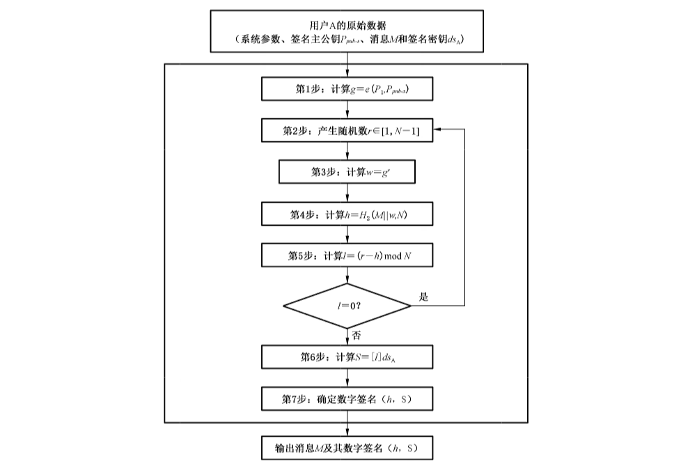
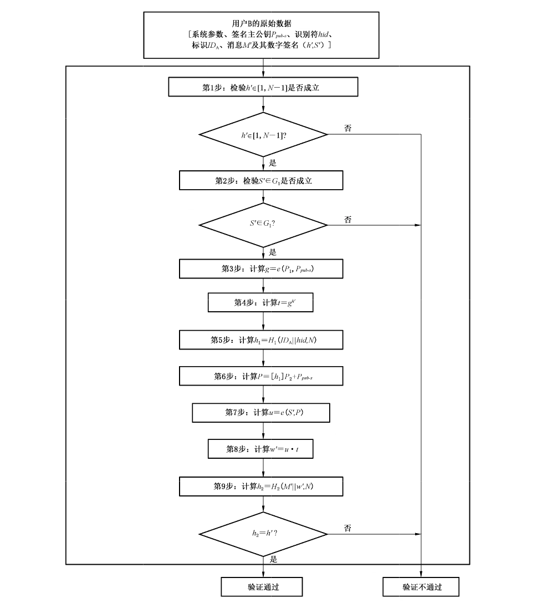
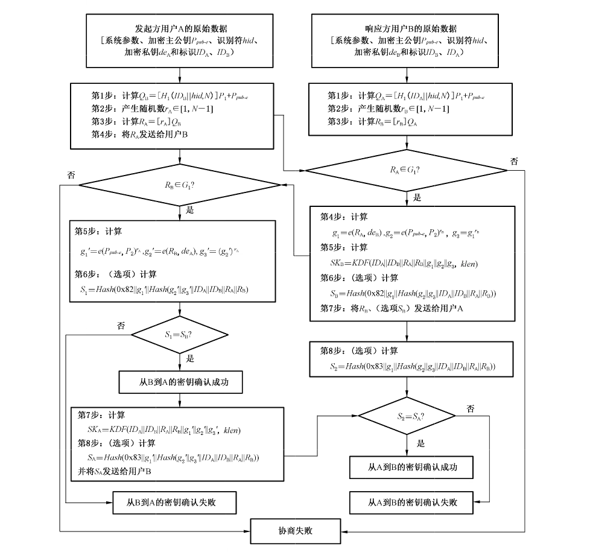
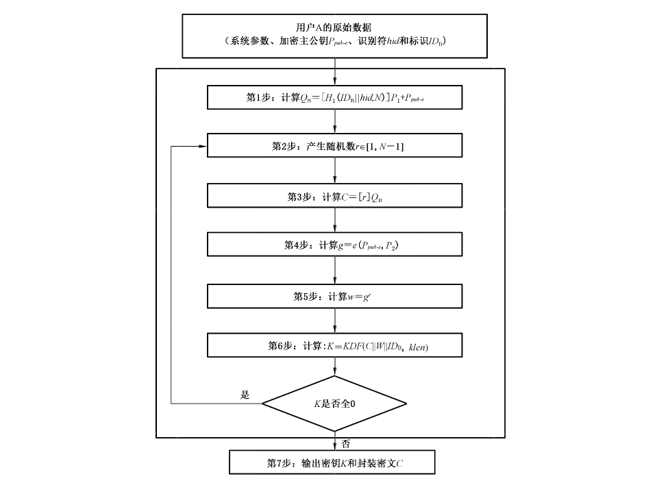
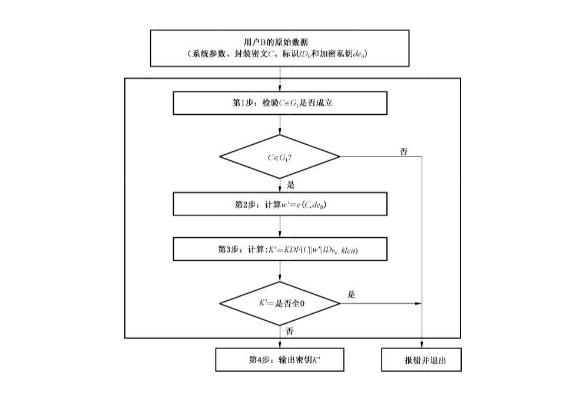
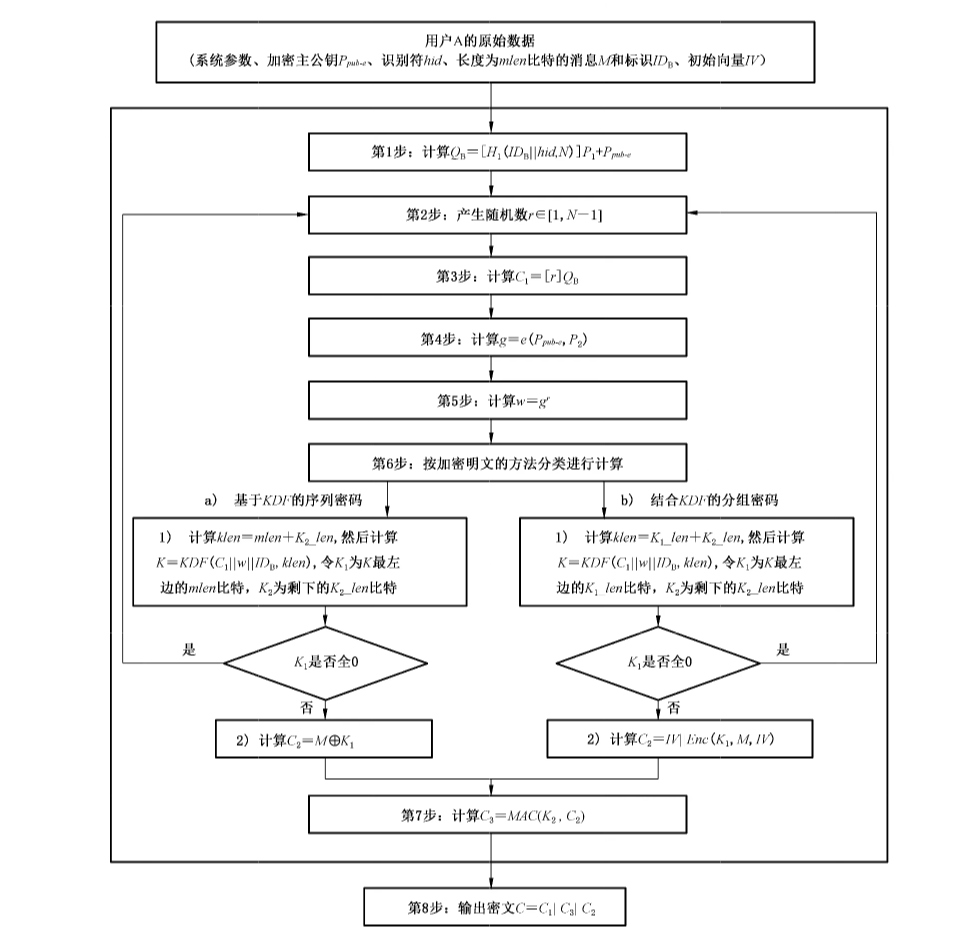
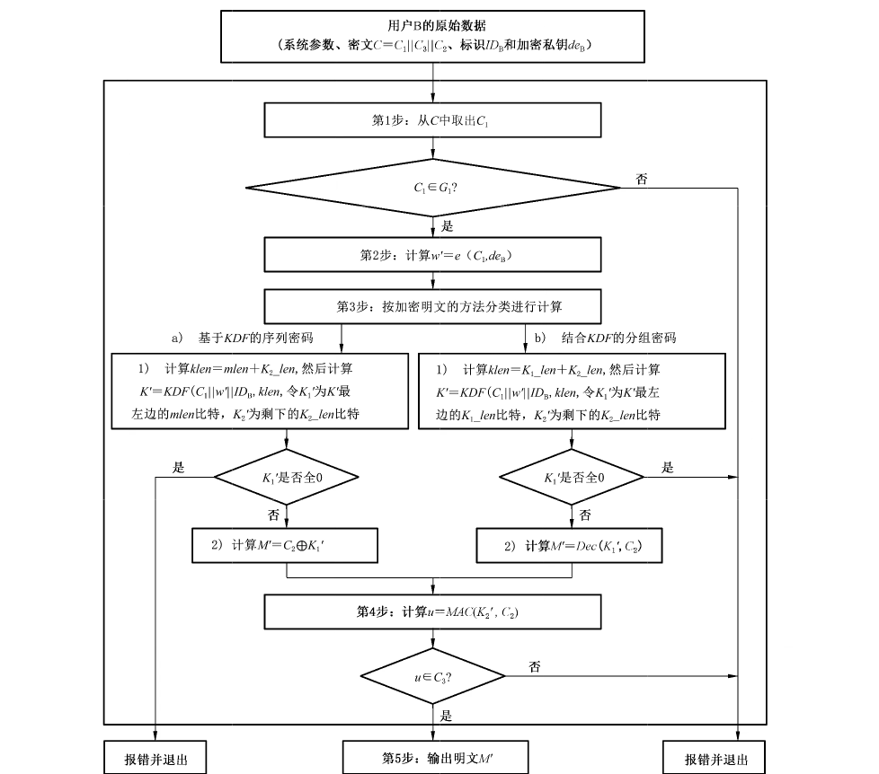

# GB/T 38635.2-2020 信息安全技术 SM9标识密码算法 第2部分：算法

> 来源：[GB/T 38635.2-2020 国家标准详情](https://openstd.samr.gov.cn/bzgk/std/newGbInfo?hcno=02A8E87248BD500747D2CD484C034EB0)；封面发布日期：2020-04-28；实施日期：2020-11-01。
> 官方在线预览截图 SHA-256：d756cfd45dc6d8366d27494bdc3f1ecdffa5dfe11838f0b56553a9b66e8e40a3。
> 依据官方在线预览 41 页渲染图像转写与校核；省略封面、目录、分页、页眉和页脚，合并跨页内容。已复算 A.3 确认杂凑、A.4/A.5 密钥派生、A.5 序列密码与 SM4-CBC 密文，并核对重复向量和密文拼接；扩域运算未独立复算。正式引用请核对官方原文。
> 原文差异：6.1 的 $t_2$ 公式印作 $k\cdot t_1^{-1}$，附录 A.2 的对应示例印作 $ks\cdot t_1^{-1}$；本稿各按原页保留。
> 原文差异：A.3 的 B1～B7 示例中，$ID_A\parallel hid$ 印作末尾 6502，与前文 6503 不同；计算 $S_A$ 时所列的内部杂凑输入串（官方预览第 32 页）也与其表达式及相同杂凑值的其他输入串不一致。本稿保留各处印刷数据。
> 原文差异：A.5 分组密码示例把 $C_2$ 印作 $IV\parallel Enc(K_1,M,IV)$，但列出的 $C_3$ 与仅对 $Enc(K_1,M,IV)$ 求取的 $MAC$ 相符；本稿保留印刷值。

## 前言

GB/T 38635《信息安全技术 SM9 标识密码算法》分为两个部分：

- 第 1 部分：总则；
- 第 2 部分：算法。

本部分为 GB/T 38635 的第 2 部分。

本部分按照 GB/T 1.1—2009 给出的规则起草。

请注意本文件的某些内容可能涉及专利。本文件的发布机构不承担识别这些专利的责任。

本部分由全国信息安全标准化技术委员会（SAC/TC 260）提出并归口。

本部分起草单位：国家信息安全工程技术研究中心、北京国脉信安科技有限公司、深圳奥联信息安全技术有限公司、中国科学院软件研究所、武汉大学、中科院信息工程研究所。

本部分主要起草人：陈晓、程朝辉、张振峰、叶顶峰、胡磊、陈建华、季庆光、袁文恭、刘平、马宁、袁峰、李增欣、王学进、杨恒亮、张青坡、马艳丽、浦雨三、唐英、孙移盛、安萱、封维端、张立圆。

## 引言

A.Shamir 在 1984 年提出了标识密码（Identity-based cryptography）的概念，在标识密码系统中，用户的私钥由密钥生成中心（KGC）根据主密钥和用户标识计算得出，用户的公钥由用户标识唯一确定，由标识管理者保证标识的真实性。与基于证书的公钥密码系统相比，标识密码系统中的密钥管理环节可以得到适当简化。

1999 年，K.Ohgishi、R.Sakai 和 M.Kasahara 在日本提出了用椭圆曲线对（pairing）构造基于标识的密钥共享方案；2001 年，D.Boneh 和 M.Franklin，以及 R.Sakai、K.Ohgishi 和 M.Kasahara 等人独立提出了用椭圆曲线对构造标识公钥加密算法。这些工作引发了标识密码的新发展，出现了一批用椭圆曲线对实现的标识密码算法，其中包括数字签名算法、密钥交换协议、密钥封装机制和公钥加密算法等。

椭圆曲线对具有双线性的性质，它在椭圆曲线的循环子群与扩域的乘法循环子群之间建立联系，构成了双线性 DH、双线性逆 DH、判定性双线性逆 DH、$\tau$-双线性逆 DH 和 $\tau$-Gap-双线性逆 DH 等难题，当椭圆曲线离散对数问题和扩域离散对数问题的求解难度相当时，可用椭圆曲线对构造出安全性和实现效率兼顾的标识密码。

## 1 范围

GB/T 38635 的本部分规定了 SM9 标识密码算法中数字签名算法、密钥交换协议、密钥封装机制和加密算法。

本部分适用于 SM9 标识密码算法工程化的实现，指导 SM9 标识密码算法相关产品的研制和检测。

## 2 规范性引用文件

下列文件对于本文件的应用是必不可少的。凡是注日期的引用文件，仅注日期的版本适用于本文件。凡是不注日期的引用文件，其最新版本（包括所有的修改单）适用于本文件。

- GB/T 17964 信息安全技术 分组密码算法的工作模式
- GB/T 32905 信息安全技术 SM3 密码杂凑算法
- GB/T 32907 信息安全技术 SM4 分组密码算法
- GB/T 32915 信息安全技术 二元序列随机性检测规范
- GB/T 38635.1—2020 信息安全技术 SM9 标识密码算法 第 1 部分：总则

## 3 术语和定义

GB/T 38635.1—2020 界定的以及下列术语和定义适用于本文件。为了便于使用，以下重复列出了 GB/T 38635.1—2020 中的一些术语和定义。

### 3.1 加密主密钥 encryption master key

处于标识密码密钥分层结构最顶层的密钥，内容为加密主私钥和加密主公钥，其中加密主公钥公开，加密主私钥由密钥生成中心（KGC）秘密保存。KGC 用加密主私钥和用户的标识生成用户的加密私钥。在标识密码中，加密主私钥一般由 KGC 通过随机数发生器产生，加密主公钥由加密主私钥结合系统参数产生。

### 3.2 标识 identity

由实体无法否认的信息组成，如实体的可识别名称、电子邮箱、身份证号、电话号码、街道地址等，可唯一确定一个实体的身份。

［GB/T 38635.1—2020，定义 3.1］

### 3.3 发起方 initiator

在一个协议的操作过程中发送首轮交换信息的用户。

### 3.4 初始向量/值 initialization vector/initialization value; IV

在密码变换中，为增加安全性或使密码设备同步而引入的用于数据变换的起始数据。

### 3.5 从 A 到 B 的密钥确认 key confirmation from A to B

使用户 B 确信用户 A 拥有特定秘密密钥的保证。

### 3.6 签名消息 signed message

由消息以及该消息的数字签名部分所组成的一组数据元素。

### 3.7 签名密钥 signature key

在数字签名生成过程中由签名者专用的秘密数据元素，即签名者的私钥。

### 3.8 签名主密钥 signature master key

系统的签名根密钥，内容为签名主私钥和签名主公钥，其中签名主公钥公开，签名主私钥由 KGC 秘密保存。KGC 用签名主私钥和用户的标识生成用户的签名私钥。在标识密码中，签名主私钥一般由 KGC 通过随机数发生器产生，签名主公钥由签名主私钥结合系统参数产生。

### 3.9 密钥交换 key exchange

在通信实体之间安全地交换密钥的方案，可以使通信双方在非安全通信线路上为信息传送安全地交换密钥。

### 3.10 密钥协商 key agreement

多个用户之间建立一个共享秘密密钥的过程，其中的任何一个用户都不能预先确定该密钥的值。

### 3.11 密钥派生函数 key derivation function

通过作用于共享秘密和双方都知道的其他参数，产生一个或多个共享秘密密钥的函数。

### 3.12 响应方 responder

在一个协议的操作过程中不是发送首轮交换信息的用户。

### 3.13 秘密密钥 secret key

在密码体制中收发双方共同拥有的而第三方不知道的一种密钥。

### 3.14 消息认证码 message authentication code; MAC

一种认证算法作用于特定的密钥和消息比特串所得出的一段码字，以用来鉴别数据的来源和检验数据的完整性。用于求取消息认证码的函数称作消息认证码函数。

## 4 符号

下列符号适用于本文件。

- $A,B$：使用标识密码系统的两个用户。
- $cf$：椭圆曲线阶相对于 $N$ 的余因子。
- $cid$：用一个字节表示的曲线的识别符，其中 0x10 表示 $F_p$（素数 $p>2^{191}$）上常曲线（即非超奇异曲线），0x11 表示 $F_p$ 上超奇异曲线，0x12 表示 $F_p$ 上常曲线及其扭曲线。
- $ds_A$：用户 $A$ 的签名私钥。
- $e$：从 $G_1\times G_2$ 到 $G_T$ 的双线性对。
- $eid$：用一个字节表示的双线性对 $e$ 的识别符，其中 0x01 表示 Tate 对，0x02 表示 Weil 对，0x03 表示 Ate 对，0x04 表示 R-Ate 对。
- $G_T$：阶为素数 $N$ 的乘法循环群。
- $G_1$：阶为素数 $N$ 的加法循环群。
- $G_2$：阶为素数 $N$ 的加法循环群。
- $g^u$：乘法群 $G_T$ 中元素 $g$ 的 $u$ 次幂，即 $g^u=\underbrace{g\cdot g\cdots g}_{u\text{ 个}}$，$u$ 是正整数。
- $H_v()$：密码杂凑函数。
- $H_1()$、$H_2()$：由密码杂凑函数派生的密码函数。
- $hid$：用一个字节表示的签名私钥生成函数识别符，由 KGC 选择并公开。
- $(h,S)$：发送的签名。
- $(h',S')$：收到的签名。
- $ID_A$：用户 $A$ 的标识，可以唯一确定用户 $A$ 的公钥。
- $ks$：签名主私钥。
- $M$：待签名消息。
- $M'$：待验证消息。
- $\operatorname{mod}n$：模 $n$ 运算。示例 1：$23\bmod7=2$。
- $N$：循环群 $G_1$、$G_2$ 和 $G_T$ 的阶，为大于 $2^{191}$ 的素数。
- $P_{pub-s}$：签名主公钥。
- $P_1$：群 $G_1$ 的生成元。
- $P_2$：群 $G_2$ 的生成元。
- $\langle P\rangle$：由元素 $P$ 生成的循环群。
- $[u]P$：加法群 $G_1$、$G_2$ 中元素 $P$ 的 $u$ 倍。
- $\lceil x\rceil$：顶函数，不小于 $x$ 的最小整数。示例 2：$\lceil7\rceil=7$，$\lceil8.3\rceil=9$。
- $\lfloor x\rfloor$：底函数，不大于 $x$ 的最大整数。示例 3：$\lfloor7\rfloor=7$，$\lfloor8.3\rfloor=8$。
- $x\parallel y$：$x$ 与 $y$ 的拼接，$x$ 和 $y$ 是比特串或字节串。
- $[x,y]$：不小于 $x$ 且不大于 $y$ 的整数的集合。
- $\beta$：扭曲线参数。

## 5 算法参数与辅助函数

### 5.1 概述

第 6 章规定了一个用椭圆曲线对实现的基于标识的数字签名算法。该算法的签名者持有一个标识和一个相应的签名私钥，该签名私钥由密钥生成中心通过签名主私钥和签名者的标识结合产生。签名者用自身签名私钥对数据产生数字签名，验证者用签名者的标识验证签名的可靠性。

在签名的生成和验证过程之前，应用密码杂凑函数对待签消息 $M$ 和待验证消息 $M'$ 进行杂凑计算。

第 7 章规定了一个用椭圆曲线对实现的基于标识的密钥交换协议。参与密钥交换的发起方用户 A 和响应方用户 B 各自持有一个标识和一个相应的加密私钥，加密私钥均由密钥生成中心通过加密主私钥和用户的标识结合产生。用户 A 和 B 通过交互的信息传递，用标识和各自的加密私钥来商定一个只有他们知道的秘密密钥，用户双方可以通过可选项实现密钥确认。这个共享的秘密密钥通常用在某个对称密码算法中。该密钥交换协议能够用于密钥管理和协商。

在现代密码系统中，密钥是控制密码变换的重要参数，而且密码的安全性极大地依赖于对密钥的安全保护。密钥封装机制使得封装者可以产生和加密一个秘密密钥给目标用户，而唯有目标用户可以解封装该秘密密钥，并把它作为进一步的会话密钥。

第 8 章规定了一个用椭圆曲线对实现的基于标识的密钥封装机制。解封装用户持有一个标识和一个相应的加密私钥，该加密私钥由密钥生成中心通过加密主私钥和解封装用户的标识结合产生。封装者利用解封装用户的标识产生并加密一个秘密密钥给对方，解封装用户则用相应的加密私钥解封装该秘密密钥。

第 9 章规定了一个用椭圆曲线对实现的基于标识的公钥加密算法。该公钥加密算法是上述密钥封装机制和消息封装机制的结合，消息封装机制包括基于密钥派生函数的序列密码以及结合密钥派生函数的分组密码算法两种类型，该算法可提供消息的机密性。在基于标识的加密算法中，解密用户持有一个标识和一个相应的加密私钥，该加密私钥由密钥生成中心通过加密主私钥和解密用户的标识结合产生。加密用户用解密用户的标识加密数据，解密用户用自身加密私钥解密数据。

附录 A 给出了数字签名算法、密钥交换协议、密钥封装机制和公钥加密算法示例。

### 5.2 系统参数组

系统参数组包括曲线识别符 $cid$；$N$ 椭圆曲线基域 $F_q$ 的参数；椭圆曲线方程参数 $a$ 和 $b$；扭曲线参数 $\beta$（若 $cid$ 的低 4 位为 2）；曲线阶的素因子 $N$ 和相对于 $N$ 的余因子 $cf$；曲线 $E(F_q)$ 相对于 $N$ 的嵌入次数 $k$；$E(F_{q^{d_1}})$（$d_1$ 整除 $k$）的 $N$ 阶循环子群 $G_1$ 的生成元 $P_1$；$E(F_{q^{d_2}})$（$d_2$ 整除 $k$）的 $N$ 阶循环子群 $G_2$ 的生成元 $P_2$；双线性对 $e$ 的识别符 $eid$；（选项）$G_2$ 到 $G_1$ 的同态映射 $\psi$。

双线性对 $e$ 的值域为 $N$ 阶乘法循环群 $G_T$。

系统参数的详细描述见 GB/T 38635.1—2020 中的附录 A。

### 5.3 辅助函数

#### 5.3.1 概述

本部分规定基于标识的密码算法计算中涉及辅助函数。

#### 5.3.2 密码杂凑函数

##### 5.3.2.1 密码杂凑函数 $H_v()$

密码杂凑函数 $H_v()$ 的输出是长度恰为 $v$ 比特的杂凑值。本部分规定使用国家密码管理部门批准的密码杂凑函数，见 GB/T 32905。

##### 5.3.2.2 密码函数 $H_1()$

密码函数 $H_1(Z,n)$ 的输入为比特串 $Z$ 和整数 $n$，输出为一个整数 $h_1\in[1,n-1]$。$H_1(Z,n)$ 需要调用密码杂凑函数 $H_v()$。关于密码杂凑函数 $H_v()$，应符合 5.3.2.1 的规定。

密码函数 $H_1(Z,n)$：

输入：比特串 $Z$，整数 $n$。

输出：整数 $h_1\in[1,n-1]$。

计算步骤为：

a）初始化一个 32 比特构成的计数器 $ct=\text{0x00000001}$。

b）计算 $hlen=8\times\lceil(5\times(\log_2n))/32\rceil$。

c）对 $i$ 从 $1\sim\lceil hlen/v\rceil$ 执行：

1）计算 $Ha_i=H_v(\text{0x01}\parallel Z\parallel ct)$；

2）$ct++$。

d）若 $hlen/v$ 是整数，令 $Ha!_{\lceil hlen/v\rceil}=Ha_{\lceil hlen/v\rceil}$，否则令 $Ha!_{\lceil hlen/v\rceil}$ 为 $Ha_{\lceil hlen/v\rceil}$ 最左边的 $(hlen-(v\times\lfloor hlen/v\rfloor))$ 比特。

e）令 $Ha=Ha_1\parallel Ha_2\parallel\cdots\parallel Ha_{\lceil hlen/v\rceil-1}\parallel Ha!_{\lceil hlen/v\rceil}$，按照 GB/T 38635.1—2020 中 7.2.4 和 7.2.3 给出的细节将 $Ha$ 的数据类型转换为整数。

f）计算 $h_1=(Ha\bmod(n-1))+1$。

##### 5.3.2.3 密码函数 $H_2()$

密码函数 $H_2(Z,n)$ 的输入为比特串 $Z$ 和整数 $n$，输出为一个整数 $h_2\in[1,n-1]$。$H_2(Z,n)$ 需要调用密码杂凑函数 $H_v()$。关于密码杂凑函数 $H_v()$，应符合 5.3.2.1 的规定。

密码函数 $H_2(Z,n)$：

输入：比特串 $Z$，整数 $n$。

输出：整数 $h_2\in[1,n-1]$。

计算步骤为：

a）初始化一个 32 比特构成的计数器 $ct=\text{0x00000001}$。

b）计算 $hlen=8\times\lceil(5\times(\log_2n))/32\rceil$。

c）对 $i$ 从 $1\sim\lceil hlen/v\rceil$ 执行：

1）计算 $Ha_i=H_v(\text{0x02}\parallel Z\parallel ct)$；

2）$ct++$。

d）若 $hlen/v$ 是整数，令 $Ha!_{\lceil hlen/v\rceil}=Ha_{\lceil hlen/v\rceil}$，否则令 $Ha!_{\lceil hlen/v\rceil}$ 为 $Ha_{\lceil hlen/v\rceil}$ 最左边的 $(hlen-(v\times\lfloor hlen/v\rfloor))$ 比特。

e）令 $Ha=Ha_1\parallel Ha_2\parallel\cdots\parallel Ha_{\lceil hlen/v\rceil-1}\parallel Ha!_{\lceil hlen/v\rceil}$，按照 GB/T 38635.1—2020 中 7.2.4 和 7.2.3 给出的细节将 $Ha$ 的数据类型转换为整数。

f）计算 $h_2=(Ha\bmod(n-1))+1$。

#### 5.3.3 随机数发生器

应使用符合 GB/T 32915 的随机数发生器。

#### 5.3.4 分组密码算法

分组密码算法包括加密算法 $Enc(K_1,m)$ 和解密算法 $Dec(K_1,c)$。$Enc(K_1,m)$ 表示用密钥 $K_1$ 对明文 $m$ 进行加密，其输出为密文比特串 $c$；$Dec(K_1,c)$ 表示用密钥 $K_1$ 对密文 $c$ 进行解密，其输出为明文比特串 $m$ 或“错误”。密钥 $K_1$ 的比特长度记为 $K_1\_len$。

应使用符合国家密码管理部门批准的分组密码算法。

#### 5.3.5 消息认证码函数

消息认证码函数 $MAC(K_2,Z)$ 的作用是防止消息数据 $Z$ 被非法篡改，它在密钥 $K_2$ 的控制下，产生消息数据比特串 $Z$ 的认证码，密钥 $K_2$ 的比特长度记为 $K_2\_len$。在本部分的基于标识的加密算法中，消息认证码函数使用密钥派生函数生成的密钥对密文比特串求取消息认证码，从而使解密者可以鉴别消息的来源和检验数据的完整性。

消息认证码函数需要调用密码杂凑函数。

设密码杂凑函数为 $H_v()$，其输出是长度恰为 $v$ 比特的杂凑值。

消息认证码函数 $MAC(K_2,Z)$，其中：

输入：比特串 $K_2$（比特长度为 $K_2\_len$ 的密钥），比特串 $Z$（待求取消息认证码的消息）。

输出：长度为 $v$ 的消息认证码数据比特串 $K$。$K=H_v(Z\parallel K_2)$。

#### 5.3.6 密钥派生函数

密钥派生函数的作用是从一个共享的秘密比特串中派生出密钥数据。在密钥协商过程中，密钥派生函数作用在密钥交换所获共享的秘密比特串上，从中产生所需的会话密钥或进一步加密所需的密钥数据。

密钥派生函数需要调用密码杂凑函数。

设密码杂凑函数为 $H_v()$，其输出是长度恰为 $v$ 比特的杂凑值。

密钥派生函数 $KDF(Z,klen)$，其中：

输入：比特串 $Z$（双方共享的数据），整数 $klen$［表示要获得的密钥数据的比特长度，要求该值小于 $(2^{32}-1)v$］。

输出：长度为 $klen$ 的密钥数据比特串 $K$。

计算步骤为：

a）初始化一个 32 比特构成的计数器 $ct=\text{0x00000001}$。

b）对 $i$ 从 $1\sim\lceil klen/v\rceil$ 执行：

1）计算 $Ha_i=H_v(Z\parallel ct)$；

2）$ct++$。

c）若 $klen/v$ 是整数，令 $Ha!_{\lceil klen/v\rceil}=Ha_{\lceil klen/v\rceil}$，否则令 $Ha!_{\lceil klen/v\rceil}$ 为 $Ha_{\lceil klen/v\rceil}$ 最左边的 $(klen-(v\times\lfloor klen/v\rfloor))$ 比特。

d）令 $K=Ha_1\parallel Ha_2\parallel\cdots\parallel Ha_{\lceil klen/v\rceil-1}\parallel Ha!_{\lceil klen/v\rceil}$。

## 6 数字签名生成和验证算法及流程

### 6.1 系统签名主密钥和用户签名密钥的产生

KGC 产生随机数 $ks\in[1,N-1]$ 作为签名主私钥，计算 $G_2$ 中的元素 $P_{pub-s}=[ks]P_2$ 作为签名主公钥，则签名主密钥对为 $(ks,P_{pub-s})$。KGC 秘密保存 $ks$，公开 $P_{pub-s}$。

KGC 选择并公开用一个字节表示的签名私钥生成函数识别符 $hid$。

用户 A 的标识为 $ID_A$，为产生用户 A 的签名私钥 $ds_A$，KGC 首先在有限域 $F_N$ 上计算 $t_1=H_1(ID_A\parallel hid,N)+ks$，若 $t_1=0$ 则需重新产生签名主私钥，计算和公开签名主公钥，并更新已有用户的签名私钥；否则计算 $t_2=k\cdot t_1^{-1}$，然后计算 $ds_A=[t_2]P_1$。

### 6.2 数字签名生成算法

设待签名的消息为比特串 $M$，为了获取消息 $M$ 的数字签名 $(h,S)$，作为签名者的用户 A 应实现以下运算步骤：

A1：计算群 $G_T$ 中的元素 $g=e(P_1,P_{pub-s})$；

A2：产生随机数 $r\in[1,N-1]$；

A3：计算群 $G_T$ 中的元素 $w=g^r$，按照 GB/T 38635.1—2020 中 7.2.6 和 7.2.5 给出的细节将 $w$ 的数据类型转换为比特串；

A4：计算整数 $h=H_2(M\parallel w,N)$；

A5：计算整数 $l=(r-h)\bmod N$，若 $l=0$ 则返回 A2；

A6：计算群 $G_1$ 中的元素 $S=[l]ds_A$；

A7：按照 GB/T 38635.1—2020 中 7.2.2 给出的细节，将 $h$ 的数据类型转换为字节串，按照 GB/T 38635.1—2020 中 7.2.8 给出的细节将 $S$ 的数据类型转换为字节串，消息 $M$ 的签名为 $(h,S)$。

### 6.3 数字签名生成算法流程

数字签名生成算法流程如图 1 所示。

### 6.4 数字签名验证算法

为了检验收到的消息 $M'$ 及其数字签名 $(h',S')$，作为验证者的用户 B 应实现以下运算步骤：

B1：按照 GB/T 38635.1—2020 中 7.2.3 给出的细节将 $h'$ 的数据类型转换为整数，检验 $h'\in[1,N-1]$ 是否成立，若不成立则验证不通过；

B2：按照 GB/T 38635.1—2020 中 7.2.9 给出的细节将 $S'$ 的数据类型转换为椭圆曲线上的点，按 GB/T 38635.1—2020 中 5.5 给出的细节检验 $S'\in G_1$ 是否成立，若不成立则验证不通过；

B3：计算群 $G_T$ 中的元素 $g=e(P_1,P_{pub-s})$；

B4：计算群 $G_T$ 中的元素 $t=g^{h'}$；

B5：计算整数 $h_1=H_1(ID_A\parallel hid,N)$；

B6：计算群 $G_2$ 中的元素 $P=[h_1]P_2+P_{pub-s}$；

B7：计算群 $G_T$ 中的元素 $u=e(S',P)$；

B8：计算群 $G_T$ 中的元素 $w'=u\cdot t$，按照 GB/T 38635.1—2020 中 7.2.6 和 7.2.5 给出的细节将 $w'$ 的数据类型转换为比特串；

B9：计算整数 $h_2=H_2(M'\parallel w',N)$，检验 $h_2=h'$ 是否成立，若成立则验证通过；否则验证不通过。

### 6.5 数字签名验证算法流程

数字签名验证算法流程如图 2 所示。

## 7 密钥交换协议及流程

### 7.1 系统加密主密钥和用户加密密钥的产生

KGC 产生随机数 $ke\in[1,N-1]$ 作为加密主私钥，计算 $G_1$ 中的元素 $P_{pub-e}=[ke]P_1$ 作为加密主公钥，则加密主密钥对为 $(ke,P_{pub-e})$。KGC 秘密保存 $ke$，公开 $P_{pub-e}$。

KGC 选择并公开用一个字节表示的加密私钥生成函数识别符 $hid$。

用户 A 和用户 B 的标识分别为 $ID_A$ 和 $ID_B$。为产生用户 A 的加密私钥 $de_A$，KGC 首先在有限域 $F_N$ 上计算 $t_1=H_1(ID_A\parallel hid,N)+ke$，若 $t_1=0$ 则需重新产生加密主私钥，计算和公开加密主公钥，并更新已有用户的加密私钥；否则计算 $t_2=ke\cdot t_1^{-1}$，然后计算 $de_A=[t_2]P_2$。为产生用户 B 的加密私钥 $de_B$，KGC 首先在有限域 $F_N$ 上计算 $t_3=H_1(ID_B\parallel hid,N)+ke$，若 $t_3=0$ 则需重新产生加密主私钥，计算和公开加密主公钥，并更新已有用户的加密私钥；否则计算 $t_4=ke\cdot t_3^{-1}$，然后计算 $de_B=[t_4]P_2$。

### 7.2 密钥交换协议

设用户 A 和用户 B 协商获得密钥数据的长度为 $klen$ 比特，用户 A 为发起方，用户 B 为响应方。

用户 A 和用户 B 双方为了获得相同的密钥，应实现如下运算步骤：

用户 A：

A1：计算群 $G_1$ 中的元素 $Q_B=[H_1(ID_B\parallel hid,N)]P_1+P_{pub-e}$；

A2：产生随机数 $r_A\in[1,N-1]$；

A3：计算群 $G_1$ 中的元素 $R_A=[r_A]Q_B$；

A4：将 $R_A$ 发送给用户 B。

用户 B：

B1：计算群 $G_1$ 中的元素 $Q_A=[H_1(ID_A\parallel hid,N)]P_1+P_{pub-e}$；

B2：产生随机数 $r_B\in[1,N-1]$；

B3：计算群 $G_1$ 中的元素 $R_B=[r_B]Q_A$；

B4：按照 GB/T 38635.1—2020 中 5.5 给出的细节验证 $R_A\in G_1$ 是否成立，若不成立则协商失败；否则计算群 $G_T$ 中的元素 $g_1=e(R_A,de_B)$，$g_2=e(P_{pub-e},P_2)^{r_B}$，$g_3=g_1^{r_B}$，按照 GB/T 38635.1—2020 中 7.2.6 和 7.2.5 给出的细节将 $g_1$、$g_2$、$g_3$ 的数据类型转换为比特串；

B5：按照 GB/T 38635.1—2020 中 7.2.8 和 7.2.5 给出的细节把 $R_A$ 和 $R_B$ 的数据类型转换为比特串，计算 $SK_B=KDF(ID_A\parallel ID_B\parallel R_A\parallel R_B\parallel g_1\parallel g_2\parallel g_3,klen)$；

B6：（选项）计算 $S_B=Hash(\text{0x82}\parallel g_1\parallel Hash(g_2\parallel g_3\parallel ID_A\parallel ID_B\parallel R_A\parallel R_B))$；

B7：将 $R_B$、（选项 $S_B$）发送给用户 A。

用户 A：

A5：按照 GB/T 38635.1—2020 中 5.5 给出的细节验证 $R_B\in G_1$ 是否成立，若不成立则协商失败；否则计算群 $G_T$ 中的元素 $g'_1=e(P_{pub-e},P_2)^{r_A}$，$g'_2=e(R_B,de_A)$，$g'_3=(g'_2)^{r_A}$，按照 GB/T 38635.1—2020 中 7.2.6 和 7.2.5 给出的细节将 $g'_1$、$g'_2$、$g'_3$ 的数据类型转换为比特串；

A6：按照 GB/T 38635.1—2020 中 7.2.8 和 7.2.5 给出的细节把 $R_A$ 和 $R_B$ 的数据类型转换为比特串，（选项）计算 $S_1=Hash(\text{0x82}\parallel g'_1\parallel Hash(g'_2\parallel g'_3\parallel ID_A\parallel ID_B\parallel R_A\parallel R_B))$，并检验 $S_1=S_B$ 是否成立，若等式不成立则从 B 到 A 的密钥确认失败；

A7：计算 $SK_A=KDF(ID_A\parallel ID_B\parallel R_A\parallel R_B\parallel g'_1\parallel g'_2\parallel g'_3,klen)$；

A8：（选项）计算 $S_A=Hash(\text{0x83}\parallel g'_1\parallel Hash(g'_2\parallel g'_3\parallel ID_A\parallel ID_B\parallel R_A\parallel R_B))$，并将 $S_A$ 发送给用户 B。

用户 B：

B8：（选项）计算 $S_2=Hash(\text{0x83}\parallel g_1\parallel Hash(g_2\parallel g_3\parallel ID_A\parallel ID_B\parallel R_A\parallel R_B))$，并检验 $S_2=S_A$ 是否成立，若等式不成立则从 A 到 B 的密钥确认失败。

### 7.3 密钥交换协议流程

密钥交换协议流程如图 3 所示。

## 8 密钥封装机制及流程

### 8.1 系统加密主密钥和用户加密密钥的产生

KGC 产生随机数 $ke\in[1,N-1]$ 作为加密主私钥，计算 $G_1$ 中的元素 $P_{pub-e}=[ke]P_1$ 作为加密主公钥，则加密主密钥对为 $(ke,P_{pub-e})$。KGC 秘密保存 $ke$，公开 $P_{pub-e}$。

KGC 选择并公开用一个字节表示的加密私钥生成函数识别符 $hid$。

用户 A 和 B 的标识分别为 $ID_A$ 和 $ID_B$。为产生用户 A 的加密私钥 $de_A$，KGC 首先在有限域 $F_N$ 上计算 $t_1=H_1(ID_A\parallel hid,N)+ke$，若 $t_1=0$ 则需重新产生加密主私钥，计算和公开加密主公钥，并更新已有用户的加密私钥；否则计算 $t_2=ke\cdot t_1^{-1}$，然后计算 $de_A=[t_2]P_2$。为产生用户 B 的加密私钥 $de_B$，KGC 首先在有限域 $F_N$ 上计算 $t_3=H_1(ID_B\parallel hid,N)+ke$，若 $t_3=0$ 则需重新产生加密主私钥，计算和公开加密主公钥，并更新已有用户的加密私钥；否则计算 $t_4=ke\cdot t_3^{-1}$，然后计算 $de_B=[t_4]P_2$。

### 8.2 密钥封装算法

为了封装比特长度为 $klen$ 的密钥给用户 B，作为封装者的用户 A 需要执行以下运算步骤：

A1：计算群 $G_1$ 中的元素 $Q_B=[H_1(ID_B\parallel hid,N)]P_1+P_{pub-e}$；

A2：产生随机数 $r\in[1,N-1]$；

A3：计算群 $G_1$ 中的元素 $C=[r]Q_B$，按照 GB/T 38635.1—2020 中 7.2.8 和 7.2.5 给出的细节将 $C$ 的数据类型转换为比特串；

A4：计算群 $G_T$ 中的元素 $g=e(P_{pub-e},P_2)$；

A5：计算群 $G_T$ 中的元素 $w=g^r$，按照 GB/T 38635.1—2020 中 7.2.6 和 7.2.5 给出的细节将 $w$ 的数据类型转换为比特串；

A6：计算 $K=KDF(C\parallel w\parallel ID_B,klen)$，若 $K$ 为全 0 比特串，则返回 A2；

A7：输出 $(K,C)$，其中 $K$ 是被封装的密钥，$C$ 是封装密文。

### 8.3 密钥封装算法流程

密钥封装算法流程如图 4 所示。

### 8.4 解封装算法

用户 B 收到封装密文 $C$ 后，为了对比特长度为 $klen$ 的密钥解封装，需要执行以下运算步骤：

B1：按照 GB/T 38635.1—2020 中 5.5 给出的细节验证 $C\in G_1$ 是否成立，若不成立则报错并退出；

B2：计算群 $G_T$ 中的元素 $w'=e(C,de_B)$，按照 GB/T 38635.1—2020 中 7.2.6 和 7.2.5 给出的细节将 $w'$ 的数据类型转换为比特串；

B3：按照 GB/T 38635.1—2020 中 7.2.6 和 7.2.5 给出的细节将 $C$ 的数据类型转换为比特串，计算封装的密钥 $K'=KDF(C\parallel w'\parallel ID_B,klen)$，若 $K'$ 为全 0 比特串，则报错并退出；

B4：输出密钥 $K'$。

### 8.5 解封装算法流程

解封装算法流程如图 5 所示。

## 9 加密算法及流程

### 9.1 系统加密主密钥和用户加密密钥的产生

KGC 产生随机数 $ke\in[1,N-1]$ 作为加密主私钥，计算 $G_1$ 中的元素 $P_{pub-e}=[ke]P_1$ 作为加密主公钥，则加密主密钥对为 $(ke,P_{pub-e})$。KGC 秘密保存 $ke$，公开 $P_{pub-e}$。

KGC 选择并公开用一个字节表示的加密私钥生成函数识别符 $hid$。

用户 A 和 B 的标识分别为 $ID_A$ 和 $ID_B$。为产生用户 A 的加密私钥 $de_A$，KGC 首先在有限域 $F_N$ 上计算 $t_1=H_1(ID_A\parallel hid,N)+ke$，若 $t_1=0$ 则需重新产生加密主私钥，计算和公开加密主公钥，并更新已有用户的加密私钥；否则计算 $t_2=ke\cdot t_1^{-1}$，然后计算 $de_A=[t_2]P_2$。为产生用户 B 的加密私钥 $de_B$，KGC 首先在有限域 $F_N$ 上计算 $t_3=H_1(ID_B\parallel hid,N)+ke$，若 $t_3=0$ 则需重新产生加密主私钥，计算和公开加密主公钥，并更新已有用户的加密私钥；否则计算 $t_4=ke\cdot t_3^{-1}$，然后计算 $de_B=[t_4]P_2$。

### 9.2 加密算法

设需要发送的消息为比特串 $M$，$mlen$ 为 $M$ 的比特长度，$K_1\_len$ 为分组密码算法中密钥 $K_1$ 的比特长度，$K_2\_len$ 为函数 $MAC(K_2,Z)$ 中密钥 $K_2$ 的比特长度。

为了加密明文 $M$ 给用户 B，作为加密者的用户 A 应实现以下运算步骤：

A1：计算群 $G_1$ 中的元素 $Q_B=[H_1(ID_B\parallel hid,N)]P_1+P_{pub-e}$；

A2：产生随机数 $r\in[1,N-1]$；

A3：计算群 $G_1$ 中的元素 $C_1=[r]Q_B$，按照 GB/T 38635.1—2020 中 7.2.8 和 7.2.5 给出的细节将 $C_1$ 的数据类型转换为比特串；

A4：计算群 $G_T$ 中的元素 $g=e(P_{pub-e},P_2)$；

A5：计算群 $G_T$ 中的元素 $w=g^r$，按照 GB/T 38635.1—2020 中 7.2.6 和 7.2.5 给出的细节将 $w$ 的数据类型转换为比特串；

A6：按加密明文的方法分类进行计算：

a）如果加密明文的方法是基于密钥派生函数的序列密码算法，则：

1）计算整数 $klen=mlen+K_2\_len$，然后计算 $K=KDF(C_1\parallel w\parallel ID_B,klen)$。令 $K_1$ 为 $K$ 最左边的 $mlen$ 比特，$K_2$ 为剩下的 $K_2\_len$ 比特，若 $K_1$ 为全 0 比特串，则返回 A2；

2）计算 $C_2=M\oplus K_1$。

b）如果加密明文的方法是结合密钥派生函数的分组密码算法，则：

1）计算整数 $klen=K_1\_len+K_2\_len$，然后计算 $K=KDF(C_1\parallel w\parallel ID_B,klen)$。令 $K_1$ 为 $K$ 最左边的 $K_1\_len$ 比特，$K_2$ 为剩下的 $K_2\_len$ 比特，若 $K_1$ 为全 0 比特串，则返回 A2；

2）计算 $C_2=IV\parallel Enc(K_1,M,IV)$，$C_2$ 的结构中前 16 个字节为 $IV$ 值，且仅当分组密码算法模式为非 ECB（见 GB/T 17964）时初始化向量 $IV$ 才有效，其中 $Enc$ 分组密码算法遵循 GB/T 32907，填充方式为将密钥模长度 $k-(\text{明文长度 }l\bmod k)$ 值，即作为填充数，也作为填充个数。填充方式示例：

| 填充内容 | 明文长度 $l$ 与密钥长度 $k$ 的计算 |
| --- | --- |
| 01 | $l\bmod k=k-1$ |
| 02 02 | $l\bmod k=k-2$ |
| $k\ k\ \cdots\ k$ | $l\bmod k=0$ |

A7：计算 $C_3=MAC(K_2,C_2)$。

A8：输出密文 $C=C_1\parallel C_3\parallel C_2$。

### 9.3 加密算法流程

加密算法流程如图 6 所示。

### 9.4 解密算法

设 $mlen$ 为密文 $C=C_1\parallel C_3\parallel C_2$ 中 $C_2$ 的比特长度，$K_1\_len$ 为分组密码算法中密钥 $K_1$ 的比特长度，$K_2\_len$ 为函数 $MAC(K_2,Z)$ 中密钥 $K_2$ 的比特长度。

为了对 $C$ 进行解密，作为解密者的用户 B 应实现以下运算步骤：

B1：从 $C$ 中取出比特串 $C_1$，按照 GB/T 38635.1—2020 中 7.2.4 和 7.2.9 给出的细节将 $C_1$ 的数据类型转换为椭圆曲线上的点，按照 GB/T 38635.1—2020 中 5.5 给出的细节验证 $C_1\in G_1$ 是否成立，若不成立立即报错并退出。

B2：计算群 $G_T$ 中的元素 $w'=e(C_1,de_B)$，按照 GB/T 38635.1—2020 中 7.2.6 和 7.2.5 给出的细节将 $w'$ 的数据类型转换为比特串。

B3：按加密明文的方法分类进行计算：

a）如果加密明文的方法是基于密钥派生函数的序列密码算法，则：

1）计算整数 $klen=mlen+K_2\_len$，然后计算 $K'=KDF(C_1\parallel w'\parallel ID_B,klen)$。令 $K'_1$ 为 $K'$ 最左边的 $mlen$ 比特，$K'_2$ 为剩下的 $K_2\_len$ 比特，若 $K'_1$ 为全 0 比特串，则报错并退出；

2）计算 $M'=C_2\oplus K'_1$。

b）如果加密明文的方法是结合密钥派生函数的分组密码算法，则：

1）计算整数 $klen=K_1\_len+K_2\_len$，然后计算 $K'=KDF(C_1\parallel w'\parallel ID_B,klen)$。令 $K'_1$ 为 $K'$ 最左边的 $K_1\_len$ 比特，$K'_2$ 为剩下的 $K_2\_len$ 比特，若 $K'_1$ 为全 0 比特串，则报错并退出；

2）计算 $M'=Dec(K'_1,C_2)$。

B4：计算 $u=MAC(K'_2,C_2)$，从 $C$ 中取出比特串 $C_3$，若 $u\ne C_3$，则报错并退出。

B5：输出明文 $M'$。

### 9.5 解密算法流程

解密算法流程如图 7 所示。

## 附录 A（资料性附录）算法示例

### A.1 概述

本附录选用 GB/T 32905 给出的密码杂凑函数，其输入是长度小于 $2^{64}$ 的消息比特串，输出是长度为 256 比特的杂凑值。

本附录中，所有用 16 进制表示的数，左边为高位，右边为低位。

本附录中，消息采用 GB/T 1988—1998 进行编码。

### A.2 数字签名与验证

椭圆曲线方程为：$y^2=x^3+b$。

基域特征 $q$：

~~~text
B6400000 02A3A6F1 D603AB4F F58EC745 21F2934B 1A7AEEDB E56F9B27 E351457D
~~~

方程参数 $b$：05。

群 $G_1$、$G_2$ 的阶 $N$：

~~~text
B6400000 02A3A6F1 D603AB4F F58EC744 49F2934B 18EA8BEE E56EE19C D69ECF25
~~~

余因子 $cf$：1。

嵌入次数 $k$：12。

扭曲线的参数 $\beta$：$\sqrt{-2}$。

群 $G_1$ 的生成元 $P_1=(x_{P_1},y_{P_1})$。

坐标 $x_{P_1}$：

~~~text
93DE051D 62BF718F F5ED0704 487D01D6 E1E40869 09DC3280 E8C4E481 7C66DDDD
~~~

坐标 $y_{P_1}$：

~~~text
21FE8DDA 4F21E607 63106512 5C395BBC 1C1C00CB FA602435 0C464CD7 0A3EA616
~~~

群 $G_2$ 的生成元 $P_2=(x_{P_2},y_{P_2})$。

坐标 $x_{P_2}$：

~~~text
(85AEF3D0 78640C98 597B6027 B441A01F F1DD2C19 0F5E93C4 54806C11 D8806141,
 37227552 92130B08 D2AAB97F D34EC120 EE265948 D19C17AB F9B7213B AF82D65B)
~~~

坐标 $y_{P_2}$：

~~~text
(17509B09 2E845C12 66BA0D26 2CBEE6ED 0736A96F A347C8BD 856DC76B 84EBEB96,
 A7CF28D5 19BE3DA6 5F317015 3D278FF2 47EFBA98 A71A0811 6215BBA5 C999A7C7)
~~~

双线性对的识别符 $eid$：0x04。

**签名主密钥和用户签名密钥产生过程中的相关值：**

签名主私钥 $ks$：

~~~text
0130E7 8459D785 45CB54C5 87E02CF4 80CE0B66 340F319F 348A1D5B 1F2DC5F4
~~~

签名主公钥 $P_{pub-s}=[ks]P_2=(x_{P_{pub-s}},y_{P_{pub-s}})$。

坐标 $x_{P_{pub-s}}$：

~~~text
(9F64080B 3084F733 E48AFF4B 41B56501 1CE0711C 5E392CFB 0AB1B679 1B94C408,
 29DBA116 152D1F78 6CE843ED 24A3B573 414D2177 386A92DD 8F14D656 96EA5E32)
~~~

坐标 $y_{P_{pub-s}}$：

~~~text
(69850938 ABEA0112 B57329F4 47E3A0CB AD3E2FDB 1A77F335 E89E1408 D0EF1C25,
 41E00A53 DDA532DA 1A7CE027 B7A46F74 1006E85F 5CDFF073 0E75C05F B4E3216D)
~~~

签名私钥生成函数识别符 $hid$：0x01。

实体 A 的标识 $ID_A$：Alice。

$ID_A$ 的 16 进制表示：

~~~text
416C6963 65
~~~

在有限域 $F_N$ 上计算 $t_1=H_1(ID_A\parallel hid,N)+ks$。

$ID_A\parallel hid$：

~~~text
416C6963 6501
~~~

$H_1(ID_A\parallel hid,N)$：

~~~text
2ACC468C 3926B0BD B2767E99 FF26E084 DE9CED8D BC7D5FBF 418027B6 67862FAB
~~~

$t_1$：

~~~text
2ACD7773 BD808842 F841D35F 87070D79 5F6AF8F3 F08C915E 760A4511 86B3F59F
~~~

在有限域 $F_N$ 上计算 $t_2=ks\cdot t_1^{-1}$。

$t_2$：

~~~text
291FE3CA C8F58AD2 DC462C8D 4D578A94 DAFD5624 DDC28E32 8D293668 8A86CF1A
~~~

签名私钥 $ds_A=[t_2]P_1=(x_{ds_A},y_{ds_A})$。

坐标 $x_{ds_A}$：

~~~text
A5702F05 CF131530 5E2D6EB6 4B0DEB92 3DB1A0BC F0CAFF90 523AC875 4AA69820
~~~

坐标 $y_{ds_A}$：

~~~text
78559A84 4411F982 5C109F5E E3F52D72 0DD01785 392A727B B1556952 B2B013D3
~~~

**签名步骤中的相关值：**

待签名消息 $M$：Chinese IBS standard。

$M$ 的 16 进制表示：

~~~text
4368696E 65736520 49425320 7374616E 64617264
~~~

计算群 $G_T$ 中的元素 $g=e(P_1,P_{pub-s})$：

~~~text
(4E378FB5 561CD066 8F906B73 1AC58FEE 25738EDF 09CADC7A 29C0ABC0 177AEA6D,
 28B3404A 61908F5D 6198815C 99AF1990 C8AF3865 5930058C 28C21BB5 39CE0000,
 38BFFE40 A22D529A 0C66124B 2C308DAC 92299126 56F62B4F ACFCED40 8E02380F,
 A01F2C8B EE817696 09462C69 C96AA923 FD863E20 9D3CE26D D889B55E 2E3873DB,
 67E0E0C2 EED7A699 3DCE28FE 9AA2EF56 83430786 0839677F 96685F2B 44D0911F,
 5A1AE172 102EFD95 DF7338DB C577C66D 8D6C15E0 A0158C75 07228EFB 078F42A6,
 1604A3FC FA9783E6 67CE9FCB 1062C2A5 C6685C31 6DDA62DE 0548BAA6 BA30038B,
 93634F44 FA13AF76 169F3CC8 FBEA880A DAFF8475 D5FD28A7 5DEB83C4 4362B439,
 B3129A75 D31D1719 4675A1BC 56947920 898FBF39 0A5BF5D9 31CE6CBB 3340F66D,
 4C744E69 C4A2E1C8 ED72F796 D151A17C E2325B94 3260FC46 0B9F73CB 57C9014B,
 84B87422 330D7936 EABA1109 FA5A7A71 81EE16F2 438B0AEB 2F38FD5F 7554E57A,
 AAB9F06A 4EEBA432 3A7833DB 202E4E35 639D93FA 3305AF73 F0F071D7 D284FCFB)
~~~

产生随机数 $r$：

~~~text
033C86 16B06704 813203DF D0096502 2ED15975 C662337A ED648835 DC4B1CBE
~~~

计算群 $G_T$ 中的元素 $w=g^r$：

~~~text
(81377B8F DBC2839B 4FA2D0E0 F8AA6853 BBBE9E9C 4099608F 8612C607 8ACD7563,
 815AEBA2 17AD502D A0F48704 CC73CABB 3C06209B D87142E1 4CBD99E8 BCA1680F,
 30DADC5C D9E207AE E32209F6 C3CA3EC0 D800A1A4 2D33C731 53DED47C 70A39D2E,
 8EAF5D17 9A1836B3 59A9D1D9 BFC19F2E FCDB8293 28620962 BD3FDF15 F2567F58,
 A543D256 09AE9439 20679194 ED30328B B33FD156 60BDE485 C6B79A7B 32B01398,
 3F012DB0 4BA59FE8 8DB88932 1CC2373D 4C0C35E8 4F7AB1FF 33679BCA 575D6765,
 4F8624EB 435B838C CA77B2D0 347E65D5 E4696441 2A096F41 50D8C5ED E5440DDF,
 0656FCB6 63D24731 E8029218 8A2471B8 B68AA993 89926849 9D23C897 55A1A897,
 44643CEA D40F0965 F28E1CD2 895C3D11 8E4F65C9 A0E3E741 B6DD52C0 EE2D25F5,
 898D6084 8026B7EF B8FCC1B2 442ECF07 95F8A81C EE99A624 8F294C82 C90D26BD,
 6A814AAF 475F128A EF43A128 E37F8015 4AE6CB92 CAD7D150 1BAE30F7 50B3A9BD,
 1F96B08E 97997363 91131470 5BFB9A9D BB97F755 53EC90FB B2DDAE53 C8F68E42)
~~~

计算 $h=H_2(M\parallel w,N)$。

$M\parallel w$：

~~~text
4368696E 65736520 49425320 7374616E 64617264 81377B8F DBC2839B 4FA2D0E0 F8AA6853 BBBE9E9C
4099608F 8612C607 8ACD7563 815AEBA2 17AD502D A0F48704 CC73CABB 3C06209B D87142E1 4CBD99E8
BCA1680F 30DADC5C D9E207AE E32209F6 C3CA3EC0 D800A1A4 2D33C731 53DED47C 70A39D2E 8EAF5D17
9A1836B3 59A9D1D9 BFC19F2E FCDB8293 28620962 BD3FDF15 F2567F58 A543D256 09AE9439 20679194
ED30328B B33FD156 60BDE485 C6B79A7B 32B01398 3F012DB0 4BA59FE8 8DB88932 1CC2373D 4C0C35E8
4F7AB1FF 33679BCA 575D6765 4F8624EB 435B838C CA77B2D0 347E65D5 E4696441 2A096F41 50D8C5ED
E5440DDF 0656FCB6 63D24731 E8029218 8A2471B8 B68AA993 89926849 9D23C897 55A1A897 44643CEA
D40F0965 F28E1CD2 895C3D11 8E4F65C9 A0E3E741 B6DD52C0 EE2D25F5 898D6084 8026B7EF B8FCC1B2
442ECF07 95F8A81C EE99A624 8F294C82 C90D26BD 6A814AAF 475F128A EF43A128 E37F8015 4AE6CB92
CAD7D150 1BAE30F7 50B3A9BD 1F96B08E 97997363 91131470 5BFB9A9D BB97F755 53EC90FB B2DDAE53
C8F68E42
~~~

$h$：

~~~text
823C4B21 E4BD2DFE 1ED92C60 6653E996 66856315 2FC33F55 D7BFBB9B D9705ADB
~~~

计算 $l=(r-h)\bmod N$：

~~~text
3406F164 3496DFF8 385C82CF 5F4442B0 123E89AB AF898013 FB13AE36 D9799108
~~~

计算群 $G_1$ 中的元素 $S=[l]ds_A=(x_S,y_S)$。

坐标 $x_S$：

~~~text
73BF9692 3CE58B6A D0E13E96 43A406D8 EB98417C 50EF1B29 CEF9ADB4 8B6D598C
~~~

坐标 $y_S$：

~~~text
856712F1 C2E0968A B7769F42 A99586AE D139D5B8 B3E15891 827CC2AC ED9BAA05
~~~

消息 $M$ 的签名为 $(h,S)$，其中 $S$ 的字节串表示为：

~~~text
04 73BF9692 3CE58B6A D0E13E96 43A406D8 EB98417C 50EF1B29 CEF9ADB4 8B6D598C
   856712F1 C2E0968A B7769F42 A99586AE D139D5B8 B3E15891 827CC2AC ED9BAA05
~~~

**验证步骤中的相关值：**

计算群 $G_T$ 中的元素 $g=e(P_1,P_{pub-s})$：

~~~text
(4E378FB5 561CD066 8F906B73 1AC58FEE 25738EDF 09CADC7A 29C0ABC0 177AEA6D,
 28B3404A 61908F5D 6198815C 99AF1990 C8AF3865 5930058C 28C21BB5 39CE0000,
 38BFFE40 A22D529A 0C66124B 2C308DAC 92299126 56F62B4F ACFCED40 8E02380F,
 A01F2C8B EE817696 09462C69 C96AA923 FD863E20 9D3CE26D D889B55E 2E3873DB,
 67E0E0C2 EED7A699 3DCE28FE 9AA2EF56 83430786 0839677F 96685F2B 44D0911F,
 5A1AE172 102EFD95 DF7338DB C577C66D 8D6C15E0 A0158C75 07228EFB 078F42A6,
 1604A3FC FA9783E6 67CE9FCB 1062C2A5 C6685C31 6DDA62DE 0548BAA6 BA30038B,
 93634F44 FA13AF76 169F3CC8 FBEA880A DAFF8475 D5FD28A7 5DEB83C4 4362B439,
 B3129A75 D31D1719 4675A1BC 56947920 898FBF39 0A5BF5D9 31CE6CBB 3340F66D,
 4C744E69 C4A2E1C8 ED72F796 D151A17C E2325B94 3260FC46 0B9F73CB 57C9014B,
 84B87422 330D7936 EABA1109 FA5A7A71 81EE16F2 438B0AEB 2F38FD5F 7554E57A,
 AAB9F06A 4EEBA432 3A7833DB 202E4E35 639D93FA 3305AF73 F0F071D7 D284FCFB)
~~~

计算群 $G_T$ 中的元素 $t=g^{h'}$：

~~~text
(B59486D6 F3AE4649 ADF387C5 A22790E4 2B98051A 339B3403 B17B1F2B 38259EFE,
 1632C30A A86001F5 2EEFED51 7AA672D7 0F03AF3E E9197017 EDA43143 6CFBDACE,
 2F635B5B 0243F6F4 876A1D91 49EAFAB7 1060EA43 52DE6D4A 83B5F8F3 DF73EFF0,
 3A27F33E 024339B8 3F16E58A E524A5FA A3E7FD00 9568A9FF 23752BC8 DD85B704,
 08208E26 734BC667 31AEE530 692B3AE2 77EA70D6 BBAF8F48 5295D067 E67B3B4F,
 1DBDDD78 126E962E 950CEBB3 85C3F7A3 E0A5597F 9C3B9FB3 F5DAC3DA A85FD016,
 189E64A3 C0A0D876 11A83AEC 8F3A3688 C0ABF2F6 4860CF33 1463ACB3 A4AABB04,
 6E3FA26F 762D1A23 71601BE0 0DA702B1 A726273C E843D991 CE5C2EAB AB2EAC6F,
 A5BCFFD5 40EB56B5 A26CCDA5 66FD8ABC 3615CB7D EA8F240E 0BF46158 16C2B23E,
 A074A0AA 62A26C28 3F11543C ECDEA524 2113FE2E 982CCBDA 2D495EF6 C05550A6,
 2E3F160C 96C16059 5A1034B5 15692066 8A7BEE5E 82E0B8BE 06963FDD BDEB5AAE,
 0DCF9EA2 8617B596 5313B917 D556DA0D 3A557C41 12CE1C4A 06B327D7 DC18273D)
~~~

计算 $h_1=H_1(ID_A\parallel hid,N)$。

$ID_A\parallel hid$：

~~~text
416C6963 6501
~~~

$h_1$：

~~~text
2ACC468C 3926B0BD B2767E99 FF26E084 DE9CED8D BC7D5FBF 418027B6 67862FAB
~~~

计算群 $G_2$ 中的元素 $P=[h_1]P_2+P_{pub-s}=(x_P,y_P)$。

坐标 $x_P$：

~~~text
(511F2C82 3C7484DD FC16BBC5 3AAD33B7 8D2429AF CF7F8AD8 B72261B4 E1FFCF79,
 7B234E1D 623A172A AA89164A F3E828B4 D0E49CE6 EC5C7FE9 2E657272 250CBAF6)
~~~

坐标 $y_P$：

~~~text
(4831DD31 3EC39FDA 59F3E14F EBCFF784 8D11875D 805662D2 6969CE70 5D46FD70,
 73B542A6 9058F460 1AC19F23 72036863 68FEC436 C13C2B07 61F9F9B6 E14A36E4)
~~~

计算群 $G_T$ 中的元素 $u=e(S',P)$：

~~~text
(A97A1713 04A0316F C8BA21B9 11289C43 71E73B7D 2163AC5B 44F3B525 88EB69A1,
 1838972B F0CA86E1 7147468A 869A3261 FCC27993 AA50E367 27918ED5 ABD71C0C,
 291663C4 9DF9B4A8 2B122412 B749BF14 4341F2E2 25645061 45E0B771 73496F50,
 ABB3B115 E006FAE8 EC3CB133 F411DF05 B32CFA15 7716082D EEDF7BDB 188966DF,
 5FCC7DBD FC714FC8 989E0331 83814227 5EAE6B63 09BAD1DE FE28263A D66E6780,
 48697F5C 62EE4342 325A9EF0 3775A52F 1C0B9D5F B08D99E8 D65A436B 8A9AF05E,
 5C53DC7E 4D8A0B75 57920B21 FA5F2E75 B38C4445 F0CF9153 AC412724 0530F5D5,
 01BBD7B3 4565F80C CB452809 3CE9FAFD F6AD84FD 620F3B5B C324DA19 BB665151,
 4AE8D623 18D2BA35 F9494189 100BCD82 F1B1399B 0B148677 00D3D7A2 43D02D3A,
 701409A6 6ED452DE C4586735 CF363137 9501DC75 6466F6F1 8E3DC002 722531AE,
 7B9A10CE B34F1195 6A04E306 4663D87B 844B452C 3D81C91A 8223938D 1A9ABBC4,
 753A274B 8E9E35AF 503B7C2E 39ABB32B C8674FC8 EC012D8B EBDFFF2F E0985F85)
~~~

计算群 $G_T$ 中的元素 $w'=u\cdot t$：

~~~text
(81377B8F DBC2839B 4FA2D0E0 F8AA6853 BBBE9E9C 4099608F 8612C607 8ACD7563,
 815AEBA2 17AD502D A0F48704 CC73CABB 3C06209B D87142E1 4CBD99E8 BCA1680F,
 30DADC5C D9E207AE E32209F6 C3CA3EC0 D800A1A4 2D33C731 53DED47C 70A39D2E,
 8EAF5D17 9A1836B3 59A9D1D9 BFC19F2E FCDB8293 28620962 BD3FDF15 F2567F58,
 A543D256 09AE9439 20679194 ED30328B B33FD156 60BDE485 C6B79A7B 32B01398,
 3F012DB0 4BA59FE8 8DB88932 1CC2373D 4C0C35E8 4F7AB1FF 33679BCA 575D6765,
 4F8624EB 435B838C CA77B2D0 347E65D5 E4696441 2A096F41 50D8C5ED E5440DDF,
 0656FCB6 63D24731 E8029218 8A2471B8 B68AA993 89926849 9D23C897 55A1A897,
 44643CEA D40F0965 F28E1CD2 895C3D11 8E4F65C9 A0E3E741 B6DD52C0 EE2D25F5,
 898D6084 8026B7EF B8FCC1B2 442ECF07 95F8A81C EE99A624 8F294C82 C90D26BD,
 6A814AAF 475F128A EF43A128 E37F8015 4AE6CB92 CAD7D150 1BAE30F7 50B3A9BD,
 1F96B08E 97997363 91131470 5BFB9A9D BB97F755 53EC90FB B2DDAE53 C8F68E42)
~~~

计算 $h_2=H_2(M'\parallel w',N)$。

$M'\parallel w'$：

~~~text
4368696E 65736520 49425320 7374616E 64617264 81377B8F DBC2839B 4FA2D0E0 F8AA6853 BBBE9E9C
4099608F 8612C607 8ACD7563 815AEBA2 17AD502D A0F48704 CC73CABB 3C06209B D87142E1 4CBD99E8
BCA1680F 30DADC5C D9E207AE E32209F6 C3CA3EC0 D800A1A4 2D33C731 53DED47C 70A39D2E 8EAF5D17
9A1836B3 59A9D1D9 BFC19F2E FCDB8293 28620962 BD3FDF15 F2567F58 A543D256 09AE9439 20679194
ED30328B B33FD156 60BDE485 C6B79A7B 32B01398 3F012DB0 4BA59FE8 8DB88932 1CC2373D 4C0C35E8
4F7AB1FF 33679BCA 575D6765 4F8624EB 435B838C CA77B2D0 347E65D5 E4696441 2A096F41 50D8C5ED
E5440DDF 0656FCB6 63D24731 E8029218 8A2471B8 B68AA993 89926849 9D23C897 55A1A897 44643CEA
D40F0965 F28E1CD2 895C3D11 8E4F65C9 A0E3E741 B6DD52C0 EE2D25F5 898D6084 8026B7EF B8FCC1B2
442ECF07 95F8A81C EE99A624 8F294C82 C90D26BD 6A814AAF 475F128A EF43A128 E37F8015 4AE6CB92
CAD7D150 1BAE30F7 50B3A9BD 1F96B08E 97997363 91131470 5BFB9A9D BB97F755 53EC90FB B2DDAE53
C8F68E42
~~~

$h_2$：

~~~text
823C4B21 E4BD2DFE 1ED92C60 6653E996 66856315 2FC33F55 D7BFBB9B D9705ADB
~~~

$h_2=h$，验证通过。

### A.3 密钥交换

椭圆曲线方程为：$y^2=x^3+b$。

基域特征 $q$：

~~~text
B6400000 02A3A6F1 D603AB4F F58EC745 21F2934B 1A7AEEDB E56F9B27 E351457D
~~~

方程参数 $b$：05。

群 $G_1$、$G_2$ 的阶 $N$：

~~~text
B6400000 02A3A6F1 D603AB4F F58EC744 49F2934B 18EA8BEE E56EE19C D69ECF25
~~~

余因子 $cf$：1。嵌入次数 $k$：12。扭曲线的参数 $\beta$：$\sqrt{-2}$。

群 $G_1$ 的生成元 $P_1=(x_{P_1},y_{P_1})$。

坐标 $x_{P_1}$：

~~~text
93DE051D 62BF718F F5ED0704 487D01D6 E1E40869 09DC3280 E8C4E481 7C66DDDD
~~~

坐标 $y_{P_1}$：

~~~text
21FE8DDA 4F21E607 63106512 5C395BBC 1C1C00CB FA602435 0C464CD7 0A3EA616
~~~

群 $G_2$ 的生成元 $P_2=(x_{P_2},y_{P_2})$。

坐标 $x_{P_2}$：

~~~text
(85AEF3D0 78640C98 597B6027 B441A01F F1DD2C19 0F5E93C4 54806C11 D8806141,
 37227552 92130B08 D2AAB97F D34EC120 EE265948 D19C17AB F9B7213B AF82D65B)
~~~

坐标 $y_{P_2}$：

~~~text
(17509B09 2E845C12 66BA0D26 2CBEE6ED 0736A96F A347C8BD 856DC76B 84EBEB96,
 A7CF28D5 19BE3DA6 5F317015 3D278FF2 47EFBA98 A71A0811 6215BBA5 C999A7C7)
~~~

双线性对的识别符 $eid$：0x04。

**加密主密钥和用户加密密钥产生过程中的相关值：**

加密主私钥 $ke$：

~~~text
02E65B 0762D042 F51F0D23 542B13ED 8CFA2E9A 0E720636 1E013A28 3905E31F
~~~

加密主公钥 $P_{pub-e}=[ke]P_1=(x_{P_{pub-e}},y_{P_{pub-e}})$。

坐标 $x_{P_{pub-e}}$：

~~~text
91745426 68E8F14A B273C094 5C3690C6 6E5DD096 78B86F73 4C435056 7ED06283
~~~

坐标 $y_{P_{pub-e}}$：

~~~text
54E598C6 BF749A3D ACC9FFFE DD9DB686 6C50457C FC7AA2A4 AD65C316 8FF74210
~~~

加密私钥生成函数识别符 $hid$：0x03。

实体 A 的标识 $ID_A$：Alice。$ID_A$ 的 16 进制表示：

~~~text
416C6963 65
~~~

在有限域 $F_N$ 上计算 $t_1=H_1(ID_A\parallel hid,N)+ke$。

$ID_A\parallel hid$：

~~~text
416C6963 6503
~~~

$H_1(ID_A\parallel hid,N)$：

~~~text
32DEE8AA D2DF2DB7 2C087F89 AA5FDA45 1B94D31A BD03F8E3 6A057FE2 CD160014
~~~

$t_1$：

~~~text
32E1CF05 DA41FDFA 21278CAC FE8AEE32 A88F01B4 CB75FF19 8806BA0B 061BE333
~~~

在有限域 $F_N$ 上计算 $t_2=ke\cdot t_1^{-1}$。

$t_2$：

~~~text
8C6C41DE ECB6FDDA 9E304420 13EF97E8 1FC55EEC 23ECDD47 500B3E30 156438EB
~~~

加密私钥 $de_A=[t_2]P_2=(x_{de_A},y_{de_A})$。

坐标 $x_{de_A}$：

~~~text
(4C5EC9C8 CA8DEBA2 38CC3E50 0458F514 7911F225 1A4BD0AA 903BB5F8 D5FD23B4,
 0360DBBD D69A0573 0775BB3F 8AD799CC 571DCB88 3D417B8D 239302BD 90097C6B)
~~~

坐标 $y_{de_A}$：

~~~text
(21F05A64 F6592874 00F2D202 72329F2A 80EB6076 7C9FF9D2 3CE8046A F5C950D0,
 68AFFFD5 03C768A7 65731F62 FC3CB7B7 705456D4 0830E868 CC17A7F9 51855678)
~~~

实体 B 的标识 $ID_B$：Bob。$ID_B$ 的 16 进制表示：

~~~text
426F62
~~~

在有限域 $F_N$ 上计算 $t_3=H_1(ID_B\parallel hid,N)+ke$。

$ID_B\parallel hid$：

~~~text
426F6203
~~~

$H_1(ID_B\parallel hid,N)$：

~~~text
9CB1F628 8CE0E510 43CE7234 4582FFC3 01E0A812 A7F5F200 4B85547A 24B82716
~~~

$t_3$：

~~~text
9CB4DC83 9443B553 38ED7F57 99AE13B0 8EDAD6AC B667F836 69868EA2 5DBE0A35
~~~

在有限域 $F_N$ 上计算 $t_4=ke\cdot t_3^{-1}$。

$t_4$：

~~~text
965F05D0 1B5E3284 145DAB2C AC0C9EF0 362FF06A 82A0ECEE A92CA016 C294946F
~~~

加密私钥 $de_B=[t_4]P_2=(x_{de_B},y_{de_B})$。

坐标 $x_{de_B}$：

~~~text
(713E27FB 1C09A61A 08626545 78D4A645 0E1493EF EC23DB0F 7C428B99 DDFDDDE8,
 0D9C3B42 2AEBB8AB FC847D8A AB1348B6 F96F103D CEDCD7A5 DC907103 6706AF22)
~~~

坐标 $y_{de_B}$：

~~~text
(83F7CED7 74B11E44 D56FD481 37E97AC7 51BDF497 E442DCFE AD941199 8293A4D9,
 011D5E96 6FEDB249 E02F1A53 9E362C42 CD9E70D0 CE83F33D E494583F 6DD04276)
~~~

交换密钥的长度 $klen$：0x80。

**密钥交换步骤 A1～A4 中的相关值：**

计算 $Q_B=[H_1(ID_B\parallel hid,N)]P_1+P_{pub-e}=(x_{Q_B},y_{Q_B})$。

$ID_B\parallel hid$：

~~~text
426F6203
~~~

$H_1(ID_B\parallel hid,N)$：

~~~text
9CB1F628 8CE0E510 43CE7234 4582FFC3 01E0A812 A7F5F200 4B85547A 24B82716
~~~

坐标 $x_{Q_B}$：

~~~text
6D57AED3 264CA6E0 A1E35C94 369142B4 94504FAE E3C2C146 6B1A046D CE67FE22
~~~

坐标 $y_{Q_B}$：

~~~text
2336CA2B 93CDB461 5BC395AC 9D0F158B 0160F636 C3DD3862 364A15C5 C5218B9B
~~~

取 $r_A$ 为：

~~~text
5879 DD1D51E1 75946F23 B1B41E93 BA31C584 AE59A426 EC1046A4 D03B06C8
~~~

计算 $R_A=[r_A]Q_B=(x_{R_A},y_{R_A})$。

坐标 $x_{R_A}$：

~~~text
767A4BED 09FFBB52 29D9CAA1 65548FFA 8284A315 B15FBA86 4887A9AF A5B755FC
~~~

坐标 $y_{R_A}$：

~~~text
02A4E503 51092133 252BA616 09779B45 5DF9C4A0 109ACE24 1485A955 D5B81726
~~~

**密钥交换步骤 B1～B7 中的相关值：**

计算 $Q_A=[H_1(ID_A\parallel hid,N)]P_1+P_{pub-e}=(x_{Q_A},y_{Q_A})$。

$ID_A\parallel hid$：

~~~text
416C6963 6502
~~~

$H_1(ID_A\parallel hid,N)$：

~~~text
32DEE8AA D2DF2DB7 2C087F89 AA5FDA45 1B94D31A BD03F8E3 6A057FE2 CD160014
~~~

坐标 $x_{Q_A}$：

~~~text
1CF00974 AB8AE009 7EAFFDDC B2425184 16DF388A 7DEBAF8B D1C2AE23 DA028C26
~~~

坐标 $y_{Q_A}$：

~~~text
97D25B78 504195C4 19600AAB B38E7D2B BACFC13D B28DC48D 371A2651 BB1820DA
~~~

取 $r_B$ 为：

~~~text
018B98 C44BEF9F 8537FB7D 071B2C92 8B3BC65B D3D69E1E EE213564 905634FE
~~~

计算 $R_B=[r_B]Q_A=(x_{R_B},y_{R_B})$。

坐标 $x_{R_B}$：

~~~text
8168903E 4A56DC41 17387217 C0AA55AB 72A5F6A7 8973E612 A58AABE2 A5BBC828
~~~

坐标 $y_{R_B}$：

~~~text
7E07CE2D 3B285A56 148D66FC 64FE0ED9 28BA902C 1FDA056C 0083AF2C B66528AE
~~~

计算 $g_1=e(R_A,de_B)$：

~~~text
(28542FB6 954C84BE 6A5F2988 A31CB681 7BA07819 66FA83D9 673A9577 D3C0C134,
 5E27C19F C02ED9AE 37F5BB7B E9C03C2B 87DE0275 39CCF03E 6B7D36DE 4AB45CD1,
 A1ABFCD3 0C57DB0F 1A838E3A 8F2BF823 479C978B D1372305 06EA6249 C891049E,
 34974779 13AB89F5 E2960F38 2B1B5C8E E09DE0FA 498BA95C 4409D630 D343DA40,
 4FEC9347 2DA33A4D B6599095 C0CF895E 3A7B993E E5E4EBE3 B9AB7D7D 5FF2A3D1,
 647BA154 C3E8E185 DFC33657 C1F128D4 80F3F7E3 F1680120 8029E194 34C733BB,
 73F21693 C66FC237 24DB2638 0C526223 C705DAF6 BA18B763 A68623C8 6A632B05,
 0F63A071 A6D62EA4 5B59A194 2DFF5335 D1A232C9 C5664FAD 5D6AF54C 11418B0D,
 8C8E9D8D 905780D5 0E779067 F2C4B1C8 F83A8B59 D735BB52 AF35F567 30BDE5AC,
 861CCD99 78617267 CE4AD978 9F77739E 62F2E57B 48C2FF26 D2E90A79 A1D86B93,
 9B1CA08F 64712E33 AEDA3F44 BD6CB633 E0F72221 1E344D73 EC9BBEBC 92142765,
 6BA584CE 742A2A3A B41C15D3 EF94EDEB 8EF74A2B DCDAAECC 09ABA567 981F6437)
~~~

计算 $g_2=e(P_{pub-e},P_2)^{r_B}$：

~~~text
(1052D6E9 D13E3819 09DFF7B2 B41E13C9 87D0A906 8423B769 480DACCE 6A06F492,
 5FFEB92A D870F97D C0893114 DA22A44D BC9E7A8B 6CA31A0C F0467265 A1FB48C7,
 2C5C3B37 E4F2FF83 DB33D98C 0317BCBB BBF4AC6D F6B89ECA 58268B28 0045E612,
 6CED9E2D 7C9CD3D5 AD630DEF AB0B8315 06218037 EE0F861C F9B43C78 434AEC38,
 0AE7BF3E 1AEC0CB6 7A034409 06C7DFB3 BCD4B6EE EBB7E371 F0094AD4 A816088D,
 98DBC791 D0671CAC A12236CD F8F39E15 AEB96FAE B39606D5 B04AC581 746A663D,
 00DD2B74 16BAA911 72E89D53 09D834F7 8C1E31B4 483BB971 85931BAD 7BE1B9B5,
 7EBAC034 9F854446 9E60C32F 6075FB04 68A68147 FF013537 DF792FFC E024F857,
 10CC2B56 1A62B62D A36AEFD6 0850714F 49170FD9 4A0010C6 D4B651B6 4F3A3A5E,
 58C9687B EDDCD9E4 FEDAB16B 884D1FE6 DFA117B2 AB821F74 E0BF7ACD A2269859,
 2A430968 F1608606 1904CE20 1847934B 11CA0F9E 9528F5A9 D0CE8F01 5C9AEA79,
 934FDDA6 D3AB48C8 571CE235 4B79742A A498CB8C DDE6BD1F A5946345 A1A652F6)
~~~

计算 $g_3=g_1^{r_B}$：

~~~text
(A76B6777 AD87C912 4C7D7065 F74808DB 2E80371C 70471580 B0C7C457 A79EA5E7,
 242FA31F F8E139FA E169A169 92F5F029 162664CE 78B33332 4B3BDB4C 682BF9B2,
 0626D64D CE603F33 2E9593F6 2B67A6B0 02DEB6DD 2E7D4FAD 3F33C38F 202DE204,
 53274906 11B2AE6F 849CF779 B9B74AD9 BA6CF397 F6132612 0777CE46 92F85DC2,
 ADC269D1 B6233258 2D823132 A9712754 77A0CF1D CCF4B2BF 096D9110 F74E2A01,
 B1ED0650 2333B2AB 1AE697EA 34F2EF8C 6E47B043 1831706C B5AFCD75 754FA795,
 28F65B36 51E184BC ED030661 EE4A8D67 0FBAE267 96E8CDB6 6F388ED6 644AF851,
 885C7F92 4CC7CB20 968AA50E 8230A3B3 9C2BB5DD 4D753D94 BE5DD9A4 272CF827,
 0DA649CB 8A63172F 8FB028CD 951E7621 5824A4EE 28405D3C 5E5DFDA6 C7CE293F,
 4A40AC8F C5B7168F A54AD3D0 B81A0F8F 50C16436 6CCDEC1C 9A40DCE9 F0A31133,
 35D89EAE B36F4D31 BB671306 4CDA8835 E2AA4529 F4212932 7C6F7E8A B760654D,
 58D17E44 8F6D5CBC A66BD7E3 3810D270 DD3B9436 B1BF46B9 A17C9D11 A5A6B148)
~~~

计算 $SK_B=KDF(ID_A\parallel ID_B\parallel R_A\parallel R_B\parallel g_1\parallel g_2\parallel g_3,klen)$。

$ID_A\parallel ID_B\parallel R_A\parallel R_B\parallel g_1\parallel g_2\parallel g_3$：

~~~text
416C6963 65426F62 767A4BED 09FFBB52 29D9CAA1 65548FFA 8284A315 B15FBA86 4887A9AF A5B755FC
02A4E503 51092133 252BA616 09779B45 5DF9C4A0 109ACE24 1485A955 D5B81726 8168903E 4A56DC41
17387217 C0AA55AB 72A5F6A7 8973E612 A58AABE2 A5BBC828 7E07CE2D 3B285A56 148D66FC 64FE0ED9
28BA902C 1FDA056C 0083AF2C B66528AE 28542FB6 954C84BE 6A5F2988 A31CB681 7BA07819 66FA83D9
673A9577 D3C0C134 5E27C19F C02ED9AE 37F5BB7B E9C03C2B 87DE0275 39CCF03E 6B7D36DE 4AB45CD1
A1ABFCD3 0C57DB0F 1A838E3A 8F2BF823 479C978B D1372305 06EA6249 C891049E 34974779 13AB89F5
E2960F38 2B1B5C8E E09DE0FA 498BA95C 4409D630 D343DA40 4FEC9347 2DA33A4D B6599095 C0CF895E
3A7B993E E5E4EBE3 B9AB7D7D 5FF2A3D1 647BA154 C3E8E185 DFC33657 C1F128D4 80F3F7E3 F1680120
8029E194 34C733BB 73F21693 C66FC237 24DB2638 0C526223 C705DAF6 BA18B763 A68623C8 6A632B05
0F63A071 A6D62EA4 5B59A194 2DFF5335 D1A232C9 C5664FAD 5D6AF54C 11418B0D 8C8E9D8D 905780D5
0E779067 F2C4B1C8 F83A8B59 D735BB52 AF35F567 30BDE5AC 861CCD99 78617267 CE4AD978 9F77739E
62F2E57B 48C2FF26 D2E90A79 A1D86B93 9B1CA08F 64712E33 AEDA3F44 BD6CB633 E0F72221 1E344D73
EC9BBEBC 92142765 6BA584CE 742A2A3A B41C15D3 EF94EDEB 8EF74A2B DCDAAECC 09ABA567 981F6437
1052D6E9 D13E3819 09DFF7B2 B41E13C9 87D0A906 8423B769 480DACCE 6A06F492 5FFEB92A D870F97D
C0893114 DA22A44D BC9E7A8B 6CA31A0C F0467265 A1FB48C7 2C5C3B37 E4F2FF83 DB33D98C 0317BCBB
BBF4AC6D F6B89ECA 58268B28 0045E612 6CED9E2D 7C9CD3D5 AD630DEF AB0B8315 06218037 EE0F861C
F9B43C78 434AEC38 0AE7BF3E 1AEC0CB6 7A034409 06C7DFB3 BCD4B6EE EBB7E371 F0094AD4 A816088D
98DBC791 D0671CAC A12236CD F8F39E15 AEB96FAE B39606D5 B04AC581 746A663D 00DD2B74 16BAA911
72E89D53 09D834F7 8C1E31B4 483BB971 85931BAD 7BE1B9B5 7EBAC034 9F854446 9E60C32F 6075FB04
68A68147 FF013537 DF792FFC E024F857 10CC2B56 1A62B62D A36AEFD6 0850714F 49170FD9 4A0010C6
D4B651B6 4F3A3A5E 58C9687B EDDCD9E4 FEDAB16B 884D1FE6 DFA117B2 AB821F74 E0BF7ACD A2269859
2A430968 F1608606 1904CE20 1847934B 11CA0F9E 9528F5A9 D0CE8F01 5C9AEA79 934FDDA6 D3AB48C8
571CE235 4B79742A A498CB8C DDE6BD1F A5946345 A1A652F6 A76B6777 AD87C912 4C7D7065 F74808DB
2E80371C 70471580 B0C7C457 A79EA5E7 242FA31F F8E139FA E169A169 92F5F029 162664CE 78B33332
4B3BDB4C 682BF9B2 0626D64D CE603F33 2E9593F6 2B67A6B0 02DEB6DD 2E7D4FAD 3F33C38F 202DE204
53274906 11B2AE6F 849CF779 B9B74AD9 BA6CF397 F6132612 0777CE46 92F85DC2 ADC269D1 B6233258
2D823132 A9712754 77A0CF1D CCF4B2BF 096D9110 F74E2A01 B1ED0650 2333B2AB 1AE697EA 34F2EF8C
6E47B043 1831706C B5AFCD75 754FA795 28F65B36 51E184BC ED030661 EE4A8D67 0FBAE267 96E8CDB6
6F388ED6 644AF851 885C7F92 4CC7CB20 968AA50E 8230A3B3 9C2BB5DD 4D753D94 BE5DD9A4 272CF827
0DA649CB 8A63172F 8FB028CD 951E7621 5824A4EE 28405D3C 5E5DFDA6 C7CE293F 4A40AC8F C5B7168F
A54AD3D0 B81A0F8F 50C16436 6CCDEC1C 9A40DCE9 F0A31133 35D89EAE B36F4D31 BB671306 4CDA8835
E2AA4529 F4212932 7C6F7E8A B760654D 58D17E44 8F6D5CBC A66BD7E3 3810D270 DD3B9436 B1BF46B9
A17C9D11 A5A6B148
~~~

$SK_B$：

~~~text
68B20D30 77EA6E2B 82531583 6FDBC633
~~~

计算选项 $S_B=Hash(\text{0x82}\parallel g_1\parallel Hash(g_2\parallel g_3\parallel ID_A\parallel ID_B\parallel R_A\parallel R_B))$。

$g_2\parallel g_3\parallel ID_A\parallel ID_B\parallel R_A\parallel R_B$：

~~~text
1052D6E9 D13E3819 09DFF7B2 B41E13C9 87D0A906 8423B769 480DACCE 6A06F492 5FFEB92A D870F97D
C0893114 DA22A44D BC9E7A8B 6CA31A0C F0467265 A1FB48C7 2C5C3B37 E4F2FF83 DB33D98C 0317BCBB
BBF4AC6D F6B89ECA 58268B28 0045E612 6CED9E2D 7C9CD3D5 AD630DEF AB0B8315 06218037 EE0F861C
F9B43C78 434AEC38 0AE7BF3E 1AEC0CB6 7A034409 06C7DFB3 BCD4B6EE EBB7E371 F0094AD4 A816088D
98DBC791 D0671CAC A12236CD F8F39E15 AEB96FAE B39606D5 B04AC581 746A663D 00DD2B74 16BAA911
72E89D53 09D834F7 8C1E31B4 483BB971 85931BAD 7BE1B9B5 7EBAC034 9F854446 9E60C32F 6075FB04
68A68147 FF013537 DF792FFC E024F857 10CC2B56 1A62B62D A36AEFD6 0850714F 49170FD9 4A0010C6
D4B651B6 4F3A3A5E 58C9687B EDDCD9E4 FEDAB16B 884D1FE6 DFA117B2 AB821F74 E0BF7ACD A2269859
2A430968 F1608606 1904CE20 1847934B 11CA0F9E 9528F5A9 D0CE8F01 5C9AEA79 934FDDA6 D3AB48C8
571CE235 4B79742A A498CB8C DDE6BD1F A5946345 A1A652F6 A76B6777 AD87C912 4C7D7065 F74808DB
2E80371C 70471580 B0C7C457 A79EA5E7 242FA31F F8E139FA E169A169 92F5F029 162664CE 78B33332
4B3BDB4C 682BF9B2 0626D64D CE603F33 2E9593F6 2B67A6B0 02DEB6DD 2E7D4FAD 3F33C38F 202DE204
53274906 11B2AE6F 849CF779 B9B74AD9 BA6CF397 F6132612 0777CE46 92F85DC2 ADC269D1 B6233258
2D823132 A9712754 77A0CF1D CCF4B2BF 096D9110 F74E2A01 B1ED0650 2333B2AB 1AE697EA 34F2EF8C
6E47B043 1831706C B5AFCD75 754FA795 28F65B36 51E184BC ED030661 EE4A8D67 0FBAE267 96E8CDB6
6F388ED6 644AF851 885C7F92 4CC7CB20 968AA50E 8230A3B3 9C2BB5DD 4D753D94 BE5DD9A4 272CF827
0DA649CB 8A63172F 8FB028CD 951E7621 5824A4EE 28405D3C 5E5DFDA6 C7CE293F 4A40AC8F C5B7168F
A54AD3D0 B81A0F8F 50C16436 6CCDEC1C 9A40DCE9 F0A31133 35D89EAE B36F4D31 BB671306 4CDA8835
E2AA4529 F4212932 7C6F7E8A B760654D 58D17E44 8F6D5CBC A66BD7E3 3810D270 DD3B9436 B1BF46B9
A17C9D11 A5A6B148 416C6963 65426F62 767A4BED 09FFBB52 29D9CAA1 65548FFA 8284A315 B15FBA86
4887A9AF A5B755FC 02A4E503 51092133 252BA616 09779B45 5DF9C4A0 109ACE24 1485A955 D5B81726
8168903E 4A56DC41 17387217 C0AA55AB 72A5F6A7 8973E612 A58AABE2 A5BBC828 7E07CE2D 3B285A56
148D66FC 64FE0ED9 28BA902C 1FDA056C 0083AF2C B66528AE
~~~

$Hash(g_2\parallel g_3\parallel ID_A\parallel ID_B\parallel R_A\parallel R_B)$：

~~~text
B6F6F71E FCEA0E02 DF198422 28AD50A9 EFD7A4B2 F12DAFE2 BE354AD0 107547F1
~~~

$\text{0x82}\parallel g_1\parallel Hash(g_2\parallel g_3\parallel ID_A\parallel ID_B\parallel R_A\parallel R_B)$：

~~~text
8228542F B6954C84 BE6A5F29 88A31CB6 817BA078 1966FA83 D9673A95 77D3C0C1 345E27C1 9FC02ED9
AE37F5BB 7BE9C03C 2B87DE02 7539CCF0 3E6B7D36 DE4AB45C D1A1ABFC D30C57DB 0F1A838E 3A8F2BF8
23479C97 8BD13723 0506EA62 49C89104 9E349747 7913AB89 F5E2960F 382B1B5C 8EE09DE0 FA498BA9
5C4409D6 30D343DA 404FEC93 472DA33A 4DB65990 95C0CF89 5E3A7B99 3EE5E4EB E3B9AB7D 7D5FF2A3
D1647BA1 54C3E8E1 85DFC336 57C1F128 D480F3F7 E3F16801 208029E1 9434C733 BB73F216 93C66FC2
3724DB26 380C5262 23C705DA F6BA18B7 63A68623 C86A632B 050F63A0 71A6D62E A45B59A1 942DFF53
35D1A232 C9C5664F AD5D6AF5 4C11418B 0D8C8E9D 8D905780 D50E7790 67F2C4B1 C8F83A8B 59D735BB
52AF35F5 6730BDE5 AC861CCD 99786172 67CE4AD9 789F7773 9E62F2E5 7B48C2FF 26D2E90A 79A1D86B
939B1CA0 8F64712E 33AEDA3F 44BD6CB6 33E0F722 211E344D 73EC9BBE BC921427 656BA584 CE742A2A
3AB41C15 D3EF94ED EB8EF74A 2BDCDAAE CC09ABA5 67981F64 37B6F6F7 1EFCEA0E 02DF1984 2228AD50
A9EFD7A4 B2F12DAF E2BE354A D0107547 F1
~~~

选项 $S_B$：

~~~text
E122B3BF A8965562 AA0A4A92 B671A193 352F2832 8A129BFF 45C4DD26 2EBCB9EE
~~~

**密钥交换步骤 A5～A8 中的相关值：**

计算 $g'_1=e(P_{pub-e},P_2)^{r_A}$：

~~~text
(28542FB6 954C84BE 6A5F2988 A31CB681 7BA07819 66FA83D9 673A9577 D3C0C134,
 5E27C19F C02ED9AE 37F5BB7B E9C03C2B 87DE0275 39CCF03E 6B7D36DE 4AB45CD1,
 A1ABFCD3 0C57DB0F 1A838E3A 8F2BF823 479C978B D1372305 06EA6249 C891049E,
 34974779 13AB89F5 E2960F38 2B1B5C8E E09DE0FA 498BA95C 4409D630 D343DA40,
 4FEC9347 2DA33A4D B6599095 C0CF895E 3A7B993E E5E4EBE3 B9AB7D7D 5FF2A3D1,
 647BA154 C3E8E185 DFC33657 C1F128D4 80F3F7E3 F1680120 8029E194 34C733BB,
 73F21693 C66FC237 24DB2638 0C526223 C705DAF6 BA18B763 A68623C8 6A632B05,
 0F63A071 A6D62EA4 5B59A194 2DFF5335 D1A232C9 C5664FAD 5D6AF54C 11418B0D,
 8C8E9D8D 905780D5 0E779067 F2C4B1C8 F83A8B59 D735BB52 AF35F567 30BDE5AC,
 861CCD99 78617267 CE4AD978 9F77739E 62F2E57B 48C2FF26 D2E90A79 A1D86B93,
 9B1CA08F 64712E33 AEDA3F44 BD6CB633 E0F72221 1E344D73 EC9BBEBC 92142765,
 6BA584CE 742A2A3A B41C15D3 EF94EDEB 8EF74A2B DCDAAECC 09ABA567 981F6437)
~~~

计算 $g'_2=e(R_B,de_A)$：

~~~text
(1052D6E9 D13E3819 09DFF7B2 B41E13C9 87D0A906 8423B769 480DACCE 6A06F492,
 5FFEB92A D870F97D C0893114 DA22A44D BC9E7A8B 6CA31A0C F0467265 A1FB48C7,
 2C5C3B37 E4F2FF83 DB33D98C 0317BCBB BBF4AC6D F6B89ECA 58268B28 0045E612,
 6CED9E2D 7C9CD3D5 AD630DEF AB0B8315 06218037 EE0F861C F9B43C78 434AEC38,
 0AE7BF3E 1AEC0CB6 7A034409 06C7DFB3 BCD4B6EE EBB7E371 F0094AD4 A816088D,
 98DBC791 D0671CAC A12236CD F8F39E15 AEB96FAE B39606D5 B04AC581 746A663D,
 00DD2B74 16BAA911 72E89D53 09D834F7 8C1E31B4 483BB971 85931BAD 7BE1B9B5,
 7EBAC034 9F854446 9E60C32F 6075FB04 68A68147 FF013537 DF792FFC E024F857,
 10CC2B56 1A62B62D A36AEFD6 0850714F 49170FD9 4A0010C6 D4B651B6 4F3A3A5E,
 58C9687B EDDCD9E4 FEDAB16B 884D1FE6 DFA117B2 AB821F74 E0BF7ACD A2269859,
 2A430968 F1608606 1904CE20 1847934B 11CA0F9E 9528F5A9 D0CE8F01 5C9AEA79,
 934FDDA6 D3AB48C8 571CE235 4B79742A A498CB8C DDE6BD1F A5946345 A1A652F6)
~~~

计算 $g'_3=(g'_2)^{r_A}$：

~~~text
(A76B6777 AD87C912 4C7D7065 F74808DB 2E80371C 70471580 B0C7C457 A79EA5E7,
 242FA31F F8E139FA E169A169 92F5F029 162664CE 78B33332 4B3BDB4C 682BF9B2,
 0626D64D CE603F33 2E9593F6 2B67A6B0 02DEB6DD 2E7D4FAD 3F33C38F 202DE204,
 53274906 11B2AE6F 849CF779 B9B74AD9 BA6CF397 F6132612 0777CE46 92F85DC2,
 ADC269D1 B6233258 2D823132 A9712754 77A0CF1D CCF4B2BF 096D9110 F74E2A01,
 B1ED0650 2333B2AB 1AE697EA 34F2EF8C 6E47B043 1831706C B5AFCD75 754FA795,
 28F65B36 51E184BC ED030661 EE4A8D67 0FBAE267 96E8CDB6 6F388ED6 644AF851,
 885C7F92 4CC7CB20 968AA50E 8230A3B3 9C2BB5DD 4D753D94 BE5DD9A4 272CF827,
 0DA649CB 8A63172F 8FB028CD 951E7621 5824A4EE 28405D3C 5E5DFDA6 C7CE293F,
 4A40AC8F C5B7168F A54AD3D0 B81A0F8F 50C16436 6CCDEC1C 9A40DCE9 F0A31133,
 35D89EAE B36F4D31 BB671306 4CDA8835 E2AA4529 F4212932 7C6F7E8A B760654D,
 58D17E44 8F6D5CBC A66BD7E3 3810D270 DD3B9436 B1BF46B9 A17C9D11 A5A6B148)
~~~

计算选项 $S_1=Hash(\text{0x82}\parallel g'_1\parallel Hash(g'_2\parallel g'_3\parallel ID_A\parallel ID_B\parallel R_A\parallel R_B))$。

$g'_2\parallel g'_3\parallel ID_A\parallel ID_B\parallel R_A\parallel R_B$：

~~~text
1052D6E9 D13E3819 09DFF7B2 B41E13C9 87D0A906 8423B769 480DACCE 6A06F492 5FFEB92A D870F97D
C0893114 DA22A44D BC9E7A8B 6CA31A0C F0467265 A1FB48C7 2C5C3B37 E4F2FF83 DB33D98C 0317BCBB
BBF4AC6D F6B89ECA 58268B28 0045E612 6CED9E2D 7C9CD3D5 AD630DEF AB0B8315 06218037 EE0F861C
F9B43C78 434AEC38 0AE7BF3E 1AEC0CB6 7A034409 06C7DFB3 BCD4B6EE EBB7E371 F0094AD4 A816088D
98DBC791 D0671CAC A12236CD F8F39E15 AEB96FAE B39606D5 B04AC581 746A663D 00DD2B74 16BAA911
72E89D53 09D834F7 8C1E31B4 483BB971 85931BAD 7BE1B9B5 7EBAC034 9F854446 9E60C32F 6075FB04
68A68147 FF013537 DF792FFC E024F857 10CC2B56 1A62B62D A36AEFD6 0850714F 49170FD9 4A0010C6
D4B651B6 4F3A3A5E 58C9687B EDDCD9E4 FEDAB16B 884D1FE6 DFA117B2 AB821F74 E0BF7ACD A2269859
2A430968 F1608606 1904CE20 1847934B 11CA0F9E 9528F5A9 D0CE8F01 5C9AEA79 934FDDA6 D3AB48C8
571CE235 4B79742A A498CB8C DDE6BD1F A5946345 A1A652F6 A76B6777 AD87C912 4C7D7065 F74808DB
2E80371C 70471580 B0C7C457 A79EA5E7 242FA31F F8E139FA E169A169 92F5F029 162664CE 78B33332
4B3BDB4C 682BF9B2 0626D64D CE603F33 2E9593F6 2B67A6B0 02DEB6DD 2E7D4FAD 3F33C38F 202DE204
53274906 11B2AE6F 849CF779 B9B74AD9 BA6CF397 F6132612 0777CE46 92F85DC2 ADC269D1 B6233258
2D823132 A9712754 77A0CF1D CCF4B2BF 096D9110 F74E2A01 B1ED0650 2333B2AB 1AE697EA 34F2EF8C
6E47B043 1831706C B5AFCD75 754FA795 28F65B36 51E184BC ED030661 EE4A8D67 0FBAE267 96E8CDB6
6F388ED6 644AF851 885C7F92 4CC7CB20 968AA50E 8230A3B3 9C2BB5DD 4D753D94 BE5DD9A4 272CF827
0DA649CB 8A63172F 8FB028CD 951E7621 5824A4EE 28405D3C 5E5DFDA6 C7CE293F 4A40AC8F C5B7168F
A54AD3D0 B81A0F8F 50C16436 6CCDEC1C 9A40DCE9 F0A31133 35D89EAE B36F4D31 BB671306 4CDA8835
E2AA4529 F4212932 7C6F7E8A B760654D 58D17E44 8F6D5CBC A66BD7E3 3810D270 DD3B9436 B1BF46B9
A17C9D11 A5A6B148 416C6963 65426F62 767A4BED 09FFBB52 29D9CAA1 65548FFA 8284A315 B15FBA86
4887A9AF A5B755FC 02A4E503 51092133 252BA616 09779B45 5DF9C4A0 109ACE24 1485A955 D5B81726
8168903E 4A56DC41 17387217 C0AA55AB 72A5F6A7 8973E612 A58AABE2 A5BBC828 7E07CE2D 3B285A56
148D66FC 64FE0ED9 28BA902C 1FDA056C 0083AF2C B66528AE
~~~

$Hash(g'_2\parallel g'_3\parallel ID_A\parallel ID_B\parallel R_A\parallel R_B)$：

~~~text
B6F6F71E FCEA0E02 DF198422 28AD50A9 EFD7A4B2 F12DAFE2 BE354AD0 107547F1
~~~

$\text{0x82}\parallel g'_1\parallel Hash(g'_2\parallel g'_3\parallel ID_A\parallel ID_B\parallel R_A\parallel R_B)$：

~~~text
8228542F B6954C84 BE6A5F29 88A31CB6 817BA078 1966FA83 D9673A95 77D3C0C1 345E27C1 9FC02ED9
AE37F5BB 7BE9C03C 2B87DE02 7539CCF0 3E6B7D36 DE4AB45C D1A1ABFC D30C57DB 0F1A838E 3A8F2BF8
23479C97 8BD13723 0506EA62 49C89104 9E349747 7913AB89 F5E2960F 382B1B5C 8EE09DE0 FA498BA9
5C4409D6 30D343DA 404FEC93 472DA33A 4DB65990 95C0CF89 5E3A7B99 3EE5E4EB E3B9AB7D 7D5FF2A3
D1647BA1 54C3E8E1 85DFC336 57C1F128 D480F3F7 E3F16801 208029E1 9434C733 BB73F216 93C66FC2
3724DB26 380C5262 23C705DA F6BA18B7 63A68623 C86A632B 050F63A0 71A6D62E A45B59A1 942DFF53
35D1A232 C9C5664F AD5D6AF5 4C11418B 0D8C8E9D 8D905780 D50E7790 67F2C4B1 C8F83A8B 59D735BB
52AF35F5 6730BDE5 AC861CCD 99786172 67CE4AD9 789F7773 9E62F2E5 7B48C2FF 26D2E90A 79A1D86B
939B1CA0 8F64712E 33AEDA3F 44BD6CB6 33E0F722 211E344D 73EC9BBE BC921427 656BA584 CE742A2A
3AB41C15 D3EF94ED EB8EF74A 2BDCDAAE CC09ABA5 67981F64 37B6F6F7 1EFCEA0E 02DF1984 2228AD50
A9EFD7A4 B2F12DAF E2BE354A D0107547 F1
~~~

选项 $S_1$：

~~~text
E122B3BF A8965562 AA0A4A92 B671A193 352F2832 8A129BFF 45C4DD26 2EBCB9EE
~~~

计算 $SK_A=KDF(ID_A\parallel ID_B\parallel R_A\parallel R_B\parallel g'_1\parallel g'_2\parallel g'_3,klen)$。

$ID_A\parallel ID_B\parallel R_A\parallel R_B\parallel g'_1\parallel g'_2\parallel g'_3$：

~~~text
416C6963 65426F62 767A4BED 09FFBB52 29D9CAA1 65548FFA 8284A315 B15FBA86 4887A9AF A5B755FC
02A4E503 51092133 252BA616 09779B45 5DF9C4A0 109ACE24 1485A955 D5B81726 8168903E 4A56DC41
17387217 C0AA55AB 72A5F6A7 8973E612 A58AABE2 A5BBC828 7E07CE2D 3B285A56 148D66FC 64FE0ED9
28BA902C 1FDA056C 0083AF2C B66528AE 28542FB6 954C84BE 6A5F2988 A31CB681 7BA07819 66FA83D9
673A9577 D3C0C134 5E27C19F C02ED9AE 37F5BB7B E9C03C2B 87DE0275 39CCF03E 6B7D36DE 4AB45CD1
A1ABFCD3 0C57DB0F 1A838E3A 8F2BF823 479C978B D1372305 06EA6249 C891049E 34974779 13AB89F5
E2960F38 2B1B5C8E E09DE0FA 498BA95C 4409D630 D343DA40 4FEC9347 2DA33A4D B6599095 C0CF895E
3A7B993E E5E4EBE3 B9AB7D7D 5FF2A3D1 647BA154 C3E8E185 DFC33657 C1F128D4 80F3F7E3 F1680120
8029E194 34C733BB 73F21693 C66FC237 24DB2638 0C526223 C705DAF6 BA18B763 A68623C8 6A632B05
0F63A071 A6D62EA4 5B59A194 2DFF5335 D1A232C9 C5664FAD 5D6AF54C 11418B0D 8C8E9D8D 905780D5
0E779067 F2C4B1C8 F83A8B59 D735BB52 AF35F567 30BDE5AC 861CCD99 78617267 CE4AD978 9F77739E
62F2E57B 48C2FF26 D2E90A79 A1D86B93 9B1CA08F 64712E33 AEDA3F44 BD6CB633 E0F72221 1E344D73
EC9BBEBC 92142765 6BA584CE 742A2A3A B41C15D3 EF94EDEB 8EF74A2B DCDAAECC 09ABA567 981F6437
1052D6E9 D13E3819 09DFF7B2 B41E13C9 87D0A906 8423B769 480DACCE 6A06F492 5FFEB92A D870F97D
C0893114 DA22A44D BC9E7A8B 6CA31A0C F0467265 A1FB48C7 2C5C3B37 E4F2FF83 DB33D98C 0317BCBB
BBF4AC6D F6B89ECA 58268B28 0045E612 6CED9E2D 7C9CD3D5 AD630DEF AB0B8315 06218037 EE0F861C
F9B43C78 434AEC38 0AE7BF3E 1AEC0CB6 7A034409 06C7DFB3 BCD4B6EE EBB7E371 F0094AD4 A816088D
98DBC791 D0671CAC A12236CD F8F39E15 AEB96FAE B39606D5 B04AC581 746A663D 00DD2B74 16BAA911
72E89D53 09D834F7 8C1E31B4 483BB971 85931BAD 7BE1B9B5 7EBAC034 9F854446 9E60C32F 6075FB04
68A68147 FF013537 DF792FFC E024F857 10CC2B56 1A62B62D A36AEFD6 0850714F 49170FD9 4A0010C6
D4B651B6 4F3A3A5E 58C9687B EDDCD9E4 FEDAB16B 884D1FE6 DFA117B2 AB821F74 E0BF7ACD A2269859
2A430968 F1608606 1904CE20 1847934B 11CA0F9E 9528F5A9 D0CE8F01 5C9AEA79 934FDDA6 D3AB48C8
571CE235 4B79742A A498CB8C DDE6BD1F A5946345 A1A652F6 A76B6777 AD87C912 4C7D7065 F74808DB
2E80371C 70471580 B0C7C457 A79EA5E7 242FA31F F8E139FA E169A169 92F5F029 162664CE 78B33332
4B3BDB4C 682BF9B2 0626D64D CE603F33 2E9593F6 2B67A6B0 02DEB6DD 2E7D4FAD 3F33C38F 202DE204
53274906 11B2AE6F 849CF779 B9B74AD9 BA6CF397 F6132612 0777CE46 92F85DC2 ADC269D1 B6233258
2D823132 A9712754 77A0CF1D CCF4B2BF 096D9110 F74E2A01 B1ED0650 2333B2AB 1AE697EA 34F2EF8C
6E47B043 1831706C B5AFCD75 754FA795 28F65B36 51E184BC ED030661 EE4A8D67 0FBAE267 96E8CDB6
6F388ED6 644AF851 885C7F92 4CC7CB20 968AA50E 8230A3B3 9C2BB5DD 4D753D94 BE5DD9A4 272CF827
0DA649CB 8A63172F 8FB028CD 951E7621 5824A4EE 28405D3C 5E5DFDA6 C7CE293F 4A40AC8F C5B7168F
A54AD3D0 B81A0F8F 50C16436 6CCDEC1C 9A40DCE9 F0A31133 35D89EAE B36F4D31 BB671306 4CDA8835
E2AA4529 F4212932 7C6F7E8A B760654D 58D17E44 8F6D5CBC A66BD7E3 3810D270 DD3B9436 B1BF46B9
A17C9D11 A5A6B148
~~~

$SK_A$：

~~~text
68B20D30 77EA6E2B 82531583 6FDBC633
~~~

计算选项 $S_A=Hash(\text{0x83}\parallel g'_1\parallel Hash(g'_2\parallel g'_3\parallel ID_A\parallel ID_B\parallel R_A\parallel R_B))$。

$g'_2\parallel g'_3\parallel ID_A\parallel ID_B\parallel R_A\parallel R_B$：

~~~text
1052D6E9 D13E3819 09DFF7B2 B41E13C9 87D0A906 8423B769 480DACCE 6A06F492 5FFEB92A D870F97D
C0893114 DA22A44D BC9E7A8B 6CA31A0C F0467265 A1FB48C7 2C5C3B37 E4F2FF83 DB33D98C 0317BCBB
BBF4AC6D F6B89ECA 58268B28 0045E612 6CED9E2D 7C9CD3D5 AD630DEF AB0B8315 06218037 EE0F861C
F9B43C78 434AEC38 0AE7BF3E 1AEC0CB6 7A034409 06C7DFB3 BCD4B6EE EBB7E371 F0094AD4 A816088D
98DBC791 D0671CAC A12236CD F8F39E15 AEB96FAE B39606D5 B04AC581 746A663D 00DD2B74 16BAA911
72E89D53 09D834F7 8C1E31B4 483BB971 85931BAD 7BE1B9B5 7EBAC034 9F854446 9E60C32F 6075FB04
68A68147 FF013537 DF792FFC E024F857 10CC2B56 1A62B62D A36AEFD6 0850714F 49170FD9 4A0010C6
D4B651B6 4F3A3A5E 58C9687B EDDCD9E4 FEDAB16B 884D1FE6 DFA117B2 AB821F74 E0BF7ACD A2269859
2A430968 F1608606 1904CE20 1847934B 11CA0F9E 9528F5A9 D0CE8F01 5C9AEA79 934FDDA6 D3AB48C8
571CE235 4B79742A A498CB8C DDE6BD1F A5946345 A1A652F6 8228542F B6954C84 BE6A5F29 88A31CB6
817BA078 1966FA83 D9673A95 77D3C0C1 345E27C1 9FC02ED9 AE37F5BB 7BE9C03C 2B87DE02 7539CCF0
3E6B7D36 DE4AB45C D1A1ABFC D30C57DB 0F1A838E 3A8F2BF8 23479C97 8BD13723 0506EA62 49C89104
9E349747 7913AB89 F5E2960F 382B1B5C 8EE09DE0 FA498BA9 5C4409D6 30D343DA 404FEC93 472DA33A
4DB65990 95C0CF89 5E3A7B99 3EE5E4EB E3B9AB7D 7D5FF2A3 D1647BA1 54C3E8E1 85DFC336 57C1F128
D480F3F7 E3F16801 208029E1 9434C733 BB73F216 93C66FC2 3724DB26 380C5262 23C705DA F6BA18B7
63A68623 C86A632B 050F63A0 71A6D62E A45B59A1 942DFF53 35D1A232 C9C5664F AD5D6AF5 4C11418B
0D8C8E9D 8D905780 D50E7790 67F2C4B1 C8F83A8B 59D735BB 52AF35F5 6730BDE5 AC861CCD 99786172
67CE4AD9 789F7773 9E62F2E5 7B48C2FF 26D2E90A 79A1D86B 939B1CA0 8F64712E 33AEDA3F 44BD6CB6
33E0F722 211E344D 73EC9BBE BC921427 656BA584 CE742A2A 3AB41C15 D3EF94ED EB8EF74A 2BDCDAAE
CC09ABA5 67981F64 37B6F6F7 1EFCEA0E 02DF1984 2228AD50 A9EFD7A4 B2F12DAF E2BE354A D0107547
F187A9AF A5B755FC 02A4E503 51092133 252BA616 09779B45 5DF9C4A0 109ACE24 1485A955 D5B81726
8168903E 4A56DC41 17387217 C0AA55AB 72A5F6A7 8973E612 A58AABE2 A5BBC828 7E07CE2D 3B285A56
148D66FC 64FE0ED9 28BA902C 1FDA056C 0083AF2C B66528AE
~~~

$Hash(g'_2\parallel g'_3\parallel ID_A\parallel ID_B\parallel R_A\parallel R_B)$：

~~~text
B6F6F71E FCEA0E02 DF198422 28AD50A9 EFD7A4B2 F12DAFE2 BE354AD0 107547F1
~~~

$\text{0x83}\parallel g'_1\parallel Hash(g'_2\parallel g'_3\parallel ID_A\parallel ID_B\parallel R_A\parallel R_B)$：

~~~text
8328542F B6954C84 BE6A5F29 88A31CB6 817BA078 1966FA83 D9673A95 77D3C0C1 345E27C1 9FC02ED9
AE37F5BB 7BE9C03C 2B87DE02 7539CCF0 3E6B7D36 DE4AB45C D1A1ABFC D30C57DB 0F1A838E 3A8F2BF8
23479C97 8BD13723 0506EA62 49C89104 9E349747 7913AB89 F5E2960F 382B1B5C 8EE09DE0 FA498BA9
5C4409D6 30D343DA 404FEC93 472DA33A 4DB65990 95C0CF89 5E3A7B99 3EE5E4EB E3B9AB7D 7D5FF2A3
D1647BA1 54C3E8E1 85DFC336 57C1F128 D480F3F7 E3F16801 208029E1 9434C733 BB73F216 93C66FC2
3724DB26 380C5262 23C705DA F6BA18B7 63A68623 C86A632B 050F63A0 71A6D62E A45B59A1 942DFF53
35D1A232 C9C5664F AD5D6AF5 4C11418B 0D8C8E9D 8D905780 D50E7790 67F2C4B1 C8F83A8B 59D735BB
52AF35F5 6730BDE5 AC861CCD 99786172 67CE4AD9 789F7773 9E62F2E5 7B48C2FF 26D2E90A 79A1D86B
939B1CA0 8F64712E 33AEDA3F 44BD6CB6 33E0F722 211E344D 73EC9BBE BC921427 656BA584 CE742A2A
3AB41C15 D3EF94ED EB8EF74A 2BDCDAAE CC09ABA5 67981F64 37B6F6F7 1EFCEA0E 02DF1984 2228AD50
A9EFD7A4 B2F12DAF E2BE354A D0107547 F1
~~~

选项 $S_A$：

~~~text
6CD52312 17E73D80 548A1A65 DED17849 3F4282E6 E471FE3E F62271EA 758470E6
~~~

**密钥交换步骤 B8 中的相关值：**

计算选项 $S_2=Hash(\text{0x83}\parallel g_1\parallel Hash(g_2\parallel g_3\parallel ID_A\parallel ID_B\parallel R_A\parallel R_B))$。

$g_2\parallel g_3\parallel ID_A\parallel ID_B\parallel R_A\parallel R_B$：

~~~text
1052D6E9 D13E3819 09DFF7B2 B41E13C9 87D0A906 8423B769 480DACCE 6A06F492 5FFEB92A D870F97D
C0893114 DA22A44D BC9E7A8B 6CA31A0C F0467265 A1FB48C7 2C5C3B37 E4F2FF83 DB33D98C 0317BCBB
BBF4AC6D F6B89ECA 58268B28 0045E612 6CED9E2D 7C9CD3D5 AD630DEF AB0B8315 06218037 EE0F861C
F9B43C78 434AEC38 0AE7BF3E 1AEC0CB6 7A034409 06C7DFB3 BCD4B6EE EBB7E371 F0094AD4 A816088D
98DBC791 D0671CAC A12236CD F8F39E15 AEB96FAE B39606D5 B04AC581 746A663D 00DD2B74 16BAA911
72E89D53 09D834F7 8C1E31B4 483BB971 85931BAD 7BE1B9B5 7EBAC034 9F854446 9E60C32F 6075FB04
68A68147 FF013537 DF792FFC E024F857 10CC2B56 1A62B62D A36AEFD6 0850714F 49170FD9 4A0010C6
D4B651B6 4F3A3A5E 58C9687B EDDCD9E4 FEDAB16B 884D1FE6 DFA117B2 AB821F74 E0BF7ACD A2269859
2A430968 F1608606 1904CE20 1847934B 11CA0F9E 9528F5A9 D0CE8F01 5C9AEA79 934FDDA6 D3AB48C8
571CE235 4B79742A A498CB8C DDE6BD1F A5946345 A1A652F6 A76B6777 AD87C912 4C7D7065 F74808DB
2E80371C 70471580 B0C7C457 A79EA5E7 242FA31F F8E139FA E169A169 92F5F029 162664CE 78B33332
4B3BDB4C 682BF9B2 0626D64D CE603F33 2E9593F6 2B67A6B0 02DEB6DD 2E7D4FAD 3F33C38F 202DE204
53274906 11B2AE6F 849CF779 B9B74AD9 BA6CF397 F6132612 0777CE46 92F85DC2 ADC269D1 B6233258
2D823132 A9712754 77A0CF1D CCF4B2BF 096D9110 F74E2A01 B1ED0650 2333B2AB 1AE697EA 34F2EF8C
6E47B043 1831706C B5AFCD75 754FA795 28F65B36 51E184BC ED030661 EE4A8D67 0FBAE267 96E8CDB6
6F388ED6 644AF851 885C7F92 4CC7CB20 968AA50E 8230A3B3 9C2BB5DD 4D753D94 BE5DD9A4 272CF827
0DA649CB 8A63172F 8FB028CD 951E7621 5824A4EE 28405D3C 5E5DFDA6 C7CE293F 4A40AC8F C5B7168F
A54AD3D0 B81A0F8F 50C16436 6CCDEC1C 9A40DCE9 F0A31133 35D89EAE B36F4D31 BB671306 4CDA8835
E2AA4529 F4212932 7C6F7E8A B760654D 58D17E44 8F6D5CBC A66BD7E3 3810D270 DD3B9436 B1BF46B9
A17C9D11 A5A6B148 416C6963 65426F62 767A4BED 09FFBB52 29D9CAA1 65548FFA 8284A315 B15FBA86
4887A9AF A5B755FC 02A4E503 51092133 252BA616 09779B45 5DF9C4A0 109ACE24 1485A955 D5B81726
8168903E 4A56DC41 17387217 C0AA55AB 72A5F6A7 8973E612 A58AABE2 A5BBC828 7E07CE2D 3B285A56
148D66FC 64FE0ED9 28BA902C 1FDA056C 0083AF2C B66528AE
~~~

$Hash(g_2\parallel g_3\parallel ID_A\parallel ID_B\parallel R_A\parallel R_B)$：

~~~text
B6F6F71E FCEA0E02 DF198422 28AD50A9 EFD7A4B2 F12DAFE2 BE354AD0 107547F1
~~~

$\text{0x83}\parallel g_1\parallel Hash(g_2\parallel g_3\parallel ID_A\parallel ID_B\parallel R_A\parallel R_B)$：

~~~text
8328542F B6954C84 BE6A5F29 88A31CB6 817BA078 1966FA83 D9673A95 77D3C0C1 345E27C1 9FC02ED9
AE37F5BB 7BE9C03C 2B87DE02 7539CCF0 3E6B7D36 DE4AB45C D1A1ABFC D30C57DB 0F1A838E 3A8F2BF8
23479C97 8BD13723 0506EA62 49C89104 9E349747 7913AB89 F5E2960F 382B1B5C 8EE09DE0 FA498BA9
5C4409D6 30D343DA 404FEC93 472DA33A 4DB65990 95C0CF89 5E3A7B99 3EE5E4EB E3B9AB7D 7D5FF2A3
D1647BA1 54C3E8E1 85DFC336 57C1F128 D480F3F7 E3F16801 208029E1 9434C733 BB73F216 93C66FC2
3724DB26 380C5262 23C705DA F6BA18B7 63A68623 C86A632B 050F63A0 71A6D62E A45B59A1 942DFF53
35D1A232 C9C5664F AD5D6AF5 4C11418B 0D8C8E9D 8D905780 D50E7790 67F2C4B1 C8F83A8B 59D735BB
52AF35F5 6730BDE5 AC861CCD 99786172 67CE4AD9 789F7773 9E62F2E5 7B48C2FF 26D2E90A 79A1D86B
939B1CA0 8F64712E 33AEDA3F 44BD6CB6 33E0F722 211E344D 73EC9BBE BC921427 656BA584 CE742A2A
3AB41C15 D3EF94ED EB8EF74A 2BDCDAAE CC09ABA5 67981F64 37B6F6F7 1EFCEA0E 02DF1984 2228AD50
A9EFD7A4 B2F12DAF E2BE354A D0107547 F1
~~~

选项 $S_2$：

~~~text
6CD52312 17E73D80 548A1A65 DED17849 3F4282E6 E471FE3E F62271EA 758470E6
~~~

$S_2=S_A$，从 A 到 B 的密钥确认成功。

### A.4 密钥封装

椭圆曲线方程为：$y^2=x^3+b$。

基域特征 $q$：

~~~text
B6400000 02A3A6F1 D603AB4F F58EC745 21F2934B 1A7AEEDB E56F9B27 E351457D
~~~

方程参数 $b$：05。

群 $G_1$、$G_2$ 的阶 $N$：

~~~text
B6400000 02A3A6F1 D603AB4F F58EC744 49F2934B 18EA8BEE E56EE19C D69ECF25
~~~

余因子 $cf$：1。嵌入次数 $k$：12。扭曲线的参数 $\beta$：$\sqrt{-2}$。

群 $G_1$ 的生成元 $P_1=(x_{P_1},y_{P_1})$。

坐标 $x_{P_1}$：

~~~text
93DE051D 62BF718F F5ED0704 487D01D6 E1E40869 09DC3280 E8C4E481 7C66DDDD
~~~

坐标 $y_{P_1}$：

~~~text
21FE8DDA 4F21E607 63106512 5C395BBC 1C1C00CB FA602435 0C464CD7 0A3EA616
~~~

群 $G_2$ 的生成元 $P_2=(x_{P_2},y_{P_2})$。

坐标 $x_{P_2}$：

~~~text
(85AEF3D0 78640C98 597B6027 B441A01F F1DD2C19 0F5E93C4 54806C11 D8806141,
 37227552 92130B08 D2AAB97F D34EC120 EE265948 D19C17AB F9B7213B AF82D65B)
~~~

坐标 $y_{P_2}$：

~~~text
(17509B09 2E845C12 66BA0D26 2CBEE6ED 0736A96F A347C8BD 856DC76B 84EBEB96,
 A7CF28D5 19BE3DA6 5F317015 3D278FF2 47EFBA98 A71A0811 6215BBA5 C999A7C7)
~~~

双线性对的识别符 $eid$：0x04。

**加密主密钥和用户加密密钥产生过程中的相关值：**

加密主私钥 $ke$：

~~~text
01EDEE 3778F441 F8DEA3D9 FA0ACC4E 07EE36C9 3F9A0861 8AF4AD85 CEDE1C22
~~~

加密主公钥 $P_{pub-e}=[ke]P_1=(x_{P_{pub-e}},y_{P_{pub-e}})$。

坐标 $x_{P_{pub-e}}$：

~~~text
787ED7B8 A51F3AB8 4E0A6600 3F32DA5C 720B17EC A7137D39 ABC66E3C 80A892FF
~~~

坐标 $y_{P_{pub-e}}$：

~~~text
769DE617 91E5ADC4 B9FF85A3 1354900B 20287127 9A8C49DC 3F220F64 4C57A7B1
~~~

加密私钥生成函数识别符 $hid$：0x03。

实体 B 的标识 $ID_B$：Bob。$ID_B$ 的 16 进制表示：426F62。

在有限域 $F_N$ 上计算 $t_1=H_1(ID_B\parallel hid,N)+ke$。

$ID_B\parallel hid$：426F6203。

$H_1(ID_B\parallel hid,N)$：

~~~text
9CB1F628 8CE0E510 43CE7234 4582FFC3 01E0A812 A7F5F200 4B85547A 24B82716
~~~

$t_1$：

~~~text
9CB3E416 C459D952 3CAD160E 3F8DCC11 09CEDEDB E78FFA61 D67A01FF F3964338
~~~

在有限域 $F_N$ 上计算 $t_2=ke\cdot t_1^{-1}$。

$t_2$：

~~~text
864E4D83 91948B37 535ECFA4 4C3F8D4E 545ADA50 2FF8229C 7C32F529 AF406E06
~~~

计算 $de_B=[t_2]P_2=(x_{de_B},y_{de_B})$。

坐标 $x_{de_B}$：

~~~text
(94736ACD 2C8C8796 CC4785E9 38301A13 9A059D35 37B64141 40B2D31E ECF41683,
 115BAE85 F5D8BC6C 3DBD9E53 42979ACC CF3C2F4F 28420B1C B4F8C0B5 9A19B158)
~~~

坐标 $y_{de_B}$：

~~~text
(7AA5E475 70DA7600 CD760A0C F7BEAF71 C447F384 4753FE74 FA7BA92C A7D3B55F,
 27538A62 E7F7BFB5 1DCE0870 4796D94C 9D56734F 119EA447 32B50E31 CDEB75C1)
~~~

封装密钥的长度：0100。

**密钥封装步骤 A1～A7 中的相关值：**

计算 $Q_B=[H_1(ID_B\parallel hid,N)]P_1+P_{pub-e}=(x_{Q_B},y_{Q_B})$。

$ID_B\parallel hid$：426F6203。

$H_1(ID_B\parallel hid,N)$：

~~~text
9CB1F628 8CE0E510 43CE7234 4582FFC3 01E0A812 A7F5F200 4B85547A 24B82716
~~~

坐标 $x_{Q_B}$：

~~~text
709D1658 08B0A43E 2574E203 FA885ABC BAB16A24 0C4C1916 552E7C43 D09763B8
~~~

坐标 $y_{Q_B}$：

~~~text
693269A6 BE2456F4 33337582 74786B60 51FF87B7 F198DA4B A1A2C6E3 36F51FCC
~~~

产生随机数 $r$：

~~~text
7401 5F8489C0 1EF42704 56F9E647 5BFB602B DE7F33FD 482AB4E3 684A6722
~~~

计算 $C=[r]Q_B=(x_C,y_C)$。

坐标 $x_C$：

~~~text
1EDEE2C3 F4659144 91DE44CE FB2CB434 AB02C308 D9DC5E20 67B4FED5 AAAC8A0F
~~~

坐标 $y_C$：

~~~text
1C9B4C43 5ECA35AB 83BB7341 74C0F78F DE81A533 74AFF3B3 602BBC5E 37BE9A4C
~~~

计算 $g=e(P_{pub-e},P_2)$：

~~~text
(9746FC5B 231CEDF3 6F835C47 893D63C6 FF652BCB 92375CE3 C2AB256D 1FD56413,
 232A2F80 CFBAE061 F196BB99 213D5030 6648AC33 CDC78E8F 8A1563FF BF3BD3EB,
 68E8A16C 0AC905F6 92904ABC C004B1AC F12106BD 0A15B6E7 08D76E72 B9288EF2,
 9436A60C 403F4F8B AC4DD3E3 93E25419 E634FC2B 3DAF247F 6092A802 F60D5C58,
 A140EAEF 3893D574 CB83C01D 951A53F5 1975760B E57F3BBD 89817498 D2158352,
 95A2BCCE 25359D03 3FC654BD 6A9E462E 5BD0686F F6DDD745 5F71FFF1 5AFFD3F0,
 B0432019 0B1E90CE DF6AC570 147A23AE 6F0EAE45 034E6C62 124DD6E8 978F78AD,
 A504E3B4 3C1DD367 94217FA1 B05AC046 C4131854 C3D3E3A5 B5967A64 A861F0A2,
 897F7B35 D1C0E21D 84D75CFF AC08C73E 744A16A4 7EE76E28 A0B03849 888D10FF,
 24443BB4 24B12C41 EAF6D34D 92520590 1F5CBA59 CFEBA352 24660DB3 848B0BF5,
 0825403F B3F681AB 2B036DBB A25483D5 CB98BD56 F3DF95F0 A7A705A2 F6FD804B,
 9CE7BC68 062182CF 5D9F4A98 C5A4ED1F 3B4CE4EA 817D19ED 7EF2CE98 E6F5864D)
~~~

计算 $w=g^r$：

~~~text
(8EAB0CD6 D0C95A6B BB7051AC 848FDFB9 689E5E5C 486B1294 557189B3 38B53B1D,
 78082BB4 0152DC35 AC774442 CC6408FF D68494D9 953D77BF 55E30E84 697F6674,
 5AAF5223 9E46B037 3B3168BA B75C32E0 48B5FAEB ABFA1F7F 9BA6B4C0 C90E65B0,
 75F6A2D9 ED54C87C DDD2EAA7 87032320 205E7AC7 D7FEAA86 95AB2BF7 F5710861,
 247C2034 CCF4A143 2DA1876D 023AD6D7 4FF1678F DA3AF37A 3D9F613C DE805798,
 8B07151B AC93AF48 D78D86C2 6EA97F24 E2DACC84 104CCE87 91FE90BA 61B2049C,
 AAC6AB38 EA07F996 6173FD9B BF34AAB5 8EE84CD3 777A9FD0 0BBCA1DC 09CF8696,
 A1040465 BD723AE5 13C4BE3E F2CFDC08 8A935F0B 207DEED7 AAD5CE2F C37D4203,
 4D874A4C E9B3B587 65B1252A 0880952B 4FF3C97E A1A4CFDC 67A0A007 2541A03D,
 3924EABC 443B0503 510B93BB CD98EB70 E0192B82 1D14D69C CB2513A1 A7421EB7,
 A018A035 E8FB61F2 71DE1C5B 3E781C63 508C113B 3EAC5378 05EAE164 D732FAD0,
 56BEA27C 8624D506 4C9C278A 193D63F6 908EE558 DF5F5E07 21317FC6 E829C242)
~~~

计算 $K=KDF(C\parallel w\parallel ID_B,klen)$。

$C\parallel w\parallel ID_B$：

~~~text
1EDEE2C3 F4659144 91DE44CE FB2CB434 AB02C308 D9DC5E20 67B4FED5 AAAC8A0F 1C9B4C43 5ECA35AB
83BB7341 74C0F78F DE81A533 74AFF3B3 602BBC5E 37BE9A4C 8EAB0CD6 D0C95A6B BB7051AC 848FDFB9
689E5E5C 486B1294 557189B3 38B53B1D 78082BB4 0152DC35 AC774442 CC6408FF D68494D9 953D77BF
55E30E84 697F6674 5AAF5223 9E46B037 3B3168BA B75C32E0 48B5FAEB ABFA1F7F 9BA6B4C0 C90E65B0
75F6A2D9 ED54C87C DDD2EAA7 87032320 205E7AC7 D7FEAA86 95AB2BF7 F5710861 247C2034 CCF4A143
2DA1876D 023AD6D7 4FF1678F DA3AF37A 3D9F613C DE805798 8B07151B AC93AF48 D78D86C2 6EA97F24
E2DACC84 104CCE87 91FE90BA 61B2049C AAC6AB38 EA07F996 6173FD9B BF34AAB5 8EE84CD3 777A9FD0
0BBCA1DC 09CF8696 A1040465 BD723AE5 13C4BE3E F2CFDC08 8A935F0B 207DEED7 AAD5CE2F C37D4203
4D874A4C E9B3B587 65B1252A 0880952B 4FF3C97E A1A4CFDC 67A0A007 2541A03D 3924EABC 443B0503
510B93BB CD98EB70 E0192B82 1D14D69C CB2513A1 A7421EB7 A018A035 E8FB61F2 71DE1C5B 3E781C63
508C113B 3EAC5378 05EAE164 D732FAD0 56BEA27C 8624D506 4C9C278A 193D63F6 908EE558 DF5F5E07
21317FC6 E829C242 426F62
~~~

$K$：

~~~text
4FF5CF86 D2AD40C8 F4BAC98D 76ABDBDE 0C0E2F0A 829D3F91 1EF5B2BC E0695480
~~~

**解封装步骤 B1～B4 中的相关值：**

计算 $w'=e(C',de_B)$：

~~~text
(8EAB0CD6 D0C95A6B BB7051AC 848FDFB9 689E5E5C 486B1294 557189B3 38B53B1D,
 78082BB4 0152DC35 AC774442 CC6408FF D68494D9 953D77BF 55E30E84 697F6674,
 5AAF5223 9E46B037 3B3168BA B75C32E0 48B5FAEB ABFA1F7F 9BA6B4C0 C90E65B0,
 75F6A2D9 ED54C87C DDD2EAA7 87032320 205E7AC7 D7FEAA86 95AB2BF7 F5710861,
 247C2034 CCF4A143 2DA1876D 023AD6D7 4FF1678F DA3AF37A 3D9F613C DE805798,
 8B07151B AC93AF48 D78D86C2 6EA97F24 E2DACC84 104CCE87 91FE90BA 61B2049C,
 AAC6AB38 EA07F996 6173FD9B BF34AAB5 8EE84CD3 777A9FD0 0BBCA1DC 09CF8696,
 A1040465 BD723AE5 13C4BE3E F2CFDC08 8A935F0B 207DEED7 AAD5CE2F C37D4203,
 4D874A4C E9B3B587 65B1252A 0880952B 4FF3C97E A1A4CFDC 67A0A007 2541A03D,
 3924EABC 443B0503 510B93BB CD98EB70 E0192B82 1D14D69C CB2513A1 A7421EB7,
 A018A035 E8FB61F2 71DE1C5B 3E781C63 508C113B 3EAC5378 05EAE164 D732FAD0,
 56BEA27C 8624D506 4C9C278A 193D63F6 908EE558 DF5F5E07 21317FC6 E829C242)
~~~

计算 $K'=KDF(C'\parallel w'\parallel ID_B,klen)$。

$C'\parallel w'\parallel ID_B$：

~~~text
1EDEE2C3 F4659144 91DE44CE FB2CB434 AB02C308 D9DC5E20 67B4FED5 AAAC8A0F 1C9B4C43 5ECA35AB
83BB7341 74C0F78F DE81A533 74AFF3B3 602BBC5E 37BE9A4C 8EAB0CD6 D0C95A6B BB7051AC 848FDFB9
689E5E5C 486B1294 557189B3 38B53B1D 78082BB4 0152DC35 AC774442 CC6408FF D68494D9 953D77BF
55E30E84 697F6674 5AAF5223 9E46B037 3B3168BA B75C32E0 48B5FAEB ABFA1F7F 9BA6B4C0 C90E65B0
75F6A2D9 ED54C87C DDD2EAA7 87032320 205E7AC7 D7FEAA86 95AB2BF7 F5710861 247C2034 CCF4A143
2DA1876D 023AD6D7 4FF1678F DA3AF37A 3D9F613C DE805798 8B07151B AC93AF48 D78D86C2 6EA97F24
E2DACC84 104CCE87 91FE90BA 61B2049C AAC6AB38 EA07F996 6173FD9B BF34AAB5 8EE84CD3 777A9FD0
0BBCA1DC 09CF8696 A1040465 BD723AE5 13C4BE3E F2CFDC08 8A935F0B 207DEED7 AAD5CE2F C37D4203
4D874A4C E9B3B587 65B1252A 0880952B 4FF3C97E A1A4CFDC 67A0A007 2541A03D 3924EABC 443B0503
510B93BB CD98EB70 E0192B82 1D14D69C CB2513A1 A7421EB7 A018A035 E8FB61F2 71DE1C5B 3E781C63
508C113B 3EAC5378 05EAE164 D732FAD0 56BEA27C 8624D506 4C9C278A 193D63F6 908EE558 DF5F5E07
21317FC6 E829C242 426F62
~~~

$K'$：

~~~text
4FF5CF86 D2AD40C8 F4BAC98D 76ABDBDE 0C0E2F0A 829D3F91 1EF5B2BC E0695480
~~~

### A.5 公钥加解密

椭圆曲线方程为：$y^2=x^3+b$。

基域特征 $q$：

~~~text
B6400000 02A3A6F1 D603AB4F F58EC745 21F2934B 1A7AEEDB E56F9B27 E351457D
~~~

方程参数 $b$：05。

群 $G_1$、$G_2$ 的阶 $N$：

~~~text
B6400000 02A3A6F1 D603AB4F F58EC744 49F2934B 18EA8BEE E56EE19C D69ECF25
~~~

余因子 $cf$：1。嵌入次数 $k$：12。扭曲线的参数 $\beta$：$\sqrt{-2}$。

群 $G_1$ 的生成元 $P_1=(x_{P_1},y_{P_1})$。

坐标 $x_{P_1}$：

~~~text
93DE051D 62BF718F F5ED0704 487D01D6 E1E40869 09DC3280 E8C4E481 7C66DDDD
~~~

坐标 $y_{P_1}$：

~~~text
21FE8DDA 4F21E607 63106512 5C395BBC 1C1C00CB FA602435 0C464CD7 0A3EA616
~~~

群 $G_2$ 的生成元 $P_2=(x_{P_2},y_{P_2})$。

坐标 $x_{P_2}$：

~~~text
(85AEF3D0 78640C98 597B6027 B441A01F F1DD2C19 0F5E93C4 54806C11 D8806141,
 37227552 92130B08 D2AAB97F D34EC120 EE265948 D19C17AB F9B7213B AF82D65B)
~~~

坐标 $y_{P_2}$：

~~~text
(17509B09 2E845C12 66BA0D26 2CBEE6ED 0736A96F A347C8BD 856DC76B 84EBEB96,
 A7CF28D5 19BE3DA6 5F317015 3D278FF2 47EFBA98 A71A0811 6215BBA5 C999A7C7)
~~~

双线性对的识别符 $eid$：0x04。

**加密主密钥和用户加密密钥产生过程中的相关值：**

加密主私钥 $ke$：

~~~text
01EDEE 3778F441 F8DEA3D9 FA0ACC4E 07EE36C9 3F9A0861 8AF4AD85 CEDE1C22
~~~

加密主公钥 $P_{pub-e}=[ke]P_1=(x_{P_{pub-e}},y_{P_{pub-e}})$。

坐标 $x_{P_{pub-e}}$：

~~~text
787ED7B8 A51F3AB8 4E0A6600 3F32DA5C 720B17EC A7137D39 ABC66E3C 80A892FF
~~~

坐标 $y_{P_{pub-e}}$：

~~~text
769DE617 91E5ADC4 B9FF85A3 1354900B 20287127 9A8C49DC 3F220F64 4C57A7B1
~~~

加密私钥生成函数识别符 $hid$：0x03。

实体 B 的标识 $ID_B$：Bob。$ID_B$ 的 16 进制表示：426F62。

在有限域 $F_N$ 上计算 $t_1=H_1(ID_B\parallel hid,N)+ke$。

$ID_B\parallel hid$：426F6203。

$H_1(ID_B\parallel hid,N)$：

~~~text
9CB1F628 8CE0E510 43CE7234 4582FFC3 01E0A812 A7F5F200 4B85547A 24B82716
~~~

$t_1$：

~~~text
9CB3E416 C459D952 3CAD160E 3F8DCC11 09CEDEDB E78FFA61 D67A01FF F3964338
~~~

在有限域 $F_N$ 上计算 $t_2=ke\cdot t_1^{-1}$。

$t_2$：

~~~text
864E4D83 91948B37 535ECFA4 4C3F8D4E 545ADA50 2FF8229C 7C32F529 AF406E06
~~~

计算 $de_B=[t_2]P_2=(x_{de_B},y_{de_B})$。

坐标 $x_{de_B}$：

~~~text
(94736ACD 2C8C8796 CC4785E9 38301A13 9A059D35 37B64141 40B2D31E ECF41683,
 115BAE85 F5D8BC6C 3DBD9E53 42979ACC CF3C2F4F 28420B1C B4F8C0B5 9A19B158)
~~~

坐标 $y_{de_B}$：

~~~text
(7AA5E475 70DA7600 CD760A0C F7BEAF71 C447F384 4753FE74 FA7BA92C A7D3B55F,
 27538A62 E7F7BFB5 1DCE0870 4796D94C 9D56734F 119EA447 32B50E31 CDEB75C1)
~~~

待加密消息 $M$ 为：Chinese IBE standard。

消息 $M$ 的 16 进制表示：

~~~text
4368696E 65736520 49424520 7374616E 64617264
~~~

消息 $M$ 的长度 $mlen$：0xA0。$K_1\_len$：0x80。$K_2\_len$：0x0100。

**加密算法步骤 A1～A8 中的相关值：**

计算 $Q_B=[H_1(ID_B\parallel hid,N)]P_1+P_{pub-e}=(x_{Q_B},y_{Q_B})$。

$ID_B\parallel hid$：426F6203。

$H_1(ID_B\parallel hid,N)$：

~~~text
9CB1F628 8CE0E510 43CE7234 4582FFC3 01E0A812 A7F5F200 4B85547A 24B82716
~~~

坐标 $x_{Q_B}$：

~~~text
709D1658 08B0A43E 2574E203 FA885ABC BAB16A24 0C4C1916 552E7C43 D09763B8
~~~

坐标 $y_{Q_B}$：

~~~text
693269A6 BE2456F4 33337582 74786B60 51FF87B7 F198DA4B A1A2C6E3 36F51FCC
~~~

产生随机数 $r$：

~~~text
AAC0 541779C8 FC45E3E2 CB25C12B 5D2576B2 129AE8BB 5EE2CBE5 EC9E785C
~~~

计算 $C_1=[r]Q_B=(x_{C_1},y_{C_1})$。

坐标 $x_{C_1}$：

~~~text
24454711 64490618 E1EE2052 8FF1D545 B0F14C8B CAA44544 F03DAB5D AC07D8FF
~~~

坐标 $y_{C_1}$：

~~~text
42FFCA97 D57CDDC0 5EA405F2 E586FEB3 A6930715 532B8000 759F1305 9ED59AC0
~~~

计算 $g=e(P_{pub-e},P_2)$：

~~~text
(9746FC5B 231CEDF3 6F835C47 893D63C6 FF652BCB 92375CE3 C2AB256D 1FD56413,
 232A2F80 CFBAE061 F196BB99 213D5030 6648AC33 CDC78E8F 8A1563FF BF3BD3EB,
 68E8A16C 0AC905F6 92904ABC C004B1AC F12106BD 0A15B6E7 08D76E72 B9288EF2,
 9436A60C 403F4F8B AC4DD3E3 93E25419 E634FC2B 3DAF247F 6092A802 F60D5C58,
 A140EAEF 3893D574 CB83C01D 951A53F5 1975760B E57F3BBD 89817498 D2158352,
 95A2BCCE 25359D03 3FC654BD 6A9E462E 5BD0686F F6DDD745 5F71FFF1 5AFFD3F0,
 B0432019 0B1E90CE DF6AC570 147A23AE 6F0EAE45 034E6C62 124DD6E8 978F78AD,
 A504E3B4 3C1DD367 94217FA1 B05AC046 C4131854 C3D3E3A5 B5967A64 A861F0A2,
 897F7B35 D1C0E21D 84D75CFF AC08C73E 744A16A4 7EE76E28 A0B03849 888D10FF,
 24443BB4 24B12C41 EAF6D34D 92520590 1F5CBA59 CFEBA352 24660DB3 848B0BF5,
 0825403F B3F681AB 2B036DBB A25483D5 CB98BD56 F3DF95F0 A7A705A2 F6FD804B,
 9CE7BC68 062182CF 5D9F4A98 C5A4ED1F 3B4CE4EA 817D19ED 7EF2CE98 E6F5864D)
~~~

计算 $w=g^r$：

~~~text
(63253798 B7535975 A90F2025 61FC5457 0FEE88BF 69E3B7A5 12697069 E59E1F5D,
 42D54B98 4AF01D71 0BA0030C 18738F6B 14E4DF47 2ACAF893 99228D85 AF117904,
 B426DFF0 40C49F9A 43BCD7FD 7D757B7D 1D8D7311 C08FC3B5 7616C5EE 137785A3,
 28D19396 DBDFAC50 EEE62B1C 7F994BB6 F9BD9EFB 2221A1BE 1B6EB3E8 F71485B4,
 A3EEF46E 1B99F614 D7BD7F57 574BA7EB B502AF0B DABA0787 C5C4DBC5 6A344A25,
 A06790B6 05CEA0BB AF34776D 6B1FC019 8A02D05B BAAC6F64 A555AB2C A576F0DA,
 B405CBBF 22197B94 FD18D27D A0B0E52C 8754EE94 27963469 1FEA6E13 FFD0584E,
 AA2A94A7 E2259B67 1896302B 4275AE3E 8CF20100 98D5BEAF 19D0A6E6 0354E1C5,
 5C97E64F 848B06D3 9BA8828F F59502C0 81D3DAE6 8F35F7E6 448DB96D 220A0FBA,
 02BE03C5 1BF062B6 F564AE0B FB42DCA3 6E71D387 512E3BCC CA3379B7 3EC47176,
 52BE92FB 9E78BA9E 1D80A156 06580493 5742DBD2 B9675430 11AAC533 33909FBF,
 5FADEC14 A2FBD152 48E77467 442A6969 8246FB03 14C7A824 6D952219 DD2144ED)
~~~

按加密明文的方法分类进行计算：

a) 加密明文的方法为基于 $KDF$ 的序列密码：

计算 $klen=mlen+K_2\_len$：01A0。

计算 $K=KDF(C_1\parallel w\parallel ID_B,klen)=K_1\parallel K_2$。

$C_1\parallel w\parallel ID_B$：

~~~text
24454711 64490618 E1EE2052 8FF1D545 B0F14C8B CAA44544 F03DAB5D AC07D8FF 42FFCA97
D57CDDC0 5EA405F2 E586FEB3 A6930715 532B8000 759F1305 9ED59AC0 63253798 B7535975
A90F2025 61FC5457 0FEE88BF 69E3B7A5 12697069 E59E1F5D 42D54B98 4AF01D71 0BA0030C
18738F6B 14E4DF47 2ACAF893 99228D85 AF117904 B426DFF0 40C49F9A 43BCD7FD 7D757B7D
1D8D7311 C08FC3B5 7616C5EE 137785A3 28D19396 DBDFAC50 EEE62B1C 7F994BB6 F9BD9EFB
2221A1BE 1B6EB3E8 F71485B4 A3EEF46E 1B99F614 D7BD7F57 574BA7EB B502AF0B DABA0787
C5C4DBC5 6A344A25 A06790B6 05CEA0BB AF34776D 6B1FC019 8A02D05B BAAC6F64 A555AB2C
A576F0DA B405CBBF 22197B94 FD18D27D A0B0E52C 8754EE94 27963469 1FEA6E13 FFD0584E
AA2A94A7 E2259B67 1896302B 4275AE3E 8CF20100 98D5BEAF 19D0A6E6 0354E1C5 5C97E64F
848B06D3 9BA8828F F59502C0 81D3DAE6 8F35F7E6 448DB96D 220A0FBA 02BE03C5 1BF062B6
F564AE0B FB42DCA3 6E71D387 512E3BCC CA3379B7 3EC47176 52BE92FB 9E78BA9E 1D80A156
06580493 5742DBD2 B9675430 11AAC533 33909FBF 5FADEC14 A2FBD152 48E77467 442A6969
8246FB03 14C7A824 6D952219 DD2144ED 426F62
~~~

$K=K_1\parallel K_2$：

~~~text
58373260 F067EC48 667C21C1 44F8BC33 CD304978 8651FFD5 F738003E 51DF3117 4D0E4E40
2FD87F45 81B612F7 4259DB57 4F67ECE6
~~~

计算 $C_2=M\oplus K_1$。

$K_1$：

~~~text
58373260 F067EC48 667C21C1 44F8BC33 CD304978
~~~

$C_2$：

~~~text
1B5F5B0E 95148968 2F3E64E1 378CDD5D A9513B1C
~~~

计算 $C_3=MAC(K_2,C_2)$。

$K_2$：

~~~text
8651FFD5 F738003E 51DF3117 4D0E4E40 2FD87F45 81B612F7 4259DB57 4F67ECE6
~~~

$C_3$：

~~~text
BA672387 BCD6DE50 16A158A5 2BB2E7FC 429197BC AB70B25A FEE37A2B 9DB9F367
~~~

计算 $C=C_1\parallel C_3\parallel C_2$：

~~~text
24454711 64490618 E1EE2052 8FF1D545 B0F14C8B CAA44544 F03DAB5D AC07D8FF 42FFCA97
D57CDDC0 5EA405F2 E586FEB3 A6930715 532B8000 759F1305 9ED59AC0 BA672387 BCD6DE50
16A158A5 2BB2E7FC 429197BC AB70B25A FEE37A2B 9DB9F367 1B5F5B0E 95148968 2F3E64E1
378CDD5D A9513B1C
~~~

b) 加密明文的方法为分组密码算法：

在此示例中，分组密码算法遵循 GB/T 32907，工作模式为 CBC，初始向量 $IV$ 为 00000000 00000000 00000000 00000000。

计算 $klen=K_1\_len+K_2\_len$：0180。

计算 $K=KDF(C_1\parallel w\parallel ID_B,klen)=K_1\parallel K_2$。

$C_1\parallel w\parallel ID_B$：

~~~text
24454711 64490618 E1EE2052 8FF1D545 B0F14C8B CAA44544 F03DAB5D AC07D8FF 42FFCA97
D57CDDC0 5EA405F2 E586FEB3 A6930715 532B8000 759F1305 9ED59AC0 63253798 B7535975
A90F2025 61FC5457 0FEE88BF 69E3B7A5 12697069 E59E1F5D 42D54B98 4AF01D71 0BA0030C
18738F6B 14E4DF47 2ACAF893 99228D85 AF117904 B426DFF0 40C49F9A 43BCD7FD 7D757B7D
1D8D7311 C08FC3B5 7616C5EE 137785A3 28D19396 DBDFAC50 EEE62B1C 7F994BB6 F9BD9EFB
2221A1BE 1B6EB3E8 F71485B4 A3EEF46E 1B99F614 D7BD7F57 574BA7EB B502AF0B DABA0787
C5C4DBC5 6A344A25 A06790B6 05CEA0BB AF34776D 6B1FC019 8A02D05B BAAC6F64 A555AB2C
A576F0DA B405CBBF 22197B94 FD18D27D A0B0E52C 8754EE94 27963469 1FEA6E13 FFD0584E
AA2A94A7 E2259B67 1896302B 4275AE3E 8CF20100 98D5BEAF 19D0A6E6 0354E1C5 5C97E64F
848B06D3 9BA8828F F59502C0 81D3DAE6 8F35F7E6 448DB96D 220A0FBA 02BE03C5 1BF062B6
F564AE0B FB42DCA3 6E71D387 512E3BCC CA3379B7 3EC47176 52BE92FB 9E78BA9E 1D80A156
06580493 5742DBD2 B9675430 11AAC533 33909FBF 5FADEC14 A2FBD152 48E77467 442A6969
8246FB03 14C7A824 6D952219 DD2144ED 426F62
~~~

$K=K_1\parallel K_2$：

~~~text
58373260 F067EC48 667C21C1 44F8BC33 CD304978 8651FFD5 F738003E 51DF3117 4D0E4E40
2FD87F45 81B612F7 4259DB57
~~~

计算 $C_2=IV\parallel Enc(K_1,M,IV)$。

$K_1$：

~~~text
58373260 F067EC48 667C21C1 44F8BC33
~~~

$M$ 填充为：

~~~text
4368696E 65736520 49424520 7374616E 64617264 0C0C0C0C 0C0C0C0C 0C0C0C0C
~~~

$C_2$：

~~~text
00000000 00000000 00000000 00000000 E05B6FAC 6F11B965 268C994F 00DBA7A8 132C9574
5B2CACB3 82FBFD90 6D9BA86A
~~~

计算 $C_3=MAC(K_2,C_2)$。

$K_2$：

~~~text
CD304978 8651FFD5 F738003E 51DF3117 4D0E4E40 2FD87F45 81B612F7 4259DB57
~~~

$C_3$：

~~~text
12AF121D E3795AA5 14D0C6E7 949CE479 807E8B03 140DCA09 D18DD075 E47EB03C
~~~

计算 $C=C_1\parallel C_3\parallel C_2$：

~~~text
24454711 64490618 E1EE2052 8FF1D545 B0F14C8B CAA44544 F03DAB5D AC07D8FF 42FFCA97
D57CDDC0 5EA405F2 E586FEB3 A6930715 532B8000 759F1305 9ED59AC0 12AF121D E3795AA5
14D0C6E7 949CE479 807E8B03 140DCA09 D18DD075 E47EB03C 00000000 00000000 00000000
00000000 E05B6FAC 6F11B965 268C994F 00DBA7A8 132C9574 5B2CACB3 82FBFD90 6D9BA86A
~~~

**解密算法步骤 B1～B5 中的相关值：**

计算 $w'=e(C'_1,de_B)$：

~~~text
(63253798 B7535975 A90F2025 61FC5457 0FEE88BF 69E3B7A5 12697069 E59E1F5D,
 42D54B98 4AF01D71 0BA0030C 18738F6B 14E4DF47 2ACAF893 99228D85 AF117904,
 B426DFF0 40C49F9A 43BCD7FD 7D757B7D 1D8D7311 C08FC3B5 7616C5EE 137785A3,
 28D19396 DBDFAC50 EEE62B1C 7F994BB6 F9BD9EFB 2221A1BE 1B6EB3E8 F71485B4,
 A3EEF46E 1B99F614 D7BD7F57 574BA7EB B502AF0B DABA0787 C5C4DBC5 6A344A25,
 A06790B6 05CEA0BB AF34776D 6B1FC019 8A02D05B BAAC6F64 A555AB2C A576F0DA,
 B405CBBF 22197B94 FD18D27D A0B0E52C 8754EE94 27963469 1FEA6E13 FFD0584E,
 AA2A94A7 E2259B67 1896302B 4275AE3E 8CF20100 98D5BEAF 19D0A6E6 0354E1C5,
 5C97E64F 848B06D3 9BA8828F F59502C0 81D3DAE6 8F35F7E6 448DB96D 220A0FBA,
 02BE03C5 1BF062B6 F564AE0B FB42DCA3 6E71D387 512E3BCC CA3379B7 3EC47176,
 52BE92FB 9E78BA9E 1D80A156 06580493 5742DBD2 B9675430 11AAC533 33909FBF,
 5FADEC14 A2FBD152 48E77467 442A6969 8246FB03 14C7A824 6D952219 DD2144ED)
~~~

按加密明文的方法分类进行计算：

a) 加密明文的方法为基于 $KDF$ 的序列密码：

计算 $klen=mlen+K_2\_len$：01A0。

计算 $K'=KDF(C'_1\parallel w'\parallel ID_B,klen)=K_1\parallel K_2$。

$C'_1\parallel w'\parallel ID_B$：

~~~text
24454711 64490618 E1EE2052 8FF1D545 B0F14C8B CAA44544 F03DAB5D AC07D8FF 42FFCA97
D57CDDC0 5EA405F2 E586FEB3 A6930715 532B8000 759F1305 9ED59AC0 63253798 B7535975
A90F2025 61FC5457 0FEE88BF 69E3B7A5 12697069 E59E1F5D 42D54B98 4AF01D71 0BA0030C
18738F6B 14E4DF47 2ACAF893 99228D85 AF117904 B426DFF0 40C49F9A 43BCD7FD 7D757B7D
1D8D7311 C08FC3B5 7616C5EE 137785A3 28D19396 DBDFAC50 EEE62B1C 7F994BB6 F9BD9EFB
2221A1BE 1B6EB3E8 F71485B4 A3EEF46E 1B99F614 D7BD7F57 574BA7EB B502AF0B DABA0787
C5C4DBC5 6A344A25 A06790B6 05CEA0BB AF34776D 6B1FC019 8A02D05B BAAC6F64 A555AB2C
A576F0DA B405CBBF 22197B94 FD18D27D A0B0E52C 8754EE94 27963469 1FEA6E13 FFD0584E
AA2A94A7 E2259B67 1896302B 4275AE3E 8CF20100 98D5BEAF 19D0A6E6 0354E1C5 5C97E64F
848B06D3 9BA8828F F59502C0 81D3DAE6 8F35F7E6 448DB96D 220A0FBA 02BE03C5 1BF062B6
F564AE0B FB42DCA3 6E71D387 512E3BCC CA3379B7 3EC47176 52BE92FB 9E78BA9E 1D80A156
06580493 5742DBD2 B9675430 11AAC533 33909FBF 5FADEC14 A2FBD152 48E77467 442A6969
8246FB03 14C7A824 6D952219 DD2144ED 426F62
~~~

$K=K'_1\parallel K'_2$：

~~~text
58373260 F067EC48 667C21C1 44F8BC33 CD304978 8651FFD5 F738003E 51DF3117 4D0E4E40
2FD87F45 81B612F7 4259DB57 4F67ECE6
~~~

计算 $M'=C'_2\oplus K'_1$。

$K'_1$：

~~~text
58373260 F067EC48 667C21C1 44F8BC33 CD304978
~~~

$M'$：

~~~text
4368696E 65736520 49424520 7374616E 64617264
~~~

计算 $u=MAC(K'_2,C'_2)$：

$K'_2$：

~~~text
8651FFD5 F738003E 51DF3117 4D0E4E40 2FD87F45 81B612F7 4259DB57 4F67ECE6
~~~

$u$：

~~~text
BA672387 BCD6DE50 16A158A5 2BB2E7FC 429197BC AB70B25A FEE37A2B 9DB9F367
~~~

$u=C'_3$，明文即为：Chinese IBE standard。

b) 加密明文的方法为分组密码算法：

计算 $klen=K_1\_len+K_2\_len$：0180。

计算 $K'=KDF(C'_1\parallel w'\parallel ID_B,klen)=K'_1\parallel K'_2$。

$C'_1\parallel w'\parallel ID_B$：

~~~text
24454711 64490618 E1EE2052 8FF1D545 B0F14C8B CAA44544 F03DAB5D AC07D8FF 42FFCA97
D57CDDC0 5EA405F2 E586FEB3 A6930715 532B8000 759F1305 9ED59AC0 63253798 B7535975
A90F2025 61FC5457 0FEE88BF 69E3B7A5 12697069 E59E1F5D 42D54B98 4AF01D71 0BA0030C
18738F6B 14E4DF47 2ACAF893 99228D85 AF117904 B426DFF0 40C49F9A 43BCD7FD 7D757B7D
1D8D7311 C08FC3B5 7616C5EE 137785A3 28D19396 DBDFAC50 EEE62B1C 7F994BB6 F9BD9EFB
2221A1BE 1B6EB3E8 F71485B4 A3EEF46E 1B99F614 D7BD7F57 574BA7EB B502AF0B DABA0787
C5C4DBC5 6A344A25 A06790B6 05CEA0BB AF34776D 6B1FC019 8A02D05B BAAC6F64 A555AB2C
A576F0DA B405CBBF 22197B94 FD18D27D A0B0E52C 8754EE94 27963469 1FEA6E13 FFD0584E
AA2A94A7 E2259B67 1896302B 4275AE3E 8CF20100 98D5BEAF 19D0A6E6 0354E1C5 5C97E64F
848B06D3 9BA8828F F59502C0 81D3DAE6 8F35F7E6 448DB96D 220A0FBA 02BE03C5 1BF062B6
F564AE0B FB42DCA3 6E71D387 512E3BCC CA3379B7 3EC47176 52BE92FB 9E78BA9E 1D80A156
06580493 5742DBD2 B9675430 11AAC533 33909FBF 5FADEC14 A2FBD152 48E77467 442A6969
8246FB03 14C7A824 6D952219 DD2144ED 426F62
~~~

$K'=K'_1\parallel K'_2$：

~~~text
58373260 F067EC48 667C21C1 44F8BC33 CD304978 8651FFD5 F738003E 51DF3117 4D0E4E40
2FD87F45 81B612F7 4259DB57
~~~

计算 $M'=Dec(K'_1,C'_2)$：

$K'_1$：

~~~text
58373260 F067EC48 667C21C1 44F8BC33
~~~

$M'$：

~~~text
4368696E 65736520 49424520 7374616E 64617264 0C0C0C0C 0C0C0C0C 0C0C0C0C
~~~

计算 $u=MAC(K'_2,C'_2)$：

$K'_2$：

~~~text
CD304978 8651FFD5 F738003E 51DF3117 4D0E4E40 2FD87F45 81B612F7 4259DB57
~~~

$u$：

~~~text
12AF121D E3795AA5 14D0C6E7 949CE479 807E8B03 140DCA09 D18DD075 E47EB03C
~~~

$u=C'_3$，明文即为：Chinese IBE standard。
