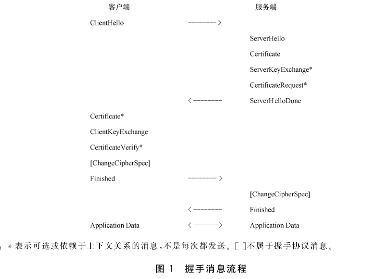
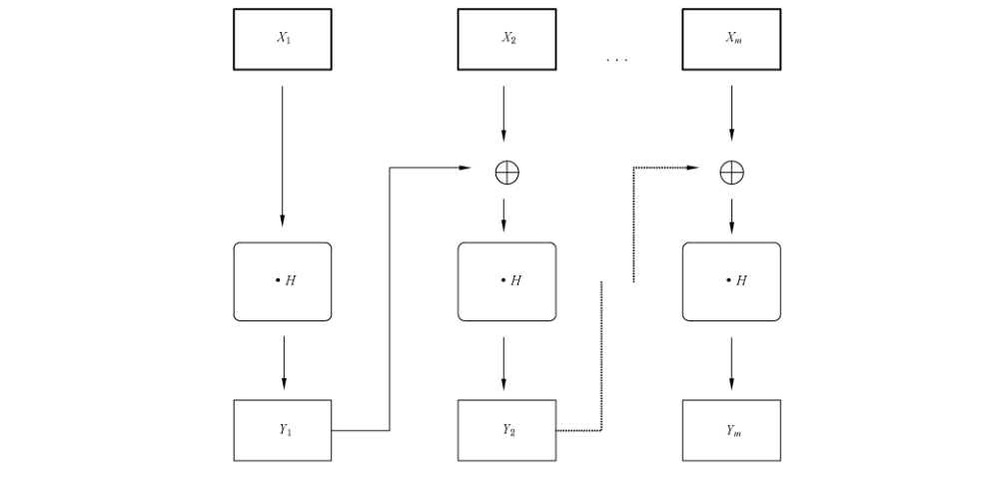
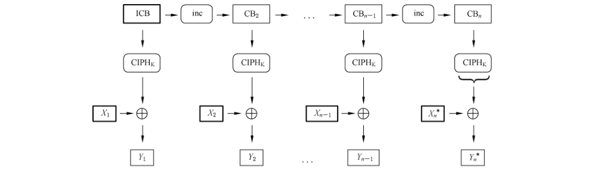
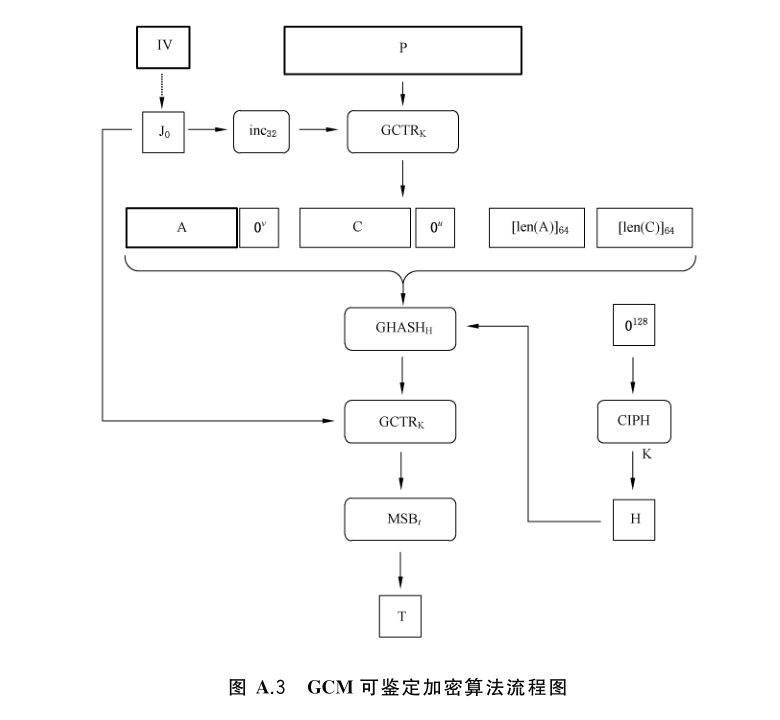
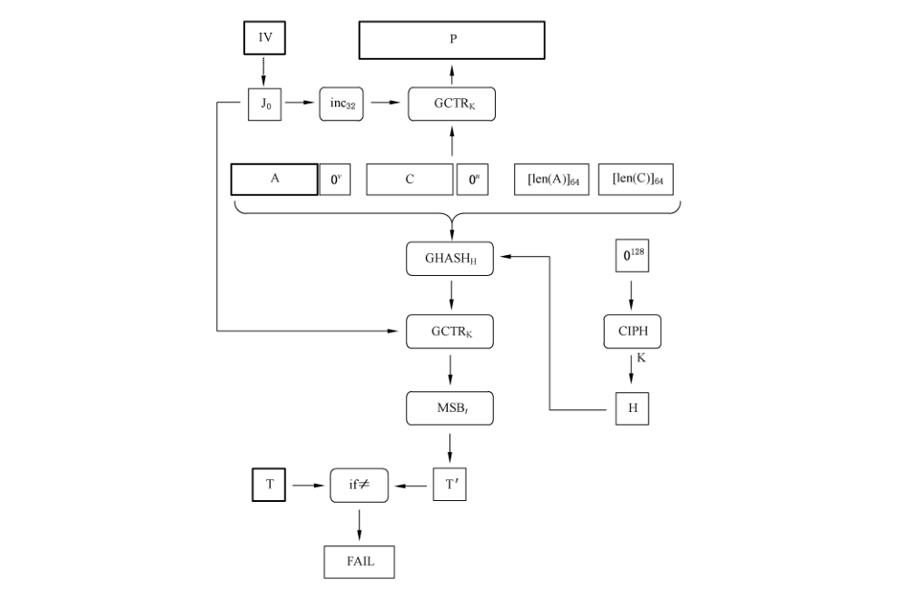

# GB/T 38636-2020 信息安全技术 传输层密码协议（TLCP）

> 来源：[GB/T 38636-2020 国家标准详情](https://openstd.samr.gov.cn/bzgk/std/newGbInfo?hcno=778097598DA2761E94A5FF3F77BD66DA)。
> PDF SHA-256：ea46891f921d7e655858a13f9433602e50c183e37cb6a4c60f4e9a9dced853b5。
> 发布日期：2020-04-28；实施日期：2020-11-01。依据官方 PDF 的 34 页图像逐页核对，保留六幅原图，恢复协议结构体、GCM 算法与公式，并去除封面、目录、分页和页眉页脚。正式引用请核对官方原文。

## 前言

本标准按照 GB/T 1.1—2009给出的规则起草。

请注意本文件的某些内容可能涉及专利。本文件的发布机构不承担识别这些专利的责任。

本标准由全国信息安全标准化技术委员会（SAC/TC 260）提出并归口。

本标准起草单位：山东得安信息技术有限公司、格尔软件股份有限公司、北京信安世纪科技有限公司、成都卫士通信息产业股份有限公司、长春吉大正元信息技术股份有限公司，北京握奇智能科技有限公司、北京三未信安科技发展有限公司、北京海泰方圆科技有限公司、国家密码管理局商用密码检测中心、北京江南天安科技有限公司、中金金融认证中心有限公司、北京天融信网络安全技术有限公司。

本标准主要起草人：郑强、马洪富、汪宗斌、罗俊、赵丽丽、张立延、汪雪林、田敏求、张岳公、蒋红宇、吕春梅、李国、孙圣男、雷晓锋。

## 1 范围

本标准规定了传输层密码协议，包括记录层协议、握手协议族和密钥计算。

本标准适用于传输层密码协议相关产品（如 SSL VPN 网关、浏览器等）的研制，也可用于指导传输层密码协议相关产品的检测、管理和使用。

## 2 规范性引用文件

下列文件对于本文件的应用是必不可少的。凡是注日期的引用文件，仅注日期的版本适用于本文件。凡是不注日期的引用文件，其最新版本（包括所有的修改单）适用于本文件。

- GB/T 20518 信息安全技术 公钥基础设施 数字证书格式规范

- GB/T 35275 信息安全技术 SM2密码算法加密签名消息语法规范

- GB/T 35276 信息安全技术 SM2密码算法使用规范

## 3 术语和定义

下列术语和定义适用于本文件。

### 3.1 数字证书 digital certificate

由证书认证机构（CA）签名的包含公开密钥拥有者信息、公开密钥、签发者信息、有效期以及扩展信息的一种数据结构。

> 注：按类别可分为个人证书、机构证书和设备证书，按用途可分为签名证书和加密证书。

### 3.2 IBC 算法 identity based cryptography algorithm

一种能以任意标识作为公钥，不需要使用数字证书证明公钥的非对称密码算法。

### 3.3 IBC 标识 IBC identity

表示实体身份或属性的字符串。

### 3.4 IBC 公共参数 IBC public parameter

包含了 IBC 密钥管理中心的名称、运算曲线、标识编码方式和密钥生成算法等公开参数信息。

> 注：参数信息用于将实体标识转换为公开密钥。

### 3.5 初始化向量/值 initialization vector;initialization value;IV

在密码变换中，为增加安全性或使密码设备同步而引入的用作数据变换的起始数据。

## 4 符号和缩略语

### 4.1 符号

下列符号适用于本文件。

`+`：串联。

`⊕`：异或运算。

`0^s`：包含 s 个“0”比特的比特串。

`CIPH_K(X)`：对于密钥为 K，分组为 X 的分组密文的输出。

`GCTR_K(ICB, X)`：对于比特串为 X，初始计数分组为 ICB，密钥为 K 的 GCTR 函数的输出。

`GHASH_H(X)`：对于杂凑密钥为 H，比特串为 H 的 GHASH 的输出。

`HMAC(X, Y)`：以 X 为密钥对 Y 进行密码杂凑运算。

`inc_s(X)`：比特串 X 的最右边 s 比特的递增输出。

`int(X)`：比特串 X 的整数表示。

`len(X)`：比特串 X 的长度。

`LSB_s(X)`：比特串 X 的最右段的 s 位比特串。

`MSB_s(X)`：比特串 X 的最左端的 s 位比特串。

`X || Y`：比特串 X 与比特串 Y 的连接。

A：附加可鉴别的数据。

C：密文。

H：杂凑子密钥。

K：分组密钥。

P：明文。

R：算法中用于分组乘法运算的常数。

T：鉴别标签。

t：鉴别标签的长度。

### 4.2 缩略语

下列缩略语适用于本文件。

AEAD：带额外数据的认证加密（Authenticated Encryption with Addation Data）。

ADD：附加鉴别数据（Additional Authenticated Data）。

CBC：密码分组链接工作模式（Cipher Block Chaining）。

CTR：计数器（Counter）。

DN：识别名（Distinguished Name）。

GCM：Galois 计数器模式（Galois Counter Mode）。

HMAC：采用杂凑算法计算的消息验证码（Hash-based Message Authentication Code）。

IBC：标识密码算法（Identity-Based Cryptography）。

ICB：初始计数器分组（Initial Counter Block）。

IV：初始向量（Initialization Vector）。

LSB：最低端比特（Least Significant Bit）。

MSB：最高端比特（Most Significant Bit）。

TLCP：传输层密码协议（Transport Layer Cryptography Protocol）。

XOR：异或（Exclusive-OR）。

## 5 密码算法和密钥种类

### 5.1 概述

TLCP 是利用密码技术，为两个应用程序之间提供保密性和数据的完整性。协议用到的密码算法包含非对称密码算法、分组密码算法、密码杂凑算法、数据扩展函数和伪随机函数，协议用到的密钥种类包含服务端密钥、客户端密钥、预主密钥、主密钥和工作密钥。

### 5.2 密码算法

#### 5.2.1 非对称密码算法

用于身份鉴别、数字签名、密钥交换等。

#### 5.2.2 分组密码算法

用于密钥交换数据的加密保护和报文数据的加密保护。采用的工作模式应为GCM或CBC 模式。

#### 5.2.3 密码杂凑算法

用于对称密钥生成和完整性校验。

#### 5.2.4 数据扩展函数 P_hash

P_hash 函数定义如下：

```text
P_hash(secret, seed) = HMAC(secret, A(1) + seed) +
                       HMAC(secret, A(2) + seed) +
                       HMAC(secret, A(3) + seed) +
                       ...
```

其中：

secret 是进行计算所需要的密钥。

seed 是进行计算所需要的数据。

```text
A(0) = seed
A(i) = HMAC(secret, A(i-1))
```

P_hash 能够反复迭代直至产生要求长度的数据。

#### 5.2.5 伪随机函数 PRF

PRF 的计算方法如下：

```text
PRF(secret, label, seed) = P_hash(secret, label + seed)
```

### 5.3 密钥种类

#### 5.3.1 概述

采用非对称密码算法进行身份鉴别和密钥交换，身份鉴别通过后协商预主密钥，双方各自计算主密钥，进而推导出工作密钥。使用工作密钥进行加解密和完整性校验。

#### 5.3.2 服务端密钥

服务端密钥为非对称密码算法的密钥对，包括签名密钥对和加密密钥对，其中签名密钥用于握手过程中服务端身份鉴别，加密密钥对用于预主密钥的协商。

#### 5.3.3 客户端密钥

客户端密钥为非对称密码算法的密钥对，包括签名密钥对和加密密钥对，其中签名密钥用于握手过程中客户端身份鉴别，加密密钥对用于预主密钥的协商。

#### 5.3.4 预主密钥

预主密钥（pre_master_secret）是双方协商生成的密钥素材，用于生成主密钥。

#### 5.3.5 主密钥

主密钥（master_secret）由预主密钥、客户端随机数、服务端随机数、常量字符串，经计算生成的48 字节密钥素材，用于生成工作密钥。

#### 5.3.6 工作密钥

工作密钥包括数据加密密钥和校验密钥。其中数据加密密钥用于数据的加密和解密，校验密钥用于数据的完整性计算和校验。发送方使用的工作密钥称为写密钥，接收方使用的工作密钥称为读密钥。

## 6 协议

### 6.1 概述

TLCP 包括记录层协议和握手协议族，握手协议族包含密码规格变更协议、报警协议及握手协议。

### 6.2 数据类型定义

#### 6.2.1 基本数据类型

定义了六种基本数据类型，分别 opaque、uint8、uint16、uint24、uint32、uint64。所有类型都以网络字节顺序表示，最小数据的大小是一个8位字节。

opaque：任意类型数据，1个字节。

uint8：无符号的8位整数，1个字节。

uint16：无符号的16位整数，2个字节。

uint24：无符号的24位整数，3个字节。

uint32：无符号的32位整数，4个字节。

uint64：无符号的64位整数，8个字节。

#### 6.2.2 向量

向量（Vectors）是给定类型的数据序列。向量分为两种：定长和变长。定长向量以 `[x]` 来表示；变长向量以 `<x..y>` 来表示，其中 x 代表下限，y 代表上限，如果只需表达上限时，用 `<y>` 表示。所有向量的长度都以字节为单位。变长向量首部表示向量实际长度，其首部大小为能够容纳变长向量最大长度的最小字节数。

#### 6.2.3 枚举类型

枚举（Enumerateds）是一系列特定值的字段集合，通常每个字段都包括一个名称和值。如果包含一个未命名的值，这个值表示指定的最大值。如果只包含了名称而不定义值，只能用来指代状态值，不能在实际编码中使用。例如，`enum { red(0), green(1), (255) } color`。枚举变量大小为能够容纳最大枚举值的最小字节数。

#### 6.2.4 结构类型

结构类型（Constructed Types）用 struct 来定义，与C语言的struct 语法类似。struct 中的字段按照先后顺序串连起来进行编码。如果一个 struct 包含于另一个 struct 中，则可以省略该 struct 的名字。

#### 6.2.5 变体类型

变体（Variants）类型用 select、case 来定义，用于定义依赖外部信息而变化的结构，类似于C语言中的 union或 ASN.1的CHOICE。

### 6.3 记录层协议

#### 6.3.1 概述

记录层协议是分层次的，每一层都包括长度字段，描述字段和内容字段。记录层协议接收将要被传输的消息，将数据分块、压缩（可选）、计算 HMAC、加密，然后传输。接收到的数据经过解密、验证、解压缩（可选）、重新封装然后传送给高层应用。

记录层协议包括：握手、报警、密码规格变更等类型。为了支持协议的扩展，记录层协议可支持其他的记录类型。任何新的记录类型都应在针对上述类型分配的内容类型值之外去分配。如果接收到一个不能识别的记录类型应忽略。

#### 6.3.2 连接状态

连接状态是记录层协议的操作环境。包括四种典型的连接状态：当前读状态、写状态、未决的读状态、未决的写状态。其中，读表示接收数据，写表示发送数据。所有记录都是在当前读写状态下处理的。

未决状态的安全参数可以由握手协议设定，而密码规格变更消息可使未决状态变为当前状态。除了最初的当前状态外，当前状态应包含经过协商的安全参数。

连接状态的安全参数结构如下：

```text
struct {
    ConnectionEnd       entity;
    BulkCipherAlgorithm bulk_cipher_algorithm;
    CipherType          cipher_type;
    uint8               key_material_length;
    MACAlgorithm        mac_algorithm;
    uint8               hash_size;
    CompressionMethod   compression_algorithm;
    opaque              master_secret[48];
    opaque              client_random[32];
    opaque              server_random[32];
    uint8               record_iv_length;
    uint8               fixed_iv_length;
    uint8               mac_length;
} SecurityParameters;
```

其中：

a） ConnectionEnd 表示本端在连接中的角色，为客户端或服务端。定义为：`enum { server, client } ConnectionEnd`。

b） BulkCipherAlgorithm 用于数据加解密的密码算法。定义为：`enum { sm4 } BulkCipherAlgorithm`。

c） CipherType 表示密码算法的类型。定义为：`enum { block } CipherType`。

d） key_material_length表示密钥材料的长度。

e） MACAlgorithm 用于计算和校验消息完整性的密码杂凑算法。定义为：`enum { sha_256, sm3 } MACAlgorithm`。

f） hash_size 表示杂凑的长度。

g） CompressionMethod 用于数据压缩的算法。定义为：`enum { null(0), (255) } CompressionMethod`。

h） master_secret在协商过程中由预主密钥、客户端随机数、服务端随机数计算出的48字节密钥。

i） client_random由客户端产生的32字节随机数据。

j） server_random由服务端产生的32字节随机数据。

k） record_iv_length初始向量的长度。

l） fixed_iv_length 固定的初始向量长度。

m） mac_length MAC 长度。

记录层将使用上述安全参数来生成下列内容：

——客户端写校验密钥 client write MAC secret。

——服务端写校验密钥 server write MAC secret。

——客户端写密钥 client write key。

——服务端写密钥 server write key。

——客户端写初始向量 client write iv。

——服务端写初始向量 server write iv。

服务端接收和处理记录时使用客户端写参数，客户端接收和处理记录时使用服务端写参数。用安全参数生成这些密钥的算法，见6.5。密钥生成后，连接状态就可以改变为当前状态。

#### 6.3.3 记录层

##### 6.3.3.1 概述

记录层接收从高层来的任意大小的非空连续数据，将数据分段、压缩、计算校验码、加密，然后传输。

接收到的数据经过解密、验证、解压缩、重新封装然后传送给高层应用。

##### 6.3.3.2 分段

记录层将数据分成 2^14 字节或者更小的片段。

每个片段结构如下：

```text
struct {
    ContentType type;
    ProtocolVersion version;
    uint16 length;
    opaque fragment[TLSPlaintext.length];
} TLSPlaintext;
```

其中：

a） Type：片段的记录层协议类型。定义为：

```text
enum {
    change_cipher_spec(20), alert(21), handshake(22),
    application_data(23), (255)
} ContentType;
```

b） Version：所用协议的版本号。这里的版本号为 1.1。定义为：

```text
struct {
    uint8 major = 0x01,
    uint8 minor = 0x01;
} ProtocolVersion;
```

c） length：以字节为单位的片段长度，小于或等于 2^14。

d） fragment：将传输的数据。记录层协议不关心具体数据内容。

##### 6.3.3.3 压缩和解压缩

所有的记录都使用当前会话状态指定的压缩算法进行压缩。当前会话状态指定的压缩算法被初始化空算法。

压缩算法将一个 TLSPlaintext 结构的数据转换成一个 TLSCompressed 结构的数据。

压缩后的数据长度最多只能增加 1 024 个字节。如果解压缩后的数据长度超过了 2^14 个字节，则报告一个 decompression failure 致命错误。

压缩后数据结构如下：

```text
struct {
    ContentType type;
    ProtocolVersion version;
    uint16 length;
    opaque fragment[TLSCompressed.length];
} TLSCompressed;
```

其中：

a） type、version 的定义同 6.3.3.2 中的 a）、b）。

b） length：以字节为单位的 TLSCompressed.fragment 长度，小于或等于 2^14＋1 024。

c） fragment TLSPlaintext.fragment 的压缩形式。

##### 6.3.3.4 加密和校验

###### 6.3.3.4.1 概述

加密运算和校验运算把一个 TLSCompressed 结构的数据转化为一个 TLSCiphertext 结构的数据。

解密运算则是执行相反的操作。

加密后数据结构如下：

```text
struct {
    ContentType type;
    ProtocolVersion version;
    uint16 length;
    select (CipherSpec.cipher_type) {
        case block: GenericBlockCipher;
        case aead: GenericAEADCipher;
    } fragment;
} TLSCiphertext;
```

其中：

a） type、version 的定义同 6.3.3.2中a）、b）。

b） length：以字节为单位的 TLSCiphertext.fragment 长度，小于或等于 2^14＋2 048。

c） fragment带有校验码的TLSCompressed.fragment 加密形式。

###### 6.3.3.4.2 校验算法的数据处理

校验码的计算是在加密之前进行，运算方法如下：

```text
HMAC_hash(MAC_write_secret, seq_num + TLSCompressed.type +
          TLSCompressed.version + TLSCompressed.length +
          TLSCompressed.fragment)
```

其中：

a） seq_num：序列号。每一个读写状态都分别维持一个单调递增序列号。序列号的类型为 uint64，序列号初始值为零，最大不能超出 2^64−1。序列号不能回绕。如果序列号溢出，那就应重新开始握手。

b） hash计算校验码时使用的杂凑算法。

###### 6.3.3.4.3 分组密码算法的数据处理

使用分组密码算法加解密数据时，加密运算和校验运算用于将一个 TLSCompressed.fragment 结构的数据转换成一个 TLSCiphertext.fragment 结构的数据。被加密的数据包括了校验运算的结果。

加密处理前数据结构如下：

```text
struct {
    opaque IV[SecurityParameters.record_iv_length];
    block-ciphered struct {
        opaque content[TLSCompressed.length];
        opaque MAC[SecurityParameters.mac_length];
        uint8 padding_length;
        uint8 padding[GenericBlockCipher.padding_length];
    };
} GenericBlockCipher;
```

其中：

a） IV在GenericBlockCipher 中传输的初始化向量。该向量应随机产生。

b） SecurityParameters.record_iv_length IV 的长度，其缺省值与使用的密码套件相关。

c） SecurityParameters.mac_length MAC 的长度，其缺省值与使用的密码套件相关。

d） Content加密前的明文数据。

e） MAC Content 的校验值。

f） Padding填充的数据。在数据加密前需要将数据填充为密码算法分组长度的整数倍，填充的长度不能超过255个字节。填充的每个字节的内容是填充的字节数。接收者应检查这个填充，如果出错，发送 bad_record_mac 报警消息。

###### 6.3.3.4.4 认证加密算法（AEAD）的数据处理

使用认证加密算法加解密时，认证加密函数在 TLSCompressed.fragment 结构和认证加密 TLSCiphertext.fragment 结构之间进行转换。

认证加密 AEAD 密码的输入是一个密钥、一个随机数、明文和额外认证数据。密钥是客户端写密钥或服务端写密钥，根据是哪一端进行加密来确定。

```text
struct {
    opaque nonce_explicit[SecurityParameters.record_iv_length];
    aead-ciphered struct {
        opaque content[TLSCompressed.length];
    };
} GenericAEADCipher;
```

每个 AEAD 密码套件应指定怎样构造提供给 AEAD 操作的随机数，以及 GenericAEADCipher.nonce_explicit 部分的长度大小。AEAD 加密模式一般采用计数器模式。AEAD 使用的随机数应由显式和隐式两部分组成，显式部分即 nonce_explicit，客户端和服务端使用的隐式部分分别来自 client_write_iv 和 server_write_iv。AEAD 使用的随机数和计数器的构造方式参见 RFC 5116。

额外认证数据（additional_data）定义如下：

```text
additional_data = seq_num + TLSCompressed.type +
                  TLSCompressed.version + TLSCompressed.length;
```

AEAD的输出是由 AEAD加密操作的密文输出组成。其长度通常比 TLSCompressed.length长，但是多出的长度在 AEAD密码算法中并不统一。因密码算法可能包括了填充，所以开销的数量可能随着不同的 TLSCompressed.length值而不同。每个AEAD 密码算法生成的扩展应不能多于1024比特。

```text
AEADEncrypted = AEAD-Encrypt(write_key, nonce, plaintext, additional_data)
```

为了解密和验证，密码算法把密钥、随机数、additional_data 和 AEADEncrypted 值当作输入。输出为明文或者一个指示解密失败的错误。没有另外的完整性检查。即：

```text
TLSCompressed.fragment = AEAD-Decrypt(write_key, nonce,
                                      AEADEncrypted, additional_data)
```

如果解密失败，应生成一个致命的 bad_record_mac 警告。

GCM 可鉴别加密模式见附录 A。

### 6.4 握手协议族

#### 6.4.1 概述

握手协议族由密码规格变更协议、握手协议和报警协议三个子协议组成，用于双方协商出供记录层使用的安全参数，进行身份验证以及向对方报告错误等。

握手协议族负责协商出一个会话，这个会话包含：

a） 会话标识：由服务端选取的随意的字节序列，用于识别活跃或可恢复的会话。

b） 证书：X509 v3 格式的数字证书，符合 GB/T 20518。

c） 压缩方法：压缩数据的算法。

d） 密码规格：指定的密码算法。

e） 主密钥：客户端和服务端共享的48个字节的密钥。

f） 重用标识：标明能否用该会话发起一个新连接的标识。本标准仅支持会话标识的重用模式，表明是否能重用已有的或者现在的会话，不重新协商安全参数。

利用以上数据可以产生安全参数。利用握手协议的重用特性，可以使用相同的会话建立多个连接。

#### 6.4.2 密码规格变更协议

密码规格变更协议用于通知密码规格的改变，即通知对方使用刚协商好的安全参数来保护接下来的数据。该协议由一条消息组成，该消息用当前的压缩算法压缩，并用当前的密码规格加密，如果是首次协商，该消息为明文。

该消息的长度为一个字节，其值为1。客户端和服务端都要在安全参数协商完毕之后、握手结束消息之前发送此消息。

对于刚协商好的密钥，写密钥在此消息发送之后立即启用；读密钥在收到此消息之后立即启用。

密码规格变更消息结构定义如下：

```text
struct {
    enum { change_cipher_spec(1), (255) } type;
} ChangeCipherSpec;
```

#### 6.4.3 报警协议

##### 6.4.3.1 结构定义

报警协议用于关闭连接的通知以及对整个连接过程中出现的错误进行报警，其中关闭通知由发起者发送，错误报警由错误的发现者发送。该协议由一条消息组成，该消息用当前的压缩算法压缩，并用当前的密码规格加密，如果是首次协商，该消息为明文。

报警消息的长度为两个字节，分别为报警级别和报警内容。

报警消息结构定义如下：

```text
enum { warning(1), fatal(2), (255) } AlertLevel;

enum {
    close_notify(0),
    unexpected_message(10),
    bad_record_mac(20),
    decryption_failed(21),
    record_overflow(22),
    decompression_failure(30),
    handshake_failure(40),
    bad_certificate(42),
    unsupported_certificate(43),
    certificate_revoked(44),
    certificate_expired(45),
    certificate_unknown(46),
    illegal_parameter(47),
    unknown_ca(48),
    access_denied(49),
    decode_error(50),
    decrypt_error(51),
    protocol_version(70),
    insufficient_security(71),
    internal_error(80),
    user_canceled(90),
    no_renegotiation(100),
    unsupported_site2site(200),
    no_area(201),
    unsupported_areatype(202),
    bad_ibcparam(203),
    unsupported_ibcparam(204),
    identity_need(205),
    (255)
} AlertDescription;

struct {
    AlertLevel level;
    AlertDescription description;
} Alert;
```

##### 6.4.3.2 关闭通知

除非出现致命报警，客户端和服务端任何一方在结束连接之前都应发送关闭通知消息。对于该消息的发送方，该消息通知对方不再发送任何数据，可以等待接收方回应的关闭通知消息后，关闭本次连接，也可以立即关闭本次连接。对于接收方，收到该消息后应回应一个关闭通知消息，然后关闭本次连接，不再接收和发送数据。

##### 6.4.3.3 错误报警

当发送或接收到一个致命级别报警之后，双方都应立即关闭连接，废弃出错连接的会话标识和密钥，被致命报警关闭的连接是不能复用的。定义的报警见表1。

**表1 错误报警表**

| 错误报警名称 | 值 | 级别 | 描述 |
| --- | --- | --- | --- |
| unexpected_message | 10 | 致命 | 接收到一个不符合上下文关系的消息 |
| bad_record_mac | 20 | 致命 | MAC校验错误或解密错误 |
| decryption_failed | 21 | 致命 | 解密失败 |
| record_overflow | 22 | 致命 | 报文过长 |
| decompression_failure | 30 | 致命 | 解压缩失败 |
| handshake failure | 40 | 致命 | 协商失败 |
| bad certificate | 42 | — | 证书被破坏 |
| unsupported certificate | 43 | — | 不支持证书类型 |
| certificate revoked | 44 | — | 证书被撤销 |
| certificate expired | 45 | — | 证书过期或未生效 |
| certificate unknown | 46 | — | 未知证书错误 |
| illegal parameter | 47 | 致命 | 非法参数 |
| unknown ca | 48 | 致命 | 根证书不可信 |
| access denied | 49 | 致命 | 拒绝访问 |
| decode error | 50 | 致命 | 消息解码失败 |
| decrypt error | 51 | — | 消息解密失败 |
| protocol version | 70 | 致命 | 版本不匹配 |
| insufficient security | 71 | 致命 | 安全性不足 |
| internal error | 80 | 致命 | 内部错误 |
| user canceled | 90 | 警告 | 用户取消操作 |
| no renegotiation | 100 | 警告 | 拒绝重新协商 |
| unsupported_site2site | 200 | 致命 | 不支持 site2site |
| no_area | 201 | — | 没有保护域 |
| unsupported_areatype | 202 | — | 不支持的保护域类型 |
| bad_ibcparam | 203 | 致命 | 接收到一个无效的 ibc 公共参数 |
| unsupported_ibcparam | 204 | 致命 | 不支持 ibc公共参数中定义的信息 |
| identity_need | 205 | 致命 | 缺少对方的ibc 标识 |

对于没有明确指出级别的错误报警，发送者可以自行决定是否致命，如果发送者认为是致命的，应向接收者发出关闭通知，最后关闭本次连接；如果接收到一个警告级别的报警，接收者可以自行决定是否致命，如果接收者认为是致命的，应向发起者发出关闭通知，最后关闭本次连接。

#### 6.4.4 握手协议总览

握手协议涉及以下过程：

——交换 hello 消息来协商密码套件，交换随机数，决定是否会话重用。

——交换必要的参数，协商预主密钥。

——交换证书或 IBC 信息，用于验证对方。

——使用预主密钥和交换的随机数生成主密钥。

——向记录层提供安全参数。

——验证双方计算的安全参数的一致性、握手过程的真实性和完整性。

握手过程如下：客户端发送客户端 hello消息给服务端，服务端应回应服务端 hello 消息，否则产生一个致命错误并且断开连接。客户端 hello 和服务端 hello 用于在客户端和服务端进行基于 SM2、RSA或IBC的密码算法协商，以及确定安全传输能力，包括协议版本、会话标识、密码套件等属性，并且产生和交换随机数。

在客户端 hello和服务端 hello 消息之后是身份验证和密钥交换过程。包括服务端证书、服务端密钥交换，客户端证书、客户端密钥交换。

在服务端发送完 hello消息之后，接着发送自己的证书消息，服务端密钥交换消息。如果服务端需要验证客户端的身份，则向客户端发送证书请求消息。然后发送服务端 hello完成消息，表示 hello 消息阶段已经结束，服务端等待客户端的返回消息。如果服务端发送了一个证书请求消息，客户端应返回一个证书消息。然后客户端发送密钥交换消息，消息内容取决于客户端 hello 消息和服务端 hello 消息协商出的密钥交换算法。如果客户端发送了证书消息，那么也应发送一个带数字签名的证书验证消息供服务端验证客户端的身份。

接着客户端发送密码规格变更消息，然后客户端立即使用刚协商的算法和密钥，加密并发送握手结束消息。服务端则回应密码规格变更消息，使用刚协商的算法和密钥，加密并发送握手结束消息。至此握手过程结束，服务端和客户端可以开始数据安全传输。

握手消息流程如图1所示。



如果客户端和服务端决定重用之前的会话，可不必重新协商安全参数。客户端发送客户端 hello消息，并且带上要重用的会话标识。如果服务端有匹配的会话存在，服务端则使用相应的会话状态接受连接，发送一个具有相同会话标识的服务端hello消息。然后客户端和服务端各自发送密码规格变更消息和握手结束消息。至此握手过程结束，服务端和客户端可以开始数据安全传输。如果服务端没有匹配的会话标识，服务端会生成一个新的会话标识进行一个完整的握手过程。

会话重用的握手消息流程如图2所示。


#### 6.4.5 握手协议

##### 6.4.5.1 结构定义

握手协议是在记录层协议之上的协议，用于协商安全参数。握手协议的消息通过记录层协议传输。

握手消息结构定义如下：

```text
struct {
    HandshakeType msg_type;
    uint24 length;
    select (msg_type) {
        case client_hello: ClientHello;
        case server_hello: ServerHello;
        case certificate: Certificate;
        case server_key_exchange: ServerKeyExchange;
        case certificate_request: CertificateRequest;
        case server_hello_done: ServerHelloDone;
        case certificate_verify: CertificateVerify;
        case client_key_exchange: ClientKeyExchange;
        case finished: Finished;
    } body;
} Handshake;
```

握手消息类型定义如下：

```text
enum {
    client_hello(1), server_hello(2),
    certificate(11), server_key_exchange(12),
    certificate_request(13), server_hello_done(14),
    certificate_verify(15), client_key_exchange(16),
    finished(20), (255)
} HandshakeType;
```

握手协议消息应按照规定的流程顺序进行发送，否则将会导致致命的错误。不需要的握手消息可以被接收方忽略。

##### 6.4.5.2 Hello 消息

###### 6.4.5.2.1 Client Hello 消息

该消息为客户端 hello 消息。

客户端 hello 消息作为握手协议的第一条消息。

客户端在发送客户端 hello 消息之后，等待服务端回应服务端 hello 消息。

客户端 hello 消息结构定义如下：

```text
struct {
    ProtocolVersion client_version;
    Random random;
    SessionID session_id;
    CipherSuite cipher_suites<2..2^16-1>;
    CompressionMethod compression_methods<1..2^8-1>;
} ClientHello;
```

其中：

a） client_version客户端在这个会话中使用的协议版本。在本标准中，协议版本号是1.1。

b） random：客户端产生的随机信息，其内容包括时钟和随机数，结构定义如下：

```text
struct {
    uint32 gmt_unix_time;
    opaque random_bytes[28];
} Random;
```

gmt_unix_time 为标准 UNIX 32位格式表示的发送者时钟，其值为从格林威治时间的1970年1月1日零点到当前时间的秒数。

random_bytes 为28 个字节的随机数。

c） session_id：客户端在连接中使用的会话标识，定义为：`opaque SessionID<0..32>`。session_id 是一个可变长字段，其值由服务端决定。如果没有可重用的会话标识或希望协商安全参数，该字段应为空，否则表示客户端希望重用该会话。这个会话标识可能是之前的连接标识、当前连接标识，或其他处于连接状态的连接标识。会话标识生成后应一直保持到被超时删除或与这个会话相关的连接遇到致命错误被关闭。一个会话失效或被关闭时则与其相关的连接都应被强制关闭。

d） cipher_suites客户端所支持的密码套件列表，客户端应按照密码套件使用的优先级顺序排列，优先级最高的密码套件应排在首位。如果会话标识字段不为空，本字段应至少包含将重用的会话所使用的密码套件。

密码套件定义如下：`uint8 CipherSuite[2];`

每个密码套件包括一个密钥交换算法、一个加密算法及密钥长度和一个校验算法。服务端将在密码套件列表中选择一个与之匹配的密码套件，如果没有可匹配的密码套件，应返回握手失败报警消息 handshake_failure 并且关闭连接。

支持的密码套件见表2。

**表2 密码套件列表**

| 名称 | 密钥交换 | 加密 | 校验 | 值 |
| --- | --- | --- | --- | --- |
| ECDHE_SM4_CBC_SM3 | ECDHE | SM4_CBC | SM3 | {0xe0, 0x11} |
| ECDHE_SM4_GCM_SM3 | ECDHE | SM4_GCM | SM3 | {0xe0, 0x51} |
| ECC_SM4_CBC_SM3 | ECC | SM4_CBC | SM3 | {0xe0, 0x13} |
| ECC_SM4_GCM_SM3 | ECC | SM4_GCM | SM3 | {0xe0, 0x53} |
| IBSDH_SM4_CBC_SM3 | IBSDH | SM4_CBC | SM3 | {0xe0, 0x15} |
| IBSDH_SM4_GCM_SM3 | IBSDH | SM4_GCM | SM3 | {0xe0, 0x55} |
| IBC_SM4_CBC_SM3 | IBC | SM4_CBC | SM3 | {0xe0, 0x17} |
| IBC_SM4_GCM_SM3 | IBC | SM4_GCM | SM3 | {0xe0, 0x57} |
| RSA_SM4_CBC_SM3 | RSA | SM4_CBC | SM3 | {0xe0, 0x19} |
| RSA_SM4_GCM_SM3 | RSA | SM4_GCM | SM3 | {0xe0, 0x59} |
| RSA_SM4_CBC_SHA256 | RSA | SM4_CBC | SHA256 | {0xe0, 0x1c} |
| RSA_SM4_GCM_SHA256 | RSA | SM4_GCM | SHA256 | {0xe0, 0x5a} |

本标准实现ECC 和 ECDHE 的算法为SM2；实现 IBC 和IBSDH 的算法SM9。

e） compression_methods客户端所支持的压缩算法列表，客户端应按照压缩算法使用的优先级顺序排列，优先级最高的压缩算法应排在首位。

定义如下：`enum { null(0), (255) } CompressionMethod;`

服务端将在压缩算法列表中选择一个与之匹配的压缩算法。列表中应包含空压缩算法，这样客户端和服务端总能协商出一致的压缩算法。

###### 6.4.5.2.2 Server Hello 消息

该消息为服务端 hello 消息。

如果能从客户端 hello消息中找到匹配的密码套件，服务端发送这个消息作为对客户端 hello消息的回复。如果找不到匹配的密码套件，服务端将回应 handshake failure 报警消息。

服务端 hello 消息结构定义如下：

```text
struct {
    ProtocolVersion server_version;
    Random random;
    SessionID session_id;
    CipherSuite cipher_suite;
    CompressionMethod compression_method;
} ServerHello;
```

其中：

a） server_version该字段表示服务端支持的协议版本。本标准的版本号是 1.1。

b） random服务端产生的随机数。

c） session_id服务端使用的会话标识，如果客户端 hello 消息中的会话标识不为空，且服务端存在匹配的会话标识，则服务端重用与该标识对应的会话建立新连接，并在回应的服务端 hello 消息中带上与客户端一致的会话标识，否则服务端产生一个新的会话标识，用来建立一个新的会话。

d） cipher_suite服务端从客户端hello 消息中选取的一个密码套件。对于重用的会话，本字段存放重用会话使用的密码套件。

f） compression_method服务端从客户端 hello 消息中选取的一个压缩算法，对于重用的会话，本字段存放重用会话使用的压缩算法。

##### 6.4.5.3 Server Certificate 消息

该消息为服务端证书消息。

服务端应发送一个服务端证书消息给客户端，该消息总是紧跟在服务端hello消息之后。当选中的密码套件使用 RSA 或ECC或ECDHE 算法时，本消息的内容为服务端的签名证书和加密证书；当选中的密码套件使用IBC或IBSDH 算法时，本消息的内容为服务端标识和 IBC公共参数，用于客户端与服务端协商 IBC公开参数。

证书格式为X.509v3，证书类型应能适用于已经确定的密钥交换算法。密钥交换算法与证书密钥类型的关系见表3。

**表3 密钥交换算法与证书密钥类型关系表**

| 密钥交换算法 | 证书密钥类型 |
| --- | --- |
| RSA | RSA 公钥，应使用加密证书中的公钥 |
| IBC | 服务端标识和 IBC公共参数 |
| IBSDH | 服务端标识和 IBC 公共参数 |
| ECC | ECC公钥，应使用加密证书中的公钥 |
| ECDHE | ECC 公钥，应使用加密证书中的公钥 |

对于证书消息结构如下：

```text
opaque ASN.1Cert<1..2^24-1>;
struct {
    ASN.1Cert certificate<0..2^24-1>;
} Certificate;
```

Certificate：服务器证书：签名证书在前，加密证书在后。

IBC 标识及公共参数结构：

```text
opaque ASN.1IBCParam<1..2^24-1>;
struct {
    opaque ibc_id<1..2^16-1>;
    ASN.1IBCParam ibc_parameter;
} Certificate;
```

其中：

a） ibc_id服务端标识。

b） ibc_parameter IBC公共参数，遵循 ASN.1 编码。

##### 6.4.5.4 Server Key Exchange 消息

本消息为服务端密钥交换消息。本消息传送的信息用于客户端计算产生48字节的预主密钥。

服务端密钥交换消息结构定义如下：

```text
enum { ECDHE, ECC, IBSDH, IBC, RSA } KeyExchangeAlgorithm;
struct {
    select (KeyExchangeAlgorithm) {
        case ECDHE:
            ServerECDHEParams params;
            Digitally-signed struct {
                opaque client_random[32];
                opaque server_random[32];
                ServerECDHEParams params;
            } signed_params;
        case ECC:
            digitally-signed struct {
                opaque client_random[32];
                opaque server_random[32];
                opaque ASN.1Cert<1..2^24-1>;
            } signed_params;
        case IBSDH:
            ServerIBSDHParams params;
            digitally-signed struct {
                opaque client_random[32];
                opaque server_random[32];
                ServerIBSDHParams params;
            } signed_params;
        Case IBC:
            ServerIBCParams params;
            digitally-signed struct {
                opaque client_random[32];
                opaque server_random[32];
                ServerIBCParams params;
                opaque IBCEncryptionKey[1 024];
            } signed_params;
        Case RSA:
            digitally-signed struct {
                opaque client_random[32];
                opaque server_random[32];
                opaque ASN.1Cert<1..2^24-1>;
            } signed_params;
    };
} ServerKeyExchange;
```

其中：

a） ServerECDHEParams服务端的密钥交换参数，当使用 SM2算法时，交换的参数见GB/T 35276，其中服务端的公钥不需要交换，客户端直接从服务端的加密证书中获取。

```text
struct {
    ECParameters curve_params;
    ECPoint public;
} ServerECDHParams;
```

如果使用 SM2算法时，忽略第一个参数 ECParameters。

b） ServerIBSDHParams使用IBSDH 算法时，服务端的密钥交换参数，密钥交换参数格式参见 SM9算法。

c） ServerlBCParams使用IBC算法时，服务器的密钥交换参数，密钥交换参数格式参见 SM9算法。

d） IBCEncyptionKey使用IBC算法时，服务端的加密公钥，长度1024字节。

e） signed_params当密钥交换方式为 ECDHE、IBSDH 和 IBC 时，signed_params 是服务端对双方随机数和服务端密钥交换参数的签名；当密钥交换方式 ECC 和 RSA 时，singed_params 是服务端对双方随机数和服务端加密证书的签名。

##### 6.4.5.5 Certificate Request 消息

本消息为证书请求消息。

如果服务端要求认证客户端，则应发送此消息，要求客户端发送自己的证书。

该消息紧跟在服务端密钥交换消息之后。

证书请求消息的结构定义如下：

```text
struct {
    ClientCertificateType certificate_types<1..2^8-1>;
    DistinguishedName certificate_authorities<0..2^16-1>;
} CertificateRequest;
```

其中：

a） certificate_types要求客户端提供的证书类型的列表。

```text
enum { rsa_sign(1), ecdsa_sign(64), ibc_params(80), (255) } ClientCertificateType;
```

b） certificate_authorities如果 ClientCertificateType 是ibc_params，本字段的内容是IBC密钥管理中心的信任域名列表。否则是服务端信任的CA的证书DN列表，包括根CA或者二级CA的DN。

定义如下：

```text
opaque DistinguishedName<1..2^16-1>;
```

##### 6.4.5.6 Server Hello Done 消息

表示握手过程的hello消息阶段完成。发送完该消息后服务端会等待客户端的响应消息。

客户端接收到服务端的 hello 完成消息之后，应验证服务端证书是否有效，并检验服务端的 hello消息参数是否可以接受。如果可以接受，客户端继续握手过程。否则发送一个 Handshake failure 致命报警。

服务端 hello 完成消息结构如下：

```text
struct { } ServerHelloDone;
```

##### 6.4.5.7 Client Certificate 消息

本消息为客户端证书消息。如果服务端请求客户端证书，客户端要随后发送本消息。

如果协商的密码套件使用 IBC 或IBSDH算法，此消息的内容为客户端标识和IBC公共参数，用于客户端与服务端协商 IBC公开参数。

客户端证书消息的结构同 6.4.5.3定义的结构。

##### 6.4.5.8 Client Key Exchange 消息

本消息为客户端密钥交换消息。

如果服务端请求客户端证书，本消息紧跟于客户端证书消息之后，否则本消息是客户端接收到服务端 hello完成消息后所发送的第一条消息。

如果密钥交换算法使用 RSA算法、ECC算法和 IBC算法，本消息中包含预主密钥，该预主密钥由客户端产生，采用服务端的加密公钥进行加密。当服务端收到加密后的预主密钥后，利用相应的私钥进行解密，获取所述预主密钥的明文。如果是IBC算法，客户端利用获取的服务端标识和 IBC公开参数，产生服务端公钥。如果是 RSA算法，建议使用 PKCS#1版本1.5对RSA加密后的密文进行编码。如果密钥交换算法使用 ECDHE 算法或IBSDH 算法，本消息中包含计算预主密钥的客户端密钥交换参数。

客户端密钥交换消息结构定义如下：

```text
struct {
    select (KeyExchangeAlgorithm) {
        case ECDHE:
            opaque ClientECDHEParams<1..2^16-1>;
        case IBSDH:
            opaque ClientIBSDHParams<1..2^16-1>;
        case ECC:
            opaque ECCEncryptedPreMasterSecret<0..2^16-1>;
        case IBC:
            opaque IBCEncryptedPreMasterSecret<0..2^16-1>;
        case RSA:
            opaque RSAEncryptedPreMasterSecret<0..2^16-1>;
    } exchange_keys;
} ClientKeyExchange;
```

其中：

a） ClientECDHEParams使用 ECDHE算法时，要求客户端发送证书。客户端的密钥交换参数，当使用SM2算法时，交换的参数见GB/T 35276。

其结构如下：

```text
struct {
    ECParameters curve_params;
    ECPoint public;
} ClientECDHParams;
```

如果使用 SM2算法时，第一个参数不效验。

b） ClientIBSDHParams使用IBSDH算法时，客户端的密钥交换参数。

c） ECCEncryptedPreMasterSecret使用 ECC加密算法时，用服务端加密公钥加密的预主密钥。

d） IBCEncryptedPreMasterSecret使用 IBC加密算法时，用服务端公钥加密的预主密钥。

e） RSAEncryptedPreMasterSecret使用 RSA 加密算法时，用服务端加密公钥加密的预主密钥。

预主密钥的数据结构如下：

```text
struct {
    ProtocolVersion client_version;
    opaque random[46];
} PreMasterSecret;
```

其中：

a） client_version客户端所支持的版本号。服务端要检查这个值是否跟客户端hello 消息中所发送的值相匹配。

b） random 46 字节的随机数。

##### 6.4.5.9 Certificate Verify 消息

本消息为证书校验消息。

该消息用于鉴别客户端是否为证书的合法持有者，只有 Client Certificate 消息发送时才发送此消息，紧跟于客户端密钥交换消息之后。

证书校验消息的数据结构如下：

```text
struct {
    Signature signature;
} CertificateVerify;
```

其中：Signature 的结构如下：

```text
enum { rsa_sha256, rsa_sm3, ecc_sm3, ibs_sm3 } SignatureAlgorithm;
struct {
    select (SignatureAlgorithm) {
        case rsa_sha256:
            digitally-signed struct {
                opaque sha256_hash[20];
            };
        case rsa_sm3:
            digitally-signed struct {
                opaque sm3_hash[32];
            };
        case ecc_sm3: // 当 ECC 为 SM2 算法时，用这个套件
            digitally-signed struct {
                opaque sm3_hash[32];
            };
        case ibs_sm3:
            digitally-signed struct {
                opaque sm3_hash[32];
            };
    };
} Signature;
```

sm3_hash 和 sha256_hash 是指 hash 运算的结果，运算的内容是自客户端 hello 消息开始直到本消息止（不包括本消息）的所有与握手有关的消息（加密证书要包在签名计算中），包括握手消息的类型和长度域。

当使用 SM2算法签名时，使用客户端的签名密钥，签名方法见 GB/T 35275。

##### 6.4.5.10 Finished 消息

本消息为握手结束消息。

服务端和客户端各自在密码规格变更消息之后发送本消息，用于验证密钥交换过程是否成功，并校验握手过程的完整性。

本消息用本次握手过程协商出的算法和密钥保护。

本消息的接收方应检验消息内容的正确性。一旦一方发送了握手结束消息，并且接收到了对方的握手结束消息并通过校验，就可以使用该连接进行数据安全传输。

握手结束消息数据结构如下：

```text
struct {
    opaque verify_data[12];
} Finished;
```

其中：verify_data 为校验数据，该数据产生方法如下：

```text
PRF(master_secret, finished_label, SM3(handshake_messages))[0..11]
```

表达式中：

a） finished_label：对于由客户端发送的结束消息，该标签是字符串“client finished”。对于服务端，该标签是字符串“server finished”。

b） handshake_messages指自客户端 hello 消息开始直到本消息为止（不包括本消息、密码规格变更消息和 hello 请求消息）的所有与握手有关的消息，包括握手消息的类型和长度域。

### 6.5 密钥计算

#### 6.5.1 主密钥计算

主密钥由48个字节组成，由预主密钥、客户端随机数、服务端随机数、常量字符串，经PRF 计算生成。

计算方法如下：

```text
master_secret = PRF(pre_master_secret, "master secret",
                    ClientHello.random + ServerHello.random)[0..47]
```

#### 6.5.2 工作密钥

工作密钥包括校验密钥和加密密钥，具体密钥长度由选用的密码算法决定。由主密钥、客户端随机数、服务端随机数、常量字符串，经PRF 计算生成。

计算方法如下：

```text
key_block = PRF(SecurityParameters.master_secret, "key expansion",
                SecurityParameters.server_random + SecurityParameters.client_random);
```

直到生成所需长度的输出，然后按顺序分割得到所需的密钥：

```text
client_write_MAC_secret[SecurityParameters.hash_size]
server_write_MAC_secret[SecurityParameters.hash_size]
client_write_key[SecurityParameters.key_material_length]
server_write_key[SecurityParameters.key_material_length]
client_write_IV[SecurityParameters.fixed_iv_length]
server_write_IV[SecurityParameters.fixed_iv_length]
```

## 附录 A（规范性附录）GCM 可鉴别加密模式

### A.1 GCM 可鉴别加密模式

#### A.1.1 GCM 简介

伽罗瓦/计数器模式（GCM）是一种对数据的加密鉴别模式，GCM 使用了加密的计数器运算模式来确保数据的机密性，并且通过使用有限域上的通用的杂凑函数来保证机密数据的完整性。GCM 对于无需加密的附加数据提供了认证，确保其没有被修改。

如果 GCM 的输入被限制为没有加密的数据，那么 GCM 的输出结果可被称为 GMAC，GMAC 是对输入的数据提供可鉴别模式。

GCM 有两个相关函数分别被称为鉴别加密和鉴别解密，每一个函数都相对高效的，并且能够并行化的处理。

#### A.1.2 GCM 的要素

##### A.1.2.1 分组密码

GCM 的工作依赖于底层的对称密钥分组密码的选择，因而可以被看作是分组密码的工作模式。

GCM 密钥是分组密码密钥。

对于任何给定的密钥，模式的底层分组密码由两个互逆函数组成。分组密码的选择包括将分组密码的两个函数之一指定为前向密码函数。

前向密码函数是一个定长的比特串上的置换，这个串被称为分组，分组的长度称为分组大小。密钥用K表示，由此产生的分组密码的前向密码函数表示为CIPHK。

底层分组密码的分组大小应为128 比特，密钥长度应至少为128比特。密钥应随机均匀，或近似随机均匀生成。因此，密钥有很高的概率不同于任何以前的密钥。并且密钥仅用于 GCM 所选的分组密码。

##### A.1.2.2 GCM 的两个要素

###### A.1.2.2.1 可鉴别加密函数

**A.1.2.2.1.1 输入数据**

根据分组密码和密钥的选择，可鉴别加密函数有三个输入字符串：

——明文，表示为 P；

——附加的可鉴别数据（AAD），表示为 A；

——初始向量，表示为 IV。

明文和 AAD是GCM保护的两类数据。GCM保护明文和 AAD的真实性；GCM 也保护明文的机密性，而 AAD则被保留是明文的。

示例：在网络协议中，AAD可以包括地址、端口、序列号、协议版本号，以及说明如何处理明文的其他字段。

IV 本质上是一个 nonce，即，在指定上下文中唯一的一个值。

可鉴别加密函数的输入字符串的比特长度应满足以下要求：

```text
len(P) ≤ 2^39 − 256
len(A) ≤ 2^64 − 1
1 ≤ len(IV) ≤ 2^64 − 1
```

GCM 是在比特串上定义的，明文、AAD 和 IV 的比特长度都是 8 的倍数。

对于IV，建议实现上限制对96 比特长度的支持，以提升设计的互操作性、有效性和容易性。

**A.1.2.2.1.2 输出数据**

下面的两个比特串组成了可鉴别加密函数的输出数据：

——密文，表示为 C，其比特长度与明文相同。

——可鉴别标签（或简称标签），表示为T。

标签的比特长度（表示为t）是一个安全参数。一般来说，t可以是下列五个值中的任何一个：128、120、112、104或96。对于某些应用程序，t可以是64或32。

###### A.1.2.2.2 可鉴别解密函数

根据分组密码、密钥和相关联的标签长度的选择，可鉴别解密函数的输入为 IV、A、C 和 T 的值，如上面 A.1.2.1 所述。输出是下列之一：

——与密文 C 相对应的明文 P，或

——一个特殊错误代码，在本文档中表示为 FAIL。

输出 P表明T是IV、A和C的正确的可鉴别标签；否则，输出是 FAIL。

#### A.1.3 GCM 的数学基础

##### A.1.3.1 比特串的基本运算和函数

对于一个实数 x，⌈x⌉ 表示 ≥x 的最小整数，例如 ⌈2.1⌉=3，⌈4⌉=4。

给定一个正整数 s，0^s 表示包含 s 个“0”的比特串，例如 0^8=00000000。

比特串之间的拼接操作用“||”表示，例如 001||10111=00110111。

给定两个相同长度的比特串，它们的异或运算用“⊕”表示，又称为模 2 加，例如 10011 ⊕ 10101=00110。

给定一个比特串 X，其长度用len（X）表示，例如len（00010）=5。

给定一个比特串 X 和一个非负整数 s，其中 len(X)≥s，LSB_s(X) 和 MSB_s(X) 分别表示比特串 X 的最低位（最右）s 比特和最高位（最左）s 比特。例如 LSB_3(111011010)=010，MSB_4(111011010)=1110。

给定一个比特串 X，单比特右移函数表示为 X≫1，其右移结果为 MSB_len(X)(0||X)，例如 0110111≫1=0011011。

给定一个正整数 s 和一个非负整数 x，其中 x＜2^s，整数转比特串的函数记为 [x]_s，即将整数 x 表示为二进制字符串。例如，一个十进制整数 39，其二进制表示为 100111，[39]_8=00100111。

给定一个非空比特串 X，比特串转整数的函数记 int（X），例如 int（00011010）=26。

##### A.1.3.2 递增函数 inc_s(X)

给定一个正整数 s 和一个比特串 X，其中 len(X)≥s，设 inc_s(X) 为一个 s 比特递增函数，其定义为：

```text
inc_s(X) = MSB_(len(X)−s)(X) || [int(LSB_s(X)) + 1 mod 2^s]_s
```

此函数将 X 的右 s 比特加 1 后取模 2^s，左边的 len(X)−s 比特不变。

##### A.1.3.3 分组之间的乘法运算

设 R 是一个比特串 11100001||0^120，给定两个分组 X 和 Y，算法 1 计算乘积 X·Y：

算法 1：计算 X·Y。

输入：分组 X、Y。

输出：X·Y。

开始

a）令 x_0、x_1、…、x_127 表示 X 的比特序列；

b）令 Z_0=0^128，V_0=Y；

c）对于 i 从 0～127，计算分组 Z_(i+1) 和 V_(i+1) 如下：

```text
Z_(i+1) = Z_i              当 x_i=0
          Z_i ⊕ V_i        当 x_i=1

V_(i+1) = V_i≫1           当 LSB_1(V_i)=0
          (V_i≫1) ⊕ R     当 LSB_1(V_i)=1
```

d）返回 Z_128。

分组乘法运算符“·”表示有限域中的 2^128 个元素之间的乘法运算。固定的分组 R 确定了有限域的模二进制多项式的表示。从比特串到二进制多项式之间的转换是小端格式（little endian），即如果令 u 为多项式的变量，则分组 x_0、x_1、…、x_127 对应多项式 x_0+x_1u+…+x_127u^127。异或运算用于多项式的相同次数项的系数的模 2 相加。模约多项式是一个次数为 128 的多项式，即 R||1_0。

对于一个正整数 i，分组 X 的第 i 次方表示为 X^i，例如 H^2=H·H，H^3=H·H·H。

##### A.1.3.4 GHASH 泛杂凑函数

算法 2：GHASH_H(X)。

已知：分组 H，作为杂凑运算的子密钥。

输入：比特串 X，其中 len(X)=128m，m 是一个正整数。

输出：分组 GHASH_H(X)。

开始

a）设 X_1、X_2、…、X_m 为比特串 X 的分组序列，满足 X=X_1||X_2||…||X_m；

b）设 Y_0=0^128；

c）对于 i 从 1～m，Y_i=(Y_(i−1)⊕X_i)·H；

d）返回 Y_m。

事实上，GHASH 泛杂凑函数计算的值为 X_1·H^m⊕X_2·H^(m−1)⊕…⊕X_m·H，如图 A.1 所示。



##### A.1.3.5 GCTR 函数

算法 3：GCTR_K(ICB,X)

已知：分组密码算法 CIPH，其分组长度为 128 比特；密钥为 K；

输入：初始计数器分组 ICB，任意长度的比特串 X。

输出：比特串 Y，其长度为 len(X)。

开始

a）如果 X 是空比特串，则返回空比特串 Y；

b）令 n=⌈len(X)/128⌉；

c）设 X_1、X_2、…、X_(n−1)、X_n^* 为比特串 X 的分组序列，满足 X=X_1||X_2||…||X_(n−1)||X_n^*，其中前 n−1 个分组都是完整大小的分组；

d）令 CB_1=ICB；

e）对于 i 从 2～n，CB_i=inc_32(CB_(i−1))；

f）对于 i 从 1～(n−1)，Y_i=X_i⊕CIPH_K(CB_i)；

g）Y_n^*=X_n^*⊕MSB_len(X_n^*)(CIPH_K(CB_n))；

h）Y=Y_1||Y_2||…||Y_(n−1)||Y_n^*；

i）返回 Y。

在步骤 b）和 c）中，将任意长度的比特串划分成若干个分组的序列，其最后部分 X_n^* 有可能不足一个分组。在步骤 d）和 e）中，使用 32 比特的递增函数，生成一系列循环计数分组。在步骤 f）和 g）中，进行各个分组与计数分组的异或操作。步骤 h）进行输出结果的拼接，如图 A.2 所示。



#### A.1.4 GCM 描述

##### A.1.4.1 可鉴别加密函数算法

算法 4 描述了可鉴别加密函数的流程。

算法 4：GCM-AE_K(IV,P,A)。

已知：分组密码算法 CIPH，其分组长度为 128 比特；

密钥 K；

输入-输出长度定义；

与密钥 K 相关的标签 tag 长度 t。

输入：初始向量 IV；

明文 P；

附加的鉴别数据 A。

输出：密文 C；

鉴别标签 T。

开始

a）令 H=CIPH_K(0^128)；

b）定义一个分组 J_0：

当 len(IV)=96，则 J_0=IV||0^31||1；

当 len(IV)≠96，则 J_0=GHASH_H(IV||0^(s+64)||[len(IV)]_64)，其中 s=128⌈len(IV)/128⌉−len(IV)；

c）C=GCTR_K(inc_32(J_0),P)；

d）u=128·⌈len(C)/128⌉−len(C)；

v=128·⌈len(A)/128⌉−len(A)；

e）定义一个分组 S，S=GHASH_H(A||0^v||C||0^u||[len(A)]_64||[len(C)]_64)；

f）T=MSB_t(GCTR_K(J_0,S))；

g）返回 (C,T)。

在步骤 a）中，通过对“0”分组的加密得到 GHASH 泛杂凑函数的子密钥。在步骤 b）中，由初始向量 IV 生成分组 J_0。在步骤 c）中，根据分组 J_0 和明文 P，利用 32 位递增函数 inc_32() 和 GCTR 函数生成初始的计数器时钟。步骤 d）、e）和 f）生成鉴别标签 T。步骤 g）返回密文 C 和鉴别标签 T，如图 A.3 所示。



##### A.1.4.2 可鉴别解密函数算法

算法 5 描述了可鉴别解密函数的流程。

算法 5：GCM-AD_K(IV,C,A,T)。

已知：分组密码算法 CIPH，其分组长度为 128 比特；

密钥 K；

输入-输出长度定义；

与密钥 K 相关的标签 tag 长度 t。

输入：初始向量 IV；

明文 P；

附加的鉴别数据 A。

输出：明文 P；

鉴别结果（成功或失败）。

开始

a）如果 IV、A 或 C 的比特长度不支持，或者 len(T)≠t，则返回“失败”；

b）令 H=CIPH_K(0^128)；

c）定义一个分组 J_0：当 len(IV)=96，则 J_0=IV||0^31||1；

当 len(IV)≠96，则 J_0=GHASH_H(IV||0^(s+64)||[len(IV)]_64)，其中 s=128⌈len(IV)/128⌉−len(IV)；

d）P=GCTR_K(inc_32(J_0),C)；

e）u=128·⌈len(C)/128⌉−len(C)；

v=128·⌈len(A)/128⌉−len(A)；

f）定义一个分组 S，S=GHASH_H(A||0^v||C||0^u||[len(A)]_64||[len(C)]_64)；

g）T'=MSB_t(GCTR_K(J_0,S))；

h）如果 T=T'，则返回明文 P；否则，返回“失败”。

在步骤 a）中，验证初始向量、密文以及鉴别标签等的长度是否支持。在步骤 b）中，通过对“0”分组的加密得到 GHASH 泛杂凑函数的子密钥。在步骤 c）中，由初始向量 IV 生成分组 J_0。在步骤 d）中，根据分组 J_0 和密文 C，利用 32 位递增函数 inc_32() 和 GCTR 函数生成初始的计数器时钟。步骤 e）、f）和 g）生成鉴别标签 T'。步骤 h）比较 T 和 T' 是否相等，并根据结果返回明文 P 或“失败”，如图 A.4 所示。



## 参考文献

- ［1］ GB/T 32905—2016 信息安全技术 SM3 密码杂凑算法

- ［2］ GB/T 32907—2016 信息安全技术 SM4 分组密码算法

- ［3］ GB/T 32918（所有部分） 信息安全技术 SM2 椭圆曲线公钥密码算法

- ［4］ GM/T 0044—2016 SM9 标识密码算法

- ［5］ RFC 4346 The Transport Layer Security （TLS） Protocol Version 1.1

- ［6］ RFC 4492 Elliptic Curve Cryptography (ECC) Cipher Suites for Transport Layer Security (TLS)

- ［7］ RFC 5116 An Interface and Algorithms for Authenticated Encryption

- ［8］ RFC 5246 The Transport Layer Security （TLS） Protocol Version 1.2
