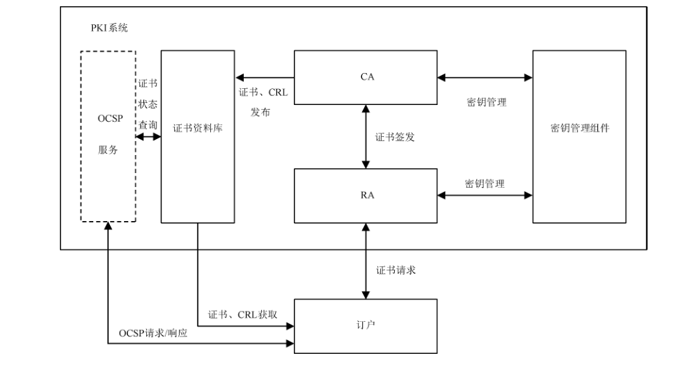

# GB/T 21053-2023 信息安全技术 公钥基础设施 PKI系统安全技术要求

> 来源：[GB/T 21053-2023 国家标准详情](https://openstd.samr.gov.cn/bzgk/std/newGbInfo?hcno=2467B42B0BFB9B8E0F21D59CF33127EA)；封面发布日期：2023-03-17；实施日期：2023-10-01。
> PDF SHA-256：33a77915c3e6c361f2aff8054239fac850928f684e642ca2a07f5af8c0e8f1e0。
> 转写说明：按官方 PDF 全部 22 页的页面图像核对正文、图 1 和表 1；省略封面、目录、页眉、页脚和页码，合并跨页内容。增强级新增要求以粗体表示。正式引用请核对原 PDF。

## 前言

本文件按照 GB/T 1.1—2020《标准化工作导则 第1部分：标准化文件的结构和起草规则》的规定起草。

本文件代替 GB/T 21053—2007《信息安全技术 公钥基础设施 PKI系统安全等级保护技术要求》。与GB/T 21053—2007相比，除结构调整和编辑性改动外，主要技术变化如下：

- a） 将名称修改为《信息安全技术 公钥基础设施 PKI 系统安全技术要求》；

- b） 对范围的内容进行了修改（见第1章，2007年版的第1章）；

- c） 调整修改了规范性引用文件（见第2章，2007年版的第2章）；

- d）增加了“PKI 系统框架与安全级别”一章，对 PKI 系统的基本框架、各组件的功能和本文件规定的 PKI 系统的安全等级进行了描述（见第5章）；

- e） 将安全级别划分由 2007 年版的五个级别修改为基本级和增强级两个级别（见 5.3，2007 年版的 5.1.1、5.2.1、5.3.1、5.4.1、5.5.1）；

- f） 将2007年版5.1~5.5的内容调整至新增的6安全功能要求和7安全保障要求（见第6 章和第7 章，2007年版的5.1~5.5）；

- g） 删除了2007年版中与实际部署相关的内容（物理安全、数据输入输出）；将其中“数据输入输出”中关于原发抗抵赖的要求调整为 6.9“原发抗抵赖”（见6.9,2007年版的5.1.2、5.3.2、5.1.6和 5.3.7）。

请注意本文件的某些内容可能涉及专利。本文件的发布机构不承担识别专利的责任。

本文件由全国信息安全标准化技术委员会（SAC/TC 260）提出并归口。

本文件起草单位：中国科学院软件研究所、中国科学院大学、公安部第三研究所、公安部第一研究所、成都卫士通信息产业股份有限公司、北京信安世纪科技股份有限公司、北京数字认证股份有限公司、长春吉大正元信息技术股份有限公司、格尔软件股份有限公司、中国信息通信研究院、数安时代科技股份有限公司、北京创原天地科技有限公司、北京奇虎科技有限公司、中国电子科技集团公司第十五研究所、北京中电华大电子设计有限责任公司、国网区块链科技（北京）有限公司、华为技术有限公司、郑州信大捷安信息技术股份有限公司、西安西电捷通无线网络通信股份有限公司、天津南大通用数据技术股份有限公司、北京软件产品质量检测检验中心、同智伟业软件股份有限公司、北京百度网讯科技有限公司、亚数信息科技（上海）有限公司、广州市百果园信息技术有限公司、广州市网星信息技术有限公司、中金金融认证中心有限公司。

本文件主要起草人：张立武、张严、王蕊、陈妍、冯登国、顾健、邱梓华、李景华、亢洋、李谦、刘丽敏、张妍、刘玉岭、郑强、张立廷、傅大鹏、汪宗斌、张宝欣、寇春静、刘金华、李健、丁肇伟、王现方、王榕、周蔚林、肖青海、张屹、刘健、黄钰、李达、褚超、周吉祥、杜志强、毛巨辉、孟祥振、焦正坤、韩长青、魏一才、朱晓宇、钟清华、李达。

本文件及其所代替文件的历次版本发布情况为：

- 2007 年首次发布为 GB/T 21053—2007；
- 本次为第一次修订。

## 1 范围

本文件将 PKI 系统的安全级别划分为基本级和增强级，规定了相应安全级别的安全功能要求和安全保障要求。

本文件适用于 PKI系统的研发，PKI 系统产品的测评和采购参照使用。

## 2 规范性引用文件

下列文件中的内容通过文中的规范性引用而构成本文件必不可少的条款。其中，注日期的引用文件，仅该日期对应的版本适用于本文件；不注日期的引用文件，其最新版本（包括所有的修改单）适用于本文件。

- GB/T 20518—2018 信息安全技术 公钥基础设施 数字证书格式

- GB/T 25056—2018 信息安全技术 证书认证系统密码及其相关安全技术规范

- GB/T 25069 信息安全技术 术语

- GM/T 0014—2012 数字证书认证系统密码协议规范

## 3 术语和定义

GB/T 25069界定的以及下列术语和定义适用于本文件。

### 3.1 PKI 系统 PKI system

公钥基础设施中，基于公钥密码体制，实现数字证书的发布、撤销和管理等功能，并为订户（3.4）提供相应服务的信息系统。

### 3.2 拆分知识 split knowledge

将密码密钥拆分成多个密钥组件的如下过程：各单个组件并不共享原始密钥的知识，而能由分开的实体随后将其输入密码模块或从密码模块输出，经组合来重新创建原始密码密钥。

> 注：能请求组件的全部或其某一子集来完成此种组合。

［来源：GB/T 25069—2022,3.120］

### 3.3 系统用户 system user

在 PKI系统中，通过系统操作界面进行特定操作，实现对系统特定功能进行控制的用户。

示例：PKI系统的管理员，审计员和操作员。

［来源：GB/T 25069—2022,3.652，有修改］

### 3.4 订户 subscriber

使用 PKI 系统提供的服务获取数字证书的用户。

### 3.5 系统用户密钥 system user key

系统用户使用的密钥。

示例：用于对 PKI 系统用户进行身份鉴别的密钥。

### 3.6 系统部件密钥 system component key

PKI 系统中各部件使用的密钥。

示例：CA签名密钥。

### 3.7 系统密钥 system key

PKI 系统的系统部件密钥和系统用户密钥的统称。

### 3.8 订户密钥 subscriber key

订户使用的密钥。

示例：PKI系统发放的用户证书的证书主体密钥。

## 4 缩略语

下列缩略语适用于本文件。

CA：证书认证中心（Certification Authority）

CRL：证书撤销列表（Certificate Revocation List）

OCSP：在线证书状态协议（Online Certificate Status Protocol）

PKI：公钥基础设施（Public Key Infrastructure）

RA：证书注册中心（Registration Authority）

## 5 PKI 系统框架与安全级别

### 5.1 典型框架

PKI 系统的典型框架如图1所示，主要包括CA、RA、证书资料库、密钥管理和 OCSP 服务等组件。

各组件的主要功能包括：

- RA 与订户进行交互，接收证书请求，并将证书请求发送给 CA。当 CA 完成证书签发后，RA 将签发后的订户证书发送给订户；

- CA 根据证书请求签发对应的证书，为已撤销的证书发布 CRL，然后将证书和 CRL 存储至证书资料库；

- 证书资料库组件提供证书和 CRL 的存储和查询等服务；

- 密钥管理组件提供 PKI 系统中各类密钥的生成、存储、分发、导入导出、使用、备份、恢复、归档与销毁等管理功能；

- OCSP 服务组件是可选组件，如果 PKI 系统支持 OCSP 功能，则通过该组件，实现 OCSP 请求的接收和响应。

> 注：关于 PKI 系统各组件功能和事务的详细描述见 GB/T 19771—2005的第5章。

### 5.2 安全功能

PKI 系统应满足的安全功能要求主要包括密钥管理、模板管理、证书管理以及 PKI 系统自身安全相关功能。其中，密钥管理是支撑 PKI 系统证书安全和密码应用安全的必要功能，模板管理和证书管理是 PKI 系统提供的主要安全功能，身份鉴别、访问控制、安全审计、原发抗抵赖、备份和恢复、启动和运行监测、组件间通信安全等是保证 PKI 系统自身安全的必要功能。各安全功能的主要内容和涉及的组件如下：

- 密钥管理（6.1～6.3）：通过密钥管理组件实现各项密钥管理功能，对 PKI 系统的订户密钥以及各组件中所使用的系统密钥的生成、存储、分发、导入导出、使用、备份、恢复、归档与销毁等进行管理；

- 模板管理（6.4）：通过 CA 和 RA 实现模板管理，预先定义证书、CRL 和 OCSP 响应中字段和扩展可能的值；

- 证书管理（6.5）：通过 CA 和 RA 实现证书、CRL 的管理功能；

- 身份鉴别（6.6）和访问控制（6.7）：通过实现身份鉴别和访问控制功能，对各组件的登录和操作进行鉴别和访问控制，防止未授权用户和操作；

- 安全审计（6.8）：通过实现审计功能，对各组件的关键安全事件生成审计记录，为责任追踪与认定提供日志记录支持；

- 原发抗抵赖（6.9）：通过原发抗抵赖证据生成和验证功能，对安全相关信息产生原发抗抵赖证据，在发生争议时提供不可否认性证据；

- 备份和恢复（6.10）：通过备份和恢复功能，在发生系统失败或者其他严重错误的情况下通过调用恢复功能，从备份数据中恢复各组件的正常运行；

- 启动和运行监测（6.11）：通过启动和运行监测功能，在初始化、启动和系统运行期间对各组件和重要配置文件的状态进行监测，当发现异常时及时告警；

- 组件间通信安全（6.12）：通过密码技术保障 PKI 系统各组件间通信的保密性和完整性。

### 5.3 安全级别划分

本文件规定的PKI 系统包括基本级和增强级两个安全级别，安全级别划分具体依据安全功能的强弱以及安全保障要求的高低。

与基本级内容相比，增强级在基本级基础上增加的内容在正文中采用“宋体加粗”表示。

## 6 安全功能要求

### 6.1 密钥管理通用要求

PKI 系统的密钥管理涉及系统密钥和订户密钥，其中系统密钥又分为由系统用户使用的系统用户密钥（例如：系统管理员密钥）和由系统各部件使用的系统部件密钥（例如：CA 签名密钥），系统密钥管理的安全要求见6.2，订户密钥管理的安全要求见 6.3。

PKI 系统的密钥管理通用安全要求如下：

- a） 应通过密钥管理组件实现密钥管理功能，对系统密钥和订户密钥的生成、存储、分发、导入导出、使用、备份、恢复、归档与销毁等进行管理；

- b） 密钥管理过程使用的密码产品应具备商用密码产品认证证书；

- c） 应支持密钥有效期设置功能，并在生成系统密钥和订户密钥时根据策略为密钥设置有效期。

### 6.2 系统密钥管理

#### 6.2.1 密钥生成

PKI 系统的系统密钥生成安全要求如下：

- a） 系统密钥应通过符合6.1 b）要求的密钥管理产品生成或在具备商用密码产品认证证书的密码模块中生成；

- b） **当密钥生成过程中使用密码模块时，上述密码模块应具备密码模块安全二级及以上的密码产品认证证书；**

- c） 应支持密钥生成操作的权限验证功能，在密钥生成时检查用户角色，防止未授权操作；

- d） **应确保只有当多于一个管理员角色的用户同时进行操作时，才能执行CA 签名密钥生成过程；**

- e） PKI系统的文档中应规定系统密钥生成方法。

#### 6.2.2 密钥存储

PKI 系统的系统密钥存储安全要求如下。

- a） 系统密钥的私钥和秘密密钥部分应加密后存储。

- b） **系统用户密钥的私钥和秘密密钥部分应通过符合 6.1b）要求的密钥管理产品存储、存储于密码模块中或使用存储于密码模块中的密钥加密后存储，PKI系统部件密钥的私钥和秘密密钥部分通过符合6.1b）要求的密钥管理产品实现密钥存储或存储于密码模块中。上述密码模块应具备密码模块安全二级及以上的密码产品认证证书。**

- c） **CA 签名私钥宜通过符合6.1b）要求的密钥管理产品采用拆分知识方法或其他分布存储方案存储，或采用拆分知识方法或其他分布存储方案存储于具备密码模块安全三级及以上密码产品认证证书的密码产品中。当采用分布存储方法时，各组件应物理分散存放。**

- d） PKI 系统的文档中应规定系统密钥存储方法和密钥泄露时的应急处置措施。

#### 6.2.3 密钥传送与分发

PKI 系统的系统密钥传送与分发安全要求如下。

- a） 系统部件密钥私钥和秘密密钥部分的传送与分发应以加密形式直接发送到 PKI 系统部件中，并有足够的机制确保密钥的安全性，包括：保密性和完整性等。

- b） 系统用户密钥的私钥和秘密密钥部分传送与分发应以加密形式直接发送到系统用户证书载体中，并有足够的机制确保密钥的安全性，包括：保密性和完整性等。

- c） CA 签名公钥的分发方法应切实可行，如提供根证书和CA证书下载、与终端证书一起下载等。公钥分发还应保证CA 公钥的完整性，例如：使用安全信道传递、手工传递等方法分发。

- d） **对于增强级的 PKI 系统，6.2.3a）和b）过程所使用的加密程序应通过符合6.1b）要求的密钥管理产品或使用具备密码模块安全二级及以上密码产品认证证书的密码模块实现。**

#### 6.2.4 密钥导入导出

密钥被导出到 PKI 系统之外可能基于以下的原因：密钥备份、复制，以及将 PKI 系统部件产生的系统用户密钥传送到系统用户手中。在系统密钥导入导出方面，PKI 系统的安全要求如下：

- a） PKI系统的文档中应说明是否支持系统密钥导入导出，如果支持，应规定密钥导入导出方法；

- b）密钥导入或导出 PKI 系统时，应采取有效的措施，保证密钥导入与导出的安全，确保各类私钥和秘密密钥不以明文形式导出 PKI 系统；

- c） **在导入和导出时，PKI系统密钥的私钥和秘密密钥部分应通过符合6.1b）要求的密钥管理产品或使用具备密码模块安全二级及以上密码产品认证证书的密码模块加密保护。**

#### 6.2.5 密钥使用

PKI 系统应支持密钥使用权限管理，将 PKI 系统的系统密钥与正确实体相关联，并赋予相应的权限。

#### 6.2.6 密钥备份

PKI 系统的系统密钥备份安全要求如下：

- a） PKI系统应支持对CA签名密钥的备份功能；

- b） **增强级的PKI系统应支持系统密钥备份功能，对PKI 系统部件密钥和系统用户密钥进行备份；**

- c） **备份的系统密钥的私钥和秘密密钥部分应通过符合6.1b）要求的密钥管理产品存储或存储于具备密码模块安全二级及以上密码产品认证证书的密码模块中；**

- d） **对于CA签名私钥的备份，应对存放部件进行访问控制，只有特定权限的人员才能访问私钥信息存放部件；**

- e） **增强级的 PKI系统的文档中应规定系统密钥备份方法。**

#### 6.2.7 密钥恢复

PKI系统的系统密钥恢复安全要求如下：

- a） PKI系统应支持对CA签名密钥的恢复功能，以便在必要时对CA 签名密钥进行恢复，保证系统的连续性；

- b）**增强级的PKI 系统应支持系统密钥恢复功能，在必要时对备份和归档的密钥进行恢复；**

- c） 对于作为备份存储的密钥，应确保密钥所有者以外的实体不能进行密钥恢复；

- d） **对于作为归档存储的密钥，应在恢复密钥前验证申请者的身份，确保其具有相应的权限；**

- e） 在密钥恢复过程中应确保私钥和秘密密钥以密文形式存在，且无法被未授权地泄露或修改；

- f） **应确保CA签名私钥恢复需要多个被授权的人员同时使用存有密钥信息的部件进行，并保证密钥恢复环境的安全可信，恢复过程不应危及密钥信息的安全性，不应暴露签名私钥，对于恢复前采用分布式方案存储的CA 签名私钥，恢复后的私钥应仍然采用分布式方案进行存储；**

- g） 对于支持密钥恢复的系统密钥，PKI 系统的文档中应规定相应的恢复方法。

#### 6.2.8 密钥归档

##### 6.2.8.1 私钥归档

PKI 系统的系统密钥私钥归档安全要求如下：

- a） PKI 系统宜支持系统密钥私钥的归档功能，在进行归档时，应对归档的密钥采取有效的安全保护措施，防止私钥泄露；

- b） 进行归档时，PKI 系统在私钥归档中应区分用于签名的私钥和用于解密数据的私钥，并确保签名私钥不被归档，仅用于解密数据的私钥可被归档；

  > 注：私钥归档与备份类似，同样保存一份私钥的拷贝，但用于不同的目的。备份用于保证系统运作的连续性，以防意外事故造成的私钥损坏、丢失、删除等。而归档用于长期的、将来为解密历史数据提供服务。

- c） **增强级的PKI 系统应支持系统密钥私钥的归档功能，并在文档中规定私钥归档方法。**

##### 6.2.8.2 公钥归档

PKI 系统的系统密钥公钥归档安全要求如下：

- a） **PKI 系统应确保CA、RA及其他系统组件签名密钥的公钥能够被归档，以支持在数字证书从目录中移除后验证数字签名；**

- b） **增强级的PKI 系统应支持系统密钥的公钥归档功能，并在文档中规定公钥归档方法。**

#### 6.2.9 密钥销毁

PKI 系统的系统密钥销毁要求如下：

- a） **PKI 系统应确保系统密钥的销毁由具有特定权限的实体执行，并保证销毁过程是不可逆的，提供的销毁程序可包括：用随机数据覆盖存储密钥的媒介、存储体，物理销毁存储密钥的媒介等；**

- b） **CA 签名私钥的密钥销毁应确保多个管理员同时执行销毁操作时才能执行，销毁过程应包含多道销毁程序；**

- c） PKI 系统应支持系统密钥销毁功能，并在 PKI 系统文档中规定系统密钥销毁方法。

#### 6.2.10 密钥更新

PKI 系统的系统密钥更新要求如下：

- a） PKI 系统应支持密钥更新功能，当CA签名密钥过期，或CA 签名私钥的安全性受到威胁时，对CA 签名密钥和证书进行更新；

- b） **更新时，CA 签名密钥的产生应符合6.2.1中CA签名密钥生成的规定；**

- c） **更新后的CA 签名公钥分发应符合6.2.3中CA 公钥分发的规定；**

- d） **在密钥更新过程中，如果旧的CA公钥需要归档，应符合6.2.8中CA 签名密钥归档的规定；**

- e）**旧的CA 签名私钥的销毁应符合6.2.9中CA 签名密钥销毁的规定；**

- f） **PKI 系统应在更新CA 签名密钥的过程中采取安全措施保证 PKI 系统服务的安全性和连续性，并保护 CA签名密钥的安全；**

- g） **PKI 系统的文档中，应说明CA 签名密钥的更新方法，并确保CA 签名密钥更新时，严格按照文档中规定的方法操作。**

### 6.3 订户密钥管理

#### 6.3.1 订户密钥类型

PKI 系统的订户密钥包括订户签名密钥对和用于实现保密性保护的密钥对。

#### 6.3.2 密钥生成

PKI 系统的订户密钥生成安全要求如下：

- a） **PKI 系统应确保订户签名密钥对由其自己生成；**

- b） **PKI 系统宜向用户提供订户密钥生成机制，使订户可采用达到具备密码模块安全二级及以上密码产品认证证书的密码模块生成订户密钥；**

- c） PKI系统应支持订户密钥生成功能，PKI系统的文档中应规定订户密钥生成方法。

#### 6.3.3 密钥存储

PKI 系统的订户密钥存储安全要求如下：

- a） **PKI 系统应确保订户私钥存储的保密性，应通过符合6.1b）要求的密钥管理产品存储、存储于密码模块中或使用存储于密码模块中的密钥加密后存储，上述密码模块应具备密码模块安全二级及以上的密码产品认证证书；**

- b） PKI 系统应支持订户密钥存储功能，PKI 系统的文档中应规定订户密钥存储方法。

#### 6.3.4 密钥传送与分发

PKI 系统的订户密钥传送与分发安全要求如下：

- a） 如果订户自己生成密钥对，订户将公钥传送给CA是证书注册过程的一部分，PKI 系统应实现终端密钥传送与分发功能来接收订户向 CA提交的密钥，并确保公钥提交过程中的完整性，例如：使用证书载体等方法进行面对面传送；

- b） 如果订户委托CA生成密钥对，则不需要签发前的订户公钥传送过程，PKI 系统应实现订户密钥传送与分发功能支持CA 向订户的密钥安全分发，并确保CA 向用户传送与分发密钥过程中私钥的保密性；

- c） PKI 系统的文档中应规定用户密钥传送方法。

#### 6.3.5 密钥导入导出

密钥被导出到 PKI系统之外可能基于以下的原因：密钥备份、复制，以及将 PKI 系统部件产生的密钥传送到用户手中。在订户密钥导入导出方面，PKI 系统的安全要求如下：

- a） PKI 系统的文档中应说明是否支持订户密钥导入导出，如果支持，应规定密钥导入导出方法；

- b） 密钥导入或导出 PKI 系统时，应采取有效的措施，保证密钥导入与导出的安全；

- c） PKI 系统应确保订户私钥不以明文形式导入导出 PKI系统。

#### 6.3.6 密钥使用

PKI系统应支持密钥使用权限管理，将订户密钥与正确实体相关联，并赋予相应的权限。

#### 6.3.7 密钥备份

PKI 系统的订户密钥备份安全要求如下：

- a） **增强级的PKI 系统的文档中应规定订户密钥备份方法；**

- b） **订户签名私钥应由订户自行备份，订户用于实现保密性保护的密钥可由PKI系统提供备份服务或由订户自行备份；**

- c） **如果订户用于实现保密性保护的密钥由 PKI 系统备份，PKI 系统应支持订户密钥备份功能，确保订户密钥备份时私钥的保密性，应通过符合 6.1 b）要求的密钥管理产品存储、存储于密码模块中或使用存储于密码模块中的密钥加密后存储，上述密码模块应具备密码模块安全二级及以上的密码产品认证证书。**

#### 6.3.8 密钥恢复

PKI 系统的订户密钥恢复安全要求如下：

- a） **如果 PKI 系统支持订户密钥备份，PKI 系统应提供订户密钥恢复功能，实现对由 PKI 系统备份的订户加密密钥的恢复；**

- b） **应保证订户加密密钥恢复过程中的密钥完整性，恢复过程中私钥应以加密形式存在；**

- c） **PKI 系统的文档中应规定订户密钥恢复方法。**

#### 6.3.9 密钥归档

##### 6.3.9.1 私钥归档

PKI 系统的订户密钥私钥归档安全要求如下：

- a） **增强级的PKI 系统应支持订户密钥的私钥归档功能，对需要被归档的私钥进行归档；**

- b） **PKI 系统在私钥归档中应区分用于签名的私钥和用于解密数据的私钥，并确保签名私钥不被归档，仅用于解密数据的私钥可被归档；**

  > 注：私钥归档与备份类似，同样保存一份私钥的拷贝，但用于不同的目的。备份用于保证系统运作的连续性，以防意外事故造成的私钥损坏、丢失、删除等。而归档用于长期的、将来为解密历史数据提供服务。

- c） **增强级的PKI 系统的文档中应规定私钥归档方法。**

##### 6.3.9.2 公钥归档

PKI 系统的订户密钥公钥归档安全要求如下：

- a）**增强级的PKI 系统应确保订户的公钥能够被归档，以支持在数字证书从目录中移除后验证数字签名；**

- b） **增强级的PKI系统支持订户密钥的公钥归档功能，并在文档中规定公钥归档方法。**

#### 6.3.10 密钥销毁

PKI 系统的订户密钥销毁要求如下：

- a） **当由PKI系统管理的订户密钥被销毁时，应确保订户密钥的销毁过程是不可逆的，提供的销毁程序可包括：用随机数据覆盖存储密钥的媒介、存储体，物理销毁存储密钥的媒介等；**

- b） PKI 系统应支持订户密钥销毁功能，并在 PKI系统文档中规定订户密钥销毁方法。

#### 6.3.11 密钥更新

订户密钥更新指对过期或者私钥的安全性受到威胁的订户密钥进行更新。PKI系统的订户密钥更新安全要求如下：

- a） **新的订户密钥的产生应符合6.3.2中订户密钥生成的规定；**

- b） **新的订户密钥的分发应符合 6.3.4中订户公钥分发的规定；**

- c） **在密钥更新过程中，如果旧的用户公钥需要归档，应符合6.3.9中订户密钥归档的规定；**

- d） **旧的用户密钥的销毁应符合6.3.10中订户密钥销毁的规定；**

- e） PKI 系统应支持订户密钥的更新，在更新过程中应采取安全措施保证订户密钥的安全性；

- f）**增强级的PKI系统的文档中应说明订户密钥的更新方法，并确保严格按照文档中规定的方法操作。**

### 6.4 模板管理

#### 6.4.1 概述

在PKI 系统中，可预先根据应用场景定义证书、CRL 和OCSP 响应中字段和扩展可能的值，包含这些信息的数据称为模板。

#### 6.4.2 证书模板管理

PKI 系统的证书模板管理安全要求如下：

- a） PKI 系统应支持证书模板管理功能，确保管理员可通过证书模板预先定义证书中的字段和扩展可能的值，并确保字段和扩展与 GB/T 20518—2018 的 5.2 相一致；

- b） PKI 系统应确保发布的证书与证书模板中的描述一致；

- c） PKI 系统应确保发布证书前，管理员通过证书模板管理操作为以下字段和扩展指定了可能的值：

  - 证书持有人的标识符；
  - 主体的算法标识符；

  - 证书发布者的标识符；

  - 证书的有效期；

  - 证书序列号；

  - 密钥用法（keyUsage）；

  - 基本限制（basicConstraints）；

  - 证书策略（certificatePolicies）。

#### 6.4.3 证书撤销列表模板管理

支持通过CRL 进行证书撤销的 PKI 系统的 CRL模板管理安全要求如下。

- a） PKI 系统应支持证书撤销列表模板管理功能，确保管理员可通过证书撤销列表模板定义 CRL 中字段和扩展中可接受的值，并确保字段和扩展应与 GB/T 20518—2018 的 5.3 相一致，CRL 模板中可包含对以下内容可接受值的定义：

  - CRL 可能或者应包括的扩展和每一扩展；
  - CRL 的发布者；

  - CRL 的下次更新日期。

- b） PKI 系统发布 CRL 时，应保证发布的CRL 与通过模板管理功能预先定义的内容相一致。

- c） PKI 系统应确保发布 CRL 前，系统管理员通过 CRL 模板管理操作为以下字段和扩展指定了可能的值：

  - 颁发者（issuer）；
  - 颁发者替换名称（issuerAltName）；

  - 下次更新日期（NextUpdate）。

#### 6.4.4 在线证书状态协议模板管理

支持通过 OCSP 进行证书撤销的 PKI 系统的 OCSP模板管理安全要求如下：

- a） 应支持 OCSP模板管理功能，确保管理员可通过OCSP 模板定义OCSP 响应中可接受的值；

- b） PKI 系统发布 OCSP 响应时，应确保 OCSP 响应与模板一致；

- c） PKI 系统应确保发布 OCSP 响应前，系统管理员通过 OCSP 模板管理操作为以下字段和扩展指定了可能的值：

  - 回复类型（responseType）；
  - 若 PKI 系统允许使用基本响应类型的 OCSP 响应，则 PKI 系统管理员应预先为回复数据（ResponseData）中 ResponderID 数据项指定可接受的值。

### 6.5 证书管理

#### 6.5.1 通用要求

PKI系统应通过CA、RA实现证书注册、证书生成和证书撤销等证书管理功能。并在证书注册、证书生成和证书撤销方面，满足 6.5.2~6.5.6 中的安全要求。

#### 6.5.2 证书注册

PKI 系统应支持证书注册功能，对输入证书字段和扩展中的数据进行校验和批准，可采用的校验和批准方式包括：

- 由操作员人工进行数据校验和批准；
- 自动检查和批准数据；

- 由 PKI 系统自动生成符合要求的字段或扩展的值；

- 由预先定义的证书模板中获得数据。

#### 6.5.3 证书生成

PKI 系统的证书生成安全要求如下：

- a） PKI 系统应确保证书生成功能所签发的公钥证书的格式符合 GB/T 20518—2018中的规定，任何证书所包含的字段或扩展应被 PKI 系统根据GB/T 20518—2018 生成或由颁发机构验证以保证其一致性；

- b） 如果待签发证书的公私钥对不是由 PKI 系统所产生的，PKI系统应通过验证确保证书主体拥有与证书中包含的公钥相对应的私钥。

#### 6.5.4 证书撤销

##### 6.5.4.1 采用证书撤销列表的证书撤销

若 PKI 系统采用CRL方式实现证书撤销，则应对发布的CRL进行验证，验证CRL的所有必要项的值是否符合 GB/T 20518—2018 中5.3的规定。

##### 6.5.4.2 采用 OCSP 的证书撤销

若 PKI 系统采用 OCSP 方式实现证书撤销，则应支持 OCSP 响应功能，并验证 OCSP 响应所有必要项的值是否符合 GM/T 0014—2012 中 5.6 的规定。

#### 6.5.5 证书更新

PKI 系统的证书更新安全要求如下：

- a） PKI 系统应支持证书更新功能，实现对已发布证书有效期的更新，在进行证书更新时，可对证书中包含的密钥进行同时更新，密钥更新的安全要求见 6.2.10和 6.3.10；

- b） PKI 系统应在更新CA证书的过程中采取安全措施保证 PKI 系统服务的安全性和连续性；

- c） PKI 系统应在发布更新后证书的过程中并保护证书的安全，包括：防止对证书等发起替换攻击等。

#### 6.5.6 证书变更

PKI 系统的证书变更安全要求如下：

- a） PKI 系统应支持证书变更功能，实现对已发布证书中信息的变更；

- b） PKI系统应在发布变更后证书的过程中并保护证书的安全，包括：防止对证书等发起替换攻击等。

### 6.6 身份鉴别

#### 6.6.1 用户身份鉴别

PKI 系统的用户身份鉴别安全要求如下。

- a） PKI 系统应支持用户身份鉴别功能，对系统用户和订户进行身份鉴别。

- b） PKI 系统应预先设定由 PKI 系统代表用户执行的、与安全功能无关的动作，并确保在用户身份被鉴别之前，可执行这些预设动作，例如：

  - 1） 响应查询公开信息（例如：在线证书状态查询等）；

  - 2） 接收用户发来的数据，但直到系统用户批准之后才处理。

- c） PKI 系统应定义所支持的用户鉴别机制的类型。

- d） 当进行用户鉴别时，PKI系统应避免泄露用户的鉴别数据。

#### 6.6.2 多因素身份鉴别

PKI 系统的多因素身份鉴别安全要求如下：

- a） **增强级的PKI系统应实现两种或以上的鉴别机制，并支持对不同身份的用户使用不同的鉴别机制，以及对同一用户同时使用多种鉴别过程进行多因素鉴别；**

- b） **当对单个用户同时使用多种鉴别过程进行鉴别时，所使用的鉴别机制中应包含基于数字证书的鉴别机制。**

#### 6.6.3 鉴别失败处理

PKI 系统的鉴别失败处理安全要求如下：

- a） PKI 系统应支持鉴别失败次数检测功能，当不成功鉴别尝试次数达到或超过了定义界限等情况发生时，能够检测并记录；

- b） 应支持鉴别失败检测参数配置功能，允许管理员对相关参数进行配置，包括：失败的鉴别次数和失效时间值等；

- c） **增强级的PKI 系统应支持鉴别失败处理功能，当检测到用户自最近一次鉴别成功以来不成功的鉴别尝试的次数达到或超过了定义的界限时，PKI 系统应采取应对措施以防止口令猜测等攻击，可采取的应对措施包括：在后续一段时间内限制用户继续进行鉴别尝试等等，并保证至少有一个用户账号不应失效，以防止拒绝服务攻击。**

#### 6.6.4 口令管理

PKI 系统的口令管理安全要求如下：

- a） PKI 系统宜通过强度检查等方式，确保 PKI 系统中使用口令的安全性，避免弱口令的使用；

- b） **当用来进行用户身份鉴别的口令由用户自己产生时，PKI系统应对可接受的口令的质量作出要求，并实现口令强度检查功能；**

- c） **当用来进行用户身份鉴别的口令由PKI系统产生时，PKI 系统应确保生成符合强度要求的口令，并确保生成的口令满足以下要求：口令长度应为8个字节以上，应是字母、数字和特殊字符组成的混合体，口令不得采用有特殊意义的（如姓名、生日、电话号码等）数字和词组；**

- d） **增强级的PKI 系统应支持口令使用期限管理功能，实现口令使用期限定义和定期更换。**

### 6.7 访问控制

#### 6.7.1 用户属性定义

PKI 系统应支持安全属性维护功能，实现对用户安全属性的维护。安全属性包括但不限于身份、组、角色、许可、安全和完整性等级。

#### 6.7.2 角色与责任

PKI 系统的角色与责任安全要求如下。

- a） PKI 系统应提供 PKI 系统的管理员和操作员的角色定义。各角色的主要职责包括：

  - 1） 管理员：安装、配置、维护系统；建立和管理用户账户；生成部件密钥；执行系统的备份和恢复；查看和维护审计日志（系统中没有定义专门的审计员角色时）；

  - 2） 操作员：签发和撤销证书。

- b）**增强级的 PKI 系统应提供 PKI系统的审计员的角色定义，并将与审计相关的职责分配给审计员，包括：查看和维护审计日志。**

- c） PKI 系统应提供主体与角色关联功能，具备使主体与角色相关联的能力，并通过对角色的管理进行相关限制，确保单个身份不应同时具备多个角色的权限，单个用户不应同时拥有多个角色。

#### 6.7.3 系统用户访问控制

PKI系统的系统用户访问控制安全要求如下：

- a） PKI 系统应提供系统用户注册、注销功能，为用户分配或者使用系统特权时，应对该操作进行严格的限制和控制；

- b）**增强级的 PKI系统应具备对系统用户开展定期审核的能力，定期审核系统用户的权限分配是否适当，包括：角色和属性分配是否合理、单个身份不同时具备多个角色的权限、单个用户不同时拥有多个角色等等，审核可自动执行或告知管理员手动执行；**

- c） PKI 系统应提供系统用户访问控制功能；

- d） **增强级的 PKI 系统应定义系统关键操作，包括：CA 私钥和关键部件密钥的生成、备份、更新、导入导出、恢复、销毁等，并确保当且仅当多个具有相应权限的用户同时通过身份鉴别后，才能执行被定义为系统关键操作的操作；**

- e） PKI系统应在文档中提供访问控制的相关文档，并包含如下几个方面内容：

  - 1） 角色及其相应的访问权限；

  - 2） 标识与鉴别系统用户的过程；

  - 3） 角色的职能分割。

### 6.8 安全审计

#### 6.8.1 概述

PKI系统的安全审计功能，包括审计数据产生、审计查阅、选择性审计查阅等。

#### 6.8.2 审计数据产生

PKI 系统的审计数据产生安全要求如下。

- a） 审计功能的启动和结束以及表1中列出的事件应产生审计记录；

- b）**增强级的 PKI 系统应依据 GB/T 25056—2018中 8.2.6，对功能模块调用和管理员、操作员的操作产生审计记录；**

- c） 对于需产生审计记录的每个事件，审计数据产生功能生成的审计记录应包括：操作员姓名、操作项目、操作起始时间、操作终止时间、证书序列号、操作结果事件，以及表1中该类型事件对应行中需记录的信息一栏中的内容；

**表1 应产生审计记录的可审计事件**

| 功能 | 事件 | 需记录的信息 |
| --- | --- | --- |
| 安全审计 | 所有对审计变量（如：时间间隔、审计事件的类型）的改变 |  |
| 安全审计 | 所有删除审计记录的操作 |  |
| 安全审计 | 对审计日志签名 | 审计日志记录中应保存数字签名和消息鉴别码等完整性保护信息 |
| 本地数据输入 | 所有的安全相关数据输入系统 | 若输入的数据与其他数据相关，应验证用户访问相关数据的权限 |
| 远程数据输入 | 所有被系统所接受的安全相关信息 |  |
| 数据输出 | 所有对关键的或安全相关的信息进行输出的请求 |  |
| 密钥生成 | 密钥生成请求（用作一次性会话密钥的对称密钥生成除外） | 审计日志记录中应保存非对称密钥对的公钥部分 |
| 私钥载入 | 部件私钥的载入 |  |
| 私钥的存储 | 对为密钥恢复而保存的证书主体私钥的读取 |  |
| 可信公钥的输入、删除和存储 | 所有对于可信公钥的改变（如：添加、删除） | 应包括公钥和与公钥相关的信息 |
| 私钥和对称密钥的输出 | 私钥和对称密钥（包括一次性会话密钥）的输出 |  |
| 证书注册 | 所有的证书注册请求 | 若成功，在日志记录中保存证书的复件；若拒绝，在日志记录中保存原因 |
| 证书状态变更的审批 | 所有更改证书状态的请求 | 在日志记录中保存请求结果（成功或失败） |
| PKI 系统部件的配置 | 所有与安全相关的对于 PKI 系统安全功能的配置 |  |
| 证书模板管理 | 所有的对于证书模板的更改 | 保存对模板更改的内容 |
| 证书撤销列表模板管理 | 所有的对于 CRL 模板的更改 | 保存对模板更改的内容 |
| 在线证书状态协议模板管理 | 所有的对于 OCSP 模板的更改 | 保存对模板更改的内容 |

- d） 应确保生成的审计记录中不出现明文形式的私钥、对称密钥以及其他安全相关的参数；

- e） 在进行审计时，PKI 系统应能将可审计事件与发起该事件的用户身份相关联。

#### 6.8.3 审计查阅

审计查阅功能应支持为系统用户提供查看所有日志信息的能力，并以适于阅读和解释的方式向审计员提供日志信息。

#### 6.8.4 选择性审计查阅

选择性审计查阅功能应支持使得系统用户在查阅审计日志时可根据属性选择或排除审计事件集中的可审计事件，包括：用户标识、事件类型、主体标识、客体标识等。

#### 6.8.5 审计事件存储

PKI 系统的审计事件存储要求如下：

- a） 安全审计功能应在审计事件存储过程中防止对审计记录的非授权修改，并可检测对审计记录的修改；

- b） 当审计日志存储已满时，安全审计功能应能够阻止除由管理员发起以外的所有审计事件的发生，以防止审计数据丢失。

#### 6.8.6 审计日志完整性保护

PKI 系统的审计日志完整性安全要求如下：

- a） **增强级的PKI系统应采用密码技术的完整性保护功能，定期对审计日志记录进行完整性保护；**

- b） **进行完整性保护时，保护对象应包括从上次运算后加入的所有审计日志条目以及上次运算的结果；**

- c） **进行完整性保护运算的时间周期应是可配置的；**

- d） **进行完整性保护运算的事件应写入审计日志中，审计日志内容应包含完整性保护运算结果。**

### 6.9 原发抗抵赖

PKI 系统的原发抗抵赖安全要求如下：

- a） **增强级的 PKI 系统应提供原发抗抵赖证据生成功能，对证书状态信息和其他安全相关信息强制产生原发抗抵赖证据，以实现采用密码技术保证的不可否认性，PKI 系统应能使信息原发者的身份等属性与证据使用信息的安全相关部分相关联；**

- b）**增强级的PKI系统应能为所有安全相关的信息提供验证信息原发证据的能力，按正规的程序来进行验证。**

### 6.10 备份和恢复

PKI 系统的备份和恢复安全要求如下：

- a） PKI 系统应支持备份和恢复功能，执行备份的频率取决于系统或者组件的重要性，在系统备份数据中应保存足够的信息使系统或组件能够重建备份时的系统状态，PKI 系统必要时可调用恢复功能，从系统失败或者其他严重错误的情况下重建系统；

- b） **增强级的PKI 系统应通过数字签名等机制防止备份数据受到未授权的修改，备份数据中的关键安全参数应以加密形式存储；**

- c） **PKI 系统的备份方案应能在不中断数据库使用的前提下实施；**

- d） **PKI 系统应提供人工和自动备份模式；**

- e） **PKI 系统应提供实时和定期备份模式；**

- f） **PKI 系统应提供增量备份功能；**

- g） **PKI 系统的备份应提供归档检索与恢复功能；**

- h） **PKI 系统应支持通过在线备份和恢复等方式，在系统失败或者其他严重错误的情况下保证PKI 系统服务的连续性。**

### 6.11 启动和运行监测

PKI 系统的启动和运行监测安全要求如下。

- a） PKI 系统应具备一定的启动监测功能。在初始化、启动期间对设备、组件和重要配置文件等进行监测，当发现异常时能够及时告警。

- b） PKI 系统应具备一定的运行监测功能。在系统运行期间对安全功能的运行情况进行监测，当出现异常时能够及时告警。

### 6.12 组件间通信安全

PKI 系统的组件间通信安全要求如下：

- a） PKI 系统应采用密码技术保证 PKI 系统各组件间通信的保密性和完整性；

- b） **应采用具备商用密码产品认证证书的密码产品或使用具备密码模块安全二级及以上密码产品认证证书的密码模块实现组件间通信过程中的密码运算。**

## 7 安全保障要求

### 7.1 开发

#### 7.1.1 安全架构

开发者应提供产品安全功能的安全架构描述，安全架构描述应与产品设计文档中对安全功能的描述范围相一致。

#### 7.1.2 功能规格说明

开发者应提供完备的功能规格说明，功能规格说明应满足以下要求：

- a） 清晰描述第6章中定义的安全功能；

- b） 提供组件和安全功能接口间的对应关系；

- c） 通过实现组件描述安全功能，标识和描述实现组件的目的、相关接口及返回值等，并描述实现组件间的相互作用及调用的接口；

- d） 提供实现组件和子系统间的对应关系。

#### 7.1.3 产品设计

开发者应提供产品设计文档，产品设计文档应满足以下要求：

- a） 通过子系统描述产品结构，标识和描述产品安全功能的所有子系统，并描述子系统间的相互作用；

- b） 提供子系统和安全功能接口间的对应关系；

- c） **通过实现组件描述安全功能，标识和描述实现组件的目的、相关接口及返回值等，并描述实现组件间的相互作用及调用的接口；**

- d） **提供实现组件和子系统间的对应关系。**

#### 7.1.4 实现表示

**开发者应提供产品安全功能的实现表示，实现表示应满足以下要求：**

- a） **详细定义产品安全功能，包括软件代码、设计数据等实例；**

- b） **提供实现表示与产品设计描述间的对应关系。**

### 7.2 指导性文档

#### 7.2.1 操作用户指南

开发者应提供明确和合理的操作用户指南，对每一种用户角色的描述应满足以下要求：

- a） 描述用户能访问的功能和特权，包含适当的警示信息；

- b） 描述产品安全功能及接口的用户操作方法，包括配置参数的安全值等；

- c） 标识和描述产品运行的所有可能状态，包括操作导致的失败或者操作性错误；

- d） 描述实现产品安全目的必需执行的安全策略。

#### 7.2.2 准备程序

开发者应提供产品及其准备程序，准备程序描述应满足以下要求：

- a） 描述与开发者交付程序相一致的安全接收所交付产品必需的所有步骤；

- b）描述安全安装产品及其运行环境必须的所有步骤。

### 7.3 生命周期支持

#### 7.3.1 配置管理能力

开发者的配置管理能力应满足以下要求：

- a） 为产品的不同版本提供唯一的标识；

- b） 使用配置管理系统对组成产品的所有配置项进行维护，并进行唯一标识；

- c） 提供配置管理文档，配置管理文档描述用于唯一标识配置项的方法；

- d） **配置管理系统提供自动方式来支持产品的生成，通过自动化措施确保配置项仅接受授权变更；**

- e） **配置管理文档包括一个配置管理计划，描述用来接受修改过的或新建的作为产品组成部分的配置项的程序。配置管理计划描述应描述如何使用配置管理系统开发产品，开发者实施的配置管理应与配置管理计划相一致。**

#### 7.3.2 配置管理范围

开发者应提供产品配置项列表，并说明配置项的开发者。配置项列表应包含以下内容：

- a） 产品及其组成部分、安全保障要求的评估证据；

- b） **实现表示、安全缺陷报告及其解决状态。**

#### 7.3.3 交付程序

开发者应使用一定的交付程序交付产品，并将交付过程文档化。在给用户方交付产品的各版本时，交付文档应描述为维护安全所必需的所有程序。

#### 7.3.4 开发安全

**开发者应提供开发安全文档。开发安全文档应描述在产品的开发环境中，为保护产品设计和实现的保密性和完整性所必需的所有物理的、程序的、人员的和其他方面的安全措施。**

#### 7.3.5 生命周期定义

**开发者应建立一个生命周期模型对产品的开发和维护进行的必要控制，并提供生命周期定义文档描述用于开发和维护产品的模型。**

#### 7.3.6 工具和技术

**开发者应明确定义用于开发产品的工具，并提供开发工具文档无歧义地定义实现中每个语句的含义和所有依赖于实现的选项的含义。**

### 7.4 开发者测试

#### 7.4.1 测试覆盖

开发者应提供测试覆盖文档，测试覆盖描述应满足以下要求：

- a） 表明测试文档中所标识的测试与功能规范中所描述的产品的安全功能间的对应性；

- b） **表明上述对应性是完备的，并证实功能规范中的所有安全功能接口都进行了测试。**

#### 7.4.2 测试深度

**开发者应提供测试深度的分析。测试深度分析描述应满足以下要求：**

- a） **证实测试文档中的测试与产品设计中的安全功能子系统和实现组件之间的一致性；**

- b） **证实产品设计中的所有安全功能子系统、实现组件都已经进行过测试。**

#### 7.4.3 功能测试

开发者应测试产品安全功能，将结果文档化并提供测试文档。测试文档应包括以下内容：

- a） 测试计划，标识要执行的测试，并描述执行每个测试的方案，这些方案包括对于其他测试结果的任何顺序依赖性；

- b） 预期的测试结果，表明测试成功后的预期输出；

- c） 实际测试结果和预期的测试结果的对比。

#### 7.4.4 独立测试

开发者应提供一组与其自测安全功能时使用的同等资源，以用于安全功能的抽样测试。

### 7.5 脆弱性评定

基于已标识的潜在脆弱性，产品能抵御以下强度的攻击：

- a） 具有基本攻击潜力的攻击者的攻击；

- b） **具有中等攻击潜力的攻击者的攻击。**

## 参考文献

- ［1］ GB/T 18336（所有部分）信息技术 安全技术 信息技术安全评估准则

- ［2］ GB/T 19771—2005 信息技术 安全技术 公钥基础设施 PKI组件最小互操作规范

- ［3］ GB/T 20281—2020 信息安全技术 防火墙安全技术要求和测试评价方法

- ［4］ GB/T 25069—2022 信息安全技术 术语

- ［5］ GB/T 37092—2018 信息安全技术 密码模块安全要求

- ［6］ GB/T 39786—2021 信息安全技术 信息系统密码应用基本要求

- ［7］ GM/T 0028—2014 密码模块技术要求
