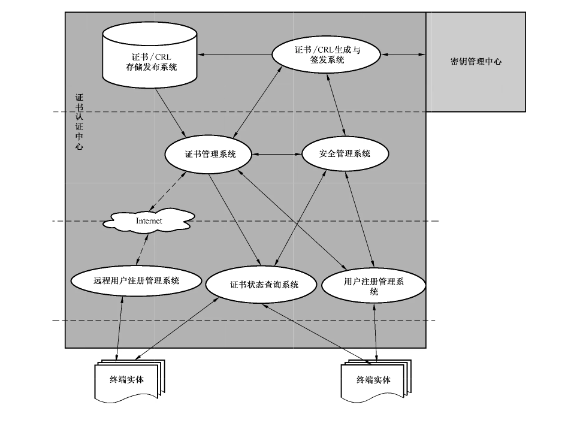
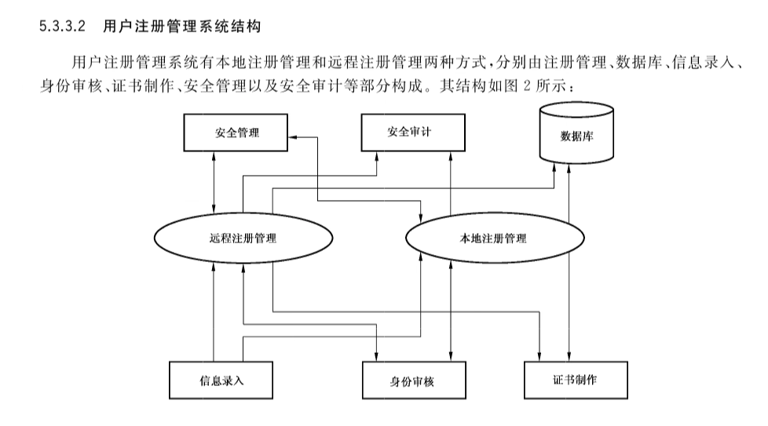
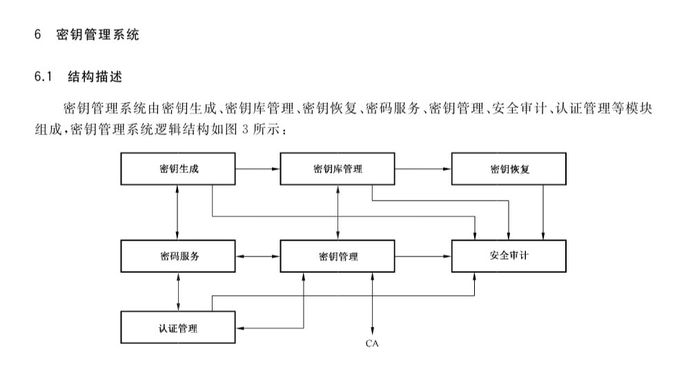
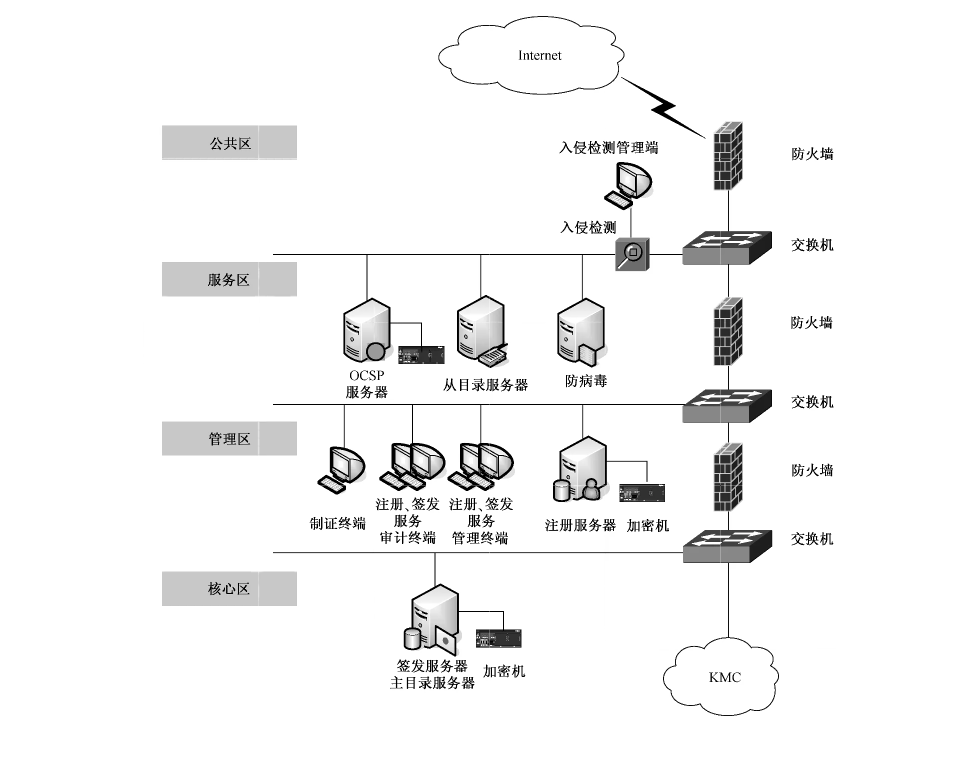
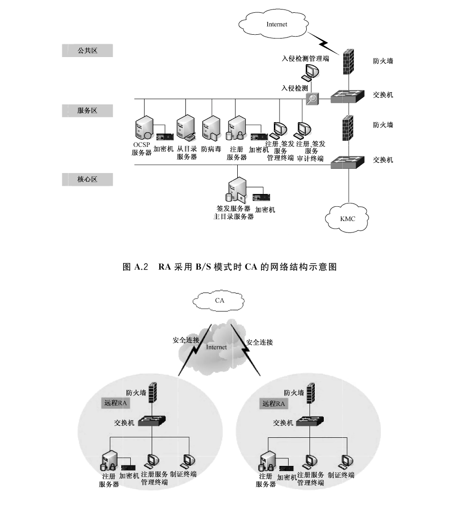
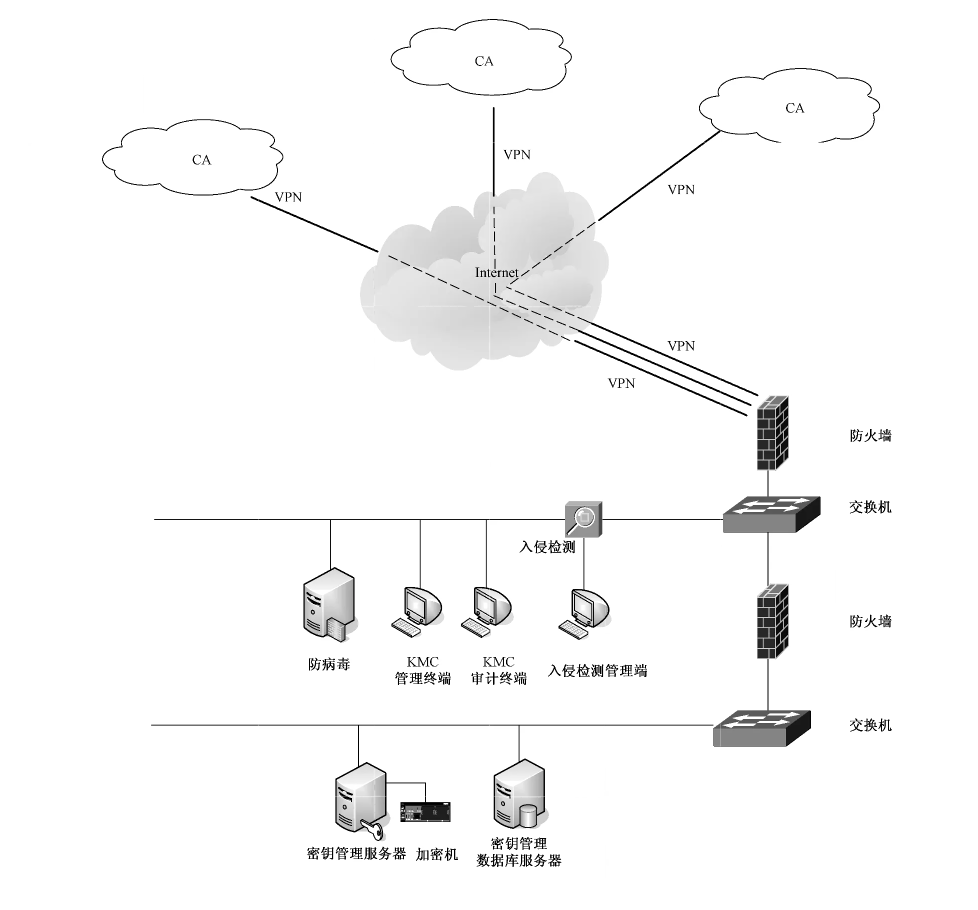

# GB/T 25056-2018 信息安全技术 证书认证系统密码及其相关安全技术规范

> 来源：[GB/T 25056-2018 国家标准详情](https://openstd.samr.gov.cn/bzgk/std/newGbInfo?hcno=4BBDEAD7450084CD1AB9E2BEDE462C1E)；封面发布日期：2018-06-07；实施日期：2019-01-01。
> 官方在线预览截图 SHA-256：d671220ac885b0c5f5ca3e300b5a5fac32d86eac48bd93b35b83503f153b35d5。
> 转写说明：对照官方在线预览全部 37 页图像校核文字、图示和章节；省略封面、目录、页眉、页脚及页码，保留正文与附录的全部图示。正式引用请核对官方原文。
> 原文疑点：第 7.1 节“非对称密钥密码算法”项中印为“认可的对称密码算法”；第 12.6 节将挂起后的证书状态写作“已吊销”。以下按原页保留。

## 前言

本标准按照 GB/T 1.1—2009 给出的规则起草。

本标准代替 GB/T 25056—2010《信息安全技术 证书认证系统密码及其相关安全技术规范》，与 GB/T 25056—2010 相比主要技术变化如下：

- 修改了对密码算法的要求（见 7.1）；

- 修改了对密码服务接口的要求（见 7.3）；

- 修改了证书认证系统的密码协议，删除了原标准第 8 章，改为引用 GM/T 0014；

- 修改了 KMC 与 CA 之间的消息格式和安全通信协议，删除了原标准的附录 A 和附录 B，改为引用 GM/T 0014；

- 修改了密码接口函数定义，删除了原标准的附录 C，改为引用 GM/T 0019；

- 增加了对证书操作流程的规定（见第 12 章）。

请注意本文件的某些内容可能涉及专利。本文件的发布机构不承担识别这些专利的责任。

本标准由全国信息安全标准化技术委员会（SAC/TC 260）提出并归口。

本标准起草单位：上海市数字证书认证中心有限公司、上海格尔软件股份有限公司、北京数字认证股份有限公司、长春吉大正元信息技术股份有限公司、北京海泰方圆科技股份有限公司、无锡江南信息安全工程技术中心、成都卫士通信息产业股份有限公司、兴唐通信科技有限公司、上海颐东网络信息有限公司、万达信息股份有限公司、飞天诚信科技股份有限公司、北京华大智宝电子系统有限公司、北京握奇智能科技有限公司、山东得安信息技术有限公司、上海信息安全工程技术研究中心、国家密码管理局商用密码检测中心。

本标准起草人：刘平、崔久强、刘承、郑强、谭武征、李述胜、赵丽丽、柳增寿、徐明翼、李元正、王妮娜、夏东山、李海杰、于华章、陈跃、胡俊义、孔凡玉、袁峰、李志伟。

本标准所代替标准的历次版本发布情况为：GB/T 25056—2010。

## 1 范围

本标准规定了数字证书认证系统的密码及其相关安全技术要求，包括：证书认证系统，密钥管理系统，密码算法、密码设备及接口，证书认证中心，密钥管理中心，证书认证中心运行管理要求，密钥管理中心运行管理要求，证书操作流程等。

本标准适用于指导第三方认证机构的数字证书认证系统的建设和检测评估，规范数字证书认证系统中密码及相关安全技术的应用。非第三方认证机构的数字证书认证系统的建设、运行及管理，可参照本标准。

## 2 规范性引用文件

下列文件对于本文件的应用是必不可少的。凡是注日期的引用文件，仅注日期的版本适用于本文件，凡是不注日期的引用文件，其最新版本（包括所有的修改单）适用于本文件。

- GB/T 2887 计算机场地通用规范

- GB/T 9361 计算机场地安全要求

- GB/T 32905 信息安全技术 SM3密码杂凑算法

- GB/T 32918（所有部分）信息安全技术 SM2椭圆曲线公钥密码算法

- GB/T 35291—2017 信息安全技术 智能密码钥匙应用接口规范

- GB/T 20518—2018 信息安全技术 公钥基础设施 数字证书格式

- GB/T 36322—2018 信息安全技术 密码设备应用接口规范

- GB 50174 数据中心设计规范
- BMB 3—1999 处理涉密信息的电磁屏蔽室的技术要求和测试方法
- GM/T 0014—2012 数字证书认证系统密码协议规范
- GM/T 0019—2012 通用密码服务接口规范
- GM/T 0020—2012 证书应用综合服务接口规范
- RFC 6960 X.509 因特网公钥基础设施在线证书状态协议（X.509 Internet Public Key Infrastructure Online Certificate Status Protocol）

## 3 术语和定义

下列术语和定义适用于本文件。

### 3.1 CA 证书 CA certificate

由一个CA 给另一个CA签发的证书，一个CA也可以为自己签发证书，这是一种自签名的证书。

### 3.2 证书认证系统 certificate authentication system

对数字证书的签发、发布、更新、撤销等数字证书全生命周期进行管理的系统。

### 3.3 证书策略 certificate policy

一个指定的规则集合，它指出证书对于具有普通安全需求的一个特定团体和（或）具体应用类的适用性。

> 注：一个特定的证书策略可以指出一个类型的证书对在一定的价格幅度下商品交易的电子数据处理的认证的适用性。

### 3.4 证书撤销列表 certificate revocation list

由证书认证机构（CA）签发并发布的被撤销证书的列表。

### 3.5 证书认证机构 certificate authority

对数字证书进行全生命周期管理的实体，也称为电子认证服务机构。

### 3.6 CA 注销列表 certificate authority revocation list

标记已经被注销的 CA 的公钥证书的列表，表示这些证书已经无效。

### 3.7 证书撤销列表分发点 certificate revocation list distribution point

CDP

一个目录条目或其他的证书撤销列表分布源，一个通过证书撤销列表分发点发布的证书撤销列表，可以包括由一个 CA 发布的所有证书中的一个证书子集的注销条目，也可以包括全部证书的注销条目。

### 3.8 证书序列号 certificate serial number

在一个证书认证机构所签发的证书中用于唯一标识数字证书的一个整数。

### 3.9 数字证书 digital certificate

公钥证书

由证书认证机构（CA）签名的包含公开密钥拥有者信息、公开密钥、签发者信息、有效期以及扩展信息的一种数据结构。按类别可分为个人证书、机构证书和设备证书，按用途可分为签名证书和加密证书。

### 3.10 私钥 private key

非对称密码算法中只能由拥有者使用的不公开密钥。

### 3.11 公钥 public key

非对称密码算法中可以公开的密钥。

### 3.12 证书注册机构 registration authority

受理数字证书的申请、更新、恢复和注销等业务的实体。

### 3.13 安全策略 security policy

由证书认证机构发布的用于约束安全服务以及设施的使用和提供方式的规则集合。

### 3.14 SM2 算法 SM2 algorithm

由GB/T 32918（所有部分）定义的算法。

### 3.15 SM3 密码杂凑算法 SM3 cryptographic hash algorithm

由GB/T 32905定义的算法。

### 3.16 信任 trust

通常说一个实体信任另一个实体表示后一个实体将完全按照第一个实体的规定进行相关的活动。

在本标准中，信任用来描述一个认证实体与证书认证机构之间的关系。

## 4 缩略语

下列缩略语适用于本文件。

- ARL：CA 注销列表（Certificate Authority Revocation List）
- CA：证书认证机构（Certificate Authority）
- CRL：证书撤销列表（Certificate Revocation List）
- HTTP：超文本传输协议（Hypertext Transfer Protocol）
- HTTPS：安全超文本传输协议（Secure Hypertext Transfer Protocol）
- KMC：密钥管理中心（Key Management Centre）
- LDAP：轻量级目录访问协议（Lightweight Directory Access Protocol）
- OCSP：在线证书状态查询协议（Online Certificate Status Protocol）
- OID：对象标识符（Object ID）
- RA：证书注册机构（Registration Authority）

## 5 证书认证系统

### 5.1 概述

证书认证系统是对生命周期内的数字证书进行全过程管理的安全系统。证书认证系统应采用双证书（用于数字签名的证书和用于数据加密的证书）机制，并建设双中心（证书认证中心和密钥管理中心）。

证书认证系统在逻辑上可分为核心层、管理层和服务层，其中，核心层由密钥管理中心、证书/CRL 生成与签发系统、证书/CRL 存储发布系统构成；管理层由证书管理系统和安全管理系统构成；服务层由证书注册管理系统（包括远程用户注册管理系统）和证书状态查询系统构成。证书认证系统的逻辑结构宜如图 1 所示。

### 5.2 功能描述

#### 5.2.1 概述

证书认证系统提供了对生命周期内的数字证书进行全过程管理的功能，包括用户注册管理、证书/证书撤销列表的生成与签发、证书/证书撤销列表的存储与发布、证书状态的查询、证书管理及安全管理等。

#### 5.2.2 用户注册管理系统

##### 5.2.2.1 概述

用户注册管理系统负责用户的证书申请、身份审核和证书下载，可分为本地注册管理系统和远程注册管理系统。

##### 5.2.2.2 证书申请

证书申请可采用在线或离线两种方式：

a） 在线方式：用户通过互联网等登录到用户注册管理系统申请证书；

b） 离线方式：用户到指定的注册机构申请证书。

##### 5.2.2.3 身份审核

审核人员通过用户注册管理系统，对证书申请者进行身份审核。

##### 5.2.2.4 证书下载

证书下载可采用在线或离线两种方式：

a） 在线方式：用户通过互联网等登录到用户注册管理系统下载证书；

b） 离线方式：用户到指定的注册机构下载证书。

#### 5.2.3 证书/证书撤销列表生成与签发系统

##### 5.2.3.1 功能

证书/证书撤销列表生成与签发系统负责生成、签发数字证书和证书撤销列表。

##### 5.2.3.2 证书类型

按主体对象，证书分为人员证书、设备证书和机构证书三种类型。

按功能，证书分为加密证书和签名证书两种类型。

##### 5.2.3.3 证书机制

证书认证系统采用双证书机制。每个用户拥有两张数字证书，一张用于数字签名，另一张用于数据加密。用于数字签名的密钥对可以由用户利用具有密码运算功能的证书载体产生；用于数据加密的密钥对由密钥管理中心产生并负责安全管理。签名证书和加密证书一起保存在用户的证书载体中。

##### 5.2.3.4 证书生成/签发

用户的数字证书由该系统的CA签发，根CA 的数字证书由根CA自己签发，下级CA 的数字证书由上级 CA签发。

##### 5.2.3.5 证书撤销列表

证书撤销列表是在证书有效期之内，CA 签发的终止使用证书的信息，分为用户证书撤销列表（CRL）和 CA 证书撤销列表（ARL）两类。在证书的使用过程中，应用系统通过检查 CRL/ARL，获取有关证书的状态。

#### 5.2.4 证书/证书撤销列表存储与发布系统

证书/证书撤销列表存储与发布系统负责数字证书、证书撤销列表的存储和发布。

根据应用环境的不同，证书/证书撤销列表存储与发布系统应采用数据库或目录服务方式，实现数字证书/证书撤销列表的存储、备份和恢复等功能，并提供查询服务。

使用目录服务方式，应采用主、从目录服务器结构以保证主目录服务器的安全，同时从目录服务器可以采用分布式的方式进行设置，以提高系统的效率。用户只能访问从目录服务器。

#### 5.2.5 证书状态查询系统

证书状态查询系统应为用户和应用系统提供证书状态查询服务，包括：

a） CRL 查询：用户或应用系统利用数字证书中标识的 CRL 地址，下载 CRL，并检验证书有效性；

b） 在线证书状态查询：用户或应用系统按照在 RFC 6960 中规定的方法，实时在线查询证书的状态。

在实际应用中，可以根据具体情况采用上述两种查询方式之一或全部。

#### 5.2.6 证书管理系统

证书管理系统是证书认证系统中实现对证书/证书撤销列表的申请、审核、生成、签发、存储、发布、注销、归档等功能的管理控制系统。

#### 5.2.7 安全管理系统

安全管理系统主要包括安全审计系统和安全防护系统。

安全审计系统提供事件级审计功能，对涉及系统安全的行为、人员、时间等记录进行跟踪、统计和分析。

安全防护系统提供访问控制、入侵检测（入侵防御）、漏洞扫描、病毒防治等网络安全功能。

### 5.3 系统设计

#### 5.3.1 概述

证书认证系统的设计包括系统的总体设计和各子系统设计，本标准提供证书认证系统的设计原则以及各个子系统的实现方式，在具体实现过程中，应根据所选择的开发平台和开发环境进行详细设计。

#### 5.3.2 总体设计原则

证书认证系统的总体设计原则如下：

a） 证书认证系统遵循标准化、模块化设计原则；

b） 证书认证系统设置相对独立的功能模块，通过各模块之间的安全连接，实现各项功能；

c） 各模块之间的通信采用基于身份鉴别机制的安全通信协议；

d） 各模块使用的密码运算都要在密码设备中完成；

e） 各模块产生的审计日志文件采用统一的格式传递和存储；

f） 用户注册管理系统、证书/证书撤销列表生成与签发系统和密钥管理中心可以设置独立的数据库；

g） 证书认证系统的各模块应设置有效的系统管理功能；

h） 系统应具备访问控制功能；

i） 系统在实现证书管理功能的同时，应充分考虑系统本身的安全性。

#### 5.3.3 用户注册管理系统设计

##### 5.3.3.1 用户注册管理系统功能

用户注册管理系统负责用户证书/证书撤销列表的申请、审核以及证书的制作，其主要功能如下：

a） 用户信息的录入：录入用户的申请信息，用户申请信息包括签发证书所需要的信息，还包括用于验证用户身份的信息，这些信息存放在用户注册管理系统的数据库中。用户注册管理系统应能够批量接收从外部系统生成的、以电子文档方式存储的用户信息。

b） 用户信息的审核：提取用户的申请信息，审核用户的真实身份，当审核通过后，将证书签发所需要的信息提交给签发系统。

c） 用户证书下载：用户注册管理系统提供证书下载功能，当签发系统为用户签发证书后，用户注册管理系统能够下载用户证书，并将用户证书写入指定的用户证书载体中，然后分发给用户。

d） 安全审计：负责对用户注册管理系统的管理人员、操作人员的操作日志进行查询、统计以及报表打印等。

e） 安全管理：对用户注册管理系统的登陆进行安全访问控制，并对用户信息数据库进行管理和备份。

f） 多级审核：用户注册管理系统可根据需要采用分级部署的模式，对不同种类和等级的证书，可由不同级别的用户注册管理系统进行审核。用户注册管理系统应能够根据需求支持多级注册管理系统的建立和多级审核模式。

用户注册管理系统应具有并行处理的能力。

#### 5.3.4 证书/证书撤销列表生成与签发系统设计

##### 5.3.4.1 证书/证书撤销列表生成与签发系统功能

证书/证书撤销列表生成与签发系统是证书认证系统的核心，不仅为整个证书认证系统提供签发证书/证书撤销列表的服务，还承担整个证书认证系统中主要的安全管理工作。其主要功能如下：

a） 证书生成与签发：从数据库中读取与核对用户信息，根据拟签发的证书类型向密钥管理中心申请加密密钥对，生成用户的签名证书和加密证书，将签发完成的证书发布到目录服务器和数据库中。根据系统的配置和管理策略，不同种类或用途的证书可以采用不同的签名密钥。

b） 证书更新：系统应提供 CA证书及用户证书的更新功能。

c） 证书撤销列表生成与签发：接收注销信息，验证注销信息中的签名，然后签发证书撤销列表，将签发后的注销列表发布到数据库或目录服务器中。签发证书撤销列表的签名密钥可以与签发证书的签名密钥相同或不同。

d） 安全审计：负责对证书/证书撤销列表生成与签发系统的管理人员、操作人员的操作日志进行查询、统计以及报表打印等。

e） 安全管理：对证书/证书撤销列表生成与签发系统的登录进行安全访问控制，并对证书/证书撤销列表数据库进行管理和备份；设置管理员、操作员，并为这些人员申请和下载数字证书；配置不同的密码设备；配置不同的证书模板。

证书/证书撤销列表生成与签发系统应具有并行处理的能力。

##### 5.3.4.2 证书/证书撤销列表生成与签发系统结构

###### 5.3.4.2.1 概述

证书/证书撤销列表生成与签发系统由证书/证书撤销列表生成与签发模块、密码设备模块、安全管理模块、安全审计模块等组成。

###### 5.3.4.2.2 证书/证书撤销列表生成与签发

主要功能包括证书的生成与签发和 CRL/ARL 的生成与签发：

a） 证书的生成/签发：根据接收的请求信息，从数据库中提取用户的信息，向密钥管理中心申请加密密钥对，然后生成并签发签名证书和加密证书，签发的证书和加密证书的私钥通过证书管理系统下传给申请者，同时将证书发布到数据库和目录服务器中。在此过程中，应保证私钥传递的安全。

b） 证书撤销列表的生成/签发：首先验证申请信息中的数字签名和相关数据，然后签发证书撤销列表，并将证书撤销列表发布到目录服务器或数据库指定的位置。

###### 5.3.4.2.3 密码设备

密码设备完成签名以及验证工作，并负责与其他系统通信过程中的密码运算，CA的签名密钥保存在密码设备中。在进行上述工作中，应保证所使用的密钥不能以明文形式被读出密码设备。

###### 5.3.4.2.4 安全管理

主要包括：

a） 证书模板配置：不同的证书种类由不同的证书模板确定，证书模板包括相应种类证书的基本项和证书的扩展项；

b） CRL 发布策略配置：配置 CRL 的发布策略，包括自动/人工发布模式选择、发布时间间隔；

c） 进行 CA 密钥的更新；

d） 进行证书的备份和归档；

e） 进行服务器安全配置，包括服务器可接受的主机访问列表；

f） 为其他子系统定义管理员以及为这些管理员签发数字证书；

g） 数据库系统的配置：数据源的选择，数据库连接的用户名和口令设置。

###### 5.3.4.2.5 安全审计

查询证书/证书撤销列表生成与签发系统中的安全审计日志，并进行统计与打印。

#### 5.3.5 证书/证书撤销列表存储发布系统设计

##### 5.3.5.1 证书/证书撤销列表存储发布系统功能

证书/证书撤销列表存储发布系统负责证书和证书撤销列表的存储与发布，是证书认证系统的基础组成部分。证书的存储和发布应采用数据库、目录服务器或其中之一。该系统主要功能如下：

a） 证书存储；

b） 证书撤销列表存储；

c） 证书和 CRL 发布；

d） 安全审计：负责对证书/证书撤销列表存储发布系统的管理人员、操作人员的操作日志进行审查、统计以及报表打印等；

e） 安全管理：对证书/证书撤销列表存储发布系统的登陆进行访问控制，并定期对数据库和目录服务器进行管理和备份；

f） 数据一致性检验：对数据库和目录服务器中的数据进行一致性检验。

##### 5.3.5.2 证书/证书撤销列表存储发布系统结构

###### 5.3.5.2.1 概述

证书/证书撤销列表存储与发布系统由数据库、目录服务器、安全管理模块、安全审计模块组成。

###### 5.3.5.2.2 数据库

存放证书和证书撤销列表以及用户的其他信息。

###### 5.3.5.2.3 目录服务器

证书/证书撤销列表存储发布系统采用主从结构的目录服务器，签发完成的数据直接写入主目录服务器中，然后由目录服务器的主从映射功能自动映射到从目录服务器中。主、从目录服务器通常配置在不同等级的安全区域。用户只能访问从目录服务器。

###### 5.3.5.2.4 安全管理

主要包括：

a） 定期对数据库和目录服务器的内容进行数据的备份和归档；

b） 对数据库和目录服务器中的数据进行一致性检查，发现不一致时，应进行数据恢复。

###### 5.3.5.2.5 安全审计

查询证书/证书撤销列表存储与发布系统中的安全审计日志，并进行统计与打印等。

#### 5.3.6 证书状态查询系统设计

##### 5.3.6.1 证书状态查询系统功能

证书状态查询系统为用户及应用系统提供证书状态查询服务。

证书状态查询系统所提供的服务可以采用以下两种方式：

a） CRL 查询：用户或应用系统利用证书中标识的 CRL 地址，查询并下载 CRL 到本地，进行证书状态的检验；

b） 在线证书状态查询。用户或应用系统利用 OCSP 协议，在线实时查询证书的状态，查询结果经过签名后返回给请求者，进行证书状态的检验。

##### 5.3.6.2 证书状态查询系统结构

###### 5.3.6.2.1 概述

证书状态查询系统由证书状态数据库/OCSP 服务器、密码设备、安全管理模块、安全审计模块组成。

###### 5.3.6.2.2 证书状态数据库/OCSP服务器

接受用户及应用系统的证书状态查询请求，根据请求信息中的证书序列号，从证书状态数据库中查询证书的状态，查询结果返回给请求者。

###### 5.3.6.2.3 密码设备

验证请求信息中的签名，并对查询结果进行签名。

###### 5.3.6.2.4 安全管理

主要包括：

a） OCSP 服务器的配置；定义可接受的访问控制信息以及查询的证书状态数据库的地址；

b） 启动/停止查询服务，配置可接受的用户请求数量等。

###### 5.3.6.2.5 安全审计

查询证书状态查询系统中的安全审计日志，并进行统计与打印等。

#### 5.3.7 证书管理系统设计

证书管理系统是证书认证系统的综合信息控制和调度服务系统，它接收用户的各种请求信息，并将请求信息提交给相应的子系统。证书管理系统是一个逻辑上独立的系统，在进行系统设计过程中，可根据证书认证系统提供的服务，由不同的处理模块组成，这些模块可以采用分布式的结构，以增强系统的处理能力，提高系统的效率。

#### 5.3.8 安全管理系统设计

##### 5.3.8.1 概述

安全管理系统主要包括安全审计系统和安全防护系统。

##### 5.3.8.2 安全审计系统

提供事件级审计功能，对涉及系统安全的行为、人员、时间的记录进行跟踪、统计和分析。安全审计系统可以分别查询各子系统中的日志记录，也可以通过查询证书/证书撤销列表存储与发布系统中的数据库，进行集中审计。

日志记录的主要内容包括：

a） 操作员姓名；

b） 操作项目；

c） 操作起始时间；

d） 操作终止时间；

e） 证书序列号；

f） 操作结果。

日志管理的主要内容包括：

a） 日志参数设置，设置日志保存的最大规模和日志备份的目录；

b） 日志查询，查询操作员、操作事件信息；

c） 日志备份，当日志保存到日志参数设置的最大规模时，将保存的日志备份；

d） 日志处理，对日志记录的正常业务流量和各类事件进行分类整理；

e） 证据管理，对证据数据进行审计、统计和记录。

##### 5.3.8.3 安全防护系统

提供访问控制、入侵检测、漏洞扫描、病毒防治等网络安全功能。

### 5.4 数字证书

关于数字证书结构和格式见 GB/T 20518—2018的5.2“数字证书格式”。

其中，证书结构中的颁发者名称和主体名称的 DN顺序应符合下列规则：

a） 如果有C项，则放在最后，且C=CN；

b） 如果有CN项，则放在 DN 的最前面；

c） 如果同时存在 OU 和 O 项，则 OU 在 O 前面；如果同时存在 S 和 L 项，则 L 在 S 前面。

证书结构中的签名算法域中标识的密码算法应为国家密码管理主管部门认可的算法。

### 5.5 证书撤销列表

本标准的证书撤销列表结构和格式见 GB/T 20518—2018 的 5.3“CRL 格式”。

证书中的证书撤销列表分发点应是有效地址。

其中，证书撤销列表结构中的签名算法域中标识的密码算法应为国家密码管理主管部门认可的算法。

## 6 密钥管理系统

### 6.1 结构描述

密钥管理系统由密钥生成、密钥库管理、密钥恢复、密码服务、密钥管理、安全审计、认证管理等模块组成，密钥管理系统逻辑结构如图 3 所示：

### 6.2 功能描述

#### 6.2.1 概述

密钥管理系统提供了对生命周期内的加密证书密钥对进行全过程管理的功能，包括密钥生成、密钥存储、密钥分发、密钥备份、密钥更新、密钥撤消、密钥归档、密钥恢复等。

#### 6.2.2 密钥生成

根据CA的请求为用户生成非对称密钥对，该密钥对由密钥管理系统的硬件密码设备生成。

#### 6.2.3 密钥存储

密钥管理系统生成的非对称密钥对，经硬件密码设备加密后存储在数据库中。

#### 6.2.4 密钥分发

密钥管理系统生成的非对称密钥对，通过证书认证系统分发到用户证书载体中。

#### 6.2.5 密钥备份

密钥管理系统采用热备份、冷备份和异地备份等措施实现密钥备份。

#### 6.2.6 密钥更新

当证书到期或用户需要时，密钥管理系统根据CA 请求为用户生成新的非对称密钥对。

#### 6.2.7 密钥撤消

当证书到期、用户需要或管理机构依据合同规定认为必要时，密钥管理系统根据CA 请求撤消用户当前使用的密钥。

#### 6.2.8 密钥归档

密钥管理系统为到期或撤消的密钥提供安全长期的存储。

#### 6.2.9 密钥恢复

密钥管理系统可为用户提供密钥恢复服务和为司法取证提供特定密钥恢复。密钥恢复需依据相关法规并按管理策略进行审批，一般用户只限于恢复自身密钥。

### 6.3 系统设计

#### 6.3.1 概述

密钥管理系统的设计包括系统的整体设计和各子系统设计。本标准提供密钥管理系统的设计原则以及各个子系统的实现方式，在具体实现过程中，应根据所选择的开发平台和开发环境进行详细设计。

#### 6.3.2 总体设计原则

密钥管理系统可采取灵活多样的实现方式，但应遵循以下原则：

a） 密钥管理系统遵循标准化、模块化设计原则；

b） 密钥管理系统设置相对独立的功能模块，通过各模块之间的安全连接，实现各项功能；

c） 各模块之间的通信采用基于身份验证机制的安全通信协议；

d） 各模块使用的密码运算都应在密码设备中完成；

e） 各模块产生的审计日志文件采用统一的格式传递和存储；

f） 系统应具备访问控制功能；

g） 系统应设置有效的系统管理功能；

h） 系统在实现密钥管理功能的同时，应充分考虑系统本身的安全性；

i） 系统可为多个CA 提供密钥服务，当为多个 CA提供密钥服务时，由上级CA为密钥管理系统签发证书。

#### 6.3.3 密钥生成模块

密钥生成模块应提供以下主要功能：

a） 非对称密钥对的生成，并将其保存在备用库中；当备用库中密钥数量不足时，自动进行补充；

b） 对称密钥的生成；

c） 随机数的生成。

#### 6.3.4 密钥库管理模块

##### 6.3.4.1 概述

密钥库管理模块负责密钥的存储管理，按照其存储的密钥的状态，密钥库分为备用库、在用库和历史库等三种类型，密钥库中的密钥数据应加密存放。

##### 6.3.4.2 备用库

备用库存放待使用的密钥对。密钥生成模块预生成一批密钥对，存放于备用库中；CA 需要时，可及时调出，将其提供给CA 后转入在用库。

备用密钥库应保持一定数量的待用密钥对，存放的密钥数量依系统的用户数量而定，若少于设定的最低数量时应自动补足到规定数量。

##### 6.3.4.3 在用库

在用库存放当前使用的密钥对。在用库中的密钥记录包含用户证书的序列号、ID 号和有效时间等标志。

##### 6.3.4.4 历史库

历史库存放过期或已被注销的密钥对。历史库中的密钥记录包含用户证书的序列号、ID 号、有效时间和作废时间等标志。

#### 6.3.5 密钥恢复模块

##### 6.3.5.1 用户密钥恢复

用户密钥恢复：用户通过 RA 申请，经审核后，由CA 向密钥管理中心提出密钥恢复请求，密钥恢复模块恢复用户的密钥并通过CA返回 RA，下载于用户证书载体中。

##### 6.3.5.2 司法取证密钥恢复

司法取证密钥恢复：司法取证人员应到 KMC进行司法取证密钥恢复，KMC对司法取证人员的身份进行认证，认证通过后，由密钥恢复模块恢复所需的密钥并下载于特定载体中。

#### 6.3.6 密码服务模块

密码服务模块负责为密钥管理系统的各项业务提供密码支持。

密码服务模块配置经国家密码管理主管部门认可的非对称密钥密码算法、对称密钥密码算法和数据摘要算法等。

密码算法应在硬件密码设备中运行，有关密码算法、密码设备和密码接口的要求在本标准第7章中规定。

#### 6.3.7 密钥管理模块

密钥管理模块应提供以下主要功能：

a） 接收、审核CA的密钥申请；

b） 调用备用密钥库中的密钥对；

c） 向CA发送密钥对；

d） 对调用的备用密钥库中的密钥对进行处理，并将其转移到在用密钥库；

e） 对在用密钥库中的密钥进行定期检查，将超过有效期的或被撤销的密钥转移到历史密钥库；

f） 对历史密钥库中的密钥进行处理，将超过规定保留期的密钥转移到规定载体；

g） 接收与审查关于恢复密钥的申请，依据安全策略进行处理；

h） 对进入本系统的有关操作及操作人员进行身份与权限的认证。

#### 6.3.8 安全审计模块

安全审计模块负责各个功能模块的运行事件检查、有关资料分析和密钥申请统计等服务。审计项目主要包括：

a） 运行事件记录；

b） 服务器状态记录；

c） 系统重要策略设置。

审计记录不能进行修改。

#### 6.3.9 认证管理模块

认证管理模块负责对进入本系统的有关操作及操作人员进行身份与权限的认证。

#### 6.3.10 日志审计模块

##### 6.3.10.1 概述

密钥管理系统设置日志审计模块，包括全程审计和事件审计。审计员定时调出审计记录，制作统计分析表。审计员可以处理但不能修改日志审计数据。

##### 6.3.10.2 日志记录

日志记录的主要内容包括：

a） 操作员姓名；

b） 操作项目；

c） 操作起始时间；

d） 操作终止时间；

e） 证书序列号；

f） 操作结果。

##### 6.3.10.3 日志管理

日志管理的主要内容包括：

a） 日志参数设置，设置日志保存的最大规模和日志备份的目录等；

b） 日志查询，查询操作员、认证机构操作事件等信息；

c） 日志备份，当日志保存到日志参数设置的最大规模时，将保存的日志备份；

d） 日志处理，对日志记录的正常业务流量和各类事件进行分类整理；

e） 证据管理，对证据数据进行审计、统计和记录。

### 6.4 KMC与CA的安全通信协议

KMC与CA之间采用基于身份鉴别机制的安全通信协议，并进行双向身份鉴别。

有关安全通信协议的详细内容可见 GM/T 0014—2012第5章“相关协议”。

## 7 密码算法、密码设备及接口

### 7.1 密码算法

证书认证系统使用对称密码算法、非对称密码算法和密码杂凑算法等三类算法实现有关密码服务各项功能，其中，对称密钥密码算法实现数据加/解密以及消息认证；非对称密钥密码算法实现签名/验证以及密钥交换；密码杂凑算法实现待签名消息的摘要运算。

证书认证系统使用的密码算法要求如下：

a） 对称密钥密码算法：采用国家密码管理主管部门认可的对称密码算法；

b）非对称密钥密码算法：采用国家密码管理主管部门认可的对称密码算法，推荐采用SM2密码算法；

c） 密码杂凑算法：采用国家密码管理主管部门认可的密码杂凑算法，推荐采用 SM3 密码杂凑算法。

### 7.2 密码设备

#### 7.2.1 概述

应采用国家密码管理主管部门认可的密码设备，包括：

a） 应用类密码设备；在证书认证系统中提供签名/验证、数据加密/解密、数据摘要、数字信封、密钥生成和管理等密码作业服务；

b） 通信类密码设备；用于在 KMC 与CA之间、CA与RA 间加密和认证传输的数据；

c） 证书载体。具有数字签名/验证、数据加/解密等功能的智能密码钥匙等载体，用于用户的证书存储及相关的密码作业。

#### 7.2.2 密码设备的功能

密码设备应具备如下基本功能：

a） 随机数生成；

b） 非对称密钥的产生；

c） 对称密钥的产生；

d） 非对称密钥密码算法的加解密运算；

e） 对称密钥密码算法的加解密运算；

f） 数据摘要运算；

g） 密钥的存储；

h） 密钥的安全备份和安全导入导出；

i） 多密码设备并行工作时，密钥的安全同步。

#### 7.2.3 密码设备的安全要求

密码设备应满足下列要求：

a） 接口安全，不执行规定命令以外的任何命令和操作；

b） 协议安全，所有命令的任意组合，不能得到密钥的明文；

c） 密钥安全，密钥不以明文形式出现在密码设备之外；

d） 物理安全，密码设备应具有物理防护措施，任何情况下的拆卸均应立即销毁设备内保存的密钥。

### 7.3 密码服务接口

密码设备的接口应遵循GB/T 36322—2018第6章“设备接口描述”，智能密码钥匙的接口应遵循GB/T 35291—2017第7章“接口函数”，密码服务的接口应遵循GM/T 0019—2012第6章“密码服务接口”和 GM/T 0020—2012第6章“证书应用综合服务接口概述”中的规定。

## 8 证书认证中心

### 8.1 系统

#### 8.1.1 功能要求

CA 提供的服务功能主要有：

a） 提供各种证书在其生命周期中的管理服务；

b）提供RA 的多种建设方式，RA可以全部托管在CA 系统，也可以部分托管在CA，部分建在远端；

c） 提供人工审核或自动审核两种审核模式；

d） 支持多级CA 认证；

e） 提供证书查询、证书状态查询、证书撤销列表下载、目录服务等功能。

#### 8.1.2 性能要求

CA 系统的性能应满足如下要求：

a） 系统对用户接口采用标准的 HTTP、HTTPS、LDAP 和 OCSP 协议，确保各种用户都能够使用本系统服务；

b） 系统各模块的状态信息保存在配置文件和数据库内部，保证系统的部署方便性和配置方便性，当系统需改变配置时无需中断系统的服务；

c） 各模块的功能可以通过配置文件进行控制，系统可以根据不同的需求进行设置；

d） 系统某一功能模块可有多个实例，并且多个实例可运行在一台或多台计算机上；

e） 系统应有冗余设计，保证系统的不间断运行。

#### 8.1.3 管理员配置要求

在CA应设置下列管理和操作人员：

a） 超级管理员；

b） 审计管理员；

c） 审计员；

d） 业务管理员；

e） 业务操作员。

“超级管理员”负责CA系统的策略设置，设置各子系统的业务管理员并对其管理的业务范围进行授权。

“业务管理员”负责CA 系统的某个子系统的业务管理，设置本子系统的业务操作员并对其操作的权限进行授权。

“业务操作员”按其权限进行具体的业务操作。

“审计管理员”负责产生审计员并进行管理。

“审计员”负责对涉及系统安全的事件和各类管理和操作人员的行为进行审计和监督。

上述各类人员使用证书进行登录，其中“超级管理员”和“审计管理员”的证书应在CA系统进行初始化时同时产生。

另外，CA 应设置安全管理员，全面负责系统的安全工作。

#### 8.1.4 网络划分

CA 系统的计算机网络需要合理分段，原则上要求整个网络应划分为四部分：

a） 公共部分：为CA用户所在的网络，所有用户将通过该网络访问CA；

b） 服务部分：为外部用户提供域名解析功能，并负责内部系统对外邮件的收发功能；包括系统的各种 Web 服务器和从目录服务器，是外部用户访问内部功能的接口，为用户提供访问界面；

c） 管理部分：仅供CA 的工作人员使用的网络；

d） 核心部分：包括各种核心应用、数据库和密码设备等在内的实现系统功能的安全网络。

当RA 采用客户机/服务器（C/S）模式时，应该按照上述方式划分网络；当RA采取浏览器/服务器（B/S）模式时，可将服务与管理网络放在同一网段。网络结构示意图参见附录 A。

#### 8.1.5 初始化要求

CA 的初始化过程应完成下列工作：

a） 产生本CA 的机构密钥对，并使用（3,5）门限秘密共享机制将密钥对中的私钥交由5个独立的分管者保管。门限秘密共享机制的算法本标准不做规定；

b）若本CA为根CA，则使用根CA 的签名密钥进行自签名；若本CA从属于某一根 CA，则将产生的签名公钥提交根CA 签发本CA 的证书；

c） 由CA签发CA 服务器证书；

d） 由CA 签发 RA 服务器证书（可选）；

e） 由CA签发超级管理员和审计管理员证书；

f） 由CA签发其他审计员，管理员和操作员证书。

### 8.2 安全

#### 8.2.1 概述

CA 系统的安全包括系统安全、通信安全、密钥安全、证书管理安全、安全审计等各方面的安全。

#### 8.2.2 系统安全

系统安全的主要目标是保障网络、主机系统、应用系统及数据库运行的安全。应采取防火墙、病毒防治、漏洞扫描、入侵监测或入侵防御、数据备份、灾难恢复等安全防护措施。

#### 8.2.3 通信安全

通信安全的主要目标是保障CA 系统各子系统之间、CA与KMC 之间、CA与RA之间的安全通信，应采取通信加密、安全通信协议等安全措施。

#### 8.2.4 密钥安全

##### 8.2.4.1 概述

密钥安全的主要目标是保障CA 系统中所使用的密钥，在其生成、存储、使用、更新、废除、归档、销毁，备份和恢复整个生命周期中的安全。应采取硬件密码设备、密钥管理安全协议、密钥存取访问控制、密钥管理操作审计等多种安全措施。

##### 8.2.4.2 基本要求

密钥安全的基本要求是：

a） 密钥的生成和使用应在硬件密码设备中完成；

b） 密钥的生成和使用应有安全可靠的管理机制；

c） 存在于硬件密码设备之外的所有密钥应加密；

d） 密钥应有安全可靠的备份恢复机制；

e） 对密码设备操作应由多个操作员实施。

##### 8.2.4.3 根 CA 密钥

根 CA 密钥的安全性除了满足基本要求外，还应满足下列要求：

a） 根 CA 密钥的产生：CA 系统的根密钥由硬件密码设备生成并存放在该密码设备中，应采用（3，5）秘密共享机制将密钥份额分享给 5 个分管者保管。生成根 CA 密钥时，应先选定分管者。

选定的分管者应分别用自己输入的口令保护分管的密钥份额，分管的密钥份额应存放在智能密码钥匙中。智能密码钥匙也应备份，并安全存放。根CA密钥的产生过程应进行记录。

b） 根 CA 密钥的恢复：恢复根 CA 密钥时，由 5 个分管者中任意 3 个将各自保管的密钥份额输入密码设备，在密码设备中恢复根 CA 密钥。

c）根CA 密钥的更新：根CA密钥的更新，需重新生成根CA 密钥，其过程同根CA 密钥的生成。

d）根CA 密钥的废除：根CA 密钥的废除应与根CA 密钥的更新同步。

e） 根CA 密钥的销毁：根CA 密钥的销毁应与备份的根CA 密钥一同销毁。由国家密码管理主管部门授权的机构实施。

##### 8.2.4.4 非根CA 密钥

非根CA密钥的安全性要求与根CA 密钥的安全性要求一致。

##### 8.2.4.5 管理员证书密钥

管理员包括超级管理员、审计管理员、审计员、业务管理员和业务操作员等。管理员证书对应的公私密钥对应使用硬件来产生，并将私钥存储在不可读出的硬件（如智能密码钥匙）中。

管理员证书密钥的安全性应满足下列要求：

a） 管理员证书密钥的产生和使用应在证书载体中完成；

b） 密钥的生成和使用应有安全可靠的管理机制；

c） 管理员的口令长度为8个字节以上；

d） 管理员的账号要和普通用户账号严格分类管理。

#### 8.2.5 证书管理安全

证书的管理安全应满足下列要求：

a） 验证证书申请者的身份；

b）防止非法签发和越权签发证书，通过审批的证书申请应提交给CA，由CA签发与申请者身份相符的证书；

c） 保证证书管理的可审计性，对于证书的任何处理都应作日志记录。通过对日志文件的分析，可以对证书事件进行审计和跟踪。

#### 8.2.6 安全审计

##### 8.2.6.1 概述

CA 系统在运行过程中涉及大量功能模块之间的相互调用，以及各种管理员的操作，对这些调用和操作需要以日志的形式进行记载，以便用于系统错误分析、风险分析和安全审计等工作。

##### 8.2.6.2 功能模块调用日志

系统内的各功能模块在运行过程中会调用其他功能模块或被其他功能模块所调用，对于这些相互之间的功能调用，各模块应该记录如下数据：

a） 调用请求的接收时间；

b） 调用请求的来源网络地址；

c） 调用请求发起者的身份；

d） 调用请求的内容；

e） 处理结果等。

##### 8.2.6.3 CA 超级管理员审计

CA超级管理员的下列操作应被记录：

a）根CA 证书加载；

b） CA证书加载；

c） 证书撤销列表加载；

d） 证书撤销列表更新等；

e） 系统配置；

f） 权限分配。

##### 8.2.6.4 CA业务操作员审计

CA 业务操作员的下列操作应被记录：

a） 证书请求批准；

b） 证书请求拒绝；

c） 证书请求分配；

d） 证书注销。

##### 8.2.6.5 RA 业务操作员审计

RA 业务操作员的下列操作应被记录：

a） 证书请求批准；

b） 证书请求拒绝；

c） 证书请求分配；

d） 证书注销。

### 8.3 数据备份

数据备份的目的是确保CA的关键业务数据在发生灾难性破坏时，系统能够及时和尽可能完整地恢复被破坏的数据。应选择适当的存储备份系统对重要数据进行备份。

不同的应用环境可以有不同的备份方案，但应满足以下基本要求：

a） 备份要在不中断数据库使用的前提下实施；

b） 备份方案应符合国家有关信息数据备份的标准要求；

c） 备份方案应提供人工和自动备份功能；

d） 备份方案应提供实时和定期备份功能；

e） 备份方案应提供增量备份功能；

f） 备份方案应提供日志记录功能；

g） 备份应提供归档检索与恢复功能。

### 8.4 可靠性

#### 8.4.1 概述

CA 应提供 7×24 h 服务，对影响系统可靠性的主要因素如网络故障、主机故障、密码设备故障、数据库故障和电源故障等，宜采取软硬件冗余配置作为预防措施。

#### 8.4.2 网络链路冗余

为保证 CA 的服务，CA 网络对外接口应根据具体情况，可有两条物理上独立的链路，同时考虑交换机、路由器、防火墙的冗余配置。

#### 8.4.3 主机及密码设备冗余

CA 系统中与关键业务相关的主机、密码设备、在服务网段和核心网段中的服务器应采用双机热备份或双机备份措施。

#### 8.4.4 数据库冗余

CA 系统的数据库应采用磁盘阵列、磁盘镜像等措施，具备容错和备份能力。

#### 8.4.5 电源冗余

CA 系统应采用高可靠的电源解决方案，并应采用 UPS 为系统提供不间断电源。

### 8.5 物理安全

#### 8.5.1 物理环境建设

CA 的建筑物及机房建设应按照国家密码管理相关政策要求，并按照下列标准实施：

a） GB/T 2887；

b） GB/T 9361；

c） GB 50174；

d） BMB3—1999。

#### 8.5.2 对CA 的分层访问

##### 8.5.2.1 概述

CA 系统按功能分为四个区域，由外到里分别是：公共区、服务区、管理区和核心区，各区的功能及设备配置参见附录A。

##### 8.5.2.2 公共区

入口之外的区域为公共区。

##### 8.5.2.3 服务区

所有进入此区的人员使用身份识别卡刷卡进入。该区的每扇窗户都应安装玻璃破碎报警器。

##### 8.5.2.4 管理区

所有进入此区人员需要同时使用身份识别卡和人体特征鉴别才可以进入，人员进出管理区要有日志记录。所有的房间不应安装窗户，所有的墙体应采用高强度防护墙。

##### 8.5.2.5 核心区

所有进入此区人员需要同时使用身份识别卡和人体特征鉴别才可以进入，人员进出该区要有日志记录。

核心区应为屏蔽机房，应加装高强度的钢制防盗门。所有进出屏蔽室的线路都要采取防电磁泄漏措施。

##### 8.5.2.6 安全监控和配电消防

CA 应设置安全监控室、系统监控室、配电室和消防器材室。

安全监控室是安全管理人员值班的地方，可对整个 CA 的进出人员实行监控，处理日常的安全事件。只有安全管理人员同时使用身份识别卡和人体特征鉴别才可以进入，刷卡离开。

系统监控室是网络管理人员工作的地方。需要同时使用身份识别卡和人体特征鉴别才可以进入，刷卡离开。

配电室是放置所有供电设备的房间，只有相应的授权人员同时使用身份识别卡和人体特征鉴别才可以进入，刷卡离开。

消防器材室是存放消防设备的房间，宜使用身份识别卡对进入消防器材室的人员进行认证。

#### 8.5.3 门禁和物理侵入报警系统

CA 应设置门禁和物理侵入报警系统。

门禁系统控制各层门的进出。工作人员都需使用身份识别卡或结合人体特征鉴别才能进出，并且进出每一道门都应有时间记录和相关信息提示。

任何非法的闯入、非正常手段的开门，以及授权人刷卡离开后房内还有非授权的滞留人员，都应触发报警系统。报警系统应明确地指出报警部位。

门禁和物理侵入报警系统应自备有 UPS，并应提供至少8h 的供电。

与门禁和物理侵入报警系统配合使用的还应有录像监控系统。对监控区域进行24h不间断的录像。所有的录像资料应根据需要保留至少6个月，以备查询。

### 8.6 人事管理制度

人事管理制度包括人员的可信度鉴别、岗位设置等。

CA应制定可信人员策略并据此进行人员的可信度鉴别和聘用。可信人员应接受并通过广泛的背景调查，才能证明他们有能力进行那些关键操作所必需的信任级别。

CA对人员的教育水平、从业经历、信用情况等方面进行调查，来评估人员的可信度。进行可信人员背景调查应遵循国家的有关法律、法规和政策。

## 9 密钥管理中心

### 9.1 建设原则

密钥管理中心的工程建设按照与CA统一规划、有机结合、独立设置、分别管理的原则建设。

### 9.2 系统

#### 9.2.1 功能要求

密钥管理中心应提供下列服务功能：

a） 为 CA 提供密钥生成服务；

b） 为司法机关提供密钥恢复服务；

c） 为用户提供密钥更新、密钥恢复、密钥撤销服务。

#### 9.2.2 性能要求

密钥管理中心的性能应满足如下要求：

a） 密钥的保存期应大于10年；

b） 系统应支持多并发服务请求；

c） 系统各模块的状态信息保存在配置文件和数据库内部，保证系统的部署方便性和配置方便性，当系统需改变配置时无需中断系统的服务；

d） 各模块的功能可以通过配置文件进行控制，系统可以根据不同的需求进行设置；

e） 系统应有冗余设计，保证系统的不间断运行。

#### 9.2.3 管理员配置要求

在KMC应设置下列管理和操作人员：

a） 超级管理员；

b） 审计管理员；

c） 审计员；

d） 业务管理员；

e） 业务操作员。

“超级管理员”负责 KMC 系统的策略设置，设置各子系统的业务管理员并对其管理的业务范围进行授权。

“业务管理员“负责 KMC 系统的某个子系统的业务管理，设置本子系统的业务操作员并对其操作的权限进行授权。

“业务操作员”按其权限进行具体的业务操作。

“审计管理员”负责产生审计员并进行管理。

“审计员”负责对涉及系统安全的事件和各类管理和操作人员的行为进行审计和监督。

上述各类人员使用证书进行登录，其中“超级管理员”和“审计管理员”的证书应在KMC 系统进行初始化时同时产生。KMC工作人员的证书应由 KMC自建的独立内部CA签发，自建独立CA的根证书应由国家级认证机构的根CA签发。证书对应的私钥应保存在防读出的密码硬件（如智能密码钥匙）中。

另外，KMC应设置安全管理员，全面负责系统的安全工作。

#### 9.2.4 初始化要求

KMC的初始化过程应完成下列工作：

a） 生成 KMC 的机构密钥并安全备份；

b） 由国家级认证机构的根 CA 签发 KMC机构证书；

c） 由KMC 自主或由授权的CA签发超级管理员和审计管理员证书；

d） 由KMC自主或由授权的CA 签发审计员、业务管理员和业务操作员证书。

### 9.3 安全

KMC的安全参照8.2 的要求进行。

### 9.4 数据备份

KMC 的数据备份参照8.3的要求进行。

### 9.5 可靠性

KMC 的可靠性参照8.4的要求进行。

### 9.6 物理安全

KMC 的物理安全参照8.5 的要求进行。

### 9.7 人事管理制度

KMC的人事管理制度参照8.6 的要求进行。

## 10 证书认证中心运行管理要求

### 10.1 人员管理要求

为防止非授权人员操作CA 系统，在每一个操作终端上应设有操作员身份鉴别系统，对系统的所有操作都要对有关操作员进行身份鉴别和权限控制。

CA 系统的每个操作人员配置有标明个人身份相关信息的证书载体（如智能密码钥匙），证书载体具有口令保护机制，以保证私钥的安全。

操作人员包含以下类型：

a） CA 超级管理员；其权限为添加、删除、修改 CA 业务管理员账号；

b） CA业务管理员；其权限为：添加、删除、修改CA业务操作员账号；

c） CA业务操作员，其权限：管理证书模板、配置证书策略，及对系统进行配置，如配置主机加密服务器参数、目录服务器、CA系统参数、RA 系统参数等。添加、删除、修改 RA业务管理员和 RA 审计员账号；

d） CA 审计管理员；其权限为添加、删除、修改CA审计员账号；

e） CA 审计员：负责查询CA 系统日志、查询审计CA操作记录；

f）RA业务管理员；其权限：添加、删除、修改RA业务操作员账号；

g） RA 业务操作员；其权限为：对证书申请的录入；对证书更新申请、密钥恢复申请的录入。审核证书申请、撤销审核；证书的下载、制作；证书查询；审核证书更新请求和密钥恢复请求。录入和审核工作不能由同一人兼任；

h） RA审计员；负责查询RA 系统日志、查询审计RA操作记录。

管理、操作和审计人员登录CA 系统以及在CA 中的所有操作都采用基于证书的身份鉴别，宜将证书保存在智能密码钥匙中。当此类人员离职或是被撤职时，应及时注销其证书。对于管理员和操作员的操作记录，其对应执行人应进行数字签名。对于审计记录，创建人也应进行数字签名。

### 10.2 CA 业务运行管理要求

#### 10.2.1 概述

CA应制订业务运行管理规范来指导CA日常业务开展。业务运行管理规范通常应包括CA管理制度、信息系统安全操作与维护、密钥介质管理制度以及客户服务等。

#### 10.2.2 CA 管理制度

CA 管理制度包括CA运行场所进出管理制度、客户信息保密制度、CA工作人员管理制度、机房安全管理制度等，应按国家有关标准执行。

#### 10.2.3 安全操作与维护规范

##### 10.2.3.1 系统管理

系统管理的操作与维护规范应包括以下内容：

a） 对CA 系统进行任何操作之前，应充分考虑并预计操作之后的结果，每次操作都要做记录；

b） 改变系统的配置，应制订实施计划和相关文档说明，经上级主管批准后才能进行操作，操作时应有双人在场；

c） 系统出现故障时，应由系统管理人员检查处理，其他人员未经批准不得处理；

d） 未经批准不得在服务器上安装任何软件和硬件；

e） 未经批准不得删除服务器上的任何文件。

##### 10.2.3.2 数据备份

数据备份的操作与维护规范应包括以下内容：

a） 系统升级后，应立即进行全备份；

b） 对数据变化量大的服务器，应每天做一次增量备份，每周做一次全备份；

c） 对数据变化量少的服务器，可每周做一次备份；

d） 对重要数据应准备两套备份，其中异地存放一套；

e） 对数据库的备份应单独进行；

f） 对重要的目录应单独进行备份；

g） 手工进行的备份，应在介质上标明备份的服务器及路径；

h）自动进行的备份，应将备份介质有效区分；

i） 选择的备份介质应能保证数据的长期可靠，否则应定期更新。

##### 10.2.3.3 口令管理

口令管理规范应包括以下内容：

a） 口令长度应为8个字节以上，应是字母、数字和特殊字符组成的混合体，口令不得采用有特殊意义的（如姓名、生日、电话号码等）数字和词组；

b） 设置口令时应对口令强度进行安全性检查。

c） 应规定口令的使用期限并定期更换；

d） 口令应妥善保管，防止泄漏；

e） 通过网络传输的口令应采取保护措施；

f）应检查网络设备、主机和应用程序中是否设置有缺省口令的缺省用户名，找出并禁止。

##### 10.2.3.4 应急处理

CA 应制订应急处理预案，当出现重大故障或灾难性事故时，应启动预定的应急处理方案进行处理。

应急处理预案应根据事件的严重程度、紧急程度和事件类别，分别规范告警、报告、保护、处置、善后、总结等处理流程和处置措施。

系统恢复正常运行后，应对应急处理过程进行总结，总结中应详细记录事件起因、处理过程、经验教训、改进建议等。

应针对应急事件处理中暴露的问题，不断完善和修改应急处理预案。

#### 10.2.4 密钥介质管理制度

密钥介质管理制度包括密钥介质的登记、出入库、领用和初始化等方面的管理，要求对时间、地点、操作人员、操作内容、介质硬件规格等信息进行详细记录，并定期进行审计。

#### 10.2.5 客户服务规范

CA 应对客户提供全面、及时、有效的服务，保证客户在证书使用过程中出现的任何问题都能及时得到响应和解决。

服务的过程应作记录。

### 10.3 密钥分管要求

CA 和KMC 的根密钥需要用密钥分割或秘密共享机制分割备份出来，分别交予分管者保管。恢复时，到场的分管者的人数应满足恢复所需的人数。

分管者的选择条件如下：

a） 分管者应符合可信人员策略规定的条件；

b） 符合下列条件之一者，不能成为分管者：

1） 本证书认证系统的超级管理员；

2） 本证书认证系统的业务管理员；

3） 本证书认证系统的业务操作员；

4） 本证书认证系统的系统维护人员。

### 10.4 安全管理要求

安全管理员的职责主要包括：

a） 制定 CA 的安全策略；

b）指导CA的安全管理；

c） 设计和指导CA 的安全策略实施；

d） 对CA的安全管理进行定期的检查和评估；

e） 对安全策略和执行程序的日常维持；

f） 定期对相关人员开展安全教育。

安全管理员对安全的三个关键领域应负有全面的责任，即：

a） 开发与执行安全策略；

b） 维护与完善安全策略；

c） 保持与安全审计的一致性。

安全管理员有责任来定义和委托CA 的特定个人或部门的安全职责。

### 10.5 安全审计要求

审计员应定期对CA进行安全审计，包括：

a） 人员审计：CA的人员应当是可信任的；应理解安全策略和安全操作程序；

b） 物理安全审计：物理安全防护措施是否完善；安全物品的管理是否符合CA的安全管理规定；

c） 通信安全审计：CA的所有安全通信设备的使用是否符合CA 的安全管理规定；

d） 操作安全审计：CA所有的人员的操作记录应当完整保存，并且所有操作应符合CA 的安全管理规定；

e） 系统安全审计：检查 CA 的操作系统、数据库系统、入侵检测（或入侵防御）系统、漏洞扫描系统、防病毒系统、防火墙系统、CA 系统等的日志记录，以确定系统是否异常；

f） 对于记录是否已被审计过，应有明确的标记方法，以便审计人员能够快速区分已审计记录和未审计记录；

g） 每次完成审计时，审计人员要对审计记录进行数字签名。

### 10.6 文档配备要求

#### 10.6.1 概述

CA 应配备相关的文档用于指导CA的建设、运行、服务、应急和日常管理。可分为技术实现、物理建设、人事管理、运行管理以及审计与评估五类。

#### 10.6.2 技术实现类

技术实现类主要包括CA 系统设计、CA 系统安全、CA 系统安装与配置手册、CA 系统安全目标、CA 系统用户手册五类文档，技术实现类文档主要描述内容如下：

a） CA 系统设计：描述CA 系统的逻辑结构、网络结构、数据通信设计、密钥管理、业务处理流程以及系统的软硬件配置等；

b） CA 系统安全：描述 CA 系统通过采用防火墙、入侵检测、漏洞扫描、病毒防治、访问控制、安全配置等措施，保证 CA 的安全性。同时，从数据通讯、密钥管理、证书管理、安全审计、物理安全等各个方面阐述 CA 安全措施的实现；

c） CA 系统安装与配置手册：介绍CA 系统的安装与配置；

d） CA 系统安全目标：描述CA 系统对国家相关安全标准的满足情况；

e） CA 系统用户手册：描述用户对CA 系统使用和操作的技术手册。

#### 10.6.3 物理建设类

物理建设类主要包括物理场地安全手册、物理场地安全管理规定两类文档，物理建设类文档主要描述内容如下：

a） 物理场地安全手册：描述物理场地的安全的要求及实现等；

b）物理场地安全管理规定：描述人员进出 CA各个区域的权限、来访者的接待和管理、门禁系统的使用、监控报警系统的操作使用等管理规定。

#### 10.6.4 人事管理类

人事管理类文档主要包括可信人员策略、可信人员职位划分原则与鉴别两类文档，人事管理类文档主要描述内容如下：

a） 可信人员策略：描述可信人员策略及其如何进行可信人员调查；

b） 可信人员职位划分原则与鉴别：描述可信人员职位划分原则，可信人员鉴别和背景调查及分析等。

#### 10.6.5 运行管理类

运行管理类文档主要包括账号管理、CA 管理规范、认证业务声明、操作手册、安全应急预案、客户服务规范六类文档，运行管理类文档主要描述内容如下：

a） 账号管理：描述账号的处理和管理；

b） CA 管理规范：描述CA的操作与安全维护管理的规定；

c） 认证业务声明：对外公布的证书认证业务服务声明；

d） 操作手册：描述认证业务流程；

e） 安全应急预案：描述CA电力系统、消防系统、业务系统、人员变动、安全等方面出现事故时的应急处理流程和措施；

f） 客户服务规范：是由CA制订出的系列客户服务文档，包括客户法律协议、隐私保护政策、客户保障计划等。

#### 10.6.6 审计与评估类

审计与评估类文档主要包括CA 安全与审计规范、安全审核与评估规范两类文档，审计与评估类文档主要描述内容如下：

a） CA 安全与审计规范：规定了 CA运行系统的审核方法；

b） 安全审核与评估规范：规定了CA运行系统的审核范围和评价标准。

## 11 密钥管理中心运行管理要求

### 11.1 人员管理要求

为防止非授权人员操作密钥管理系统，在每一个操作终端上应设有操作员身份鉴别系统，对系统的所有操作都要对有关操作员进行身份鉴别和权限控制。

密钥管理系统的每个操作人员配置有标明个人身份相关信息的证书载体（如智能密码钥匙），证书载体具有口令保护机制，以保证私钥的安全。

操作人员包含以下类型：

a） KM 超级管理员：其权限为添加、删除、修改 KM 业务操作员账号；

b） KM 业务操作员：其权限为：生成密钥、存储密钥、备份密钥、恢复密钥；

c） KM 审计管理员：其权限为添加、删除、修改 KM 审计员账号；

d） KM 审计员：负责创建、查询审计记录或日志；

所有人员应对其进行的操作进行数字签名。

### 11.2 运行管理要求

应遵循10.2的要求。

### 11.3 密钥分管要求

应遵循10.3的要求。

### 11.4 安全管理要求

应遵循10.4的要求。

### 11.5 安全审计要求

应遵循10.5的要求。

### 11.6 文档配备要求

应遵循10.6的要求。

## 12 证书操作流程

### 12.1 证书申请流程

证书申请流程如下：

a） 客户向 RA 提出证书申请，RA 业务操作员对客户申请进行审核。如果审核通过，RA 业务操作员录入客户信息，使用密码硬件（如密码设备或智能密码钥匙）为客户生成签名密钥对。如果审核未通过则告知客户失败原因。RA 业务操作员把证书申请发给 CA 系统；

b） CA 系统为客户生成签名数字证书，RA 业务操作员将签名证书下载并置入安全载体（如智能密码钥匙）。通常签名密钥对是在安全载体（如智能密码钥匙）中生成，此时其内部已保存有签名密钥对；

c） CA 系统向密钥管理中心提交用户的签名证书公钥，并申请加密密钥对；

d） 密钥管理中心业务操作员从备用库中取出加密密钥对，当证书基于 SM2算法时，使用SM2加密密钥对保护结构数据格式发送给CA 系统，CA 生成加密数字证书，把加密证书和 SM2加密密钥对保护结构数据发送给 RA 业务操作员。SM2加密密钥对保护结构数据格式见GB/T 35291—2017 的6.4.10；

e） RA业务操作员把加密证书及对应的私钥导入安全载体（如智能密码钥匙）中；

f） RA业务操作员把包含加密密钥证书、签名密钥证书及其对应私钥的安全载体发放给客户。

### 12.2 证书更新流程

客户向 RA提出证书更新请求，RA业务操作员审核客户的请求，若通过则接下来进入证书申请流程，为用户颁发新证书。若拒绝则告知客户失败原因。

在具体应用中，部分 CA 在证书更新时先吊销客户的原有证书，再为用户颁发新证书。另一部分 CA 不吊销客户原有证书，待其截止日到达后自然过期，新旧证书有可能在短时期内同时有效。这样做的好处是可以避免将即将过期的证书加入 CRL 列表，减轻 CRL 列表维护的负担，避免在短时期内频繁更新 CRL 列表。这里推荐采用证书更新时先吊销原先证书再颁发新证书的方式，但不做强制要求。

### 12.3 证书吊销流程

客户向 RA 提出证书吊销请求，RA 业务操作员审核客户的请求，若拒绝则告知客户失败原因，若通过则 RA 业务操作员将要吊销的数字证书和吊销请求发送 CA 系统，CA 系统将该证书信息加入 CRL 列表，并在 OCSP 响应服务器上将该证书的状态修改为“已吊销”。

如果吊销的是加密证书，还需要以下步骤：CA 系统将吊销加密数字证书请求发送给密钥管理中心。密钥管理中心业务操作员将要撤销的加密密钥对从在用库转移到历史库中。

### 12.4 用户密钥恢复流程

用户密钥恢复流程如下：

a） 客户向RA提出密钥恢复请求，RA业务操作员审核客户的请求，若拒绝则告知客户失败原因，若通过则使用密码硬件（如密码设备或智能密码钥匙）为客户生成新的签名密钥对。RA业务操作员把密钥恢复请求发给CA 系统。

b） CA 系统在签名密钥对的基础上为客户生成签名数字证书，RA 业务操作员将签名证书下载并置入安全载体（如智能密码钥匙）。通常签名密钥对是在安全载体（如智能密码钥匙）中生成，其内部已保存有签名密钥对。若签名密钥对不是在安全载体（如智能密码钥匙）中生成，则需通过密钥对保护方式将加密的签名密钥对导入到安全载体中，密钥对保护方式参考 GB/T 35291—2017 的 6.4.10。

c） CA 系统向密钥管理中心提交用户的签名证书公钥，并申请恢复加密密钥对中的私钥。

d） 密钥管理中心业务操作员从在用库中取出要恢复的加密密钥对，如果使用的证书基于SM2算法，则使用 SM2加密密钥对保护结构数据格式把待恢复的密钥对发送给 RA业务操作员。若密钥恢复申请不通过则把拒绝原因发送给 RA业务操作员。SM2加密密钥对保护结构数据格式见 GB/T 35291—2017的6.4.10。

e） RA业务操作员进行证书查询，找到加密密钥对对应的加密数字证书，把加密证书及对应的私钥导入安全载体（如智能密码钥匙）中。注意客户原有的加密数字证书可继续使用，无需重新签发。

f） RA 业务操作员把包含加密密钥证书、签名密钥证书及其对应私钥的安全载体发放给客户。

### 12.5 司法密钥恢复

这是一种特殊的密钥恢复操作，恢复对象是加密密钥对中的私钥，实施地点为密钥管理中心，前提是有以下两方人员同时在场参与：

a） 有司法恢复权限的密钥管理中心业务操作员；

b） 司法取证人员。司法取证人员应持有能证明其身份的数字证书和能进行数字签名的密码硬件（如智能密码钥匙）。

司法密钥恢复流程如下：

a） 密钥管理中心对司法取证人员进行身份鉴别，通过鉴别后才能进入下一步；

b） 若待恢复的加密密钥对所对应的加密证书未过期或未被吊销，密钥管理中心业务操作员到在用库中找到要恢复的加密密钥对；若待恢复的加密密钥对所对应的加密证书已过期或已被吊销，操作员到历史库中找到要恢复的加密密钥对；

c） 可用司法取证人员的公钥制作数字信封，将要恢复的加密密钥对保存在数字信封中。也可用SM2 加密密钥对保护结构存放恢复出的加密密钥对，SM2 加密密钥对保护结构数据格式见GB/T 35291—2017 的 6.4.10；

d） 将恢复出的加密密钥以数字信封形式或加密密钥对保护结构文件形式保存到司法专用载体（如智能密码钥匙）中；

e） 司法取证人员和参与恢复的密钥管理中心业务操作员应对司法密钥恢复记录进行数字签名。

### 12.6 证书挂起流程

证书持有者、法律或者政府权力部门可以要求将证书挂起，应向 RA 提出证书挂起请求，RA 业务操作员审核挂起请求，若拒绝则告知失败原因，若通过则 RA 业务操作员将要挂起的数字证书和挂起请求发送 CA 系统，CA 系统将该证书信息加入 CRL 列表，并在 OCSP 响应服务器上将该证书的状态修改为“已吊销”。

### 12.7 解除证书挂起流程

证书挂起的提出者向 RA 提出解除证书挂起请求，RA 业务操作员审核解除挂起请求，若拒绝则告知失败原因，若通过则 RA 业务操作员将要解除挂起的数字证书和解除挂起请求发送给 CA 系统，CA 系统将该证书信息从 CRL 列表中移除，并在 OCSP 响应服务器上将该证书的状态修改为“有效”。

## 附录 A（资料性附录）证书认证系统网络结构图

证书认证系统的网络拓扑实现可以有多种方式，在此提供一些实施参考。当 RA 采用“客户机/服务器”（C/S）连接方式时，网络结构实现可参考图 A.1。当 RA 采用“浏览器/服务器”（B/S）连接方式时，网络结构实现可参考图 A.2。当 RA 不在 CA 本地时，需要在 RA 与 CA 之间建立远程连接，连接方式可参考图 A.3。当密钥管理中心（KMC）同时为多个 CA 提供密钥生成服务时，连接方式可参考图 A.4。

