# GB/T 25064-2010 信息安全技术 公钥基础设施 电子签名格式规范

> 来源：[GB/T 25064-2010 国家标准详情](https://openstd.samr.gov.cn/bzgk/std/newGbInfo?hcno=F10823F5B10B4BFA9D33E7D6889DE688)；发布日期：2010-09-02；实施日期：2011-02-01。
> 官方 PDF SHA-256：`7d53c42679bed4f079916f93628492eaa73703767f5aadcf662df70d23f0b9cf`。
> 依据官方 PDF 全部 44 页页面图像转写与校核；省略封面、目录、页眉、页脚、出版信息和分页，合并印刷折行。ASN.1 保留原文写法，不作为已通过编译验证的代码。

## 前言

本标准的附录 A 和附录 B 为规范性附录。

本标准由全国信息安全标准化技术委员会（SAC/TC 260）提出并归口。

本标准起草单位：中国科学院软件研究所信息安全国家重点实验室、信息安全共性技术国家工程研究中心。

本标准主要起草人：张凡、冯登国、庄涌、张立武、路晓明、杨婧。

## 引言

电子商务作为跨越本地、广域、全球网络的新型商务模式，可信对于其成功和连续进行至关重要。

以电子方式进行商务活动的公司必须有适合的安全控制机制来保护他们的交易并确保交易方的安全，而电子签名对于保护信息和提供电子商务中的信任是一项重要的安全措施。

本标准主要参考了 ETSI TS 101 733 V1.2.2（2000-12），并以我国电子签名法为纲，针对各种类型的电子签名，可以应用于各种业务，包括个人与公司、公司与公司、个人与政府。本标准独立于应用环境，可以应用在智能卡、GSM SIM卡、电子签名的特殊应用等各种环境中。根据本标准生成的电子签名并满足《中华人民共和国电子签名法》第十三条规定，即认为是可靠的电子签名。

本标准凡涉及密码算法相关内容，按国家密码管理部门相关规定执行。

本标准例子中提及的密码算法如 SHA-1算法均为举例性说明，具体使用时均须采用国家密码管理部门批准的相应算法。

## 1 范围

本标准针对基于公钥密码学生成的数字签名类型的电子签名，定义了电子签名与验证的主要参与方、电子签名的类型、验证和仲裁要求。本标准还规范了电子签名的数据格式，包括基本数据格式、验证数据格式、签名策略格式等。

本标准适用于电子签名产品的设计和实现，同时相关产品的测试、评估和采购亦可参照使用。

## 2 规范性引用文件

下列文件中的条款通过本标准的引用而成为本标准的条款。凡是注日期的引用文件，其随后所有的修改单（不包括勘误的内容）或修订版均不适用于本标准，然而，鼓励根据本标准达成协议的各方研究是否可使用这些文件的最新版本。凡是不注日期的引用文件，其最新版本适用于本标准。

- GB/T 16264.8—2005 信息技术 开放系统互连 目录 第8部分：公钥和属性证书框架（ISO/IEC 9594-8:2001，IDT）

- GB/T 16262.1—2006 信息技术 抽象语法记法一（ASN. 1）第1部分：基本记法规范（ISO/IEC 8824-1:2002，IDT）

- GB/T 19713—2005 信息技术 安全技术 公钥基础设施 在线证书状态协议

- GB/T 20518—2006 信息安全技术 公钥基础设施 数字证书格式

- GB/T 20520—2006 信息安全技术 公钥基础设施 时间戳规范

- RFC2630 加密消息语法

- RFC2634 S/MIME 的增强安全服务

## 3 术语和定义

下列术语和定义适用于本标准。

### 3.1 签名者 signer

电子签名人，创建电子签名的实体。

### 3.2 验证者 verifier

电子签名依赖方，对电子签名进行合法性验证的实体。

### 3.3 仲裁者 arbitrator

当数字签名的有效性发生争议时，对签名者和验证者之间的争议进行仲裁的实体。

### 3.4 可信服务提供者 trusted service provider

帮助签名者和验证者建立信任关系的一个或多个实体。

### 3.5 时间戳 time stamp

使用数字签名技术产生的数据，签名的对象包括了原始文件信息、签名参数、签名时间等信息。时间戳机构对此对象进行数字签名产生时间戳，以证明原始文件在签名时间之前已经存在。

### 3.6 签名策略 signature policy

创建和验证电子签名的一套规则，可以在签名策略的指导下决定一个电子签名是否合法。

## 4 缩略语

下列缩略语适用于本标准：

- CA 认证机构（Certification Authority）
- CRL 证书撤销列表（Certificate Revocation List）
- ES 电子签名（Electronic Signature）
- BES 基本电子签名（Basis Electronic Signature）
- ES-A 带归档验证数据的电子签名（ES with Archive Validation Data）
- ES-C 带完全验证数据的电子签名（ES with Complete Validation Data）
- ES-T 带时间戳的电子签名（ES with Timestamp）
- ES-X 带扩展验证数据的电子签名（ES with Extended Validation Data）
- OCSP 在线证书状态协议（Online Certificate Status Protocol）
- RA 注册机构（Registration Authority）
- TSA 时间戳机构（Time Stamp Authority）
- TSP 可信服务提供者（Trusted Service Provider）
- CMS 加密消息语法（Cryptographic Message Syntax）
- ESS 增强安全服务（Enhanced Security Services）

## 5 电子签名组成

### 5.1 电子签名的主要参与方

电子签名在其产生和使用的过程中，要涉及多方面的机构和角色，下面列出了本标准定义的四个电子签名主要参与方：

a） 签名者。签名者是指创建电子签名的实体，当签名者使用预定义的格式对数据进行数字签名时，就代表了它对被签名数据的一种承诺。

b） 验证者。验证者是指对电子签名进行合法性验证的实体，它可以是单个实体，也可以是多个实体。

c） 可信服务提供者（TSP）。可信服务提供者是指帮助签名者和验证者建立信任关系的一个或多个实体。它们为签名者和验证者提供了建立信任关系的可信服务，例如证书、交叉证书、时间戳、证书撤销列表、在线证书查询等等。以下列表列出了一些主要的 TSP：

<ol class="standard-subclauses">
<li>1） 认证机构（CA），为用户提供公钥证书；</li>
<li>2） 注册机构（RA），在CA 给用户颁发证书前，对用户进行认证和注册；</li>
<li>3） 时间戳机构（TSA），证明数据在某个确定时间前产生；</li>
</ol>

d） 仲裁者。仲裁者是指在签名者和验证者之间发生争论时，进行裁决的实体。

### 5.2 电子签名的类型

#### 5.2.1 基本电子签名（BES）

基本电子签名（BES）是指包括了签名的基本数据信息的电子签名，这些基本数据信息主要包括以下3项：

a） 签名策略。签名策略定义了在电子签名产生和验证过程中的技术和程序要求，目的是为了满足特定场合的需要。电子签名的参与者应识别其策略，并满足策略的要求。

b） 数字签名。数字签名是签名者对以下各项信息的综合数据进行的数字签名，信息主要包括：被签名数据的杂凑值；签名策略标识符；其他签名属性。

c） 签名者提供的其他签名属性。其他签名属性是签名者为了满足签名策略要求或者标准要求而提供的其他属性信息。

BES 的基本组成结构如图 1 所示：

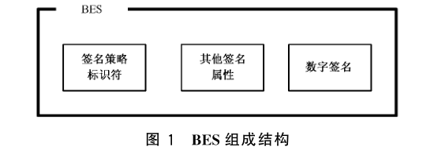

#### 5.2.2 验证数据

根据电子签名所使用的不同策略，签名者应收集不同的验证数据添加到电子签名中，验证者同样也需要收集与之相联系的验证信息。这些验证数据类型包括：

a） 数字证书；

b） 证书撤销信息，如证书撤销列表或在线查询的证书状态信息等；

c） 时间戳或其他可以用来证明事件发生时间的数据，但作为最小要求，签名者和验证者获得的时间戳必须能够维持完整性，对其的任何修改都可以被检测出来，使得各个参与方都能获得电子签名的准确产生时间。

根据电子签名中添加的验证信息的类型和数量，电子签名的安全强度也可以得到不同程度的加强，根据这些验证数据，电子签名可以分为多种类型。

#### 5.2.3 带验证数据的电子签名

##### 5.2.3.1 分类总述

电子签名可以有以下5种格式类型：

a） 基本电子签名（BES），这类电子签名主要包含数字签名和其他签名者提供的基本信息。

b） 带时间戳的电子签名（ES-T），这类电子签名在基本电子签名的基础上添加了时间戳，其目的是保证一定程度的长时间的有效性。

c） 带完全验证数据的电子签名（ES-C），这类电子签名在 ES-T 的基础上，添加了一套完整的用来验证电子签名的数据，例如证书撤销参考信息等等。但其中可能包括了一些参考信息，如一个网址，需要验证者去该网址获得具体数据。

d） 带扩展的验证数据的电子签名（ES-X），这类电子签名在 ES-C的基础上，添加了一些额外数据，以适应一些特殊情况。

e） 带归档时间戳的电子签名（ES-A），这类电子签名是在上述各种电子签名基础上形成的，主要是为长期归档保存电子签名，所以对整个电子签名添加时间戳，以保证长期安全性。

签名者在提交电子签名时，至少应给出 BES 格式的签名，在某些情况下可以决定是否提供ES-T格式的电子签名，在某些极端情况下可以提供ES-C格式的电子签名。如果签名者没有提供 ES-T，则验证者可在收到电子签名时立即自行创建一个 ES-T，或者保存一个接收签名时间的安全记录。验证者的这二种方法都可以为验证时间提供一个独立的证据，而验证时间实际上应接近电子签名的创建时间，使得其可以有足够证据来防止对签名的否认。如果签名者没有提供 ES-C，验证者可在 BES 基础上自行创建一个 ES-C，前提是其可以获得相应的验证数据。除此三种外，ES-X 和 ES-A均为可选支持格式。

##### 5.2.3.2 带时间戳的电子签名（ES-T）

ES-T 中的时间戳所记录的时间应尽可能地接近 BES 的实际创建时间，以提供最大程度的安全保护。

如果签名者没有提供 ES-T，则验证者可在收到电子签名时立即自行创建一个 ES-T。

ES-T 的基本组成结构如图 2 所示：

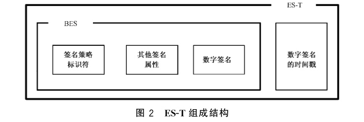

需要注意，当某些验证数据的安全性受到威胁的时候，数字签名上的时间戳或者一个安全的时间记录都可以帮助保护签名的有效性，只要这些安全性威胁是在签名产生以后发生的。因为时间戳和安全时间记录可以有效证明一份电子签名是在这些安全威胁产生前创建的，所以这份电子签名就仍然可以保持其有效性。

##### 5.2.3.3 带完全验证数据的电子签名（ES-C）

ES-C 格式的电子签名不容易与 BES 同时被创建，因为签名者需要去收集相关的证书信息和证书撤销信息。如果发现一份证书已经被暂停使用，则必须等待到证书暂停期结束。从 BES 被创建到 ES-C 被创建可能需要等待一段足够长的时间，签名者只有满足上述这种情况才能创建一个完整的 ES-C。

这样带来的好处是验证者可以获得完整的用来验证 BES 的的数据支持。

如果签名者没有提供 ES-C，验证者可在 BES 基础上自行创建一个 ES-C，前提是其可以获得相应的验证数据。

ES-C 的基本组成结构如图 3 所示：

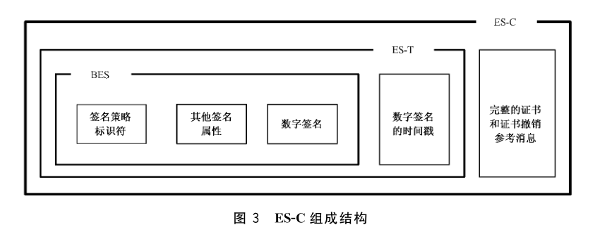

这里所提到的证书和证书撤销参考信息，是指验证者可以根据这些参考信息，通过指定的途径获得最终需要的证书和证书撤销信息。

如果在实际应用中，不需要对数字签名加盖时间戳，则可以使用下面图4的ES-C1 组成结构。但是，这种情况下应保存验证时间的一个安全记录。

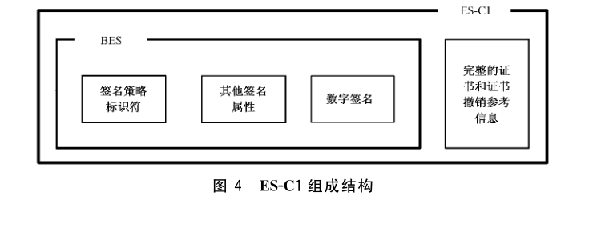

##### 5.2.3.4 带扩展验证数据的电子签名（ES-X）

5.2.3.3所描述的 ES-C 可以扩展成一种新的ES-X 格式，其目的是为了适应以下需求：

a） 如果验证者无法从其他途径获得以下数据，则这些数据可以被添加进电子签名，这种扩展格式称为扩展长验证数据 ES-X0 格式（图 5）：

<ol class="standard-subclauses">
<li>1） 签名者的证书；</li>
<li>2） 构成CA 证书链所需要的CA证书；</li>
<li>3） 需要的具体证书撤销信息。</li>
</ol>

b） 如果CA证书链中的任意一个CA 密钥的安全性可能受到威胁，就有必要添加一个额外的时间戳，统称为扩展时间戳验证数据。这种情况可以使用下面两种格式：

<ol class="standard-subclauses">
<li>1） 在 ES-C 的基础上，为整个 ES-C 产生一个时间戳，并添加到电子签名中。这种扩展格式称为 ES-X1 格式（图6）；</li>
<li>2） 在 ES-C 的基础上，仅仅对 ES-C 添加的“证书和证书撤销参考信息”产生时间戳，并添加到电子签名中。这种扩展格式称为 ES-X2 格式（图7）。</li>
</ol>

c） 如果以上二种情况同时发生，则需要同时在电子签名中添加二类数据。根据b）中的不同格式，可以产生 ES-X3格式（图8）和 ES-X4 格式（图9），统称为扩展时间戳长验证数据。

本标准定义的各种 ES-X 格式仅为可选格式，是否对其支持也是可选的。

ES-X0 的组成结构如图 5 所示：

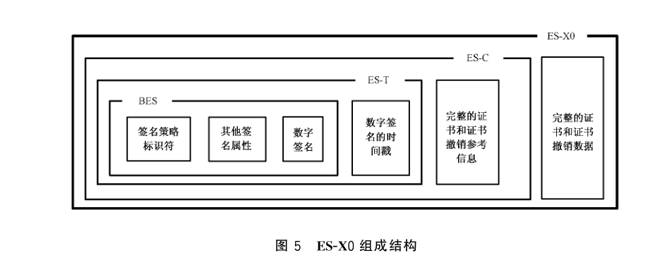

ES-X1 的组成结构如图 6 所示：

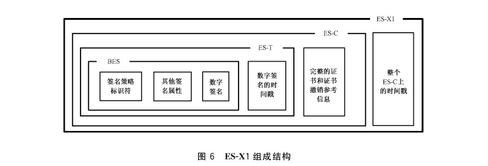

ES-X2 的组成结构如图 7 所示：

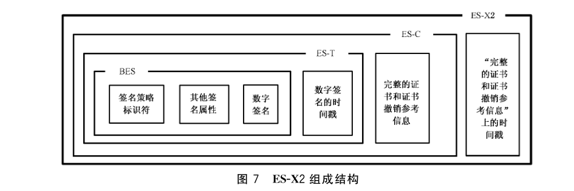

ES-X3 所包含的内容包括完整的证书和证书撤销数据，以及针对所有内容的时间戳，其基本结构如图 8 所示：

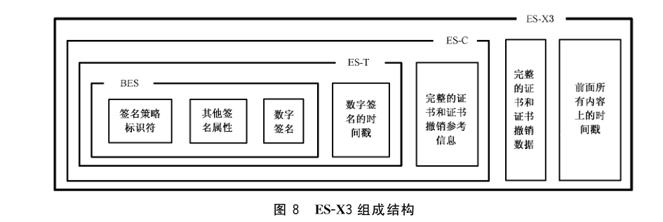

ES-X4 所包含的内容主要有完整的证书和证书撤销数据，以及对“完整的证书和证书撤销数据”上的时间戳，其基本组成结构如图 9 所示：

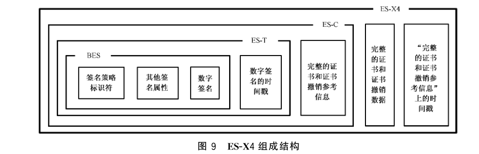

##### 5.2.3.5 带归档时间戳的电子签名（ES-A）

各种算法、密钥、加密数据、加密函数都会随着时间而逐渐降低其安全性，各种证书也会随着时间而纷纷失效，如果要长期保存一个电子签名，就需要在这些成分的安全性降低前对整个电子签名加盖一次时间戳。新加的时间戳尽可能使用比老时间戳更强的算法和密钥。这类额外添加的验证数据称为归档验证数据。

考虑到时间戳所使用的证书、算法和密钥也会随着时间而失效或降低安全性，在这种情况发生前，必须加盖新的时间戳。因此，一个 ES-A 可能嵌套了多重时间戳。

本标准定义的 ES-A 是可选格式，对其的支持也是可选的。

ES-A 的基本组成结构如图 10 所示：

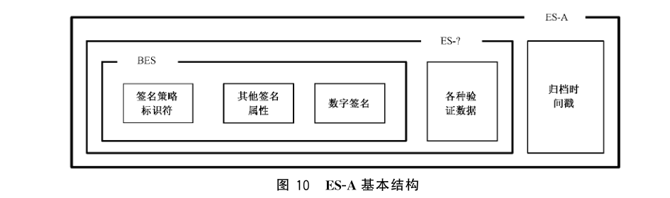

### 5.3 电子签名的验证

#### 5.3.1 验证目标

对电子签名的验证必须符合电子签名策略，验证的结果有3种情况：

a） 签名有效。这个结果意味着该电子签名通过了验证，并且符合电子签名策略的所有要求；

b） 签名无效。签名无效基于以下二种情况：

<ol class="standard-subclauses">
<li>1） 电子签名的格式错误；</li>
<li>2） 数字签名验证失败，例如：数字签名完整性检测失败：验证过程中所使用的数字证书已经无效或者被撤销；</li>
</ol>

c） 不完全验证。这个结果意味着电子签名的格式没有错误，数字签名也已经通过验证，但是没有足够的信息判断该电子签名是否符合其签名策略的要求。例如，签名策略需要一些附加信息，这些信息对数字签名的有效性没有任何影响，但是现在因为无法获得，所以无法判断是否符合签名策略。在这种情况下，验证者应根据策略要求用户自行处理“部分正确”的电子签名，也可在信息足够时再度对电子签名进行验证。

#### 5.3.2 验证过程

如5.2.2所述，签名者和验证者都可以收集所有的额外数据来完成一个电子签名的创建和验证，图11描述了如何完成一个 ES-C验证的过程。

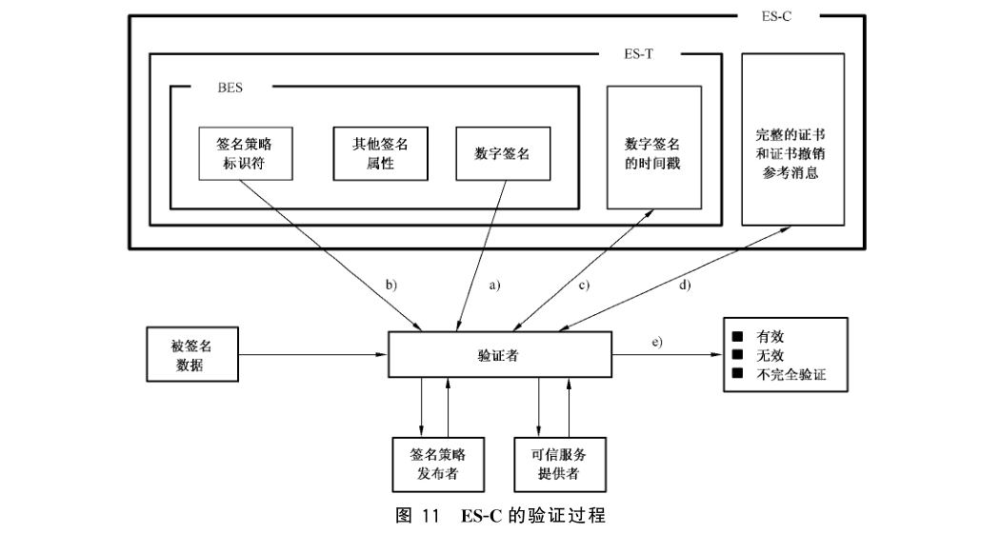

a） 在收到签名者的BES以后，验证者根据被签名数据和 BES，首先验证数字签名的正确性、完整性和有效性。

b） 验证者根据电子签名以及 TSP 提供的数据，检查签名是否符合签名策略的要求。

c） 如果签名者没有提供时间戳或者没有提供可以信任的时间戳，则验证者此时应自行添加一个时间戳。因此到这一步截止，至少应产生一个 ES-T电子签名。

d） 如果签名者没有提供证书和证书撤销参考信息，则验证者需要收集所有必需的证书和证书撤销信息，并在这些数据可以使用后，完成所有的验证过程。然后记录一个完整的证书和证书撤销参考信息，创建 ES-C电子签名。

e） 验证者输出验证结果。

ES-C 是标准中必须支持的格式，但是验证者可以进一步扩展成需要的 ES-X 或者 ES-A 可选格式。

如果签名者没有提供 ES-X，则在验证者完成 ES-C 以后，验证者将可以提供或记录在 ES-C 中使用的完整的证书和证书撤销数据（图 12 中的步骤 f）），从而形成 ES-X0 格式，过程如图 12 所示：

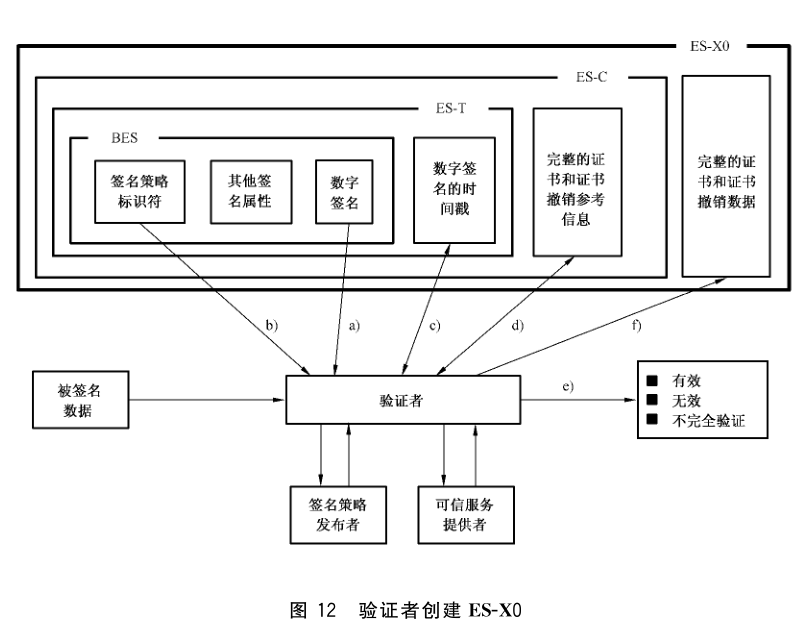

根据验证者的选择和实际情况，也可以创建一个 ES-X1 电子签名，在整个 ES-C上加盖时间戳（图13 中步骤g）），过程如图 13所示：

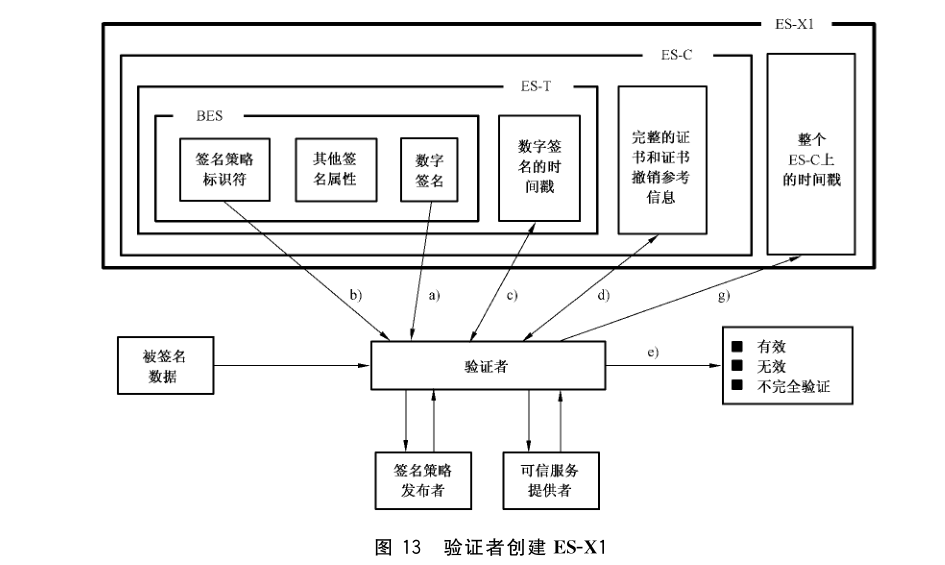

验证者也可以创建一个 ES-X2 电子签名，只在“证书和证书撤销参考信息”上加盖时间戳（图 14 中步骤 g′）），过程如图 14 所示：

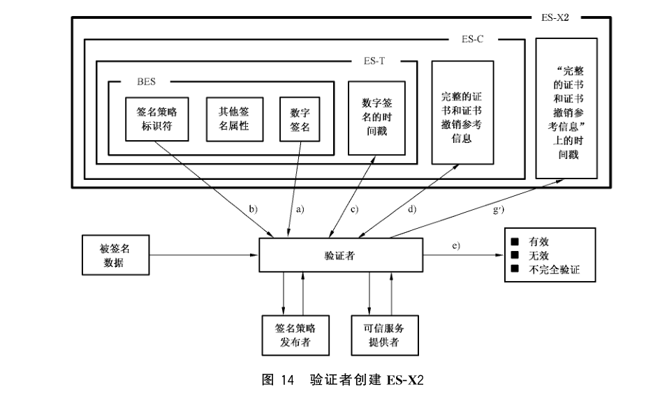

最后，验证者有必要针对需要长期保存的电子签名创建 ES-A 格式，这种格式不需要马上创建，但应在电子签名中任何一项元素（如算法、密钥、证书等）的安全性受威胁前创建。创建时，验证者需要针对整个电子签名的所有内容加盖时间戳（图15中步骤h）），过程如图15所示：

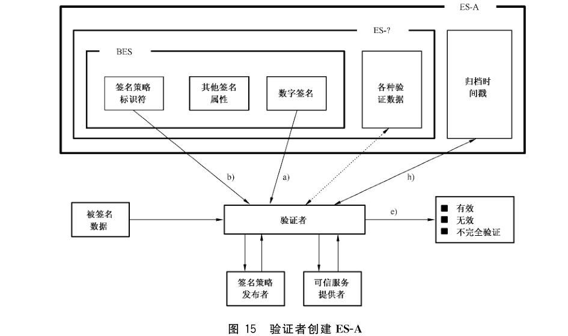

#### 5.3.3 仲裁

如果签名者和验证者发生争执，则需要提请仲裁者进行仲裁。针对提请仲裁的电子签名类型，有以下这些考虑：ES-C 签名可以作为仲裁使用的签名类型，但必须符合下面3个条件：

a） 仲裁者知道如何获得签名者的证书、所有的交叉认证证书、需要的 CRL 以及 ES-C 可能提到的 OCSP 查询；

b） 签名所使用的整个证书链都是安全的，链上每个证书密钥的安全性都还未受到威胁；

c） 在ES-C创建时所使用的各种密码学技术，在仲裁时仍然是安全的。

如果条件 a）不满足，则原告方需要提供 ES-X0电子签名。

如果条件 b）不满足，则原告方需要提供 ES-X1 或者 ES-X2电子签名。

如果条件c）不满足，则原告方需要提供 ES-A 电子签名。

## 6 电子签名的数据格式

### 6.1 基本数据格式

本标准中数据格式、语法结构等均采用GB/T 16262.1—2006 规定的 ASN.1 表示描述。本条中的数据格式定义以 RFC2630 中定义的加密消息语法（CMS）和 RFC2634 中定义的增强安全服务（ESS）为基础。对于 RFC2630和 RFC2634中已定义的语法结构，本标准直接引用不再给出具体定义。

#### 6.1.1 总体语法结构

电子签名的总体语法结构见 RFC2630中的定义。

#### 6.1.2 数据内容类型

电子签名中的数据内容类型的语法结构和要求见 RFC2630。

#### 6.1.3 签名数据内容类型

电子签名中的签名数据内容类型的语法结构和要求见 RFC2630。

为了确保签名验证方能够正确地使用签名者公钥进行验证，本标准中规定，签名证书属性（Signed Attribute）应包含签名者的签名认证证书的杂凑值，签名证书属性的定义见 RFC2634。

#### 6.1.4 签名数据类型

电子签名中的签名数据类型的语法结构和要求除了符合 RFC2630的规定外，还应满足以下3点：

a） 版本号须设置为3；

b） 用于签名的签名者证书的标识须经过签名；

c） 签名数据中必须至少有一个签名者信息。

#### 6.1.5 封装数据内容信息类型

电子签名中的封装数据内容信息类型的语法结构和要求见 RFC2630。其中各字段的含义和要求与 RFC2630 中一致，另外还要求字段中必须至少有一个签名者信息。

#### 6.1.6 签名者信息类型

电子签名中的签名者信息类型的语法结构和要求见 RFC2630。每个签名者的信息都用一个签名者信息类型的数据结构表示，对有多个独立签名者的情况，每个签名者都使用一个签名者信息类型的数据结构表示。

签名者信息类型中各字段的含义和要求与 RFC2630中相同，但被签名属性中须包含以下属性：

a） 内容类型；

b） 消息摘要；

c） 签名时间；

d） 签名证书；

e） 签名策略标识。

其消息摘要的计算流程、消息签名的生成流程见 RFC2630中的相关规定。消息签名的验证流程除了 RFC2630 中规定的内容外，还应满足以下要求：用于验证签名的签名者的公钥的真实性须使用 ESS规定的或其他的签名证书属性来验证。

#### 6.1.7 RFC2630 中引入的强制属性

在本标准所规定的电子签名中，下列几种 RFC2630中定义的属性必须与签名数据一同出现：

a） 内容类型属性（content-type attribute），其语法结构定义见 RFC2630；

b） 消息摘要属性（message-digest attribute），其语法结构定义见 RFC2630；

c） 签名时间属性（signing-time attribute），其语法结构定义见 RFC2630。该属性中的时间值应是签名者声称已经完成签名过程的时间，本标准中建议时间格式采用 Generalized Time 类型。

#### 6.1.8 可替代的签名证书属性

##### 6.1.8.1 签名证书属性选择标准

符合本标准的电子签名应在签名数据中包含下面两个可选签名证书属性中的一个，而且仅包含一个。选择的依据是：当使用的杂凑函数为 SHA-1 时使用ESS 签名证书属性，当使用其他杂凑函数时，使用其他签名证书属性。

##### 6.1.8.2 ESS 签名证书属性

ESS 签名证书属性的语法结构定义和要求见 RFC2634。各字段的含义和用法除了 RFC2634中规定的以外还须满足以下几点：

a） ESS 签名证书属性必须是被签名属性，而且不能为空。用于验证签名的证书的标识必须包含在该属性中。

b） 用于验证签名的证书所对应的 ESS 签名证书属性中 ESSCertID 字段的编码应包含 issureSerial 字段，而且 issureSerial 字段内容应该与 SignerInfo 中的 issuerAndSerialNumber 字段内容相符。在签名验证过程中，应检查所使用的验证证书的杂凑值与上述字段中的相应内容是否一致，如不一致，应认定该签名无效。

#> 转写注：6.1.8.2 原版字段拼作 `issureSerial`，与后文 ASN.1 的 `issuerSerial` 不一致，此处保留原文。

#### 6.1.8.3 其他签名证书属性

该属性的结构与ESS签名证书属性相同，但该属性可以在杂凑函数非 SHA-1 的情况下使用。对ESS签名证书属性的使用要求同样适用于该属性。

该属性的对象标识符（OID，Object Identifier）如下：

```asn1
id-aa-ets-otherSigCert OBJECT IDENTIFIER ::= {
    iso(1) member-body(2) us(840) rsadsi(113549)
    pkcs(1) pkcs9(9) smime(16) id-aa(2) 19
}
```

该属性（OtherSigningCertificate）的语法结构 ASN.1 描述如下：

```asn1
OtherSigningCertificate ::= SEQUENCE {
    certs SEQUENCE OF OtherCertID,
}
OtherCertID ::= SEQUENCE {
    otherCertHash OtherHash,
    issuerSerial IssuerSerial OPTIONAL
}
OtherHash ::= CHOICE {
    sha1Hash OtherHashValue, -- 该字段包含一个 SHA-1 的杂凑值
    otherHash OtherHashAlgAndValue
}
OtherHashValue ::= OCTET STRING
OtherHashAlgAndValue ::= SEQUENCE {
    hashAlgorithm AlgorithmIdentifier,
    hashValue OtherHashValue
}
```

#### 6.1.9 其他强制属性

本标准要求在签名数据（SignedData）中必须包含一个对签名策略的引用。这个引用可以被显式地标识出来，也可以是通过签名内容或其他外部数据隐式的给出。签名策略定义了产生并验证一个签名的规则，应在每个签名的被签名属性中都包含。签名策略标识属性应为被签名属性。签名策略标识的对象标识符为：

```asn1
id-aa-ets-sigPolicyId OBJECT IDENTIFIER ::= {
    iso(1) member-body(2) us(840) rsadsi(113549)
    pkcs(1) pkcs9(9) smime(16) id-aa(2) 15
}
```

其语法结构的 ASN.1 描述为：

Signature-policy-identifier attribute values have ASN.1 type SignaturePolicyIdentifier.

```asn1
SignaturePolicyIdentifier ::= CHOICE {
    SignaturePolicyId SignaturePolicyId,
    SignaturePolicyImplied SignaturePolicyImplied
}
SignaturePolicyId ::= SEQUENCE {
    sigPolicyId SigPolicyId,
    sigPolicyHash SigPolicyHash,
    sigPolicyQualifiers SEQUENCE SIZE (1..MAX) OF SigPolicyQualifierInfo OPTIONAL
}
SignaturePolicyImplied ::= NULL
```

SignaturePolicyImplied 为 NULL 类型表明了，签名策略是在签名内容或其他外部数据中隐式的给出的。

SigPolicyId 字段包含了一个能够唯一标识某个签名策略的对象标识符，其语法结构为：

```asn1
SigPolicyId ::= OBJECT IDENTIFIER
```

SigPolicyHash 字段包含了杂凑算法的标识符和对签名策略的杂凑运算结果。

如果签名策略是用 ASN.1 定义的，则其杂凑值是对其编码中除去外部类型和长度的部分做杂凑运算的结果，而且杂凑函数算法应在 SignPolicyHshAlg 字段中给出。

如果签名策略是用其他语法结构定义的，则其语法结构的类型以及使用的杂凑函数应作为签名策略的一部分给出，或使用签名策略限定符（signature policy qualifier）标明。

```asn1
SigPolicyHash ::= OtherHashAlgAndValue
```

签名策略标识符应通过签名策略限定符的其他相关信息限定。签名策略限定符的语义及语法结构是与 SigPolicyQualifierId 字段中的对象标识符相关联的，其语法定义如下：

```asn1
SigPolicyQualifierInfo ::= SEQUENCE {
  sigPolicyQualifierId SigPolicyQualifierId,
  sigQualifier ANY DEFINED BY sigPolicyQualifierId }
```

本标准给出两种限定符：

a）spuri：包含了指向签名策略的 URI 或 URL；

b）spUserNotice：包含一个用户通知，当验证签名时该通知应被显示给验证者。

```asn1
SigPolicyQualifierId ::= OBJECT IDENTIFIER
id-spq-ets-uri OBJECT IDENTIFIER ::= { iso(1) member-body(2) us(840)
  rsadsi(113549) pkcs(1) pkcs9(9) smime(16) id-spq(5) 1 }
SPuri ::= IA5String
id-spq-ets-unotice OBJECT IDENTIFIER ::= { iso(1) member-body(2) us(840)
  rsadsi(113549) pkcs(1) pkcs9(9) smime(16) id-spq(5) 2 }
SPUserNotice ::= SEQUENCE {
  noticeRef NoticeReference OPTIONAL,
  explicitText DisplayText OPTIONAL }
NoticeReference ::= SEQUENCE {
  organization DisplayText,
  noticeNumbers SEQUENCE OF INTEGER }
DisplayText ::= CHOICE {
  visibleString VisibleString (SIZE (1..200)),
  bmpString BMPString (SIZE (1..200)),
  utf8String UTF8String (SIZE (1..200)) }
```

#### 6.1.10 RFC2630 中引入的可选属性

联署签名属性（countersignature attribute）。其语法结构定义见 RFC2630。联署签名属性在使用时应为未签名属性（UnsignedAttribute）。

#### 6.1.11 RFC2634 中引入的可选属性

RFC2634 中引入的可选属性包含以下属性：

a）签名内容引用属性（Signed Content Reference Attribute）。该属性把一个签名数据链接到另一个。可以用于把对消息的回复同原消息联系起来，或者把一个签名数据并入其他签名数据中。该属性应为被签名属性。其语法结构定义见 RFC2634。

b）内容标识属性（Content Identifier Attribute）。内容标识属性提供一个被签名内容的标识，该标识可在以后需要对该内容进行引用时使用。该属性的语法结构定义见 RFC2634，在使用时，该属性应为被签名属性。

c）内容提示属性（Content Hint Attribute）。内容提示属性用于提供被签名内容的格式信息。可以用于签名者向验证者指明被签名内容的格式。当被签名内容必须显示给验证方看时，该属性必须包含在签名数据中。其语法结构定义见 RFC2634。

#### 6.1.12 其他可选属性

其他可选属性包括以下属性：

##### 6.1.12.1 承诺类型标识属性

在某些情况下，签名者希望通过显式的向验证者表明，签名数据代表了签名者某种承诺。承诺类型标识属性（Commitment Type Indication Attribute）用于传达这种信息。该属性应为被签名属性。

承诺类型应是签名策略的一部分，或者是一个已经注册的类型。

签名策略规定了一个其承认的属性集合。这个承认的属性集合中包含了所有该策略承认的承诺类型。只有承认的承诺类型才允许出现在该属性字段中。

该属性的对象标识符定义为：

```asn1
id-aa-ets-commitmentType OBJECT IDENTIFIER ::= { iso(1) member-body(2) us(840)
  rsadsi(113549) pkcs(1) pkcs-9(9) smime(16) id-aa(2) 16 }
```

该属性的语法结构 ASN.1 定义为：

```asn1
CommitmentTypeIndication ::= SEQUENCE {
  commitmentTypeId CommitmentTypeIdentifier,
  commitmentTypeQualifier SEQUENCE SIZE (1..MAX) OF CommitmentTypeQualifier
    OPTIONAL }
CommitmentTypeIdentifier ::= OBJECT IDENTIFIER
CommitmentTypeQualifier ::= SEQUENCE {
  commitmentTypeIdentifier CommitmentTypeIdentifier,
  qualifier ANY DEFINED BY commitmentTypeIdentifier }
```

本标准给出几种承诺类型：

```asn1
id-cti-ets-proofOfOrigin OBJECT IDENTIFIER ::= { iso(1) member-body(2) us(840)
  rsadsi(113549) pkcs(1) pkcs-9(9) smime(16) cti(6) 1 }
id-cti-ets-proofOfReceipt OBJECT IDENTIFIER ::= { iso(1) member-body(2) us(840)
  rsadsi(113549) pkcs(1) pkcs-9(9) smime(16) cti(6) 2 }
id-cti-ets-proofOfDelivery OBJECT IDENTIFIER ::= { iso(1) member-body(2) us(840)
  rsadsi(113549) pkcs(1) pkcs-9(9) smime(16) cti(6) 3 }
id-cti-ets-proofOfSender OBJECT IDENTIFIER ::= { iso(1) member-body(2) us(840)
  rsadsi(113549) pkcs(1) pkcs-9(9) smime(16) cti(6) 4 }
id-cti-ets-proofOfApproval OBJECT IDENTIFIER ::= { iso(1) member-body(2) us(840)
  rsadsi(113549) pkcs(1) pkcs-9(9) smime(16) cti(6) 5 }
id-cti-ets-proofOfCreation OBJECT IDENTIFIER ::= { iso(1) member-body(2) us(840)
  rsadsi(113549) pkcs(1) pkcs-9(9) smime(16) cti(6) 6 }
```

这些承诺类型含义如下：

<ol class="standard-subclauses">
<li>1）Proof of origin：表明签名者承认其曾生成、认同并发送了该消息；</li>
<li>2）Proof of receipt：表明签名者承认其曾接受到该内容的消息；</li>
<li>3）Proof of delivery：表明提供该承诺的可信服务提供者已经把某消息传送给了接受者可访问的本地存储中；</li>
<li>4）Proof of sender：表明提供该承诺的实体发送过这个消息（但不一定创建了该消息）；</li>
<li>5）Proof of approval：表明签名者认同该消息的内容；</li>
<li>6）Proof of creation：表明签名者创建了该消息（但并不一定认同或发送过该消息）。</li>
</ol>

##### 6.1.12.2 签名者位置属性

签名者位置属性（Signer Location）用于指定一个表明签名者所处地理位置的助记符。这个助记符应在签名者所在的国家注册，并在公共电报服务（Public Telegram Service）中使用。该属性应为被签名属性。

该属性的对象标识符为：

```asn1
id-aa-ets-signerLocation OBJECT IDENTIFIER ::= { iso(1) member-body(2) us(840)
  rsadsi(113549) pkcs(1) pkcs-9(9) smime(16) id-aa(2) 17 }
```

该属性的语法结构 ASN.1 定义为：

```asn1
SignerLocation ::= SEQUENCE { ---下列的内容应至少有一项出现
  countryName [0] DirectoryString OPTIONAL,
  localityName [1] DirectoryString OPTIONAL,
  postalAdddress [2] PostalAddress OPTIONAL, }
PostalAddress ::= SEQUENCE SIZE(1..6) OF DirectoryString
```

##### 6.1.12.3 签名者属性

签名者属性（Signer Attributes）用于表示签名者的其他信息，包括签名者宣称的属性和签名者被证明的属性。该属性应为被签名属性。

该属性的对象标识符为：

```asn1
id-aa-ets-signerAttr OBJECT IDENTIFIER ::= { iso(1) member-body(2) us(840)
  rsadsi(113549) pkcs(1) pkcs-9(9) smime(16) id-aa(2) 18 }
```

该属性语法结构的 ASN.1 描述为：

```asn1
SignerAttribute ::= SEQUENCE OF CHOICE {
  claimedAttributes [0] ClaimedAttributes,
  certifiedAttributes [1] CertifiedAttributes }
ClaimedAttributes ::= SEQUENCE OF Attribute
CertifiedAttributes ::= AttributeCertificate ---见 GB/T 16264.8—2005 中定义。
```

##### 6.1.12.4 内容时间戳

内容时间戳（Content Timestamp）属性是被签名内容在签名前的一个时间戳。该属性应为被签名属性。其对象标识符为：

```asn1
id-aa-ets-contentTimestamp OBJECT IDENTIFIER ::= { iso(1) member-body(2) us(840)
  rsadsi(113549) pkcs(1) pkcs-9(9) smime(16) id-aa(2) 20 }
```

其语法结构的 ASN.1 描述为：

```asn1
ContentTimestamp ::= TimeStampToken
```

TimeStampToken 定义见 GB/T 20520—2006。TimeStampToken 中的 messageImprint 字段的值应为电子签名中 signedData 中的 encapContentInfo 中的 eContent 字段的内容的杂凑值。

#### 6.1.13 对多签名的支持

对多签名的支持包含以下方法：

a） 独立签名。多方独立签名可通过对每个签名者使用一个 SignerInfo实现。每个 SignerInfo 都应包括本标准中规定的所有属性。签名验证者应对每个 SignerInfo 都单独验证。

b） 嵌入签名。对方嵌入签名可通过使用未签名的联署签名属性（counter-signature unsigned attribute）实现。每个联署签名结果都应放在签名结果的 SignerInfo 的一个联署签名属性（Countersignature）中。

### 6.2 验证数据格式

#### 6.2.1 导引

本条规定了电子签名的验证数据格式，包括时间戳和完全验证数据。时间戳应用于电子签名的值，完全验证数据包含签名值的时间戳、用于电子签名完全验证的所有证书和撤销信息。

本条还规定验证数据的扩展格式。时间戳包含 ES-C 的时间戳，而扩展时间戳包含验证路径引用和撤销信息引用的时间戳以支持 ES-C。扩展长验证数据包含完全验证数据和使用在 ES-C 中的所有证书和撤销信息的实际值。扩展时间戳长验证数据包含时间戳或扩展时间戳，和使用在 ES-C 中的所有证书和撤销信息的实际值。

本条还规定了归档验证数据的数据格式。归档验证数据包含完全验证数据、证书和撤销信息、扩展时间戳、签名用户数据和所有这些数据的归档时间戳。归档时间戳可以在一个长周期后重新申请，在电子签名和时间戳算法弱化时以维持有效性。

本条下面定义的所有数据都是非签名类型。

#### 6.2.2 电子签名时间戳

一个电子签名可以从不同的时间戳机构得到多个电子签名时间戳实例。以下的对象标识符标识了签名时间戳属性：

```asn1
id-aa-signatureTimeStampToken OBJECT IDENTIFIER ::= { iso(1) member-body(2)
  us(840) rsadsi(113549) pkcs(1) pkcs-9(9) smime(16) id-aa(2) 14 }
```

签名时间戳属性值的 ASN.1 语法为：

```asn1
SignatureTimeStampToken ::= TimeStampToken
```

TimeStampToken 中的 messageImprint 域的值应为用于对 signedData 进行时间戳的 SignerInfo 中的签名域值的杂凑值。

#### 6.2.3 完全验证数据

##### 6.2.3.1 完全验证数据内容

完全验证数据最少应包括签名时间戳属性、完全证书引用、完全撤销引用。

##### 6.2.3.2 完全证书引用属性

完全证书引用引用了 CA 证书的全集，这些证书被用于验证 ES-C。一个电子签名只可以有一个完全证书引用实例。以下的对象标识符标识了完全证书引用属性：

```asn1
id-aa-ets-certificateRefs OBJECT IDENTIFIER ::= { iso(1) member-body(2)
  us(840) rsadsi(113549) pkcs(1) pkcs-9(9) smime(16) id-aa(2) 21 }
```

完全证书引用属性值的 ASN.1 语法为：

```asn1
CompleteCertificateRefs ::= SEQUENCE OF OtherCertID
```

其中 OtherCertID 中应出现 IssuerSerial，certHash 应与证书引用的杂凑值匹配。

##### 6.2.3.3 完全撤销引用属性

完全撤销引用引用了 CRL 或 OCSP 响应的全集，这些 CRL 或 OCSP 响应被用于验证 ES-C 中使用的签名者和 CA 证书。一个电子签名只可以有一个完全撤销引用实例。以下的对象标识符标识了完全撤销引用属性：

```asn1
id-aa-ets-revocationRefs OBJECT IDENTIFIER ::= { iso(1) member-body(2)
  us(840) rsadsi(113549) pkcs(1) pkcs-9(9) smime(16) id-aa(2) 22 }
```

完全撤销引用属性值的 ASN.1 语法为：

```asn1
CompleteRevocationRefs ::= SEQUENCE OF CrlOcspRef
CrlOcspRef ::= SEQUENCE {
  crlids [0] CRLListID OPTIONAL,
  ocspids [1] OcspListID OPTIONAL,
  otherRev [2] OtherRevRefs OPTIONAL }
```

CompleteRevocationRefs 应包含签名证书的一个 CrlOcspRef、CompleteCertificateRefs 属性中每个 OtherCertID 的 CrlOcspRef，这些 CrlOcspRef 应与相关的 OtherCertID 次序保持一致。

```asn1
CRLListID ::= SEQUENCE {
  crls SEQUENCE OF CrlValidatedID }
CrlValidatedID ::= SEQUENCE {
  crlHash OtherHash,
  crlIdentifier CrlIdentifier OPTIONAL }
CrlIdentifier ::= SEQUENCE {
  crlissuer Name,
  crlIssuedTime UTCTime,
  crlNumber INTEGER OPTIONAL }
OcspListID ::= SEQUENCE {
  ocspResponses SEQUENCE OF OcspResponsesID }
OcspResponsesID ::= SEQUENCE {
  ocspIdentifier OcspIdentifier,
  ocspRepHash OtherHash OPTIONAL }
OcspIdentifier ::= SEQUENCE {
  ocspResponderID ResponderID,
  producedAt GeneralizedTime }
```

创建 crlValidatedID 时，在包含签名的完整的 DER 编码的 CRL 上 crlHash 被计算出。除非 CRL 可以从其他信息中推断出，crlIdentifier 一般都要出现。crlIdentifier 用颁发者名字和 CRL 颁发时间来标识 CRL，其中 CRL 颁发时间对应着 CRL 中的“thisUpdate”时间。当标识的 CRL 是增量 CRL 时，crlListID 应包含 CRL 集合的引用以提供完全的撤销列表。

OcspIdentifier 用颁发者名字和 OCSP 响应颁发时间来标识 OCSP 响应，其中 OCSP 响应颁发时间对应着 OCSP 响应中的“producedAt”时间。由于可能需要在同一秒内区别收到的两个不同的 OCSP 响应，OcspResponsesID 中的响应杂凑值被用于解决这种混淆。

```asn1
OtherRevRefs ::= SEQUENCE {
  otherRevRefType OtherRevRefType,
  otherRevRefs ANY DEFINED BY otherRevRefType }
OtherRevRefType ::= OBJECT IDENTIFIER
```

其他撤销引用的语法和语意不在本规范描述。

#### 6.2.4 扩展验证数据

##### 6.2.4.1 证书值属性

证书值属性含有完全证书引用属性中引用的证书值。一个电子签名只可以有一个证书值属性实例。以下的对象标识符标识了证书值属性：

```asn1
id-aa-ets-certValues OBJECT IDENTIFIER ::= { iso(1) member-body(2)
  us(840) rsadsi(113549) pkcs(1) pkcs-9(9) smime(16) id-aa(2) 23 }
```

证书值属性值的 ASN.1 语法为：

```asn1
CertificateValues ::= SEQUENCE OF Certificate
```

##### 6.2.4.2 撤销值属性

撤销值属性含有完全撤销引用属性中引用的 CRL 和 OCSP 的值。一个电子签名只可以有一个撤销值属性实例。以下的对象标识符标识了撤销值属性：

```asn1
id-aa-ets-revocationValues OBJECT IDENTIFIER ::= { iso(1) member-body(2)
  us(840) rsadsi(113549) pkcs(1) pkcs-9(9) smime(16) id-aa(2) 24 }
```

撤销值属性值的 ASN.1 语法为：

```asn1
RevocationValues ::= SEQUENCE {
  crlVals [0] SEQUENCE OF CertificateList OPTIONAL,
  ocspVals [1] SEQUENCE OF BasicOCSPResponse OPTIONAL,
  otherRevVals [2] OtherRevVals }
OtherRevVals ::= SEQUENCE {
  otherRevValType OtherRevValType,
  otherRevVals ANY DEFINED BY OtherRevValType }
OtherRevValType ::= OBJECT IDENTIFIER
```

其中 CertificateList 在 GB/T 20518—2006 中定义，BasicOCSPResponse 参见 GB/T 19713—2005 中的定义。

##### 6.2.4.3 ES-C 时间戳属性

ES-C 时间戳属性是电子签名和完全验证数据的杂凑值的时间戳。一个电子签名可以从不同的时间戳机构得到多个 ES-C 时间戳属性实例。以下的对象标识符标识了 ES-C 时间戳属性：

```asn1
id-aa-ets-escTimeStamp OBJECT IDENTIFIER ::= { iso(1) member-body(2)
  us(840) rsadsi(113549) pkcs(1) pkcs-9(9) smime(16) id-aa(2) 25 }
```

ES-C 时间戳属性值的 ASN.1 语法为：

```asn1
ESCTimeStampToken ::= TimeStampToken
```

TimeStampToken 中的 messageImprint 域的值应为出现在 ES-C 中的以下数据对象的连接值的杂凑值：

a）SignerInfo 中的签名域；

b）签名时间戳属性；

c）完全证书引用属性；

d）完全撤销引用属性。

##### 6.2.4.4 时间戳证书和 CRL 属性

时间戳证书和 CRL 属性是相关证书和 OCSP 响应/CRL 的一个列表，这个列表被加了时间戳来保护 CA 安全。以下的对象标识符标识了时间戳证书和 CRL 属性：

```asn1
id-aa-ets-certCRLTimestamp OBJECT IDENTIFIER ::= { iso(1) member-body(2)
  us(840) rsadsi(113549) pkcs(1) pkcs-9(9) smime(16) id-aa(2) 26 }
```

时间戳证书和 CRL 属性值的 ASN.1 语法为：

```asn1
TimestampedCertsCRLs ::= TimeStampToken
```

TimeStampToken 中的 messageImprint 域的值应为出现在 ES-C 中的以下数据对象的连接值的杂凑值：

a）完全证书引用属性；

b）完全撤销引用属性。

#### 6.2.5 归档验证数据

当需要一个非常长时间的电子签名，可能会因为算法的弱化或 TSA 证书的有效期限制，电子签名的时间戳可能会变得危险，这时需要多次申请电子签名的时间戳。归档时间戳用于解决这个问题，时间戳可以每过一定周期反复应用。

归档时间戳属性是用户数据和整个电子签名的时间戳。一个电子签名可以从不同的时间戳机构随着时间的流逝得到多个归档时间戳属性实例。以下的对象标识符标识了嵌套归档时间戳属性：

```asn1
id-aa-ets-archiveTimestamp OBJECT IDENTIFIER ::= { iso(1) member-body(2)
  us(840) rsadsi(113549) pkcs(1) pkcs-9(9) smime(16) id-aa(2) 27 }
```

归档时间戳属性值的 ASN.1 语法为：

```asn1
ArchiveTimeStampToken ::= TimeStampToken
```

TimeStampToken 中的 messageImprint 域的值应为出现在电子签名中的以下数据对象的连接值的杂凑值：

a）encapContentInfo eContent OCTET STRING；

b）signedAttributes；

c）signature field within SignerInfo；

d）SignatureTimeStampToken attribute；

e）CompleteCertificateRefs attribute；

f）CompleteRevocationData attribute；

g）CertificateValues attribute（如果不存在，这个信息就应该包含在 ES-A 中）；

h）RevocationValues attribute（如果不存在，这个信息就应该包含在 ES-A 中）；

i）ESCTimeStampToken attribute if present；

j）TimestampedCertsCRLs attribute if present；

k）any previous ArchiveTimeStampToken attributes。

归档时间戳应该比普通电子签名和弱算法（密钥长度）时间戳使用更强的算法（或更长的密钥长度）。

### 6.3 签名策略要求

对于签名策略，本标准要求：

a） 签名者和验证者应按照签名策略属性中给出的签名策略来产生和验证签名；

b） 显式给出的签名策略应使用对象表述符标识；

c） 应有一个对应签名策略的策略说明；

d） 对一个显式给出的策略，应有一个确定的策略说明格式，并且该格式有唯一的二进制编码；

e） 对于确定的并且显式给出的签名策略说明，应有一个使用合法算法做的杂凑运算结果，签名者应向验证者提供该杂凑运算结果，验证者应检查该结果的正确性。

签名策略说明主要包括关于该策略的一般性信息，验证该策略的规则以及其他的签名策略相关信息。

#### 6.3.1 ASN.1 总体结构

本标准给出的 ASN.1 语法结构使用 DER 编码格式。

签名策略的 ASN.1 语法结构描述如下：

```asn1
SignaturePolicy ::= SEQUENCE {
  signPolicyHashAlg AlgorithmIdentifier,
  signPolicyInfo SignPolicyInfo,
  signPolicyHash SignPolicyHash OPTIONAL }
SignPolicyHash ::= OCTET STRING
SignPolicyInfo ::= SEQUENCE {
  signPolicyIdentifier SignPolicyId,
  dateOfIssue GeneralizedTime,
  policyIssuerName PolicyIssuerName,
  fieldOfApplication FieldOfApplication,
  signatureValidationPolicy SignatureValidationPolicy,
  signPolExtensions SignPolExtensions OPTIONAL }
SignPolicyId ::= OBJECT IDENTIFIER
```

PolicyIssuerName 字段使用 General Name 的方式标识策略颁发者，ASN.1 定义如下：

```asn1
PolicyIssuerName ::= GeneralNames
```

fieldofApplication 字段描述该策略的期望应用领域，ASN.1 定义如下：

```asn1
FieldOfApplication ::= DirectoryString
```

#### 6.3.2 签名验证策略

对于签名者，签名验证策略（Signature Validation Policy）规定了电子签名中应包含的数据单元；对于签名验证者，签名验证策略规定了根据签名策略的要求，电子签名中应含有哪些数据单元才有可能验证通过。

签名验证策略的语法结构定义如下：

```asn1
SignatureValidationPolicy ::= SEQUENCE {
  signingPeriod SigningPeriod,
  commonRules CommonRules,
  commitmentRules CommitmentRules,
  signPolExtensions SignPolExtensions OPTIONAL }
```

其中 signingPeriod 字段用于给出该签名策略有效期的起始日期和时间，另外该字段还有一个可选项用于给出该签名策略有效期的终止日期和时间。该字段的语法结构如下：

```asn1
SigningPeriod ::= SEQUENCE {
  notBefore GeneralizedTime,
  notAfter GeneralizedTime OPTIONAL }
```

#### 6.3.3 通用规则

通用规则（Common Rules）是对所有的承诺类型（commitment types）都适用的规则。其 ASN.1 语法结构定义如下：

```asn1
CommonRules ::= SEQUENCE {
  signerAndVeriferRules [0] SignerAndVerifierRules OPTIONAL,
  signingCertTrustCondition [1] SigningCertTrustCondition OPTIONAL,
  timeStampTrustCondition [2] TimestampTrustCondition OPTIONAL,
  attributeTrustCondition [3] AttributeTrustCondition OPTIONAL,
  algorithmConstraintSet [4] AlgorithmConstraintSet OPTIONAL,
  signPolExtensions [5] SignPolExtensions OPTIONAL }
```

如果某个字段在 CommonRules 中出现，则相应的字段也应在 CommitmentRules 中出现。如果下列的某个字段在 CommonRules 中没有出现，则在每个 CommitmentRule 中都应给出：

a）signerAndVerifierRules；

b）signingCertTrustCondition；

c）timeStampTrustCondition。

#### 6.3.4 承诺规则

承诺规则（Commitment Rules）中包含了对给定承诺类型的验证规则，其 ASN.1 定义如下：

```asn1
CommitmentRules ::= SEQUENCE OF CommitmentRule
```

CommitmentRule 的定义如下：

```asn1
CommitmentRule ::= SEQUENCE {
  selCommitmentTypes SelectedCommitmentTypes,
  signerAndVeriferRules [0] SignerAndVerifierRules OPTIONAL,
  signingCertTrustCondition [1] SigningCertTrustCondition OPTIONAL,
  timeStampTrustCondition [2] TimestampTrustCondition OPTIONAL,
  attributeTrustCondition [3] AttributeTrustCondition OPTIONAL,
  algorithmConstraintSet [4] AlgorithmConstraintSet OPTIONAL,
  signPolExtensions [5] SignPolExtensions OPTIONAL }
SelectedCommitmentTypes ::= SEQUENCE OF CHOICE {
  empty NULL,
  recognizedCommitmentType CommitmentType }
```

如果 SelectedCommitmentTypes 中选择的是 empty，则该规则适用于没有指定承诺类型的情况（即承诺类型通过消息的语义内容指定）。否则，即 SelectedCommitmentTypes 选择的是 recognizedCommitmentType，则该规则适用于 recognizedCommitmentType 给出的某个承诺类型。一种承诺类型应至多有一个承诺规则。承诺类型的 ASN.1 语法结构定义如下：

```asn1
CommitmentType ::= SEQUENCE {
  identifier CommitmentTypeIdentifier,
  fieldOfApplication [0] FieldOfApplication OPTIONAL,
  semantics [1] DirectoryString OPTIONAL }
```

其中 fieldOfApplication 字段和 semantics 字段定义了该承诺类型在签名策略规定的总的应用领域中的具体用法和含义。

#### 6.3.5 签名者和验证者规则

##### 6.3.5.1 导引

签名者和验证者规则（Singer and Verifier Rules）包含了一个签名者规则和一个验证规则，其 ASN.1 语法结构定义如下：

```asn1
SignerAndVerifierRules ::= SEQUENCE {
  signerRules SignerRules,
  verifierRules VerifierRules }
```

##### 6.3.5.2 签名者规则

签名者规则用于标识：

a）eContent 字段是否为空，以及签名值是否是对 CMS 结构以外的数据的杂凑值做的签名结果；

b）根据该签名策略签名者应提供的 CMS 被签名属性；

c）根据该签名策略签名者应提供的 CMS 未被签名属性；

d）在 SigningCertificate 属性中，是否需要包含从认证路径到信任锚点（trust point）的所有证书的标识符；

e）在 SignedData 的 certificates 字段中，是仅需要包含签名者的证书还是需要从认证路径到信任锚点的所有证书。

签名者规则的 ASN.1 语法结构定义如下：

```asn1
SignerRules ::= SEQUENCE {
  externalSignedData BOOLEAN OPTIONAL,
  ---如果被签名数据是 CMS 结构以外的，则为真
  ---如果被签名数据是 CMS 结构中的一部分，则为假
  ---如果两者都允许则该字段不出现
  mandatedSignedAttr CMSAttrs,
  mandatedUnsignedAttr CMSAttrs,
  mandatedCertificateRef [0] CertRefReq DEFAULT signerOnly,
  mandatedCertificateInfo [1] CertInfoReq DEFAULT none,
  signPolExtensions [2] SignPolExtensions OPTIONAL }
CMSAttrs ::= SEQUENCE OF OBJECT IDENTIFIER
```

其中，mandatedSignedAttr 字段需要包括所有本标准中规定的以及该策略规定的被签名属性的对象标识符。mandatedUnsignedAttr 字段则应包括所有本标准中规定的以及该策略规定的未被签名属性的对象标识符。

mandatedCertificateRef 用于说明是签名者仅需要提供签名者的证书还是需要提供证书路径上的所有证书。其 ASN.1 语法结构定义如下：

```asn1
CertRefReq ::= ENUMERATED {
  signerOnly (1), ---仅需要提供签名者证书
  fullPath (2) } ---要求整个证书路径上所有证书
```

mandatedCertificateInfo 字段用于说明在 SignedData 的 certificates 字段中，是仅需要包含签名者的证书还是需要从认证路径到信任锚点的所有证书是签名者的证书。其 ASN.1 语法结构定义如下：

```asn1
CertInfoReq ::= ENUMERATED {
  none (0), ---没有强制要求
  signerOnly (1), ---仅要求签名者证书
  fullPath (2) } ---要求证书路径上的所有证书
```

##### 6.3.5.3 验证者规则

验证者规则用于说明根据该规则，签名中应有的 CMS 未签名属性，以及如果签名者没有给出验证者需要补充的未签名属性。验证者规则的 ASN.1 语法结构定义如下：

```asn1
VerifierRules ::= SEQUENCE {
  mandatedUnsignedAttr MandatedUnsignedAttr,
  signPolExtensions SignPolExtensions OPTIONAL }
MandatedUnsignedAttr ::= CMSAttrs
```

#### 6.3.6 证书及撤销要求

##### 6.3.6.1 证书要求

certificateTrustTrees 给出了一组自签名证书，信任锚点使用这些自签名证书作为证书路径处理的起点。其 ASN.1 语法结构定义如下：

```asn1
CertificateTrustTrees ::= SEQUENCE OF CertificateTrustPoint
CertificateTrustPoint ::= SEQUENCE {
  trustpoint Certificate, ---自签名证书
  pathLenConstraint [0] PathLenConstraint OPTIONAL,
  acceptablePolicySet [1] AcceptablePolicySet OPTIONAL, ---如果该字段不出现表示所有策略
  nameConstraints [2] NameConstraints OPTIONAL,
  policyConstraints [3] PolicyConstraints OPTIONAL }
```

trustPoint 字段中给出在证书路径处理中作为信任锚点的 CA 自签名证书。

pathLenConstraint 字段给出从信任锚点开始的证书路径中 CA 证书的最大数量。该值为零时，证书路径中应仅有信任锚点证书和终端实体证书。如果该字段出现则其值应不小于零。如果该字段不出现，则对证书路径的长度不限制。

```asn1
pathLenConstraint ::= INTEGER (0..MAX)
```

acceptablePolicySet 字段给出了根据该签名策略所有可接受的证书策略。其 ASN.1 语法结构定义如下：

```asn1
AcceptablePolicySet ::= SEQUENCE OF CertPolicyId
CertPolicyId ::= OBJECT IDENTIFIER
```

nameConstraints 字段给出了证书路径中所有证书主体名允许的名字空间。对名字的要求适用于 subject distinguished name 和 subject alternative name。这些限制要求包括允许的名字子树和不允许的名字子树。其 ASN.1 语法结构定义如下：

```asn1
NameConstraints ::= SEQUENCE {
  permittedSubtrees [0] GeneralSubtrees OPTIONAL,
  excludedSubtrees [1] GeneralSubtrees OPTIONAL }
GeneralSubtrees ::= SEQUENCE SIZE (1..MAX) OF GeneralSubtree
GeneralSubtree ::= SEQUENCE {
  base GeneralName,
  minimum [0] BaseDistance DEFAULT 0,
  maximum [1] BaseDistance OPTIONAL }
BaseDistance ::= INTEGER (0..MAX)
```

PolicyConstraints 的 ASN.1 语法结构定义如下：

```asn1
PolicyConstraints ::= SEQUENCE {
  requireExplicitPolicy [0] SkipCerts OPTIONAL,
  inhibitPolicyMapping [1] SkipCerts OPTIONAL }
SkipCerts ::= INTEGER (0..MAX)
```

如果 inhibitPolicyMapping 字段存在，则该值用于表示在策略映射不再允许前证书路径中其他证书的数量（包括信任锚点的自签名证书）。

如果 requireExplicitPolicy 字段存在，后续的证书中应包含可接受的策略标识符。requireExplicitPolicy 字段的值用于表示在需要显式策略时，证书路径中其他证书的数量。

##### 6.3.6.2 撤销要求

RevocRequirements 字段定义了对从 CRL 和/或 OCSP 响应消息中获得的用于验证证书状态的撤销信息的最小要求。其 ASN.1 语法结构定义如下：

```asn1
CertRevReq ::= SEQUENCE {
  endCertRevReq RevReq,
  caCerts [0] RevReq }
```

证书撤销要求包含以下内容：

endCertRevReq：终端证书（签名证书，属性证书和 TSA 证书）；

caCerts：CA 证书；

```asn1
RevReq ::= SEQUENCE {
  enuRevReq EnuRevReq,
  exRevReq SignPolExtensions OPTIONAL }
EnuRevReq ::= ENUMERATED {
  clrCheck (0),
  ocspCheck (1),
  bothCheck (2),
  eitherCheck (3),
  noCheck (4),
  other (5) }
```

撤销要求定义了以下内容：

a）clrCheck：应根据当前的 CRL 或 ARL 进行检查；

b）ocspCheck：应适用 OCSP（见 RFC2450）检查撤销状态；

c）bothCheck：应同时做 OCSP 和 CRL 检查；

d）eitherCheck：既可以做 OCSP 也可以做 CRL 检查；

e）noCheck：不要求检查。

#### 6.3.7 签名证书信任条件

签名证书信任条件（SigningCertTrustCondition）规定了验证签名证书时处理证书路径的信任条件。其 ASN.1 语法结构定义如下：

```asn1
SigningCertTrustCondition ::= SEQUENCE {
  signerTrustTrees CertificateTrustTrees,
  signerRevReq CertRevReq }
```

#### 6.3.8 时间戳信任条件

时间戳信任条件（TimeStampCondition）规定了用于认证时间戳机构的真实性时验证证书路径的信任条件以及对时间戳机构的名字限制。这些信任条件和限制应用于 ES-T 签名中的时间戳。

```asn1
TimestampTrustCondition ::= SEQUENCE {
  ttsCertificateTrustTrees [0] CertificateTrustTrees OPTIONAL,
  ttsRevReq [1] CertRevReq OPTIONAL,
  ttsNameConstraints [2] NameConstraints OPTIONAL,
  cautionPeriod [3] DeltaTime OPTIONAL,
  signatureTimestampDelay [4] DeltaTime OPTIONAL }
DeltaTime ::= SEQUENCE {
  deltaSeconds INTEGER,
  deltaMinutes INTEGER,
  deltaHours INTEGER,
  deltaDays INTEGER }
```

如果 ttsCertificateTrustTrees 不存在，则 certificateTrustCondition 中规定的规则适用于认证时间戳机构的公钥。

tstrRevReq 规定了对从 CRL 和/或 OCSP 响应消息中获得的撤销信息的最小要求。这些撤销信息用于验证 ES-T 中时间戳的撤销状态。

如果 ttsNameConstraints 没出现，则除了 ttsCertificateTrustTrees 以外对于时间戳机构没有其他的名字限制。

CautionPeriod 字段中规定了一个签名时间之后的谨慎时间段，在这个时间段内签名者应防止对签名者公钥的合法性给予过高的信任，而且在该时间段内任何相关的撤销都应被通知。ES-C 签名中的撤销状态信息应在谨慎时间段后才能够收集用于验证电子签名的状态。

signatureTimestampDelay 字段规定了一个从创建签名到创建 ES-T 中的时间戳的最大时间差。如果签名时间戳与签名时间属性（signing-time attribute）中时间的时间差大于 signatureTimestampDelay，则该签名被认为无效。

#### 6.3.9 属性信任条件

如果 attributeTrustConditions 字段没有出现，则在任何验证策略下任何认证的属性都不应认为是合法的。该字段的 ASN.1 语法结构定义如下：

```asn1
AttributeTrustCondition ::= SEQUENCE {
  attributeMandated BOOLEAN, ---属性应出现
  howCertAttribute HowCertAttribute,
  attrCertificateTrustTrees [0] CertificateTrustTrees OPTIONAL,
  attrRevReq [1] CertRevReq OPTIONAL,
  attributeConstraints [2] AttributeConstraints OPTIONAL }
```

如果 attributeMandated 为真，则下面这些条件认证的属性应出现，如果为假，则如果没有属性的话签名仍有效。

howCertAttribute 字段规定了未认证的属性是由签名者“宣布”，还是在属性证书中认证，或者使用 6.1.12 中的签名者属性定义。

```asn1
HowCertAttribute ::= ENUMERATED {
  claimedAttribute (0),
  certifiedAttribtes (1),
  either (2) }
```

attrCertificateTrustTrees 字段定义了对所有属性证书的证书路径条件，如果该字段不存在，则应用 certificateTrustCondition 中的规则。

attrRevReq 规定从 CRL 和/或 OCSP 响应消息中得到的撤销信息的最小要求。这些要求用于检查属性证书的撤销状态。

如果 attributeConstraints 字段不存在，则在该策略下对属性没有任何限制。该字段 ASN.1 定义如下：

```asn1
AttributeConstraints ::= SEQUENCE {
  attributeTypeConstarints [0] AttributeTypeConstraints OPTIONAL,
  attributeValueConstarints [1] AttributeValueConstraints OPTIONAL }
```

如果该字段存在，该字段规定了在该策略下合法的属性的类型。

```asn1
AttributeTypeConstraints ::= SEQUENCE OF AttributeType
```

如果 attributeValueConstraints 字段存在，则该字段给出了在该策略下合法的属性值。

```asn1
AttributeValueConstraints ::= SEQUENCE OF AttributeTypeAndValue
```

> 转写注：本条及附录 B 原版字段拼作 `attributeTypeConstarints`、`attributeValueConstarints`，此处保留原文。

#### 6.3.10 算法限制

如果 AlgorithmConstraints 字段存在，则该字段给出可以用于特定用途的签名算法以及最小长度。如果该字段不出现，则表明该策略没有任何限制。

```asn1
AlgorithmConstraintSet ::= SEQUENCE {
  signerAlgorithmConstraints [0] AlgorithmConstraints OPTIONAL,
  eeCertAlgorithmConstraints [1] AlgorithmConstraints OPTIONAL,
  caCertAlgorithmConstraints [2] AlgorithmConstraints OPTIONAL,
  aaCertAlgorithmConstraints [3] AlgorithmConstraints OPTIONAL,
  tsaCertAlgorithmConstraints [4] AlgorithmConstraints OPTIONAL }
AlgorithmConstraints ::= SEQUENCE OF AlgAndLength
AlgAndLength ::= SEQUENCE {
  algID OBJECT IDENTIFIER,
  minKeyLength INTEGER OPTIONAL,
  other SignPolExtensions OPTIONAL }
```

#### 6.3.11 签名策略扩展

下面列出的内容还可以有额外的签名策略规则：

a）总体签名策略结构；

b）签名验证策略结构；

c）通用规则；

d）承诺规则；

e）签名者规则；

f）验证者规则；

g）撤销要求；

h）算法限制。

这些扩展应使用 ASN.1 语法定义，并有对应的对象标识符，其 ASN.1 语法结构定义如下：

```asn1
SignPolExtensions ::= SEQUENCE OF SignPolExtn
SignPolExtn ::= SEQUENCE {
  extnID OBJECT IDENTIFIER,
  extnValue OCTET STRING }
```

extnID 字段应包含该扩展的对象标识符。ExtnValue 字段应包含对该扩展的 DER 编码。对扩展的定义应包括其语法结构以及对应的语义。

## 附录 A（规范性附录）电子签名格式的抽象语法记法一（ASN.1）表示

本附录给出符合 GB/T 16262.1—2006 规定的电子签名格式的 ASN.1 表示。

```asn1
ETS-ElectronicSignatureFormats-97Syntax { iso(1) member-body(2)
  us(840) rsadsi(113549) pkcs(1) pkcs-9(9) smime(16) id-mod(0) 6 }
DEFINITIONS EXPLICIT TAGS ::=
BEGIN
-- EXPORTS All -

IMPORTS

-- Crypographic Message Syntax (CMS): RFC 2630
  ContentInfo, ContentType, id-data, id-signedData, SignedData,
  EncapsulatedContentInfo, SignerInfo,
  id-contentType, id-messageDigest, MessageDigest, id-signingTime, SigningTime,
  id-countersignature, Countersignature
  FROM CryptographicMessageSyntax
    { iso(1) member-body(2) us(840) rsadsi(113549) pkcs(1) pkcs-9(9)
      smime(16) modules(0) cms(1) }

-- ESS Defined attributes: RFC 2634 (Enhanced Security Services for S/MIME)
  id-aa-signingCertificate, SigningCertificate, IssuerSerial,
  id-aa-contentReference, ContentReference, id-aa-contentIdentifier, ContentIdentifier
  FROM ExtendedSecurityServices
    { iso(1) member-body(2) us(840) rsadsi(113549)
      pkcs(1) pkcs-9(9) smime(16) modules(0) ess(2) }

-- Internet X.509 Public Key Infrastructure - Certificate and CRL Profile: RFC 2459
  Certificate, AlgorithmIdentifier, CertificateList, Name, GeneralNames, GeneralName,
  DirectoryString, Attribute, AttributeTypeAndValue, AttributeType, AttributeValue,
  PolicyInformation
  FROM PKIX1Explicit93
    { iso(1) identified-organization(3) dod(6) internet(1)
      security(5) mechanisms(5) pkix(7) id-mod(0) id-pkix1-explicit-88(1) }

-- X.509 '97 Authentication Framework
  AttributeCertificate
  FROM AuthenticationFramework
    { joint-iso-ccitt ds(5) module(1) authenticationFramework(7) 3 }

-- OCSP 2560
  BasicOCSPResponse, ResponderID
  FROM OCSP
-- { OID not assigned }

-- Time Stamp Protocol Internet Draft
  TimeStampToken
  FROM TSP
-- { OID not assigned }
;

-- S/MIME Object Identifier arcs used in the present document
-- S/MIME OID arc used in the present document
-- id-smime OBJECT IDENTIFIER ::= { iso(1) member-body(2)
-- us(840) rsadsi(113549) pkcs(1) pkcs-9(9) 16 }

-- S/MIME Arcs
-- id-mod OBJECT IDENTIFIER ::= { id-smime 0 }
-- modules
-- id-ct OBJECT IDENTIFIER ::= { id-smime 1 }
-- content types
-- id-aa OBJECT IDENTIFIER ::= { id-smime 2 }
-- attributes
-- id-spq OBJECT IDENTIFIER ::= { id-smime 5 }
-- signature policy qualifier
-- id-cti OBJECT IDENTIFIER ::= { id-smime 6 }
-- commitment type identifier

-- Definitions of Object Identifier arcs used in the present document
-- The allocation of OIDs to specific objects are given below with the associated
-- ASN.1 syntax definition
-- OID used referencing electronic signature mechanisms based on the present document
-- for use with the IDUP API (see annex D)
id-etsi-es-IDUP-Mechanism-v1 OBJECT IDENTIFIER ::=
  { itu-t(0) identified-organization(4) etsi(0)
    electronic-signature-standard (1733) part1 (1) idupMechanism (4) etsiESv1(1) }

-- CMS Attributes Defined in the present document
-- Mandatory Electronic Signature Attributes
-- OtherSigningCertificate
id-aa-ets-otherSigCert OBJECT IDENTIFIER ::= { iso(1)
  member-body(2) us(840) rsadsi(113549) pkcs(1) pkcs9(9)
  smime(16) id-aa(2) 19 }

OtherSigningCertificate ::= SEQUENCE {
  certs SEQUENCE OF OtherCertID,
  policies SEQUENCE OF PolicyInformation OPTIONAL
    -- NOT USED IN THE PRESENT DOCUMENT
}
OtherCertID ::= SEQUENCE {
  otherCertHash OtherHash,
  issuerSerial IssuerSerial OPTIONAL }
OtherHash ::= CHOICE {
  sha1Hash OtherHashValue, -- This contains a SHA-1 hash
  otherHash OtherHashAlgAndValue }
OtherHashValue ::= OCTET STRING
OtherHashAlgAndValue ::= SEQUENCE {
  hashAlgorithm AlgorithmIdentifier,
  hashValue OtherHashValue }

-- Signature Policy Identifier
id-aa-ets-sigPolicyId OBJECT IDENTIFIER ::= { iso(1)
  member-body(2) us(840) rsadsi(113549) pkcs(1) pkcs9(9)
  smime(16) id-aa(2) 15 }
"SignaturePolicy CHOICE {
  SignaturePolicyId SignaturePolicyId,
  SignaturePolicyImplied SignaturePolicyImplied
}
SignaturePolicyId ::= SEQUENCE {
  sigPolicyId SigPolicyId,
  sigPolicyHash SigPolicyHash,
  sigPolicyQualifiers SEQUENCE SIZE (1..MAX) OF SigPolicyQualifierInfo OPTIONAL
}
SignaturePolicyImplied ::= NULL
SigPolicyId ::= OBJECT IDENTIFIER
SigPolicyHash ::= OtherHashAlgAndValue
SigPolicyQualifierInfo ::= SEQUENCE {
  sigPolicyQualifierId SIG-POLICY-QUALIFIER.&id
    ({SupportedSigPolicyQualifiers}),
  qualifier SIG-POLICY-QUALIFIER.&Qualifier
    ({SupportedSigPolicyQualifiers}{@sigPolicyQualifierId}) OPTIONAL }
SupportedSigPolicyQualifiers SIG-POLICY-QUALIFIER ::= { noticeToUser | pointerToSigPolSpec }
SIG-POLICY-QUALIFIER ::= CLASS {
  &id OBJECT IDENTIFIER UNIQUE,
  &Qualifier OPTIONAL }
WITH SYNTAX {
  SIG-POLICY-QUALIFIER-ID &id
  [SIG-QUALIFIER-TYPE &Qualifier] }
noticeToUser SIG-POLICY-QUALIFIER ::= {
  SIG-POLICY-QUALIFIER-ID id-sqt-unotice
  SIG-QUALIFIER-TYPE SPUserNotice }
pointerToSigPolSpec SIG-POLICY-QUALIFIER ::= {
  SIG-POLICY-QUALIFIER-ID id-sqt-uri
  SIG-QUALIFIER-TYPE SPuri }
id-spq-ets-uri OBJECT IDENTIFIER ::= { iso(1)
  member-body(2) us(840) rsadsi(113549) pkcs(1) pkcs9(9)
  smime(16) id-spq(5) 1 }
SPuri ::= IA5String
id-spq-ets-unotice OBJECT IDENTIFIER ::= { iso(1)
  member-body(2) us(840) rsadsi(113549) pkcs(1) pkcs9(9)
  smime(16) id-spq(5) 2 }
SPUserNotice ::= SEQUENCE {
  noticeRef NoticeReference OPTIONAL,
  explicitText DisplayText OPTIONAL }
NoticeReference ::= SEQUENCE {
  organization DisplayText,
  noticeNumbers SEQUENCE OF INTEGER }
DisplayText ::= CHOICE {
  visibleString VisibleString (SIZE (1..200)),
  bmpString BMPString (SIZE (1..200)),
  utf8String UTF8String (SIZE (1..200)) }

-- Optional Electronic Signature Attributes
-- Commitment Type
id-aa-ets-commitmentType OBJECT IDENTIFIER ::= { iso(1) member-body(2)
  us(840) rsadsi(113549) pkcs(1) pkcs-9(9) smime(16) id-aa(2) 16 }
CommitmentTypeIndication ::= SEQUENCE {
  commitmentTypeId CommitmentTypeIdentifier,
  commitmentTypeQualifier SEQUENCE SIZE (1..MAX) OF CommitmentTypeQualifier
    OPTIONAL }
CommitmentTypeIdentifier ::= OBJECT IDENTIFIER
CommitmentTypeQualifier ::= SEQUENCE {
  commitmentQualifierId COMMITMENT-QUALIFIER.&id,
  qualifier COMMITMENT-QUALIFIER.&Qualifier OPTIONAL }
COMMITMENT-QUALIFIER ::= CLASS {
  &id OBJECT IDENTIFIER UNIQUE,
  &Qualifier OPTIONAL }
WITH SYNTAX {
  COMMITMENT-QUALIFIER-ID &id
  [COMMITMENT-TYPE &Qualifier] }
id-cti-ets-proofOfOrigin OBJECT IDENTIFIER ::= { iso(1) member-body(2)
  us(840) rsadsi(113549) pkcs(1) pkcs-9(9) smime(16) cti(6) 1 }
id-cti-ets-proofOfReceipt OBJECT IDENTIFIER ::= { iso(1) member-body(2)
  us(840) rsadsi(113549) pkcs(1) pkcs-9(9) smime(16) cti(6) 2 }
id-cti-ets-proofOfDelivery OBJECT IDENTIFIER ::= { iso(1) member-body(2)
  us(840) rsadsi(113549) pkcs(1) pkcs-9(9) smime(16) cti(6) 3 }
id-cti-ets-proofOfSender OBJECT IDENTIFIER ::= { iso(1) member-body(2)
  us(840) rsadsi(113549) pkcs(1) pkcs-9(9) smime(16) cti(6) 4 }
id-cti-ets-proofOfApproval OBJECT IDENTIFIER ::= { iso(1) member-body(2)
  us(840) rsadsi(113549) pkcs(1) pkcs-9(9) smime(16) cti(6) 5 }
id-cti-ets-proofOfCreation OBJECT IDENTIFIER ::= { iso(1) member-body(2)
  us(840) rsadsi(113549) pkcs(1) pkcs-9(9) smime(16) cti(6) 6 }

-- Signer Location
id-aa-ets-signerLocation OBJECT IDENTIFIER ::= { iso(1) member-body(2)
  us(840) rsadsi(113549) pkcs(1) pkcs-9(9) smime(16) id-aa(2) 17 }
SignerLocation ::= SEQUENCE { -- at least one of the following shall be present
  countryName [0] DirectoryString OPTIONAL,
  -- As used to name a Country in X.500
  localityName [1] DirectoryString OPTIONAL,
  -- As used to name a locality in X.500
  postalAdddress [2] PostalAddress OPTIONAL }
PostalAddress ::= SEQUENCE SIZE(1..6) OF DirectoryString

-- Signer Attributes
id-aa-ets-signerAttr OBJECT IDENTIFIER ::= { iso(1) member-body(2)
  us(840) rsadsi(113549) pkcs(1) pkcs-9(9) smime(16) id-aa(2) 18 }
SignerAttribute ::= SEQUENCE OF CHOICE {
  claimedAttributes [0] ClaimedAttributes,
  certifiedAttributes [1] CertifiedAttributes }
ClaimedAttributes ::= SEQUENCE OF Attribute
CertifiedAttributes ::= AttributeCertificate -- As defined in X.509: see section 10.3

-- Content Timestamp
id-aa-ets-contentTimestamp OBJECT IDENTIFIER ::= { iso(1) member-body(2)
  us(840) rsadsi(113549) pkcs(1) pkcs-9(9) smime(16) id-aa(2) 20 }
ContentTimestamp ::= TimeStampToken

-- Validation Data
-- Signature Timestamp
id-aa-signatureTimeStampToken OBJECT IDENTIFIER ::= { iso(1) member-body(2)
  us(840) rsadsi(113549) pkcs(1) pkcs-9(9) smime(16) id-aa(2) 14 }
SignatureTimeStampToken ::= TimeStampToken

-- Complete Certificate Refs.
id-aa-ets-certificateRefs OBJECT IDENTIFIER ::= { iso(1) member-body(2)
  us(840) rsadsi(113549) pkcs(1) pkcs-9(9) smime(16) id-aa(2) 21 }
CompleteCertificateRefs ::= SEQUENCE OF OtherCertID

-- Complete Revocation Refs
id-aa-ets-revocationRefs OBJECT IDENTIFIER ::= { iso(1) member-body(2)
  us(840) rsadsi(113549) pkcs(1) pkcs-9(9) smime(16) id-aa(2) 22 }
CompleteRevocationRefs ::= SEQUENCE OF CrlOcspRef
CrlOcspRef ::= SEQUENCE {
  crlids [0] CRLListID OPTIONAL,
  ocspids [1] OcspListID OPTIONAL,
  otherRev [2] OtherRevRefs OPTIONAL }
CRLListID ::= SEQUENCE {
  crls SEQUENCE OF CrlValidatedID }
CrlValidatedID ::= SEQUENCE {
  crlHash OtherHash,
  crlIdentifier CrlIdentifier OPTIONAL }
CrlIdentifier ::= SEQUENCE {
  crlissuer Name,
  crlIssuedTime UTCTime,
  crlNumber INTEGER OPTIONAL }
OcspListID ::= SEQUENCE {
  ocspResponses SEQUENCE OF OcspResponsesID }
OcspResponsesID ::= SEQUENCE {
  ocspIdentifier OcspIdentifier,
  ocspRepHash OtherHash OPTIONAL }
OcspIdentifier ::= SEQUENCE {
  ocspResponderID ResponderID, -- As in OCSP response data
  producedAt GeneralizedTime } -- As in OCSP response data
OtherRevRefs ::= SEQUENCE {
  otherRevRefType OTHER-REVOCATION-REF.&id,
  otherRevRefs SEQUENCE OF OTHER-REVOCATION-REF.&Type }
OTHER-REVOCATION-REF ::= CLASS {
  &Type,
  &id OBJECT IDENTIFIER UNIQUE }
WITH SYNTAX {
  WITH SYNTAX &Type ID &id }

-- Certificate Values
id-aa-ets-certValues OBJECT IDENTIFIER ::= { iso(1) member-body(2)
  us(840) rsadsi(113549) pkcs(1) pkcs-9(9) smime(16) id-aa(2) 23 }
CertificateValues ::= SEQUENCE OF Certificate

-- Certificate Revocation Values
id-aa-ets-revocationValues OBJECT IDENTIFIER ::= { iso(1) member-body(2)
  us(840) rsadsi(113549) pkcs(1) pkcs-9(9) smime(16) id-aa(2) 24 }
RevocationValues ::= SEQUENCE {
  crlVals [0] SEQUENCE OF CertificateList OPTIONAL,
  ocspVals [1] SEQUENCE OF BasicOCSPResponse OPTIONAL,
  otherRevVals [2] OtherRevVals }
OtherRevVals ::= SEQUENCE {
  otherRevValType OTHER-REVOCATION-VAL.&id,
  otherRevVals SEQUENCE OF OTHER-REVOCATION-REF.&Type }
OTHER-REVOCATION-VAL ::= CLASS {
  &Type,
  &id OBJECT IDENTIFIER UNIQUE }
WITH SYNTAX {
  WITH SYNTAX &Type ID &id }

-- ES-C Timestamp
id-aa-ets-escTimeStamp OBJECT IDENTIFIER ::= { iso(1) member-body(2)
  us(840) rsadsi(113549) pkcs(1) pkcs-9(9) smime(16) id-aa(2) 25 }
ESCTimeStampToken ::= TimeStampToken

-- Time-Stamped Certificates and CRLs
id-aa-ets-certCRLTimestamp OBJECT IDENTIFIER ::= { iso(1) member-body(2)
  us(840) rsadsi(113549) pkcs(1) pkcs-9(9) smime(16) id-aa(2) 26 }
TimestampedCertsCRLs ::= TimeStampToken

-- Archive Timestamp
id-aa-ets-archiveTimestamp OBJECT IDENTIFIER ::= { iso(1) member-body(2)
  us(840) rsadsi(113549) pkcs(1) pkcs-9(9) smime(16) id-aa(2) 27 }
ArchiveTimeStampToken ::= TimeStampToken
END -- ETS-ElectronicSignatureFormats-97Syntax
```

## 附录 B（规范性附录）签名策略的抽象语法记法一（ASN.1）表示

本附录给出符合 GB/T 16262.1—2006 规定的签名策略的 ASN.1 表示。

```asn1
ETS-ElectronicSignaturePolicies-97Syntax { iso(1) member-body(2)
  us(840) rsadsi(113549) pkcs(1) pkcs-9(9) smime(16) id-mod(0) 8 }
DEFINITIONS EXPLICIT TAGS ::=
BEGIN
-- EXPORTS All -

IMPORTS

-- Internet X.509 Public Key Infrastructure - Certificate and CRL Profile: RFC 2459
  Certificate, AlgorithmIdentifier, CertificateList, Name, GeneralNames, GeneralName,
  DirectoryString, Attribute, AttributeTypeAndValue, AttributeType, AttributeValue,
  PolicyInformation
  FROM PKIX1Explicit93
    { iso(1) identified-organization(3) dod(6) internet(1)
      security(5) mechanisms(5) pkix(7) id-mod(0) id-pkix1-explicit-88(1) }
;

-- S/MIME Object Identifier arcs used in the present document
-- S/MIME OID arc used in the present document
-- id-smime OBJECT IDENTIFIER ::= { iso(1) member-body(2)
-- us(840) rsadsi(113549) pkcs(1) pkcs-9(9) 16 }
-- S/MIME Arcs
-- id-mod OBJECT IDENTIFIER ::= { id-smime 0 }
-- modules
-- id-ct OBJECT IDENTIFIER ::= { id-smime 1 }
-- content types
-- id-aa OBJECT IDENTIFIER ::= { id-smime 2 }
-- attributes
-- id-spq OBJECT IDENTIFIER ::= { id-smime 5 }
-- signature policy qualifier
-- id-cti OBJECT IDENTIFIER ::= { id-smime 6 }
-- commitment type identifier

-- Signature Policy Specification
-- ==============================
SignaturePolicy ::= SEQUENCE {
  signPolicyHashAlg AlgorithmIdentifier,
  signPolicyInfo SignPolicyInfo,
  signPolicyHash SignPolicyHash OPTIONAL }
SignPolicyHash ::= OCTET STRING
SignPolicyInfo ::= SEQUENCE {
  signPolicyIdentifier SignPolicyId,
  dateOfIssue GeneralizedTime,
  policyIssuerName PolicyIssuerName,
  fieldOfApplication FieldOfApplication,
  signatureValidationPolicy SignatureValidationPolicy,
  signPolExtensions SignPolExtensions OPTIONAL }
SignPolicyId ::= OBJECT IDENTIFIER
PolicyIssuerName ::= GeneralNames
FieldOfApplication ::= DirectoryString
SignatureValidationPolicy ::= SEQUENCE {
  signingPeriod SigningPeriod,
  commonRules CommonRules,
  commitmentRules CommitmentRules,
  signPolExtensions SignPolExtensions OPTIONAL }
SigningPeriod ::= SEQUENCE {
  notBefore GeneralizedTime,
  notAfter GeneralizedTime OPTIONAL }
CommonRules ::= SEQUENCE {
  signerAndVeriferRules [0] SignerAndVerifierRules OPTIONAL,
  signingCertTrustCondition [1] SigningCertTrustCondition OPTIONAL,
  timeStampTrustCondition [2] TimestampTrustCondition OPTIONAL,
  attributeTrustCondition [3] AttributeTrustCondition OPTIONAL,
  algorithmConstraintSet [4] AlgorithmConstraintSet OPTIONAL,
  signPolExtensions [5] SignPolExtensions OPTIONAL }
CommitmentRules ::= SEQUENCE OF CommitmentRule
CommitmentRule ::= SEQUENCE {
  selCommitmentTypes SelectedCommitmentTypes,
  signerAndVeriferRules [0] SignerAndVerifierRules OPTIONAL,
  signingCertTrustCondition [1] SigningCertTrustCondition OPTIONAL,
  timeStampTrustCondition [2] TimestampTrustCondition OPTIONAL,
  attributeTrustCondition [3] AttributeTrustCondition OPTIONAL,
  algorithmConstraintSet [4] AlgorithmConstraintSet OPTIONAL,
  signPolExtensions [5] SignPolExtensions OPTIONAL }
SelectedCommitmentTypes ::= SEQUENCE OF CHOICE {
  empty NULL,
  recognizedCommitmentType CommitmentType }
CommitmentType ::= SEQUENCE {
  identifier CommitmentTypeIdentifier,
  fieldOfApplication [0] FieldOfApplication OPTIONAL,
  semantics [1] DirectoryString OPTIONAL }
SignerAndVerifierRules ::= SEQUENCE {
  signerRules SignerRules,
  verifierRules VerifierRules }
SignerRules ::= SEQUENCE {
  externalSignedData BOOLEAN OPTIONAL,
  -- True if signed data is external to CMS structure
  -- False if signed data part of CMS structure
  -- not present if either allowed
  mandatedSignedAttr CMSAttrs, -- Mandated CMS signed attributes
  mandatedUnsignedAttr CMSAttrs, -- Mandated CMS unsigned attributed
  mandatedCertificateRef [0] CertRefReq DEFAULT signerOnly,
  -- Mandated Certificate Reference
  mandatedCertificateInfo [1] CertInfoReq DEFAULT none,
  -- Mandated Certificate Info
  signPolExtensions [2] SignPolExtensions OPTIONAL }
CMSAttrs ::= SEQUENCE OF OBJECT IDENTIFIER
CertRefReq ::= ENUMERATED {
  signerOnly (1), -- Only reference to signer cert mandated
  fullPath (2) -- References for full cert path up to a trust point required
}
CertInfoReq ::= ENUMERATED {
  none (0), -- No mandatory requirements
  signerOnly (1), -- Only reference to signer cert mandated
  fullPath (2) -- References for full cert path up to a trust point mandated
}
VerifierRules ::= SEQUENCE {
  mandatedUnsignedAttr MandatedUnsignedAttr,
  signPolExtensions SignPolExtensions OPTIONAL }
MandatedUnsignedAttr ::= CMSAttrs -- Mandated CMS unsigned attributed
CertificateTrustTrees ::= SEQUENCE OF CertificateTrustPoint
CertificateTrustPoint ::= SEQUENCE {
  trustpoint Certificate, -- self-signed certificate
  pathLenConstraint [0] PathLenConstraint OPTIONAL,
  acceptablePolicySet [1] AcceptablePolicySet OPTIONAL, -- If not present "any policy"
  nameConstraints [2] NameConstraints OPTIONAL,
  policyConstraints [3] PolicyConstraints OPTIONAL }
PathLenConstraint ::= INTEGER (0..MAX)
AcceptablePolicySet ::= SEQUENCE OF CertPolicyId
CertPolicyId ::= OBJECT IDENTIFIER
NameConstraints ::= SEQUENCE {
  permittedSubtrees [0] GeneralSubtrees OPTIONAL,
  excludedSubtrees [1] GeneralSubtrees OPTIONAL }
GeneralSubtrees ::= SEQUENCE SIZE (1..MAX) OF GeneralSubtree
GeneralSubtree ::= SEQUENCE {
  base GeneralName,
  minimum [0] BaseDistance DEFAULT 0,
  maximum [1] BaseDistance OPTIONAL }
BaseDistance ::= INTEGER (0..MAX)
PolicyConstraints ::= SEQUENCE {
  requireExplicitPolicy [0] SkipCerts OPTIONAL,
  inhibitPolicyMapping [1] SkipCerts OPTIONAL }
SkipCerts ::= INTEGER (0..MAX)
CertRevReq ::= SEQUENCE {
  endCertRevReq RevReq,
  caCerts [0] RevReq }
RevReq ::= SEQUENCE {
  enuRevReq EnuRevReq,
  exRevReq SignPolExtensions OPTIONAL }
EnuRevReq ::= ENUMERATED {
  clrCheck (0), -- Checks shall be made against current CRLs
  -- (or authority revocation lists)
  ocspCheck (1), -- The revocation status shall be checked
  -- using the Online Certificate Status Protocol (RFC 2450)
  bothCheck (2), -- Both CRL and OCSP checks shall be carried out
  eitherCheck (3), -- At least one of CRL or OCSP checks shall be carried out
  noCheck (4), -- no check is mandated
  other (5) -- Other mechanism as defined by signature policy extension
}
SigningCertTrustCondition ::= SEQUENCE {
  signerTrustTrees CertificateTrustTrees,
  signerRevReq CertRevReq }
TimestampTrustCondition ::= SEQUENCE {
  ttsCertificateTrustTrees [0] CertificateTrustTrees OPTIONAL,
  ttsRevReq [1] CertRevReq OPTIONAL,
  ttsNameConstraints [2] NameConstraints OPTIONAL,
  cautionPeriod [3] DeltaTime OPTIONAL,
  signatureTimestampDelay [4] DeltaTime OPTIONAL }
DeltaTime ::= SEQUENCE {
  deltaSeconds INTEGER,
  deltaMinutes INTEGER,
  deltaHours INTEGER,
  deltaDays INTEGER }
AttributeTrustCondition ::= SEQUENCE {
  attributeMandated BOOLEAN, -- Attribute shall be present
  howCertAttribute HowCertAttribute,
  attrCertificateTrustTrees [0] CertificateTrustTrees OPTIONAL,
  attrRevReq [1] CertRevReq OPTIONAL,
  attributeConstraints [2] AttributeConstraints OPTIONAL }
HowCertAttribute ::= ENUMERATED {
  claimedAttribute (0),
  certifiedAttribtes (1),
  either (2) }
AttributeConstraints ::= SEQUENCE {
  attributeTypeConstarints [0] AttributeTypeConstraints OPTIONAL,
  attributeValueConstarints [1] AttributeValueConstraints OPTIONAL }
AttributeTypeConstraints ::= SEQUENCE OF AttributeType
AttributeValueConstraints ::= SEQUENCE OF AttributeTypeAndValue
AlgorithmConstraintSet ::= SEQUENCE { -- Algorithm constrains on:
  signerAlgorithmConstraints [0] AlgorithmConstraints OPTIONAL, -- signer
  eeCertAlgorithmConstraints [1] AlgorithmConstraints OPTIONAL, -- issuer of end entity certs.
  caCertAlgorithmConstraints [2] AlgorithmConstraints OPTIONAL, -- issuer of CA certificates
  aaCertAlgorithmConstraints [3] AlgorithmConstraints OPTIONAL, -- Attribute Authority
  tsaCertAlgorithmConstraints [4] AlgorithmConstraints OPTIONAL -- TimeStamping Authority
}
AlgorithmConstraints ::= SEQUENCE OF AlgAndLength
AlgAndLength ::= SEQUENCE {
  algID OBJECT IDENTIFIER,
  minKeyLength INTEGER OPTIONAL, -- Minimum key length in bits
  other SignPolExtensions OPTIONAL }
SignPolExtensions ::= SEQUENCE OF SignPolExtn
SignPolExtn ::= SEQUENCE {
  extnID OBJECT IDENTIFIER,
  extnValue OCTET STRING }

END -- ETS-ElectronicSignaturePolicies-97Syntax
```

## 参考文献

[1] GB/T 16264.8—2005 信息技术 开放系统互连 目录 第8部分：公钥和属性证书框架（ISO/IEC 9594-8:2001，IDT）

[2] GB/T 16262.1—2006 信息技术 抽象语法记法一（ASN.1）第1部分：基本记法规范（ISO/IEC 8824-1:2002，IDT）

[3] GB/T 19713—2005 信息安全技术 公钥基础设施 在线证书状态协议

[4] GB/T 20518—2006 信息安全技术 公钥基础设施 数字证书格式

[5] GB/T 20520—2006 信息安全技术 公钥基础设施 时间戳规范

[6] Housley, R., “Cryptographic Message Syntax”, RFC2630, June 1999.

[7] Hoffman, P., “Enhanced Security Services for S/MIMEStatus”, RFC2634, June 1999.
