# GB/T 25065-2010 信息安全技术 公钥基础设施 签名生成应用程序的安全要求

> 来源：[GB/T 25065-2010 国家标准详情](https://openstd.samr.gov.cn/bzgk/std/newGbInfo?hcno=386DAB087407FFD47AEF4CB4BBE3DAE4)；发布日期：2010-09-02；实施日期：2011-02-01。
> 官方在线预览页面图像 SHA-256：`b7ce61e9b2dd78cf1ec7fc5d7890012ea5bd7194ffd3d7fec49c02a2384ad2ca`。
> 依据官方在线预览全部 44 张页面图像转写与校核；省略封面、目录、页眉、页脚、出版信息和分页，合并印刷折行与跨页表格。

## 前言

本标准凡涉及密码算法的相关内容，按国家有关法规实施。

本标准中引用的 RSA 和 SHA-1 密码算法为举例性说明，具体使用时均须采用国家密码管理机构批准的相应算法。

本标准参考 EESSI 标准《CWA14170-签名生成应用程序的安全要求》。

本标准中的附录 A、附录 B、附录 C 是资料性附录。

本标准由全国信息安全标准化技术委员会（SAC/TC 260）提出并归口。

本标准起草单位：北京天威诚信电子商务服务有限公司、中国电子技术标准化研究所、北京邮电大学。

本标准主要起草人：刘海龙、唐志红、宋美娜、鄂海红、王延鸣、张海松、杨真、许蕾、邵哲。

## 1 范围

本标准规定了产生可靠电子签名的签名生成应用程序（SCA）的安全要求，内容包括：定义一种签名生成环境的模型和签名生成应用程序的功能模型；规定适用于功能模型中所有功能模块的总体要求；规定签名生成应用程序中每个功能模块的安全要求，除了 SSCD。

本标准适用于所有用于生成可靠电子签名的签名生成应用程序。

## 2 规范性引用文件

下列文件中的条款通过本标准的引用而成为本标准的条款。凡是注日期的引用文件，其随后所有的修改单（不包括勘误的内容）或修订版均不适用于本标准，然而，鼓励根据本标准达成协议的各方研究是否可使用这些文件的最新版本。凡是不注日期的引用文件，其最新版本适用于本标准。

GB/T 25064—2010 信息安全技术 公钥基础设施 电子签名格式规范

## 3 术语和定义

下列术语和定义适用于本标准。

### 3.1 可靠电子签名 reliable electronic signature

能符合以下条件的电子签名：电子签名制作数据用于电子签名时，属于电子签名人专有；签署时电子签名制作数据仅由电子签名人控制；签署后对电子签名的任何改动能够被发现；签署后对数据电文内容和形式的任何改动能够被发现。

### 3.2 证书标识符 certificate identifier

证书的一个明确标识符。

### 3.3 电子认证服务提供者 certification-service-provider

一个实体，或者是法人或自然人，颁发证书或提供与电子签名相关的其他服务。

### 3.4 加密设备 cryptographic token

能够执行加密操作的个人安全设备。签名生成设备即是一种加密设备。

### 3.5 待签数据 data to be signed

所要签署的完整电子数据。

### 3.6 格式化的待签数据 data to be signed formatted

已经被格式化的 DTBS 组成部件，并且按照签名人所选择 SDO 类型的要求正确排序。

### 3.7 DTBS 表示 DTBS-representation

由签名生成应用发送给签名生成设备的、需要被签署的数据。

### 3.8 电子签名 electronic signature

数据电文中以电子形式所含、所附用于识别签名人身份并表明签名人认可其中内容的数据。

### 3.9 对象标识符 object identifier

代表某一对象的、唯一的、永久的数字序列。

### 3.10 个人身份识别码 personal identification number

被当作签名人的鉴别数据使用的数字。

### 3.11 安全签名生成设备 secure signature creation device

符合国家密码主管部门相关要求的签名生成设备。

### 3.12 签名人 signatory/signer

指持有电子签名制作数据并以本人身份或者以其所代表的人的名义实施电子签名的人。

### 3.13 签名属性 signature attributes

与签名人文件一同被签署的附加信息。

### 3.14 签名生成应用程序 signature creation applications

签名生成系统中生成电子签名的应用程序，不包括 SSCD。

### 3.15 电子签名制作数据 signature creation data

唯一的数据，如代码或私有密钥，被签名人用于生成电子签名。

### 3.16 签名生成设备 signature creation device

用于实现电子签名制作数据、可配置的软件或硬件。

### 3.17 签名生成环境 signature creation environment

签名生成系统的物理、地理和计算环境。

### 3.18 签名生成系统 signature creation system

由 SCA 和 SSCD/SCD 组成的全部系统，可生成电子签名。

### 3.19 签名策略 signature policy

生成和验证电子签名的规则集，其中定义了电子签名生成和验证过程中的技术和过程要求，以满足特定的商业要求，并说明在何种情况下可确定电子签名是有效的。

### 3.20 签名数据对象 signed data object

SCA 签名进程的结果，包括签名文件的数字签名、SD 或其杂凑/散列值（可选）、签名属性，以签名人选择的签名数据对象类型所指定的格式。

### 3.21 签名人鉴别数据 signer’s authentication data

指 SSCD 用于鉴别签名人的数据（如，PIN、口令或生物数据），是允许使用 SSCD 中电子签名制作数据所必需的。在其他文件中，可能称签名人鉴别数据为“激活数据”。

### 3.22 签名人文件 signer’s/signers’ document

一个或多个签名人想要为其生成电子签名的文件，或者是已经生成电子签名的文件。在不引起混淆的情况下，简称签名文件。

### 3.23 签名人界面 signer’s interface

签名人控制 SCA 和 SSCD 来生成电子签名的人机界面。

### 3.24 可信路径 trusted path

在 SCA 中为两个实体或组件之间提供完整性、真实性和保密性的路径。

### 3.25 验证者 verifier

验证电子签名的实体，可以是依赖方或有权验证电子签名的第三方，如仲裁者。

## 4 缩略语

下列缩略语适用于本标准：

| 缩略语 | 含义 |
| --- | --- |
| CRL | 证书撤销列表（Certification Revocation List） |
| CSP | 电子认证服务提供者（Certification Service Provider） |
| DTBS | 待签数据（Data To Be Signed） |
| DTBSF | 格式化后的待签数据（Data To Be Signed Formatted） |
| DTBSR | 待签数据表示（Data To Be Signed Representation） |
| EDI | 电子数据交换（Electronic Data Interchange） |
| OCSP | 在线证书状态协议（Online Certificate Status Protocol） |
| PCMCIA | PC 机内存卡国际联合会（Personal Computer Memory Card International Association） |
| PIN | 个人身份识别码（Personal Identification Number） |
| SCA | 签名生成应用程序（Signature Creation Applications） |
| SCS | 签名生成系统（Signature Creation System） |

## 5 签名生成的功能模型

### 5.1 签名生成的目标

签名生成应用程序的总体目标是产生可靠的电子签名，包含签名人文件 SD、签名人证书以及（如果可行）SD 的数据类型。

### 5.2 功能模型

产生可靠电子签名的签名生成环境包含签名人和与其交互的签名生成系统 SCS。签名生成系统包括签名生成应用程序 SCA、安全签名生成设备 SSCD 以及相关证书，如图 1 所示。

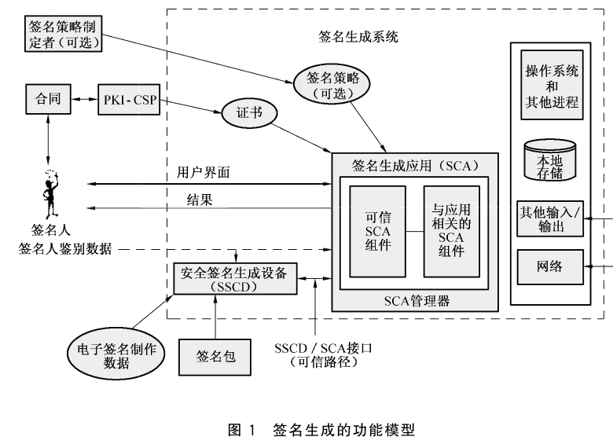

在签名生成环境中，签名生成应用程序是签名生成系统的一部分。图 1 示例说明了签名生成的功能和数据对象，以及与安全有关的接口。这里不区分硬件或软件实现，也未指出输入/输出的性质或不同功能模块之间的信息传输路径（可能采取直接输入/输出设备、硬件线路连接或通信网连接的形式）。

该模型也未说明在不同的平台之上的功能分布。这些方面的问题将在采用特定技术来实现签名生成系统时来具体化。

SCA 和 SSCD 的目的是将签名人文件及相关签名属性形成待签数据 DTBS，对 DTBS 进行签名而生成可靠电子签名，作为最终结果产生签名数据对象 SDO。

SCA 的主要功能包含在“可信的”和“与应用相关的”SCA 组件中。这些功能的细节在 5.3 中进一步说明。除此之外，为支持签名进程或支持与签名生成无关但对安全要求有影响的其他功能，SCA 通常还包含下列功能：

- SCA 管理器。它执行一系列功能来支持签名程序，包括对签名人界面的操作、从签名人界面到 SSCD 接口的信息传递、签名包和签名策略的解释、获得签名策略信息和证书、管理本地存储。
- SSCD 接口。SSCD 是 SCA 的外部构件，如果没有 SSCD 到签名人的直接用户界面，则 SSCD 需要与 SCA 交互，以接收签名人鉴别数据和 DTBS，并返回数字签名。
- SCA 本地存储。在签署文件的过程中，SCA 本地存储可能被用来暂时存放数据，这将有可能成为安全威胁的（攻击）目标。

SCA 还可能包含与产生签名无关的其他功能：

- 数据输入/输出端口和网络连接，这些可能成为安全威胁的目标；
- 硬件/软件进程，也可能是安全威胁的目标。

在签名生成环境中使用下列信息对象（在第 6 章中详细描述）：

- 签名包；
- 签名属性；
- 电子签名制作数据；
- 签名人鉴别数据；
- 签名人证书；
- 签名数据对象；
- 签名人文件。

下列接口和交互将对 SCA 的操作产生影响：

- 被签署文件的选择，以允许签名人选择 SD；
- 签名属性的选择，以允许签名人依据所需签名的类型来选择适合的证书和其他签名属性；
- 所需签名数据对象类型的选择，以指明 SCA 输出结果的形式和内容；
- 签名人鉴别数据的输入，如果需要，SCA 将签名人鉴别数据由签名人传递至 SSCD；
- 安全显示能力，以允许签名人在调用签名进程之前检查 SD 和签名属性；
- 与 CSP 的接口，以获得证书、证书吊销信息和签名策略；
- 签名调用，以允许使用者调用签名进程（有意行为）；
- SSCD 接口，使 SCA 和 SSCD 之间能够通过一条可信路径进行通信；
- 输出，由签名人所指定类型的签名数据对象。

### 5.3 签名生成应用程序

签名生成应用程序主要由可信 SCA 组件和应用相关 SCA 组件构成，如图 2 所示。

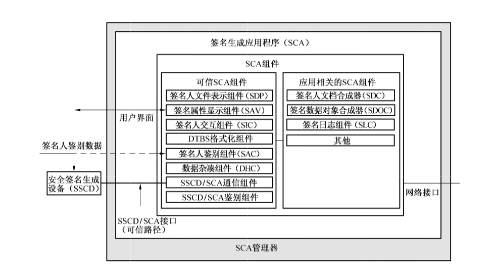

可信 SCA 组件是所有 SCA 所必需的，其定义了所有 SCA 所必须具备的功能。应用相关 SCA 组件是依赖于应用系统的组件，其表示、结构和功能都可能因应用系统而有所不同。

可信 SCA 组件包括：

- 签名人文件表示组件，该组件用于表示签名人所选择的 SD（通过签名人交互组件），对该组件的安全要求在第 8 章中描述。
- 签名属性显示组件，该组件用于显示签名人所选择的签名属性（通过签名人交互组件），这些属性信息将要与 SD 一同被签名，该组件还应具备表示可能的、与应用相关的特定签名人证书内容的能力。对该组件的安全要求在第 9 章描述。
- DTBS 格式化组件，该组件用于将 SD（或其杂凑/散列值）及签名属性格式化并排序形成格式化的 DTBS（DTBSF），再将 DTBSF 送给数据杂凑/散列组件。对该组件的安全要求在第 12 章中描述。
- 签名人交互组件，签名人通过该组件与 SCA 进行交互，以控制签名的生成过程，并且 SCA 通过该组件向签名人返回错误及状态信息。该组件用于签名人和 SCA 之间的所有交互，包括 SD 和签名属性的选择/输入，但不包含签名人鉴别数据。对该组件的安全要求在第 10 章中描述。
- 签名人鉴别组件，该组件用于表示基于知识的签名人鉴别数据或生物特征，并对签名人鉴别数据进行预处理，使其能够与 SSCD 中的签名人鉴别数据进行比较。对该组件的安全要求在第 11 章中描述。
- 数据杂凑/散列组件，该组件用于产生 DTBS 表示（可以是未杂凑/散列的、半杂凑/散列的或全部杂凑/散列的，根据 SSCD 的要求），如果 SSCD 中执行全部的杂凑/散列运算，则该组件的任务就是将 DTBS 表示完整地传递至 SSCD。对该组件的安全要求在第 13 章中描述。
- SSCD/SCA 通信组件，该组件用于管理 SCA 和 SSCD 之间的交互。对该组件的安全要求在第 14 章中描述。
- SSCD/SCA 鉴别模块，该组件在 SSCD 和 SCA 之间建立一条可信路径。该组件是条件存在的，即仅存在于 SCA 在公共服务提供商的控制下且可信路径不能通过组织的方式建立。对该组件的安全要求在第 15 章中描述。

应用相关 SCA 组件包括：

- SD 合成组件，该组件用于创建、输入或选择 SD，对该组件所合成信息的管理是通过签名人交互组件来实现的，对该组件的安全要求在第 16 章中描述；
- SDO 合成组件，该组件通常将 DTBSF 与 SSCD 输出的数字签名合成起来形成签名数据对象 SDO，SDO 的类型由签名人指定，并符合 GB/T 25064 中所定义的电子签名类型，对该组件的安全要求在第 17 章中描述；
- 签名日志组件，该组件负责记录 SCA 近期所生成电子签名的细节过程。对该组件的安全要求在附录 C 中给出。

除此之外，第 18 章中描述了 SCA 与外部环境之间通信的安全要求。

能够实现 SCA 的设备可以是：

- 个人计算机；
- 笔记本电脑；
- PDA；
- 移动电话。

### 5.4 安全签名生成设备

安全签名生成设备 SSCD 执行如下功能：存放签名人的电子签名制作数据，验证签名人鉴别数据，使用电子签名制作数据产生电子签名。SSCD 可以是：

- 智能卡；
- USB 令牌；
- PCMCIA 令牌。

SSCD 应符合国家密码主管部门的相关要求。

### 5.5 签名生成应用程序实例

签名生成应用程序实例是 SCA 组件的具体实现，在同一个物理单元中，如个人计算机，可以有一个或多个实例，如安全电子邮件或网上银行，这些实例可以共享一些 SCA 组件。

### 5.6 签名生成系统的控制和拥有

在不同的签名生成环境中，对签名生成系统有两种基本的控制和拥有类型：签名人控制和公共服务提供商控制。对于这两种控制类型，需要采取不同级别的安全措施，如图 3 所示。

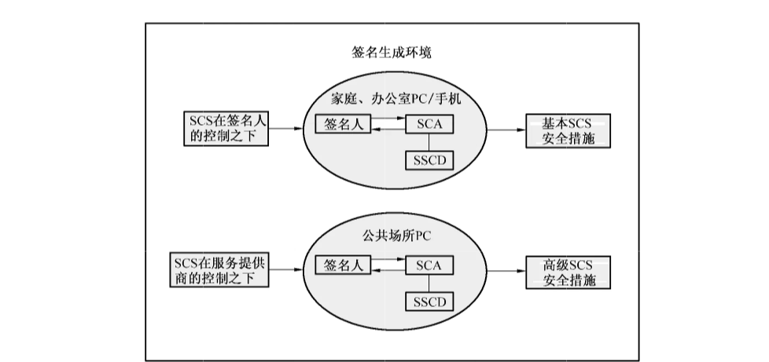

第一种控制类型的典型环境可能是家庭或办公室，SCS 直接在个人或公司的控制之下。在这种情况下，安全要求可以通过组织的方法来满足，或者由签名人来管理，确认安全要求得到满足的技术方法较为简单。例如，在极端情况下，签名人可以使用一台隔离的、只能由签名人打开的计算机来实现签名。

第二种控制类型的典型环境是 SCS 位于公共环境，如车站、银行或是其他 SCS 由服务提供商来提供且与签名人无关的情形。如果没有进一步的技术安全措施，此类环境可能会带来其他的攻击，例如用虚假的 SCS 来替代真实的 SCS。对于这种环境下的 SCS，其技术要求应更严格。

虽然签名人所关注的总体安全要求是相同的，但不同的环境对 SCS 的安全要求具有不同的影响。这些安全要求需要以不同的方式来满足。

## 6 签名数据对象信息模型

图 4 给出了构成电子签名的一些基本信息以及这些信息之间的关系，并指出了这些信息与 SCA 组件之间的关系，附录 A 给出关于这些信息对象的一些建议。本章的每一条将描述这些信息对象，但并不说明如何处理这些信息对象。

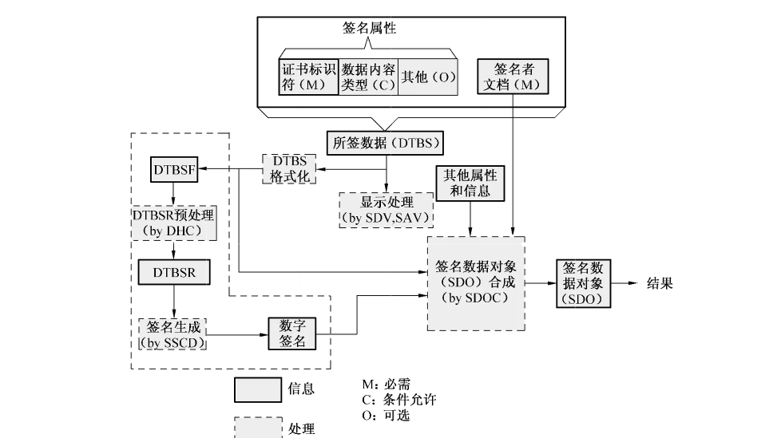

### 6.1 签名人文件

签名人文件 SD 即是用于产生可靠电子签名的文件，SD 与电子签名是相关联的。SD 由签名人通过使用 SD 合成组件选取或组合。某些情况下，可以使用 SD 的杂凑/散列值来代表完整的 SD 向签名进程提供。

SD 中有一些重要的变量或部分会影响到签名的过程或状态：

a）SD 的显示格式是可修改的，例如字处理文件或消息或可编辑文件，其表现形式依赖于显示设备的当前配置，且签名人所看到的 SD 表现形式可能与验证者所看到的有所不同；

b）SD 的显示格式是不可修改的，SD 中包含了全部的显示规则，按照这些规则，可以保证签名人和验证者能看到相同的表现形式；

c）SD 中可能包含隐藏的编码信息（如宏、隐藏文本、计算组件或病毒），签名人在预览和验证签名时可能未看到这些信息，并且可能不知道他们的存在，SD 中这些潜在的不确定性视为一种安全威胁；

d）SD 可能是一种不能在签名人或验证者面前直接显示的形式，或者其以不同的形式表示给签名人和验证者，如电子数据交换 EDI 消息、Web 网页、可扩展标记语言 XML 和计算机文件等；

e）SD 中可能包含内嵌的签名数据对象，该对象是由当前签名人以外的人或实体创建的；

f）SD 的格式是由数据内容类型（签名属性）所描述的，该属性精确表述了验证者应如何查看或解释 SD，以及验证者应采用何种类型的应用或显示设备来查看或使用 SD。

### 6.2 签名属性

签名属性是支持电子签名的信息条目，它与 SD 一同被签署。下面是强制的、条件存在的或可选的签名属性：

a）签名人证书标识符（强制），即签名人证书的标识符或引用，该证书应是包含了与生成当前电子签名所使用的电子签名制作数据相对应的签名验证数据的证书。该属性是必需的，原因在于对于相同的电子签名制作数据，签名人可能在当前或者是将来持有不同的证书，这样可以防止证书彼此替换。如果签名人持有多张证书（对应不同的电子签名制作数据），这样可以指示验证者使用正确的签名验证数据。

b）签名策略引用（可选），如果签名上下文需要（如在指定进行贸易协议中），可包含签名策略引用。在验证签名的过程中，该引用向验证者指出该使用哪个签名策略。例如，在一个签名策略中明确地指出签名人针对当前 SD 想要承担的角色和承诺。

c）数据内容类型（条件存在），该项指出 SD 的格式，并说明验证者应如何查看和使用 SD，即按照签名人所期望的方式。

d）承诺类型（可选），该项指出在签名人所选择的签名策略中，签名所代表的确切含义（也就是说签名可表达签名人的不同意图）。如果存在一个签名策略应用，承诺类型可在所选的签名策略所指定的范围内选择。

e）其他可选的签名属性，如签名人角色、签名产生时签名人所在地、时间戳、归档的证书文件等，这些属性都可添加到 DTBS 中，以支持签名的目的和解释规则。详细的签名属性在 GB/T 25064 中定义。

签名属性的输入或选择是由签名人通过签名人交互组件 SIC 来实现的。

### 6.3 待签数据

待签数据 DTBS 是可靠电子签名所覆盖的信息对象，包括：

- 签名人文件 SD；
- 由签名人所选择的、与 SD 一同被签署的签名属性。

### 6.4 格式化的待签数据

格式化的待签数据 DTBSF 是经 DTBS 格式化组件处理而形成的固定格式及顺序的 DTBS 部件。

DTBSF 是数字签名所真正签署的信息对象，并被包含在签名数据对象 SDO 中，验证电子签名时也必须使用 DTBSF。SDO 的格式由签名人选定的 SDO 类型来确定。

### 6.5 待签数据表示

待签数据表示 DTBSR 是对 DTBSF 进行杂凑/散列运算后形成的结果，杂凑/散列算法由签名包来指定。DTBSR 由数据杂凑/散列组件计算产生。为了使杂凑/散列值能够精确代表 DTBSF，杂凑/散列算法应具备足够的强度，即在签名生命期内找到碰撞在计算上不可行。应提起注意的是，杂凑/散列算法的强度在将来可能会变弱，因而应采取附加的安全措施，如时间戳。

### 6.6 可靠电子签名

可靠电子签名由 SDO 及签名人证书或其引用组成，证书中包含了正确的签名验证数据。可靠电子签名应由签名人的安全签名生成设备 SSCD 产生，即使用 SSCD 中的电子签名制作数据对 DTBSR 进行计算而得。

### 6.7 签名数据对象

签名数据对象是 SCA 的最终输出结果，由 SDO 合成组件来完成，并采用 SDO 类型所对应的格式。SDO 中应包含如下信息：

- 由签名人的电子签名制作数据所产生的数字签名；
- 签名人文件；
- 格式化的待签数据；
- 未被签署的附加属性和信息，如时间戳，依赖于具体的应用环境。

### 6.8 签名人鉴别数据

签名人鉴别数据在图 4 中并未显示，该信息在签名进行之前由签名人向签名生成设备提供，用以鉴别签名人。

## 7 SCA 的总体安全要求

### 7.1 基本要求

在签名人的控制下，SCA 应使用 SSCD 来生成一个包括 SD 和签名属性的可靠电子签名。如果签名属性中包含了签名人生成电子签名时所代表的角色和承诺时，则包含签名属性是非常重要的。

### 7.2 可信路径

#### 7.2.1 可信路径的基本要求

信任路径是对支持图 2 所示签名组件的通用基础平台的要求，用以保护 DTBS 组件中的 DTBSF 和 DTBSR，不论是其在 SCA 中还是在向 SSCD 传输的过程中。可信路径对表 1 所列威胁提供保护。

**表 1 可信路径的安全要求**

| 威胁名称 | 威胁 | 安全要求 |
| --- | --- | --- |
| a）偶然的或者恶意的破坏 DTBS 组件 | SCA 所使用的系统进程会偶然的或恶意的更改 DTBS、DTBSF 或 DTBSR，当它们被签名人选择或 SCA 和 SSCD 之间所用协议调用时 | SCA 应保证如下信息的完整性： a）签名人所提供的 DTBS、DTBSF、DTBSR 以及其他所有信息 b）在 SCA 和 SSCD 之间是流动的协议数据 |
| b）偶然的或恶意的破坏签名人鉴别数据、DTBS 组件或 DTBSF 的保密性 | SCA 的系统平台暴露或拷贝签名人鉴别数据、DTBS 组件或 DTBSF 给未授权的人 | SCA 应保护签名人鉴别数据、DTBS 组件和 DTBSF 的保密性 |

#### 7.2.2 公共 SCA 的要求

如果 SCA 不是总在签名人的控制下，则需满足如下表 2 所列要求：

**表 2 对公共签名生成系统的安全要求**

| 威胁名称 | 威胁 | 安全要求 |
| --- | --- | --- |
| a）由服务提供商运行的公共 SCS 公开或滥用签名人鉴别数据、DTBS 和 DTBSF | 公共 SCS 破坏签名人鉴别数据、DTBS 和 DTBSF 的保密性 | a）SCA 应在完成全部的签名处理操作后安全删除所有与签名相关数据 b）公共 SCS 不应保留这些元素或将其复制给任何未经签名人授权的实体 |

#### 7.2.3 引用正确的签名人文件和签名属性

对于电子签名而言，能正确覆盖到签名人所选择的 DTBS 组成部件是至关重要的，并且在签名人预览之后到 DBTSR 产生之前，DTBS 组成部件不应存在被偶然或恶意替换的可能性。引用 SD 和签名属性的安全要求如下表 3 所列：

**表 3 引用 SD 和签名属性的安全要求**

| 威胁名称 | 威胁 | 安全要求 |
| --- | --- | --- |
| a）替代一个或多个 DTBS 或 DTBSF 组成部件 | 在完成签名过程之前，SCA 系统平台偶然或恶意替代由签名人选择的 DTBS 和 DTBSF 组成部件 | a）SCA 应该确保展现在签名人眼前的 DTBS 与签名人所选择的 DTBS 是相同的 b）SCA 应该确保用于产生 DTBSF 和 DTBSR 的 DTBS 组成部件，与展现在签名人眼前的相同，并且就是签名人所选择的 |

### 7.3 分布式签名生成应用程序的要求

组成 SCA 的程序可能分布在不同平台上，这意味着信息可能需要通过不可信的通信连接传输，或者是通过不可信系统的内部 API 和软硬件模块提交签名人鉴别数据、DTBS 和 DTBSF，对这些数据的完整性、真实性和保密性造成威胁。为抵御这些威胁，应满足如下表 4 所要求：

**表 4 对分布式 SCA 的安全要求**

| 威胁名称 | 威胁 | 安全要求 |
| --- | --- | --- |
| a）在 SCA 组件中传递签名人鉴别数据时，其完整性或保密性被破坏 | 签名人鉴别数据被偶然或恶意地破坏、更改，或其保密性遭到破坏，当其在 SCA 组件中传递时 | 任何需要在 SCA 的分布式组件中传递的签名人鉴别数据，都应通过可信路径来传递，该可信路径应提供完整性和保密性 |
| b）当 DTBS 或 DTBSF 在 SCA 的功能模块之间进行传递时，其完整性或保密性被破坏 | DTBS 或 DTBSF 被偶然或恶意地破坏、更改，或其保密性遭到破坏，当其在 SCA 组件中传递时 | DTBS 或 DTBSF 在分布式组件中传递时，应通过可信路径来传递，该可信路径应提供完整性和保密性 |

### 7.4 对不可信进程和通信端口的要求

一些系统进程、应用进程、外围设备和通信信道，运行在与 SCA 相同的系统环境下，但它们不是签名生成过程所需的，应将其视为不可信的，因而会产生下列威胁和要求。对不可信 SCA 组件的威胁和防护如下表 5 所列：

**表 5 对不可信 SCA 组件的防护**

| 威胁名称 | 威胁 | 安全要求 |
| --- | --- | --- |
| a）在 SCA 中不可信进程和通信端口的冲突 | SCA 中与签名过程无关的进程和 I/O 端口，可能会破坏签名人鉴别数据、DTBS 和 DTBSF 的保密性，或破坏 SCA 本身的进程 | 对于所有不是 SCA 所必需的不可信系统进程、应用进程、外围设备和通信信道，都应防止其与签名进程发生冲突 |

在不同的环境下，对不可信组件的防护可以有不同的实现方式。例如，如果 SCA 与通信网络隔离且只在家庭或办公环境中，或者 SCA 处在其他物理层安全的环境中，只要 SCA 在签名人的单独控制下，就没有必要对 SCA 进行特别加固或关闭系统进程或应用进程。但是，在公开环境下，对 SCA 的安全责任则要落到公开服务提供商身上，上述安全要求则需要通过技术或组织的方式得到满足。为了给签名人一定程度的信心，SCA 应显示出服务提供商的名称，并且声明此 SCA 适用于可靠电子签名的生成。

### 7.5 签名数据对象的事后签名验证

尽管在 SCA 中实现了所有的安全措施，但仍存在破坏、替代 DTBS 组件或 DTBSF 的可能性。因此强烈建议向签名人提供能够对电子签名进行验证的工具，以使签名人能够检查当前电子签名是对正确的签名人文件和签名属性进行计算而得到的结果。

### 7.6 对待签数据的安全要求

对于 DTBS，需要满足如下表 6 所列安全要求：

**表 6 对 DTBS 的安全要求**

| 威胁名称 | 威胁 | 安全要求 |
| --- | --- | --- |
| a）产生不正确的签名 | 签名是对空文件进行运算的结果 | DTBS 应该包含一个签名人文件 |
| b）签名中所引用证书不准确 | 攻击者可将签名与签名人的另一证书相联系，且该证书与签名人想要使用的证书具有不同的含义 | DTBS 应包含签名人所选择的证书，该证书与生成电子签名的电子签名制作数据相联系，且是签名人本身要使用的证书 |
| c）签名人文件的表示不准确 | 验证者使用与签名人不同的方式察看 SD，由于验证者使用不同的数据内容类型来解释 SD。当应用或安全策略允许多个数据内容类型时，这种情形就有可能发生 | DTBS 应该包含 SD 的数据内容类型，如果没有其他的方式指示出这方面信息 |

依赖于特定的应用，在 DTBS 中还可能包含其他签名属性。

## 8 SD 表示组件

### 8.1 功能

SD 表示组件旨在提供合理的信任：将要被签署的文件正是签名人想要签署的文件，并且该文件没有被、也将不会被破坏或修改。该组件通过安全地向签名人显示将要被签署的文件来实现此功能，显示时依据数据内容类型。

安全的 SD 表示组件应具备显示有限数据内容类型的 SD 的能力。当签名人请求 SCA 签署一个 SCA 所不支持的数据内容类型的文档时，SD 表示组件应发出警告。但是为 SD 选择一个适当的数据内容类型，完全是签名人的责任，并且签名人能够决定 SCA 是否符合数据内容类型的要求。

### 8.2 分类

每个 SD 都应隐式包含一个数据内容类型（或与之相联系），指出验证者应如何显示或使用该文件。

除此之外，针对文件的显示，可将 SD 分为两类：

a）显示敏感的 SD：文件的语义依赖于文件的精确表示，在签名人和验证者显示不同时代表不同的含义。字处理文件属于此类数据内容类型。

b）显示不敏感的 SD：文件的语义完全或部分地由自动处理程序来解释，文件的显示不需在签名人和验证者面前一致。这可能是因为使用 SD 的系统及软件的内在不同所造成的，也可能是缘于签名人和验证者均不需“看见”文件。EDI 消息、计算机文件、HTML 文件、XML 文件及其他基于标记语言的文件，属于此类数据内容类型。

同时，组成 SD 的部件的来源可能是本地，或者是远程。所有情况下，应满足下列要求：

a）SD 的语义应明确，需要时附加签名属性。这意味着 SD 及签名属性应包含所有的相关信息，使得验证系统能够正确地解释其语义。

b）SD 表示组件应确保 SD 的句法与所指定的数据内容类型相一致。

c）SD 中不应包含隐藏的、加密的或“激活的”代码如宏，这些代码能够在验证者解释 SD 语义之前或过程中，改变或表面上改变文件信息；或者，SD 表示组件具备无效隐藏代码的能力。仅允许的例外包括：

1）SD 表示组件对任何类型的隐藏代码都向签名人发出警告；

2）存在一个针对该文档格式的显示器，对于签名后的任何改动（不影响签名的有效性），该显示器都能够向验证者触发一个警告。这种显示器一定是被广泛知晓的，并且由一个可靠的源来提供给验证者，验证者应具备确认其真实性和完整性的手段。

d）在一些情况下，SD 表示组件可能无法精确地向签名人展示 SD，此时 SD 表示组件应警示签名人。

显示敏感的 SD 和显示不敏感的 SD 具有不同的安全要求。在实际中，签名人应确认 SD 表示组件工作正常，且上述条件得到满足。

### 8.3 数据内容类型的要求

SD 的语法信息由数据内容类型属性所指定，SCA 要允许包含此属性，以确保验证者不致误解 SD。

关于 SD 的内容对 SD 表示组件的威胁和安全要求如下表 7 所列：

**表 7 关于 SD 的内容对 SD 表示组件的安全要求**

| 威胁名称 | 威胁 | 安全要求 |
| --- | --- | --- |
| a）由于缺乏数据内容类型而导致的对 SD 的误解 | 验证者可能会误解 SD，如果其使用与签名人不同的数据内容类型 | SD 表示组件应允许包含数据内容类型，不论是隐含在文件当中，还是作为一个确切的签名属性 |
| b）语法错误 | 文件不遵守由数据内容类型所指定的语法 | SD 表示组件应警示签名人实际情况，并允许签名人中断签名过程 |
| c）签署文件时采用了错误的数据内容类型 | 签名人签署了一个 SCA 不支持的数据内容类型的文件，某些情况下，这种操作将导致不确定性 | a）厂商手册中应说明 SD 表示组件所支持的数据内容类型 b）厂商手册中应说明如果签名人采用了错误的数据内容类型将产生的潜在后果 c）SD 表示组件应警告签名人，当签名人为一个 SD 表示组件不支持的数据内容类型的 SD 产生签名时 |
| d）签署了错误的 SD | 签名是对错误的 SD 的计算结果 | SD 表示组件应保证展示在签名人面前的 SD，与在签名过程中即将被签署的文件相同，并且与签名人所选择的文件相同 |
| e）签署 SD 中错误的部分 | 签名人在不知情的情况下签署了其他内嵌的错误签名数据对象，或者是由其他人生成的无效签名 | 表示过程中应提示签名人在 SD 中内嵌了其他的签名数据对象。（SD 表示组件也可连接到某签名验证系统，以验证这些签名） |
| f）签名人意外修改 SD | 在显示 SD 的过程中，签名人意外修改了 SD 的任何部分 | SD 表示组件应不允许签名人修改 SD 的任何部分 |
| g）由于 SD 表示组件的限制对 SD 显示不充分 | 由于受硬件、软件或配置等因素的限制，SD 表示组件不能表示 SD 的全部，这可能会导致签名人不能知道所要签署 SD 的某些方面 | SD 表示组件应警示签名人，如果其不能按照数据内容类型准确表示 SD 的全部内容 |

### 8.4 SD 无歧义性要求

当 SD 的表示很重要时（即 SD 的表示形式是表达语义的一种方式），签名人应确信验证者收到了足够的信息，以能够正确地查看 SD，否则 SD 可能存在歧义性，即验证者可能以与签名人不同的方式理解 SD。因此，对于显示敏感的 SD，为实现无歧义性，应通过数据内容类型来指明一些显示信息，表 8 只是示例性说明。

**表 8 显示敏感的 SD 的可变参数示例**

| 字体 | 表格设计 |
| --- | --- |
| 分页 | 段落格式 |
| 声音 | 音频表演 |
| 图像 | 视频表演 |

为确保 SD 的无歧义性，应符合如下表 9 所列要求：

**表 9 对显示敏感 SD 的无歧义性安全要求**

| 威胁名称 | 威胁 | 安全要求 |
| --- | --- | --- |
| a）SD 显示的不确定性 | 签名人签署一份文件，该文件可以有不同的显示方式，并表达不同的含义，因而具有不确定性。验证者可能会以另一种方式来理解 SD | SCA 应允许在 DTBS 中包含数据内容类型属性，以确保 SD 的显示无歧义性 |

### 8.5 对显示不敏感的 SD 的安全要求

当 SD 的语义不依赖于显示时，则必须在 SD 或签名属性中包含足够的信息，以确保其无歧义性。下表 10 所列要求适用于显示不敏感的 SD。

**表 10 显示不敏感 SD 的无歧义性安全要求**

| 威胁名称 | 威胁 | 安全要求 |
| --- | --- | --- |
| a）不显示 SD 的不确定性 | 一个 SD 可能会由于缺乏足够的结构描述信息和语义解释信息而具有不确定性 | SCA 应允许在 DTBS 中包含数据内容类型属性，以确保 SD 在语义上只能有一种解释 |

### 8.6 对隐藏文本和活动代码的要求

经过合成的 SD 可能包含一些不能在（或不欲在）签名人或验证者面前显示的信息，如宏、隐藏文本等。此类信息依赖于产生 SD 的应用程序，但此类信息的存在可能会带来混乱或不确定性，例如宏可能会自动更新 SD 中的信息。因此，应采用如下表 11 所列要求：

**表 11 对 SD 中隐藏文本、宏及活动代码的安全要求**

| 威胁名称 | 威胁 | 安全要求 |
| --- | --- | --- |
| a）SD 的变更 | SD 中可能包含隐藏代码，该代码能够改变 SD 的显示，但不影响签名的（密码学）有效性，这样就会欺骗验证者和（或）签名人 | 应具备允许签名人只对静态文件格式进行签名的 SD 表示组件。如果没有此功能的组件，则： a）SD 表示组件应警示签名人存在隐藏代码 b）应具备 SD 显示器，该显示器通过可信的源获得，并对签署后的 SD 的任何改动都能发出警告 |

## 9 签名属性显示组件

签名属性显示组件旨在通过显示签名属性，确保 SD 和签名意图无歧义性。签名人应能够检查所有的签名属性，特别是针对下列内容：

- 签名人的证书；
- SD 的数据内容类型（如果出现）；
- 签名策略（如果出现）；
- 承诺类型（如果出现）。

使用已吊销的或是过期的证书是一种安全威胁，因为它能导致生成无效的签名。因此在签名之前，SCA 应检查证书的有效期和吊销状态。这可通过访问电子认证服务提供者的证书撤销列表（CRL）实现，或通过证书状态查询服务 OCSP 实现。具体对签名属性显示组件的安全要求如下表 12 所列：

**表 12 对签名属性显示组件的安全要求**

| 威胁名称 | 威胁 | 安全要求 |
| --- | --- | --- |
| a）签署了错误的签名属性 | 签名中使用了错误的签名属性 | a）签名属性显示过程应允许签名人查看签名属性 b）签名属性显示组件应确保显示给签名人的签名属性，与签名过程中所要被签署的一致，与签名人所选择的一致 |
| b）SCA 偶然或恶意地更改签名属性 | SD 的意义有所改变，因偶然或恶意更改一项或多项签名属性 | a）签名属性的完整性和真实性应得到保护 b）对属性中存在的隐藏信息、宏或者活动代码，签名人应得到警示 |
| c）在显示给验证者之前，签名属性可能自动变化 | 签名属性代码中包含活动组件，会更改签名属性的显示或语义 | a）签名属性显示组件应警示签名人任何内嵌在签名属性中的隐藏或活动组件 b）签名属性显示组件可通过可信的源获得，并对签名生成后属性的任何改变都能发出警告 |
| d）在签名中引用一张无效的证书 | 通过使用过期的或者被撤销的证书，生成一个无效的签名 | SCA 应检查证书的有效期和撤销状态，如果发现无效证书，应阻止签名人使用相关的 SSCD |

特别地，签名属性显示组件应允许签名人检查包含在签名中的证书。签名人可能拥有多张证书，适用于不同的任务和不同的角色，且不同的证书可能代表不同的含义。由于存在偶然选错证书的情形，故签名人需要确认使用了正确的证书。

应符合如下表 13 所列安全要求：

**表 13 证书显示的安全要求**

| 威胁名称 | 威胁 | 安全要求 |
| --- | --- | --- |
| a）使用错误的证书 | SD 与错误的签名人证书相关联，导致签名人做出了非本意的承诺 | 签名属性显示组件应允许签名人检查包含在 DTBS 内的证书的主要部分 |

## 10 签名人交互组件

### 10.1 用户界面高层原理

在设计用户界面时，应遵从下列原理：

- 任务适用；
- 风格一致；
- 和使用者的期望保持一致；
- 可控制；
- 容错性；
- 个人设置；
- 对签名人有足够的状态报告情况和错误提示信息。

### 10.2 签名调用

在生成签名之前，SCA 应确定确实是签名人想要产生一个可靠电子签名，而不是受某种意外情况的影响。这可以通过 SCA 与签名人之间的一系列交互来实现，交互过程由签名人交互组件来完成。在本标准中将此过程称为“签名调用”。

签名调用是由签名人通过签名人交互组件向 SCA 发送的一个信号，表示签名人认同 SCA 所引用的 SD 和签名属性，并希望产生一个包括这些内容的可靠电子签名，也就是要签署文件。

SCA 应确认产生的每个签名都是一个明确的签名调用的结果。应符合如下表 14 所列要求：

**表 14 对签名调用的安全要求**

| 威胁名称 | 威胁 | 安全要求 |
| --- | --- | --- |
| a）意外调用签名进程 | 用户可能会意外调用签名进程 | 在初始化签名进程之前，签名人交互组件应请求签名人执行签名调用，以证实这不是意外情况导致的结果 |

每次签名调用所能产生的签名数量由用户或用户组织的安全策略所决定。例如，一位医生要开 150 个处方，并没有必要在一个会话中执行 150 次签名调用，但这 150 个签名仍应视为同一意愿的结果。而对于签署高额合同，则可能每次签名都需执行签名调用。

### 10.3 签名进程超时休止

应避免在 SCA 和 SSCD 中发生下述情形：签名人鉴别数据已经提供而签名人长时间处于不活动状态。例如，签名人已经从签名进程中转移，另一个人可能会对一个修改的或被替换的 SD 和签名属性完成签名过程。非活动时限的安全要求如下表 15 所列：

**表 15 非活动时限的安全要求**

| 威胁名称 | 威胁 | 安全要求 |
| --- | --- | --- |
| a）不被注意的 SCA 允许未被授权的签名产生 | 签名人提供签名人鉴别数据给 SCA/SSCD，另外一个未被授权的人控制 SCA/SSCD，并生成一个未被授权的电子签名 | a）签名人交互组件应设置一个空闲时限，即 SCA 既不与签名人交互，也未执行相关过程 b）如果空闲时限过去，则 SCA 应重新鉴别签名人 |

### 10.4 签名人控制功能

控制功能允许签名人控制签名生成环境及 SCA 的签名过程和活动。SCA 应提供下列控制功能：

- 允许签名人选择 SD 和签名属性；
- 允许签名人完成签名调用，以初始化 SSCD 和 SCA 之间的签名过程；
- 允许签名人为将要生成的签名选择正确的签名人证书；
- 允许签名人提供基于知识的或基于生物特征的签名人鉴别数据；
- 允许签名人改变签名人鉴别数据，依赖于策略。

### 10.5 签名人使用特征的获得

如果签名人想要使用安装在公共场所的 SCA，那么向 SCA 指明签名人的使用特征（习惯）是有帮助的，如：

- 语言使用习惯；
- 不可用信息的显示使用习惯，如果其与 SCA 的用户界面相关。

对于用户控制下的 SCA，则此功能不是很重要，因为这些系统通常是根据用户的需求定制的。

### 10.6 用户界面

本条规定用户界面的基本要求，见表 16 所列，进一步的建议在附录 B 中给出。

用户界面的主要要求是：

- 易用性；
- 容错性，特别是抵御操作错误或提前结束签名过程的能力，并且不损害签名人个人数据的保密性。

**表 16 用户界面的安全要求**

| 威胁名称 | 威胁 | 安全要求 |
| --- | --- | --- |
| a）签名人的行为破坏了过程的安全 | 被误导的签名人可能以错误的方式执行操作或输入数据，因此黑客可以捕获机密数据或盗取签名人的身份 | 签名人交互组件对话框应简单明了、易于实现，以防止签名人自己造成安全漏洞 |
| b）由于签名过程被中断而泄露个人数据 | 当用户离开签名现场时，他/她的私人数据仍然能被未授权的他人看到 | 在签名人完成正常的操作之后，屏幕应该清除签名人的私人数据，显示私人数据的地方应填充一些“无意义”的数据，以防止潜在的图片被读取 |

## 11 签名人鉴别组件

### 11.1 总体要求

根据可靠电子签名定义的前两条，即：

- 电子签名制作数据用于电子签名时，属于电子签名人专有；
- 签署时电子签名制作数据仅由电子签名人控制。

因此，SSCD 应执行一个鉴别过程，以确认请求生成电子签名的人就是 SSCD 的合法持有人。有两种基本的签名人鉴别方式：

- 基于知识的签名人鉴别（PIN 码或口令）；
- 基于生物特征的签名人鉴别。

在签名人成功出示签名人鉴别数据（PIN、口令或指纹）之后，SSCD 的“安全状态”应设置为允许签名。SSCD 的安全状态是否需要保持，依赖于合法签名人对 SSCD 的设置。

在 SCA 中应提供专门的签名人鉴别组件以协助实现上述功能。

### 11.2 获得签名人鉴别数据

在产生可靠电子签名之前，SSCD 应通过获得签名人鉴别数据来确认签名人就是 SSCD 拥有者（或授权使用）。在某些 SCA/SSCD 的实现中，签名人鉴别数据是首先提交给 SCA，然后再由 SCA 转交给 SSCD。对于这种实现方式，应符合表 17 的相关要求。

### 11.3 基于知识的签名人鉴别

对于基于知识的鉴别过程，签名人向 SCA 或 SSCD 提供一个秘密，如：

- 个人身份识别码；
- 口令。

SSCD 将签名人提供的秘密与保存在其中的参考值进行比较，如果匹配，则表示验证通过。

为防止口令猜测和蛮力攻击，SSCD 中应设置相关安全措施，如设置尝试次数。此外，对秘密值的修改，可通过 SCA 进行，也可通过专用的 SSCD 管理工具进行。

### 11.4 基于生物特征的签名人鉴别

对于基于生物特征的鉴别，签名人鉴别数据是由签名人的生物特征信息导出的。

对于某些生物识别统计系统，如基于指纹的系统，生物特征提取是在生物识别终端内部进行的。在注册阶段，完成对特征模板的提取，并将其保存在 SSCD 中，视该生物特征与 SSCD 持有人逻辑相关。在鉴别时，需要将现场获取的生物特征与存储在 SSCD 中的生物特征进行比对。

攻击可能发生在注册阶段（将用户与其他人的特征模板相关联），也可能发生在鉴别阶段（返回伪造的鉴别成功或失败响应消息）。

为了防止这些攻击，强烈建议在 SCA 之外进行特征值的提取、存储及比对，包括注册阶段或鉴别阶段。特别地，可在 SSCD 的内部完成这些操作，或是在 SSCD 及其读写设备内部完成。核心问题是生物特征数据不要通过运行 SCA 的计算机。

生物鉴别机制应能够保护电子签名制作数据，达到下述目的：

- 通过伪造生物特征的假冒攻击，在实际中不可操作；
- 能对抗穷举攻击，如设置重试次数；
- 能对抗重放攻击，如生物特征的提取和比对完全在 SSCD 内部实现，不经过 SCA 或其他计算设备；
- 在注册阶段将某人与他人的生物模板相对应，在实际中不可操作；
- 在鉴别阶段更改签名人鉴别数据，在实际中不可操作。

### 11.5 对错误的签名人鉴别数据的处理

签名人可能有时会提供错误的签名人鉴别数据（如敲错键盘）。多数情况下，这是一次真正的错误。然而，在某些情况下，这表示有人正在企图通过尝试获得真正的签名人鉴别数据。因此，如果 SCA 参与了处理签名人鉴别数据，应仅向签名人指出最终结果（接受或不接受），以及签名人鉴别方法是否被锁死。见表 17 的第 4 项要求。

### 11.6 签名人鉴别数据的变更和计数器重置

对于基于知识的签名人鉴别数据，如 PIN 码或口令，在下列两种情形下应由签名人进行修改：

- 被分配的、签名人不容易记住的 PIN 码或口令；
- 签名人鉴别数据可能已经失密。

比较签名人鉴别数据的次数应受到限制，由重试计数器来记录次数，以限制错误输入次数和防止对签名人鉴别数据的攻击。SSCD 也应提供一种重置重试计数器的方法（如设置一个重置口令）。

### 11.7 签名人鉴别数据用户界面

当签名人输入 PIN 码或口令时，签名人鉴别组件应提供一种特殊字符的反馈（如显示字符“*”或其他方式）。见表 17 的第 7 项要求。

签名人应能够取消 PIN 码或口令的显示。

如果要修改 PIN 码或口令，则签名人鉴别组件应要求用户输入 2 次 PIN 码或口令，以确保没有敲击错误发生，见表 17 的第 8 项要求。对于生物鉴别，应有准确的用户指导。如果使用可选择的生物特征（如食指或中指，左眼或右眼），应向签名人明确指出，或者由签名人自己选择。

### 11.8 签名人鉴别组件的安全要求

表 17、表 18 所列是对签名人鉴别组件的安全要求。

**表 17 对基于知识的签名人鉴别数据的安全要求**

| 威胁名称 | 威胁 | 安全要求 |
| --- | --- | --- |
| a）对 SSCD 的未授权使用 | 一个未授权的个体获得对 SSCD 的访问权限，以伪造签名 | 应提供一种方式，让签名人将签名人鉴别数据输入到 SSCD 或 SCA/SSCD |
| b）由 SCA 泄漏了签名人鉴别数据 | 签名人鉴别数据的保密性在 SCA 中遭到破坏 | 如果签名人鉴别数据在 SCA 中保留，应保证其保密性，并且当其不再需要时应安全删除 |
| c）偶然输入错误的签名人鉴别数据 | 签名人偶然敲错了签名人鉴别数据 | 如果签名人在有限次数（鉴别失败次数不能超过 3 次，3 次之后 SSCD 自锁）范围内输入了错误的签名人鉴别数据，应向签名人发出错误响应，并允许其重试。应向签名人显示相关响应消息，但不应提供其他错误类型消息 |
| d）PIN 码/口令的猜测 | 黑客可能通过猜测或者蛮力攻击来获得 PIN/口令 | 在 SSCD 中应有相关安全措施，签名人鉴别组件不能妨碍这些措施的实现，因此签名人鉴别组件应： 1）能够处理 SSCD 所允许的最大长度 PIN/口令 2）不能阻碍签名人自己修改 PIN/口令 |
| e）检测和滥用基于知识的签名人鉴别数据 | 如果 PIN 或口令可通过 PIN 码盘或键盘到 SSCD 的路径检测到，且攻击者能够访问到这些信息，则有可能造成对 SSCD 的滥用 | SCA 应提供从 PIN 码盘或键盘到 SSCD 的可信路径，以传递 PIN 码或口令 |
| f）PIN/口令的保密性遭到破坏 | 攻击者已经拥有 SSCD 的 PIN 或口令，因而可能滥用 PIN/密码 | 应提供改变签名人鉴别数据的功能，除非安全策略要求某类 SCA 应禁止此功能 |
| g）PIN/口令的显示 | 如果签名人鉴别组件显示签名人所输入的 PIN 或口令，则可能被偷看 | 签名人所输入的 PIN/口令不应被显示出来，但是签名人鉴别组件应给出签名人键入数字或字母的反馈，通过使用特殊的字符 |
| h）修改 PIN/密码时键入错误 | 如果是敲击错误，签名人将不能输入新的 PIN/口令，这样会使 PIN/口令的强度变弱 | 签名人鉴别组件应要求输入 2 次新的 PIN/口令，并在发送 PIN/口令至 SSCD 之前检查两次输入是否一致 |

**表 18 对基于生物特征的签名人鉴别数据的安全要求**

| 威胁名称 | 威胁 | 安全要求 |
| --- | --- | --- |
| a）基于生物特征的签名人鉴别数据的检测和重放 | 如果基于生物特征的签名人鉴别数据在传递给 SSCD 时能够被检测到，则有可能造成对 SSCD 的滥用，如果攻击者能够访问到这些信息 | 应该提供一条从生物传感器到 SSCD 之间的可信路径，以传输生物特征信息 |
| b）滥用公开的、基于生物特征的签名人鉴别数据 | 攻击者可能获取公开的生物特征如人脸、指纹，并从中导出签名人鉴别数据，从而获得对 SSCD 的使用权 | 生物传感器应保护用户的生物图像，以防止其被用于重放攻击 |
| c）与错误的生物特征鉴别数据相关联 | 恶意代码能够截获某人的注册数据，并将其链接到另一个人的生物数据，以便在后期冒充真实签名人的身份进行电子签名 | 生物特征数据的关联绑定不应发生在运行 SCA 的计算机内部 |
| d）错误的鉴别 | 攻击者可能会拦截鉴别过程的返回消息，以便给出虚假的正面响应（冒充）或负面响应（拒绝服务） | 生物特征数据的比对不应发生在运行 SCA 的计算机内部 |

## 12 DTBS 格式化组件

### 12.1 DTBS 格式化组件的功能

DTBS 格式化组件将 SD 和签名属性形成格式化的待签数据 DTBSF。如果需要在 DTBS 中包含一个 SD 的杂凑/散列值，而且还未进行这个操作，则 DTBS 格式化组件在产生 DTBSF 之前将先进行杂凑/散列运算。一些情况下，签名人在选择所签文件时直接选择了文件的杂凑/散列值。

### 12.2 对 DTBS 格式化组件的安全要求

表 19 所列是 DTBS 格式化组件的安全要求。

**表 19 对 DTBS 格式化组件的安全要求**

| 威胁名称 | 威胁 | 安全要求 |
| --- | --- | --- |
| a）产生错误的或不完整的 DTBSF | 数据内容类型 a）为了某种目的，攻击者可能会阻止 SCA 使用所有的签名组成部件 b）攻击者可能会向 SCA 提供伪造的签名组成部件 | SCA 应该执行相关措施来验证全部所获得组成部件的有效性、真实性和完整性，以产生由签名人所选择正确 DTBSF |

## 13 数据杂凑/散列组件

### 13.1 数据杂凑/散列组件的功能

数据杂凑/散列组件接收 DTBSF 并执行下列功能：

- 产生待签数据表示 DTBSR；
- 为将其输入到 SSCD，通过填充等方式将 DTBSR 格式化。

SCA 中数据杂凑/散列组件与 SSCD 之间的工作分工依赖于 SSCD 的功能。

### 13.2 DTBSR 的产生组件的输出结果

图 5 指出了具有不同功能的 SSCD 以及它们对安全的影响。

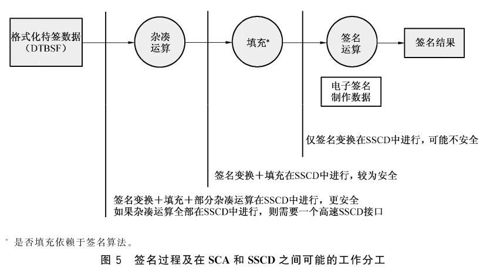

在用户调用签名生成进程后，第一步是杂凑/散列运算。杂凑/散列运算是必需的，因为所要被签署的消息可能是任意长度的，而签名算法只能处理与密钥长度相同或更短的数据。杂凑/散列运算过程超出了签名人的视觉和知识控制范围，因为签名人不能自己计算或判断杂凑/散列运算结果是否正确。这意味着签名人必须依赖该过程。因而对此的安全要求是传递给杂凑/散列函数的消息应是未被修改的，并且杂凑/散列函数工作正确。

杂凑/散列运算的实现具有不同的分工方式，如图 6 所示：

- 全部杂凑/散列运算在 SCA 中进行；
- 部分杂凑/散列运算在 SCA 中进行，并在 SSCD 中最终完成全部运算；
- 全部杂凑/散列运算在 SSCD 中进行。

对于大文件在 SSCD 中进行杂凑/散列运算的情形，如果 SSCD 具有高速接口（如 USB 接口），则在技术上是可行的。

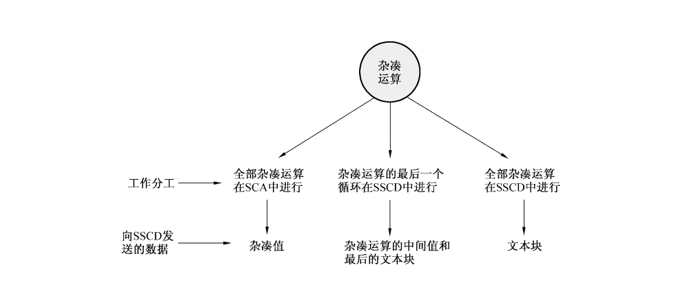

SSCD 所支持的杂凑/散列运算形式，应在 SSCD 的使用手册中说明。

### 13.3 电子签名输入的格式化

签名过程的第二步是格式化杂凑/散列值，本标准中称为填充，填充是某些签名算法所需要的。

为了保证 SCA 和 SSCD 之间的正常交互，SCA 需要知道与 SSCD 的交互协议，这些交互协议应在 SSCD 的使用手册中定义。

### 13.4 对数据杂凑/散列组件的安全要求

表 20 所列是与数据杂凑/散列组件相关的安全要求。

**表 20 对数据杂凑/散列组件的安全要求**

| 威胁名称 | 威胁 | 安全要求 |
| --- | --- | --- |
| a）弱杂凑/散列算法 | 弱杂凑/散列算法可能会导致碰撞 | SCA 应确认使用了国家密码主管部门批准的杂凑/散列算法 |
| b）弱电子签名输入格式 | 使用弱电子签名输入格式，包括填充，可能会引起电子签名制作数据被计算出的问题 | SCA 应确认使用了国家密码主管部门批准的签名输入格式 |
| c）生成错误的或不完整的 DTBSR | 如果 DTBSR 未能包含安全策略和签名人所需的必须和可选部件，则可能会产生不完整和不明确的签名 | SCA 应保证为签名产生了正确的 DTBSR |

## 14 SSCD/SCA 通信组件

### 14.1 交互序列

SSCD/SCA 通信组件执行所有 SSCD 和 SCA 之间的必要交互。因此从安全的角度看，该组件是个非常重要的组件，该组件的任何错误都将导致产生错误的签名。图 7 给出了两种不同的交互序列：

- 在签名人控制下的 SSCD 和 SCA 之间的交互；
- 在服务提供商控制下的 SSCD 和 SCA 之间的交互。

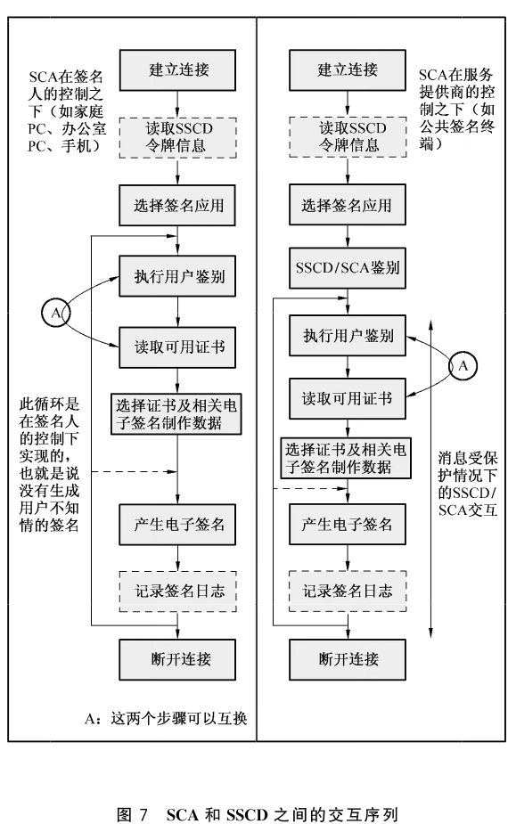

虚线箭头表示一些 SSCD 要求每次产生签名之前都要进行签名人鉴别，而另一些 SSCD 则是在连接断开之前或是签名应用程序关闭之前总可以产生签名。后者可以使 SCA 更灵活，针对签名人鉴别方式，可将 SCA 配置成：

- 每次鉴别；
- n 次之后鉴别；
- 一段未产生签名的时间后鉴别。

如果 SCA 对上述鉴别模式进行配置，则配置功能应受到保护，只有签名人才能对其修改。

### 14.2 建立物理通信连接

SCA 至少要有一个适当的物理接口与 SSCD 通信。

对于 SSCD 永久内嵌在 SCA 的情形，也需有个合适的接口，但此接口不需要外部可访问。

对于 SSCD 需要动态建立连接的情形，如插入到 SCA 中，应保证：

- 当 SSCD 需要电源时，应提供足够的电源，且电压在指定的范围内，以保证 SSCD 的正常工作；
- 具备给定频率范围内的时钟，以保证 SSCD 的比特同步；
- SCA 支持 SSCD 的比特协议；
- SCA 支持 SSCD 的传输协议。

SSCD 及对应的相关接口可以是：

- 智能卡，需要一个智能卡接口，读卡器可以集成在键盘或其他系统单元中，或者独立的读卡器通过适当的接口与计算机相连；
- USB 令牌，需要一个 USB 接口；
- PCMCIA 令牌，需要一个 PCMCIA 接口；
- 其他插拔式密码令牌，需要一个总线接口。

SCA 和 SSCD 之间的连接线路可以是：

- 有线连接；
- 无线连接；
- 红外线连接；
- 复合连接。

当使用无线或红外连接时，SSCD 应保证签名生成功能：

- 不可访问；
- 使用该通信线路不会带来附加风险。

### 14.3 SSCD 令牌信息的读取

不同类型 SSCD 的参数可能会有所不同，包括：

- 签名算法；
- 密钥长度；
- 签名对输入格式的特殊要求；
- 所使用的杂凑/散列函数；
- 就杂凑/散列运算及签名输入格式，SCA 和 SSCD 之间的工作分工；
- 签名人鉴别的方法和类型；
- 证书；
- 在 SSCD 完成签名生成服务所需使用的命令类型及顺序。

为了使一个 SCA 能够支持多种类型的 SSCD，应使 SCA 能够读取并处理 SSCD 的密码令牌信息对象，如图 8 所示。该对象指出了 SSCD 中所支持的数据元素及处理方式。

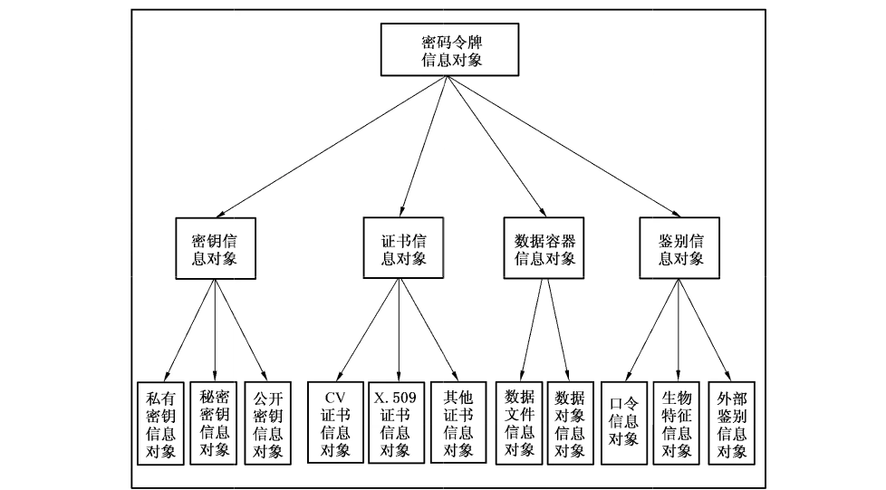

### 14.4 在多应用平台上 SSCD 功能的选择

在一个硬件平台上可以实现一个或多个签名设备。进一步，在该硬件平台中，签名功能可能只是其他应用一部分。在这样的多应用平台中，可以实现一个或多个逻辑的 SSCD，此时 SCA 应能够根据应用标识符对 SSCD 进行选择。

### 14.5 证书的获取

一个 SSCD 可能载有多张证书，如：

- 签名人在不同的角色、不同签名算法中使用的证书；
- 签名人的“属性证书”；
- 用于构造证书认证路径的中间证书。

SSCD 应向 SCA 提供下列信息：

- 如何读取证书；
- 制作电子签名相关数据的引用；
- 证书隶属哪条证书认证路径的信息。

如果 SCA 在签名人的控制下已经存储了证书，则不需要再次读取。

依赖于 SSCD 发行者的安全策略，读取 SSCD 中的全部或部分证书可以是允许的或受限的，可以限制 SCA 仅能在通过签名人鉴别之后才能读取证书。

如果 SSCD 中不包含带有签名验证数据的证书，则至少应包含一个关于该证书的引用，以统一资源定位符（URL）或其他形式，且该引用应可读。

### 14.6 电子签名制作数据的选择

如果 SSCD 中包含了多个电子签名制作数据，则签名人应能够根据自己的意图选择正确的电子签名制作数据。尽管只有一个电子签名制作数据，也可能需要一个对其的引用。为了能够选择电子签名制作数据，SSCD 令牌信息对象中应包含说明证书与电子签名制作数据连接关系的信息。如果 SSCD 也需要算法引用，SSCD 令牌信息对象中也应指明。

### 14.7 签名人鉴别的执行

当 SSCD 没有直接输入设备时，SSCD/SCA 通信组件将从签名人鉴别组件中接收签名人鉴别数据（通过一条可信路径），并使用正确的 SSCD 命令将其发送给 SSCD 去做比较，应有三种可能的结果：

- 验证成功；
- 验证失败；
- 验证方法被锁死，由于出现连续多次错误的签名人鉴别数据。

结果返回给签名人鉴别组件，以适当的消息形式显示给签名人。

### 14.8 数字签名的计算

签名生成进程的最后一步是计算数字签名。为避免使用限制，SSCD 应将数字签名以比特串的形式发送。形成相关电子签名格式并给出签名过程的最终结果，使签名数据对象合成组件的任务。

### 14.9 签名日志的记录

如果 SCA 和 SSCD 记录了完整的签名日志，则 SCA 和 SSCD 之间的交互过程全部完成。参见附录 C。

### 14.10 对 SSCD/SCA 通信组件的安全要求

表 21 所列是对 SSCD/SCA 通信组件的安全要求。

**表 21 对 SSCD/SCA 通信组件的安全要求**

| 威胁名称 | 威胁 | 安全要求 |
| --- | --- | --- |
| a）由物理接口的故障导致的错误签名 | 物理接口的错误行为，可能会导致产生一个非签名人想要签署的 DTBS 的签名 | SSCD/SCA 通信组件应该支持与物理接口相关的全部项目，以及所指出的全部特征，以保证 SSCD 的正常工作 |
| b）对 SCA 和 SSCD 间无线接口的偷听或者干扰 | 偷听或干扰 SCA 和 SSCD 之间的无线接口，可能会导致安全性的破坏 | 如果在 SCA 和 SSCD 之间使用了无线链路，则 SSCD/SCA 组件应提供适当的手段来避免被偷听或干扰 |
| c）电子签名制作数据的错误选择 | 选择一个非本意的签名应用或一个非本意的电子签名制作数据，可能会导致严重的后果，因为签名人可能会产生一个带有非本意的认证路径或语义的签名 | SSCD/SCA 通信组件应确保签名人选择了正确的 SSCD 功能，并采用了与签名属性相对应的电子签名制作数据 |
| d）由 SSCD/SCA 通信组件破坏所造成的签名生成错误 | 对 SSCD/SCA 通信组件的任何非授权改动，都可能会导致错误的签名生成 | SSCD/SCA 通信组件应受到保护，防止任何非授权改动 |

## 15 SSCD/SCA 鉴别组件

### 15.1 SCA 与 SSCD 之间的鉴别

如果签名产生于在服务提供商控制下的 SCA，那么签名人需要决定是否可以对其置予同样的信任（相对于签名人自己控制下的 SCA）。对签名生成的置信度，可通过管理方法实现，也可以通过技术方法实现。

技术方法可以是：

- SSCD 与 SCA 进行双向鉴别；
- 鉴别之后的通信通过安全消息会话来保护；
- 签名人能够识别 SCA 和 SSCD 之间的安全交互是否值得信任，签名人应可以知道这种信任假设是不充分的（当有恶意代码时）；

如果鉴别过程不能被执行，比如缺乏验证密钥，则应向签名人指示。很多情况下，SSCD 对 SCA 的鉴别可能会受到恶意代码的影响，如果该恶意代码能够截获 SCA 与 SSCD 之间、SCA 与签名人之间的对话。

鉴于对称密码技术在密钥管理等方面的问题，SSCD 和 SCA 之间的鉴别应采用基于公钥的鉴别机制，基本流程如图 9 所示。

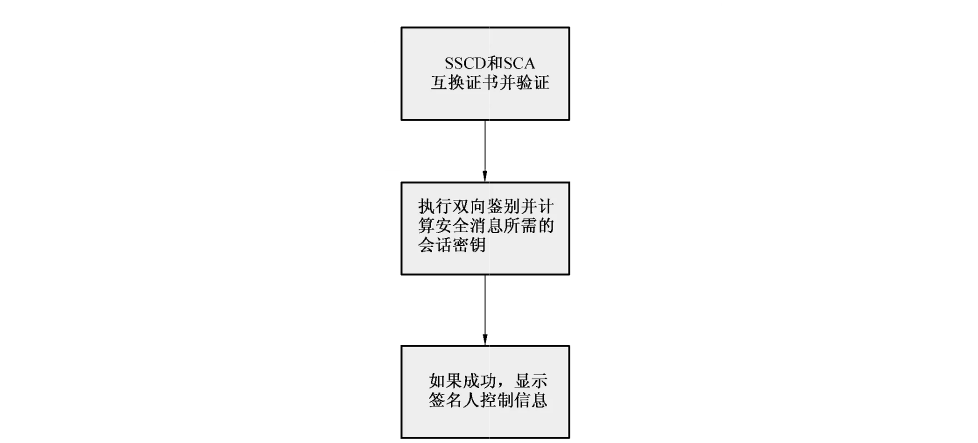

### 15.2 对 SSCD/SCA 鉴别组件的安全要求

表 22 所列是对 SSCD/SCA 鉴别组件的安全要求。

**表 22 对服务商控制下的 SCA 的安全要求**

| 威胁名称 | 威胁 | 安全要求 |
| --- | --- | --- |
| a）虚假的公共 SCA 所造成的破坏 | 虚假的或被更改的 SCA 可能会对签名人造成伤害 | SCA 应支持 SCA 和 SSCD 之间的实体鉴别，以向签名人提示成功鉴别，并保护随后的安全通信 |

## 16 SD 合成组件

SD 合成组件的功能是允许签名人创建或选择将要被签署的 SD。

SD 合成组件不应具备处理带隐藏代码的文件的能力，或者应具备使隐藏代码无效的能力。

SD 合成组件应符合如下表 23 所列安全要求：

**表 23 对 SD 合成组件的安全要求**

| 威胁名称 | 威胁 | 安全要求 |
| --- | --- | --- |
| a）SD 中存在隐藏代码 | SD 中的隐藏代码可能会改变被签名的原文，但不改变签名的有效性，从而欺骗签名人和（或）验证者 | SD 合成组件应不允许在 SD 中插入隐藏代码，或者 SD 合成组件能够使隐藏代码无效 |

## 17 SDO 合成组件

SDO 合成组件将 SSCD 的输出结果（数字签名）与 DTBSF 结合起来，按照签名人所选择的 SDO 类型，形成标准格式的电子签名。

对 SDO 合成组件没有安全要求，但所形成的签名数据对象至少应包含可靠电子签名，还可包含以下各项：

- 签名人文件 SD；
- 与产生签名所用电子签名制作数据相关联的签名人证书；
- 签名所覆盖的零个或多个签名属性，由 SDO 类型所决定。

SDO 类型还应指明 SD 和签名属性的顺序，即与产生 DTBSF 的顺序一致。

## 18 输入/输出的外部接口

### 18.1 SCA 面临的风险

外部输入/输出接口（如与公共网络的连接）总是风险的来源，因为：

- 入侵者试图修改 SCA；
- 病毒可能已经通过电子邮件进入，可能会破坏数据和软件。

签名人或服务提供商应保护 SCA，可通过以下方式：

- 安装防火墙；
- 扫描病毒；
- 所有的输入都使用中间服务器。

### 18.2 证书的导入

如果 SSCD 中不包含所有的必需证书（只包含证书标识符），则 SCA 应能够取回这些证书。

SCA 应具备验证所取回证书的真实性的能力。

### 18.3 SD 和签名属性的导入

如果 SD 或其一部分，或任何签名属性是通过输入/输出接口获得的，SCA 应确认其中未包含隐藏部分，或者不会发生对 DTBS 任何部分的替代。

### 18.4 SCA 组件的下载

在 PC 机或是移动设备中，经常会使用小程序（Applets）和插件来增加功能，或下载 SSCD 接口驱动。如果需要可信的 SCA 组件是通过这种方式获得的，则应验证这些组件来自一个可信的源，并且其完整性得到保护。

### 18.5 对输入控制的安全要求

表 24 所列是对输入控制的安全要求。

**表 24 对输入控制的安全要求**

| 威胁名称 | 威胁 | 安全要求 |
| --- | --- | --- |
| a）SCA 组件被恶意代码破坏 | 被植入的恶意代码可能会破坏 SCA 组件 | 应该采取相关措施以确保 SCA 组件未被恶意代码所破坏，或者已遭到恶意代码攻击的组件能够被重新识别 |
| b）SCA 组件被入侵者破坏 | 入侵者可能会破坏 SCA 组件 | SCA 应保护其功能组件的完整性，并避免入侵者对其的破坏 |
| c）安装虚假的 SCA 组件所造成的损害 | 如果通过 SCA 组件是通过互联网获得的，则其可能是假的，并导致产生不正确的签名 | 在 SCA 中应采取相关措施，使得只有是通过安全下载的 SCA 组件才能够被安装 |

## 附录 A（资料性附录）签名数据对象通用指导

### A.1 签名生成应用程序的运行

签名人、SCS 的 SCA 组件和 SSCD 一起，通过一系列步骤合作生成 DTBS 可靠电子签名。下列仅给出典型的 SCA 和 SSCD 的这些行为的简单介绍，一些步骤可能在执行时与下列顺序有所不同。

a）SCA 被初始化为运行模式。这可能通过签名人将 SSC 连结到 SCS，或选择并启动 SCA 软件来完成。

b）SCA 和 SSCD 相互鉴别，向签名人保证 SCA 可信。要求的条件在第 17 章中详细说明。

c）签名人和签名人交互组件交互作用输入、选择或组成 SD。

d）SCA 通过签名人交互组件获得签名人提供的信息，作为签名属性。这些属性的选择依赖于特定的签名生成应用实例，然而“证书引用”这一签名属性应是强制的。签名人的证书与签名人的特定角色、姓名、或假名等相关联，这样也使得 SCA 和 SSCD 可以选择正确的电子签名制作数据来生成签名。

e）SCA 应允许签名人使用 SDP 和签名属性显示组件预览签名文件和签名属性，确保显示的信息是正确的。在程序中，SCA 还可以允许签名人验证任意一个现有的包含在签名文件中的电子签名。

f）签名人通过签名人交互组件以向 SCA 提供关于所要产生的签名类型的指令，即 SDO 类型。这一操作是需要的，如果 SCA 能够产生不同类型的签名格式，或者使用了不同 PKI 的不同证书。SCA 需要知道产生和输出哪种类型的签名，这一点十分重要。

g）SCA 必须和签名人在签名人交互组件上交互作用以获得一个签名调用，以指示 SCA 和 SSCD 初始化签名程序。

h）签名人将签名人鉴别数据通过签名人鉴别组件提供给 SCA 或直接提供给 SSCD（例如，PIN 和/或生物特征数据）。这用来向 SSCD 提供签名人的鉴别，以防止除签名人以外的人员使用 SSCD。

i）DTBS 格式化组件将 SD（或其杂凑/散列值）与签名属性连接，其顺序由签名（SDO 类型）的必要类型决定，以形成格式化待签数据（DTBSF）。签名属性包含在 DTBS 中，以确保任何试图将它们替换成其他内容的企图都无法通过验证程序。

j）数据杂凑/散列组件取得 DTBSF 并通过杂凑/散列程序计算 DTBSR。在一些情况下，所有的杂凑/散列在 SCA 中执行，另一些情况中，部分或所有的杂凑/散列可能由 SSCD 执行，这根据所用的 SSCD 类型决定。DTBSR 和可选内容稍后通过 SSC 提供给 SSCD。

k）SSCD 使用签名人的、与签名人所选证书相关的电子签名制作数据，加密 DTBSR 和其他的一些数据。

l）前一过程的输出通过 SSC 组件从 SSCD 返回到 SCA。

m）SDO 合成组件以标准的格式将 SD 的数字签名、SD 和签名属性组装成一个可靠的电子签名，按照签名人所选择的 SDO 类型，并将输出 SDO。

n）然后签名人被允许验证电子签名并再次浏览 DTBS。

o）格式化的签名数据对象被存储，或由 SCA 发送给接收者。

p）签名行为由 SLC 组件记录（即，某一签名事实被 SCA 或 SSCD，或两者一起记录）。

q）SCA 可以被重置（即，在由服务提供者运行 SCA 的情况下，将安全地删除所有数据，这些数据曾在 SCA 处理和存储的签名过程中使用）。

### A.2 对环境的要求

不应安装闭路电视，以防捕获签名人的鉴别数据。

应将 SCS 设计和安装成这样的：他人不可能偷窥或摄录到签名人的鉴别数据。

### A.3 显示不敏感的 SD

表 A.1 的粗略说明列出了本级文档的一些类型，并描述这些文档类型的某些方面，以便澄清。

**表 A.1 显示不敏感的 SD 的变量参数的例子**

| 信息类型 | 方面 |
| --- | --- |
| EDI 传输 | 数据词典、编码规则等，能使用数据的应用 |
| SGML，HTML，XML…… | 文件类型定义、数据词典等 |
| 文件 | 文件类型、文件格式、文件结构，数据元素语义学等，能说明数据的应用 |

## 附录 B（资料性附录）用户接口实现的指导

### B.1 目的

本附录的目的是提供构造用户接口原理的指导。通过使接口尽可能简单和减少人为错误导致的安全问题，来增强用户对电子签名生成程序的信心。还要确保该接口对于所有用户都是可访问的，包括有特殊需求的人们。

本附录涉及了一般用户接口对签名人与电子签名生成程序的交互的建议。

决定用户接口对信息和通信技术系统的建议，包括电子签名生成系统，是许多不同参数交互的结果，如用户特征、任务、应用、所用服务、技术和环境。这种交互决定了系统的可用性和可接受性。没有单独一组详细的建议可以覆盖所有可能的交互。

用户接口包括许多不同的元素，它们必须适当的结合在一起以完成构架。如果缺少了一种元素或是一种元素不合格，那么接口就可能无法工作。因此，需要阅读相互间的所有建议。

但是，注意用户接口对于硬件的要求，例如正确的输入、输出设备（像键盘）、本地安装环境（例如照明条件、终端的物理访问等），不在本文讨论范围内。

### B.2 用户接口的一致性

用户接口的一致性被公认为是生成用户友好的系统和降低用户错误的、最重要的方式之一。

应包含安装、管理、使用和接受电子签名的方法，不必包含：

- 哪个机构颁发的证书；
- 签名人扮演的不同角色；
- 被签名的对象是什么（例如，投票形式或银行协议）；
- 由哪个 SCA 产生签名。

### B.3 颜色的使用

颜色是最有力的视觉编码介质之一，它能用来提供信息。正确和保持一贯的使用它，对用户接口设计是相当重要的。应根据心理学来分配来使用颜色，举例来说，红色等于紧急/错误，绿色等于前进/运行。

应遵守颜色使用的标准惯例。

### B.4 反馈

反馈是增加签名人的信任和对系统的信心的重要方法，并可避免多次输入相同的数据。

应坚持使用应答来确认行为的产生、签名人行为的执行是正确的（或错误的）及确认程序的状态（例如，请等待，系统正在检查您的编码/生物特征）。

### B.5 安全漏洞检测

如果 SCA 检测到一个安全漏洞，应通知用户签名程序在当前的环境下不能运行。

存在一个对签名有威胁的安全漏洞的情况时，系统应该给签名人提示，并解释在哪种条件下电子签名生成程序可以重新开始。

### B.6 无效的选择

在一些情况下，不可能所有的、正常条件下的选择都是有效的。签名人可以选择无效的选择。因此，正常有效的选择在特别条件下，可能是无效的选择，这时应该被指出。

### B.7 信息的保护

一些系统支持而且提供完整的多媒体输入/输出，而且能够考虑到使用户接口配合个体的需要。签名生成程序不会对现有系统造成负面影响（例如，阻止声音的输出），这一点是很重要的。

电子签名程序整合到现有系统，应不会影响其在特殊介质下提供信息的能力（例如，文本，图像，声音，照片和符号，虚拟的 3D 立体），也不对任何人类感官（经由文本的输入，语言，声音，接触，手势和其他发动控制形式，生物识别）造成影响。

### B.8 个性化

大多的计算机操作系统允许用户建立不同的轮廓，有不同的访问权限，以便系统可以做到适应个人需要。公众的终端机（ATM）也能通过智能卡编码体现个体的要求。

签名生成程序应该和用户的轮廓标准/技术相兼容，以便他们可以变成用户轮廓整体的一部分。

### B.9 整合用户轮廓技术的签名人控制

将 SCA 与用户轮廓整合的技术的潜在优势，就是并不意味着签名人放松对签名生成程序的控制。

签名人因此能够抛开用户轮廓技术，而只产生他们希望的签名。

### B.10 签名生成程序的配置和编辑

不同的终端电子签名产生不同的输入/输出功能，它将影响签名人和系统之间的会话。用户轮廓（例如，存储在智能卡中，见 EN 1332-4［3］中定义）能够为不同级别的、存储在智能卡上的终端选择会话。还可以选择电子签名生成程序在不同终端上被处理的方式（例如，电话终端）。

SCA 应该是和用户轮廓技术相兼容，而且可以根据不同终端类型产生和编辑不同的 SCP。

### B.11 区分证书

为了帮助签名人明确的区别每张证书并记住他们代表的内容，签名人可以为每个证书分配一个对自己来说有意义的标签、符号或图标。

### B.12 操作的时间

人们可以读、听、理解变化多端的消息，并做出反应。早先使用一个特别的系统的经验将会影响反应的时间。

应给予用户（特别是年长的用户和刚开始使用的用户）充分的时间来完成签名操作。建议如果可能的话，由用户定义时间。

### B.13 公共领域终端的安全

终端机放在公众的领域之内（如商店、火车站）必然有用户接口/安全之类的问题，如：

- 摄像头可以窥视用户输入的 PIN 码；
- 机密的数据可能留在屏幕上；
- 机密的数据可能留在终端机上（收据）；
- 终端机可能是不安全的（假的），等等。

一些关于 SCA 安全级别的信任信息应该提供给用户。这可能通过机构或技术来实现。设备的用户接口中输入的机密信息（签名人鉴别数据）应可防止摄像头等设备的窥探。在用户完成操作后，机密/敏感的信息不应再留在屏幕上。声音提示不应包含机密/敏感的信息（如密码）。

### B.14 秘密的用户保存

如果在制作电子签名过程中使用秘密口令（如签名人鉴别数据）来控制 SCA，相对于生物特征，它们应易被收集，即简短的或有含义的。如果是使用长口令，则应帮助用户记住它们，如数字字符串，或使用对签名人有含意的数字序列。

口令应该易于被签名人保存。理想情况下，用户应该能够选择口令。

### B.15 用户指导

签名人需要知道该如何运行签名生成程序，他行为的结果是什么，保证安全（如 PIN 码）的重要性，以及当他知道安全受到威胁时该和谁联系。

明确的用户指导应该包括如何配置、安装、使用系统和安全方面的内容。用户指导的发展方向应是基于相关人类工程学标准/指导的。它应是可读可听格式的。

### B.16 操作顺序的表达

用户对不同阶段如何进行应有明确的了解，并知道必要时如何退出，这一点很重要。

在创建电子签名时，应给予签名人清晰的、用于显示不同阶段和应进行的操作的信息。信息可以包括屏幕上显示数据的顺序，用户已进行到流程的哪一步，条形符号、图标等。它应清楚的向签名人指出如何退出程序。信息应包括通过视觉、听觉、触觉进行的交流。例如，提示音应用于描述处理顺序，给出选择键盘的确认。

### B.17 可区别部分的表达

创建电子签名程序中有几个组件部分是不可混淆的，既易用，又使用户了解执行这些组件的结果。

使用不同的组件生成的签名应相互区别开来，例如，使用至少两种编码介质，如使用颜色、形状、标签，等等。

### B.18 指导

建立用户信赖的系统的前提条件是在复杂过程的每一步都对用户提供安全的指导。

应明确指出操作序列的下一步及相关的功能区域。

### B.19 术语

技术术语对于大多数用户来说是不可理解的。尽可能使用那些在公共领域已经被人们所熟知的日常术语（例如取消、清除、输入），不论是通过屏幕，还是通过打印或口述的方式，这是非常重要的。

### B.20 容错性

无论用户产生的错误是疏忽、还是故犯，系统应足够强壮去应对，而不会关机或崩溃。

电子签名生成程序应可对用户的输入错误（无效输入）进行容错，例如过短或过长的字符输入到固定长度的字符串中。

### B.21 信息错误消息

ICT 系统中有许多没有用的错误的指示信息。像“错误 123”这样的提示没有什么帮助，甚至还责怪用户。

无效输入的情况下，应给出信息错误消息。SCA 应该告知签名人错误已经发生，及该如何去修改。这种消息不应责怪用户。

例如，如果向 SCS 输入了 10 个数字，而系统只允许 9 个数字时，SCS 应提示类似“请重新输入，最多 9 个数字”的消息。信息应是有效的可读或可闻格式。

### B.22 公众 SCA 的单手操作

一些系统要求用户同时按下几个按键，这就要求使用两只手完成。对于健全的人来说，这不是个问题。但是对于非健全人，或者手里拿着其他东西（手机、智能卡、钱包）的人来说，这就不是很容易的事情了。

程序应避免要求两个或更多个操作同时进行，即单个操作应可单手完成。

### B.23 取消操作

了解到你可以随时安全的退出应用程序，以便给用户整个系统的控制。

用户应可随时取消当前操作、返回主菜单，或是完全退出系统。

### B.24 撤销操作

如果人们出现错误，则他们可以直接纠正错误，且不必走额外程序来说明他们所犯的错误，这是很重要的。

在签名程序中，应在适当的步骤设置“取消命令”功能，使得可以撤销最后一步操作，或是整个处理过程。

### B.25 签名人的鉴别组件

a）签名人鉴别方法的选择

不同的人有不同的喜好和能力，会以不同的方式输入敏感数据。如果 SCA/SSCD 支持几种不同的签名人鉴别方法，如图 B.1 所示，则签名人可以选择自己的鉴别方法（例如生物识别或是 PIN 码）。

生物识别法可能不适用于下列签名人：

1）缺少主题的生物特征；

2）主题的生物特征不够突出；

3）主题的生物特征不是常态的特征；

4）因个人理由拒绝；

5）文化的不兼容。

因此，对于在服务提供商控制下的、支持生物特征设备的 SCS（公共 SCS），在其全部生命周期内，还应支持一种基于知识的方法，作为其生物特征方法失效时的候选方法。

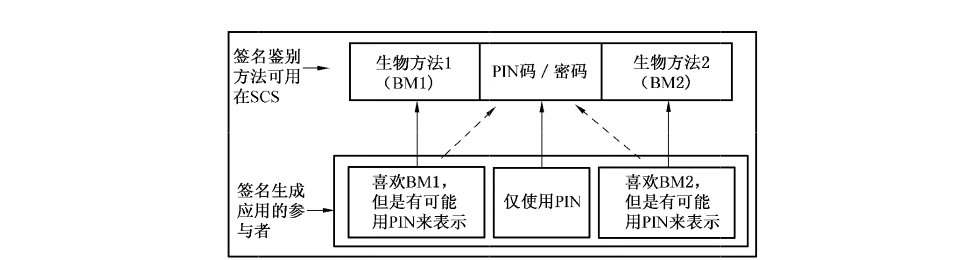

在签名生成环境中，签名人和 SCA 是一对一的关系，应使用适合签名人的鉴别方法。在 SSCD 的多个电子签名制作数据的实例中，可能会要求每一个使用不同的签名人鉴别数据。关于一个签名人鉴别数据属于哪一个电子签名制作数据的指示，可由密码令牌信息提供。

b）基于生物特征的签名人鉴别

生物特征的示例如下：

1）指纹；

2）掌纹；

3）面部特征；

4）虹膜特征；

5）视网膜特征；

6）动态签名；

7）声音模式；

8）敲键；

9）上面各项的综合。

一些生物统计学方法与签名生成环境不甚相关。而各种不同方法的适用性的评估超出本附录讨论范畴。

## 附录 C（资料性附录）签名日志组件（SLC）

从 SCA/SSCD 的日志功能得到支持，对于签名人来说是用处很大的。即每产生一个签名，都会有日志记录存储在 SSCD 中，如图 C.1 所示。既然 SSCD 没有足够的空间来存储无限量的日志，那么采用循环结构应是更加合适的，这样一来一定数量的最新签名将被记录。记录的信息依赖于相关的 SSCD 的容量和应用程序提供者的概念。

以下举例说明可能被考虑记入的日志内容：

- 签名生成计数器；
- 签名生成的数据和时间；
- 杂凑/散列值；
- 签名；
- 签名文件标识符；
- SCA/SSCD 标识符；
- 签名人的证书标识符；
- 签名策略参考；
- 承诺类型。

一些数据，尤其是散列值和电子签名应记入 SSCD 日志中，如图 C.1 所示，其他信息，如签名人的文件标识符应由 SCA 提供。

注意：编写日志记录的必要条件是它不能被修改。

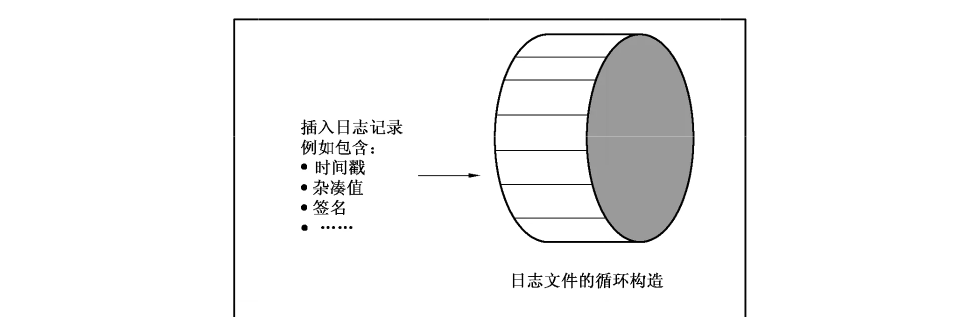

如果 SCA 支持签名日志，而且签名日志记录在 SSCD 上，则 SLC 组件应组织日志记录的写入。对 SSCD 不可知的信息，需要 SLC 组件进行整理使其能够写入 SSCD。为了建立此信息，可能需要与签名人交互，如获得签名人文件的引用。进一步，SLC 组件必须能够通过与 SSA 组件的适当交互，从 SSCD 中检索到日志信息并显示它。

当日志记录被 SCA 运行的时候，更多的数据将被记录。特别是它能记录全部行为，或是 SCA 组件的指定部分。

日志功能提供下列内容：

- 记录最新生成的签名；
- 能够检测出 SCA 和 SSCD 的误用。

## 参考文献

[1] ISO/IEC 8613 Information technology—Open Document Architecture (ODA) and interchange format: The following sources have been consulted in preparation of the Signer's Interface requirements:

[2] DIN V66291-1: Chipcards with digital signature application/function according to SigG and SigV. Version 1.0 from 15.12.1998, editorial revised 24.04.2000;

[3] TeleTrusT-Office Identity Card, Version 1.0, 06.07.2000;

[4] ISO/IEC JTC 1 Business Team on Electronic Commerce Doc. 071;

[5] ISO TC 68 /CEN TC 224 SC 6 Project Team on Electronic Commerce;

[6] EN 1332-Identification Card Systems: Man-Machine Interface:

- Part One: User Interface dialogue design specifications;
- Part Two: Tactile identifier;
- Part Three: Keypads;
- Part Four: Coding of Special User Requirements;

[7] ES 201 381 Keypads and keyboards for telecommunications equipment;

[8] CWA 14170-2004 Security requirements for signature creation applications

[9] ETSI TS 101 903-XML Advanced Electronic Signatures (XAdES)
