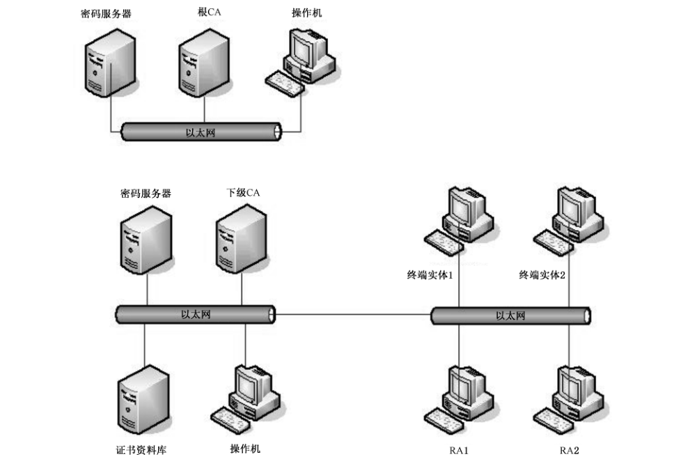

# GB/T 30272-2021 信息安全技术 公钥基础设施 标准符合性测评

> 来源：[国家标准全文公开系统](https://openstd.samr.gov.cn/bzgk/std/newGbInfo?hcno=790E5D818962CEFD8F9D625CE530C89F)；发布日期：2021-10-11；实施日期：2022-05-01。
> 官方 PDF SHA-256：`0758425c0a0c76f1428cd00f8672b3ca505ca7d79109a9928bfb985fefbd183b`。
> 依据官方 PDF 全部 44 页页面图像转写与校核；省略封面、目录、页眉、页脚和分页，合并印刷折行。

## 前言

本文件按照 GB/T 1.1—2020《标准化工作导则 第 1 部分：标准化文件的结构和起草规则》的规定起草。

本文件代替 GB/T 30272—2013《信息安全技术 公钥基础设施 标准一致性测试评价指南》，与 GB/T 30272—2013 相比，除编辑性改动外，主要技术变化如下：

——删除了“特定权限管理中心技术规范测评”（见 2013 年版的 4.5）；

——更改了“数字证书格式测评”中的相关内容（见第 8 章，2013 年版的 4.4）；

——增加了“电子签名格式测评”（见第 10 章）；

——增加了“基于数字证书的可靠电子签名生成及验证技术测评”（见第 11 章）。

请注意本文件的某些内容可能涉及专利。本文件的发布机构不承担识别专利的责任。

本文件由全国信息安全标准化技术委员会（SAC/TC 260）提出并归口。

本文件起草单位：上海辰锐信息科技公司、公安部第三研究所、中国科学院数据与通信保护研究教育中心、北京数字认证股份有限公司、格尔软件股份有限公司、中国电子科技集团公司第十五研究所（信息产业信息安全测评中心）。

本文件主要起草人：邱梓华、陈妍、李谦、刘丽敏、吕娜、郑强、傅大鹏、王路晗、邵旭东、陈家明、顾流、赵欣怡、原泉、刘中、许俊、刘健。

本文件及其所代替文件的历次版本发布情况为：

——2013 年首次发布为 GB/T 30272—2013；

——本次为第一次修订。

## 引言

本文件用于指导测试评价者测试与评价公钥基础设施是否达到国家标准要求。

本文件依据国家已颁布、实施的 7 个公钥基础设施标准，即：

——GB/T 19713—2005 信息技术 安全技术 公钥基础设施 在线证书状态协议

——GB/T 19714—2005 信息技术 安全技术 公钥基础设施 证书管理协议

——GB/T 19771—2005 信息技术 安全技术 公钥基础设施 PKI 组件最小互操作规范

——GB/T 20518—2018 信息安全技术 公钥基础设施 数字证书格式

——GB/T 20520—2006 信息安全技术 公钥基础设施 时间戳规范

——GB/T 25064—2010 信息安全技术 公钥基础设施 电子签名格式规范

——GB/T 35285—2017 信息安全技术 公钥基础设施 基于数字证书的可靠电子签名生成及验证技术要求

这 7 个标准对相应评价测试方法做了详细描述。

## 1 范围

本文件描述了公钥基础设施相关组件的测试评价方法，包括 CA、RA、时间戳子系统、在线证书状态查询子系统、电子签名及验证子系统、客户端等组件。

本文件适用于按照国家标准 GB/T 19713—2005、GB/T 19714—2005、GB/T 19771—2005、GB/T 20518—2018、GB/T 20520—2006、GB/T 25064—2010、GB/T 35285—2017 进行研制开发的产品类公钥基础设施相关组件的测试和评价。

## 2 规范性引用文件

下列文件中的内容通过文中的规范性引用而构成本文件必不可少的条款。其中，注日期的引用文件，仅该日期对应的版本适用于本文件；不注日期的引用文件，其最新版本（包括所有的修改单）适用于本文件。

- GB/T 19713—2005 信息技术 安全技术 公钥基础设施 在线证书状态协议

- GB/T 19714—2005 信息技术 安全技术 公钥基础设施 证书管理协议

- GB/T 19771—2005 信息技术 安全技术 公钥基础设施 PKI 组件最小互操作规范

- GB/T 20518—2018 信息安全技术 公钥基础设施 数字证书格式

- GB/T 20520—2006 信息安全技术 公钥基础设施 时间戳规范

- GB/T 25064—2010 信息安全技术 公钥基础设施 电子签名格式规范

- GB/T 25069—2010 信息安全技术 术语

- GB/T 35275—2017 信息安全技术 SM2 密码算法加密签名消息语法规范

- GB/T 35285—2017 信息安全技术 公钥基础设施 基于数字证书的可靠电子签名生成及验证技术要求

## 3 术语和定义

GB/T 19713—2005、GB/T 19714—2005、GB/T 19771—2005、GB/T 20518—2018、GB/T 20520—2006、GB/T 25064—2010、GB/T 35285—2017、GB/T 25069—2010 界定的术语和定义适用于本文件。

## 4 缩略语

下列缩略语适用于本文件。

BES：基本电子签名（Basis Electronic Signature）

CA：认证机构（Certification Authority）

CPS：认证惯例陈述（Certification Practice Statement）

CRL：证书撤销列表（Certificate Revocation List）

ES：电子签名（Electronic Signature）

ESS：增强安全服务（Enhanced Security Services）

MIME：多用途网络邮件扩充协议（Multipurpose Internet Mail Extension）

OCSP：在线证书状态协议（Online Certificate Status Protocol）

OID：对象标识符（Object ID）

PIN：个人身份识别码（Personal Identification Number）

PKCS：公钥密码标准（Public-Key Cryptography Standards）

PKI：公钥基础设施（Public Key Infrastructure）

RA：注册机构（Registration Authority）

TSA：时间戳机构（Time Stamp Authority）

## 5 在线证书状态协议测评

### 5.1 总则

#### 5.1.1 请求

依据 GB/T 19713—2005 中 5.2 的内容进行测评。

开发者应提供文档，对所使用的在线证书状态协议进行说明。

测评方法如下。

a） 由 OCSP 请求者发送多个不同状态证书的状态请求，检测 OCSP 响应器是否提供了正确的证书状态响应。

b） 检测 OCSP 请求是否包含以下数据：协议版本、服务请求、目标证书标识符、其他扩展数据（如 OCSP 请求者的签名、随机数等）。

c） 使用工具发送不正确报文格式的请求，检测 OCSP 响应器是否发出错误信息。

d） 使用工具发送响应器没有配置所要求服务的请求，检测 OCSP 响应器是否发出错误信息。

e） 使用工具发送不完整信息的请求，检测 OCSP 响应器是否发出错误信息。

记录测评结果并对该结果是否完全符合标准相关要求作出判断。如果以上结果全部符合，则本项满足。

#### 5.1.2 响应

依据 GB/T 19713—2005 中 5.3 的内容进行测评。

开发者应提供文档，对响应签名的密钥、响应消息格式、响应消息内容等进行说明。

测评方法如下。

a） 模拟各种身份的 OCSP 请求者，发送多个不同状态证书的状态请求，OCSP 响应请求，检测此过程中是否对所有明确的响应报文都进行数字签名。

b） 检测响应签名的密钥是否为下列三种情况之一：

1） 签发待查询证书的 CA 公钥；

2） 可信赖的响应器的公钥；

3） CA 指定的响应器公钥。

c） 由 OCSP 请求者发送多个不同状态证书的状态请求，检测 OCSP 响应器的响应消息中是否包含以下内容：

1） 响应语法的版本；

2） 响应器的名称；

3） 对请求中每个证书的响应；

4） 可选的扩展；

5） 签名算法的 OID；

6） 响应的杂凑值签名。

d） 检测对请求中每个证书的响应，是否包含以下内容：

1） 目标证书标识符；

2） 证书状态值；

3） 响应的有效期限；

4） 可选的扩展。

e） 检测 OCSP 响应消息中，证书状态值是否为以下三种响应标识符之一，并检测证书状态是否与实际一致：

1） Good，表示对状态查询的肯定响应；

2） Revoked（已撤销），表示证书已被撤销；

3） Unknown（未知），表示响应器不能鉴别待验证状态的证书。

记录测评结果并对该结果是否完全符合标准相关要求作出判断。如果以上结果全部符合，则本项满足。如果不包含可选的扩展，并且其他结果全部符合，则本项满足。

#### 5.1.3 异常情况

依据 GB/T 19713—2005 中 5.4 的内容进行测评。

开发者应提供文档，对 OCSP 响应器返回的错误消息进行说明。

测评方法如下。

a） 使用工具发送一个没有遵循 OCSP 语法的请求，检测 OCSP 响应器是否发出相应的错误信息。

b） 使响应器处于非协调的工作状态，发送一个正常请求，检测 OCSP 响应器是否发出相应的错误信息。

c） 使响应器处于不能返回所请求证书的状态，发送一个证书请求，检测 OCSP 响应器是否发出相应的错误信息。

d） 使用工具发送一个没有签名的请求，检测 OCSP 响应器是否发出相应的错误信息。

e） 使用工具发送一个未授权的请求，检测 OCSP 响应器是否发出相应的错误信息。

记录测评结果并对该结果是否完全符合标准相关要求作出判断。如果以上结果全部符合，则本项满足。

#### 5.1.4 thisUpdate、nextUpdate 和 producedAt 的语义

依据 GB/T 19713—2005 中 5.5 的内容进行测评。

开发者应提供文档，对 thisUpdate、nextUpdate 和 producedAt 的语义进行说明。

测评方法为：发送多个证书请求，检测 OCSP 响应消息是否包含以下时间字段：

a） thisUpdate：此次更新时间；

b） nextUpdate（可选字段）：下次更新时间；若没有设置此字段，需指明随时可以获得更新的撤销信息；

c） producedAt：签发时间。

记录测评结果并对该结果是否完全符合标准相关要求作出判断。如果以上结果全部符合，则本项满足。如果不包含可选字段 nextUpdate，并且指明了随时可以获得更新的撤销信息，其他结果全部符合，则本项满足。

#### 5.1.5 OCSP 签名机构的委托

依据 GB/T 19713—2005 中 5.7 的内容进行测评。

开发者应提供文档，对所使用的在线证书状态协议中 OCSP 签名机构的委托过程进行说明。

测评方法如下。

a） 如果签署证书状态信息的密钥与签署证书的密钥不同，由 CA 向响应器签发一个含有 extendedKeyUsage 唯一值的证书。

b） 发送一个证书状态查询请求，检测响应器能否用上述证书对证书状态信息进行签名。

记录测评结果并对该结果是否完全符合标准相关要求作出判断。如果以上结果全部符合，则本项满足。

#### 5.1.6 CA 密钥泄露

依据 GB/T 19713—2005 中 5.8 的内容进行测评。

开发者应提供文档，对 CA 密钥泄露时 OCSP 响应器的设置进行说明。

测评方法如下。

a） 在 OCSP 响应器中，将某一个 CA 的状态设置为私钥泄露。

b） 发送一个上述 CA 签发的证书状态查询请求，检测 OCSP 响应器能否返回上述 CA 签发的所有证书已撤销的状态信息。

记录测评结果并对该结果是否完全符合标准相关要求作出判断。如果以上结果全部符合，则本项满足。

### 5.2 安全考虑

依据 GB/T 19713—2005 中第 8 章的内容进行测评。

开发者应提供文档，对所使用的在线证书状态协议进行脆弱性分析。

测评方法：查看开发者提供的脆弱性分析报告，检测 OCSP 系统能否抵御标准中的相关攻击（至少应该包括拒绝服务攻击和重放攻击）。

记录测评结果并对该结果是否完全符合标准相关要求作出判断。如果以上结果全部符合，则本项满足。

## 6 证书管理协议测评

### 6.1 必需的 PKI 管理功能

#### 6.1.1 根 CA 初始化

依据 GB/T 19714—2005 中 8.1 的内容进行测评。

开发者应提供文档，针对根 CA 初始化的过程进行说明。

测评方法如下。

a） 根据开发者文档，产生一对根 CA 的密钥对，并将密钥对中的私钥进行保存，检测根密钥的保存方式是否安全（例如：保存在加密机或加密卡中，并受口令保护）。

b） 选择根 CA 的密钥对进行根 CA 初始化，用产生的私钥为公钥签发证书，产生自签名证书，检测这个证书的结构是否和“newWithNew”证书结构相同。

c） 为 CA 的公钥产生一个指纹，并检测传递指纹的数据结构是否为 OOBCertHash。

记录测评结果并对该结果是否完全符合标准相关要求作出判断。如果以上结果全部符合，则本项满足。

#### 6.1.2 根 CA 密钥更新

依据 GB/T 19714—2005 中 8.2 的内容进行测评。

开发者应提供文档，针对根 CA 密钥更新的过程进行说明。

测评方法如下。

a） 在 CA 的生命周期到期前，模拟一次根 CA 密钥更新的过程。

b） 产生新的根 CA 的密钥对。

c） 产生一个用新私钥为旧公钥签名的证书（“OldWithNew”证书）。

d） 产生一个用旧私钥为新公钥签名的证书（“NewWithOld”证书）。

e） 产生一个用新私钥为新公钥签名的证书（“NewWithNew”证书）。

f） 发布这些新证书。

g） 导出 CA 的新公钥。

h） 使用 CA 的新密钥为一个终端实体签发一个新证书。

i） 利用 CA 旧公钥的终端实体，获得 NewWithOld 证书，并验证上述新证书。

j） 利用 CA 新公钥的终端实体，获得 OldWithNew 证书，并验证 CA 旧密钥签发的旧证书。

记录测评结果并对该结果是否完全符合标准相关要求作出判断。如果以上结果全部符合，则本项满足。

#### 6.1.3 下级 CA 初始化

依据 GB/T 19714—2005 中 8.3 的内容进行测评。

开发者应提供文档，针对下级 CA 初始化的过程进行说明。

测评方法如下。

a） 在下级 CA 初始化之前，检测下级 CA 能否获得以下 PKI 信息：

1） 当前根 CA 的公钥，并使用杂凑值对根 CA 公钥进行带外验证；

2） 撤销列表以及撤销列表的认证路径；

3） 所支持的每一种相关应用的算法和算法变量。

b） 模拟一次下级 CA 初始化的过程：产生下级 CA 密钥，利用根证书产生下级 CA 的签名证书。

c） 产生初始的撤销列表。

记录测评结果并对该结果是否完全符合标准相关要求作出判断。如果以上结果全部符合，则本项满足。

#### 6.1.4 CRL 产生

依据 GB/T 19714—2005 中 8.4 的内容进行测评。

开发者应提供文档，针对 CRL 产生的过程进行说明。

测评方法如下。

a） 在发布证书之前，在新建立 CA 中产生空的 CRL 列表。

b） 检测能否操作成功。

c） 撤销一张证书，检测 CRL 是否可以正常更新。

记录测评结果并对该结果是否完全符合标准相关要求作出判断。如果以上结果全部符合，则本项满足。

#### 6.1.5 PKI 信息请求

依据 GB/T 19714—2005 中 8.5 的内容进行测评。

开发者应提供文档，针对 PKI 信息请求进行说明。

测评方法如下。

a） 评价者模拟各种 PKI 信息请求，检测 CA 是否能够提供请求者要求的所有请求信息，如果某些信息不能提供，CA 是否给请求者返回错误信息。

b） 检测文档是否和标准的规定一致。

记录测评结果并对该结果是否完全符合标准相关要求作出判断。如果以上结果全部符合，则本项满足。

#### 6.1.6 交叉认证

依据 GB/T 19714—2005 中 8.6 的内容进行测评。

开发者应提供文档，针对交叉认证过程进行说明。

测评方法如下。

a） 评价者模拟一次交叉认证过程。

b） 新建三个独立的 CA 系统，分别命名为 A、B、C。

c） 分别使用三个 CA 系统，签发三个证书，分别命名为：a、b、c。

d） 以 CA 系统 A 为请求者，CA 系统 B 为响应者，进行交叉认证操作，检测操作过程和消息结构是否符合标准要求。

e） 在拥有证书 b 的终端实体上，使用交叉认证证书验证证书 a，应能验证成功。

f） 在拥有证书 b 的终端实体上，验证证书 c，验证应不成功。

记录测评结果并对该结果是否完全符合标准相关要求作出判断。如果系统提供交叉认证功能，以上结果全部正确，则本项满足；如果系统不提供交叉认证功能，则此项不作为最终结果的判断依据。

#### 6.1.7 终端实体初始化

依据 GB/T 19714—2005 中 8.7.1 的内容进行测评。

开发者应提供文档，针对终端实体初始化过程中的“获得 PKI 信息”这一步骤进行说明。

测评方法为：在终端实体初始化之前，检测能否获得以下 PKI 信息：

a） 当前根 CA 的公钥；

b） 撤销列表以及撤销列表的认证路径；

c） 所支持的每一种相关应用的算法和算法参数。

记录测评结果并对该结果是否完全符合标准相关要求作出判断。如果以上结果全部符合，则本项满足。

#### 6.1.8 证书请求

依据 GB/T 19714—2005 中 8.8 的内容进行测评。

开发者应提供文档，针对证书模板和证书请求进行说明。

测评方法如下。

a） 对每一种证书模板，选择一个经过初始化的终端实体，提出证书请求。

b） 检测这个请求是否使用证书请求消息。

c） 检测能否返回所申请的新证书。

d） 选择一个已经拥有一对签名密钥（带有相应的验证证书）的终端实体，提出证书请求。

e） 检测证书请求消息是否使用此实体的数字签名来保护。

f） 检测能否返回所申请的新证书。

g） 检查文档是否和标准的规定一致。

记录测评结果并对该结果是否完全符合标准相关要求作出判断。如果以上结果全部符合，则本项满足。

#### 6.1.9 密钥更新

依据 GB/T 19714—2005 中 8.9 的内容进行测评。

开发者应提供文档，针对密钥更新进行说明。

测评方法如下。

a） 在终端实体的证书将要过期前，评价者模拟密钥更新的过程。

b） 检查文档是否和标准的规定一致。

记录测评结果并对该结果是否完全符合标准相关要求作出判断。如果以上结果全部符合，则本项满足。

### 6.2 传输

依据 GB/T 19714—2005 中第 9 章的内容进行测评。

开发者应提供文档，说明在终端实体、RA、CA 之间传输 PKI 消息的传输协议和消息格式。

测评方法如下。

a） 如果 PKI 消息通过文件传输，检测 PKI 消息的格式是否符合标准要求。

b） 如果 PKI 消息通过 TCP 管理协议传输，检测 PKI 消息的格式是否符合标准要求。

c） 如果 PKI 消息通过 E-mail 方式传输，检测 PKI 消息的格式是否符合标准要求。

d） 如果 PKI 消息通过 HTTP 方式传输，检测 PKI 消息的格式是否符合标准要求。

记录测评结果并对该结果是否完全符合标准相关要求作出判断。如果系统支持的每种传输方式的消息格式和传输协议均符合标准要求，则本项满足。

### 6.3 必选的 PKI 管理消息结构

#### 6.3.1 初始的注册/认证（基本认证方案）

依据 GB/T 19714—2005 中 B.4 的内容进行测评。

开发者应提供文档，说明初始的注册/认证的消息格式。

测评方法为：通过未初始化的终端实体向 CA 请求第一个证书，根据开发者所提供的文档，检测终端实体和 PKI 之间的通信消息是否符合标准要求。

记录测评结果并对该结果是否完全符合标准相关要求作出判断。如果以上结果全部符合，则本项满足。

#### 6.3.2 证书请求

依据 GB/T 19714—2005 中 B.5 的内容进行测评。

开发者应提供文档，说明证书请求的消息格式。

测评方法：通过已经初始化的终端实体向 CA 请求证书，根据开发者所提供的文档，检测终端实体和 PKI 之间的通信消息是否符合标准要求。

记录测评结果并对该结果是否完全符合标准相关要求作出判断。如果以上结果全部符合，则本项满足。

#### 6.3.3 密钥更新请求

依据 GB/T 19714—2005 中 B.6 的内容进行测评。

开发者应提供文档，说明密钥更新请求的消息格式。

测评方法为：在密钥即将过期前，通过已经初始化的终端实体向 CA 请求证书（用于更新密钥对和/或已经拥有的相应证书），根据开发者所提供的文档，检测终端实体和 PKI 之间的通信消息是否符合标准要求。

记录测评结果并对该结果是否完全符合标准相关要求作出判断。如果以上结果全部符合，则本项满足。

## 7 组件最小互操作规范测评

### 7.1 组件规范

#### 7.1.1 证书认证机构（CA）

##### 7.1.1.1 颁发数字签名证书

依据 GB/T 19771—2005 中 5.2.2 a）的内容进行测评。

开发者应提供文档，针对数字签名证书的颁发进行说明。

测评方法如下。

a） 对每一种证书模板，通过授权 RA 产生多个签名数字证书请求，并发送给 CA，检测 CA 能否生成新证书并将其放在资料库中。

b） 通过非授权 RA 产生一个签名数字证书请求，并发送给 CA，检测 CA 能否拒绝该证书申请，能否向 RA 报告失败并说明原因。

c） 通过授权 RA 产生一个包含不匹配信息的签名数字证书请求，并发送给 CA，检测 CA 能否拒绝该证书申请，能否向 RA 报告失败并说明原因。

d） 对每一种证书模板，产生多个自我注册的证书请求，并发送给 CA，检测 CA 是否验证请求者的身份并验证申请者的相应私钥，如果验证成功，检测 CA 能否生成新证书并将其放在资料库中；如果验证失败，检测 CA 能否拒绝该证书申请，能否向申请者报告失败并说明原因。

e） 对每一种证书模板，产生多个更新的证书请求，并发送给 CA，检测 CA 是否验证请求者的身份，如果验证成功，检测 CA 能否生成新证书并将其放在资料库中；如果签名无效或者 CA 策略不允许更新，检测 CA 能否拒绝该证书更新请求，并向申请者报告失败并说明原因。

f） 以非法的请求者产生一个更新的证书请求，检测 CA 能否拒绝该证书更新请求，能否向申请者报告失败并说明原因。

记录测评结果并对该结果是否完全符合标准相关要求作出判断。如果以上结果全部符合，则本项满足。

##### 7.1.1.2 颁发加密证书

依据 GB/T 19771—2005中 5.2.2b）的内容进行测评。

开发者应提供文档，针对加密证书的颁发进行说明。

测评方法如下。

a） 由第三方集中产生加密密钥对，并通过带外方式提供给CA。

b） 由证书持有者生成一个加密证书请求，说明自己想要的加密算法，并对该请求进行数字签名，将该请求发送给 CA。

c） 检测 CA 能否验证请求者身份，并颁发加密证书和加密私钥给请求者。

记录测评结果并对该结果是否完全符合标准相关要求作出判断。如果以上结果全部符合，则本项满足。

##### 7.1.1.3 交叉认证

依据 GB/T 19771—2005中 5.2.2c）的内容进行测评。

开发者应提供文档，针对CA间的交叉认证进行说明。

测评方法如下。

a） 在两个交叉认证的 CA 之间交换 CA 的公钥，分别根据对方的公钥生成证书，并将其存放到资料库中。

b） 检测双方之间的证书能否交叉认证。

记录测评结果并对该结果是否完全符合标准相关要求作出判断。如果系统提供交叉认证功能，以上结果全部正确，则本项满足；如果系统不提供交叉认证功能，则此项不作为最终结果的判断依据。

##### 7.1.1.4 撤销证书

依据 GB/T 19771—2005中 5.2.2 d）的内容进行测评。

开发者应提供文档，针对证书的撤销进行说明。

测评方法如下。

a） 以多个证书持有者身份请求撤销证书，并将请求发送给 CA，检测 CA 是否验证请求者身份，验证成功后能否将证书放入 CRL 中。

b） 产生新的全量CRL，检测老 CRL 中的全部信息是否放到新 CRL 中。

c） 产生新的增量 CRL，检测新增的撤销证书信息是否放到新 CRL 中。

d） 通过 RA 向 CA 发送多个证书撤销请求，检测 CA 是否验证请求者身份，验证成功后能否将证书放入 CRL 中。

记录测评结果并对该结果是否完全符合标准相关要求作出判断。如果以上结果全部符合，则本项满足。

##### 7.1.1.5 请求 CA证书

依据 GB/T 19771—2005中5.2.2f）的内容进行测评。

开发者应提供文档，针对向上一级CA 申请证书进行说明。

测评方法为：通过CA 向上一级的CA 申请证书，检测能否申请成功。

记录测评结果并对该结果是否完全符合标准相关要求作出判断。如果以上结果全部符合，则本项满足。

#### 7.1.2 注册机构（RA）

依据 GB/T 19771—2005中5.3的内容进行测评。

开发者应提供文档，针对 RA的操作规范进行说明。

测评方法如下。

a） 针对每一种证书模板，向 RA 提交多个 CertReq 格式的证书请求。

b） 检测 RA 是否审查请求者的身份。

c） 检测 RA 是否确认请求者拥有相应的完整的密钥对。

d） 验证通过后，检测 RA能否抽取公钥信息并用 RA的名字和签名建立一个新的CertReq 消息。

e） 检测 RA 能否将新的 CertReq 消息发送给CA。

f） 如果证书请求被接受，检测 RA能否接收CA颁发的新证书，并将新证书发送给请求者。

g） 如果证书请求被拒绝，检测 RA能否审查从 CA发来的错误代码并向证书请求者返回证书拒绝的响应消息。

h） 向 RA 提交多个证书撤销请求，检测 RA 是否验证请求者身份，并产生新的 RevReq 消息。

i） 检测 RA能否将新的 RevReq 消息发送给CA。

j） 如果证书撤销请求被接受，检测 RA能否接收CA回应的RevReq 消息，能否将此信息提交给请求者。

k） 如果证书撤销请求被拒绝，检测 RA能否审查错误代码，并再次产生撤销请求。

记录测评结果并对该结果是否完全符合标准相关要求作出判断。如果以上结果全部符合，则本项满足。

#### 7.1.3 证书持有者规范

依据 GB/T 19771—2005中5.4的内容进行测评。

开发者应提供文档，针对证书持有者规范进行说明。

测评方法如下。

a） 以多个用户身份申请签名证书，检测能否成功申请并且获取证书。

b） 以多个用户身份申请加密证书，检测能否成功申请并且获取证书。

c） 以多个证书持有者身份，申请撤销签名证书，检测能否成功撤销证书。

d） 以多个证书持有者身份，申请更新签名证书，检测能否成功更新证书。

记录测评结果并对该结果是否完全符合标准相关要求作出判断。如果以上结果全部符合，则本项满足。

#### 7.1.4 客户规范

依据 GB/T 19771—2005中5.5的内容进行测评。

开发者应提供文档，针对客户规范进行说明。

测评方法如下。

a） 验证客户能否验证签名。

b） 验证客户能否从查询服务器检索证书和 CRLs。

c） 验证客户能否验证证书认证路径。

记录测评结果并对该结果是否完全符合标准相关要求作出判断。如果以上结果全部符合，则本项满足。

### 7.2 数据格式

#### 7.2.1 证书撤销列表

依据 GB/T 19771—2005中6.3的内容进行测评。

开发者应提供文档，针对证书撤销列表的格式进行说明。

测评方法如下。

a） 由CA颁发证书撤销列表。

b） 下载证书撤销列表，检测证书撤销列表的格式是否符合标准要求。

记录测评结果并对该结果是否完全符合标准相关要求作出判断。如果以上结果全部符合，则本项满足。

#### 7.2.2 事务消息格式

##### 7.2.2.1 全体 PKI 消息组件

依据 GB/T 19771—2005中 6.5.2的内容进行测评。

开发者应提供文档，针对 PKI 消息的格式进行说明。

测评方法为：根据开发者提供的文档，检测 PKI 消息（包括：header、body、protection、extraCerts 字段）的格式是否符合标准要求。

记录测评结果并对该结果是否完全符合标准相关要求作出判断。如果以上结果全部符合，则本项满足。

##### 7.2.2.2 通用数据结构

依据 GB/T 19771—2005中6.5.3的内容进行测评。

开发者应提供文档，针对证书模板、签名私钥的拥有证明、证书请求消息、协议加密密钥控制、PKI消息状态码、失败信息、确认协议、证书识别、Centrally Generated Keys 和带外信息的格式进行说明。

测评方法如下。

a） 根据开发者提供的文档，检测证书模板的消息格式是否符合标准要求。

b） 根据开发者提供的文档，检测签名私钥的拥有证明消息格式是否符合标准要求。

c） 根据开发者提供的文档，检测证书请求的消息格式是否符合标准要求。

d） 根据开发者提供的文档，检测协议加密密钥控制的消息格式是否符合标准要求。

e） 根据开发者提供的文档，检测 PKI消息状态码的消息格式是否符合标准要求。

f） 根据开发者提供的文档，检测失败信息的消息格式是否符合标准要求。

g） 根据开发者提供的文档，检测确认协议的消息格式是否符合标准要求。

h） 根据开发者提供的文档，检测证书识别的消息格式是否符合标准要求。

i） 根据开发者提供的文档，检测 Centrally Generated Keys 的消息格式是否符合标准要求。

j） 根据开发者提供的文档，检测带外信息的消息格式是否符合标准要求。

记录测评结果并对该结果是否完全符合标准相关要求作出判断。如果以上结果全部符合，则本项满足。

##### 7.2.2.3 特殊操作的数据结构

依据 GB/T 19771—2005中6.5.4的内容进行测评。

开发者应提供文档，针对注册/证书请求、注册/证书响应、撤销请求的内容、撤销响应内容、PKCS #10 证书请求的消息格式进行说明。

测评方法如下。

a） 根据开发者提供的文档，检测注册/证书请求的消息格式是否符合标准要求。

b）根据开发者提供的文档，检测注册/证书响应的拥有证明消息格式是否符合标准要求。

c） 根据开发者提供的文档，检测撤销请求的内容的消息格式是否符合标准要求。

d） 根据开发者提供的文档，检测撤销响应内容的消息格式是否符合标准要求。

e） 根据开发者提供的文档，检测 PKCS #10 证书请求的消息格式是否符合标准要求。

记录测评结果并对该结果是否完全符合标准相关要求作出判断。如果以上结果全部符合，则本项满足。

#### 7.2.3 PKI事务

##### 7.2.3.1 RA 发起的注册请求

依据 GB/T 19771—2005中6.6.2的内容进行测评。

如果产品支持远端 RA，则开发者应提供文档，针对 RA 发起的注册请求进行说明。

测评方法如下。

a） 根据开发者提供的文档，对每一种证书模板，在RA上向CA 请求多个终端实体的证书。

b） 检测从 RA 到CA 的证书请求消息的格式是否符合标准要求。

c） 检测从 CA到RA的证书回应消息的格式是否符合标准要求。

d） 检测确认消息的格式是否符合标准要求。

记录测评结果并对该结果是否完全符合标准相关要求作出判断。如果以上结果全部符合，则本项满足。

##### 7.2.3.2 新实体的自我注册请求

依据 GB/T 19771—2005 中6.6.3的内容进行测评。

如果CA接受自我注册请求，则开发者应提供文档，针对新实体的自我注册请求进行说明。

测评方法如下。

a） 根据开发者提供的文档，对每一种证书模板，以多个新实体身份直接向CA申请新的证书。

b） 检测从证书持有者到CA 的自我注册请求消息的格式是否符合标准要求。

c） 检测从 CA 到证书请求者的自我注册请求回应消息的格式是否符合标准要求。

d） 检测确认消息的格式是否符合标准要求。

记录测评结果并对该结果是否完全符合标准相关要求作出判断。如果以上结果全部符合，则本项满足。

##### 7.2.3.3 已知实体的自我注册请求

依据 GB/T 19771—2005中6.6.4的内容进行测评。

如果CA接受自我注册请求，则开发者应提供文档，针对已知实体的自我注册请求进行说明。

测评方法如下。

a） 根据开发者提供的文档，对每一种证书模板，以多个已知实体身份直接向CA申请新的证书。

b） 检测从证书持有者到CA 的自我注册请求消息的格式是否符合标准要求。

c） 检测从CA 到证书请求者的自我注册请求回应消息的格式是否符合标准要求。

d） 检测确认消息的格式是否符合标准要求。

记录测评结果并对该结果是否完全符合标准相关要求作出判断。如果以上结果全部符合，则本项满足。

##### 7.2.3.4 证书更新

依据 GB/T 19771—2005中6.6.5的内容进行测评。

如果CA的CPS支持证书更新，则开发者应提供文档，针对证书的更新进行说明。

测评方法如下。

a） 根据开发者提供的文档，对每一种证书模板，以多个拥有当前有效证书的实体身份直接向CA申请新的证书。

b） 检测从证书持有者到CA的证书更新申请消息的格式是否符合标准要求。

c） 检测从 CA到证书持有者的证书更新响应消息的格式是否符合标准要求。

d） 检测确认消息的格式是否符合标准要求。

记录测评结果并对该结果是否完全符合标准相关要求作出判断。如果以上结果全部符合，则本项满足。

##### 7.2.3.5 PKCS#10自我注册请求

依据 GB/T 19771—2005 中 6.6.6 的内容进行测评。

如果 CA 接受自我注册请求，则开发者应提供文档，针对 PKCS #10 自我注册请求进行说明。

测评方法如下。

a） 根据开发者提供的文档，对每一种证书模板，以多个新实体身份直接向 CA 申请新的 PKCS #10 证书。

b） 检测从证书持有者到CA的自我注册请求消息的格式是否符合标准要求。

c） 检测从 CA 到证书请求者的 PKCS证书请求响应消息的格式是否符合标准要求。

记录测评结果并对该结果是否完全符合标准相关要求作出判断。如果以上结果全部符合，则本项满足。

##### 7.2.3.6 撤销请求

依据 GB/T 19771—2005中6.6.7的内容进行测评。

开发者应提供文档，针对撤销请求进行说明。

测评方法如下。

a） 根据开发者提供的文档，以多个拥有当前有效证书的实体身份直接申请撤销自己的证书。

b） 检测从证书持有者到 RA的撤销请求消息的格式是否符合标准要求。

c） 检测从 RA到CA的撤销请求消息的格式是否符合标准要求。

d） 检测从CA到RA的撤销响应消息的格式是否符合标准要求。

e） 检测从 RA到证书持有者的撤销响应消息的格式是否符合标准要求。

记录测评结果并对该结果是否完全符合标准相关要求作出判断。如果以上结果全部符合，则本项满足。

##### 7.2.3.7 集中产生密钥对和密钥管理证书申请

依据 GB/T 19771—2005中6.6.8的内容进行测评。

开发者应提供文档，针对集中产生密钥对和密钥管理证书申请进行说明。

测评方法如下。

a） 根据开发者提供的文档，以多个拥有当前有效证书的实体身份向 CA 申请产生加密密钥并签发证书。

b） 检测集中产生密钥对申请消息的格式是否符合标准要求。

c） 检测集中产生密钥对回应消息的格式是否符合标准要求。

d） 检测确认消息的格式是否符合标准要求。

记录测评结果并对该结果是否完全符合标准相关要求作出判断。如果以上结果全部符合，则本项满足。

##### 7.2.3.8 组合证书申请

依据 GB/T 19771—2005 中6.6.9的内容进行测评。

如果CA 支持组合证书，则开发者应提供文档，针对组合证书申请进行说明。

测评方法如下。

a） 根据开发者提供的文档，以多个新实体身份向CA 申请组合证书：一个签名密钥证书和加密证书。

b） 检测组合证书申请消息的格式是否符合标准要求。

c） 检测组合证书回应消息的格式是否符合标准要求。

d） 检测确认消息的格式是否符合标准要求。

记录测评结果并对该结果是否完全符合标准相关要求作出判断。如果以上结果全部符合，则本项满足。

## 8 数字证书格式测评

### 8.1 基本证书域的数据结构

依据 GB/T 20518—2018中5.2.2 的内容进行测评。

开发者应提供文档，针对所颁发的数字证书格式进行说明。

测评方法如下。

a） 对每一种证书模板，使用公钥基础设施颁发多个数字证书。

b） 检测所颁发数字证书的基本数据结构是否和标准一致。

记录测评结果并对该结果是否完全符合标准相关要求作出判断。如果以上结果全部符合，则本项满足。

### 8.2 TBSCertificate 及其数据结构

#### 8.2.1 版本 Version

依据 GB/T 20518—2018中5.2.3.1 的内容进行测评。

开发者应提供文档，针对所颁发的数字证书格式进行说明。

测评方法如下。

a） 检测所颁发数字证书中是否包含版本项。

b） 检测证书中版本项的格式、内容是否和标准一致。

记录测评结果并对该结果是否完全符合标准相关要求作出判断。如果以上结果全部符合，则本项满足。

#### 8.2.2 序列号 Serial number

依据 GB/T 20518—2018中5.2.3.2的内容进行测评。

开发者应提供文档，针对所颁发的数字证书格式进行说明。

测评方法如下。

a） 检测所颁发数字证书中是否包含序列号项。

b）检测证书中序列号项的格式、内容是否和标准一致。

记录测评结果并对该结果是否完全符合标准相关要求作出判断。如果以上结果全部符合，则本项满足。

#### 8.2.3 签名算法 Signature algorithm

依据 GB/T 20518—2018中5.2.3.3的内容进行测评。

开发者应提供文档，针对所颁发的数字证书格式进行说明。

测评方法如下。

a） 检测所颁发数字证书中是否包含签名算法项。

b） 检测证书中签名算法项的格式、内容是否和标准一致。

记录测评结果并对该结果是否完全符合标准相关要求作出判断。如果以上结果全部符合，则本项满足。

#### 8.2.4 颁发者 Issuer

依据 GB/T 20518—2018中 5.2.3.4的内容进行测评。

开发者应提供文档，针对所颁发的数字证书格式进行说明。

测评方法如下。

a） 检测所颁发数字证书中是否包含颁发者项。

b） 检测证书中颁发者项的格式、内容是否和标准一致。

记录测评结果并对该结果是否完全符合标准相关要求作出判断。如果以上结果全部符合，则本项满足。

#### 8.2.5 有效期 Validity

依据 GB/T 20518—2018中5.2.3.5的内容进行测评。

开发者应提供文档，针对所颁发的数字证书格式进行说明。

测评方法如下。

a） 检测所颁发数字证书中是否包含有效期项。

b） 检测证书中有效期项的格式、内容是否和标准一致。

记录测评结果并对该结果是否完全符合标准相关要求作出判断。如果以上结果全部符合，则本项满足。

#### 8.2.6 主体 Subject

依据 GB/T 20518—2018中5.2.3.6 的内容进行测评。

开发者应提供文档，针对所颁发的数字证书格式进行说明。

测评方法如下。

a） 检测所颁发数字证书中是否包含主体项。

b） 检测证书中主体项的格式、内容是否和标准一致。

记录测评结果并对该结果是否完全符合标准相关要求作出判断。如果以上结果全部符合，则本项满足。

#### 8.2.7 主体公钥信息 Subject Public Key Info

依据 GB/T 20518—2018中5.2.3.7的内容进行测评。

开发者应提供文档，针对所颁发的数字证书格式进行说明。

测评方法如下。

a） 检测所颁发数字证书中是否包含主体公钥信息项。

b）检测证书中主体公钥信息项的格式、内容是否和标准一致。

记录测评结果并对该结果是否完全符合标准相关要求作出判断。如果以上结果全部符合，则本项满足。

#### 8.2.8 颁发者唯一标识符 issuerUniqueID

依据 GB/T 20518—2018中 5.2.3.8的内容进行测评。

开发者应提供文档，针对所颁发的数字证书格式进行说明。

测评方法为：检测所颁发数字证书中是否包含颁发者唯一标识符项。

记录测评结果并对该结果是否完全符合标准相关要求作出判断。如果以上结果全部符合，则本项满足。

#### 8.2.9 主体唯一标识符 subjectUniqueID

依据 GB/T 20518—2018中5.2.3.9的内容进行测评。

开发者应提供文档，针对所颁发的数字证书格式进行说明。

测评方法为：检测所颁发数字证书中是否包含主体唯一标识符项。

记录测评结果并对该结果是否完全符合标准相关要求作出判断。如果以上结果全部符合，则本项满足。

### 8.3 证书扩展项

#### 8.3.1 标准扩展

##### 8.3.1.1 颁发机构密钥标识符 authorityKeyIdentifier

依据 GB/T 20518—2018中 5.2.4.2.2 的内容进行测评。

开发者应提供文档，针对所颁发的数字证书格式进行说明。

测评方法如下。

a） 检测所颁发数字证书中是否包含颁发机构密钥标识符项。

b） 检测证书中颁发机构密钥标识符项的格式，内容是否和标准一致。

记录测评结果并对该结果是否完全符合标准相关要求作出判断。如果以上结果全部符合，则本项满足。

##### 8.3.1.2 主体密钥标识符 subjectKeyIdentifier

依据 GB/T 20518—2018中5.2.4.2.3的内容进行测评。

开发者应提供文档，针对所颁发的数字证书格式进行说明。

测评方法如下。

a） 检测所颁发数字证书中是否包含主体密钥标识符项。

b）检测证书中主体密钥标识符项的格式、内容是否和标准一致。

记录测评结果并对该结果是否完全符合标准相关要求作出判断。如果以上结果全部符合，则本项满足。

##### 8.3.1.3 密钥用法 keyUsage

依据 GB/T 20518—2018中 5.2.4.2.4的内容进行测评。

开发者应提供文档，针对所颁发的数字证书格式进行说明。

测评方法如下。

a） 检测所颁发数字证书中是否包含密钥用法项。

b） 检测证书中密钥用法项的格式、内容是否和标准一致。

记录测评结果并对该结果是否完全符合标准相关要求作出判断。如果以上结果全部符合，则本项满足。

##### 8.3.1.4 扩展密钥用途 extKeyUsage

依据 GB/T 20518—2018中 5.2.4.2.5的内容进行测评。

开发者应提供文档，针对所颁发的数字证书格式进行说明。

测评方法如下。

a） 如果公钥基础设施支持扩展密钥用途扩展项，则此项为检测项，否则为非检测项。

b） 检测所颁发数字证书中是否包含扩展密钥用途项。

c） 检测证书中扩展密钥用途项的格式、内容是否和标准一致。

记录测评结果并对该结果是否完全符合标准相关要求作出判断。如果以上结果全部符合，则本项满足。

##### 8.3.1.5 私有密钥使用期 privateKeyUsagePeriod

依据 GB/T 20518—2018中 5.2.4.2.6 的内容进行测评。

开发者应提供文档，针对所颁发的数字证书格式进行说明。

测评方法如下。

a） 如果公钥基础设施支持私有密钥使用期扩展项，则此项为检测项，否则为非检测项。

b） 检测所颁发数字证书中是否包含私有密钥使用期项。

c） 检测证书中私有密钥使用期项的格式、内容是否和标准一致。

记录测评结果并对该结果是否完全符合标准相关要求作出判断。如果以上结果全部符合，则本项满足。

##### 8.3.1.6 证书策略 certificatePolicies

依据 GB/T 20518—2018中 5.2.4.2.7 的内容进行测评。

开发者应提供文档，针对所颁发的数字证书格式进行说明。

测评方法如下。

a） 检测所颁发数字证书中是否包含证书策略项。

b）检测证书中证书策略项的格式、内容是否和标准一致。

记录测评结果并对该结果是否完全符合标准相关要求作出判断。如果以上结果全部符合，则本项满足。

##### 8.3.1.7 策略映射 policyMappings

依据 GB/T 20518—2018中5.2.4.2.8的内容进行测评。

开发者应提供文档，针对所颁发的数字证书格式进行说明。

测评方法如下。

a） 如果公钥基础设施支持策略映射扩展项，则此项为检测项，否则为非检测项。

b） 检测所颁发数字证书中是否包含策略映射项。

c） 检测证书中策略映射项的格式、内容是否和标准一致。

记录测评结果并对该结果是否完全符合标准相关要求作出判断。如果以上结果全部符合，则本项满足。

##### 8.3.1.8 主体替换名称 subjectAltName

依据 GB/T 20518 —2018中 5.2.4.2.9的内容进行测评。

开发者应提供文档，针对所颁发的数字证书格式进行说明。

测评方法如下。

a） 如果证书中的唯一主体身份是一个选择名称格式（如一个电子邮件地址），主体的甄别名为空序列，则本项为检测项目，否则为非检测项。

b） 检测证书中主体替换名称项的格式、内容是否和标准一致。

记录测评结果并对该结果是否完全符合标准相关要求作出判断。如果以上结果全部符合，则本项满足。

##### 8.3.1.9 颁发者替换名称 issuerAltName

依据 GB/T 20518—2018中 5.2.4.2.10的内容进行测评。

开发者应提供文档，针对所颁发的数字证书格式进行说明。

测评方法如下。

a） 如果公钥基础设施支持颁发者替换名称扩展项，则此项为检测项，否则为非检测项。

b） 检测所颁发数字证书中是否包含颁发者替换名称项。

c） 检测证书中颁发者替换名称项的格式、内容是否和标准一致。

记录测评结果并对该结果是否完全符合标准相关要求作出判断。如果以上结果全部符合，则本项满足。

##### 8.3.1.10 主体目录属性 subjectDirectoryAttributes

依据 GB/T 20518 —2018 中 5.2.4.2.11的内容进行测评。

开发者应提供文档，针对所颁发的数字证书格式进行说明。

测评方法如下。

a） 如果公钥基础设施支持主体目录属性扩展项，则此项为检测项，否则为非检测项。

b） 检测所颁发数字证书中是否包含主体目录属性项。

c） 检测证书中主体目录属性项的格式、内容是否和标准一致。

记录测评结果并对该结果是否完全符合标准相关要求作出判断。如果以上结果全部符合，则本项满足。

##### 8.3.1.11 基本限制 basicConstraints

依据 GB/T 20518—2018 中 5.2.4.2.12 的内容进行测评。

开发者应提供文档，针对所颁发的数字证书格式进行说明。

测评方法如下。

a） 检测所颁发数字证书中是否包含基本限制项。

b） 如果包含基本限制项，检测证书中基本限制项的格式，内容是否和标准一致。

c） 如果不包含基本限制项，则该项为非检测项。

记录测评结果并对该结果是否完全符合标准相关要求作出判断。如果以上结果全部符合，则本项满足。

##### 8.3.1.12 名称限制 nameConstraints

依据 GB/T 20518—2018中5.2.4.2.13 的内容进行测评。

开发者应提供文档，针对所颁发的数字证书格式进行说明。

测评方法如下。

a） 如果公钥基础设施支持名称限制扩展项，则此项为检测项，否则为非检测项。

b） 检测所颁发数字证书中是否包含名称限制项。

c） 检测证书中名称限制项的格式、内容是否和标准一致。

记录测评结果并对该结果是否完全符合标准相关要求作出判断。如果以上结果全部符合，则本项满足。

##### 8.3.1.13 策略限制 policyConstraints

依据 GB/T 20518—2018中 5.2.4.2.14 的内容进行测评。

开发者应提供文档，针对所颁发的数字证书格式进行说明。

测评方法如下。

a） 如果公钥基础设施支持策略限制扩展项，则此项为检测项，否则为非检测项。

b） 检测所颁发数字证书中是否包含策略限制项。

c） 检测证书中策略限制项的格式、内容是否和标准一致。

记录测评结果并对该结果是否完全符合标准相关要求作出判断。如果以上结果全部符合，则本项满足。

##### 8.3.1.14 证书撤销列表分发点 CRLDistributionPoints

依据 GB/T 20518—2018中 5.2.4.2.15的内容进行测评。

开发者应提供文档，针对所颁发的数字证书格式进行说明。

测评方法如下。

a） 如果公钥基础设施支持证书撤销列表分发点扩展项，则此项为检测项，否则为非检测项。

b） 检测所颁发数字证书中是否包含证书撤销列表分发点项。

c） 检测证书中证书撤销列表分发点项的格式，内容是否和标准一致。

记录测评结果并对该结果是否完全符合标准相关要求作出判断。如果以上结果全部符合，则本项满足。

##### 8.3.1.15 限制所有策略 inhibitAnyPolicy

依据 GB/T 20518—2018中 5.2.4.2.16 的内容进行测评。

开发者应提供文档，针对所颁发的数字证书格式进行说明。

测评方法如下。

a） 如果公钥基础设施支持限制所有策略扩展项，则此项为检测项，否则为非检测项。

b） 检测所颁发数字证书中是否包含限制所有策略项。

c） 检测证书中限制所有策略项的格式、内容是否和标准一致。

记录测评结果并对该结果是否完全符合标准相关要求作出判断。如果以上结果全部符合，则本项满足。

##### 8.3.1.16 最新证书撤销列表 freshestCRL

依据 GB/T 20518—2018中 5.2.4.2.17的内容进行测评。

开发者应提供文档，针对所颁发的数字证书格式进行说明。

测评方法如下。

a） 如果公钥基础设施支持最新证书撤销列表扩展项，则此项为检测项，否则为非检测项。

b） 检测所颁发数字证书中是否包含最新证书撤销列表项。

c） 检测证书中最新证书撤销列表项的格式、内容是否和标准一致。

记录测评结果并对该结果是否完全符合标准相关要求作出判断。如果以上结果全部符合，则本项满足。

##### 8.3.1.17 个人身份标识码 identifyCode

依据 GB/T 20518—2018 中 5.2.4.2.18 的内容进行测评。

开发者应提供文档，针对所颁发的数字证书格式进行说明。

测评方法如下。

a） 如果公钥基础设施支持个人身份标识码扩展项，则此项为检测项，否则为非检测项。

b） 检测所颁发数字证书中是否包含个人身份标识码项。

c） 检测证书中个人身份标识码项的格式、内容是否和标准一致。

记录测评结果并对该结果是否完全符合标准相关要求作出判断。如果以上结果全部符合，则本项满足。

##### 8.3.1.18 个人社会保险号 insuranceNumber

依据 GB/T 20518—2018 中 5.2.4.2.19 的内容进行测评。

开发者应提供文档，针对所颁发的数字证书格式进行说明。

测评方法如下。

a） 如果公钥基础设施支持个人社会保险号扩展项，则此项为检测项，否则为非检测项。

b）检测所颁发数字证书中是否包含个人社会保险号项。

c） 检测证书中个人社会保险号项的格式、内容是否和标准一致。

记录测评结果并对该结果是否完全符合标准相关要求作出判断。如果以上结果全部符合，则本项满足。

#### 8.3.2 专用因特网扩展 privateInternetExtensions id-pkix

##### 8.3.2.1 机构信息访问 authorityInfoAccess

依据 GB/T 20518—2018中5.2.4.3.2的内容进行测评。

开发者应提供文档，针对所颁发的数字证书格式进行说明。

测评方法如下。

a） 如果公钥基础设施支持机构信息访问扩展项，则此项为检测项，否则为非检测项。

b） 检测所颁发数字证书中是否包含机构信息访问项。

c） 检测证书中机构信息访问项的格式、内容是否和标准一致。

记录测评结果并对该结果是否完全符合标准相关要求作出判断。如果以上结果全部符合，则本项满足。

##### 8.3.2.2 主体信息访问 subjectInformationAccess

依据 GB/T 20518—2018中 5.2.4.3.3的内容进行测评。

开发者应提供文档，针对所颁发的数字证书格式进行说明。

测评方法如下。

a） 如果公钥基础设施支持主体信息访问扩展项，则此项为检测项，否则为非检测项。

b） 检测所颁发数字证书中是否包含主体信息访问项。

c） 检测证书中主体信息访问项的格式、内容是否和标准一致。

记录测评结果并对该结果是否完全符合标准相关要求作出判断。如果以上结果全部符合，则本项满足。

## 9 时间戳规范测评

### 9.1 时间戳的产生和颁发

#### 9.1.1 申请和颁发方式

依据 GB/T 20520—2006中6.1 的内容进行测评。

开发者应提供文档，针对时间戳的申请和颁发方式进行说明。

测评方法如下。

a） 根据开发者提供的时间戳申请和颁发方式，向TSA 申请时间戳。

b） 检测 TSA 是否向申请者按开发者提供的颁发方式返回时间戳。

记录测评结果并对该结果是否完全符合标准相关要求作出判断。如果以上结果全部符合，则本项满足。

#### 9.1.2 可信时间的产生方法

依据 GB/T 20520—2006中6.2的内容进行测评。

开发者应提供文档，针对可信时间的产生方法进行说明。

测评方法为：检测 TSA 能否按规定方式获得可信时间。

记录测评结果并对该结果是否完全符合标准相关要求作出判断。如果以上结果全部符合，则本项满足。

#### 9.1.3 时间的同步

依据 GB/T 20520—2006中6.3的内容进行测评。

开发者应提供文档，针对时间同步的措施和步骤进行说明。

测评方法如下。

a） 在获得可信时间后，检测 TSA 能否对所有部件的时间进行调整。

b）检测 TSA 能否在规定时间间隔内定期同步时间。

c） 调整时间同步的间隔时间，检测 TSA能否在规定时间间隔内定期同步时间。

d） 检测 TSA 各个部件是否采取统一行动同步时间。

e） 检测可信时间源是否为第一个启动的部件。

f） 检测在TSA 开始工作之前，是否进行了时间同步。

g） 在定期同步时间的过程中，模拟无法获得可信时间的情况，检测TSA 是否立即停止接受时间戳申请和时间同步，检测是否向管理者发出警报并写入审计日志。

记录测评结果并对该结果是否完全符合标准相关要求作出判断。如果以上结果全部符合，则本项满足。

#### 9.1.4 申请和颁发过程

依据 GB/T 20520—2006 中6.4 的内容进行测评。

开发者应提供文档，针对时间戳的申请和颁发过程进行说明。

测评方法如下。

a） 向TSA提交时间戳申请请求，检测请求消息的格式是否符合标准。

b） 提交一个不合法的请求信息，检测 TSA 是否产生一个时间戳的失败响应，检测 TSA是否填写申请被拒绝的原因。

c） 提交一个合法的请求信息，并且使TSA 无法颁发这个时间戳，检测 TSA 是否产生一个时间戳的失败响应，检测 TSA是否填写申请被拒绝的原因。

d） 提交一个合法的请求信息，并且 TSA运行正常，检测TSA能否颁发一个格式正确的时间戳并签名。

e） 检测 TSA 签名系统是否通过可信通道把新生成的时间戳发送给时间戳数据库，并由时间戳数据库将其归档保存。

f） 使TSA 系统将合法的时间戳按规定方式发给用户，检测能否发送成功；在收到合法的时间戳后，检测用户是否验证时间戳的合法性。

g） 使TSA 系统将不合法或错误的时间戳按规定方式发给用户，检测能否发送成功；在收到不合法或错误的时间戳后，检测用户能否验证出不合法或错误的时间戳。

h） 测评人员检测TSA 对g）中的情况是否有完备的处理预案，并检测处理预案的可行性。

记录测评结果并对该结果是否完全符合标准相关要求作出判断。如果以上结果全部符合，则本项满足。

### 9.2 时间戳的管理

#### 9.2.1 时间戳的保存

依据 GB/T 20520—2006中 7.1.1的内容进行测评。

开发者应提供文档，针对 TSA系统中时间戳的保存进行说明。

测评方法如下。

a） 根据说明，检测 TSA 系统是否保存了所有颁发的时间戳。

b） 检测是否保存了时间戳的以下信息：入库时间、序列号、完整编码。

记录测评结果并对该结果是否完全符合标准相关要求作出判断。如果以上结果全部符合，则本项满足。

#### 9.2.2 时间戳的备份

依据 GB/T 20520—2006中7.2的内容进行测评。

开发者应提供文档，针对时间戳的备份进行说明。

测评方法如下。

a） 检测时间戳的备份是否使用异地备份的方式。

b） 检测开发者是否采取严格的措施保护时间戳的备份介质，防止备份介质被盗、被毁和受损。

c） 检测时间戳的备份数据是否以方便检索的方式存放。

记录测评结果并对该结果是否完全符合标准相关要求作出判断。如果以上结果全部符合，则本项满足。

#### 9.2.3 时间戳的检索

依据 GB/T 20520—2006中7.3的内容进行测评。

开发者应提供文档，针对时间戳的检索进行说明。

测评方法如下。

a） 检测 TSA 是否提供一个时间戳检索的方式。

b） 检测TSA 是否提供现存以及备份的时间戳以供检索。

c） 检测 TSA 能否通过时间戳入库的时间进行检索。

d） 检测 TSA能否通过时间戳的序列号进行检索。

e） 检测 TSA 能否通过时间戳的完整编码进行检索。

f） 检测时间戳的检索结果能否发送给用户。

记录测评结果并对该结果是否完全符合标准相关要求作出判断。如果以上结果全部符合，则本项满足。

#### 9.2.4 时间戳的删除和销毁

##### 9.2.4.1 时间戳的删除

依据 GB/T 20520—2006中7.4.1的内容进行测评。

开发者应提供文档，针对时间戳的删除进行说明。

测评方法如下。

a）以TSA 管理员身份登录系统，备份要删除的时间戳，然后删除此时间戳，检测能否删除成功。

b） 以非授权用户身份登录系统，尝试删除时间戳，检测能否删除成功。

记录测评结果并对该结果是否完全符合标准相关要求作出判断。如果以上结果全部符合，则本项满足。

##### 9.2.4.2 时间戳的销毁

依据 GB/T 20520—2006中7.4.2的内容进行测评。

开发者应提供文档，针对时间戳的销毁进行说明。

测评方法如下。

a） 在TSA 证书失效前，尝试销毁所有时间戳，检测能否销毁成功。

b） 在TSA 证书失效后，并且超过了规定的保存时间，以非授权用户身份登录系统，销毁所有时间戳（包括备份），检测能否销毁成功。

c） 在TSA 证书失效后，并且超过了规定的保存时间，以TSA 管理员身份登录系统，销毁所有时间戳（包括备份），检测能否销毁成功。

记录测评结果并对该结果是否完全符合标准相关要求作出判断。如果以上结果全部符合，则本项满足。

#### 9.2.5 时间戳的查看和验证

##### 9.2.5.1 时间戳的查看

依据 GB/T 20520—2006中7.5.1 的内容进行测评。

开发者应提供文档，针对时间戳的查看进行说明。

测评方法为：通过TSA 提供的查看时间戳的方法，检测用户能否查看时间戳中所有可查看的内容。

记录测评结果并对该结果是否完全符合标准相关要求作出判断。如果以上结果全部符合，则本项满足。

##### 9.2.5.2 时间戳的验证

依据 GB/T 20520—2006中7.5.2的内容进行测评。

开发者应提供文档，针对时间戳的验证进行说明。

测评方法如下。

a） 通过CRL或OCSP协议，检测用户能否验证TSA证书的有效性。

b） 通过TSA提供的验证时间戳的方法，检测用户能否验证时间戳是由该TSA 签发。

c） 通过TSA 提供的验证时间戳的方法，检测用户能否验证时间戳是指定文件的时间戳。

记录测评结果并对该结果是否完全符合标准相关要求作出判断。如果以上结果全部符合，则本项满足。

### 9.3 时间戳的格式

#### 9.3.1 对TSA 的要求

依据 GB/T 20520—2006中8.1 的内容进行测评。

开发者应提供文档，针对 TSA 系统进行说明。

测评方法如下。

a） 检测所颁发的时间戳里，是否包含以下内容：

1） 一个可信时间值；

2） 一个一次性随机整数（nonce 域），若此项不存在则为非检测项；

3） 一个唯一的标识符（表明了时间戳生成时的安全策略），若此项不存在则为非检测项。

b） 检测 TSA能否检查单向散列函数的标识符，能否验证散列值长度的正确性。

c） 检测是否只在散列值上盖时间戳。

d） 检测时间戳内是否包含任何请求方的标识，如果包含，则此项不符合。

e） 检测TSA系统是否使用专门的密钥对时间戳签名，并检测密钥对应证书中是否说明了该密钥的这个用途。

f） 使请求方在申请消息的扩展域内提出一些额外的要求，如果 TSA 支持这些扩展，检测时间戳内是否包含相应的扩展信息。

g） 使请求方在申请消息的扩展域内提出一些额外的要求，如果 TSA 不支持这些扩展，检测 TSA是否返回一个出错信息。

记录测评结果并对该结果是否完全符合标准相关要求作出判断。如果以上结果全部符合，则本项满足。

#### 9.3.2 密钥标识

依据 GB/T 20520—2006中8.2的内容进行测评。

开发者应提供文档，针对密钥标识进行说明。

测评方法为：检测 TSA 系统的所有密钥对应的证书中，是否包含唯一的Key Usage 扩展域，并检测格式是否正确。

记录测评结果并对该结果是否完全符合标准相关要求作出判断。如果以上结果全部符合，则本项满足。

#### 9.3.3 时间的表示格式

依据 GB/T 20520—2006中8.3的内容进行测评。

开发者应提供文档，针对时间的表示格式进行说明。

测评方法为：检测时间戳的时间表示格式是否正确。

记录测评结果并对该结果是否完全符合标准相关要求作出判断。如果以上结果全部符合，则本项满足。

#### 9.3.4 时间戳申请和响应消息格式

##### 9.3.4.1 申请消息格式

依据 GB/T 20520—2006中8.4.1的内容进行测评。

开发者应提供文档，针对申请消息格式进行说明。

测评方法为：检测时间戳的申请消息格式是否正确。

记录测评结果并对该结果是否完全符合标准相关要求作出判断。如果以上结果全部符合，则本项满足。

##### 9.3.4.2 响应消息格式

依据 GB/T 20520—2006中8.4.2的内容进行测评。

开发者应提供文档，针对响应消息格式进行说明。

测评方法为：检测时间戳的响应消息格式是否正确。

记录测评结果并对该结果是否完全符合标准相关要求作出判断。如果以上结果全部符合，则本项满足。

#### 9.3.5 保存文件

依据 GB/T 20520—2006中8.5 的内容进行测评。

开发者应提供文档，针对时间戳申请和响应消息的文件保存格式进行说明。

测评方法如下。

a） 将时间戳申请消息保存为文件，检测文件扩展名是否为：tsq；使用二进制查看工具查看文件是否只包含消息的 DER编码，并检测编码格式是否正确。

b） 将时间戳响应消息保存为文件，检测文件扩展名是否为：tsr；使用二进制查看工具查看文件是否只包含消息的 DER 编码，并检测编码格式是否正确。

记录测评结果并对该结果是否完全符合标准相关要求作出判断。如果以上结果全部符合，则本项满足。

#### 9.3.6 所用 MIME对象定义

##### 9.3.6.1 电子邮件传输

依据 GB/T 20520—2006中 8.6.1的内容进行测评。

开发者应提供文档，针对电子邮件传输格式进行说明。

测评方法如下。

a） 如果使用电子邮件传输时间戳申请和响应消息，则本项为检测项目，否则为非检测项。

b） 使用电子邮件进行时间戳申请，并获取时间戳。

c） 使用协议分析仪截取整个时间戳申请和响应的数据包，并进行协议还原，检测时间戳申请和响应消息的格式是否符合标准。

记录测评结果并对该结果是否完全符合标准相关要求作出判断。如果以上结果全部符合，则本项满足。

##### 9.3.6.2 HTTP 传输

依据 GB/T 20520—2006中8.6.2的内容进行测评。

开发者应提供文档，针对 HTTP传输格式进行说明。

测评方法如下。

a） 如果使用 HTTP 协议传输时间戳申请和响应消息，则本项为检测项目，否则为非检测项。

b） 使用HTTP协议进行时间戳申请，并获取时间戳。

c） 使用协议分析仪截取整个时间戳申请和响应的数据包，并进行协议还原，检测时间戳申请和响应消息的格式是否符合标准。

记录测评结果并对该结果是否完全符合标准相关要求作出判断。如果以上结果全部符合，则本项满足。

#### 9.3.7 时间戳格式的安全考虑

依据 GB/T 20520—2006中8.7的内容进行测评。

开发者应提供文档，针对时间戳格式的安全考虑进行说明。

测评方法如下。

a） 如果请求方产生 nonce 值，检测请求方是否使用一次性随机数；如果请求方采取其他措施防范重放攻击，检测该措施是否有效。

b） 检测请求方是否不采用局部时钟来考虑等待响应的时间。

c） 分别以不同实体身份用同样的数据和同样的散列算法申请时间戳，检测TSA 系统的处理措施是否正确。

d） 以同一实体身份对同一对象多次申请时间戳，检测TSA系统和客户端的处理措施是否正确。

e） 检测 TSA 系统是否采用 nonce 域申请消息，以检查重放攻击。

f） 检测TSA 系统是否采用局部时钟和移动的时间窗口，以检查重放攻击；如果请求方采取其他措施防范重放攻击，检测该措施是否有效。

记录测评结果并对该结果是否完全符合标准相关要求作出判断。如果以上结果全部符合，则本项满足。

### 9.4 时间戳系统的安全

#### 9.4.1 审计

##### 9.4.1.1 审计数据产生

依据 GB/T 20520—2006中9.2.5.1 的内容进行测评。

开发者应提供文档，针对审计事件进行说明。

测评方法如下。

a） 检测 TSA 的签名系统是否对以下事件产生审计记录：

1） 审计功能的启动和结束；

2） 表1中的事件。

**表1 审计事件**

| TSA 功能 | 事件 | 附加信息 |
| --- | --- | --- |
| 安全审计 | 所有对审计变量（如：时间间隔，审计事件的类型）的改变 |  |
| 安全审计 | 所有删除审计记录的企图 |  |
| 安全审计 | 对审计日志签名 | 数字签名，散列结果或鉴别码应该保存在审计日志之中 |
| 本地数据输入 | 所有的安全相关数据输入系统 | 若输入的数据与其他数据相关则须验证用户访问相关数据的权限 |
| 远程数据输入 | 所有被系统所接受的安全相关信息 |  |
| 数据输出 | 所有对关键的或安全相关的信息进行输出的请求 |  |
| 私钥载入 | 部件私钥的载入 |  |
| 私钥的存储 | 对为私钥恢复而保存的证书主体私钥读取 |  |
| 可信公钥的输入，删除和存储 | 所有对于可信公钥的改变（如：添加、删除） | 包括公钥和与公钥相关的信息 |
| 私钥和对称密钥的输出 | 私钥和对称密钥（包括一次性会话密钥）的输出 |  |
| 时间戳申请 | 所有的时间戳申请请求 | 若申请成功，在日志中保存申请请求和产生的时间戳的拷贝；若申请失败，在日志中保存失败原因和产生的时间戳失败响应的拷贝 |
| 部件的配置 | 所有的与安全相关的配置 |  |
| 可信时间的获取和同步 | 根据可信时间源同步时间 | 包括如果可信时间和本地时间不匹配时，根据可信时间改变本地时间，以及同步过程中发生的所有错误 |

b） 对于表1中的每一个事件，检测审计记录是否包括以下内容：事件的日期和时间、用户、事件类型、事件是否成功，表中附加信息栏中要求的内容。

c） 检测日志记录中是否出现以下内容：明文形式的私钥、非对称密钥和其他安全相关的参数，如果出现，则此项不符合。

d） 检测每个可审计事件是否与发起该事件的系统用户身份关联。

记录测评结果并对该结果是否完全符合标准相关要求作出判断。如果以上结果全部符合，则本项满足。

##### 9.4.1.2 审计查阅

依据 GB/T 20520—2006 中 9.2.5.2 的内容进行测评。

开发者应提供文档，针对审计查阅进行说明。

测评方法如下。

a） 以审计员身份登录系统，尝试对审计记录进行查阅，检测是否成功查看日志信息。

b） 查看日志信息的内容是否为人所理解。

记录测评结果并对该结果是否完全符合标准相关要求作出判断。如果以上结果全部符合，则本项满足。

##### 9.4.1.3 审计事件存储

依据 GB/T 20520—2006中9.2.5.3的内容进行测评。

开发者应提供文档，针对审计事件存储进行说明。

测评方法如下。

a） 尝试对审计记录进行非授权的修改，检测能否修改成功，能否检测出对审计记录的修改。

b） 产生大量审计记录，直至审计存储已满，检测审计功能部件能否阻止所有审计事件的发生（除非该事件是由审计员发起的）；如果采用云存储，则该项为非检测项。

记录测评结果并对该结果是否完全符合标准相关要求作出判断。如果以上结果全部符合，则本项满足。

##### 9.4.1.4 可信的时间

依据 GB/T 20520—2006中 9.2.5.4的内容进行测评。

开发者应提供文档，针对审计记录的可信时间进行说明。

测评方法为：检测每条审计记录是否都有时间，并且检测审计记录的时间是否来源于可信时间源。

记录测评结果并对该结果是否完全符合标准相关要求作出判断。如果以上结果全部符合，则本项满足。

##### 9.4.1.5 审计日志签名

依据 GB/T 20520—2006中 9.2.5.5的内容进行测评。

开发者应提供文档，针对审计日志签名机制进行说明。

测评方法如下。

a） 检测 TSA 能否定期给审计日志加盖时间戳，并检测时间周期是否可配置。

b） 检测时间戳签名的对象是否上次生成时间戳后加入的所有审计日志条目以及上次签名的时间戳的值。

c） 检测是否对加盖时间戳的事件进行审计，并检测审计记录中是否包含时间戳。

记录测评结果并对该结果是否完全符合标准相关要求作出判断。如果以上结果全部符合，则本项满足。

## 10 电子签名格式测评

### 10.1 基本数据格式

依据 GB/T 25064—2010中6.1 的内容进行测评。

开发者应提供文档，针对电子签名的基本数据格式相关内容进行说明。

测评方法如下。

a） 通过工具查看电子签名中的数据内容类型的语法结构和内容是否符合 RFC2630，如果电子签名是采用SM2算法，则检查是否符合 GB/T 35275—2017中“7数据类型（Data）”的相关要求。

b） 通过工具查看电子签名中的签名数据内容类型的语法结构内容是否符合 RFC2630，如果电子签名是采用 SM2 算法，则检查是否符合 GB/T 35275—2017 中“8签名数据类型（signedData）”的相关要求。

c） 通过工具查看电子签名中的签名数据，是否符合以下要求：

1） 版本号应设置为3；

2） 用于签名的签名者证书的标识应经过签名；

3） 签名数据中应至少有一个签名者信息。

d） 通过工具查看电子签名中是否包含：内容类型属性、消息摘要属性、签名时间属性。

记录测评结果并对该结果是否完全符合标准相关要求作出判断。如果以上结果全部符合，则本项满足。

### 10.2 验证数据格式

依据 GB/T 25064—2010中6.2的内容进行测评。

开发者应提供文档，针对电子签名的验证数据格式相关内容进行说明。

测评方法如下。

a） 使用验证工具对电子签名进行验证，检查电子签名的验证数据是否包括时间戳和完全验证数据。

b） 通过工具查看时间戳数据是否从合法的时间戳机构得到。

c） 通过工具查看完全验证数据是否包括：完全证书引用、完全撤销引用、签名时间戳属性，并查看完全验证数据是否符合要求。

记录测评结果并对该结果是否完全符合标准相关要求作出判断。如果以上结果全部符合，则本项满足。

### 10.3 签名策略要求

依据 GB/T 25064—2010中6.3的内容进行测评。

开发者应提供文档，针对电子签名的签名策略相关内容进行说明。

测评方法如下。

a） 通过工具查看签名者和验证者是否按照签名策略属性中给出的签名策略来产生和验证签名。

b） 检测签名数据是否使用对象表述符标识来显式给出签名策略。

c） 检测签名数据是否有一个对应签名策略的策略说明。

d） 对一个显式给出的策略，检测是否有一个确定的策略说明格式，并且该格式有唯一的二进制编码。

e） 对于确定的并且显式给出的签名策略说明，检测是否为使用合法算法运算的杂凑结果，签名者应向验证者提供该杂凑运算结果，验证者应检查该结果的正确性。

f） 通过工具查看签名策略的格式是否符合要求。

记录测评结果并对该结果是否完全符合标准相关要求作出判断。如果以上结果全部符合，则本项满足。

## 11 基于数字证书的可靠电子签名生成及验证技术测评

### 11.1 电子签名相关数据的要求

#### 11.1.1 待签数据的要求

依据 GB/T 35285—2017中8.1的内容进行测评。

开发者应提供文档，针对待签数据的要求进行说明。

测评方法如下。

a） 对于待签数据，通过工具查看待签数据是否包括：

1） 签名人文件；

2） 由签名人所选择的、与签名人文件一同被签署的签名属性。

b） 检测待签数据是否包括证书标识符，是否包含可选的属性：签名策略引用、数据内容类型、承诺类型、签名人角色、电子签名产生时签名人所在地、时间戳、归档的数字证书文件等。

记录测评结果并对该结果是否完全符合标准相关要求作出判断。如果以上结果全部符合，则本项满足。如果不包含可选的属性，并且其他结果全部符合，则本项满足。

#### 11.1.2 电子签名数据格式的要求

依据 GB/T 35285—2017中8.2的内容进行测评。

开发者应提供文档，针对电子签名数据格式的要求进行说明。

测评方法如下。

a） 检测系统是否支持以下五种电子签名格式类型：基本电子签名（BES）、带时间戳的电子签名（ES-T）、带完全验证数据的电子签名（ES-C）、带扩展验证数据的电子签名（ES-X）和带归档时间戳的电子签名（ES-A）。

b） 检测电子签名数据的格式及编码是否符合GB/T 25064—2010中第6章的要求。

记录测评结果并对该结果是否完全符合标准相关要求作出判断。如果以上结果全部符合，则本项满足。

### 11.2 签名生成模块的要求

#### 11.2.1 功能要求

依据 GB/T 35285—2017中9.1的内容进行测评。

开发者应提供文档，针对电子签名生成设备的功能要求进行说明。

测评方法如下。

a） 通过工具查看电子签名生成设备能否安全存放专属于电子签名人的电子签名制作数据。

b） 通过工具查看电子签名生成设备能否通过各种有效鉴别手段对签名人进行身份鉴别。

c） 通过工具查看电子签名生成设备能否安全使用电子签名制作数据生成电子签名。

记录测评结果并对该结果是否完全符合标准相关要求作出判断。如果以上结果全部符合，则本项满足。

#### 11.2.2 安全要求

依据 GB/T 35285—2017中9.2的内容进行测评。

开发者应提供文档，针对电子签名生成设备的安全要求进行说明。

测评方法为：电子签名生成设备应通过第三方测评机构的检测，以确保符合相关国家标准和行业标准的安全要求。

记录测评结果并对该结果是否完全符合标准相关要求作出判断。如果以上结果全部符合，则本项满足。

### 11.3 电子签名生成过程与应用程序要求

#### 11.3.1 电子签名生成过程要求

依据 GB/T 35285—2017中 10.1的内容进行测评。

开发者应提供文档，针对电子签名生成过程的要求进行说明。

测评方法为：检测电子签名生成过程是否包括以下步骤：

a） 签名生成应用程序与电子签名生成设备建立连接过程：在使用签名生成应用程序调用电子签名生成设备进行签名操作之前，需要首先建立二者之间的连接；

b） 电子签名数据准备过程：包括选择要签名的签名人文件、与相关签名属性一起形成待签数据、获取待用数字证书等；

c） 电子签名制作数据使用鉴别过程：电子签名生成设备对签名人使用电子签名制作数据的权限进行鉴别；

d） 产生电子签名过程：选择用于签名的电子签名制作数据，并进行签名运算产生电子签名；

e） 电子签名输出过程：根据签名策略和应用要求，获取必要的附加信息，产生并输出电子签名。

记录测评结果并对该结果是否完全符合标准相关要求作出判断。如果以上结果全部符合，则本项满足。

#### 11.3.2 电子签名生成应用程序要求

依据 GB/T 35285—2017中10.2的内容进行测评。

开发者应提供文档，针对电子签名生成应用程序的要求进行说明。

测评方法如下。

a） 检测签名生成应用程序是否提供人机交互，使签名人能控制电子签名的生成过程，并且向签名人提示错误及状态信息。

b） 检测签名生成应用程序是否允许签名人选择签名人文件和签名属性，调用电子签名生成设备时应能够通过多种途径读取到待用数字证书。

c） 电子签名生成设备是否显示签名人文件全部内容或其关键特征内容，是否保证显示的内容不会被篡改。

d） 如果电子签名生成设备不具有签名人鉴别数据的输入功能，检测签名生成应用程序是否提供签名人鉴别数据输入功能，并对签名人鉴别数据进行预处理，使其能够与电子签名生成设备中的签名人鉴别数据进行比较。

记录测评结果并对该结果是否完全符合标准相关要求作出判断。如果以上结果全部符合，则本项满足。

### 11.4 电子签名验证过程与应用程序要求

#### 11.4.1 电子签名验证过程要求

依据 GB/T 35285 —2017中11.1的内容进行测评。

开发者应提供文档，针对电子签名验证过程的要求进行说明。

测评方法如下。

a） 检测验证程序能否正确获取签名人文件及所附的电子签名，并验证签名人文件的完整性。

b） 检测验证程序能否正确获取签名策略以及额外验证数据，正确验证额外验证数据是否符合签名策略，并正确验证额外验证数据的有效性。

c） 检测验证程序是否提供接口输出电子签名验证结果，电子签名的验证结果分为三类，即签名有效、签名无效和不完全验证。若结果是不完全验证，验证者可根据验证规则的要求补充附加信息再次进行验证。

记录测评结果并对该结果是否完全符合标准相关要求作出判断。如果以上结果全部符合，则本项满足。

#### 11.4.2 电子签名验证应用程序要求

依据 GB/T 35285—2017中 11.2的内容进行测评。

开发者应提供文档，针对电子签名验证应用程序的要求进行说明。

测评方法如下。

a） 检测电子签名验证应用程序能否正确选择待验证的电子签名和对应的签名人文件，获取额外验证数据，依据预定义的验证规则对电子签名进行验证。

b） 检测电子签名验证应用程序能否将验证结果、签名人文件、签名人的信息、数字证书和时间戳验证信息等呈现给用户或通过接口安全传输给其他信息系统。

c） 检测电子签名验证应用程序能否有效排除所有不是电子签名验证应用程序所必需的不可信系统进程、外围设备和通信信道、应用进程等对验证进程的干扰。

d） 检测电子签名验证应用程序能否确保正确验证签名人文件和额外验证数据，输出结果不会被篡改。

记录测评结果并对该结果是否完全符合标准相关要求作出判断。如果以上结果全部符合，则本项满足。

## 12 综合评价

采用密码技术解决机密性、完整性、真实性、不可否认性需求的，应遵循相关密码国家标准和行业标准。

所有测试项目的汇总表见附录A 中的表 A.1。按照表2对公钥基础设施各测试项目进行综合评价。

**表2 综合评价表**

| 测试项目 | 序号 | 测试子项目 | 综合评价 |
| --- | --- | --- | --- |
| 在线证书状态协议测评 | 5.1 | 总则 | 如果系统提供了在线证书状态查询功能，“5.1 总则”和“5.2 安全考虑”中的每一个子项目都满足要求，则系统符合 GB/T 19713—2005 的相关要求；如果“5.1 总则”和“5.2 安全考虑”中有不符合的子项目，则系统不符合 GB/T 19713—2005 的相关要求。 如果系统不提供在线证书状态查询功能，则在线证书状态协议无需测评。 |
| 在线证书状态协议测评 | 5.2 | 安全考虑 |  |
| 证书管理协议测评 | 6.1 | 必需的 PKI 管理功能 | “6.1 必需的 PKI 管理功能”和“6.3 必选的 PKI 管理消息结构”中的每一个子项目都满足要求，则系统满足 GB/T 19714—2005 的相关要求；如果“6.1 必需的 PKI 管理功能”和“6.3 必选的 PKI 管理消息结构”中有不符合的子项目，则系统不符合 GB/T 19714—2005 的相关要求。 |
| 证书管理协议测评 | 6.2 | 传输 |  |
| 证书管理协议测评 | 6.3 | 必选的 PKI 管理消息结构 |  |
| 组件最小互操作规范测评 | 7.1 | 组件规范 | “7.1 组件规范”和“7.2 数据格式”中的每一个子项目都满足要求，则系统满足 GB/T 19771—2005 的相关要求；如果“7.1 组件规范”和“7.2 数据格式”中有不符合的子项目，则系统不符合 GB/T 19771—2005 的相关要求。 |
| 组件最小互操作规范测评 | 7.2 | 数据格式 |  |
| 数字证书格式测评 | 8.1 | 基本证书域的数据结构 | “8.1 基本证书域的数据结构”和“8.2 TBSCertificate 及其数据结构”中每一个子项目都满足要求，并且“8.3 证书扩展项”中的“8.3.1.3 密钥用法 keyUsage”也满足要求，则系统满足 GB/T 20518—2018 的相关要求。如果“8.1 基本证书域的数据结构”和“8.2 TBSCertificate 及其数据结构”中有不符合的子项目，或者“8.3 证书扩展项”中的“8.3.1.3 密钥用法 keyUsage”不满足要求，则系统不符合 GB/T 20518—2018 的相关要求。 |
| 数字证书格式测评 | 8.2 | TBSCertificate 及其数据结构 |  |
| 数字证书格式测评 | 8.3 | 证书扩展项 |  |
| 时间戳规范测评 | 9.1 | 时间戳的产生和颁发 | 如果系统提供了时间戳功能，“9.1 时间戳的产生和颁发”“9.2 时间戳的管理”“9.3 时间戳的格式”“9.4 时间戳系统的安全”中每一个子项目都满足相关要求，则系统满足 GB/T 20520—2006 的相关要求；如果“9.1 时间戳的产生和颁发”“9.2 时间戳的管理”“9.3 时间戳的格式”“9.4 时间戳系统的安全”中有不符合的子项目，则系统不符合 GB/T 20520—2006 的相关要求。 如果系统不提供时间戳功能，则时间戳功能无需测评。 |
| 时间戳规范测评 | 9.2 | 时间戳的管理 |  |
| 时间戳规范测评 | 9.3 | 时间戳的格式 |  |
| 时间戳规范测评 | 9.4 | 时间戳系统的安全 |  |
| 电子签名格式测评 | 10.1 | 基本数据格式 | 如果系统提供了电子签名功能，“10.1 基本数据格式”“10.2 验证数据格式”“10.3 签名策略要求”中每一个子项目都满足相关要求，则系统满足 GB/T 20520—2006 的相关要求；如果“10.1 基本数据格式”“10.2 验证数据格式”“10.3 签名策略要求”中有不符合的子项目，则系统不符合 GB/T 25064—2010 的相关要求。 如果系统不提供电子签名功能，则电子签名格式无需测评。 |
| 电子签名格式测评 | 10.2 | 验证数据格式 |  |
| 电子签名格式测评 | 10.3 | 签名策略要求 |  |
| 基于数字证书的可靠电子签名生成及验证技术测评 | 11.1 | 电子签名相关数据的要求 | 如果系统提供了电子签名和验证功能，每一个子项目都满足相关要求，则系统 GB/T 35285—2017 的相关要求。 如果系统不提供电子签名和验证功能，则电子签名生成及验证功能无需测评。 |
| 基于数字证书的可靠电子签名生成及验证技术测评 | 11.2 | 签名生成模块的要求 |  |
| 基于数字证书的可靠电子签名生成及验证技术测评 | 11.3 | 电子签名生成过程与应用程序要求 |  |
| 基于数字证书的可靠电子签名生成及验证技术测评 | 11.4 | 电子签名验证过程与应用程序要求 |  |

## 附录 A（资料性）测试项目总表

### A.1 测试项目总表

所有测试项目的汇总表 A.1。

**表 A.1 测试项目总表**

| 序号 | 类别 | 测试项目 | 测评依据标准条款 |
| --- | --- | --- | --- |
| 1 | 5 在线证书状态协议测评 | 5.1 总则 > 5.1.1 请求 | GB/T 19713—2005 5.2 |
| 2 | 5 在线证书状态协议测评 | 5.1 总则 > 5.1.2 响应 | GB/T 19713—2005 5.3 |
| 3 | 5 在线证书状态协议测评 | 5.1 总则 > 5.1.3 异常情况 | GB/T 19713—2005 5.4 |
| 4 | 5 在线证书状态协议测评 | 5.1 总则 > 5.1.4 thisUpdate、nextUpdate 和 producedAt 的语义 | GB/T 19713—2005 5.5 |
| 5 | 5 在线证书状态协议测评 | 5.1 总则 > 5.1.5 OCSP 签名机构的委托 | GB/T 19713—2005 5.7 |
| 6 | 5 在线证书状态协议测评 | 5.1 总则 > 5.1.6 CA 密钥泄露 | GB/T 19713—2005 5.8 |
| 7 | 5 在线证书状态协议测评 | 5.2 安全考虑 | GB/T 19713—2005 第 8 章 |
| 8 | 6 证书管理协议测评 | 6.1 必需的 PKI 管理功能 > 6.1.1 根 CA 初始化 | GB/T 19714—2005 8.1 |
| 9 | 6 证书管理协议测评 | 6.1 必需的 PKI 管理功能 > 6.1.2 根 CA 密钥更新 | GB/T 19714—2005 8.2 |
| 10 | 6 证书管理协议测评 | 6.1 必需的 PKI 管理功能 > 6.1.3 下级 CA 初始化 | GB/T 19714—2005 8.3 |
| 11 | 6 证书管理协议测评 | 6.1 必需的 PKI 管理功能 > 6.1.4 CRL 产生 | GB/T 19714—2005 8.4 |
| 12 | 6 证书管理协议测评 | 6.1 必需的 PKI 管理功能 > 6.1.5 PKI 信息请求 | GB/T 19714—2005 8.5 |
| 13 | 6 证书管理协议测评 | 6.1 必需的 PKI 管理功能 > 6.1.6 交叉认证 | GB/T 19714—2005 8.6 |
| 14 | 6 证书管理协议测评 | 6.1 必需的 PKI 管理功能 > 6.1.7 终端实体初始化 > 6.1.7.1 获得 PKI 信息 | GB/T 19714—2005 8.7.1 |
| 15 | 6 证书管理协议测评 | 6.1 必需的 PKI 管理功能 > 6.1.8 证书请求 | GB/T 19714—2005 8.8 |
| 16 | 6 证书管理协议测评 | 6.1 必需的 PKI 管理功能 > 6.1.9 密钥更新 | GB/T 19714—2005 8.9 |
| 17 | 6 证书管理协议测评 | 6.2 传输 | GB/T 19714—2005 第 9 章 |
| 18 | 6 证书管理协议测评 | 6.3.1 初始的注册/认证（基本认证方案） | GB/T 19714—2005 B.4 |
| 19 | 6 证书管理协议测评 | 6.3.2 证书请求 | GB/T 19714—2005 B.5 |
| 20 | 6 证书管理协议测评 | 6.3.3 密钥更新请求 | GB/T 19714—2005 B.6 |
| 21 | 7 组件最小互操作规范测评 | 7.1 组件规范 > 7.1.1 证书认证机构（CA） > 7.1.1.1 颁发数字签名证书 | GB/T 19771—2005 5.2.2 a） |
| 22 | 7 组件最小互操作规范测评 | 7.1 组件规范 > 7.1.1 证书认证机构（CA） > 7.1.1.2 颁发加密证书 | GB/T 19771—2005 5.2.2 b） |
| 23 | 7 组件最小互操作规范测评 | 7.1 组件规范 > 7.1.1 证书认证机构（CA） > 7.1.1.3 交叉认证 | GB/T 19771—2005 5.2.2 c） |
| 24 | 7 组件最小互操作规范测评 | 7.1 组件规范 > 7.1.1 证书认证机构（CA） > 7.1.1.4 撤销证书 | GB/T 19771—2005 5.2.2 d） |
| 25 | 7 组件最小互操作规范测评 | 7.1 组件规范 > 7.1.1 证书认证机构（CA） > 7.1.1.5 请求 CA 证书 | GB/T 19771—2005 5.2.2 f） |
| 26 | 7 组件最小互操作规范测评 | 7.1 组件规范 > 7.1.2 注册机构（RA） | GB/T 19771—2005 5.3 |
| 27 | 7 组件最小互操作规范测评 | 7.1 组件规范 > 7.1.3 证书持有者规范 | GB/T 19771—2005 5.4 |
| 28 | 7 组件最小互操作规范测评 | 7.1 组件规范 > 7.1.4 客户规范 | GB/T 19771—2005 5.5 |
| 29 | 7 组件最小互操作规范测评 | 7.2 数据格式 > 7.2.1 证书撤销列表 | GB/T 19771—2005 6.3 |
| 30 | 7 组件最小互操作规范测评 | 7.2 数据格式 > 7.2.2 事务消息格式 > 7.2.2.1 全体 PKI 消息组件 | GB/T 19771—2005 6.5.2 |
| 31 | 7 组件最小互操作规范测评 | 7.2 数据格式 > 7.2.2 事务消息格式 > 7.2.2.2 通用数据结构 | GB/T 19771—2005 6.5.3 |
| 32 | 7 组件最小互操作规范测评 | 7.2 数据格式 > 7.2.2 事务消息格式 > 7.2.2.3 特殊操作的数据结构 | GB/T 19771—2005 6.5.4 |
| 33 | 7 组件最小互操作规范测评 | 7.2 数据格式 > 7.2.3 PKI 事务 > 7.2.3.1 RA 发起的注册请求 | GB/T 19771—2005 6.6.2 |
| 34 | 7 组件最小互操作规范测评 | 7.2 数据格式 > 7.2.3 PKI 事务 > 7.2.3.2 新实体的自我注册请求 | GB/T 19771—2005 6.6.3 |
| 35 | 7 组件最小互操作规范测评 | 7.2 数据格式 > 7.2.3 PKI 事务 > 7.2.3.3 已知实体的自我注册请求 | GB/T 19771—2005 6.6.4 |
| 36 | 7 组件最小互操作规范测评 | 7.2 数据格式 > 7.2.3 PKI 事务 > 7.2.3.4 证书更新 | GB/T 19771—2005 6.6.5 |
| 37 | 7 组件最小互操作规范测评 | 7.2 数据格式 > 7.2.3 PKI 事务 > 7.2.3.5 PKCS#10 自我注册请求 | GB/T 19771—2005 6.6.6 |
| 38 | 7 组件最小互操作规范测评 | 7.2 数据格式 > 7.2.3 PKI 事务 > 7.2.3.6 撤销请求 | GB/T 19771—2005 6.6.7 |
| 39 | 7 组件最小互操作规范测评 | 7.2 数据格式 > 7.2.3 PKI 事务 > 7.2.3.7 集中产生密钥对和密钥管理证书申请 | GB/T 19771—2005 6.6.8 |
| 40 | 7 组件最小互操作规范测评 | 7.2 数据格式 > 7.2.3 PKI 事务 > 7.2.3.8 组合证书申请 | GB/T 19771—2005 6.6.9 |
| 41 | 8 数字证书格式测评 | 8.1 基本证书域的数据结构 | GB/T 20518—2018 5.2.2 |
| 42 | 8 数字证书格式测评 | 8.2 TBSCertificate 及其数据结构 > 8.2 TBSCertificate 及其数据结构 > 8.2.1 版本 version | GB/T 20518—2018 5.2.3.1 |
| 43 | 8 数字证书格式测评 | 8.2 TBSCertificate 及其数据结构 > 8.2 TBSCertificate 及其数据结构 > 8.2.2 序列号 serial number | GB/T 20518—2018 5.2.3.2 |
| 44 | 8 数字证书格式测评 | 8.2 TBSCertificate 及其数据结构 > 8.2 TBSCertificate 及其数据结构 > 8.2.3 签名算法 signature | GB/T 20518—2018 5.2.3.3 |
| 45 | 8 数字证书格式测评 | 8.2 TBSCertificate 及其数据结构 > 8.2 TBSCertificate 及其数据结构 > 8.2.4 颁发者 issuer | GB/T 20518—2018 5.2.3.4 |
| 46 | 8 数字证书格式测评 | 8.2 TBSCertificate 及其数据结构 > 8.2 TBSCertificate 及其数据结构 > 8.2.5 有效期 validity | GB/T 20518—2018 5.2.3.5 |
| 47 | 8 数字证书格式测评 | 8.2 TBSCertificate 及其数据结构 > 8.2 TBSCertificate 及其数据结构 > 8.2.6 主体 subject | GB/T 20518—2018 5.2.3.6 |
| 48 | 8 数字证书格式测评 | 8.2 TBSCertificate 及其数据结构 > 8.2 TBSCertificate 及其数据结构 > 8.2.7 主体公钥信息 Subject Public Key Info | GB/T 20518—2018 5.2.3.7 |
| 49 | 8 数字证书格式测评 | 8.2 TBSCertificate 及其数据结构 > 8.2 TBSCertificate 及其数据结构 > 8.2.8 颁发者唯一标识符 IssuerUniqueID | GB/T 20518—2018 5.2.3.8 |
| 50 | 8 数字证书格式测评 | 8.2 TBSCertificate 及其数据结构 > 8.2 TBSCertificate 及其数据结构 > 8.2.9 主体唯一标识符 SubjectUniqueID | GB/T 20518—2018 5.2.3.9 |
| 51 | 8 数字证书格式测评 | 8.3 证书扩展项 > 8.3 证书扩展项 > 8.3.1 标准扩展 | GB/T 20518—2018 5.2.4.2 |
| 52 | 8 数字证书格式测评 | 8.3 证书扩展项 > 8.3 证书扩展项 > 8.3.2 专用因特网扩展 | GB/T 20518—2018 5.2.4.3 |
| 53 | 9 时间戳规范测评 | 9.1 时间戳的产生和颁发 > 9.1 时间戳的产生和颁发 > 9.1.1 申请和颁发方式 | GB/T 20520—2006 6.1 |
| 54 | 9 时间戳规范测评 | 9.1 时间戳的产生和颁发 > 9.1 时间戳的产生和颁发 > 9.1.2 可信时间的产生方法 | GB/T 20520—2006 6.2 |
| 55 | 9 时间戳规范测评 | 9.1 时间戳的产生和颁发 > 9.1 时间戳的产生和颁发 > 9.1.3 时间的同步 | GB/T 20520—2006 6.3 |
| 56 | 9 时间戳规范测评 | 9.1 时间戳的产生和颁发 > 9.1 时间戳的产生和颁发 > 9.1.4 申请和颁发过程 | GB/T 20520—2006 6.4 |
| 57 | 9 时间戳规范测评 | 9.2 时间戳的管理 > 9.2 时间戳的管理 > 9.2.1 时间戳的保存 > 9.2.1.1 在 TSA 方的保存 | GB/T 20520—2006 7.1.1 |
| 58 | 9 时间戳规范测评 | 9.2 时间戳的管理 > 9.2 时间戳的管理 > 9.2.2 时间戳的备份 | GB/T 20520—2006 7.2 |
| 59 | 9 时间戳规范测评 | 9.2 时间戳的管理 > 9.2 时间戳的管理 > 9.2.3 时间戳的检索 | GB/T 20520—2006 7.3 |
| 60 | 9 时间戳规范测评 | 9.2 时间戳的管理 > 9.2 时间戳的管理 > 9.2.4 时间戳的删除和销毁 > 9.2.4.1 时间戳的删除 | GB/T 20520—2006 7.4.1 |
| 61 | 9 时间戳规范测评 | 9.2 时间戳的管理 > 9.2 时间戳的管理 > 9.2.4 时间戳的删除和销毁 > 9.2.4.2 时间戳的销毁 | GB/T 20520—2006 7.4.2 |
| 62 | 9 时间戳规范测评 | 9.2 时间戳的管理 > 9.2 时间戳的管理 > 9.2.5 时间戳的查看和验证 > 9.2.5.1 时间戳的查看 | GB/T 20520—2006 7.5.1 |
| 63 | 9 时间戳规范测评 | 9.2 时间戳的管理 > 9.2 时间戳的管理 > 9.2.5 时间戳的查看和验证 > 9.2.5.2 时间戳的验证 | GB/T 20520—2006 7.5.2 |
| 64 | 9 时间戳规范测评 | 9.3 时间戳的格式 > 9.3 时间戳的格式 > 9.3.1 对 TSA 的要求 | GB/T 20520—2006 8.1 |
| 65 | 9 时间戳规范测评 | 9.3 时间戳的格式 > 9.3 时间戳的格式 > 9.3.2 密钥标识 | GB/T 20520—2006 8.2 |
| 66 | 9 时间戳规范测评 | 9.3 时间戳的格式 > 9.3 时间戳的格式 > 9.3.3 时间的表示格式 | GB/T 20520—2006 8.3 |
| 67 | 9 时间戳规范测评 | 9.3 时间戳的格式 > 9.3 时间戳的格式 > 9.3.4 时间戳申请和响应消息格式 > 9.3.4.1 申请消息格式 | GB/T 20520—2006 8.4.1 |
| 68 | 9 时间戳规范测评 | 9.3 时间戳的格式 > 9.3 时间戳的格式 > 9.3.4 时间戳申请和响应消息格式 > 9.3.4.2 响应消息格式 | GB/T 20520—2006 8.4.2 |
| 69 | 9 时间戳规范测评 | 9.3 时间戳的格式 > 9.3 时间戳的格式 > 9.3.5 保存文件 | GB/T 20520—2006 8.5 |
| 70 | 9 时间戳规范测评 | 9.3 时间戳的格式 > 9.3 时间戳的格式 > 9.3.6 所用 MIME 对象定义 > 9.3.6.1 电子邮件传输 | GB/T 20520—2006 8.6.1 |
| 71 | 9 时间戳规范测评 | 9.3 时间戳的格式 > 9.3 时间戳的格式 > 9.3.6 所用 MIME 对象定义 > 9.3.6.2 HTTP 传输 | GB/T 20520—2006 8.6.2 |
| 72 | 9 时间戳规范测评 | 9.3 时间戳的格式 > 9.3 时间戳的格式 > 9.3.7 时间戳格式的安全考虑 | GB/T 20520—2006 8.7 |
| 73 | 9 时间戳规范测评 | 9.4 时间戳系统的安全 > 9.4 时间戳系统的安全 > 9.4.1 审计 > 9.4.1.1 审计数据产生；9.4.1.2 审计查阅；9.4.1.3 审计事件存储；9.4.1.4 可信的时间；9.4.1.5 审计日志签名 | GB/T 20520—2006 9.2.5.1；9.2.5.2；9.2.5.3；9.2.5.4；9.2.5.5 |
| 74 | 10 电子签名格式测评 | 10.1 基本数据格式 | GB/T 25064—2010 6.1 |
| 75 | 10 电子签名格式测评 | 10.2 验证数据格式 | GB/T 25064—2010 6.2 |
| 76 | 10 电子签名格式测评 | 10.3 签名策略要求 | GB/T 25064—2010 6.3 |
| 77 | 11 基于数字证书的可靠电子签名生成及验证技术测评 | 11.1 电子签名相关数据的要求 > 11.1.1 待签数据的要求 | GB/T 35285—2017 8.1 |
| 78 | 11 基于数字证书的可靠电子签名生成及验证技术测评 | 11.1 电子签名相关数据的要求 > 11.1.2 电子签名数据格式的要求 | GB/T 35285—2017 8.2 |
| 79 | 11 基于数字证书的可靠电子签名生成及验证技术测评 | 11.2 电子签名生成设备的要求 > 11.2.1 功能要求 | GB/T 35285—2017 9.1 |
| 80 | 11 基于数字证书的可靠电子签名生成及验证技术测评 | 11.2 电子签名生成设备的要求 > 11.2.2 安全要求 | GB/T 35285—2017 9.2 |
| 81 | 11 基于数字证书的可靠电子签名生成及验证技术测评 | 11.3 电子签名生成过程与应用程序要求 > 11.3.1 电子签名生成过程要求 | GB/T 35285—2017 10.1 |
| 82 | 11 基于数字证书的可靠电子签名生成及验证技术测评 | 11.3 电子签名生成过程与应用程序要求 > 11.3.2 电子签名生成应用程序要求 | GB/T 35285—2017 10.2 |
| 83 | 11 基于数字证书的可靠电子签名生成及验证技术测评 | 11.4 电子签名验证过程与应用程序要求 > 11.4.1 电子签名验证过程要求 | GB/T 35285—2017 11.1 |
| 84 | 11 基于数字证书的可靠电子签名生成及验证技术测评 | 11.4 电子签名验证过程与应用程序要求 > 11.4.2 电子签名验证应用程序要求 | GB/T 35285—2017 11.2 |

## 附录 B（资料性）公钥基础设施测试环境示例

一个最基本的公钥基础设施一般由以下五个组件组成：

a） CA是负责生成、撤销、公布和存档证书的权威机构；

b） RA是为用户办理证书申请、身份审核、证书下载、证书更新、证书注销以及密钥恢复等实际业务的办事机构或业务受理点；

c） 终端实体是不以签署证书为目的而使用其私钥的证书主体或者是依赖（证书）方；

d） 证书资料库是存储证书和CRL等信息的数据库，并提供无需验证的信息检索服务；

e） 密码服务器是生成、存储密钥对并进行密码运算的专门设备。

此外，一个完整的 PKI 系统还可能包括时间戳服务器、在线证书状态查询模块、电子签名及验签设备等等。不同的PKI 系统包含的组件不同，因此结构也不同。

图B.1 给出了公钥基础设施测试环境网络结构图的一个示例。在实际的测试评价活动中，评价者应根据开发者提供的文档和组件搭建合适的测试环境。

公钥基础设施的常见用户角色有超级管理员、业务管理员、业务操作员、审计管理员、审计员、普通用户、匿名用户等。

## 参考文献

[1] RFC2630 Cryptographic Message Syntax
