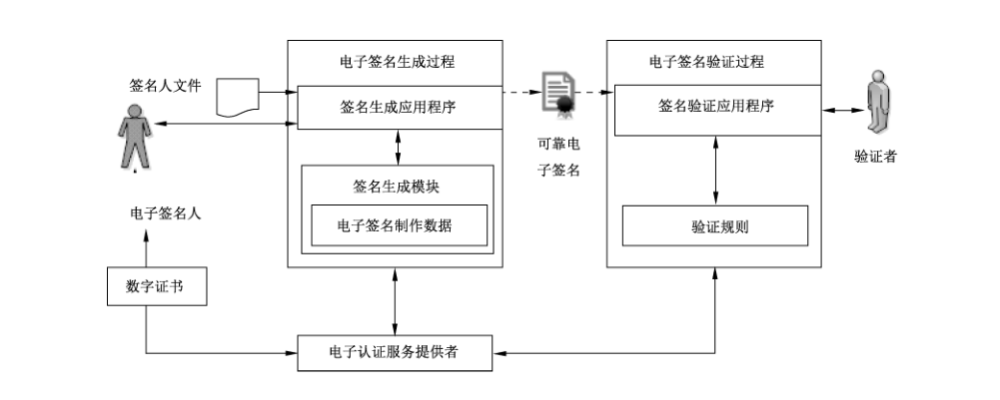

# GB/T 35285-2017 信息安全技术 公钥基础设施 基于数字证书的可靠电子签名生成及验证技术要求

> 来源：[GB/T 35285-2017 国家标准详情](https://openstd.samr.gov.cn/bzgk/std/newGbInfo?hcno=DBD0B925C417DE09B1028AB080647BA1)。
> PDF SHA-256：5a7b2dbacc7e7e6d6210e3b158bef41d2170dcf1681c95d611a49684794acb66。
> 发布日期：2017-12-29；实施日期：2018-07-01。依据官方公开 PDF 的 14 页图像逐页核对，已去除封面、分页和页眉页脚；正式引用请核对原 PDF。

## 前言

本标准按照 GB/T 1.1—2009 给出的规则起草。

本标准由全国信息安全标准化技术委员会（SAC/TC 260）提出并归口。

本标准起草单位：中国电子信息产业发展研究院、北京数字认证股份有限公司、上海格尔软件股份有限公司、标新科技（北京）有限公司、中标信安科技（北京）有限公司、北京证联信通科技发展有限公司、重庆邮电大学。

本标准主要起草人：刘权、陈月华、许亚倩、林雪焰、傅大鹏、王闯、叶枫、刘东华、段勐、马圣东、黄永洪。

## 引言

随着电子政务、电子商务等网络应用的快速发展，信息失窃、网络欺诈等现象日益突出，电子签名作为确认网络主体及行为、认定法律责任和保障合法权益的重要手段，应用日趋广泛。《中华人民共和国电子签名法》没有规定必须采用某种特定的技术，但以目前国际上比较公认的、技术成熟的技术看，主要是基于数字证书的电子签名技术。

虽然《中华人民共和国电子签名法》确立了可靠电子签名的法律效力，但如何从技术上实现可靠电子签名以及如何验证电子签名是可靠的等问题，仍没有得到很好的解决。为贯彻落实《中华人民共和国电子签名法》，促进可靠电子签名的应用普及，有必要对可靠电子签名的生成及验证技术规范进行研究和制定。本标准凡涉及电子签名技术相关内容，均指基于数字证书的电子签名技术。在本标准实施过程中，涉及密码技术的具体应用时，按照国家密码主管部门发布的有关规定和技术规范执行。

## 1 范围

本标准规定了基于数字证书的可靠电子签名生成及验证过程的技术要求，包括电子认证服务提供者、电子签名人身份、电子签名相关数据、签名生成模块、电子签名生成过程与应用程序、电子签名验证过程与应用程序等要求。

本标准适用于基于数字证书的可靠电子签名相关系统、应用的开发，以及相关产品、服务标准的制定。

## 2 规范性引用文件

下列文件对于本文件的应用是必不可少的。凡是注日期的引用文件，仅注日期的版本适用于本文件。凡是不注日期的引用文件，其最新版本（包括所有的修改单）适用于本文件。

- GB/T 20518—2006 信息安全技术 公钥基础设施 数字证书格式

- GB/T 20520—2006 信息安全技术 公钥基础设施 时间戳规范

- GB/T 25064—2010 信息安全技术 公钥基础设施 电子签名格式规范

- GB/T 25069—2010 信息安全技术 术语

## 3 术语和定义

GB/T 25069—2010界定的以及下列术语和定义适用于本文件。

### 3.1 电子签名人 electronic signer

持有电子签名制作数据并以本人身份或者以其所代表的人的名义实施电子签名的人，也称为签名方。

### 3.2 电子签名 electronic signature

数据电文中以电子形式所含、所附用于识别电子签名人身份并表明电子签名人认可其中内容的数据。

### 3.3 电子签名制作数据 electronic signature creation data

在电子签名制作过程中使用的、将电子签名与电子签名人可靠地联系起来的字符、编码等数据。在基于公钥技术实现的电子签名中，电子签名制作数据也称为私钥。

### 3.4 可靠电子签名 reliable electronic signature

能符合以下条件的电子签名：电子签名制作数据用于电子签名时，属于电子签名人专有；签名时电子签名制作数据仅由电子签名人控制；签名后对电子签名的任何改动能够被发现；签名后对数据电文内容和形式的任何改动能够被发现。

### 3.5 签名生成模块 Signature creation module

电子签名人专有的电子签名制作数据的产生、存放和使用的载体。

### 3.6 安全签名生成设备 secure signature creation device

符合国家密码主管部门相关要求的签名生成设备。

### 3.7 签名生成应用程序 Signature creation applications

签名生成系统中生成电子签名的应用程序。

### 3.8 签名人文件 signer's document

电子签名人想要为其生成电子签名的文件，或者是已经生成电子签名的文件。

### 3.9 验证者 verifier

验证电子签名的实体，可以是依赖方或有权验证可靠电子签名的第三方，如仲裁方。

### 3.10 签名验证 signature verification

验证者在电子签名生成之后所执行的验证电子签名的过程。

### 3.11 芯片操作系统 chip operating system

应用于安全签名生成设备的安全芯片内部的操作系统，主要功能是在芯片内部完成各种指令的处理及存储管理，同时控制安全芯片与外界的信息交换。

### 3.12 电子认证服务提供者 certificate service provider

负责产生、签发和管理数字证书的或提供与电子签名相关的其他服务的权威机构。

### 3.13 签名人鉴别数据 signer's authentication data

用于鉴别电子签名人的数据（如个人身份识别码、口令或生物数据），是允许使用电子签名制作数据所必需的信息。

### 3.14 签名策略 signature policy

生成和验证电子签名的规则集，其中定义了电子签名生成和验证过程中的技术和过程要求，以满足特定的应用要求，并说明在何种情况下可确定电子签名是有效的。

## 4 缩略语

下列缩略语适用于本文件。

COS：芯片操作系统（Chip Operation System）

DN：唯一甄别名（Distinguished Name）

PIN：个人身份识别码（Personal Identification Number）

SCA：签名生成应用程序（Signature Creation Application）

SSCD：安全签名生成设备（Secure Signature Creation Device）

## 5 可靠电子签名生成及验证系统架构

### 5.1 可靠电子签名生成及验证逻辑框架

图1为基于数字证书的可靠电子签名生成及验证逻辑框架。由电子认证服务提供者为电子签名人颁发数字证书。电子签名人使用签名生成应用程序，与签名生成模块建立连接，并选择要签名的签名人文件，按照签名策略形成待签数据传入签名生成模块中，调用电子签名制作数据产生数字签名，再根据具体的应用要求从电子认证服务机构获得相应的验证数据，结合签名人文件的数字签名，形成相应的可靠电子签名数据并输出签名过程的最终结果。验证时，验证者调用签名验证应用程序按照预定义的验证规则，并从电子认证服务机构获得所需的验证数据，验证签名人文件的完整性、验证数据的签名策略符合性、相关证书及验证数据的有效性等，并呈现验证结果和验证内容。

### 5.2 可靠电子签名生成及验证涉及的对象

实现可靠电子签名主要涉及以下六个对象：

a） 电子认证服务提供者，其提供的证书注册、证书生成、证书发布、证书撤销、时间戳等服务应满足相应的安全要求；

b） 电子签名人的身份，电子签名人的身份应得到有效鉴别；

c） 电子签名相关数据，根据应用场景、签名策略的不同，待签数据的组成和电子签名数据格式与编码应符合规范；

d） 签名生成模块，应满足规定的功能要求和安全要求；

e） 电子签名生成过程与应用程序，电子签名生成过程中各步骤应完成特定的功能并保证过程安全；SCA 应满足规定的功能和安全要求；

f） 电子签名验证过程与应用程序，电子签名验证过程中各步骤应完成特定的功能并保证过程安全；签名验证应用程序应满足规定的功能和安全要求。

## 6 电子认证服务提供者的要求

### 6.1 电子认证服务提供者的基本条件

电子认证服务提供者应具备下列基本条件：

a） 具有与提供电子认证服务相适应的专业技术人员和管理人员；

b） 具有与提供电子认证服务相适应的资金和经营场所；

c） 具有符合国家安全标准的技术和设备；

d） 具有国家密码主管部门同意使用密码的证明文件；

e） 制定并公布符合国家有关规定的电子认证业务规则；

f） 法律、行政法规规定的其他条件。

### 6.2 电子认证服务提供者提供的服务及安全要求

#### 6.2.1 电子认证服务提供者提供的服务

电子认证服务提供者提供的服务分为两类：一类为基本的服务，称为“核心服务”，包括证书注册服务、证书生成服务、证书发布服务、证书撤销服务；另一类可选的服务，称为“辅助服务”，包括时间戳服务、在线证书状态查询服务等。

#### 6.2.2 证书注册服务的安全要求

证书注册服务应满足如下要求：

a） 对证书申请人的身份进行查验，并对有关材料进行审查，如有效身份证件、机构资质证明、域名所有权证明等；

b） 如果证书申请包含了申请人认为需要保密的信息，则须在将该信息从证书注册服务发送给证书生成服务前，对该信息进行保护；

c） 证书注册系统应采用一种合理的机制允许注册管理员批准证书请求，并提交给后续服务；

d） 证书注册系统采用某种保护机制或安全措施来保护申请人信息的隐私性和保密性；

e） 任何与证书注册有关的事件都应记录日志。

#### 6.2.3 证书生成服务安全要求

证书生成服务应满足如下安全要求：

a） 证书生成服务应确保证书注册信息的完整性、隐私性和保密性，并认证数据来源。

b） 证书生成请求应被安全处理，并检查证书策略的一致性。

c） 签发数字证书的密钥只能用于签发数字证书，或者是对撤销证书进行签名。

d） 系统生成的数字证书，应具有下列特性：

- 要标明证书主体的名字或别名；
- 证书中的公钥与证书主体的私钥是一一对应的；
- 证书的签名是由电子认证服务提供者的签名密钥产生的；
- DN 和系统分配的证书序列号，在电子认证服务提供者中应是唯一的；
- 签发证书所采用的算法和密钥应符合国家密码主管部门的规定；
- 包含所签发证书的证书策略引用。

e） 系统生成的数字证书格式符合 GB/T 20518—2006 的要求。

f） 所有与数字证书及签发数字证书的密钥相关的事件应记录日志。

#### 6.2.4 证书发布服务安全要求

证书发布服务应定义一个访问控制策略来管理对证书数据的访问：

a） 读取访问权限，按照控制策略定义的规则，来赋予证书主体和授权实体的读取访问权限；

b） 写权限应限于授权角色。

#### 6.2.5 证书撤销服务安全要求

证书撤销服务应满足：

a） 确保撤销证书请求的实体身份符合相关要求；

b） 与撤销相关的请求和报告得到及时处理；

c） 一旦证书被明确撤销后，应确保其不能恢复再用；

d） 如果提供在线证书状态查询服务，应确保实时或周期性数据的完整性和经过身份认证；

e） 如果用实时消息提供在线证书状态查询服务，应确保是从证书状态数据库得到的证书状态数据；

f） 所有与证书状态变更请求相关的事件（包括批准或未批准的）应记录日志以便审计。

#### 6.2.6 时间戳服务安全要求

时间戳服务的安全要求应符合 GB/T 20520—2006 的规定。

## 7 电子签名人身份的要求

电子签名人需要拥有真实的实体身份，电子签名人身份由电子认证服务提供者按照 6.2.2a）中规定的内容进行有效鉴别。

## 8 电子签名相关数据的要求

### 8.1 待签数据的要求

#### 8.1.1 待签数据的组成

待签数据包括：

- 签名人文件；
- 由电子签名人所选择的，与签名人文件一同被签署的签名属性。

#### 8.1.2 签名人文件

从用户的角度来看，签名人文件可以分为两类：

a） 用户直观可见的签名人文件，这种签名人文件可以直观的形式呈现给电子签名人或验证者，电子签名人能够直观地知道所要签署的文件的内容信息，如通常的文档、声音、视频、图片等；

b） 用户非直观可见的签名人文件，这种签名人文件除非采用专门的技术来呈现，否则通常情况下不能以直观的形式呈现给电子签名人或验证者，如二进制数据、代码控件、电子数据交换消息等，在这种情况下，电子签名人应知悉自己所选择的签名人文件的含义。

#### 8.1.3 签名属性

签名属性是支持电子签名的信息项，可与签名人文件一同被签署。应与签名人文件一同被签署的签名属性为证书序列号，可选的签名属性包括：签名策略引用、数据内容类型、承诺类型、电子签名人角色、电子签名产生时电子签名人所在地、时间戳、归档的数字证书文件等。各类签名属性可见GB/T 25064—2010。

### 8.2 电子签名数据格式的要求

GB/T 25064—2010中定义了五种电子签名格式类型：基本电子签名（BES）、带时间戳的电子签名（ES-T）、带完全验证数据的电子签名（ES-C）、带扩展验证数据的电子签名（ES-X）和带归档时间戳的电子签名（ES-A），本标准中电子签名数据格式及编码应符合 GB/T 25064—2010的要求，并根据不同的应用场景、签名策略选择具体的电子签名数据格式。

## 9 签名生成模块的要求

### 9.1 功能要求

签名生成模块分为硬件和软件两类，其中，硬件应使用安全签名生成设备（SSCD），软件应符合国家密码管理部门的相关要求，且均应满足如下功能要求：

a） 能存放专属于电子签名人的电子签名制作数据；

b） 能通过各种有效鉴别手段对电子签名人进行身份认证；

c） 能使用电子签名制作数据生成电子签名。

本标准提出的要求仅针对签名生成模块为硬件的情况。

### 9.2 安全要求

#### 9.2.1 设备芯片要求

SSCD 中的安全芯片应满足如下安全要求：

a） SSCD 支持非对称密钥对生成算法，签名密钥对应在设备芯片内部生成，电子签名制作数据即私钥，在任何时刻都不得以任何形式出现在设备芯片外部；

b） 在进行签名过程中，待签数据的散列值应传入SSCD 中，由设备内的电子签名制作数据进行签名运算；

c） 如果有COS，电子签名制作数据由COS 内部管理，使用COS外部访问指令不能访问到电子签名制作数据，COS 内部不得固化密钥对和保留用于生成密钥对的参数，COS 支持的所有指令及所有参数不得留有“后门”，确保交换信息的安全。

#### 9.2.2 对电子签名人的鉴别要求

与电子签名人唯一对应的电子签名制作数据存放在 SSCD中，在签名进行之前电子签名人向SSCD 出示用以鉴别电子签名人对SSCD具有访问控制权的身份证明信息，SSCD 需提供安全鉴别措施。

SSCD 有两种基本的电子签名人鉴别方式：

- 基于知识的签名人鉴别（如 PIN 码或口令）；
- 基于生物特征的签名人鉴别。

SSCD 对电子签名人的鉴别应满足以下要求：

a） 在电子签名人成功出示签名人鉴别数据（如 PIN 码、口令或指纹等）之后，SSCD 的“安全状态”设置为允许签名，SSCD 的安全状态是否需要保持，依赖于电子签名人对SSCD的设置。

b） SSCD中设置相关安全措施，限制签名人鉴别数据的错误输入次数，当达到预先设置的鉴别失败次数时，可锁定一段时间，防止对签名人鉴别数据的攻击。

#### 9.2.3 使用环境要求

SSCD 有两种使用环境：可信环境和不可信环境。

可信环境是指SCA 处于电子签名人控制的安全应用环境，即SCA 与SSCD除了电子签名人或其授权外，任何情况无法访问和使用，如家庭或办公室。

不可信环境是指 SCA处于不完全由电子签名人控制的应用环境，即SCA 与SSCD 存在被非授权访问和使用风险，如服务大厅等公共环境。

处于可信环境时，SCA 与SSCD之间存在一个可信的通道，SSCD 可以信任SCA；处于不可信环境时，需要采用额外的实体鉴别手段，如SCA 需要有一个设备鉴别模块来实现SCA 和 SSCD之间的双向认证，认证成功后，建立 SCA 和SSCD之间的安全可信通道。

## 10 电子签名生成过程与应用程序要求

### 10.1 电子签名生成过程要求

#### 10.1.1 电子签名生成步骤

电子签名生成过程一般包括以下步骤：

a） SCA 与 SSCD建立连接过程：在使用SCA 调用SSCD进行签名操作之前，需要首先建立二者之间的连接。

b） 电子签名数据准备过程：包括选择要签名的签名人文件、与相关签名属性一起形成待签数据、获取待用数字证书等。

c） 电子签名制作数据使用鉴别过程：SSCD 对电子签名人使用电子签名制作数据的权限进行鉴别。

d） 产生数字签名过程：选择用于签名的电子签名制作数据，并在SSCD 中进行签名运算产生数字签名。

e） 电子签名输出过程：根据签名策略和应用要求，获取必要的验证数据，产生并输出电子签名。

#### 10.1.2 签名生成应用程序与安全签名生成设备建立连接过程要求

SCA 与SSCD建立连接的过程包括物理连接和数据连接过程，应满足以下要求：

a） SCA 至少要有一个适当的物理接口与SSCD建立安全的物理通信线路，即保证 SCA 与 SSCD的信息及时传输并不存在被窃取和篡改风险；

b） 根据应用场景需要，SCA需能够正确识别并选择适配 SSCD，建立安全数据连接通道，实现传输信息加密功能。

#### 10.1.3 电子签名数据准备过程要求

电子签名数据准备过程应满足以下要求：

a） SCA 支持电子签名人选择一个或多个签名人文件组合来进行签名，一旦用户选定了要进行签名的签名人文件，SCA 应保证在整个签名生成过程中签名人文件无法被修改；

b） SCA 允许电子签名人为其要生成的电子签名选择正确的数字证书；

c） SCA 允许电子签名人根据签名策略添加相应的签名属性，并与签名人文件一起形成待签数据。

#### 10.1.4 电子签名制作数据使用鉴别过程要求

SSCD应正确鉴别使用电子签名制作数据的人员是电子签名制作数据的合法持有人，防止其他人员非法使用SSCD。

#### 10.1.5 产生数字签名过程要求

产生数字签名过程应满足以下要求：

a） SSCD应允许电子签名人根据自己的意图选择正确的电子签名制作数据；

b） SSCD应正确使用电子签名制作数据对待签数据的散列值进行运算得到数字签名，并给出签名过程的结果。

#### 10.1.6 电子签名输出过程要求

SCA 根据签名策略和具体的应用要求，从电子认证服务机构正确获取相应的验证数据，如时间戳、证书链和撤销列表等，结合数字签名，产生并输出符合要求的电子签名。

### 10.2 签名生成应用程序要求

#### 10.2.1 功能要求

SCA 应满足以下功能要求：

a） 提供人机交互，使电子签名人能控制电子签名的生成过程，并且 SCA能向电子签名人提示错误及状态信息；

b） 允许电子签名人选择签名人文件和签名属性，调用 SSCD 时能够通过多种途径读取到待用数字证书；

c） 具备显示签名人文件全部内容或其关键特征内容的能力，SCA 应保证显示的内容不会被篡改；

d） 如果 SSCD不具有签名人鉴别数据的输入功能，SCA 应提供签名人鉴别数据输入功能，并对签名人鉴别数据进行预处理，使其能够与 SSCD中的签名人鉴别数据进行比较；

e） SCA 应具有下列数据处理功能：

- 将签名人文件（或其散列值）及签名属性格式化并排序形成格式化的待签数据；
- 待签数据散列运算功能；
- 将 SSCD 输出的数字签名与验证数据按照签名策略和具体应用要求生成电子签名。

#### 10.2.2 安全要求

SCA 应满足如下安全要求：

a） SCA 确保待签数据、签名人鉴别数据、SCA 和SSCD之间的交互数据等签名过程中相关信息的完整性和保密性；

b） 对不可信进程和通信端口，SCA能提供相应功能排除所有不是SCA所必需的不可信系统进程、外围设备和通信信道、应用进程等对签名进程的干扰；

c） 为了便于安全审计，SCA 对签名事件记录日志，并对安全审计日志进行完整性保护，以防止被篡改。

## 11 电子签名验证过程与应用程序要求

### 11.1 电子签名验证过程要求

电子签名验证过程包括以下步骤：签名人文件的完整性验证过程、验证数据的签名策略符合性验证过程、相关证书及验证数据的有效性验证过程以及验证结果输出过程。

电子签名验证过程应满足如下要求：

a） 能正确获取签名人文件及所附的电子签名，验证签名人文件的完整性；

b） 能正确获取签名策略以及验证数据，对验证数据是否符合签名策略进行验证；

c） 能正确获取相关证书，验证相关证书及验证数据的有效性，并提供接口输出电子签名验证结果，电子签名的验证结果应符合 GB/T 25064—2010 的规定，分为三类，即签名有效、签名无效和不完全验证。若结果是不完全验证，验证者可根据验证规则的要求补充验证数据再次进行验证。

### 11.2 签名验证应用程序要求

#### 11.2.1 功能要求

签名验证应用程序能正确选择待验证的电子签名和对应的签名人文件，从电子认证服务机构获取验证数据，依据预定义的验证规则对电子签名进行验证，并将验证结果、签名人文件、签名人的信息、数字证书和时间戳验证信息等呈现给用户或通过接口安全传输给其他信息系统。

#### 11.2.2 安全要求

签名验证应用程序应满足如下安全要求：

a） 对不可信进程和通信端口，签名验证应用程序能提供相应功能排除所有不是签名验证应用程序所必需的不可信系统进程、外围设备和通信信道、应用进程等对验证进程的干扰；

b） 签名验证应用程序能确保正确验证签名人文件和验证数据，输出结果不会被篡改。

## 参考文献

- ［1］ GB/T 25057—2010 信息安全技术 公钥基础设施 电子签名卡应用接口基本要求

- ［2］ GB/T 25065—2010 信息安全技术 公钥基础设施 签名生成应用程序的安全要求

- ［3］ GM/T 0014—2012 数字证书认证系统密码协议规范

- ［4］ GM/T 0015—2012 基于 SM2 密码算法的数字证书格式规范

- ［5］ ETSI TS 101 733 CMS Advanced Electronic Signatures（CAdES）

- ［6］ CWA 14170—2004 Security requirements for signature creation applications

- ［7］ CWA 14171—2004 General guidelines for electronic signature verification

- ［8］ EN 14890-1 Application interface for smart cards used as secure signature creation devices—Part 1: Basic services

- ［9］ CWA 14167-1,2004 Security requirements for trustworthy systems managing certificates for electronic signatures—Part 1: System security requirements
