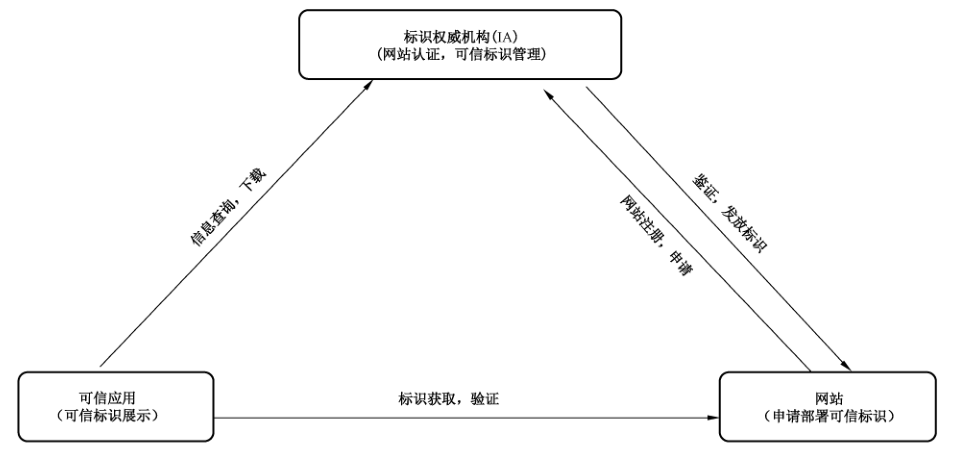
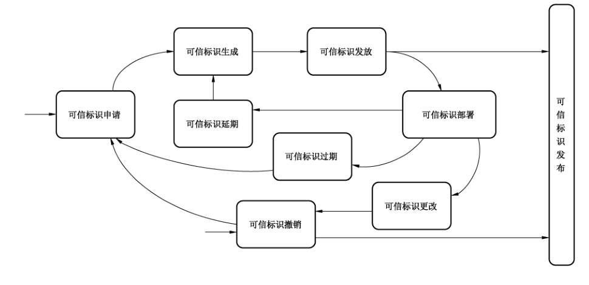
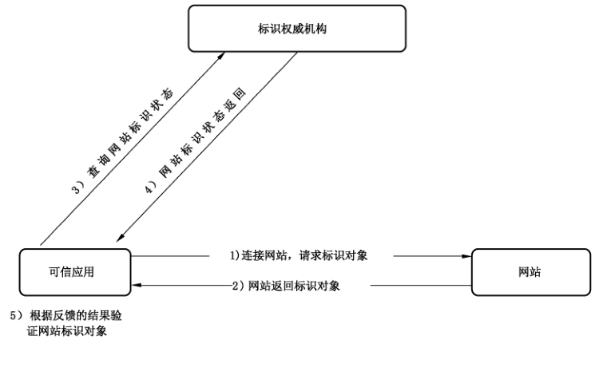
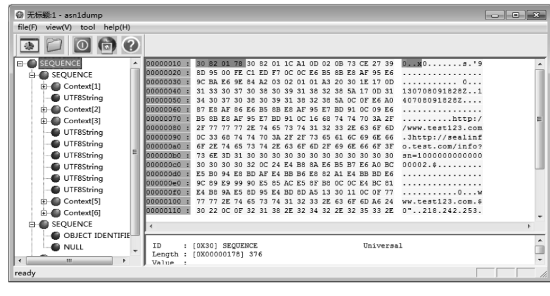

# GB/T 35287-2017 信息安全技术 网站可信标识技术指南

> 来源：[GB/T 35287-2017 国家标准详情](https://openstd.samr.gov.cn/bzgk/std/newGbInfo?hcno=1AE89D383E15DBF15E6084709F5B281A)；封面发布日期：2017-12-29；实施日期：2018-07-01。
> 官方 PDF SHA-256：ce9c98c1353d7fde5ca79cf6c92d44de344e77ac30f87dd069df5be90cdaf1d7。
> 转写说明：对照官方 PDF 全部 24 页图像校正文字、跨页表格、ASN.1 定义和附录数据；省略封面、目录、页眉、页脚和页码，保留四幅原图。正式引用请核对原 PDF。
> 原文疑点：9.2.4.7.1 正文写 RemoveFromIRL（8），同节枚举列为（7）；附录表 A.1 与 A.2 数据示例的日期和网站所有者不同。以下均按各自原页保留。

## 前言

本标准按照 GB/T 1.1—2009 给出的规则起草。

本标准由全国信息安全标准化技术委员会（SAC/TC 260）提出并归口。

本标准主要起草单位：上海格尔软件股份有限公司、上海凭安网络科技有限公司、北京奇虎科技有限公司、腾讯科技（北京）有限公司、西安西电捷通无线网络通信股份有限公司（无线网络安全技术国家工程实验室）、北京天威诚信电子商务服务有限公司、上海市数字证书认证中心有限公司、中金金融认证中心有限公司、北京数字认证股份有限公司、北龙中网（北京）科技有限责任公司、上海交通大学、四川大学、北京金山安全软件有限公司。

本标准主要起草人：杨茂江、韩洪慧、任伟、石晓虹、叶枫、徐骥、黄振海、杜志强、胡亚楠、郝萱、崔久强、赵宇、付大鹏、高宁、范磊、陈兴蜀、王海舟、张志和、陶思男。

## 引言

随着互联网快速发展，信息化已经深入社会的各个领域，并且发挥愈来愈重要的作用，同时安全问题对互联网行业的威胁也越来越大，其中假冒和钓鱼网站的危害尤为严重，如何保证网站身份真实性，有效抵制假冒、钓鱼网站已经成为国家信息系统安全建设急需解决的重要问题。

本标准定义了一种基于我国自主密码算法、可以承载网站真实信息的可信标识体系框架，并对可信标识对象、可信标识对象管理、可信标识对象获取与验证、数据格式与接口等内容进行了规范，旨在推动基于国家自主密码算法的互联网信任体系的建立。网站可信标识以自主密码技术为基础，以开放和可扩展的方式建立全新的网站认证体系和管理体系。

## 1 范围

本标准规定了用于识别网站真实信息的可信标识体系框架，并对可信标识对象、可信标识对象管理、可信标识对象获取与验证、数据格式与接口等内容进行了规范。

本标准适用于可信标识的管理系统、可信标识验证工具等系统的开发、实现和测评。

## 2 规范性引用文件

下列文件对于本文件的应用是必不可少的。凡是注日期的引用文件，仅注日期的版本适用于本文件。凡是不注日期的引用文件，其最新版本（包括所有的修改单）适用于本文件。

- GB/T 16262（所有部分）信息技术 抽象语法记法一（ASN.1）
- GB/T 16264.8—2005 信息技术 开放系统互连 目录 第 8 部分：公钥和属性证书框架
- GB 17859—1999 计算机信息系统 安全保护等级划分准则
- GB/T 18336（所有部分）信息技术 安全技术 信息技术安全评估准则
- GB/T 19713—2005 信息技术 安全技术 公钥基础设施 在线证书状态协议
- GB/T 25069—2010 信息安全技术 术语
- GM/T 0003（所有部分）SM2 椭圆曲线公钥密码算法
- GM/T 0004—2012 SM3 密码杂凑算法
- RFC 1777 LDAP 轻量级目录访问协议（Lightweight directory access protocol）

## 3 术语和定义

GB 17859—1999、GB/T 18336 和 GB/T 25069—2010 界定的以及下列术语和定义适用于本文件。

### 3.1 网站可信标识 website trusted identity

具有唯一性、防伪造及可鉴别，用于描述网站真实信息的一段数据，简称可信标识。

### 3.2 标识权威机构 identity authority

负责网站可信标识整个生命周期（注册申请、签发、发布、撤销等）管理的机构。

### 3.3 可信应用 trusted application

支持网站可信标识验证及展示的应用，包括浏览器、搜索引擎、即时通讯软件等。

## 4 缩略语

下列缩略语适用于本文件。

- IA：标识权威机构（Identity Authority）
- IRL：标识撤销列表（Identity Revocation List）
- HTTP：超文本传输协议（Hypertext Transfer Protocol）

## 5 网站可信标识体系框架

网站可信标识体系框架由网站、标识权威机构（IA）以及可信应用三部分组成，其关系如图 1 所示。



网站可信标识体系框架包括：

a）标识权威机构（IA）：指具备鉴证网站真实信息能力，能够签发网站可信标识的机构。标识权威机构对网站进行认证，根据认证的信息为网站签发可信标识，同时对可信标识进行管理。

b）网站：指待认证实体，网络服务提供者，可信标识的持有者，需要向标识权威机构申请可信标识、部署可信标识。

c）可信应用：指支持网站可信标识的应用，包括但不限于浏览器、搜索引擎、即时通讯软件等。可信应用可以对网站部署的可信标识进行验证，并向终端用户展示可信标识的信息。

可信标识的使用流程如下：

a）网站到标识权威机构提交相关的身份信息和资料，申请可信标识。

b）标识权威机构对网站信息和资料审核后，使用标识权威机构私钥对审核的信息进行签名，将用户资料、网站信息以及签名合成网站特有可信标识对象，发放给网站并公开发布。

c）网站在网络服务器的根目录中部署可信标识。

d）标识权威机构对外公开发布自身的数字证书（包含公钥信息）以及签发的可信标识信息，可信应用应正确获取并安装标识权威机构的数字证书信息。可信应用如何获取标识权威机构的数字证书，本标准不对此行为做特殊约定。

e）需要验证网站的认证信息时，可信应用从网站的根目录获取网站可信标识，使用安装的标识权威机构数字证书验证可信标识对象有效性，核对网站信息与可信标识中信息是否匹配。

f）可信标识验证通过后，可信应用将可信标识中的内容向终端用户展示。

## 6 网站可信标识对象

### 6.1 概述

网站可信标识对象具有以下特性：除了标识权威机构，没有其他机构能够更改可信标识对象，可信标识对象是不可伪造的。

由于可信标识对象是不可伪造的，所以可以通过将其放置在目录中来发布，可以采用通用方式传输，而不需要特意去保护它们。

标识权威机构通过对信息集合的签名来生成网站可信标识对象，信息集合包括可辨别的网站名称以及一个包含网站附加信息的唯一性标识符。唯一性标识符可以是诸如网站域名、IP 地址或是说明有关可辨别网站名称有效性的其他形式。具体地说，如果一个可信标识对象的可辨别网站名称为 A，唯一性标识符为 UA，并且该可信标识对象是由名为 IA，其唯一性标识符为 UIA 的标识权威机构生成的，则网站可信标识具有下列的形式：

`IA〈〈A〉〉=IA{V,SN,AI,IA,UIA,A,UA,Tᴬ}`

这里 V 为版本；SN 为序列号；AI 为用来签署可信标识对象的算法标识符；UIA 为 IA 的唯一性标识符；UA 为网站 A 的唯一性标识符；Tᴬ 表示可信标识的有效期，由两个日期组成，两者之间的时间段即是可信标识的有效期。可信标识有效期是一个时间区间，在这个时间区间里，IA 应保证维护该可信标识的状态信息，也就是发布有关撤销的信息数据。由于假定 Tᴬ 在不小于 24 h 的周期内变化，要求系统以协调世界时（Coordinated Universal Time）为基准时间。可信标识上的签名可被任何知道 IA 公钥的用户用来验证可信标识对象的有效性。

标识撤销列表（IRL）是 IA 签发的一个包含撤销可信标识的列表文件，该文件可用于可信应用鉴别可信标识的有效性。

### 6.2 可信标识对象逻辑组成

可信标识对象的组成如表 1 所示。

**表 1 可信标识对象组成**

| 组成部分 |
| --- |
| 标识信息域（TBSSiteID） |
| 签名算法（SignatureAlgorithm） |
| 签名域（SignatureValue） |

可信标识对象的组成包括：

a）标识信息域：需要签名的数据，包含网站实体信息、标识权威机构信息等，具体内容见表 2。

b）签名算法：描述签名使用的算法，目前仅为 SM2 签名算法 SM3WithSM2Encryption（OID：1.2.156.10197.1.501）。

c）签名域：标识权威机构使用私钥对标识信息域信息的签名值。

标识信息域的组成如表 2 所示。

**表 2 标识信息域**

| 名称 | 说明 |
| --- | --- |
| 版本号（Version） | 默认为 0 |
| 序列号（SerialNumber） | 标识的唯一序列号，同一个标识机构发放的标识序列号不应重复 |
| 颁发者（Issuer） | 标识权威机构的名称 |
| 等级（Level） | 认证等级，用于区分网站类型，当前为 1 |
| 有效期（Validity）：起始有效期（NotBefore） | 标识生效时间 |
| 有效期（Validity）：终止有效期（NotAfter） | 标识失效时间 |
| 网站名称（SiteName） | 网站的全称 |
| 网站别名（SiteAlias） | 网站简称，少于 12 个字符，用于在可信应用中简要显示。可选 |
| 网站首页（SiteHome） | 网站首页地址，可选 |
| 网站认证详情页面地址（SealInfo） | 详情页面的地址，用于展示更详细的网站信息。该地址通常指向标识权威机构维护的信息页面 |
| 网站所有者（SiteOwner） | 网站所有者的实体名称，如企业名称 |
| 网站所有者类型（OwnerType） | 网站所有者的类型，如企业、个人、政府等 |
| 网站域名（SiteDomains）：Domain1、Domain2、…… | 网站域名序列，验证时只有验证网站的域名在当前域名序列中才能验证通过。`*.abc.com` 表示 `abc.com` 的所有子域名 |
| 网站地址（SiteAddress）：IP1、IP2、…… | 网站 IP 地址序列，支持 IPv4 及 IPv6，验证时只有验证网站的 IP 地址在序列中才能验证通过。IP 可以用点分十进制表示，也可以用 CIDR 表示一个网段。`*` 表示任意 IP 地址 |
| 扩展信息（Extensions）：颁发机构的密钥标识（AuthorityKeyIdentifier） |  |
| 扩展信息（Extensions）：IRL 分发点（IRLDistributionPoints） | 可选 |

一个完整的可信标识对象示例参见附录 A。

## 7 可信标识对象管理

### 7.1 可信标识对象管理状态图

可信标识对象的管理状态关系如图 2 所示。



### 7.2 可信标识申请

可信标识申请是网站向标识权威机构提交相关证明材料，标识权威机构对提交的申请和证明材料进行有效性核对和审核的过程。

### 7.3 可信标识生成

可信标识生成是标识权威机构根据审核确认的网站信息，生成网站可信标识对象的过程。标识权威机构将网站实体信息以及自身信息合并后，使用 SM2 算法私钥对信息签名，产生可信标识对象，然后对可信标识对象进行 Base64 编码后以文本文件存储。标识权威机构的 SM2 私钥是签发可信标识的关键，应遵循国家密码主管机构对密钥的相关规定进行安全存储和使用。

### 7.4 可信标识发放

可信标识发放是标识权威机构将网站可信标识文件发送给网站的过程。发送方式可采用在线下载、邮件传输、离线存储设备拷贝等方式。

### 7.5 可信标识部署

可信标识的部署是网站收到可信标识文件后，按照约定部署到网站的过程，具体方式是以约定文件名称（如 `site_trust_id.txt`）部署在网站的根目录下，可信应用可以通过 HTTP 方式从网站根目录下获取可信标识（`http://网站域名/site_trust_id.txt`）。

### 7.6 可信标识更改

由于网站实体内容的更改，如域名、IP 或者网站所有者发生变化，则需要对原有可信标识进行更改。可信标识的更改首先进入可信标识撤销流程，然后重新进入可信标识申请流程。

### 7.7 可信标识过期

网站可信标识对象中的终止有效期早于当前时间时，可信标识处于过期状态，网站需要通过重新进入可信标识申请流程才能获取新的网站可信标识。

### 7.8 可信标识撤销

可信标识撤销是标识权威机构将特定可信标识列入标识撤销列表的过程，标识撤销列表包含标识权威机构的签名信息。

当出现网站实体内容更换（如域名、IP 地址或者网站所有者发生变化）情况时，网站应向标识权威机构提出可信标识撤销。

标识权威机构也可以主动撤销网站可信标识。

### 7.9 可信标识发布

标识权威机构应及时对外发布可信标识信息以及标识撤销列表信息，可信应用可以根据发布的信息验证可信标识的有效性。

### 7.10 可信标识延期

当可信标识有效期结束，网站需继续使用可信标识时，标识权威机构采用原有网站信息后重新生成可信标识，发放给网站继续使用。

## 8 可信标识对象获取及验证

当可信应用需要对网站进行验证时，首先从网站根目录下获取网站的可信标识对象文件（`http://网站域名/site_trust_id.txt`），然后从文件中提取可信标识对象进行不少于以下步骤的验证：

a）判断可信标识对象是否为合法的网站可信标识对象，即解析可信标识对象的数据内容是否符合 9.1 所定义的数据格式。

b）判断可信标识对象是否为信任的标识权威机构签发，即解析可信标识对象中的标识权威机构名称是否与可信应用信任的标识权威机构名称匹配。

c）判断可信标识对象数据是否被篡改，即使用信任的标识权威机构公钥解密可信标识对象签名域，得出签名摘要值，对可信标识信息域进行摘要运算，将两个摘要值进行比较，摘要值相同，则可信标识对象未被篡改，摘要值不同，表明可信标识对象被篡改。

d）验证可信标识对象有效期，即解析可信标识对象的起始有效期和终止有效期，与当前的时间对比，务必使当前时间处于起始有效期与终止有效期之间。

e）验证可信标识对象是否已经被撤销。验证可信标识对象是否已经被撤销的方法有两种：

<ol class="standard-subclauses">
<li>1）事先或实时获取标识撤销列表并解析，检查当前可信标识对象的序列号是否在标识的撤销列表中，如果存在，表明当前可信标识对象被撤销，如果不存在，表明可信标识对象未被撤销。标识撤销列表的数据格式在 9.2 中描述，发布及获取方式在 9.3 中描述。</li>
<li>2）采用标识状态查询方式实时获取可信标识对象的状态，判断可信标识对象有效还是撤销。标识状态查询协议在 9.4 中描述。</li>
</ol>

f）验证可信标识中的信息是否与访问的网站信息匹配。验证信息包括但不限于域名、IP 地址。

以上步骤中任何一个步骤验证失败，都认为验证失败。

## 9 数据格式与接口

### 9.1 可信标识对象数据格式

#### 9.1.1 综述

本标准采用 GB/T 16262 定义的编码规则对网站可信标识中的各项信息进行编码，组成特定的网站可信标识数据结构。ASN.1 DER 编码是关于每个元素的标识、长度和值的编码系统。

#### 9.1.2 可信标识的数据结构

可信标识数据结构的 ASN.1 描述如下：

```text
SiteID ::= SEQUENCE {
    TBSSiteID          TBSSiteID,
    SignatureAlgorithm AlgorithmIdentifier,
    SignatureValue     BIT STRING
}
TBSSiteID ::= SEQUENCE {
    Version       [0] EXPLICIT Version OPTIONAL DEFAULT v1,
    SerialNumber  [1] EXPLICIT SiteIDSerialNumber,
    Issuer        UTF8String,
    Level         [2] EXPLICIT Level,
    Validity      [3] EXPLICIT Validity,
    SiteName      UTF8String,
    SiteAlias     UTF8String, OPTIONAL
    SiteHome      UTF8String, OPTIONAL
    SealInfo      UTF8String,
    SiteOwner     UTF8String,
    OwnerType     UTF8String,
    SiteDomains   [5] EXPLICIT SiteDomains,
    SiteAddress   [6] EXPLICIT SiteAddress,
    Extensions    [7] EXPLICIT Extensions OPTIONAL  扩展项
}
Version ::= INTEGER { v1(0) }
SiteIDSerialNumber ::= INTEGER
Level ::= INTEGER {1,2,3,4,5}
Validity ::= SEQUENCE {
    NotBefore Time,
    NotAfter  Time
}
Time ::= CHOICE {
    UTCTime     UTCTime,
    GeneralTime GeneralizedTime
}
SiteDomains ::= SEQUENCE OF UTF8String
SiteAddress ::= SEQUENCE OF UTF8String
Extensions ::= SEQUENCE SIZE (1..MAX) OF Extension
Extension ::= SEQUENCE {
    ExtnID    OBJECT IDENTIFIER,
    Critical  BOOLEAN DEFAULT FALSE,
    ExtnValue OCTET STRING
}
```

上述的网站可信标识数据结构由 TBSSiteID、SignatureAlgorithm 和 SignatureValue 三个域构成。这些域的含义如下：

——TBSSiteID 域是待签名原文，包含了网站主体信息、颁发者信息、可信标识的有效期以及其他的相关信息。

——SignatureAlgorithm 域包含签发机构签发该可信标识对象所使用的密码算法的标识符。一个算法标识符的 ASN.1 结构如下：

```text
AlgorithmIdentifier ::= SEQUENCE {
    Algorithm  OBJECT IDENTIFIER,
    Parameters ANY DEFINED BY algorithm OPTIONAL
}
```

算法标识符用来标识一个密码算法，其中的 OBJECT IDENTIFIER 部分标识了具体的算法。其中可选参数的内容完全依赖于所标识的算法。目前签名算法标识为 SM3WithSM2Encryption，无参数。关于 SM2 签名算法，遵循 GM/T 0003 的定义。

——SignatureValue 域包含了对 TBSSiteID 域进行数字签名的结果。采用 ASN.1 DER 编码的 TBSSiteID 作为数字签名的输入，而签名的结果则按照 ASN.1 编码成 BIT STRING 类型并保存在标识签名值域内。

#### 9.1.3 TBSSiteID 及其数据结构

##### 9.1.3.1 综述

TBSSiteID 包含了网站可信标识结构的主要信息。这些信息主要有网站主体信息、颁发者的名称、主体的有效期、标识等级、版本号和序列号，有些 TBSSiteID 还可以包含扩展项。本条的下述段落描述这些项的语法和语义。

##### 9.1.3.2 版本号

版本号（Version）描述了可信标识的版本号，当前应为 V1（0）。

##### 9.1.3.3 序列号

序列号（SerialNumber）是标识权威机构分配给每个可信标识的一个正整数，一个标识权威机构签发的每个网站可信标识的序列号应是唯一的（这样，通过颁发者的名字和序列号就可以唯一地确定一个标识），标识权威机构应保证序列号是非负整数。序列号可以是长整数，网站可信标识用户应能够处理长达 20 个 8 位字节的序列号值。标识权威机构应确保不使用大于 20 个 8 位字节的序列号。

##### 9.1.3.4 颁发者

颁发者（Issuer）标识了网站可信标识签名和标识颁发的实体名称。该项被定义为 UTF8String 类型。

##### 9.1.3.5 等级

等级（Level）描述认证等级，当前为 1。数字越大，等级越高，需验证内容越多，验证内容的信息应在 SealInfo 地址指向的详情页面中。

##### 9.1.3.6 有效期

###### 9.1.3.6.1 综述

有效期（Validity）是一个时间段，在这个时间段内，标识权威机构担保它将维护关于网站可信标识状态的信息。该项被表示成一个具有两个时间值的 SEQUENCE 类型数据：网站可信标识有效期的起始时间（NotBefore）和网站可信标识有效期的终止时间（NotAfter）。NotBefore 和 NotAfter 这两个时间都可以作为 UTCTime 类型或者 GeneralizedTime 类型进行编码。

###### 9.1.3.6.2 编码类型要求

遵循本标准的标识权威机构在 2049 年之前（包括 2049 年）应将该时间编码为 UTCTime 类型，在 2050 年之后，编码为 GeneralizedTime 类型。

###### 9.1.3.6.3 世界时间

世界时间（UTCTime）是为国际应用设立的一个标准 ASN.1 类型，在这里只有本地时间是不够的。UTCTime 通过两个低位数确定年，时间精确到 1 min 或 1 s。UTCTime 包含 Z（用于 Zulu，或格林威治标准时间）或时间差。

在本项中，UTCTime 值应用格林威治标准时间（Zulu）表示，并且应包含秒，即使秒的数值为零（即时间格式为 YYMMDDHHMMSSZ）。系统对年字段（YY）应如下解释：

当 YY 大于或等于 50，年应解释为 19YY；当 YY 不到 50，年应解释为 20YY。

###### 9.1.3.6.4 通用时间类型

通用时间类型（GeneralizedTime）是一个标准 ASN.1 类型，表示时间的可变精确度。GeneralizedTime 字段能包含一个本地和格林威治标准时间之间的时间差。

本项中，GeneralizedTime 值应用格林威治标准时间表示，且应包含秒，即使秒的数值为零（即时间格式为 YYYYMMDDHHMMSSZ）。GeneralizedTime 值绝不能包含小数秒（fractional seconds）。

##### 9.1.3.7 网站名称

网站名称（SiteName）描述了网站可信标识相对应的网站名称，该项被定义为 UTF8String 类型。

##### 9.1.3.8 网站别名

网站别名（SiteAlias）描述了网站可信标识相对应的网站别名或者简称，该项主要用于在终端中的简要显示，被定义为 UTF8String 类型，其长度不超过 12 字符。

##### 9.1.3.9 网站首页

网站首页（SiteHome）描述了网站可信标识相对应的网站首页地址，该项被定义为 UTF8String 类型。

##### 9.1.3.10 网站认证详情页面地址

网站认证详情页面地址（SealInfo）描述了网站可信标识相对应的网站信息详情页面地址，详情页面中将显示更详细的认证信息。该项被定义为 UTF8String 类型。

##### 9.1.3.11 网站所有者

网站所有者（SiteOwner）描述了网站可信标识相对应的网站所有者名称，该项被定义为 UTF8String 类型。

##### 9.1.3.12 网站所有者类型

网站所有者类型（OwnerType）描述了网站可信标识相对应的网站所有者类型，该项目被定义为 UTF8String 类型，可以为政府机关、事业单位、企业单位、社会团体、个人用户、其他。

##### 9.1.3.13 网站域名

网站域名（SiteDomains）是网站的一个或多个域名的序列（SEQUENCE），每个域名定义为 UTF8String 类型。域名可以使用通配符表示，例如 `*.abc.com` 表示所有 `abc.com` 的子域名。

##### 9.1.3.14 网站地址

网站地址（SiteAddress）是网站相对应的 IP 地址序列，表示该网站可以在该 IP 地址部署。每个地址项被定义为 UTF8String 类型。IP 地址支持 IPv4 和 IPv6，每个 IP 地址可以用点分十进制表示，例如 `192.168.1.1`、`0:0:0:212:12:23:34`，IPv4 也可以用 CIDR 格式表示，例如 `192.168.1.0/24`。当用通配符 `*` 表示 IP 地址时，表示该网站 IP 地址不固定，可无需验证。

#### 9.1.4 网站可信标识扩展域及其数据结构

##### 9.1.4.1 网站可信标识扩展

本标准定义的可信标识扩展项提供了把一些附加属性同可信标识相关联的方法以及可信标识结构的管理方法。可信标识允许定义标准扩展项和专用扩展项。每个网站可信标识中的扩展可以定义成关键性的和非关键性的。一个扩展含有三部分，它们分别是扩展类型、扩展关键度和扩展项值。扩展关键度（extension criticality）告诉一个可信标识的使用者是否可以忽略某一扩展类型。应用系统如果不能识别关键的扩展时，应拒绝接受该可信标识，如果不能识别非关键的扩展，则可以忽略该扩展项的信息。

本条定义一些标准的扩展项。需要特别注意的是，在实际应用过程中，如果采用了关键性的扩展，可能导致在一些通用的应用中无法使用该可信标识。

每个扩展项包括一个对象标识符 OID 和一个 ASN.1 结构。当网站可信标识中出现一个扩展时，OID 作为 ExtnID 项出现，其对应的 ASN.1 编码结构就是 8bit 字符串 ExtnValue 的值。一个扩展中包含一个布尔型的值用来表示该扩展的关键性，其缺省值为 FALSE，即非关键的。每个扩展的正文指出了关键性项的可接收的值。

遵循本标准的标识权威机构应支持 IRL 分发点、颁发者密钥标识符等扩展。标识权威机构还可以支持本标准定义之外的其他的扩展。颁发者应注意，如果这些扩展被定义为关键的，则可能会给互操作性带来障碍。遵循本标准的应用应至少能够识别 IRL 分发点、颁发者密钥标识符信息。

本项定义网站可信标识的标准扩展，每个扩展与 GB/T 16264.8—2005 中定义的一个 OID 相关。这些 OID 都是 id-ce 的成员，其定义如下：

```text
id-ce OBJECT IDENTIFIER ::= { joint-iso-ccitt(2) ds(5) 29 }
```

##### 9.1.4.2 颁发机构密钥标识符

颁发机构密钥标识符（AuthorityKeyIdentifier）提供了一种方式，以识别与标识签名私钥相应的公钥。当颁发者由于有多个密钥共存或由于发生变化而具有多个签名密钥时使用该扩展。识别可基于颁发者证书中的主体密钥标识符或基于颁发者的名称和序列号。

相应 IA 产生的标识应包括 AuthorityKeyIdentifier 扩展的 KeyIdentifier 项，以便于链的建立。

```text
id-ce-authorityKeyIdentifier OBJECT IDENTIFIER ::= { id-ce 35 }
AuthorityKeyIdentifier ::= SEQUENCE {
    KeyIdentifier           [0] KeyIdentifier OPTIONAL,
    AuthorityCertIssuer     [1] GeneralNames OPTIONAL,
    AuthorityCertSerialNumber [2] CertificateSerialNumber OPTIONAL
} (WITH COMPONENTS { ..., authorityCertIssuer PRESENT,
                     AuthorityCertSerialNumber PRESENT } |
   WITH COMPONENTS { ..., authorityCertIssuer ABSENT,
                     AuthorityCertSerialNumber ABSENT })
KeyIdentifier ::= OCTET STRING
```

KeyIdentifier 项的值应从用于证实标识签名的公钥导出或用产生唯一值的方法导出。公开密钥的密钥标识符 KeyIdentifier 可采用下述两种通用的方法生成：

a）KeyIdentifier 由 BIT STRING SubjectPublicKey 值的 256-bit SM3 散列值组成（去掉标签、长度和若干不使用的字节）；

b）KeyIdentifier 由 0100 加上后跟的 BIT STRING SubjectPublicKey 值的 SM3 散列值中最低位的 60 bit 组成。

SM3 算法遵循 GM/T 0004—2012 的定义。

所有的可信标识应包含本扩展，而且要包含 KeyIdentifier 项。如果可信标识的颁发者的证书有 SubjectKeyIdentifier 扩展，则本扩展中 KeyIdentifier 项应与颁发者的证书的 SubjectKeyIdentifier 扩展的值一致，如果可信标识的颁发者的证书没有 SubjectKeyIdentifier 扩展，则可以使用上述介绍的两种方法之一来产生。

##### 9.1.4.3 网站可信标识撤销列表分发点

###### 9.1.4.3.1 综述

网站可信标识撤销列表分发点（IRLDistributionPoints）用来描述如何获得 IRL 信息，本扩展仅作为可信标识扩展使用。本项指定了 IRL 分发点或可信标识用户的查询点以确定可信标识是否已被撤销。可信标识用户能从可用分发点获得一个 IRL，或者可以从标识权威机构目录项获得当前完整的 IRL。

###### 9.1.4.3.2 定义

```text
id-ce-IRLDistributionPoints OBJECT IDENTIFIER ::= { id-ce 105 }
IRLDistributionPoints ::= { IRLDistPointsSyntax }

IRLDistPointsSyntax ::= SEQUENCE SIZE (1..MAX) OF DistributionPoint

DistributionPoint ::= SEQUENCE {
    DistributionPoint [0] DistributionPointName OPTIONAL,
    Reasons           [1] ReasonFlags OPTIONAL,
    IRLIssuer         [2] GeneralNames OPTIONAL
}

DistributionPointName ::= CHOICE {
    FullName                [0] GeneralNames,
    NameRelativeToIRLIssuer [1] RelativeDistinguishedName
}
ReasonFlags ::= BIT STRING {
    Unused               (0),
    KeyCompromise        (1),
    CACompromise         (2),
    AffiliationChanged   (3),
    Superseded           (4),
    CessationOfOperation (5),
    CertificateHold      (6)
}
```

###### 9.1.4.3.3 说明

DistributionPoint 字段描述如何能够获得 IRL 的位置。如果此字段缺省，分发点名称默认为 IRL 颁发者的名称。

当使用 FullName 替代名称或应用默认时，分发点名称可以有多种名称形式。同一名称（至少用其名称形式之一）应存在于颁发 IRL 的分发点扩展的 DistributionPoint 字段中。不要求可信标识使用系统能处理所有名称形式。它可以只处理分发点提供的诸多名称形式中的一种。如果不能处理某一分发点的任何名称形式，但能从另一个信任源得到必要的撤销信息，例如另一个分发点。

如果 IRL 分发点被赋于一个直接从属于 IRL 颁发者的目录名称的目录名，则只能使用 NameRelativeToIRLIssuer 字段。此时，NameRelativeToIRLIssuer 字段传送与 IRL 颁发者目录名称有关的可甄别名。

Reasons 字段指明由此 IRL 所包含的撤销原因。如果没有 Reasons 字段，相应的 IRL 分发点发布包含此可信标识（如果此可信标识已被撤销）的项的 IRL，而不管撤销原因。否则，Reasons 值指明相应的 IRL 分发点所包含的那些撤销原因。

IRLIssuer 字段描述颁发和签署 IRL 的机构。如果没有此字段，IRL 颁发者的名称默认为可信标识颁发者的名称。

此扩展可以是关键的或非关键的，由可信标识颁发者选择，建议该扩展设置为非关键的，但应用应支持该扩展。

如果该扩展描述为关键，标识权威机构则要保证分发点包含所用的撤销原因代码 KeyCompromise 兼容。

如果此扩展描述为非关键的，当可信标识使用系统未能识别此扩展项类型时，则只有在下列情况中，该系统可忽略此扩展：

——它能从标识权威机构获得一份完整 IRL 并检查它；

——根据本地策略不要求撤销检查；

——用其他手段完成撤销检查。

### 9.2 标识撤销列表数据格式

#### 9.2.1 综述

本标准采用 GB/T 16262 的特定编码规则（DER）对下列标识撤销列表项中的各项信息进行编码，组成特定的标识撤销列表数据结构。ASN.1 DER 编码是关于每个元素的标识、长度和值的编码系统。

#### 9.2.2 IRL 的数据结构

IRL 数据结构的 ASN.1 描述如下：

```text
IdentityList ::= SEQUENCE {
    TBSIdentityList   TBSIdentityList,
    SignatureAlgorithm AlgorithmIdentifier,
    SignatureValue    BIT STRING
}
TBSIdentityList ::= SEQUENCE {
    Version            Version OPTIONAL,
    Signature          AlgorithmIdentifier,
    Issuer             Name,
    ThisUpdate         Time,
    NextUpdate         Time OPTIONAL,
    RevokedIdentities  SEQUENCE OF SEQUENCE {
        UserIdentity       IdentitySerialNumber,
        RevocationDate     Time,
        IRLEntryExtensions Extensions OPTIONAL
    } OPTIONAL,
    IRLExtensions      [0] EXPLICIT Extensions OPTIONAL
}
```

上述的 IRL 数据结构由 TBSIdentityList、SignatureAlgorithm 和 SignatureValue 三个域构成。这些域的含义如下：

——TBSIdentityList 域包含了主体名称和颁发者名称、颁发日期、撤销的标识信息和 IRL 的扩展信息。

——SignatureAlgorithm 域包含标识机构签发该 IRL 所使用的算法标识符。一个算法标识符的 ASN.1 结构如下：

```text
AlgorithmIdentifier ::= SEQUENCE {
    Algorithm  OBJECT IDENTIFIER,
    Parameters ANY DEFINED BY algorithm OPTIONAL
}
```

算法标识符用来标识一个密码算法，其中的 OBJECT IDENTIFIER 部分标识了具体的算法。其中可选参数的内容完全依赖于所标识的算法。该域的算法标识符应与 TBSIdentityList 中的 Signature 标识的签名算法项相同。此处签名算法定义为 SM2 算法，SM2 算法签名以及数据格式遵循 GM/T 0003 的定义。

——SignatureValue 域包含了对 TBSIdentityList 域进行数字签名的结果。采用 ASN.1 DER 编码的 TBSIdentityList 作为数字签名的输入，而签名的结果则按照 ASN.1 编码成 BIT STRING 类型并保存在 IRL 签名值域内。

#### 9.2.3 TBSIdentityList 及其数据结构

##### 9.2.3.1 综述

TBSIdentityList 主要包含了版本号、颁发者、生效日期、下次更新日期、签名算法、签发机构密钥标识符、撤销的标识信息。有些 TBSIdentityList 还可以包含可选的扩展项。本条的下述段落描述这些项的语法和语义。

##### 9.2.3.2 版本号

版本号（Version）可选项描述了编码 IRL 的版本号。如果使用了 Extensions 项，则此项应存在，且其值应是 Version 2（用整数 1 表示）。

##### 9.2.3.3 签名算法

签名算法（Signature）包含标识机构签发该 IRL 所使用的密码算法的标识符，这个算法标识符应与 IdentityList 中 SignatureAlgorithm 项的算法标识符相同。使用国家密码管理主管部门审核批准的相关算法，此处为 SM3WithSM2Encryption。

##### 9.2.3.4 颁发者

颁发者（Issuer）描述了签名和颁发 IRL 的实体。它应包含一个非空的甄别名称（DN-distinguished name）。该项被定义为 Name 类型。

Issuer 的编码规则同 9.1.3.4。

##### 9.2.3.5 生效日期

生效日期（ThisUpdate）标明了 IRL 的颁发日期，使用 UTCTime or GeneralizedTime 编码。

遵循本标准的 IRL 颁发者在 2049 年之前（包括 2049 年）应将该时间编码为 UTCTime 类型，在 2050 年之后，编码为 GeneralizedTime 类型。

UTCTime 的编码规则同 9.1.3.6.3。

GeneralizedTime 的编码规则同 9.1.3.6.4。

##### 9.2.3.6 下次更新日期

下次更新日期（NextUpdate）标明了下一次 IRL 将要发布的时间。下一次 IRL 可以在此时间前签发，但不能晚于此时间签发。使用 UTCTime or GeneralizedTime 编码。

遵循本标准的 IRL 颁发者应在签发的 IRL 中包含 NextUpdate 项。

遵循本标准的 IRL 颁发者在 2049 年之前（包括 2049 年）应将该时间编码为 UTCTime 类型，在 2050 年之后，编码为 GeneralizedTime 类型。

UTCTime 的编码规则同 9.1.3.6.3。

GeneralizedTime 的编码规则同 9.1.3.6.4。

##### 9.2.3.7 撤销列表

撤销列表（Revoked Identities）该域标明被撤销的可信标识序列号、撤销时间和撤销原因。

如果没有被撤销的可信标识，此项不存在。否则，列出被撤销可信标识的序列号，并指定撤销的日期。

##### 9.2.3.8 扩展项

扩展项（IRLExtensions）只可在 version 2 出现。如果出现，此项由一个或多个 IRL 扩展的序列组成。

#### 9.2.4 IRL 扩展项及其数据结构

##### 9.2.4.1 颁发机构密钥标识符

颁发机构密钥标识符（AuthorityKeyIdentifier）提供了一种方式，以识别与 IRL 签名私钥相应的公钥。当颁发者由于有多个密钥共存或由于发生变化而具有多个签名密钥时使用该扩展。识别可基于颁发者的主体密钥标识符或基于颁发者的名称和序列号。

##### 9.2.4.2 颁发者替换名称

颁发者替换名称（IssuerAltName）包含一个或多个替换名称（可使用多种名称形式中的任一个），以供 IRL 颁发者使用。

##### 9.2.4.3 标识撤销列表号

标识撤销列表号（IrlNumber）是一个非关键的 IRL 扩展，表示在给定的 IRL 颁发者和 IRL 范围内一个单调递增序列。这个扩展可以让用户方便地确定一个特定的 IRL 何时取代另一个 IRL。标识撤销列表号也支持鉴别一个附件的完整 IRL 和增量 IRL。

如果 IRL 颁发者在一个特定范围内除了生成完整 IRL 外，还生成增量 IRL，完整 IRL 和增量 IRL 应共享同一个编号序列。如果完整 IRL 和增量 IRL 在同一时间颁发，它们应使用相同的标识撤销列表号，并提供相同的撤销信息。

如果 IRL 颁发者在一个特定范围内的不同时间生成两个 IRL（两个完整 IRL，两个增量 IRL，或者一个完整 IRL 和一个增量 IRL），这两 IRL 不能使用相同的标识撤销列表号。也就是说，如果两个 IRL 的 ThisUpdate 域不同，标识撤销列表号应不同。

IRL 号可以使用长整数。IRL 验证者应能够处理 20 字节的标识撤销列表号。遵循本标准的 IRL 颁发者不使用大于 20 字节的标识撤销列表号。

```text
id-ce-iRLNumber OBJECT IDENTIFIER ::= { id-ce 20 }
IRLNumber ::= INTEGER (0..MAX)
```

##### 9.2.4.4 增量标识撤销列表指示

增量标识撤销列表指示（Delta IRL Indicator）是一个关键 IRL 扩展，表明一个 IRL 是增量 IRL。增量 IRL 包含上次发布之后的撤销信息，而不是将所有的撤销信息包含在一个完整 IRL 里。在一些环境里使用增量 IRL 可以显著减少网络流量和处理时间。

增量标识撤销列表指示扩展包含一个类型为 BaseIRLNumber 的单一值。标识撤销列表号标识了此增量 IRL 使用的起始 IRL。遵循本标准的 IRL 颁发者应将参考基准 IRL 颁发为完整 IRL。增量 IRL 包含所有的更新撤销状态。增量 IRL 和参考基准 IRL 的组合与完整 IRL 是等效的。

当遵循本标准的 IRL 颁发者生成增量 IRL，此增量 IRL 应包含一个关键的增量标识撤销列表指示扩展项。

```text
id-ce-deltaIRLIndicator OBJECT IDENTIFIER ::= { id-ce 27 }
BaseIRLNumber ::= IRLNumber
```

##### 9.2.4.5 颁发分发点

颁发分发点（Issuing Distribution Point）是一个关键 IRL 扩展，表明一个特定 IRL 的分发点和范围，还表明这个 IRL 是否只包含了标识的撤销或者一系列的原因代码。

```text
id-ce-issuingDistributionPoint OBJECT IDENTIFIER ::= { id-ce 28 }
IssuingDistributionPoint ::= SEQUENCE {
    DistributionPoint          [0] DistributionPointName OPTIONAL,
    OnlyContainsUserIdentities [1] BOOLEAN DEFAULT FALSE,
    OnlySomeReasons            [3] ReasonFlags OPTIONAL,
    IndirectIRL                [4] BOOLEAN DEFAULT FALSE
}
```

##### 9.2.4.6 最新标识撤销列表

最新标识撤销列表（Freshest IRL）扩展项表明完整 IRL 的增量 IRL 信息如何获取。遵循本标准的 IRL 颁发者应将此项标识成非关键。此项不在增量 IRL 中出现。

最新标识撤销列表扩展项的格式和数字标识的 IRLDistributionPoints 扩展项相同。但是，该最新标识撤销列表扩展项中分发点域是有意义的；同时 Reasons 和 IRLIssuer 域应略去。

```text
id-ce-freshestIRL OBJECT IDENTIFIER ::= { id-ce 46 }
FreshestIRL ::= IRLDistributionPoints
```

##### 9.2.4.7 标识撤销列表条目

###### 9.2.4.7.1 原因代码

原因代码（Reason Code）为非关键扩展，表明标识撤销的原因。代码 RemoveFromIRL（8）只用于增量 IRL。其他代码可以用于任意 IRL。

```text
id-ce-IRLReasons OBJECT IDENTIFIER ::= { id-ce 21 }
--ReasonCode ::= { IRLReason }
IRLReason ::= ENUMERATED {
    Unspecified         (0),
    KeyCompromise       (1),
    CACompromise        (2),
    AffiliationChanged  (3),
    Superseded          (4),
    CessationOfOperation (5),
    IdentityHold        (6),
    RemoveFromIRL       (7),
    PrivilegeWithdrawn  (8),
    Compromise          (9)
}
```

###### 9.2.4.7.2 撤销时间

撤销时间（Invalidity Date）是个非关键扩展，表明标识失效的时间。该域包含的 GeneralizedTime 应使用格林威治标准时间，应按照 9.1.3.6.4 的要求表示。

```text
id-ce-invalidityDate OBJECT IDENTIFIER ::= { id-ce 24 }
InvalidityDate ::= GeneralizedTime
```

###### 9.2.4.7.3 标识颁发者

标识颁发者（Identity Issuer）如果存在，包含一个或多个和 IRL 条目对应的、从标识的颁发者域得到的名字。

```text
id-ce-identityIssuer OBJECT IDENTIFIER ::= { id-ce 29 }
IdentityIssuer ::= GeneralNames
```

### 9.3 信息发布

可信标识信息以及标识撤销列表发布都可以采用目录服务和 HTTP 两种方式，目录服务遵循 RFC 1777 的定义。

标识撤销列表内容发布方式可以采用两种方式：完全 IRL、分块 IRL。完全 IRL 指对应 IA 所签发的所有标识的废除信息都放在一个发布点中，适用于可信标识量较小的情况；分块 IRL 指对应 IA 所签发的标识的废除信息按照一定的规则，划分成若干组，存放在不同的发布点，适用于可信标识量比较大的情况。

分块 IRL 的模式先设定每个分块包含的数量（如每个分块包含 1 000），然后用类型和分块号两种方式的组合进行区分，如：`cn=entityid14group0`，表示标识类型 14，分组 0 的一个分块，表明类型第 1 到 1 000 标识的废除信息将保存在此分块中。

### 9.4 标识状态实时查询

可信应用可实时向权威标识机构查询某个或者多个可信标识对象的当前状态，标识权威机构检查标识列表以及撤销列表，向可信应用返回标识状态，包括正常、未生效、已过期、已撤销等状态。基本过程如图 3 所示。



标识的状态实时查询协议和格式遵循 GB/T 19713—2005 相关定义。

## 附录 A（资料性附录）可信标识示例

### A.1 可信标识结构示例

可信标识结构示例如表 A.1 所示。

**表 A.1 可信标识逻辑结构示例**

| 名称 | 值 |
| --- | --- |
| 版本号（Version） | 0 |
| 序列号（SerialNumber） | 140000000321307040062500343 |
| 颁发者（Issuer） | 测试机构 |
| 等级（Level） | 1 |
| 有效期（Validity）：起始有效期（NotBefore） | 2013-07-04 |
| 有效期（Validity）：终止有效期（NotAfter） | 2014-07-04 |
| 网站名称（SiteName） | 标识测试网 |
| 网站别名（SiteAlias） | 测试网 |
| 网站首页（SiteHome） | `http://www.test123.com` |
| 网站认证详情页面地址（SealInfo） | `http://sealinfo.test.com/info?sn=100000000000000002` |
| 网站所有者（SiteOwner） | 标识测试中心 |
| 网站所有者类型（OwnerType） | 企业单位 |
| 网站域名（SiteDomains）：Domain1、Domain2、…… | `www.test123.com` |
| 网站地址（SiteAddress）：IP1 | `218.242.253.134` |
| 网站地址（SiteAddress）：IP2 | `218.242.253.133` |
| 扩展信息（Extensions）：颁发机构的密钥标识（AuthorityKeyIdentifier） |  |
| 扩展信息（Extensions）：IRL 分发点（IRLDistributionPoints） |  |

### A.2 可信标识数据示例

可信标识数据示例（Base64 解码后的 DER 编码数据）如下。

```text
00000000h: 30 82 01 78 30 82 01 1C A1 0D 02 0B 73 CE 27 39
00000010h: 8D 95 00 FE C1 ED F7 0C 0C E6 B5 8B E8 AF 95 E6
00000020h: 9C BA E6 9E 84 A2 03 02 01 01 A3 20 30 1E 17 0D
00000030h: 31 33 30 37 30 38 30 39 31 38 32 38 5A 17 0D 31
00000040h: 34 30 37 30 38 30 39 31 38 32 38 5A 0C 0F E6 A0
00000050h: 87 E8 AF 86 E6 B5 8B E8 AF 95 E7 BD 91 0C 09 E6
00000060h: B5 8B E8 AF 95 E7 BD 91 0C 16 68 74 74 70 3A 2F
00000070h: 2F 77 77 77 2E 74 65 73 74 31 32 33 2E 63 6F 6D
00000080h: 0C 33 68 74 74 70 3A 2F 2F 73 65 61 6C 69 6E 66
00000090h: 6F 2E 74 65 73 74 2E 63 6F 6D 2F 69 6E 66 6F 3F
000000a0h: 73 6E 3D 31 30 30 30 30 30 30 30 30 30 30 30 30
000000b0h: 30 30 30 30 32 0C 24 E4 B8 8A E6 B5 B7 E6 A0 BC
000000c0h: E5 B0 94 E8 BD AF E4 BB B6 E8 82 A1 E4 BB BD E6
000000d0h: 9C 89 E9 99 90 E5 85 AC E5 8F B8 0C 0C E4 BC 81
000000e0h: E4 B8 9A E5 8D 95 E4 BD 8D A5 13 30 11 0C 0F 77
000000f0h: 77 77 2E 74 65 73 74 31 32 33 2E 63 6F 6D A6 24
00000100h: 30 22 0C 0F 32 31 38 2E 32 34 32 2E 32 35 33 2E
00000110h: 31 33 34 0C 0F 32 31 38 2E 32 34 32 2E 32 35 33
00000120h: 2E 31 33 33 30 0C 06 08 2A 81 1C CF 55 01 83 75
00000130h: 05 00 03 48 00 30 45 02 21 00 B5 0C 9B 8D 87 4E
00000140h: EC DD 8D 4C BE 9F 1E 08 E4 E8 A3 C4 59 94 38 23
00000150h: 65 CE D9 C1 77 49 E2 AF 90 FC 02 20 54 62 45 D4
00000160h: 41 58 CE D5 16 2F E5 FC CF 8D 1D 55 C8 D4 57 86
00000170h: 0B 1D CC 2C 3D 3F 50 93 D5 FD CD F7
```

### A.3 可信标识内容解析

可信标识可以用 Asn1View 程序打开展示，如图 A.1 所示。



## 参考文献

[1] GB/T 15843.3 信息技术 安全技术 实体鉴别 第 3 部分：采用数字签名技术的机制

[2] GB 15851—1995 信息技术 安全技术 带消息恢复的数字签名方案

[3] GB/T 17903.3—2008 信息技术 安全技术 抗抵赖 第 3 部分：采用非对称技术的机制

[4] GB/T 25069—2010 信息安全技术 术语

[5] GB/T 25056—2010 信息安全技术 证书认证系统密码及其相关安全技术规范

[6] GM/T 0006—2012 密码应用标识规范

[7] RFC 4346 the Transport Layer Security (TLS) Protocol Version 1.1

[8] RFC 3280 Internet X.509 Public Key Infrastructure Certificate and Certificate Revocation Lists (IRL) Profile, April 2002

[9] RFC 3161 Internet X.509 Public Key Infrastructure Time-Stamp Protocol (TSP), August 2001

[10] ITU-T X.208 Specification of Abstract Syntax Notation One (ASN.1)

[11] ITU-T X.209 Specification of Basic Encoding Rules for Abstract Syntax Notation One (ASN.1)

[12] ITU-T X.509V4 Information Technology Open Systems Interconnection the Directory: Public-key and Attribute Certificate Frameworks

[13] ITU-T X.680 Information Technology Abstract Syntax Notation One (ASN.1): Specification of Basic Notation

[14] ITU-T X.681 Information Technology Abstract Syntax Notation One (ASN.1): Information Object Specification

[15] ITU-T X.682 Information Technology Abstract Syntax Notation One (ASN.1): Constraint Specification
