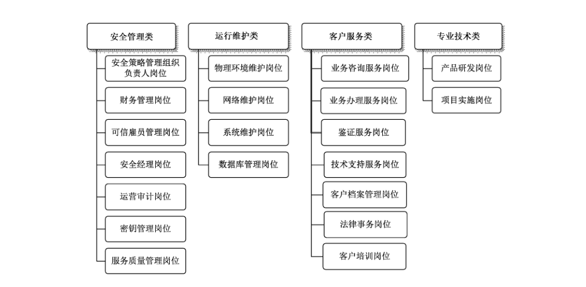
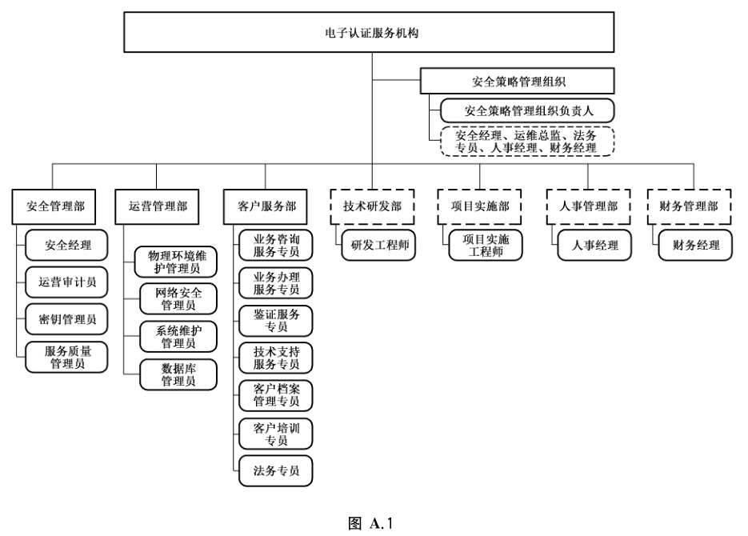

# GB/T 35288-2017 信息安全技术 电子认证服务机构从业人员岗位技能规范

> 来源：[GB/T 35288-2017 国家标准详情](https://openstd.samr.gov.cn/bzgk/std/newGbInfo?hcno=A74BA94B08EFEBF5C6E04F95694C52B3)；封面发布日期：2017-12-29；实施日期：2018-07-01。
> PDF SHA-256：28b91db8b32df4f561062b40e315bc44c88991c56243d4c41eb3bdefa5338ccb。
> 转写说明：按官方 PDF 全部 23 页的页面图像核对正文、表 1、图 1 和图 A.1；省略封面、目录、页眉、页脚和页码，合并跨页内容。正式引用请核对原 PDF。

## 前言

本标准按照 GB/T 1.1—2009给出的规则起草。

本标准由全国信息安全标准化技术委员会（SAC/TC 260）提出并归口。

本标准起草单位：北京天威诚信电子商务服务有限公司、北京天诚安信科技股份有限公司、中国电子信息产业发展研究院。

本标准主要起草人：唐志红、刘旭、刘权、白波、刘艳丽、许蕾、玉亚静、陈韶光、金露。

## 1 范围

本标准规定了电子认证服务机构的岗位划分及从业人员岗位技能要求。

本标准适用于提供电子认证服务的机构。

## 2 规范性引用文件

下列文件对于本文件的应用是必不可少的。凡是注日期的引用文件，仅注日期的版本适用于本文件。凡是不注日期的引用文件，其最新版本（包括所有的修改单）适用于本文件。

- GB/T 25056—2010 信息安全技术 证书认证系统密码及其相关安全技术规范

- GB/T 25069—2010 信息安全技术 术语

- GB/T 28447—2012 信息安全技术 电子认证服务机构运营管理规范

## 3 术语和定义

GB/T 25069—2010中界定的以及下列术语和定义适用于本文件。

### 3.1 数字证书 digital certificate

由证书认证机构签名的包含公开密钥拥有者信息、公开密钥、签发者信息、有效期以及一些扩展信息的数字文件。

### 3.2 电子签名 electronic signature

数据电文中以电子形式所含、所附用于识别签名人身份并表明签名人认可其中内容的数据。

### 3.3 电子认证 electronic certification

采用电子技术检验用户真实性的操作。

### 3.4 电子认证服务 electronic certification service

为电子签名相关各方提供真实性、可靠性验证的活动。

### 3.5 电子认证服务机构 certification authority

负责创建、分发证书并在必要时提供验证以证实用户身份的机构。

### 3.6 电子认证服务质量 electronic certification service quality

电子认证服务过程和结果满足明确的、隐含的要求所呈现的特征。

### 3.7 订户 subscriber

从电子认证服务机构接收证书的实体。

### 3.8 电子认证业务规则 certification practices statement （CPS）

电子认证服务机构在提供电子认证服务时，在责任范围、作业操作规范、信息安全保障措施等方面所遵循的业务规则。

### 3.9 可信雇员 trusted employee

根据CPS规定，对正式雇员及非正式雇员进行背景调查，调查结果符合如下要求的人员：没有伪造教育、工作经历，没有违法犯罪记录，工作中没有严重的不诚实行为的。

## 4 缩略语

下列缩略语适用于本文件。

CA：认证机构（Certification Authority）

CP：证书策略（Certificate Policy）

CPS：认证业务规则（Certification Practice Statement）

CRL：证书撤销列表（Certificate Revocation List）

FAQ：频繁提及的问题（Frequently Asked Questions）

KMC：密钥管理中心（Key Management Center）

LDAP：轻量级目录访问协议（Lightweight Directory Access Protocol）

PKI：公钥基础设施（Public Key Infrastructure）

RA：注册机构（Registration Authority）

USB KEY：采用 USB 接口的证书存储介质（Universal Serial Bus KEY）

## 5 电子认证服务岗位划分

### 5.1 岗位划分

电子认证服务岗位指依据GB/T 25056—2010中对机构运营安全和系统安全管理要求，设置的能够支撑开展电子认证服务的相关岗位。

电子认证服务岗位划分成四类：安全管理类岗位、运行维护类岗位、客户服务类岗位、专业技术类岗位。岗位划分如图1所示。

电子认证服务机构设置机构岗位时，不限于本标准规定的范围。电子认证服务机构组织架构图可参考附录 A。

图 1 的岗位划分：

- 安全管理类：安全策略管理组织负责人、财务管理、可信雇员管理、安全经理、运营审计、密钥管理、服务质量管理岗位。
- 运行维护类：物理环境维护、网络维护、系统维护、数据库管理岗位。
- 客户服务类：业务咨询服务、业务办理服务、鉴证服务、技术支持服务、客户档案管理、法律事务、客户培训岗位。
- 专业技术类：产品研发、项目实施岗位。

### 5.2 岗位职责

#### 5.2.1 安全管理类岗位

安全管理类岗位是提供安全、稳定、高质量的电子认证服务而进行的安全管理、财务管理、可信雇员管理、运营管理、密钥管理、服务质量管理等相关安全管理岗位。主要职责有：

a）负责制定、发布、废止、批准、实施电子认证服务机构总体信息安全策略、安全管理制度，并监督、检查安全运营和生产活动；

b） 监督管理财务运营状况，进行风险评估，并按照主管部门要求上报财务数据信息；

c） 制定可信雇员管理策略并监督执行，并按照主管部门要求上报可信雇员数据信息；

d） 组织进行安全运营审计，发布审计报告；

e） 对机构的人员安全、场地安全等进行监控和审计；

f） 维护证书私钥的生命周期及其物理安全和逻辑安全，确保所创建私钥和证书的完整性和可审计性等；

g） 对业务办理、业务咨询等工作进行全流程质量跟踪及管理。

#### 5.2.2 运行维护类岗位

运行维护类岗位是对机构物理环境、网络系统、电子认证系统［包括数字证书（本标准中也简称为“证书”）认证系统、密钥管理系统］和数据库系统等进行日常维护，保障电子认证服务业务连续稳定运行。主要职责有：

a） 负责机电、门禁监控设备、消防设备等机电设备的管理及维护；

b） 负责本机构网络的正常管理及维护；

c） 负责对电子认证系统进行维护，协调和监督电子认证系统和运营物理环境等基础设施正常运行；

d） 保障数据库系统正常运作。

#### 5.2.3 客户服务类岗位

客户服务类岗位是指面向证书服务申请人提供受理、鉴证、证书制作、证书分发以及提供相关技术支持、售后服务的岗位。其主要职责有：

a） 为客户提供业务咨询；

b） 负责证书业务办理；

c） 对证书订户身份真实性、过程真实性进行鉴证，并对客户资料进行正确保管；

d） 解决订户在证书使用过程中的各种技术问题和电子认证系统故障提供的技术支持服务；

e） 为客户提供电子认证服务培训；

f） 负责提供电子认证服务相关法律解读、咨询。

#### 5.2.4 专业技术类岗位

专业技术类岗位是指为保障订户不同需求而设置的产品、系统等技术研发、项目实施岗位。其职责主要有：

a） 负责电子认证服务产品、系统、集成接口等的开发工作；

b）负责为客户提供现场系统安装、部署、调试、测试以及上线运行工作。

### 5.3 岗位重要性划分

#### 5.3.1 划分依据

依据国家法律法规及 GB/T 25056—2010 和 GB/T 28447—2012 的要求，对不同的岗位进行了重要性的划分，分为关键岗位、重要岗位和一般岗位3类。其中关键岗位9个，重要岗位8个，一般岗位3个。不同岗位有不同的重要性要求。如表1所示。

**表1 岗位重要性层次划分**

| 岗位类别 | 关键岗位 | 重要岗位 | 一般岗位 |
| --- | --- | --- | --- |
| 安全管理类岗位 | 安全策略管理组织负责人岗位 财务管理岗位 可信雇员管理岗位 安全经理岗位 密钥管理岗位 | 运营审计岗位 服务质量管理岗位 | — |
| 运行维护类岗位 | 系统维护岗位 数据库维护岗位 | 物理环境维护岗位 网络维护岗位 | — |
| 客户服务类岗位 | 鉴证服务岗位 客户档案管理岗位 | 业务办理服务岗位 技术支持服务岗位 法律事务岗位 | 业务咨询服务岗位 客户培训岗位 |
| 专业技术类岗位 | — | 项目实施岗位 | 产品研发岗位 |

> 注：表中的“—”表示本标准不作规定。

表1中，关键岗位和重要岗位是需设置的，一般岗位根据机构业务发展需要设置。其中，关键岗位和重要岗位中，每个岗位不少于1人。业务办理岗不少于2人，系统维护岗不少于2人，物理环境岗不少于3人，鉴证岗不少于2人。其他岗位人员数量可根据机构业务发展需要设置。

#### 5.3.2 关键岗位

法律法规、标准规范明确规定的提供电子认证服务的岗位。

#### 5.3.3 重要岗位

对电子认证服务水平有重大影响的岗位，该岗位在主管部门对机构的监管中有重要参考意义，是需设置的。

#### 5.3.4 一般岗位

当需要时，电子认证服务机构设置的岗位。

### 5.4 岗位从业人员管理共性要求

#### 5.4.1 背景调查

对经历犯罪记录、信用记录进行调查。应将调查结果形成报告并归档，并应对调查报告保密。背景调查应为周期性调查，宜以每3年为周期对全体雇员进行背景调查。

通过调查的员工入职时除了签署劳动合同，还应签署保密协议以及其他相关协议。

#### 5.4.2 安全培训

确定每个关键岗位、重要岗位和一般岗位的培训要求和流程、再培训的周期和流程。培训要求如下：

a） 关键岗位——应进行1个月的培训，培训的范围应与人员对应的职责相关。电子认证服务机构应明确再培训周期和流程。

b） 重要岗位——应进行1周～2周的培训，培训的范围应与人员对应的职责相关。电子认证服务机构应明确再培训周期和流程。

c） 一般岗位——应进行2天～3天的与安全相关的培训。

#### 5.4.3 职责分割

职责分割指根据知识分割、双重控制、最小权限的原则，限制某些岗位由同一组人员兼任的安全要求。涉及职责分割的岗位主要有安全策略管理组织负责人岗位、财务管理岗位、可信雇员管理岗位、安全经理岗位、密钥管理岗位、服务质量管理岗位、物理环境维护岗位、网络维护岗位、鉴证服务岗位。

#### 5.4.4 人员离职和转岗

当发生人员离职或转岗时，应进行妥善的业务交接和权限的调整，并与其签订保密协议。保证电子认证服务机构运营安全和资产不受影响。

#### 5.4.5 人员异动

所谓人员异动是指由于不可预测的事件导致员工不能履行职责或员工不辞而别。电子认证服务机构应设置人员异动管理策略，要求关键岗位需设置备用人员，避免由于人员异动发生而影响电子认证服务机构运营。

## 6 电子认证服务岗位技能要求

### 6.1 安全管理类岗位

#### 6.1.1 安全策略管理组织负责人岗位

##### 6.1.1.1 设置目的

协调电子认证服务机构内部的运营管理人员、客户服务人员、服务管理人员等，组建安全策略管理组织，并进行CPS管理、监督执行，评估机构运营风险，应对突发情况管理。依法对CPS进行管理和监督执行。

##### 6.1.1.2 岗位职责

该岗位属于关键岗位，其主要职责如下：组建公司安全策略管理组织，并领导该组织工作；

负责定期组织制定和维护公司 CPS，并监督执行；

有效控制公司运营风险，保证电子认证服务质量和业务连续性。

##### 6.1.1.3 安全管理要求

该岗位应是可信雇员，与其他岗位不可兼任，应设置备用人员，避免由于人员异动而影响电子认证服务机构运营。

##### 6.1.1.4 岗位技能要求

岗位技能要求如下：具有5年以上电子认证行业或相关行业高级管理工作经验；

应能理解电子认证服务机构、证书订户、证书依赖方权利和责任的规定；

能够正确理解电子认证方面的法规、规章和行业政策；

能够正确理解本机构的 CPS；

掌握电子认证事故应急救援和预案程序；

- 能够制定信息安全管理方针和策略；

能够正确采用风险管理的方法进行信息安全管理计划、实施、评审检查和改进。

#### 6.1.2 财务管理岗位

##### 6.1.2.1 设置目的

对机构的财务进行综合管理和风险评估，依法对电子认证服务机构的财务进行管理和风险评估，降低财务风险和机构运营风险。

##### 6.1.2.2 岗位职责

该岗位属于关键岗位，其主要职责如下：财务制度的建立、更新和监督执行；

组织编制机构年度综合财务预算和控制标准；

编制财务报告，对机构的财务保障能力进行正确评估。

##### 6.1.2.3 安全管理要求

该岗位应是可信雇员，与其他岗位不可兼任，应设置备用人员，避免由于人员异动而影响电子认证服务机构运营。

##### 6.1.2.4 岗位技能要求

岗位技能要求如下：

- 会计、财务相关专业；

- 3年以上财务相关工作经验；

- 能够依照国家财务会计法规条例办理会计事务；

- 应独立进行全盘账务处理，合并报表和机构账务；

- 能够按照税务流程进行税务业务办理；

- 能够及时准确地对电子认证服务机构风险评估，降低财务风险和机构运营风险。

#### 6.1.3 可信雇员管理岗位

##### 6.1.3.1 设置目的

依据可信雇员策略对机构各关键岗位、重要岗位、一般岗位人员进行安全管理的岗位，包括建立可信雇员管理制度、流程和规范，进行背景调查、入职、培训、上岗、转岗、离职等管理。

##### 6.1.3.2 岗位职责

该岗位属于关键岗位，其主要职责如下：

- 建立可信雇员策略，包括岗位可信雇员要求、背景调查内容和程序；

- 在正式聘任员工授权接触公司重要资料前，证明其可信性，并签署员工保密协议；

- 建立每个工作岗位的工作范围及其责任，并确定关键岗位、重要岗位、一般岗位等不同职位的可信要求；

- 建立可信雇员培训制度及档案管理制度；

- 建立可信雇员异动管理制度，可信雇员离职后应立即删除其接触公司资料的权限；

- 建立可信雇员清单及所有雇员清单。

##### 6.1.3.3 安全管理要求

该岗位应是可信雇员，与其他岗位不可兼任，应设置备用人员，避免由于人员异动而影响电子认证服务机构运营。

##### 6.1.3.4 岗位技能要求

岗位技能要求如下：

- 人力资源、劳动经济等相关管理类专业；

- 两年以上人事管理工作经验；

- 能够依据国家有关劳动、社保、可信雇员的政策法规进行人事管理；

- 能够协助领导进行人员的管理；

- 能够理解可信雇员管理的要求；

- 具有良好的沟通表达能力。

#### 6.1.4 安全经理岗位

##### 6.1.4.1 设置目的

对本机构运营场地安全、人员安全、信息系统安全、通信系统安全、及重要IT 资产安全进行日常监控和审计。

##### 6.1.4.2 岗位职责

该岗位属于关键岗位，其主要职责如下：

- 制定运营场地安全策略，包括物理访问控制、电脑终端的安全接触、电力空调等设备的安全使用；

制定人员安全策略，包括定义接触电子认证系统的各类安全角色和岗位、职责分割原则和权限控制机制。定期检查物理访问权限和逻辑访问权限的设置情况，并对物理访问记录和系统操作日志进行审计；

对电子认证系统各类安全事件进行分级，建立各类安全事件报告、跟进策略及处理机制的应急响应计划，并定期测试、评估和更新此计划的内容；

制定通信安全管理策略、变更申请和批准流程，保证通信系统的可靠性，预防通信系统泄露信息，防止非授权使用通信系统；

监控各类介质包括光盘、硬盘、软盘、移动存储介质以及磁带等，防止被盗、毁坏、被修改、信息泄露未授权访问等情况发生；

制定风险管理策略，对涉及运营的各类风险进行分析、评估和分级，并提供解决方法；

对记录认证机构涉及运营条件和环境、密钥和证书生命周期管理的日志和事件进行监控和审计；

- 定期对相关人员开展安全培训；

对当前的安全策略和管理程序进行风险评估，并上报安全策略管理组织。

##### 6.1.4.3 安全管理要求

该岗位应是可信雇员，与其他岗位不可兼任，应设置备用人员，避免由于人员异动而影响电子认证服务机构运营。

##### 6.1.4.4 岗位技能要求

岗位技能要求如下：

- 具有信息安全相关认证资质；

- 具有两年以上场地维护经验；

具有两年以上机房安全管理工作经验；

熟悉ISO 27001管理体系、电子签名法、国家相关运营管理法规、标准等安全相关规范；

能够正确运用计算机网络、信息系统、PKI/CA 知识实现信息安全管理；

能够对电子认证服务安全隐患排查及事故防范；

能够对电子认证事故进行应急救援与预案程序；

能够对电子认证事故进行统计，编制相关报告制度；

能够对机房运营安全制定相应的策略；

- 能够指导相关人员进行安全培训。

#### 6.1.5 运营审计岗位

##### 6.1.5.1 设置目的

定期对电子认证系统进行安全审计，负责对涉及系统安全的事件、各类管理和操作人员的行为进行审计和监督，确保遵从法律和法规，降低运营风险，提高服务质量，保证运营的可持续性。

##### 6.1.5.2 岗位职责

该岗位属于重要岗位，依据包括电子认证服务机构发布和制定的所有与运营相关的安全策略、证书策略、电子认证业务规则等，以及国家法律法规和行业相关标准，对以下内容进行审计，并根据审计结果撰写审计报告和改进意见：

- 检查法律和法规方面的符合性，运营是否符合安全策略、证书策略、认证业务规则等；

- 评估服务能力和运营安全性，是否在人力资源、运营管理、技术、安全管理、财务等方面存在风险；

- 向安全策略管理组织提交审计报告。

##### 6.1.5.3 安全管理要求

该岗位应是可信雇员，与其他岗位不可兼任。

##### 6.1.5.4 岗位技能要求

岗位技能要求如下：

- 具有两年以上运营审计相关工作经验；

- 了解运营业务的各项制度、流程和系统；

- 能够对涉及系统安全等事件进行审计；

能够对服务和运营风险进行正确评估。

#### 6.1.6 密钥管理岗位

##### 6.1.6.1 设置目的

负责对电子认证私钥和证书的生命周期进行维护，及相关密码设备进行管理和操作。维护电子认证私钥的物理安全和逻辑安全，确保所创建私钥和证书的完整性和可审计性等。

##### 6.1.6.2 岗位职责

该岗位属于关键岗位，其主要职责如下：

- 为电子认证服务机构及客户创建并维护电子认证密钥对和证书；

- 建立密码硬件设备的采购、使用、测试、维修、保管、报废等管理制度，维护所有密钥相关设备的安全可靠；

- 协助电子认证私钥的恢复工作；

- 建立当电子认证私钥可信性受威胁时的应变计划；

制定用户加密密钥查询和恢复管理策略和流程，配合获得授权的国家机构以规定的方式进行密钥查询和恢复。

##### 6.1.6.3 安全管理要求

该岗位应是可信雇员，该岗位人员包含密钥管理员和分管者两种。密钥管理员具有电子认证私钥的操作权限，而分管者持有电子认证私钥的密钥分割或密钥共享，这两类人员对电子认证私钥的激活、恢复实现了双重控制；应设置备用人员，避免由于人员异动而影响电子认证服务机构运营。

##### 6.1.6.4 岗位技能要求

岗位技能要求如下：

- 具有计算机网络安全、信息安全技术等相关专业知识；

- 能够遵照国家的各项安全技术规范和标准对密钥进行管理；

- 能够正确使用本机构的加密设备；

具有一定的应急处理能力，能够对突发事件进行及时处理。

#### 6.1.7 服务质量管理岗位

##### 6.1.7.1 设置目的

监督提供电子认证服务的各岗位职责和作业规范的执行，并进行客户满意度调查的岗位。其设置目的是提高电子认证服务质量。

##### 6.1.7.2 岗位职责

该岗位属于重要岗位。

- 应根据业务咨询服务岗位的职责规范进行质量跟踪和管理；

- 应根据业务办理服务岗位的职责规范进行质量跟踪和管理；

应根据鉴证服务岗位的职责规范进行质量跟踪和管理；

应根据技术支持服务岗位的职责规范进行质量跟踪和管理；

应进行定期或不定期进行用户满意度调查；

能够及时处理客户投诉。

##### 6.1.7.3 安全管理要求

该岗位应是可信雇员，与其他岗位不可兼任。

##### 6.1.7.4 岗位技能要求

岗位技能要求如下：

- 具有基本的PKI/CA 知识、数字证书应用知识和计算机网络知识；

- 能够贯彻执行机构质量体系规范；

具有良好的写作能力和口头表达能力。

### 6.2 运行维护类岗位

#### 6.2.1 物理环境维护岗位

##### 6.2.1.1 设置目的

对本机构运营场地的门禁监控、照明、电力、空调、消防、综合布线、静电防护、防雷、防灾等各项基础设施进行日常监控与维护。保障运营场地、机电基础设施正常工作。

##### 6.2.1.2 岗位职责

该岗位属于重要岗位，其主要职责如下：

- 负责机电、门禁监控设备、消防设备等的管理及维护；

- 根据访问控制策略，制定《访问控制管理办法》和《访问控制权限表》，管理本机构人员的物理访问权限以及外来人员的访问控制；

- 编写和更新各项应急预案；

- 场地工程建设和改造维护。

##### 6.2.1.3 安全管理要求

该岗位应是可信雇员，与其他岗位不可兼任。

##### 6.2.1.4 岗位技能要求

岗位技能要求如下：

- 机电相关专业；

- 持有电工特种作业操作证；

5年以上机电、安全等工作经验；

能够正确运用《建筑设计防火规范》民用建筑电气设计规范》电子信息系统机房设计规范》等国家的相关安全技术规范和标准；

具有1年以上建筑物、监控、消防方面的工作经验；

- 能够依据机电管理流程对机电等设备进行管理；

- 具有火灾、水灾防护等安全知识。

#### 6.2.2 网络维护岗位

##### 6.2.2.1 设置目的

对本机构内外网络进行维护管理，制定网络策略，保障本机构网络的正常服务和IT设备的正常工作。

##### 6.2.2.2 岗位职责

该岗位属于重要岗位，其主要职责如下：

- 负责因特网的正常使用，网站发布；

- 正确配置防火墙，测试防火墙策略的有效性，保护CA 内部网络域，防止未授权的访问；

- 正确配置电子认证系统和办公系统；

对提供的服务（如HTTP、FTP 等）进行正确配置，停止不需要提供的服务进程，关闭不需要使用的端口，使用路由控制和安全通道保护外部远程电脑访问；

建立检测和防护控制来防止病毒和恶意软件，并能提供适当的报警信息。

##### 6.2.2.3 安全管理要求

该岗位应是可信雇员，与其他岗位不能兼任。

##### 6.2.2.4 岗位技能要求

岗位技能要求如下：

- 具有信息安全相关认证资质；

- 具有两年以上计算机网络安全管理经验；

- 能够正确运用主流操作系统，能够正确配置 DNS等常用服务；

- 能够正确运用计算机专业知识、PKI/CA 安全专业知识；

能够正确运用网络安全策略。

#### 6.2.3 系统维护岗位

##### 6.2.3.1 设置目的

对本机构办公系统、电子认证系统进行维护，协调和监督电子认证系统和运营物理环境等基础设施正常运行，维护电子认证系统的完整性，保障电子认证系统的正常运转。

##### 6.2.3.2 岗位职责

该岗位属于关键岗位，其主要职责如下：

- 硬件故障的排查及维修等；

- 定期检查系统及网络的稳定性、安全性及容量是否符合服务水平；

建立监控流程，确保记录并报告发现的或怀疑的、对系统或服务有威胁的安全缺陷；

建立并执行系统故障报告、处理流程；

监控电子认证系统的操作系统、备份系统的软硬件的正常运行，及时发现并排查故障；

加载系统根密钥、CA证书、CRL，更新 CRL，配置系统，分配权限等；

评估并上报对系统的安全性有影响的改动；

制定运维策略和流程，负责电子认证系统初始化和维护，以及安全设备、网络设备的正确配置；

定义系统逻辑访问控制的角色和相应的权限；

分析人侵检测系统的日志和问题，及时响应安全事件、调整安全策略；

建立并维护与电子认证系统功能相一致的测试系统；

建立系统升级、变更的审批策略和控制流程，制定新信息系统升级和新的版本验收标准，在投入电子认证系统正式使用前应作兼容性测试、功能性测试、安全性测试；

维护电子认证系统日志的完整性；

编制和维护运营场地资产清单，对重要IT 资产的保管、使用、维护、报废、销毁进行监控。

##### 6.2.3.3 安全管理要求

该岗位应是可信雇员，可以兼任数据库维护岗位。

##### 6.2.3.4 岗位技能要求

岗位技能要求如下：

- 具有信息安全相应认证资质；

能够正确运用主流的操作系统、数据库；

具有计算机相关专业知识、PKI/CA 安全专业知识；

具有两年以上运营维护和管理工作经验；

能够根据网络安全政策，保证网络系统安全；

具有风险管理能力，对于安全体系有较深的认识，能够进行风险评估，风险管理，解决系统潜在的隐患或漏洞等风险。

#### 6.2.4 数据库维护岗位

##### 6.2.4.1 设置目的

维护本机构数据库系统，保障本机构数据库系统的正常运作。

##### 6.2.4.2 岗位职责

该岗位属于关键岗位，其主要职责如下：

- 对数据库的运行状态，日志文件，备份情况，数据库的空间使用情况，系统资源的使用情况进行检查，发现并解决问题；

- 对数据库对象的空间扩展情况，数据的增长情况进行监控，对数据库做健康检查，对数据库对象的状态做检查；

- 对表和索引等进行分析，检查表空间碎片，进行数据库性能调整；

- 负责保障数据安全和服务稳定可用。

##### 6.2.4.3 安全管理要求

该岗位应是可信雇员，可以兼任系统维护岗位。

##### 6.2.4.4 岗位技能要求

岗位技能要求如下：

- 计算机、数学及相关专业；

- 具备两年以上大型数据库管理经验；

- 能够正确运用主流操作系统和数据库管理工具；

- 能够运用主流的数据库在 Windows/Linux 环境上安装、备份、恢复和调优的能力；

具有一定的网络存储系统的设计与规划能力；

具有根据业务发展情况设计系统存储备份、灾难恢复方案的能力。

### 6.3 客户服务类岗位

#### 6.3.1 业务咨询服务岗位

##### 6.3.1.1 设置目的

向用户提供电子认证服务业务介绍、业务办理流程、证书应用和电子认证服务相关法律法规的解读。针对服务订户在业务办理前、业务办理中的各种需求，以及证书应用过程中的各种使用需求提供咨询服务。

##### 6.3.1.2 岗位职责

该岗位属于一般岗位。其主要职责如下：

- 对证书业务的咨询应告知用户相应服务流程；

- 对证书应用业务的咨询应提供相应的宣传手册；

- 对电子签名法相关法律条文的咨询应能明确解答；

- 应明确告知申请者和电子认证服务提供者的责任与义务。

##### 6.3.1.3 安全管理要求

该岗位应是可信雇员，可以兼任客户培训岗位。

##### 6.3.1.4 岗位技能要求

岗位技能要求如下：

- 能够正确使用通用的办公软件；

- 具有基本的 PKI/CA 知识、数字证书应用知识及计算机网络基本知识；

- 能够正确理解《电子签名法》、《电子认证服务管理办法》等法律法规；

- 能够根据电子认证相关产品、系统的原理，确认客户需求，正确操作证书应用、基本问题解答；

- 良好的语言表达能力、人际交往能力和学习能力；

- 具有一定的应急处理能力，能够对突发事件进行及时处理。

#### 6.3.2 业务办理服务岗位

##### 6.3.2.1 设置目的

指针对证书订户提供包括证书申请、证书签发、证书更新、密钥更新、证书变更、证书撒销和挂起、证书有效性验证、密钥生成、备份和恢复等在内的各种服务。

##### 6.3.2.2 岗位职责

该岗位属于重要岗位。业务办理服务应包括11个环节：证书申请、证书签发、证书更新、证书密钥更新、证书变更、证书撤销和挂起、证书有效性验证、密钥的生成、备份和恢复、证书补办、证书口令解锁。

##### 6.3.2.3 安全管理要求

该岗位应是可信雇员，可以兼任业务咨询岗位和技术支持服务岗位、客户档案管理岗位、客户培训岗位，应设置备用人员，避免由于人员异动而影响电子认证服务机构运营。

##### 6.3.2.4 岗位技能要求

岗位技能要求如下：

- 具有基本的PKI/CA 知识及数字证书应用基本知识、计算机网络基本知识；

能够正确理解《电子签名法》《电子认证服务管理办法》等法律法规；

能够根据电子认证相关产品、系统的原理，正确操作证书应用、基本问题解答；

具有人际交往能力、团队合作能力、解决问题能力、结果导向意识和成本意识。

#### 6.3.3 鉴证服务岗位

##### 6.3.3.1 设置目的

电子认证服务机构在业务办理过程中，对证书订户的身份真实性、过程真实性进行鉴证，以及对证书订户资料进行规范管理的服务。确认客户身份的真实性；确认客户证书服务请求的真实性；确保证书签发给正确的实体。

##### 6.3.3.2 岗位职责

该岗位属于关键岗位，其主要职责如下：

- 对证书申请者的身份和其他属性进行鉴证；通过对用户提交的资质文件进行认证，以确认证书申请者的真实身份，同时对客户提交的申请信息进行确认；

- 对申请办理证书业务的人员进行身份关联鉴证和行为鉴证；

对鉴证资料进行收集、备案、归档和查询。

##### 6.3.3.3 安全管理要求

该岗位应是可信雇员，可以兼任业务办理服务岗位、技术支持服务岗位、客户档案管理岗位、客户培训岗位，与业务咨询服务岗位不可兼任；

对证书申请的审核批准工作由不同人员完成，实现了对证书签发的双重控制；该岗位应设置备用人员，避免由于人员异动而影响电子认证服务机构运营。

##### 6.3.3.4 岗位技能要求

岗位技能要求如下：

- 具有基本的 PKI/CA 知识及数字证书应用基本知识；

- 具有计算机网络基本知识；

- 能够正确理解《电子签名法》《电子认证服务管理办法》等法律法规；

- 能够根据电子认证相关产品、系统的原理，正确操作证书应用、基本问题解答；

- 具有基本的法律常识和较强的风险意识；

- 具有良好的沟通能力、分析判断能力、团队协作能力、解决问题能力和计划执行能力。

#### 6.3.4 技术支持服务岗位

##### 6.3.4.1 设置目的

电子认证服务机构在提供电子认证服务时提供相关的技术支持，包括数字证书管理、数字证书使用、证书存储介质硬件设备使用、电子认证系统使用以及各类数字证书应用（如，证书登录、证书加密、数字签名和安全邮件等）等。为解决订户在证书使用过程中的各种技术问题和电子认证系统故障提供的技术支持服务。

##### 6.3.4.2 岗位职责

该岗位属于重要岗位。主要解决证书使用问题和电子认证系统故障两大方面问题；明确对一般事件、严重事件、重大事件的处理流程和响应时间，以最大程度不影响客户使用为准则；形式上采用电话支持、远程协助支持、现场支持等。

##### 6.3.4.3 安全管理要求

该岗位应是可信雇员，可以兼任业务咨询服务岗位、业务办理服务岗位、鉴证服务岗位、客户档案管理岗位、客户培训岗位。

##### 6.3.4.4 岗位技能要求

岗位技能要求如下：

- 具有基本的 PKI/CA 知识及数字证书应用基本知识；

- 具有计算机网络基本知识；

- 能够正确理解《电子签名法》《电子认证服务管理办法》等法律法规；

- 能够根据电子认证相关产品、系统的原理，正确操作证书应用、基本问题解答；

能够使用至少一种通用的开发语言；

能够使用至少两种通用的数据库；

- 能够使用至少一种 web 服务器；

- 能够使用至少一种通用的操作系统；

- 具有良好的沟通能力；

- 具有独立分析问题和解决问题的能力。

#### 6.3.5 客户档案管理岗位

##### 6.3.5.1 设置目的

保管本机构客户的提交资料、证书使用情况等相关文件。

##### 6.3.5.2 岗位职责

该岗位属于重要岗位。其主要职责是负责建立和维护客户档案资料，管理客户档案借阅工作等。

##### 6.3.5.3 安全管理要求

该岗位应是可信雇员，可以兼任业务咨询岗位、业务办理服务岗位、鉴证服务岗位、技术支持服务岗位、客户培训岗位，应设置备用人员，避免由于人员异动影响电子认证服务机构运营。

##### 6.3.5.4 岗位技能要求

岗位技能要求如下：

- 具有基本的 PKI/CA 知识及数字证书应用基本知识；

能够正确理解《电子签名法》《电子认证服务管理办法》等法律法规；

能够正确操作证书应用，进行基本问题解答；

具有档案管理基础知识和工作经验；

能够正确操作证书应用、基本问题解答。

#### 6.3.6 客户培训岗位

##### 6.3.6.1 设置目的

为了客户更好的理解电子签名和相关法律法规环境，向其提供 PKI 技术、法律以及相关电子认证服务培训，通过提供相关培训，提高电子签名人的应用水平。

##### 6.3.6.2 岗位职责

该岗位属于一般岗位。其主要职责如下：

- 提供 PKI/CA 相关技术培训；

提供《电子签名法》等法律法规培训；

提供与客户相关的电子认证服务培训。

##### 6.3.6.3 安全管理要求

该岗位应是可信雇员，可以兼任业务咨询服务岗位、鉴证服务岗位、技术支持服务岗位、客户档案管理岗位。

##### 6.3.6.4 岗位技能要求

岗位技能要求如下：

- 能够正确运用 PKI/CA 知识、数字证书应用基本知识及计算机网络知识；

能够正确解读电子认证方面的法律法规和规章制度；

能够正确理解电子认证证书服务体系及相关应用，理解证书服务的本质内容；

具有两年以上客户培训经验；

- 具有基本的法律常识；

- 良好的客户导向、组织协调能力和解决问题的能力。

#### 6.3.7 法律事务岗位

##### 6.3.7.1 设置目的

提供法律相关内容的解读、咨询，提供电子认证服务。

##### 6.3.7.2 岗位职责

该岗位属于重要岗位。其职责主要有：

- 提供电子认证服务法律合规性保障；

- 向客户讲解分析《电子签名法》等法律法规；

- 向客户提供法律咨询和司法援助；

- 负责法律风险防范，构建法律风险防范体系，及时对法律风险进行预警、分析和建议；

负责对法律纠纷的处理。

##### 6.3.7.3 安全管理要求

该岗位应是可信雇员，可以兼任业务办理服务岗位、业务咨询服务岗位、鉴证服务岗位、技术支持服务岗位、客户档案管理岗位、客户培训岗位。

##### 6.3.7.4 岗位技能要求

岗位技能要求如下：

- 法律专业，具有专业律师资格证书；

能够正确理解《电子签名法》等法律法规中对电子认证服务机构、证书订户、证书依赖方权利和责任等内容；

能够正确理解电子认证服务机构运营体系；

能够独立起草、修改合同及法律文书；

能够独立承担纠纷诉讼案件；

- 能够恰当处理各种社会关系的能力；

具有良好的语言表达能力和文字表达能力。

### 6.4 专业技术类岗位

#### 6.4.1 产品研发岗位

##### 6.4.1.1 设置目的

顺应客户需要，完善电子认证服务的产品线，提高电子认证服务的层次和水平。

##### 6.4.1.2 岗位职责

该岗位属于一般岗位，其主要职责如下：

- 电子认证服务产品、系统的研发；

电子认证服务产品、系统维护和升级；

- 支撑项目实施人员完成实施任务。

##### 6.4.1.3 安全管理要求

该岗位应是可信雇员，可以兼任业务咨询岗位、业务办理岗位、技术支持岗位、客户培训岗位。

##### 6.4.1.4 岗位技能要求

岗位技能要求如下：

- 具有计算机相关专业知识、PKI/CA 安全专业知识；

具有2年以上技术研发相关经验；

具有1年以上软件项目管理经验；

能够使用至少 2种开发语言和相关开发工具；

具有使用通用的开源框架的能力和经验；

能够使用主流的数据库进行设计开发；

能够正确理解国内各项安全规范和标准；

能够正确理解电子认证方面的法律、法规和规章；

- 能够正确阅读该岗位所需知识的英文文档。

#### 6.4.2 项目实施岗位

##### 6.4.2.1 设置目的

降低电子签名技术难点，为电子签名人提供完整的技术支持和服务，也将会提高客户满意度。

##### 6.4.2.2 岗位职责

该岗位属于重要岗位，其主要职责如下：调配机构资源，完成客户项目实施；

现场进行系统安装、部署和测试；

根据客户不同需求，进行现场系统配置和修改；

解决项目实施中的突发问题；

提供相关的系统培训。

##### 6.4.2.3 安全管理要求

该岗位应是可信雇员，可以兼任业务咨询服务岗位、业务办理服务岗位、技术支持服务岗位、客户培训岗位。

##### 6.4.2.4 岗位技能要求

岗位技能要求如下：

- 1年以上软件项目管理经验；

能够正确理解电子认证方面的法律、法规和规章制度；

具有计算机相关专业知识、PKI/CA 安全专业知识；

能够使用至少3种主流的开发语言；

具备数据库基础知识；

具备网络基础知识；

能够使用主流的操作系统；

能够正确阅读该岗位所需知识的英文文档。

## 附录 A（资料性附录）某电子认证服务机构组织架构示意图

某电子认证服务机构组织架构示意图见图 A.1。

图 A.1 的文字结构如下：

- 电子认证服务机构下设安全策略管理组织，包含安全策略管理组织负责人；图中虚线框列出安全经理、运维总监、法务专员、人事经理、财务经理。
- 安全管理部：安全经理、运营审计员、密钥管理员、服务质量管理员。
- 运营管理部：物理环境维护管理员、网络安全管理员、系统维护管理员、数据库管理员。
- 客户服务部：业务咨询服务专员、业务办理服务专员、鉴证服务专员、技术支持服务专员、客户档案管理专员、客户培训专员、法务专员。
- 图中虚线部门：技术研发部（研发工程师）、项目实施部（项目实施工程师）、人事管理部（人事经理）、财务管理部（财务经理）。

## 参考文献

- ［1］ GB/T 19713—2005 信息技术安全技术 公钥基础设施在线证书状态协议

- ［2］ GB/T 19714—2005 信息技术安全技术 公钥基础设施证书管理协议

- ［3］ GB/T 19771—2005 信息技术安全技术 公钥基础设施 PKI组件最小互操作规范

- ［4］ GB/T 20269—2006 信息安全技术 信息系统安全管理要求

- ［5］ GB/T 20271—2006 信息安全技术 信息系统通用安全技术要求

- ［6］ GB/T 20518—2006 信息安全技术 公钥基础设施数字证书格式

- ［7］ GB/T 20984—2007 信息安全技术 信息安全风险评估规范

- ［8］ GB/Z 20985—2007 信息技术安全技术 信息安全事件管理指南

- ［9］ GB/Z 20986—2007 信息安全技术 信息安全事件分类分级指南

- ［10］ GB/Z 20988—2007 信息安全技术 信息系统灾难恢复规范

- ［11］ GB/T 21053—2007 信息安全技术 公钥基础设施 PKI系统安全等级保护技术要求

- ［12］ GB/T 21054—2007 信息安全技术 公钥基础设施 PKI 系统安全等级保护评估准则

- ［13］ GB/T 28447—2012 信息安全技术 电子认证服务机构运营管理规范

- ［14］ GB/T 31508—2015 信息安全技术 公钥基础设施 数字证书策略分类分级规范

- ［15］ 电子认证服务管理办法（工业和信息化部令第29号）

- ［16］ 中华人民共和国电子签名法（中华人民共和国主席令第18号）

- ［17］ 电子认证服务密码管理办法［国家密码管理局公告（第17号），2009年］

- ［18］ 电子政务电子认证服务质量评估要求（国家密码管理局局字 489，2009年）

- ［19］ 电子政务电子认证服务业务规则（国家密码管理局局字 488，2010年）
