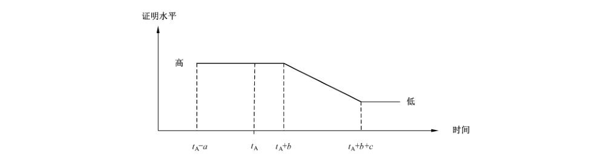
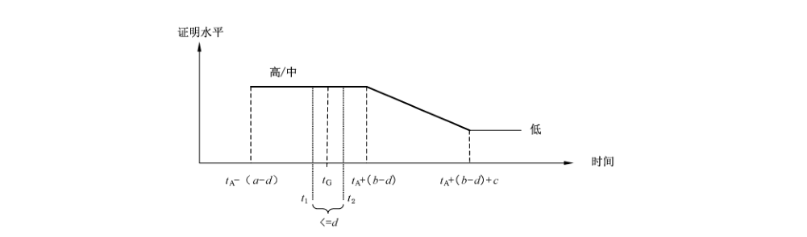
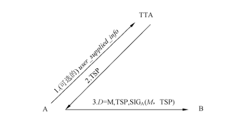
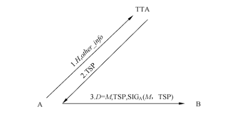
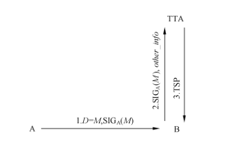
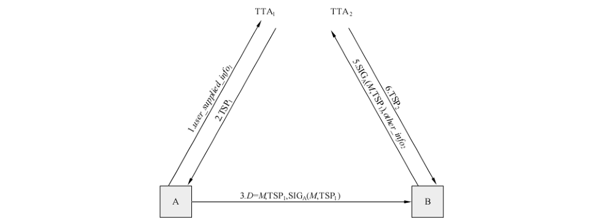
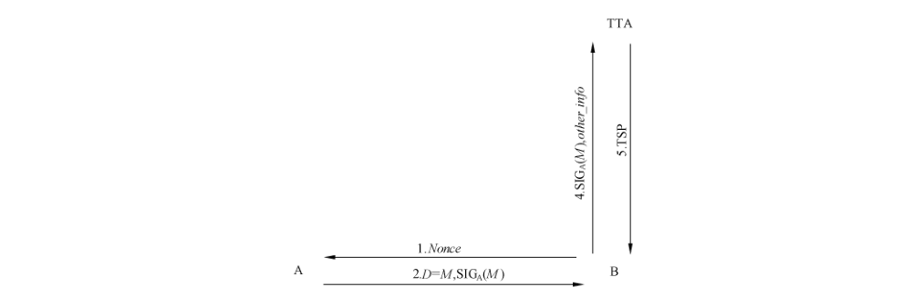

# GB/T 36644-2018 信息安全技术 数字签名应用安全证明获取方法

> 来源：[GB/T 36644-2018 国家标准详情](https://openstd.samr.gov.cn/bzgk/std/newGbInfo?hcno=F9EFC00B255CA92AD74F066F51D93993)。
> PDF SHA-256：34c0b234561e4cd350ea788c3b5544fb6622ce553b260c320f66076f97b098ee。
> 转写说明：对照官方 PDF 全部 29 页的页面图像核对正文、公式和图 1 至图 11；省略封面、目录、页眉、页脚和页码，合并跨页内容。正式引用请核对原 PDF。

## 前言

本标准按照 GB/T 1.1—2009给出的规则起草。

请注意本文件的某些内容可能涉及专利。本文件的发布机构不承担识别这些专利的责任。

本标准由全国信息安全标准化技术委员会（SAC/TC 260）提出并归口。

本标准起草单位：中国科学院数据与通信保护研究教育中心、中国科学院软件研究所、重庆大学。

本标准主要起草人：王跃武、刘丽敏、吕娜、张严、荆继武、雷灵光、牛莹姣、刘志娟、向宏、夏晓峰、周荃、夏鲁宁。

## 引言

参与数字签名生成或验证的实体取决于过程的真实性，该真实性可以通过获取私钥拥有属性的安全证明、公钥有效性的安全证明、数字签名的生成时间来保证。本标准旨在规定一套数字签名应用安全证明获取方法，用以规范数字签名应用安全证明过程，主要应用于需要提供数字签名生成过程安全性和对签名生成时间有明确要求的签名应用场景。

本标准在制定的过程中参考了 NIST SP 800-89《数字签名应用安全保证获取建议》和 NIST SP 800-102《数字签名适时性证明获取建议》。本标准与两个参考标准在技术内容上保持一致，但忽略了其与美国具体的签名算法标准相关部分，强调了安全证明获取的一般过程。此外，本标准将参考标准中与密码相关的术语和规定改成了与我国密码政策相符的规定。

## 1 范围

本标准规定了一套数字签名应用安全证明获取方法，用以规范数字签名应用安全证明过程。

本标准适用于需要提供数字签名生成过程安全性和对签名生成时间有明确要求的签名应用场景。

## 2 规范性引用文件

下列文件对于本文件的应用是必不可少的。凡是注日期的引用文件，仅注日期的版本适用于本文件。凡是不注日期的引用文件，其最新版本（包括所有的修改单）适用于本文件。

- GB/T 20520—2006 信息安全技术 公钥基础设施 时间戳规范

- GB/T 25069—2010 信息安全技术 术语

- GB/T 32918.1—2016 信息安全技术 SM2椭圆曲线公钥密码算法 第1部分：总则

- GB/T 32918.2—2016 信息安全技术 SM2椭圆曲线公钥密码算法 第2部分：数字签名算法

## 3 术语和定义

GB/T 25069—2010界定的以及下列术语和定义适用于本文件。

### 3.1 公钥有效性证明 attestation of public key validity

证明用于验证签名的公钥的有效性的证据。

### 3.2 私钥拥有属性安全证明 attestation of private key possession

证明声称的签名者确实实际拥有用于生成签名的私钥的证据。

### 3.3 证明消息 attestation message

用于获取私钥拥有属性安全证明的，具有特定格式的消息。

### 3.4 证明签名 attestation signature

作用于证明消息的数字签名。

### 3.5 证明时间 attestation time

私钥拥有属性安全证明获取的时间。

### 3.6 证明水平 attestation level

私钥拥有属性安全证明的可信程度，分为高、中、低三个层次，依赖于证明获取的手段。

### 3.7 请求验证签名 Signature in question

请求私钥拥有属性安全证明的一个签名。

### 3.8 签名生成时间证明 attestation of signature timeliness

证明一个数字签名确实是在一个时间点之前、之后或者是在两个时间点之间生成的证据。

### 3.9 时间戳机构 time stamp authority

用来产生和管理时间戳的权威机构。

［GB/T 20520—2006，定义3.3］

### 3.10 可信时间戳机构 trusted time stamp authority

被签名者、验证者以及其他签名依赖方相信的时间戳机构。

## 4 缩略语

下列缩略语适用于本文件。

- TSP：时间戳数据包（Time Stamp Packet）
- TST：时间戳令牌（Time Stamp Token）
- TTP：可信第三方（Trusted Third Party）
- TTSA：可信时间戳机构（Trusted Time Stamp Authority）

## 5 数字签名应用安全证明获取

### 5.1 概述

本标准凡涉及密码算法的相关内容，按国家有关法规实施；凡涉及到采用密码技术解决保密性、完整性、真实性、不可否认性需求的须遵循密码相关国家标准和行业标准。

本标准明确了获取数字签名生成和验证环节的有效性证明方法。每一个数字签名者都拥有一对公私钥对，并且该签名者就是这对公私钥对的拥有者。私钥用于数字签名的生成，公钥用于数字签名的验证过程。数字签名生成、验证过程的安全证明获取包括：私钥拥有属性的安全证明获取、公钥有效性的安全证明获取和数字签名的生成时间安全证明获取。

私钥的拥有者是指被授权使用公私钥对中的私钥来进行数字签名生成的实体。生成的数字签名可以被对应的公钥进行验证。被授权使用私钥生成签名并不意味着拥有者确实知道正确的私钥。因此，在拥有者进行数字签名之前，需要获取私钥拥有属性的安全证明。

根据签名公私钥对生成方式的不同，私钥被知道的方式可以分为如下5种：

a） 拥有者自己生成和维护公私钥对，仅由拥有者知道私钥；

b） 拥有者在TTP的帮助下生成公私钥对，但是私钥只能由拥有者知道；

c） 公私钥对由 TTP生成后提供给拥有者，拥有者和 TTP 同时知道私钥；

d） 公私钥对采用方式a）生成，生成后提供给充当密钥服务器的TTP，这样拥有者和TTP 同时知道私钥；

e） 公私钥对采用方式b）生成，生成后提供给充当密钥服务器的TTP，这样拥有者和充当密钥服务器的TTP 同时知道私钥。

后三种方式下，需要建立在 TTP 不会用私钥生成数字签名的信任之上。公私钥对拥有者、签名验证者以及其他签名依赖方要能够共享这个信任。方式c）、d）、e）相对于方式a）、b），其私钥拥有属性安全证明的可信程度较低。

私钥拥有属性安全证明的使用场景如下：

• 公私钥对拥有者在签名生成之前或者同时需要获得私钥拥有属性的安全证明；

• 验证者接受数字签名之前或者同时需要获得私钥拥有属性安全证明。此场景下，在获得私钥拥有属性安全证明之前，要完成生成签名的公私钥对拥有者的身份鉴别；

• TTP 向其他各方提供公私钥对拥有者的私钥拥有属性安全证明。此场景下，TTP 在获得私钥拥有属性安全证明之前，要首先完成拥有者的身份鉴别。

获取的私钥拥有属性安全证明是有时效性的。以下私钥拥有属性安全证明获取时效模型可以用于私钥拥有属性安全证明水平评估。

### 5.2 私钥拥有属性的安全证明获取

#### 5.2.1 证明时刻确定的私钥拥有属性安全证明获取时效模型

私钥拥有属性安全证明的获取要在一个特定的时间点完成，该时间点被称为证明时刻。随着时间的流逝，可能会发生一些事件，对私钥拥有属性安全证明产生负面影响。随着时间流逝的增加，发生这些事件的概率也将增加，安全证明水平将会因为这些事件的发生而降低。因此，合理地推断证明时刻之后一段时间，证明水平是必要的。

图1描述了私钥拥有属性安全证明的证明水平随时间变化的模型。签名依赖方所在的组织可以根据该模型对安全证明的证明水平做出判断。在图1中，t_A 为私钥拥有属性安全证明的证明时刻。a、b、c 的值由签名依赖方所在的组织根据自己的安全需求选择。

a 和 b 是 t_A 前后的两个时间段。在这个模型中，t_A-a 和 t_A+b 这两个时间点内，获得的私钥拥有属性安全证明具有高的证明水平。签名依赖方所在的组织根据安全策略，选择不同的 a、b 值控制对证明的信任程度。

c 是 t_A+b 之后的一个时间段。在这段时间内，私钥拥有属性安全证明的证明水平逐渐从高降到低。在 t_A+b+c 之后的时间里，私钥拥有属性安全证明的证明水平一直为低。

在私钥拥有属性安全证明的证明水平降为低之后，如果仍需要高的证明水平，需要重新进行私钥拥有属性安全证明的获取。

#### 5.2.2 证明时刻不确定的私钥拥有属性安全证明获取时效模型

理想情况下，证明时刻是一个确定的值。然而，实际应用中，准确地确定证明时刻存在一定的困难，通常会用一个估计值代替。这个估计值是用一个包含证明生成时刻的一个时间段表示。证明时刻不确定的私钥拥有属性安全证明如图2所示。

a、b、c 的定义同 5.2.1，其他参数定义如下：

- t_G：证明签名的生成时刻；
- t_1：被依赖方信任超前于 t_G 的证明生成时刻；
- t_2：被依赖方信任滞后于 t_G 的证明生成时刻；
- d：t_1 和 t_2 之间的差值；
- t_A：指定的证明时刻，并且应满足 t_1 ≤ t_A ≤ t_2；为了方便起见，可以指定 t_A=t_1，或者 t_A=t_2。

a、b、c 和 d 由签名依赖方或者其所在的组织，在考虑如下因素的基础上确定：

• a、b、c 的值根据组织策略对数字签名的安全证明的要求确定，同时还要考虑所采用的私钥拥有属性安全证明获取过程的难易程度；

• d 的值应该小于 a 和 b 中最小值的一半，即 d<1/2 min(a,b)，并且 d 的确定还要考虑签名获取时刻 t_G 的误差估计。此外，d 的确定还要考虑安全证明在网络上安全传输的时间。

根据估计的私钥拥有属性安全证明获取时刻 t_A，依赖方可以确定不同时间的证明水平的级别。如图2所示，在 t_A-(a-d) 和 t_A+(b-d) 时刻内，获取的安全证明具有高或者中的证明水平，这取决于安全证明的获取过程。t_A+(b-d) 之后，证明水平逐步降低，在 t_A+(b-d)+c 时刻，安全证明水平降到低。之后，安全证明水平将一直为低。如果策略要求需要高的安全证明水平，则需要重新获得安全证明。

具体的安全证明时效模型参数确定见5.2.4。

#### 5.2.3 私钥拥有属性安全证明获取过程

##### 5.2.3.1 总则

私钥拥有属性安全证明可以用如下一种或多种方法得到：

a） 私钥拥有者用私钥签发一个新的数字签名，然后用其对应的公钥进行验证；

b） 重新生成一次公私钥对，然后把它与拥有者当前拥有的公私钥对进行比对；

c） 用公私钥对中的一个密钥重新生成另一个密钥，然后将新生成的密钥与拥有者拥有的对应密钥进行充分地比对。

重新生成密钥的私钥拥有属性安全证明获取方法，只适用于公私钥对拥有者或者被拥有者信任可以知道私钥信息的 TTP。

公私钥对拥有者获取私钥拥有属性安全证明可以独立完成，或者与 TTP 合作完成。

TTP 获取私钥拥有属性安全证明需要与公私钥对拥有者合作完成。

签名依赖方可以从 TTP 获取私钥拥有属性安全证明，或者与拥有者合作获取证明。

私钥拥有属性安全证明获取的时刻要尽可能精确地被记录下来。确定证明获取的精确时刻可以有多个时间源。以下是一些可信程度依次降低的时间源：

• 由获取私钥拥有属性安全证明的实体、实体所在的组织以及其他依赖各方所信任的 TTP 提供可信时间戳作为时间源；

• 由获取私钥拥有属性安全证明的实体认可其精度的一个时钟作为时间源；

• 由精度不可知的时钟作为时间源。

无论采用何种时间源，都需要让证明依赖方知道，以判断证明获取时间的可信性。

##### 5.2.3.2 利用数字签名获取私钥拥有属性安全证明

###### 5.2.3.2.1 证明消息

利用数字签名获取私钥拥有属性安全证明是指用验证特定格式消息数字签名的方式来获取私钥拥有属性安全证明，该方法适用于公私钥对拥有者、TTP 或者其他依赖方获得私钥拥有属性安全证明。

当采用数字签名方式获得私钥拥有属性安全证明时，获取证明的实体将会被分配给一个拥有属性安全证明消息，简称为证明消息。然后由私钥拥有者对该消息进行签名，该签名称为证明签名。

证明消息应包括下列信息：

a） 签名者身份标识；

b） 潜在的验证者身份标识；

c） 时间戳令牌 TST，该 TST 由所有依赖方都信任的可信时间戳机构（TTSA）生成。TST 可以由签名者从 TTSA 获取，也可以由潜在的验证者从 TTSA 获取，之后传给签名者。所有依赖方都应认可 TTSA 的签名安全强度；

d） 一个验证者提供的随机数（nonce）值。如果选择了 nonce，则nonce 值的随机性要等于或者超过要获取证明的私钥的随机性。如果证明消息不包含TST，而依赖方又要求在验证证明签名时，记录证明时间，则nonce 值需要包含一个由验证者提供的时间戳，标示该 nonce 值提供给证明消息的时间。

证明消息中私钥对应的公钥展示信息不是必要的。但是该公钥展示信息的包括与否，要严格根据如下的描述决定：

• 如果生成证明签名的签名者能够在获取证明消息之前，成功展示公钥，该公钥信息可以从证明消息中去除；

• 如果证明消息中包含TST，公钥展示应在TST 标示的时刻之前。如果没有TST，公钥展示应在nonce 值中包含的时刻之前；如果没有TST，并且nonce 值中不包含时间，应出示能够被各方信任的证据证明公钥展示在证明签名生成之前；

• 公钥可以以一个包含时间戳的证书展示；

• 公钥还可以以签名者此前签发的一个签名的方式展示。该签名签发所用的私钥应与获取证明的私钥一致，即可以用相同的公钥验证。该签名的签发时间要早于证明消息发送给签名者的时间；

• 公钥展示还可以在证明签名验证者向签名者提供nonce 值之前，向验证者公开公钥的方式实现。

如下附加信息可以包含在证明签名签发之后的证明消息里：

- 一个明确的标识，表示该消息是用来获取私钥拥有属性安全证明的；

- 证明签名签发者提供的 nonce 值，nonce 值包含一个随机部分，其随机性不低于或者要高于获取证明的私钥；

- 或其他的由证明签名签发者提供给验证者的数据。

任何包含了上述所需信息的消息，都可以用来作证明消息。证明消息被要获取证明的私钥进行签名生成证明签名。证明签名需要在 TST，nonce 值或者以其他形式提供的时刻立即生成。

###### 5.2.3.2.2 指定证明时间

在证明签名成功验证后，需要给证明时间指定一个值。

证明时间的指定受证明消息的格式影响，同时也受包括证明签名生成时间 t_G 的 t_1 和 t_2 的选择的影响。

如 5.2.2 所述，t_1 是超前或者等于证明签名生成时刻的一个时间点。t_1 的几种可能赋值如下：

a） 如果证明消息中包括了来自依赖方信任的 TTSA 的时间戳，则时间戳中的时间可以作为 t_1 赋值的候选；

b） 如果证明消息中包含了验证者提供时间，例如，nonce 值中包含的时间，则该时间可以作为 t_1 赋值的候选；

c） 如果证明消息中包含一个验证者提供的 nonce 值，并且记录了 nonce 值第一次提供给证明签名签发者的时间，则该时间可以作为 t_1 赋值的候选。

依赖方从上述的 t_1 赋值候选中选择他们认为最可信的时间源为 t_1 赋值。在可信程度相等的情况下，应该优先选择最晚的时间为 t_1 赋值。

如 5.2.2 所述，t_2 是滞后或者等于证明签名生成时刻的一个时间点。t_2 的几种可能赋值如下：

• 如果证明签名生成时刻被包含在一个所有依赖方都信任的 TTSA 签发的 TST 内，则包含在 TST 中的时间可以作 t_2 赋值的候选；

• 如果验证者记录了证明签名的接收时间，则该记录的时间可以作为 t_2 赋值的候选；

• 如果验证者记录了证明签名被验证的时间，则该记录的时间可以作为 t_2 赋值的候选。

依赖方从上述的 t_2 赋值候选中选择他们认为最可信的时间源为 t_2 赋值。在可信程度相等的情况下，应该优先选择最早的时间为 t_2 赋值。

如果证明签名已被成功验证通过，并且依赖方已经确定了证明时间的误差精度 d，则可以按照如下的方法估计证明时间 t_A：

- 如果 t_2-t_1≤d，并且 t_1 可信度不小于 t_2，则应选择 t_1 为证明时间 t_A；
- 如果 t_2-t_1≤d，并且 t_1 可信度小于 t_2，则应选择 t_2 为证明时间 t_A；
- 如果 t_2-t_1>d，则私钥拥有属性安全证明没有获得，不用赋值给证明时间 t_A。

如果证明签名不能被验证通过，则私钥拥有属性安全证明没有获得，不用赋值给证明时间 t_A。

###### 5.2.3.2.3 指定初始证明水平

证明签名被验证通过和证明时间指定完成后，需要指定证明的初始水平。证明初始水平指定按如下方法完成：

a） 如果证明时间 t_A 是从依赖方信任的 TTSA 提供的 TST 中获得，那么最初的证明水平被置于高；

b） 如果证明时间 t_A 不是从依赖方信任的 TTSA 提供的 TST 中获得，而是从证明签名验证者提供的一个精度被依赖方信任的时间源获得，那么最初的证明水平被置于中；

c） 如果证明时间 t_A 不是从依赖方信任的 TTSA 提供的 TST 中获得，而是从证明签名验证者提供的一个时间源获得，并且该时间源的精度对依赖方不可知，那么最初的证明水平被置于低。

##### 5.2.3.3 通过密钥再生获取私钥拥有属性安全证明

密钥再生可以由公私钥对拥有者或者被提供公私钥对的TTP完成。

密钥再生要在与原始密钥对生成环境不同的环境下，用不同于原始密钥对生成方法的方法生成一个或者一对密钥。在后续再次获取私钥拥有属性安全证明时，密钥再生可以采用与第一次密钥再生相同的环境和流程完成。

私钥拥有属性安全证明获取只有在再生的密钥与拥有者拥有的密钥相同的情况下才能获取。

密钥再生的过程与具体的签名算法相关，可以参考对应的算法标准。

通过密钥再生获取私钥拥有属性安全证明，同样需要指定证明时间和初始证明水平，具体过程见 5.2.3.2.2 和 5.2.3.2.3。

##### 5.2.3.4 普通签名的私钥拥有属性安全证明确定

本部分描述如何判断一个普通消息签名所对应的私钥拥有属性安全证明水平。普通消息一般不会充分满足5.2.3中的证明消息的各项要求。可以用签发该普通消息签名的私钥的私钥拥有属性安全证明来确定该普通消息签名的安全证明水平。

普通消息签名安全证明获取可以在其对应私钥的私钥拥有属性安全证明的证明时间之前，同时或者之后生成。

普通消息签名的生成时间用 t_s 表示。t_s 可能有一个确定的值，或者是一个取值范围，或者是完全不确定的一个值。如果 t_s 有一个具有充分精度的值，并且对应私钥的私钥拥有属性安全证明已经获取，则可以根据 5.1.1 中的时效模型，按照如下的方法确定该普通消息签名的安全证明水平：

a） 如果 (t_A-(a-d))≤t_s≤(t_A+(b-d))，那么该普通消息签名的安全证明水平等于获取的私钥拥有属性安全证明的初始证明水平；

b） 如果 (t_A+(b-d))<t_s≤(t_A+(b-d)+c)，那么该普通消息签名的安全证明水平将从最初状态逐渐降低直至低水平；

c） t_s>(t_A+(b-d)+c)，那么该普通消息签名的安全证明水平为低。

如果 t_s 没有一个确定的值，则该普通消息签名的安全证明水平被确定为低。

#### 5.2.4 具体的私钥拥有属性安全证明获取流程

##### 5.2.4.1 公私钥对拥有者获取私钥拥有属性安全证明

公私钥对拥有者可以用如下一种或多种方法获取私钥拥有属性安全证明：

a） 公私钥对拥有者采用证明签名获取私钥拥有属性安全证明：公私钥对拥有者需要完成以下内容：

1） 确定适当的 d 值，例如，可以按照 5.2.2 中的时效模型，在确定完合适的 a、b、c 值的基础上，确定 d 值；

2） 确定一个可信的 t_1 值；

3） 生成一个新的用于获取私钥拥有属性安全证明的证明消息；

4） 用要获取证明的私钥对证明消息签名，生成证明签名；

5） 用对应的公钥验证证明签名；

6） 如果验证成功：

• 为 t_2 确定一个可信的值；

• 当 t_1≤t_2≤t_1+d 时，按照本标准前面的规定确定证明时间和初始证明水平。

b） 公私钥对拥有者采用证明签名从 TTP 获取私钥拥有属性安全证明：

1） 公私钥对拥有者要确定适当的d值，例如，可以按照5.2.2中的时效模型，在确定完合适的a，b，c值的基础上，确定d 值；

2） 如果TTP负责证明时间的分配，则d值要让 TTP 知道；

3） 公私钥对拥有者和/或 TTP 要确定一个被公私钥对拥有者信任的 t_1 值；

4） 公私钥对拥有者生成一个新的用于获取私钥拥有属性安全证明的证明消息；

5） 公私钥对拥有者用要获取证明的私钥对证明消息签名，生成证明签名；

6） 公私钥对拥有者将证明消息、证明签名和其他必要的数据发送给 TTP；

7） TTP 用对应的公钥验证证明签名；

8） 如果验证通过：

• 需要通知公私钥对拥有者，证明签名验证成功；

• 公私钥对拥有者和/或 TTP 要为 t_2 确定一个拥有者信任的值；

• 如果 t_1≤t_2≤t_1+d，公私钥对拥有者或者是 TTP 开始指定证明时间和初始证明水平，指定证明时间的实体应知道 d 值以及 t_1 和 t_2，指定初始证明水平的实体也应知道确定 t_1 和 t_2 值的方法；

• 公私钥对拥有者要记录证明时间和初始证明水平。

c） 公私钥对拥有者通过密钥再生获取私钥拥有属性安全证明：公私钥对拥有者需要完成以下内容：

1） 确定适当的 d 值，例如，可以按照 5.2.2 中的时效模型，在确定完合适的 a、b、c 值的基础上，确定 d 值；

2） 确定一个可信的 t_1 值；

3） 选择下面的一个操作：

• 重新生成要获取证明的私钥对应的密钥对；

• 重新生成要获取证明的私钥对应的密钥对中的一个密钥。

4） 对比重新生成的密钥对（密钥）值和目前拥有的密钥值；

5） 如果匹配成功：

• 为 t_2 确定一个可信的值；

• 如果 t_1≤t_2≤t_1+d，指定和记录证明时间，并且指定初始证明水平。

d） 公私钥对拥有者通过密钥再生从 TTP 获取私钥拥有属性安全证明：

1） 公私钥对拥有者要确定适当的d 值，例如，可以按照5.2.2中的时效模型，在确定完合适的a，b，c值的基础上，确定d值；如果TTP 负责证明时间值的指定，则d值要让TTP知道；

2） 公私钥对拥有者和/或 TTP 要确定一个 t_1 值，该值要被公私钥对拥有者信任；

3） 公私钥对拥有者要提供其持有的密钥以及任何其他必要的数据给 TTP 实体；

4） TTP 实体：

• 重新生成要获取证明的私钥对应的密钥对；

• 或者重新生成要提供保护的私钥对应的密钥对中的一个密钥。

5） TTP 对比重新生成的密钥对（密钥）值和拥有者目前拥有的密钥值；

6） 如果匹配成功：

• 应通知公私钥对拥有者匹配成功；

• 公私钥对拥有者和/或 TTP 要确定一个被公私钥对拥有者信任的 t_2 值；

• 如果 t_1≤t_2≤t_1+d，公私钥对拥有者或者是 TTP 开始指定证明时间和初始证明水平，指定证明时间的实体应知道 d 值以及 t_1 和 t_2；指定初始证明水平的实体也应知道确定 t_1 和 t_2 值的方法；

• 公私钥对拥有者要记录证明时间和初始证明水平。

##### 5.2.4.2 TTP 从公私钥对拥有者处获取私钥拥有属性安全证明

TTP 被要求提供私钥拥有属性安全证明给其他签名依赖方时，应实施一个明确的私钥拥有属性安全证明获取过程。该过程通过验证证明签名的方式或者密钥再生的方式从公私钥对拥有者处获得。在再生密钥的情况下，TTP 应承诺不使用拥有者的密钥对知识生成数字签名。这种信任应由公私钥对拥有者，潜在签名验证者，以及其他各依赖方共享。其中，使用证明签名的方法是首选方法。

TTP 使用如下一种或多种方法从公私钥对拥有者处获取私钥拥有属性安全证明：

a） TTP通过验证证明签名的方法从公私钥对拥有者处获取私钥拥有属性安全证明：

1） 确定适当的 d 值，例如，可以按照 5.2.2 中的时效模型，在确定完合适的 a、b、c 值的基础上，确定 d 值；

2） 公私钥对拥有者生成一个新的私钥拥有属性安全证明的证明消息；

3） 公私钥对拥有者用要获取证明的私钥对证明消息签名，生成证明签名；

4） 公私钥对拥有者提供证明消息、证明签名以及其他必要的数据给 TTP；

5） TTP 为 t_1 确定一个可信的值；

6） TTP 用要获取证明的私钥对应的公钥验证证明签名；

7） 如果验证成功：

• TTP 为 t_2 确定一个可信的值；

• 如果 t_1≤t_2≤t_1+d，TTP 开始指定证明时间和初始证明水平；

• TTP 记录证明时间和初始证明水平，并且应该将这些值也提供给公私钥对拥有者。

b） TTP通过密钥（密钥对）再生的方法从公私钥对拥有者处获取私钥拥有属性安全证明：

1） 确定适当的d值，例如，可以按照5.2.2中的时效模型，在确定完合适的a，b，c值的基础上，确定 d 值；

2） 公私钥对拥有者提供要获取证明的密钥信息，以及任何其他必要的数据给 TTP；

3） TTP 为 t_1 确定一个可信的值；

4） TTP 需要：

• 再生公私钥对拥有者的整个密钥对；

• 或者再生公私钥对拥有者的整个密钥对中的一个密钥。

5） TTP 将生成的密钥与公私钥对拥有者原有的密钥进行对比；

6） 如果 5）中的比对结果相匹配：

• TTP 要为 t_2 确定一个可信的值；

• 如果 t_1≤t_2≤t_1+d，TTP 开始指定证明时间和初始证明水平，TTP 应知道 t_1 和 t_2 值以及 t_1 和 t_2 值的确定方法；

• TTP要记录证明时间、初始证明水平和d值，这些值也应提供给公私钥对拥有者。

在响应其他依赖方的证明请求时，TTP要将私钥拥有属性安全证明，连同证明时间和初始证明水平一同提供给发起请求的依赖方。此外，TTP还可以向发起请求的依赖方提供在一个特定时刻的私钥拥有属性安全证明的估计值，证明水平估计的方法参见5.2.2中的证明时效模型。

由 TTP 选择的 a、b、c 和 d 的值，可能与其他请求私钥拥有属性安全证明的依赖方的信任标准不同。如果是此种情况，则 TTP 应当（至少）准备 t_2-t_1 值的上限（如 d）给潜在的依赖方，以及在确定上述值时对采用的时间源进行说明，从而使这些依赖方能够判定 TTP 提供的证明时间值是否有足够的精度（可信度）以满足他们的需要。

##### 5.2.4.3 验证者获取私钥拥有属性安全证明

验证者在接受数字签名验证为有效之前，要获得签名者在生成签名时，其签名的私钥的私钥拥有属性安全证明。证明时间和初始证明水平需要验证者与签名者或者TTP 相互合作获得。一旦通过标准流程获得证明后，以后任意时刻的签名的证明水平，可以根据5.2.2中的证明时效模型估计得到。

验证者可以通过使用以下一种或多种方法获取私钥拥有属性安全证明：

a） 通过与公私钥对拥有者合作，验证证明签名，获得私钥拥有属性安全证明：

1） 确定适当的d值，例如，可以按照5.2.2中的时效模型，在确定完合适的a，b，c值的基础上，确定d 值；

2） 公私钥对拥有者要提供新的证明消息、证明签名和其他必要的数据给验证者；

3） 验证者要为 t_1 确定一个可信的值；

4） 验证者用要获取证明的私钥对应的公钥验证证明签名；

5） 如果证明签名验证通过：

• 验证者要为 t_2 确定一个可信的值；

• 如果 t_1≤t_2≤t_1+d，验证者开始指定证明时间和初始证明水平；

• 验证者记录证明时间和初始证明水平。

b） 验证者通过与TTP 合作获得私钥拥有属性安全证明：

1） 确定适当的d 值，例如，可以按照5.2.2中的时效模型，在确定完合适的a，b，c值的基础上，确定d值；

2） 验证者向 TTP 索要私钥拥有属性安全证明；

如果 TTP 成功获得了私钥拥有属性安全证明：

3） TTP 要将获取的证明时间、初始证明水平以及采用的证明获取方法提供给验证者；

4） 如果验证者需要，TTP 还应该提供 t_2-t_1 的上限值、t_1、t_2 时间的获得方法和/或在验证者验证的签名签发时刻，TTP 对证明的评估值；

5） 验证者：

• 如果 TTP 提供的 t_2-t_1 的上限值>d，则拒绝 TTP 提供的私钥拥有属性安全证明；

• 如果 TTP 提供的 t_2-t_1 的上限值<d，则记录 TTP 提供的证明时间值和初始证明水平，也可记录 TTP 在请求时刻对该证明的评估和/或 t_1、t_2 值获得方法的描述，以帮助验证者判断是否对证明水平进行调整。

### 5.3 公钥有效性的安全证明获取

#### 5.3.1 总则

在进行私钥拥有属性安全证明获取之前，需要完成公钥有效性的获取（附录 A 提供了基于 SM2 签名算法的公钥有效性获取流程示例作为参考）。本标准下述内容所使用的参数定义如下：

a） timestamped_data：时间戳数据，被可信时间戳机构签名，用以提供签名生成时间证明的一个数据结构；

b） TTSA_supplied_info：可信时间戳机构信息，在签名生成时间证明获取中，由可信时间戳机构向时间戳申请实体发送时间戳数据包时提供的信息，是时间戳数据的组成部分；

c） user_supplied_info：用户提供信息，是一个实体在向 TTSA 请求时间戳数据包时提供的信息，是时间戳数据的组成部分；

d） timestamp_packet：时间戳数据包，在签名生成时间证明获取中，由可信时间戳机构发送给时间戳申请实体的，包含时间戳数据和时间戳签名的一个数据包。TSP 由 TTSA 发送，包括如下信息：

• 数字签名（timestamp_signature_TTSA）：由 TTSA 的私钥生成的数字签名；

• 时间戳数据（timestamped_data）：生成数字签名的依赖数据，包括用来精确、明确地表示数字签名 timestamp_signature_TTSA 的生成时间的时间戳。

#### 5.3.2 拥有者的公钥有效性安全证明获取

公私钥对拥有者可以通过以下五种方法获得公钥有效性的安全证明：

a） 公私钥对由拥有者自己生成：拥有者采用认定的方法生成公私钥对；

b） 公私钥对由拥有者与TTP 合作生成：拥有者在TTP 的帮助下，采用认定的方法生成公私钥对；

c） 拥有者采用明确的过程验证公钥有效性：拥有者通过执行一个明确的验证过程获得公钥有效性的安全证明，具体的验证过程见 5.3.4；

d） TTP采用明确的过程验证公钥有效性：拥有者要收到证明，证明TTP确实通过一个明确的验证过程获得公钥有效性的安全证明，具体的验证过程见5.3.4。TTP 的验证结果要提供给拥有者；

e）公私钥对由 TTP生成：TTP生成公私钥对，并将其提供给拥有者。如果采用了该方式，应该采用一个公钥有效性的验证过程，验证过程可以是拥有者按照上述方法c）进行，也可以是TTP 按照上述方法d）进行。

其中，方法 a）或者b）与方法c）或者d）的结合可以获得更为有效的安全证明。

拥有者或者其代理需要知道，具体采用了上述哪种方法来获得公钥有效性的安全证明，以确定获得的公钥有效性安全证明是否满足拥有者的要求。

#### 5.3.3 验证者的公钥有效性安全证明获取

签名的验证者获取签发者在签名时所使用的公私钥对中的公钥有效性的安全证明，可以通过采用如下三种方法：

a） 验证者采用明确的过程验证公钥有效性：验证者通过执行一个明确的验证过程获得公钥有效性的安全证明，具体的验证过程见 5.3.4。

b） TTP 采用明确的过程验证公钥有效性：验证者要收到证明，证明TTP确实通过一个明确的验证过程获得公钥有效性的安全证明，具体的验证过程见 5.3.4，TTP 的验证结果要提供给验证者。

c） TTP重新生成公钥：验证者要收到证明，证明 TTP确实采用了一种可信的途径生成或者重新生成公钥，并且验证了公私钥对的一致性。

其中，前两种方法应该优先采用。

签名验证者或其可信代理在进行签名验证之前，要知道采用了何种方法来获取公钥的有效性证明，以确定这样的证明是否能够满足验证者的要求。

#### 5.3.4 公钥有效性验证过程

公钥有效性验证是通过一个明确的过程，检查公钥的数学特性是否符合要求。公钥的有效性验证过程不需要知道对应的私钥信息，因此，验证可以由任何人在任何地点进行。具体验证过程与算法标准关系密切，应参考相应的签名算法标准实施。公钥有效性证明包括必要的参数有效性证明。

### 5.4 数字签名的生成时间安全证明获取

#### 5.4.1 总则

签名生成时间是数字签名的一个重点关注因素，如私钥拥有属性安全证明获取需要签名的生成时间证明。数字签名生成时间证明获取利用可信时间戳机构TTSA 提供的时间戳和/或签名验证者提供的时间相关数据实现。TTSA 的建立和管理不在本标准的讨论范围内。

#### 5.4.2 从TTSA 获取时间的方式获取签名生成时间证明

##### 5.4.2.1 时间戳数据包（TSP）的格式

从被签名者和验证者信任的 TTSA 获取时间是获取签名生成时间证明的一个重要方式。时间戳数据包（TSP）是该方式获取签名生成时间证明的主要数据结构。TSP 的格式具体描述如下。其中，逗号用来分割不同的数据，而不是数据格式的一部分。

a） `TSP = timestamped_data, timestamp_signature_TTSA`。TSP 由时间戳数据及其数字签名构成。数字签名是由 TTSA 的私钥对时间戳数据的签名。

b） `timestamp_signature_TTSA = SIG_TTSA(timestamped_data)`。数字签名算法 SIG_TTSA 是一个使用在时间戳数据上的数字签名操作，签名私钥为 TTSA 的数字签名私钥，该私钥只被用于对时间戳数据生成数字签名。

c） `timestamped_data = user_supplied_info, TTSA_supplied_info, timestamp`。其中：

1） user_supplied_info：用户提供信息，是一个实体在向TTSA 请求时间戳时提供的信息；

user_supplied_info 在实际应用中可以为空。如果提供了此信息，该信息将被 TTSA 在生成时间戳签名时使用，而不需要在传递时间戳数据包时返回给请求者。若使用了该信息，应保证在一个实体要验证 timestamp_signature_TTSA 时，该信息是可见的；

2） TTSA_supplied_info：TTSA 提供信息，是 TTSA 在生成 timestamp_signature_TTSA 时采用的额外信息。TTSA_supplied_info 在实际应用中可能为空。只要该部分信息能够在验证 timestamp_signature_TTSA 签名时被重新生成，其中的任何一部分都可以从时间戳数据包中删除；

3） 时间戳 timestamp 包含时间和（可能）的其他信息。

因此，由 TTSA 生成的通用的 TSP 格式如下：

`TSP = user_supplied_info, TTSA_supplied_info, timestamp, SIG_TTSA(user_supplied_info, TTSA_supplied_info, timestamp)`

其中，user_supplied_info 和 TTSA_supplied_info 可能为空。

TTSA 可能广播一个 TSP 或针对提出请求的实体回应一个 TSP，具体如下：

• 当 TTSA 广播一个 TSP 时，TSP 中的用户提供信息为空，数字签名 timestamp_signature_TTSA 在 TTSA 提供信息（可能为空）和时间戳的基础上生成，TSP 随后被组装和广播。在 TTSA 提供信息中，被所有 TSP 的既定接收者共知的部分可以从传输的 TSP 中删除。

• 当一个实体请求一个时间戳时，请求实体提供用户提供信息（可能为空）给 TTSA。数字签名 timestamp_signature_TTSA 在用户提供信息、TTSA 提供信息（可能为空）和时间戳的基础上生成。在生成签名的基础上，将数字签名 timestamp_signature_TTSA 和时间戳数据组装成一个 TSP，然后发送给请求的实体。被所有既定接收者共知的部分 TTSA 提供信息，还有以其他方式告知验证实体的用户提供信息，可以从返回的 TSP 的时间戳数据域中删除。

##### 5.4.2.2 用从 TTSA 申请的 TSP 提供签名生成时间证明

###### 5.4.2.2.1 实体 A 向 TTSA 提供用户信息（可选的）获得 TSP

对于一个实体 A，有四种不同的方案使其从一个受信任的 TTSA 获得一个 TSP，然后将 TSP、消息（M）、和签名组合，并将其加入数据的有效载荷，发送到接收实体 B，提供签名消息的生成时间证明。

在 5.4.2.2 所描述的 4 个方案中，签名生成由实体 A 或者 TTSA 采用一个认定的数字签名算法生成。SIG_A() 表示实体 A 用其私钥生成的签名，SIG_TTSA() 表示 TTSA 使用其私钥生成的签名。SIG_A() 使用实体 A 的公开签名验证密钥验证，SIG_TTSA() 使用 TTSA 的公开签名验证密钥验证。以下讨论，假定实体 A 和 B 都已成功地验证所有收到的签名。第 1 个方案描述如下：实体 A 可以直接从 TTSA 请求一个时间戳，或者实体 A 使用 TTSA 广播的时间戳（即实体 A 没有明确地从一个 TTSA 请求时间戳），提供数字签名的生成时间证明，具体过程如图 3 所示。

该方案的具体流程描述如下：

a） 一个实体 A 可以明确地向 TTSA 发送一个时间戳请求。如果请求被发送，请求消息包含期望的用户提供信息 user_supplied_info；

b） TTSA 发送 TSP 到实体 A（或广播一个 TSP，随后被实体 A 获得），其中 TSP 定义同 5.4.2.1。

具体可以分为以下三种情况：

1） 如果实体 A 在第一步被发送了请求信息，则时间戳数据 timestamped_data 包含用户提供信息 user_supplied_info；

2） 如果实体 A 没有在第一步发送请求信息，即广播方式发送 TSP，则在 TSP 采用广播的形式下，用户提供信息为空；

3） 如果实体 A 和 TTSA 之间存在双方协议，则下列信息可以从 TTSA 传输的 TSP 数据中去除：

• 用户提供信息 user_supplied_info 中的任何一部分信息可以被去除，如果实体 A 已经知道该信息；

• TTSA 提供信息中 TTSA_supplied_info 中的任何一部分信息可以被去除，只要实体A知道该信息，或者该信息能够被实体 A 确定。

但是，任何从发送的 TSP 数据中删除的信息应包含在生成/验证数字签名 timestamp_signature_TTSA 时所用的时间戳数据中。在接到从 TTSA 发送的 TSP 时，实体 A 应该：

1） 检查传输的部分用户提供信息 user_supplied_info 是否正确；

2） 使用 TTSA 的公开签名验证密钥验证数字签名 timestamp_signature_TTSA。

c） 实体 A 签名（M, TSP），组装数据 D，并将其发送到实体 B：

`D = M, TSP, SIG_A(M, TSP)`

其中，TSP 同 5.4.2.1 中规定，组装数据 D 分为如下两种情况：

1） 如果用户提供信息中的任何一部分信息从来自 TTSA 的 TSP 中被删除，那么整个用户提供信息要在组建数据 D 时回填到 TSP 中，除非实体 A 和实体 B 存在相互协定，使得被删除的部分能够被实体 B 知道或者重新生成。在存在部分信息删除的情况下，整个用户提供信息 user_supplied_info 应该包含在生成/验证数字签名 timestamp_signature_TTSA 和 SIG_A(M, TSP) 所用的时间戳数据 timestamped_data 中；

2） 如果 TTSA 提供信息 TTSA_supplied_info 中的任何一部分信息从来自 TTSA 的 TSP 中被删除，那么整个 TTSA 提供信息要在组建 D 时回填到 TSP 中，除非实体 A 和实体 B 之间存在双方协定，可以让 B 能够确定出这些信息。在这种情况下，如果实体 B 已知或者可以确定 TTSA 提供信息，那么它的任何部分信息可以从实体 A 传输的 TSP 数据中删除。然而，整个 TTSA 提供信息 TTSA_supplied_info 应该包含在生成/验证数字签名 timestamp_signature_TTSA 和 SIG_A(M, TSP) 所用的时间戳数据 timestamped_data 中。

d） 在收到 D 时，实体 B 按照如下步骤进行操作：

1） 用 TTSA 的公钥验证数字签名 timestamp_signature_TTSA；

2） 用 A 的公钥验证数字签名 SIG_A(M, TSP)。

上述两个步骤执行的先后顺序无关，但要保证这两个验证成功。

通过完成第 4 步的核查，实体 B 获取如下证明：

• 消息 M 可能在收到 TSP 之前或者之后组装；

• 数字签名 SIG_A(M, TSP) 在 TSP 中的时间戳表示的时间之后被生成；

• D 在 TSP 中的时间戳表示的时间之后被组装。

如果需要一个更为精确的 SIG_A(M, TSP) 生成时间证明，第二个可信的时间戳是必要的，见 5.4.2.3。

###### 5.4.2.2.2 实体 A 向 TTSA 提供消息 M 的 Hash 值获得 TSP

实体 A 可以在向 TTSA 请求时间戳时，提供 M 的 Hash 值，提供数字签名的生成时间证明，具体过程如图 4 所示。用 H 表示生成的 M 的 Hash 值：

a） 实体 A 在向 TTSA 的时间戳请求中发送 H，即用户提供信息由 H 和其他信息 other_info 组成。其中，other_info 可能为空。

b） TTSA 向实体 A 回送一个 TSP。TSP 由时间戳数据及其数字签名组成。与 5.4.2.2.1 方案不同的是，用户提供信息 user_supplied_info 中包括了消息 M 的 Hash 值 H。

如果实体 A 和 TTSA 之间存在双方协定，下列消息可以从传送的 TSP 数据中去除：

1） user_supplied_info 的任何部分信息可以被删除，只要实体 A 已知该信息；

2） TTSA_supplied_info 的任何部分信息可以被删除，只要实体 A 已知该信息，或者能够被实体 A 确定。

虽然这些信息可以从 TSP 传输信息中被删除，但完整的 user_supplied_info 和 TTSA_supplied_info 要被包括在 timestamped_data 中，用于生成如下的签名及其验证：

`timestamp_signature_TTSA = SIG_TTSA(timestamped_data)`

在收到从 TTSA 发送的 TSP 时，实体 A 应该：

• 检查传送的用户信息是否正确；

• 用 TTSA 的公钥验证 timestamp_signature_TTSA。

c） 实体 A 签名（M, TSP），组装 D，并将其发送到实体 B：

`D = M, TSP, SIG_A(M, TSP)`

其中，TSP 在第 2 步中规定。

如果 user_supplied_info 中的任何一部分信息从来自 TTSA 的 TSP 中被删除，那么整个 user_supplied_info 要在组建 D 时回填到 TSP 中，除非实体 A 和实体 B 存在双方协定，使得 B 可以确定这些信息。一般情况下，D 中传输的 TSP 中的下列信息可以被删除：

1） H 可以被删除，因为它可以被实体 B（重新）计算得到；

2） 任何在 user_supplied_info 中的 other_info，只要能够被 B 知道或者确定则可以被删除。

但整个 user_supplied_info 应该包含在生成/验证 timestamp_signature_TTSA 和 SIG_A(M, TSP) 所用的 timestamped_data 中。

如果 TTSA_supplied_info 中的任何一部分信息从来自 TTSA 的 TSP 中被删除，那么整个 TTSA_supplied_info 要在组建 D 时回填到 TSP，除非实体 A 和实体 B 存在双方协定，可以让 B 能够确定出这些信息。在这种情况下，如果实体 B 已知或者可以确定 TTSA_supplied_info，那么它的任何部分信息可以从实体 A 传输的 TSP 数据中删除。然而，整个 TTSA_supplied_info 应该包含在生成/验证 timestamp_signature_TTSA 和 SIG_A(M, TSP) 所用的 timestamped_data 中。

d） 在收到 D 后，B 需完成以下内容：

1） 实体 B 计算 H'=Hash(M)，如果 H 是 D 的一部分，验证 H'=H；否则，将 H' 插入 user_supplied_info，以支持验证 timestamp_signature_TTSA 和 SIG_A(M, TSP)；

2） 用 TTSA 的公开签名验证密钥验证 timestamp_signature_TTSA；

3） 用 A 的公开签名验证密钥验证 SIG_A(M, TSP)。

上述步骤执行的先后顺序无关，但要保证这两个验证成功。

通过完成第 4 步的核查，实体 B 获取如下证明：

• 在 TTSA 获取的 TSP 中的时间戳表示的时间之前 M 被组装，H 被生成；

• 在 TSP 中的时间戳表示的时间之后 M 没有被改动过；

• SIG_A(M, TSP) 在 TSP 中的时间戳表示的时间之后被生成；

• D 在 TSP 中的时间戳表示的时间之后被组装。

如果需要一个更为精确的 SIG_A(M, TSP) 生成时间，第二个可信的时间戳是必要的，具体见 5.4.2.3。

###### 5.4.2.2.3 实体 A 向 TTSA 提供 M 的数字签名值获得 TSP

实体 A 可以在向 TTSA 请求时间戳时，提供一个 M 的数字签名，提供数字签名适时性证明，具体过程如图 5 所示。

该方案的各个过程描述如下：

a） 实体 A 在一个时间戳请求中向 TTSA 发送 SIG_A(M)，以及其他可能的信息，即 `user_supplied_info = SIG_A(M), other_info`，other_info 可能为空。

b） TTSA 向实体 A 回送一个 TSP：

`TSP = timestamped_data, timestamp_signature_TTSA`

其中：

`user_supplied_info = SIG_A(M), other_info`

`timestamped_data = user_supplied_info, TTSA_supplied_info, timestamp`

`timestamp_signature_TTSA = SIG_TTSA(user_supplied_info, TTSA_supplied_info, timestamp)`

如果实体 A 和 TTSA 之间存在双方协定，下列消息可以从传送的 TSP 数据中去除：

1） user_supplied_info 中的任何部分信息可以被删除，只要实体 A 已知该信息。然而，如果 SIG_A(M) 从 TSP 中被删除，它应该在 TSP 被送往实体 B 时回填到 TSP 中；

2） TTSA_supplied_info 中的任何部分信息可以被删除，只要实体 A 已知该信息或者能够被实体 A 确定。

虽然这些信息可以从 TSP 传输信息中被去除，但完整的 user_supplied_info 和 TTSA_supplied_info 要被包括在 timestamped_data 中，用于生成如下的签名及其验证：

`timestamp_signature_TTSA = SIG_TTSA(timestamped_data)`

在收到从 TTSA 中发送的 TSP 时，实体 A 应该：首先检查传送的 user_supplied_info 是否正确；其次用 TTSA 的公钥验证 timestamp_signature_TTSA。

c） 实体 A 签名（M, TSP），组装 D，并且将其发送到 B：

`D = M, TSP, SIG_A(M, TSP)`

TSP 在第 2 步中定义。

如果 user_supplied_info 中的任何一部分信息从来自 TTSA 的 TSP 中被删除，那么整个 user_supplied_info 要在组建 D 时回填到 TSP 中，除非实体 A 和实体 B 存在相互协定，被删除的部分能够被实体 B 知道或者重新生成。在存在部分信息删除的情况下，整个 user_supplied_info 应该包含在生成/验证 timestamp_signature_TTSA 和 SIG_A(M, TSP) 所用的 timestamped_data 中。

如果 TTSA_supplied_info 中的任何一部分信息从来自 TTSA 的 TSP 中被删除，那么整个 TTSA_supplied_info 要在组建 D 时回填到 TSP 中，除非实体 A 和实体 B 存在双方协定，可以让 B 能够确定出这些信息。在这种情况下，如果实体 B 已知或者可以确定 TTSA_supplied_info，那么它的任何部分信息可以从实体 A 传输的 TSP 数据中删除。然而，整个 TTSA_supplied_info 应该包含在生成/验证 timestamp_signature_TTSA 和 SIG_A(M, TSP) 所用的 timestamped_data 中。

d） 实体 B 在收到 D 时，需要完成以下内容：

1） 用 A 的公钥验证 SIG_A(M)，SIG_A(M) 通过 D 中的 TSP 得到；

2） 用 TTSA 的公钥验证 timestamp_signature_TTSA；

3） 用实体 A 的公钥验证 SIG_A(M, TSP)；

上述步骤执行的先后顺序无关，但要保证这些验证成功。

通过完成第 4 步的核查，实体 B 获取如下证明：

• M 和 SIG_A(M) 在 TSP 中的时间戳表示的时刻之前生成，并且 SIG_A(M) 被包含在 TTSA 签过名的 timestamped_data 中；

• 在 TSP 中的时间戳表示的时间之后 M 没有被改动过；

• SIG_A(M, TSP) 在 TSP 中的时间戳表示的时间之后生成；

• D 在 TSP 中的时间戳表示的时间之后组装。

如果需要一个更为精确的 SIG_A(M, TSP) 生成时间，第二个可信的时间戳是必要的，见 5.4.2.3。

###### 5.4.2.2.4 由实体 B 向 TTSA 提供 M 的数字签名获得 TSP

实体 B 可以向 TTSA 提供其收到的 A 对消息 M 的数字签名，提供数字签名的生成时间证明，具体过程如图 6 所示。

该方案的各个过程描述如下：

a） 实体 A 签名消息 M，组装 D 并将其发送到实体 B：

`D = M, SIG_A(M)`

实体 B 可以用实体 A 的公钥验证 SIG_A(M)，并且可以根据自己的需要，记录从 A 处收到签名的大致时间。

b） 实体 B 在一个时间戳请求中发送 SIG_A(M)（和其他可能的信息）给 TTSA，即 `user_supplied_info = SIG_A(M), other_info`，other_info 可以为空。

c） TA 返回一个 TSP 给实体 B：

`TSP = timestamped_data, timestamp_signature_TTSA`

其中：

`user_supplied_info = SIG_A(M), other_info`

`timestamped_data = user_supplied_info, TTSA_supplied_info, timestamp`

`timestamp_signature_TTSA = SIG_TTSA(user_supplied_info, TTSA_supplied_info, timestamp)`

如果 B 和 TTSA 之间存在一个双方协定，则下列信息可以从向实体 B 传送的 TSP 中删除：

1） user_supplied_info 中的任意部分信息可以被删除，如果实体 B 已经知道该信息；

2） TTSA_supplied_info 中的任意部分信息可以被删除，只要实体 B 已知该信息或者能够确定该信息。

虽然这些信息可以从 TSP 传输信息中被去除，但完整的 user_supplied_info 和 TTSA_supplied_info 要包含在生成/验证 timestamp_signature_TTSA 所用的 timestamped_data 中。

d） 在收到 TSP 时，实体 B 需完成以下内容：

1） 检查传送的 user_supplied_info 是否正确；

2） 用 TTSA 的公钥验证 timestamp_signature_TTSA；

3） 如果 SIG_A(M) 没有在被送往 TTSA 之前被验证，用 A 的公钥验证。

上述步骤执行的先后顺序无关，但要保证这些验证成功。

通过完成第 4 步的核查，实体 B 获取如下证明：

• M 和 SIG_A(M) 在 TSP 中的时间戳表示的时刻之前生成；

• SIG_A(M) 包含于 timestamped_data 中，并且被 TTSA 签名。

这些证据［即 M、SIG_A(M)、TSP］可以被呈送给任何信任 TTSA 的第三方。

##### 5.4.2.3 采用第二个 TSP 获取更为精细的签名生成时间证明

###### 5.4.2.3.1 基本方案

如果可以从 TTSA 获得另外一个 TSP，就可以获取更精确的签名生成时间，第二个 TSP 请求可以由实体 A 和实体 B 发出。如果第二个 TSP 请求尽可能接近实体 A 的第一个时间戳数据包的签名生成时间，证明的精度将会更大。

在下列的方案中，最初的步骤由 5.4.2.2.1～5.4.2.2.3规定，并且完成了如下信息表示的变换：

a） user_supplied_info 变成 user_supplied_info_1；

b） 在 user_supplied_info_1 之内的 other_info 变成 other_info_1；

c） TTSA_supplied_info 变成 TTSA_supplied_info_1；

d） timestamp 变成 timestamp_1；

e） TTSA 变成 TTSA_1；

f） TSP 变成 TSP_1。

下面的方案描述中引入了两个 TTSA：TTSA_1 和 TTSA_2。TTSA_2 可能与 TTSA_1 是同一个 TTSA。

###### 5.4.2.3.2 由实体 A 请求第二个 TSP

两个 TSP 都可以由实体 A 获得。TTSAs 提供的 TSP 应同时被实体 A 和实体 B 信任，并且被任何需要信任签名生成时间的第三方信任。

该方案如图7所示，第一个 TSP 由5.4.2.2.1,5.4.2.2.2或者5.4.2.2.3 规定的程序获得，之后实体A请求第二个 TSP。前两个步骤即 a）、b）同 5.4.2.2.1～5.4.2.2.3 的规定相同，其余步骤如下。

a） 实体 A 在第二个 TSP 请求中，生成签名 SIG_A(M, TSP_1)（可能包括其他的信息），并将其发送到 TTSA_2，即 `user_supplied_info_2 = SIG_A(M, TSP_1), other_info_2`，other_info_2 可能为空。

TSP_1 的定义与在 5.4.2.2.1、5.4.2.2.2 和 5.4.2.2.3 中的 TSP 的定义相同。

b） TTSA_2 向实体 A 返回 TSP_2：

`TSP_2 = timestamped_data_2, timestamp_signature_TTSA_2`

其中：

`user_supplied_info_2 = SIG_A(M, TSP_1), other_info_2`

`timestamped_data_2 = user_supplied_info_2, TTSA_supplied_info_2, timestamp_2`

`timestamp_signature_TTSA_2 = SIG_TTSA_2(user_supplied_info_2, TTSA_supplied_info_2, timestamp_2)`

如果在实体 A 和 TTSA_2 之间存在双方协议，下列信息可以从 TTSA_2 传送的 TSP_2 中被删除：

1） user_supplied_info_2 的任何一部分信息可以被删除，只要实体 A 知道这些信息。然而，如果 SIG_A(M, TSP_1) 从 TSP_2 数据中被删除，A 应在向实体 B 发送 TSP_2 时，回填给 TSP_2 中；

2） TTSA_supplied_info_2 的任何信息可以被删除，只要该信息被实体 A 知道或者能够被实体 A 确定。

如果上述部分信息可以从传输的 TSP_2 中删除，那么完整的 user_supplied_info_2 和 TTSA_supplied_info_2 应包含在生成和验证 `timestamp_signature_TTSA_2 = SIG_TTSA_2(timestamped_data_2)` 所使用的 timestamped_data_2 数据中。

在从 TTSA_2 收到 TSP_2 后，实体 A 应该：

a） 检查 user_supplied_info_2 的传输部分是否正确；

b） 用 TTSA_2 的公共验证密钥验证 timestamp_signature_TTSA_2；

c） 实体 A 装配 D，并将其发送到实体 B：

`D = M, TSP_1, TSP_2`

其中，TSP_1 同 5.4.2.2 部分的定义，TSP_2 在第 4 部分确定。注意，如果 SIG_A(M, TSP_1) 没有包含于从 TTSA_2 传出的 timestamped_data_2 中，它要包含于用于组装 D 的 TSP_2 中。

如果部分信息从来自 TTSAs 的 TSPs 中被删除，那么完整的 user_supplied_info_1 和 TTSA_supplied_info_1 要被添加进 TSP_1，并且完整的 user_supplied_info_2 和 TTSA_supplied_info_2 要被添加进 TSP_2，除非实体 A 和实体 B 之间存在相互协定，可以确定出这些信息。下列信息可以从 D 中的 TSP_1 和 TSP_2 中去除：

• TSP_1 中的 user_supplied_info_1 的任意部分，如果实体 B 知道或者能够被实体 B 确定；

• TSP_2 中的 user_supplied_info_2 的任意部分，如果实体 B 知道或者能够被实体 B 确定；

• TSP_1 中的 TTSA_supplied_info_1 的任意部分，如果实体 B 知道或者能够被实体 B 确定；

• TSP_2 中的 TTSA_supplied_info_2 的任意部分，如果实体 B 知道或者能够被实体 B 确定。

任何被从传输的数据中删除的信息要在生成和验证如下等式时，被包含进合适的 timestamped_data（timestamped_data_1 和/或 timestamped_data_2）域，以能生成/验证如下签名：

• `timestamp_signature_TTSA_1 = SIG_TTSA_1(timestamped_data_1)`；

• `timestamp_signature_TTSA_2 = SIG_TTSA_2(timestamped_data_2)`；

• SIG_A(M, TSP_1)。

d） 在收到 D 后，实体 B 需完成以下内容：

• 如果 5.4.2.2.2 中的方案被使用，实体 B 计算 H'=Hash(M)。如果 H 在传输的 TSP_1 中被收到，实体 B 验证 H'=H；否则实体 B 在验证 timestamp_signature_TTSA_1 和 SIG_A(M, TSP_1) 时，直接设 H'=H；

• 用 TTSA_1 的公钥验证 timestamp_signature_TTSA_1；

• 用 A 的公钥验证 SIG_A(M, TSP_1)；

• 用 TTSA_2 的公钥验证 timestamp_signature_TTSA_2。

上述步骤执行的先后顺序无关，但要保证这些验证成功。

通过第 6 步的验证，在 5.4.2.2 方案获取的签名生成时间证明的基础上，还可以获得额外的如下证明：

• SIG_A(M, TSP_1) 在 timestamp_1 和 timestamp_2 表示的时刻之间被生成，并且包括在 TTSA_2 进行签名的 timestamped_data_2 中；

• 在时间戳 timestamp_2 表示的时间后数据包 D 被组装。

###### 5.4.2.3.3 由实体 B 请求第二个 TSP

实体 B 在收到实体 A 的数据包 D，并验证相关的签名（见 5.4.2.2.1～5.4.2.2.3 中的第 4 部分）之后，发起第二个 TSP 请求。提供第一个 TSP 的 TTSA（TTSA_1）应被实体 A 和实体 B 所信任，但是提供第二个 TSP 的 TTSA（TTSA_2）可以只需要被实体 B 所信任。通常，任何一方，只要依赖于 SIG_A(M, TSP_1) 的生成时刻，就应同时信任两个 TTSAs。

图 8 给出了实体 B 在收到 D 后，请求第二个 TSP 的情形。前四个步骤即 a）、b）、c）、d）如 5.4.2.2.1～5.4.2.2.3 所描述，后续步骤具体过程描述如下：

a） 实体 B 从 D 中获得 SIG_A(M, TSP_1)（可能有其他信息），并将其发送到 TTSA_2，请求第二个 TSP。即 `user_supplied_info_2 = SIG_A(M, TSP_1), other_info_2`，other_info_2 可能为空。

b） TTSA_2 返回 TSP_2 给实体 B：

`TSP_2 = timestamped_data_2, timestamp_signature_TTSA_2`

其中：

`user_supplied_info_2 = SIG_A(M, TSP_1), other_info_2`

`timestamped_data_2 = user_supplied_info_2, TTSA_supplied_info_2, timestamp_2`

`timestamp_signature_TTSA_2 = SIG_TTSA_2(user_supplied_info_2, TTSA_supplied_info_2, timestamp_2)`

如果实体 B 和 TTSA_2 之间存在双方协议，下列的信息可以被从 TTSA_2 向实体 B 回传的 TSP_2 中删除：

1） user_supplied_info_2 中的任意部分，只要该部分被实体 B 知道；

2） TTSA_supplied_info_2 中的任意部分，只要该部分被实体 B 知道，或者能够被实体 B 确定。

如果上述信息可以被从传输的 TSP_2 中删除，但是在生成和验证签名 `timestamp_signature_TTSA_2 = SIG_TTSA_2(timestamped_data_2)` 时，完整的 user_supplied_info_2 和 TTSA_supplied_info_2 信息还是要被包含在 timestamped_data_2 中。

c） 实体 B 随后：1）验证 user_supplied_info_2 的传输部分是正确的；2）用 TTSA_2 的公钥验证 timestamp_signature_TTSA_2。

通过第 7 步，在 5.4.2.2 方案获取的签名生成时间证明的基础上，还可以获得额外的如下证明：

• 签名 SIG_A(M, TSP_1) 在时间戳 timestamp_1 和 timestamp_2 标示的时刻之间生成；

• 证据［即 M、TSP_1、SIG_A(M, TSP_1) 和 TSP_2］可以被提供给任何相信 TTSAs 的第三方。

#### 5.4.3 用验证方提供的数据获得签名生成时间证明

##### 5.4.3.1 基本方案

除了使用可信时间戳服务，实体 A 还可以采用如下方法，向验证者（实体 B）提供签名生成时间的证据：

a） 将验证者提供的新鲜值和其他数据联合；

b） 对上述联合消息进行签名。

下述方案中利用 nonce 值来帮助获取签名的生成时间证明。该 nonce 值是一个随时间变化的值，被表示成一个不能忽略时间变化的字符串。例如，nonce 值可以由如下三个部分组成：

• 使用经认定的随机比特发生器（RBG）生成一个随机值作为 nonce 值。对用于获取 nonce 值的 RBG 的安全强度要等于或大于有关数字签名的过程安全强度。RBG 的安全强度要在随机值生成之前确定。RBG 的输出长度要等于或大于有关数字签名的过程安全强度要求。（比如，如果数字签名过程中的安全强度为 112 位，RBG 的输出的长度应至少 112 位）。

• 一个有足够精度的时间源，表示不同的时间。

• 一个单调递增的序列数。

如果只是一个时间源和一个单调递增序列被用于生成 nonce 值，而没有一个随机数，则序列号要只能在时间源变化时被重新设定（例如，时间源可显示日期，但不显示时间，所以要附加一个序列号，并且一天内不重复）。当用一个 nonce 值时，一般要采用 random nonce。

在 5.4.3.1 和 5.4.3.2 所描述的方案中，设定：Nonce 是一个验证方提供的 nonce（即：由实体 B 提供）。D 是由实体 A 向实体 B 传送的数据，其中包括消息 M 和各种时间戳和/或数字签名。让 SIG_A() 表示由实体 A 用一个认定的哈希函数和一个认定的数字签名算法生成的一个数字签名。SIG_A() 由实体 A 的公钥进行验证。讨论假定所有的实体 A 和 B 都成功地验证了所有的数字签名。每个方案附一个图来描述方案中的信息流动，每一个消息的数字表示文字描述中的步骤，步骤内部的消息流动并不表示在图中。

基本方案的流程如图9所示。

该方案的具体流程描述如下：

a） 实体 B 发送一个新生成的 Nonce 给实体 A；

b） 实体 A 签名（M, Nonce），组装消息 D 并将其发送给实体 B，其中：

`D = M, SIG_A(M, Nonce)`。

c） 在收到消息 D 后，实体 B 用实体 A 的公钥验证 SIG_A(M, Nonce)。

由第 3 步的验证，实体 B 可以获得证明如下：

• M 可能在从实体 B 收到 Nonce 值后或者前组装；

• SIG_A(M, Nonce) 在实体 A 收到 Nonce 值后生成；

• D 在实体 A 收到 Nonce 值后被组装。

##### 5.4.3.2 用 TSP 获得更高的证明精度

###### 5.4.3.2.1 实体 A 请求一个时间戳

实体 A 在发送一个消息给实体 B 时，请求一个 TSP。提供 TSP 的 TTSA 应被通信双方所信任。

图 10 描述了方案流程。

方案描述如下：

a） 实体 B 发送一个新生成的 Nonce 值给实体 A；

b） 实体 A 生成 SIG_A(M, Nonce)（可能有其他信息）并将其在一个时间戳请求中发送给 TTSA。

即：`user_supplied_info = SIG_A(M, Nonce), other_info`。other_info 可以为空。

c） TTSA 返回一个 TSP 实体 A：

`TSP = timestamped_data, timestamp_signature_TTSA`

其中：

`user_supplied_info = SIG_A(M, Nonce), other_info`。

`timestamped_data = user_supplied_info, TTSA_supplied_info, timestamp`。

`timestamp_signature_TTSA = SIG_TTSA(user_supplied_info, TTSA_supplied_info, timestamp)`。

如果实体 A 和 TTSA 之间存在相互协定，以下的信息可以从向 TTSA 传输的 TSP 数据中删除：

1） 任何一部分 user_supplied_info 可以被删除，只要他被实体 A 知道。然而，如果 SIG_A(M, Nonce) 被从 TSP 删除，它应重新添加到向实体 B 发送的 TSP 中。

2） 任何 TTSA_supplied_info 的部分信息可以被删除，如果这些信息被实体 A 知道或者能够被实体 B 确定。

即使这些信息可以被从 user_supplied_info 和 TTSA_supplied_info 中删除，但是完整的 user_supplied_info 和 TTSA_supplied_info 信息要在签名生成/验证时被包括进 timestamped_data 中。

在从 TTSA 收到 TSP 时，实体 A 要：

1）确认 user_supplied_info 的传输部分是否正确；2）利用 TTSA 的公钥验证 timestamp_signature_TTSA。

d） 实体 A 组装数据包 D 并把它发送给实体 B：

`D = M, TSP`

其中：TSP 在第 3 步中被确定：

如果 user_supplied_info 的部分信息被从来自 TTSA 的 TSP 中除去，完整的 user_supplied_info 的信息要被加入组装 D 的 TSP 中。除非实体 A 和实体 B 之间存在相互协定，使得 B 能够知道或者确定这些信息。在这种情况下，任何 user_supplied_info 的部分信息可以被从传送到实体 B 的 TSP 中去除，如果这些信息能够被实体 B 知道或者确定。然而，完整的 user_supplied_info 信息要被包括在签名 timestamp_signature_TTSA 和 SIG_A(M, Nonce) 生成和验证依赖的 timestamped_data 中。

如果 TTSA_supplied_info 的部分信息被从来自 TTSA 的 TSP 中除去，完整的 TTSA_supplied_info 的信息要被加入组装 D 的 TSP 中。任何 TTSA_supplied_info 的部分信息可以被从传送到实体 B 的 TSP 中去除，如果这些信息能够被实体 B 知道或者确定。然而，完整的 TTSA_supplied_info 信息要被包括在签名 timestamp_signature_TTSA 和 SIG_A(M, Nonce) 生成和验证依赖的 timestamped_data 中。

e） 在收到 D 后，实体 B 作如下的事情：

1） 用实体 A 的公钥验证 SIG_A(M, Nonce)；

2） 用 TTSA 的公钥验证 timestamp_signature_TTSA。

上述步骤执行的先后顺序无关紧要，但要保证这两个验证成功。

除了如在 5.4.3.2 中描述的证明外，第 5 步的验证还可以获得如下证明：

• SIG_A(M, Nonce) 在 Nonce 值和 TSP 表示的时刻之间生成。

###### 5.4.3.2.2 由实体 B 请求一个时间戳

实体 B 可以在收到实体 A 发送的消息应答 D 后，向 TTSA 提出 TSP 请求。

图 11 描述了方案流程。该方案类似于 5.4.2.2.4 中的方案，唯一的不同之处为从实体 B 送往实体 A 的 Nonce 值。实体 B 提供的 Nonce 值可能包括一个时间源（双方实体 A 和 B 都信任），在这种情况下，Nonce 值标示的时刻和 TSP 标示的时刻将建立一个时间区间，在此区间内该签名生成。

前三个步骤如 5.4.3.2.1 中描述。在实体 B 验证 SIG_A(M, Nonce) 之后的流程描述如下：

a） 实体 B 发送 SIG_A(M, Nonce) 和其他信息给 TTSA，发起一个时间戳请求，即：

`user_supplied_info = SIG_A(M), other_info`。other_info 可能为空。

b） TTSA 返回 TSP 给实体 B：

`TSP = timestamped_data, timestamp_signature_TTSA`

其中：

`user_supplied_info = SIG_A(M, Nonce), other_info`。

`timestamped_data = user_supplied_info, TTSA_supplied_info, timestamp`。

`timestamp_signature_TTSA = SIG_TTSA(user_supplied_info, TTSA_supplied_info, timestamp)`。

如果在实体 A 和实体 B 之间存在协定，则下列的信息可以从 TTSA 发送到实体 B 的 TSP 中删除：

1） 任何 user_supplied_info 的部分信息，如果它被实体 B 知道；

2） 任何 TTSA_supplied_info 的部分信息，当这些信息可以被实体 B 知道或者确定。

即使上述信息可以被从传输的 TSP 数据中删除，完整的 user_supplied_info 和 TTSA_supplied_info 应该包括在 `timestamp_signature_TTSA = SIG_TTSA(timestamped_data)` 签名的 timestamped_data 中。

c） 实体 B：

1） 检查传输的 user_supplied_info 部分信息是否正确；

2） 用 TTSA 的公钥验证 timestamp_signature_TTSA。

除了 5.4.3.2.1 中描述的签名生成时间证据外，实体 B 还可以通过上述 c）得到如下信息：

• SIG_A(M, Nonce) 在 timestamp_signature_TTSA 的时间戳表示的时刻之前生成。

## 附录 A（资料性附录）

### SM2 签名算法公钥有效性获取流程

以下是对 SM2 签名算法公钥有效性获取具体流程的描述。该流程仅作为一个示例，不同的算法要根据各自算法标准指定的关键参数验证过程制定相应的公钥有效性获取流程。SM2 签名算法公钥有效性获取具体流程根据 GB/T 32918.1—2016 和 GB/T 32918.2—2016 制定，具体过程如下：

a） 根据 GB/T 32918.1—2016 中 5.2.2 或 5.3.2 描述的椭圆曲线系统参数验证过程，对签名算法采用的椭圆曲线系统的参数进行验证，若验证输出“无效”结果，则公钥有效性获取过程失败。

b） 根据 GB/T 32918.1—2016 中 6.2.1 或 6.2.2 描述的公钥有效性验证过程，对签名算法的公钥进行验证，若验证输出“无效”结果，则公钥有效性获取过程失败。

## 参考文献

- ［1］ GB/T 15851—1995 带恢复的数字签名方案（idt ISO/IEC 9796:1991）
- ［2］ GB/T 17902.1—1999 带附录的数字签名 第 1 部分：概述（idt ISO/IEC 14888-1:1998）
- ［3］ GB/T 17902.2—2005 带附录的数字签名 第 2 部分：基于身份的机制（idt ISO/IEC 14888-2:1998）
- ［4］ GB/T 17902.3—2005 带附录的数字签名 第 3 部分：基于证书的机制（idt ISO/IEC 14888-3:1998）
- ［5］ GB/T 25064—2010 信息安全技术 公钥基础设施 电子签名格式规范
- ［6］ SM2 椭圆曲线公钥密码算法. http://www.oscca.gov.cn/UpFile/2010122214822692.pdf
- ［7］ NIST SP 800—89 Recommendation for Obtaining Assurances for Digital Signature Applications
- ［8］ NIST SP 800—102 Recommendation for Digital Signature Timeliness
