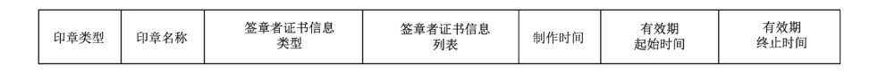

# GB/T 38540-2020 信息安全技术 安全电子签章密码技术规范

> 来源：[GB/T 38540-2020 国家标准详情](https://openstd.samr.gov.cn/bzgk/std/newGbInfo?hcno=EBF1360C272E40E7A8B9B32ED0724AB1)；发布日期：2020-03-06；实施日期：2020-10-01。
> PDF SHA-256：b0e19c497c241f23826d0bec5bbdf96518201e1d55ce6e5a8acc0d35a4637232。
> 转写说明：依据官方 PDF 渲染的全部 12 张页图逐页校正，保留图 1 至图 7 原页裁切，并按原页恢复 ASN.1 定义；省略封面、目录、页眉、页脚和页码，合并跨页段落。正式引用请核对官方原文。

## 前言

本标准按照 GB/T 1.1—2009给出的规则起草。

请注意本文件的某些内容可能涉及专利。本文件的发布机构不承担识别这些专利的责任。

本标准由全国信息安全标准化技术委员会（SAC/TC 260）提出并归口。

本标准起草单位：北京数字认证股份有限公司、中安网脉（北京）技术股份有限公司、兴唐通信科技有限公司、格尔软件股份有限公司、长春吉大正元信息技术股份有限公司、成都卫士通信息产业股份有限公司、国家密码管理局商用密码检测中心、北京海泰方圆科技股份有限公司、北京三未信安科技发展有限公司、上海市数字证书认证中心有限公司、上海颐东网络信息有限公司、中国电子技术标准化研究院。

本标准主要起草人：傅大鹏、刘岩、谢峰、徐惠清、朱亚飞、王天顺、张金铭、郑强、李述胜、田敏求、吕春梅、赵丽丽、罗俊、陈中林、蒋红宇、高志权、许永欣、韩玮、夏东山、陈亚军、王文昌、邵森、陈景燕、张妍、李敏、刘中。

## 1 范围

本标准规定了采用密码技术实现电子印章和电子签章的数据结构定义，以及相应的生成与验证流程。

本标准适用于电子印章系统的开发和使用，也可用于指导该类系统的检测。

## 2 规范性引用文件

下列文件对于本文件的应用是必不可少的。凡是注日期的引用文件，仅注日期的版本适用于本文件。凡是不注日期的引用文件，其最新版本（包括所有的修改单）适用于本文件。

- GB/T 20518 信息安全技术 公钥基础设施 数字证书格式

- GB/T 20520 信息安全技术 公钥基础设施 时间戳规范

- GB/T 32905 信息安全技术 SM3密码杂凑算法

- GB/T 32918（所有部分）信息安全技术 SM2椭圆曲线公钥密码算法

- GB/T 33560 信息安全技术 密码应用标识规范

- GB/T 35276 信息安全技术 SM2密码算法使用规范

## 3 术语和定义

下列术语和定义适用于本文件。

### 3.1 电子印章 electronic seal

一种由电子印章制章者数字签名的安全数据。

> 注：包括电子印章所有者信息和图形化内容的数据，用于安全签署电子文件。

### 3.2 电子签章 electronic seal signature

使用电子印章签署电子文件的过程。

> 注：电子签章可实现与纸质文件盖章操作相似的可视效果，可保障数据来源的真实性、数据完整性以及签名人行为的不可否认性。

### 3.3 原文 original data

需要进行电子签章或数字签名处理的电子文件。

### 3.4 电子签章数据 electronic seal signature data

电子签章过程产生的包含电子印章、原文信息和数字签名等信息的数据。

### 3.5 电子印章系统 electronic seal system

电子印章管理系统和电子签章软件的统称。

注1：电子印章管理系统具有电子印章制作与管理、安全审计等功能。

注2：电子签章软件是对电子文件加盖电子印章或添加数字签名的软件。

### 3.6 制章者 electronic seal maker

电子印章系统中具有电子印章制作和管理权限的机构。

> 注：电子印章中的图像和相关信息应经制章者进行数字签名，电子印章中的制章者证书应是该机构的单位证书。

### 3.7 签章者 electronic seal signer

电子印章的所有者，是具备电子印章法定使用权限的实体。

### 3.8 SM2算法 SM2 algorithm

由 GB/T 32918定义的一种椭圆曲线密码算法。

### 3.9 SM3算法 SM3 algorithm

由 GB/T 32905定义的一种杂凑算法。

## 4 缩略语

下列缩略语适用于本文件。

ASN.1：抽象语法记法（Abstract Syntax Notation One）

BMP：位图（Bitmap）

DER：非典型编码规则（Distinguished Encoding Rules）

> 转写注：原版第 4 章将 DER 的中文名称印作“非典型编码规则”，此处保留原文。

GIF：图形交换格式（Graphics Interchange Format）

JPG：联合图像专家组的文件格式（Joint Photographic Experts Group）

OID：对象标识符（Object Identifier）

PKI：公钥基础设施（Public Key Infrastructure）

SVG：可缩放的矢量图形（Scalable Vector Graphics）

## 5 概述

安全电子签章是通过采用 PKI公钥密码技术，将数字图像处理技术与电子签名技术进行结合，以电子形式对加盖印章图像数据的电子文档进行数字签名，以确保文档来源的真实性以及文档的完整性，防止对文档未经授权的篡改，并确保签章行为的不可否认性。

为了确保电子印章的完整性、不可伪造性，以及合法用户才能使用，需要定义一个安全的电子印章数据格式。通过数字签名，将印章图像数据与签章者等印章属性进行安全绑定，形成安全电子印章。在使用印章过程中，应对电子印章进行安全性验证。

在使用电子印章对各种文档进行电子签章过程中，签章者通过数字签名对文档数据进行签章处理，从而达到与传统纸质文件盖章操作相同的可视化效果，同时又利用数字签名技术保障了文档数据的真实性、完整性以及签章者行为的不可否认性。

## 6 电子印章

### 6.1 数据格式

#### 6.1.1 印章数据结构

电子印章由印章信息、制章者证书、签名算法标识、签名值等部分组成，其数据结构如图1所示。


电子印章数据的 ASN.1 定义为：

```asn1
SESeal ::= SEQUENCE {
    eSealInfo    SES_SealInfo,       -- 印章信息
    cert         OCTET STRING,       -- 制章者证书
    signAlgID    OBJECT IDENTIFIER,  -- 签名算法标识
    signedValue  BIT STRING          -- 签名值
}
```

#### 6.1.2 印章信息

##### 6.1.2.1 数据结构

印章信息 eSealInfo 由印章头、印章标识、印章属性、印章图像数据、自定义数据等部分组成，其数据结构如图2所示。


印章信息 eSealInfo 的 ASN.1 定义如下：

```asn1
SES_SealInfo ::= SEQUENCE {
    header     SES_Header,              -- 印章头
    esID       IA5String,               -- 印章标识
    property   SES_ESPropertyInfo,      -- 印章属性
    picture    SES_ESPictrueInfo,       -- 印章图像数据
    extDatas   ExtensionDatas OPTIONAL  -- 自定义数据
}
```

##### 6.1.2.2 印章头

印章头由头标识、版本号和厂商标识等组成，其数据结构如图3所示。


印章头的 ASN.1 定义为：

```asn1
SES_Header ::= SEQUENCE {
    ID       IA5String,  -- 头标识
    version  INTEGER,    -- 印章版本号
    Vid      IA5String   -- 厂商标识
}
```

其中：ID：固定值“ES”。

version：电子印章数据结构版本号，本标准设定数值为4，代表当前版本为v4。

Vid：电子印章厂商标识，在互联互通时，用于识别不同的软件厂商实现。

##### 6.1.2.3 印章标识

esID：区分电子印章的唯一标识编码，用于查找和索引其他信息。

##### 6.1.2.4 印章属性

印章属性由印章类型、印章名称、签章者证书信息类型、签章者证书信息列表、制作时间、有效期起始时间、有效期终止时间等部分组成，其结构如图4所示。



印章属性的 ASN.1 定义为：

```asn1
SES_ESPropertyInfo ::= SEQUENCE {
    type          INTEGER,          -- 印章类型
    name          UTF8String,       -- 印章名称
    certListType  INTEGER,          -- 签章者证书信息类型
    certList      SES_CertList,     -- 签章者证书信息列表
    createDate    GeneralizedTime,  -- 印章制作时间
    validStart    GeneralizedTime,  -- 印章有效期起始时间
    validEnd      GeneralizedTime   -- 印章有效期终止时间
}
```

其中：type：代表印章类型，可根据业务需要自定义。

name：印章名称，如“XX公司财务专用章”，对于在公安部门进行备案的印章，其印章名称与备案的名称保持一致。

certListType：签章者证书信息类型，1——数字证书，2——数字证书的杂凑值。

certList：签章者证书信息列表，一个或多个签章者证书或签章者证书杂凑值组成的列表。

createDate：印章制作时间。

validStart：印章有效期起始时间。

validEnd：印章有效期终止时间。

```asn1
SES_CertList ::= CHOICE {
    certs           CertInfoList,    -- 签章者证书
    certDigestList  CertDigestList   -- 签章者证书杂凑值
}
CertInfoList ::= SEQUENCE OF Cert
CertDigestList ::= SEQUENCE OF CertDigestObj
Cert ::= OCTET STRING
```

Cert 符合 GB/T 20518 中 Certificate 定义，按 DER 编码格式存放。

```asn1
CertDigestObj ::= SEQUENCE {
    type   ObjType,          -- 自定义类型
    value  CertDigestValue  -- 证书杂凑值
}
ObjType ::= PrintableString
CertDigestValue ::= OCTET STRING
```

##### 6.1.2.5 印章图像数据

印章图像数据由图像类型、图像数据、图像显示宽度和图像显示高度等部分组成，其数据结构如图5所示。


印章图像数据的 ASN.1 定义为：

```asn1
SES_ESPictrueInfo ::= SEQUENCE {
    type    IA5String,     -- 图像类型
    data    OCTET STRING,  -- 图像数据
    width   INTEGER,       -- 图像显示宽度
    height  INTEGER        -- 图像显示高度
}
```

其中：type：印章图像数据格式类型，如 GIF、BMP、JPG、PNG、SVG 等。

data：印章图像数据，机构的电子印章宜采用相关国家管理部门指定的印模。

width：图像显示宽度（单位为毫米，mm）。

height：图像显示高度（单位为毫米，mm）。

> 转写注：原版 ASN.1 类型名使用 SES_ESPictrueInfo（Pictrue），此处保留原拼写。

##### 6.1.2.6 自定义数据

自定义数据包含一系列自定义属性字段，可用于支持电子印章扩展特性，其 ASN.1 定义为：

```asn1
ExtensionDatas ::= SEQUENCE SIZE(0..MAX) OF ExtData
ExtData ::= SEQUENCE {
    extnID     OBJECT IDENTIFIER,      -- 自定义扩展字段标识
    critical   BOOLEAN DEFAULT FALSE,  -- 自定义扩展字段是否关键
    extnValue  OCTET STRING            -- 自定义扩展字段数据值
}
```

#### 6.1.3 制章者证书

cert：对电子印章进行签名的制章者的数字证书，应符合 GB/T 20518 中 Certificate 定义，按 DER编码格式存放。

#### 6.1.4 签名算法标识

signAlgID：代表签名算法 OID标识，应符合 GB/T 33560的规定。

示例：基于 SM2 算法和SM3算法的签名OID 为1.2.156.10197.1.501。

#### 6.1.5 签名值

signedValue：制章者对电子印章格式中印章信息域 SES_SealInfo，按 SEQUENCE 方式组成的信息内容进行数字签名所得的结果。

如果签名算法使用 SM2，应符合 GB/T 35276 的规定。

### 6.2 电子印章生成流程

电子印章生成流程如下：

a）按6.1.2定义的数据格式，将印章头、印章标识、印章属性、印章图像数据、自定义数据等数据按 SEQUENCE 方式组成印章信息；

b） 根据签名算法标识 signAlgID，对上述步骤a）的印章信息域进行数字签名运算，形成签名值；

c） 将上述步骤a）和b）的数据以及制章者证书、签名算法标识组成6.1.1定义的电子印章数据格式。

### 6.3 电子印章验证流程

电子印章验证流程如下：

<ol type="a">
<li>

验证电子印章数据格式的正确性

按照电子印章格式解析电子印章，验证是否符合6.1定义的电子印章数据格式。

如果电子印章数据格式不正确，则验证失败，返回错误代码并退出验证流程。
</li>
<li>

验证电子印章签名值是否正确

根据印章信息、制章者证书、签名算法标识来验证电子印章中的签名值是否正确。

如果电子印章签名验证失败，返回错误代码并退出验证流程。
</li>
<li>

验证电子印章制章者证书的有效性

验证制章者证书的有效性，验证项至少包括：制章者证书信任链验证、制章者证书有效期验证、制章者证书是否被撤销、密钥用法是否正确。

如果制章者证书验证失败，返回错误代码并退出验证流程。
</li>
<li>

验证电子印章的有效期

根据印章属性中的印章有效期起始时间和有效期终止时间，验证电子印章是否过期。

如果电子印章已过期，则验证失败，返回错误代码并退出验证流程。
</li>
</ol>

如果上述步骤都验证成功，则电子印章验证正确有效，可正常退出验证流程。

## 7 电子签章

### 7.1 数据格式

#### 7.1.1 签章数据结构

电子签章数据由签章信息、签章者证书、签名算法标识、签名值、时间戳等组成。

电子签章数据结构如图6所示。


电子签章数据的 ASN.1 定义为：

```asn1
SES_Signature ::= SEQUENCE {
    toSign          TBS_Sign,           -- 签章信息
    cert            OCTET STRING,       -- 签章者证书
    signatureAlgID  OBJECT IDENTIFIER,  -- 签名算法标识
    signature       BIT STRING,         -- 签名值
    timeStamp [0]   BIT STRING OPTIONAL -- 对签名值的时间戳
}
```

#### 7.1.2 签章信息

签章信息由版本号、电子印章、签章时间、原文杂凑值、原文属性、自定义数据等组成，结构如图7所示。


```asn1
TBS_Sign ::= SEQUENCE {
    version       INTEGER,                    -- 电子签章版本号，与电子印章版本号保持一致
    eseal         SESeal,                     -- 电子印章
    timeInfo      GeneralizedTime,           -- 签章时间
    dataHash      BIT STRING,                -- 原文杂凑值
    propertyInfo  IA5String,                 -- 原文数据的属性
    extDatas [0]  ExtensionDatas OPTIONAL   -- 自定义数据
}
```

其中：version：电子签章版本号，该版本号与电子印章版本号保持一致。

eseal：生成电子签章使用的电子印章。

timeInfo：电子签章对应的时间，可以是 GeneralizedTime 时间。

dataHash：待签名原文的杂凑值。

propertyInfo：原文数据的属性，如文档 ID、日期、段落、原文内容的字节数、指示信息、签名保护范围等，此部分受签名保护，propertyInfo 的具体结构可自行定义，但至少应包含签名保护范围。

extDatas：厂商自定义数据。

#### 7.1.3 签章者证书

cert：签章者的数字证书，应符合GB/T 20518的规定，按 DER编码格式存放。

#### 7.1.4 签名算法标识

signatureAlgID：签名算法标识，应符合GB/T 33560的规定，应与签章者证书中的算法声明保持一致。

示例：基于 SM2 算法和 SM3 算法的数字签名 OID 为1.2.156.10197.1.501。

#### 7.1.5 签名值

signature：签章者对签章信息 TBS_Sign 进行数字签名的结果；注意签名过程中的原文杂凑所采用的算法应与签名算法保持协调，如果签名算法是SM2，则杂凑算法应采用SM3算法。

如果签名算法使用 SM2，应符合 GB/T 35276 的规定。

#### 7.1.6 时间戳

timeStamp：对签名值的时间戳，应符合 GB/T 20520的规定，时间戳格式按 DER编码存放。

### 7.2 电子签章生成流程

电子签章生成流程如下：

<ol type="a">
<li>

准备电子印章，并验证电子印章的正确性和有效性，具体步骤如下：

<ol>
<li>

验证电子印章。按照6.3验证电子印章的正确性和有效性。
</li>
<li>

选择拟进行电子签章的签章者证书，并验证该证书的有效性。验证项至少包括：证书信任链、证书有效期验证、证书是否被撤销、密钥用法是否正确。
</li>
<li>

根据电子印章中的签章者证书列表类型，提取电子印章中的签章者证书信息列表，并用来判断步骤2）选择的签章者证书是否在列表中。如果证书信息类型值为1，则直接比对证书；如果值为2，则计算步骤2）中的证书的杂凑再进行比对：

<ul>
<li>如果拟签章者在电子印章的签章者列表中，则进行后续流程；</li>
<li>如果比对失败，返回错误代码并退出签章流程。根据错误代码进一步判断，如果比对失败是因为签章者证书执行更新、重签发等操作而导致，程序应提示重新制作印章。</li>

</ul>

</li>
</ol>

</li>
<li>

对原文进行电子签章，具体步骤如下：

<ol>
<li>

按照 propertyInfo 中的签名保护范围来准备待签名原文；
</li>
<li>

将待签名原文数据进行杂凑运算，形成原文杂凑值；
</li>
<li>

按照7.1.2电子签章数据格式组成签章信息；
</li>
<li>

签章者对签章信息进行数字签名，生成签名值；
</li>
<li>

如果需要加盖时间戳，则利用上述签名值产生相应的时间戳；
</li>
<li>

将步骤3）、4）、5）以及签章者信息、签名算法标识组成7.1.1定义的电子签章数据。
</li>
</ol>
</li>
</ol>

### 7.3 电子签章验证流程

电子签章验证流程如下：

<ol type="a">
<li>

验证电子签章数据格式的正确性

<ol>
<li>

根据7.1数据格式来解析电子签章数据。
</li>
<li>

若解析失败，则返回错误代码并退出验证流程。
</li>
<li>

按照6.3流程来验证上述电子签章中的电子印章的正确性。
</li>
<li>

如果电子签章或电子印章数据格式不正确，则返回错误代码并退出验证流程。
</li>
</ol>

</li>
<li>

验证电子签章签名值是否正确

<ol>
<li>

根据步骤a）解析所得的签章信息、签章者证书和签名算法标识，验证电子签章签名值。
</li>
<li>

如果签名值验证失败，则返回错误代码并退出验证流程。
</li>
</ol>

</li>
<li>

验证签章者证书与电子印章的匹配性

<ol>
<li>

提取电子印章中的签章者证书信息类型与签章者证书信息列表。
</li>
<li>

如果上述签章者证书信息类型值为1，则需要比对数字证书。将步骤a）解析所得的签章者证书与电子印章中签章者证书信息列表内的证书逐一作二进制比对，若均比对失败，则返回错误代码并退出验证流程。
</li>
<li>

如果上述签章者证书信息类型值为2，则需要比对证书的杂凑值。先计算步骤a）解析所得的签章者证书的杂凑值，再与电子印章中签章者证书信息列表内的杂凑值逐一作比对，若均比对失败，则返回错误代码并退出验证流程。
</li>
</ol>

</li>
<li>

验证电子印章的有效性

<ol>
<li>

从签章信息中提取电子印章，按照6.3电子印章验证流程验证印章的有效性，若验证失败，需结合签章信息中的签章时间综合判断。
</li>
<li>

若电子印章失效因制章者证书失效导致，且在签章时间点上制章者证书也是无效的，则应记录为提示信息。
</li>
<li>

若电子印章失效因过期或被撤销所导致，且在签章时间不在电子印章有效期内，或当时电子印章不在正常状态，则返回错误代码并退出验证流程。
</li>
<li>

验证签章时刻，电子印章是否处于正常状态，如不处于正常状态，则返回错误代码并退出验证流程。
</li>
</ol>

</li>
<li>

验证签章者证书有效性

<ol>
<li>

从电子签章数据获得签章者证书，验证签章者证书有效性，验证项至少包括：证书信任链验证、证书有效期验证、证书是否被撤销、密钥用法是否正确。
</li>
<li>

若签章者证书有效性验证失败且是由于证书信任链验证或密钥用法不正确导致的，则返回错误代码并退出验证流程。
</li>
<li>

若签章者证书有效性验证失败且是由于证书过期或证书状态已撤销导致的，则按步骤f）进一步判断。
</li>
</ol>

</li>
<li>

验证签章时间的有效性

<ol>
<li>

比对签章者证书有效期和签章时间，如果签章时间不在签章者证书有效期内，则签章无效，验证失败，返回错误代码并退出验证流程。
</li>
<li>

如果签章时间处于签章者证书有效期内，则检查对应的撤销列表，如果证书在签章时间处于失效状态，则签章无效，验证失败，返回错误代码并退出验证流程。
</li>
</ol>

</li>
<li>

验证原文杂凑

<ol>
<li>

从电子签章数据中提取 propertyInfo 数据，从 propertyInfo 中提取签名保护范围提取待验证原文。
</li>
<li>

将待验证原文数据进行杂凑运算，形成待验证原文杂凑值。
</li>
<li>

从电子签章数据中提取原文杂凑值，与上述待验证原文杂凑值进行二进制比对，如果比对失败，则电子签章验证失败，返回错误代码并退出验证流程。
</li>
</ol>

</li>
<li>

验证时间戳的有效性

<ol>
<li>

如果电子签章数据中包含时间戳，则应进行时间戳的有效性验证。
</li>
<li>

若时间戳验证不通过，则签章无效，返回错误代码并退出验证流程。
</li>
<li>

比对时间戳中的时间与签章时间，若签章时间晚于时间戳中的时间，则签章无效，返回错误代码并退出验证流程。
</li>
<li>

按照步骤f）验证时间戳中时间的有效性，若不通过，返回错误代码并退出验证流程。
</li>
</ol>
</li>
</ol>

如果上述各步骤验证均有效，那么电子签章验证结果有效，可正常退出验证流程。
