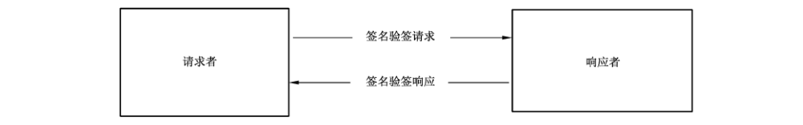

# GB/T 38629-2020 信息安全技术 签名验签服务器技术规范

> 来源：[GB/T 38629-2020 国家标准详情](https://openstd.samr.gov.cn/bzgk/std/newGbInfo?hcno=19860FA3696E88D8FF14105B48C442ED)；发布日期：2020-04-28；实施日期：2020-11-01。
> PDF SHA-256：10065fe980d7e5948a09bbd128f253d1a3fca9681fc5fff3fec98f780135c17e。
> 转写说明：将官方 PDF 按页渲染为图像，对照全部 25 页修正文、图 1、协议定义、表 1、表 2、表 A.1 和表 B.1；省略封面、目录、页眉、页脚及页码，合并跨页内容。原页字段中的 `IMPLICT` 按印刷文本照录；正式引用请核对官方 PDF。

## 前言

本标准按照 GB/T 1.1—2009给出的规则起草。

请注意本文件的某些内容可能涉及专利。本文件的发布机构不承担识别这些专利的责任。

本标准由全国信息安全标准化技术委员会（SAC/TC 260）提出并归口。

本标准起草单位：山东得安信息技术有限公司、成都卫士通信息产业股份公司、无锡江南信息安全工程技术中心、兴唐通信科技有限公司、格尔软件股份有限公司、长春吉大正元信息技术股份有限公司、上海市数字证书认证中心有限公司、北京数字认证股份有限公司、北京创原天地科技有限公司、北京三未信安科技发展有限公司、北京信安世纪科技股份有限公司。

本标准主要起草人：马洪富、孔凡玉、罗俊、徐明翼、王妮娜、郑强、赵丽丽、韩玮、李述胜、肖青海、高志权、汪宗斌。

## 1 范围

本标准规定了签名验签服务器的功能要求、安全要求和消息协议语法规则等内容。

本标准适用于签名验签服务器的研制和使用。

## 2 规范性引用文件

下列文件对于本文件的应用是必不可少的。凡是注日期的引用文件，仅注日期的版本适用于本文件。凡是不注日期的引用文件，其最新版本（包括所有的修改单）适用于本文件。

- GB/T 9813.3—2017 计算机通用规范 第3部分：服务器

- GB/T 19713—2005 信息技术 安全技术 公钥基础设施 在线证书状态协议

- GB/T 25069—2010 信息安全技术 术语

- GB/T 32905 信息安全技术 SM3密码杂凑算法

- GB/T 32918（所有部分）信息安全技术 SM2椭圆曲线公钥密码算法

- GB/T 33560—2017 信息安全技术 密码应用标识规范

- GB/T 35275 信息安全技术 SM2密码算法加密签名消息语法规范

- GB/T 35276 信息安全技术 SM2密码算法使用规范

- GB/T 35291—2017 信息安全技术 智能密码钥匙应用接口规范

- GB/T 36322 信息安全技术 密码设备应用接口规范

- GM/T 0020 证书应用综合服务接口规范

- GM/T 0028 密码模块安全要求

- GM/T 0039 密码模块安全检测要求

## 3 术语和定义

GB/T 25069—2010界定的以及下列术语和定义适用于本文件。

### 3.1 安全域 security domain

在信息系统中，单一安全策略下运行的实体的汇集。例如，由单个或一组认证机构采用同一安全策略创建的各公钥证书的汇集。

［GB/T 25069—2010，定义 2.2.1.17］

### 3.2 签名验签服务器 signature verification server

用于服务端的，为应用实体提供基于 PKI 体系和数字证书的数字签名、验证签名等运算功能的服务器，保证关键业务信息的真实性、完整性和不可否认性。

### 3.3 用户 user

与应用实体进行通信或认证的个人、机构或系统。

> 注：其数字证书可导入到签名验签服务器中。

### 3.4 SM2 算法 SM2 algorithm

由GB/T 32918定义的一种椭圆曲线密码算法。

### 3.5 SM3 算法 SM3 algorithm

由 GB/T 32905定义的一种杂凑算法。

## 4 缩略语

下列缩略语适用于本文件。

- API：应用程序接口（Application Program Interface）
- ASN.1：抽象语法记法 1（Abstract Syntax Notation One）
- CA：证书认证机构（Certification Authority）
- CRL：证书撤销列表（Certificate Revocation List）
- OCSP：在线证书状态查询协议（Online Certificate Status Protocol）
- PKI：公钥密码基础设施（Public Key Infrastructure）

## 5 签名验签服务器的功能要求

### 5.1 初始化功能

签名验签服务器的初始化应主要包括系统配置、生成管理员和审计员、创建密钥、申请证书和导入证书等，使设备处于正常工作状态。

### 5.2 与公钥基础设施的连接配置功能

#### 5.2.1 CRL 连接配置

签名验签服务器应支持 CRL 连接配置功能，通过配置管理界面，提供从 CRL 发布点获取 CRL、导入 CRL 等功能。

#### 5.2.2 OCSP 连接配置

签名验签服务器应支持 OCSP 连接配置功能，通过配置管理界面，进行 OCSP 服务的连接配置管理。OCSP 服务的连接配置应遵循GB/T 19713—2005中6.1 的规定。

### 5.3 应用管理功能

签名验签服务器的应用管理功能应包括应用实体的注册、配置密钥、设置私钥授权码等，并按照安全机制对应用实体的信息进行安全存储。应用实体注册的内容应包括设置应用实体名称、配置密钥索引号、导入证书等。

### 5.4 证书管理和验证功能

#### 5.4.1 应用实体的密钥产生、证书申请

在签名验签服务器注册的应用实体，应由签名验签服务器产生应用实体的签名密钥对和证书请求，并支持通过管理界面导入应用实体的签名证书、加密证书和加密密钥对。加密密钥对的保护结构应遵循 GB/T 35291—2017中6.4.10 的规定。

#### 5.4.2 证书导入和存储

签名验签服务器应支持用户证书、根证书或证书链的导入，导入时应对证书的有效性进行验证。

#### 5.4.3 应用实体的证书更新

应用实体的证书更新时应保存原来的证书，以防止以前的签名不能验证。

#### 5.4.4 证书验证

签名验签服务器应支持对证书的有效性的验证，包括验证证书有效期、验证证书签名有效性、验证证书状态。

#### 5.4.5 备份和恢复

签名验签服务器应支持备份和恢复功能，包括密钥、证书等数据的备份和恢复。

备份操作产生的备份文件可存储到签名验签服务器外的存储介质中，应采取措施保证备份文件的机密性和完整性。

### 5.5 数字签名和验签功能

签名验签服务器应支持 SM2算法的数字签名和数字验签功能，提供对数据、消息、文件等多种格式的运算方式。

数据的结构应遵循 GB/T 35275 和 GB/T 35276。

### 5.6 日志管理功能

签名验签服务器应提供日志记录、查看、审计和导出功能，具备相应的配置管理和查看界面。

日志内容包括：

a） 系统管理日志，包括登录认证、系统配置、密钥管理等操作；

b） 异常事件，包括认证失败、非法访问等异常事件的记录；

c） 如与设备管理中心连接，对相应操作进行记录；

d） 对应用接口的调用进行日志记录。

### 5.7 时间源同步功能

签名验签服务器应能够配置连接时间源服务器，自动同步时间。

## 6 签名验签服务器的安全要求

### 6.1 接口要求

签名验签服务器调用密码设备的接口应遵循 GB/T 36322。

### 6.2 系统要求

签名验签服务器所使用的操作系统应进行安全加固，保障其安全性。

### 6.3 使用要求

签名验签服务器只接受合法的操作指令，并防止非授权用户的使用。

### 6.4 管理要求

#### 6.4.1 管理工具

签名验签服务器通过管理工具实现对该签名验签服务器的管理功能。

#### 6.4.2 管理员身份鉴别

签名验签服务器应具备完善的身份鉴别机制，签名验签服务器应设置管理员和审计员，管理员和审计员应通过智能密码钥匙、智能IC卡等硬件介质与口令相结合的方式登录系统，并使用证书进行身份验证。各类管理员通过身份鉴别后执行自己权限范围内的相关管理操作。

#### 6.4.3 设备管理

##### 6.4.3.1 设备初始化

签名验签服务器的初始化，除应由厂商进行的操作外，系统配置、密钥的生成（恢复）与安装、生成管理员和审计员等均应由用户方设备管理人员完成。

##### 6.4.3.2 设备自检

签名验签服务器应具备自检功能，应具备状态和功能自检功能，能够进行密码算法正确性检查、随机数发生器检查、存储密钥和数据的完整性检查等，检查不通过时应报警并停止工作。

### 6.5 设备物理安全防护

签名验签服务器在工艺设计、硬件配置等方面应采取相应的保护措施，保证设备基本的物理安全防护功能。

### 6.6 网络部署要求

签名验签服务器应部署在应用系统的安全域内，只为安全域内的应用实体和用户服务，不应为安全域外的应用实体和用户使用。

### 6.7 服务接口

以基于 HTTP的WEB方式提供服务的签名验签服务器，接口要求见附录A，响应码的定义见附录B。

以消息协议方式提供服务的签名验签服务器，接口要求见第7章，响应码的定义见附录B。

以应用程序接口方式提供服务的签名验签服务器，其接口应遵循 GM/T 0020。

### 6.8 环境适应性

签名验签服务器的工作环境应遵循GB/T 9813.3—2017中5.8的规定。

### 6.9 可靠性

签名验签服务器的平均失效间隔工作时间应遵循GB/T 9813.3—2017中4.9的规定。

### 6.10 其他

签名验签服务器的其他安全要求应遵循GM/T 0028 和 GM/T 0039。

## 7 消息协议语法规则

### 7.1 概述

签名验签服务的消息协议接口采用请求响应模式，如图 1 所示。协议模型由请求者、响应者和它们之间的交互协议组成。通过本协议，请求者将数字签名、验证数字签名等请求发送给响应者，由响应者完成签名验签服务并返回结果。本规则中的接口消息协议包括导出证书、解析证书、验证证书有效性、数字签名、验证数字签名、消息签名、验证消息签名等服务功能，每个服务都按照请求—响应的步骤执行。请求者可通过规则获得签名验签功能，而不必关心下层 PKI 公钥密码基础设施的实现细节。



**图 1 签名验签服务的消息协议接口模式**

请求者组织业务服务请求，发送到响应者，并延缓自身的事务处理过程，等待响应者响应返回；响应者接收到来自请求者的业务服务请求后，检查请求的合法性，根据请求类型处理服务请求，并将处理结果返回给请求者。

下面的协议内容将按照图1所示的框架进行。

### 7.2 协议内容

协议内容如下：

a） 请求

也称业务服务请求，包含请求者业务请求的类型、性质以及特性数据等，该请求将被发送到响应者并得到服务。服务请求包括如下数据：

- 协议版本（当前版本为 1）；
- 请求类型；
- 请求包；
- 请求时间。

b） 响应

指响应者对来自请求者请求的处理响应。响应者的响应包括如下数据：

- 协议版本（当前版本为 1）；
- 响应类型；
- 响应包；
- 响应时间。

c） 异常情况

当响应者处理发生错误时，需要向请求者发送错误信息。错误可以是下列两类：

- 请求失败：响应者验证来自请求者业务请求数据失败，请求者收到该响应后应重新组织业务请求数据进行发送。
- 内部处理失败：响应者处理请求者业务请求过程中发生内部错误，响应者通知请求者该请求处理失败，请求者需重新组织业务请求数据进行发送。

本规则采用抽象语法记法1（ASN.1）来描述具体协议内容。如果无特殊说明，默认使用 ASN.1显式标记。

### 7.3 请求协议

#### 7.3.1 请求数据格式

请求者请求数据的基本格式如下：

```text
SVSRequest ::= SEQUENCE {
    version             Version DEFAULT v1,
    reqType             ReqType,
    request             Request,
    reqTime             [0] IMPLICIT GeneralizedTime OPTIONAL,
    reqTimeStampToken   [1] IMPLICIT ReqTimeStampToken OPTIONAL,
    extAttributes       [2] IMPLICIT ExtAttributes OPTIONAL
}
```

其中：

```text
Version ::= INTEGER { v1(0) }
ReqType ::= INTEGER {
    exportCert                 (0),
    parseCert                  (1),
    validateCert               (2),
    signData                   (3),
    verifySignedData           (4),
    signDataInit               (5),
    signDataUpdate             (6),
    signDataFinal              (7),
    verifySignedDataInit       (8),
    verifySignedDataUpdate     (9),
    verifySignedDataFinal     (10),
    signMessage               (11),
    verifySignedMessage       (12)
}
Request ::= OCTET STRING {
    exportUserCertReq          [0] IMPLICT ExportUserCertReq,
    parseCertReq               [1] IMPLICT ParseCertReq,
    validateCertReq            [2] IMPLICT ValidateCertReq,
    signDataReq                [3] IMPLICT SignDataReq,
    verifySignedDataReq        [4] IMPLICT VerifySignedDataReq,
    signDataInitReq            [5] IMPLICT SignDataInitReq,
    signDataUpdateReq          [6] IMPLICT SignDataUpdateReq,
    signDataFinalReq           [7] IMPLICT SignDataFinalReq,
    verifySignedDataInitReq    [8] IMPLICT VerifySignedDataInitReq,
    verifySignedDataUpdateReq  [9] IMPLICT VerifySignedDataUpdateReq,
    verifySignedDataFinalReq  [10] IMPLICT VerifySignedDataFinalReq,
    signMessageReq            [11] IMPLICT SignMessageReq,
    verifySignedMessageReq    [12] IMPLICT VerifySignedMessageReq
}
ReqTimeStampToken ::= TimeStampToken
ExtAttributes ::= SET OF Attribute
```

#### 7.3.2 SVSRequest 及其结构解释

SVSRequest 包含了请求语法中的重要信息，本条将对该结构作详细的描述和解释：

a） 协议版本

本项描述了请求语法的版本号，当前版本为 1，取整型值 0。

b） 请求类型

本项描述了不同业务的请求类型值，0～999 为保留值，不可占用。

c） 请求包

请求包与请求类型值之间的对应关系如表 1 所示。

**表1 请求包与请求类型值的对应关系**

| 请求类型字符描述 | 请求类型值 | 请求包说明 |
| --- | --- | --- |
| exportCert | 0 | 导出证书请求包 |
| parseCert | 1 | 解析证书请求包 |
| validateCert | 2 | 验证证书有效性请求包 |
| signData | 3 | 单包数字签名请求包 |
| verifySignedData | 4 | 单包验证数字签名请求包 |
| signDataInit | 5 | 多包数字签名初始化请求包 |
| signDataUpdate | 6 | 多包数字签名更新请求包 |
| signDataFinal | 7 | 多包数字签名结束请求包 |
| verifySignedDataInit | 8 | 多包验证数字签名初始化请求包 |
| verifySignedDataUpdate | 9 | 多包验证数字签名更新请求包 |
| verifySignedDataFinal | 10 | 多包验证数字签名结束请求包 |
| signMessage | 11 | 单包消息签名请求包 |
| verifySignedMessage | 12 | 单包验证消息签名请求包 |

d） 请求时间

请求者产生请求的时间，采用 GeneralizedTime 语法表示。

e） 请求时间戳

request 内容的时间戳。如包含此项数据，签名服务器应验证该时间戳。

f） 扩展数据

依据实际业务需求添加的扩展数据。

### 7.4 响应协议

#### 7.4.1 响应数据格式

响应者响应的基本格式如下：

```text
SVSRespond ::= SEQUENCE {
    version             Version DEFAULT v1,
    respType            RespType,
    respond             Respond,
    respTime            [0] IMPLICIT GeneralizedTime OPTIONAL,
    respTimeStampToken  [1] IMPLICIT RespTimeStampToken OPTIONAL,
    extAttributes       [2] IMPLICIT ExtAttributes OPTIONAL
}
```

其中：

```text
Version ::= INTEGER { v1(0) }
RespType ::= INTEGER {
    exportCert                 (0),
    parseCert                  (1),
    validateCert               (2),
    signData                   (3),
    verifySignedData           (4),
    signDataInit               (5),
    signDataUpdate             (6),
    signDataFinal              (7),
    verifySignedDataInit       (8),
    verifySignedDataUpdate     (9),
    verifySignedDataFinal     (10),
    signMessage               (11),
    verifySignedMessage       (12)
}
Respond ::= OCTET STRING {
    exportUserCertResp         [0] IMPLICT ExportUserCertResp,
    parseCertResp              [1] IMPLICT ParseCertResp,
    validateCertResp           [2] IMPLICT ValidateCertResp,
    signDataResp               [3] IMPLICT SignDataResp,
    verifySignedDataResp       [4] IMPLICT VerifySignedDataResp,
    signDataInitResp           [5] IMPLICT SignDataInitResp,
    signDataUpdateResp         [6] IMPLICT SignDataUpdateResp,
    signDataFinalResp          [7] IMPLICT SignDataFinalResp,
    verifySignedDataInitResp   [8] IMPLICT VerifySignedDataInitResp,
    verifySignedDataUpdateResp [9] IMPLICT VerifySignedDataUpdateResp,
    verifySignedDataFinalResp [10] IMPLICT VerifySignedDataFinalResp,
    signMessageResp           [11] IMPLICT SignMessageResp,
    verifySignedMessageResp   [12] IMPLICT VerifySignedMessageResp
}
respTimeStampToken ::= TimeStampToken
ExtAttributes ::= SET OF Attribute
```

#### 7.4.2 SVSRespond 及其结构解释

SVSRespond 包含了响应语法中的重要信息，本条将对该结构作详细的描述和解释：

a） 协议版本

本项描述了响应语法的版本号，当前版本为 1，取整型值 0。

b） 响应类型

本项描述了不同业务的响应类型值，0～999 为保留值，不可占用。

c） 响应包

响应包与响应类型值之间的对应关系如表 2 所示。

**表2 响应包与相应类型值的对应关系**

| 应答类型字符描述 | 应答类型值 | 响应包说明 |
| --- | --- | --- |
| exportCert | 0 | 导出证书响应包 |
| parseCert | 1 | 解析证书响应包 |
| validateCert | 2 | 验证证书有效性响应包 |
| signData | 3 | 单包数字签名响应包 |
| verifySignedData | 4 | 单包验证数字签名响应包 |
| signDataInit | 5 | 多包数字签名初始化响应包 |
| signDataUpdate | 6 | 多包数字签名更新响应包 |
| signDataFinal | 7 | 多包数字签名结束响应包 |
| verifySignedDataInit | 8 | 多包验证数字签名初始化响应包 |
| verifySignedDataUpdate | 9 | 多包验证数字签名更新响应包 |
| verifySignedDataFinal | 10 | 多包验证数字签名结束响应包 |
| signMessage | 11 | 单包消息签名响应包 |
| verifySignedMessage | 12 | 单包验证消息签名响应包 |

d） 响应时间

响应者产生响应的时间，采用 GeneralizedTime 语法表示。

e） 响应时间戳

respond 内容的时间戳。如包含此项数据，客户端应验证该时间戳。

f） 扩展数据

依据实际业务需求添加的扩展数据。

### 7.5 协议接口功能说明

#### 7.5.1 导出证书

- ExportCertReq 包

ExportCertReq 包为导出证书请求格式包，当 reqType 取值 exportCert 时，请求包采用本子包，其具体格式如下：

```text
ExportCertReq ::= SEQUENCE {
    identification  OCTET STRING
}
```

identification 表明要导出证书的标识。

- ExportCertResp 包

ExportCertResp 包为导出证书响应格式包，当 respType 取值 exportCert 时，响应包采用本子包，其具体格式如下：

```text
ExportCertResp ::= SEQUENCE {
    respValue  INTEGER,
    cert       Certificate OPTIONAL
}
```

respValue 表明响应码，0 表示成功，非 0 表示错误。

cert 表明导出的证书。

#### 7.5.2 解析证书

— ParseCertReq 包

ParseCertReq 包为解析证书请求格式包，当 reqType 取值 parseCert 时，请求包采用本子包，其具体格式如下：

```text
ParseCertReq ::= SEQUENCE {
    infoType  INTEGER,
    cert      Certificate
}
```

infoType 表明要解析证书信息的类型，应遵循 GB/T 33560—2017 中 6.3.4 的规定；

cert 表示要解析的数字证书。

— ParseCertResp 包

ParseCertResp 包为解析证书响应格式包，当 respType 取值 parseCert 时，响应包采用本子包，其具体格式如下：

```text
ParseCertResp ::= SEQUENCE {
    respValue  INTEGER,
    info       OCTET STRING OPTIONAL
}
```

respValue 表明响应码，0 表示成功，非 0 表示错误。

info 表示获取的证书信息。

#### 7.5.3 验证证书有效性

— ValidateCertReq 包

ValidateCertReq 包为验证证书有效性请求格式包，当 reqType 取值 validateCert 时，请求包采用本子包，其具体格式如下：

```text
ValidateCertReq ::= SEQUENCE {
    cert  Certificate,
    ocsp  BOOLEAN DEFAULT FALSE
}
```

cert 表示要验证证书有效性的数字证书；

ocsp 表示是否获取证书 OCSP 状态，默认值为 FALSE。

— ValidateCertResp 包

ValidateCertResp 包为验证证书有效性响应格式包，当 respType 取值 validateCert 时，响应包采用本子包，其具体格式如下：

```text
ValidateCertResp ::= SEQUENCE {
    respValue  INTEGER,
    state      INTEGER OPTIONAL
}
```

respValue 表明响应码，0 表示成功，非 0 表示错误；

state 表明获取的证书 OCSP 状态标识。

#### 7.5.4 单包数字签名

— SignDataReq 包

SignDataReq 包为单包数字签名请求格式包，当 reqType 取值 signData 时，请求包采用本子包，其具体格式如下：

```text
SignDataReq ::= SEQUENCE {
    signMethod   INTEGER,
    keyIndex     INTEGER,
    keyValue     OCTET STRING,
    signerIDLen  [0] IMPLICT INTEGER OPTIONAL,
    signerID     [1] IMPLICT OCTET STRING OPTIONAL,
    inDataLen    INTEGER,
    inData       OCTET STRING
}
```

signMethod 表明使用的签名算法类型，应遵循 GB/T 33560—2017 中 6.2.4 的规定；

keyIndex 表示签名者私钥的索引值，如十进制1表示索引值为1的密钥；

keyValue 表示签名者私钥权限标识码；

signerIDLen 表示签名者的ID 长度，当 signMethod 为 SGD_SM3_SM2 时有效；

signerID 表示签名者的ID 值，当 signMethod 为 SGD_SM3_SM2 时有效；

inDataLen 表示待签名的数据原文长度；

inData 表示待签名的数据原文。

— SignDataResp 包

SignDataResp 包为单包数字签名响应格式包，当 respType 取值 signData 时，响应包采用本子包，其具体格式如下：

```text
SignDataResp ::= SEQUENCE {
    respValue  INTEGER,
    signature  OCTET STRING OPTIONAL
}
```

respValue 表明响应码，0 表示成功，非 0 表示错误；

signature 表示签名值，数据的结构应遵循 GB/T 35276。

#### 7.5.5 单包验证数字签名

— VerifySignedDataReq 包

VerifySignedDataReq 包为单包验证数字签名请求格式包，当 reqType 取值 verifySignedData 时，请求包采用本子包，其具体格式如下：

```text
VerifySignedDataReq ::= SEQUENCE {
    signMethod   INTEGER,
    type         INTEGER,
    cert         [0] IMPLICT Certificate OPTIONAL,
    certSN       [1] IMPLICT OCTET STRING OPTIONAL,
    signerIDLen  [2] IMPLICT INTEGER OPTIONAL,
    signerID     [3] IMPLICT OCTET STRING OPTIONAL,
    inDataLen    INTEGER,
    inData       OCTET STRING,
    signature    OCTET STRING,
    verifyLevel  INTEGER
}
```

signMethod 表明使用的签名算法类型，应遵循 GB/T 33560—2017 中 6.2.4 的规定；

type 表示使用验证数字签名时使用证书或证书序列号，1表示使用证书，2表示使用证书序列号；

cert 表示签名证书，type 取值1时有效；

certSN 表示签名证书序列号，type 取值2时有效；

signerIDLen 表示签名者的 ID 长度，当 signMethod 为 SGD_SM3_SM2 时有效；

signerID 表示签名者的 ID 值，当 signMethod 为 SGD_SM3_SM2 时有效；

inDataLen 表示待签名的数据原文长度；

inData 表示待签名的数据原文；

signature 表示签名值，数据的结构应遵循 GB/T 35276；

verifyLevel 表示证书验证级别，0：验证时间，1：验证时间和根证书签名，2：验证时间、根证书签名和 CRL。

— VerifySignedDataResp 包

VerifySignedDataResp 包为单包验证数字签名响应格式包，当 respType 取值 verifySignedData 时，响应包采用本子包，其具体格式如下：

```text
VerifySignedDataResp ::= SEQUENCE {
    respValue  INTEGER
}
```

respValue 表明响应码，0 表示成功，非 0 表示错误。

#### 7.5.6 多包数字签名初始化

— SignDataInitReq 包

SignDataInitReq 包为多包数字签名初始化请求格式包，当 reqType 取值 signDataInit 时，请求包采用本子包，其具体格式如下：

```text
SignDataInitReq ::= SEQUENCE {
    signMethod      INTEGER,
    signerPublicKey [0] IMPLICT OCTET STRING OPTIONAL,
    signerIDLen     [1] IMPLICT INTEGER OPTIONAL,
    signerID        [2] IMPLICT OCTET STRING OPTIONAL
}
```

signMethod 表明使用的签名算法类型，应遵循 GB/T 33560—2017 中 6.2.4 的规定；

signerPublicKey 表示签名者公钥，当 signMethod 为 SGD_SM3_SM2 时有效；

signerIDLen 表示签名者的ID 长度，当 signMethod 为SGD_SM3_SM2 时有效；

signerID 表示签名者的 ID 值，当 signMethod 为 SGD_SM3_SM2 时有效；

— SignDataInitResp 包

SignDataInitResp 包为多包数字签名初始化响应格式包，当 respType 取值 signDataInit 时，响应包采用本子包，其具体格式如下：

```text
SignDataInitResp ::= SEQUENCE {
    respValue  INTEGER,
    SessionID  OCTET STRING OPTIONAL
}
```

respValue 表明响应码，0 表示成功，非 0 表示错误；

SessionID 表示会话标识。

#### 7.5.7 多包数字签名更新

— SignDataUpdateReq 包

SignDataUpdateReq 包为多包数字签名更新请求格式包，当 reqType 取值 signDataUpdate 时，请求包采用本子包，其具体格式如下：

```text
SignDataUpdateReq ::= SEQUENCE {
    SessionID  OCTET STRING,
    inDataLen  INTEGER,
    inData     OCTET STRING
}
```

SessionID 表示会话标识；

inDataLen 表示数据明文长度；

inData 表示数据明文。

— SignDataUpdateResp 包

SignDataUpdateResp 包为多包数字签名更新响应格式包，当 respType 取值 signDataUpdate 时，响应包采用本子包，其具体格式如下：

```text
SignDataUpdateResp ::= SEQUENCE {
    respValue  INTEGER,
    SessionID  OCTET STRING OPTIONAL
}
```

respValue 表明响应码，0 表示成功，非 0 表示错误；

SessionID 表示会话标识。

#### 7.5.8 多包数字签名结束

— SignDataFinalReq 包

SignDataFinalReq 包为多包数字签名结束请求格式包，当 reqType 取值 signDataFinal 时，请求包采用本子包，其具体格式如下：

```text
SignDataFinalReq ::= SEQUENCE {
    keyIndex   INTEGER,
    keyValue   OCTET STRING,
    SessionID  OCTET STRING
}
```

keyIndex 表示签名者私钥的索引值，如十进制 1 表示索引值为 1 的密钥；

keyValue 表示签名者私钥权限标识码；

SessionID 表示会话标识。

— SignDataFinalResp 包

SignDataFinalResp 包为多包数字签名结束响应格式包，当 respType 取值 signDataFinal 时，响应包采用本子包，其具体格式如下：

```text
SignDataFinalResp ::= SEQUENCE {
    respValue  INTEGER,
    signature  OCTET STRING OPTIONAL
}
```

respValue 表明响应码，0 表示成功，非 0 表示错误；

signature 表示签名值，数据的结构应遵循GB/T 35276。

#### 7.5.9 多包验证数字签名初始化

— VerifySignedDataInitReq 包

VerifySignedDataInitReq 包为多包验证数字签名初始化请求格式包，当 reqType 取值 verifySignedDataInit 时，请求包采用本子包，其具体格式如下：

```text
VerifySignedDataInitReq ::= SEQUENCE {
    signMethod      INTEGER,
    signerPublicKey [0] IMPLICT OCTET STRING OPTIONAL,
    signerIDLen     [1] IMPLICT INTEGER OPTIONAL,
    signerID        [2] IMPLICT OCTET STRING OPTIONAL
}
```

signMethod 表明使用的签名算法类型，应遵循 GB/T 33560—2017 中 6.2.4 的规定；

signerPublicKey 表示签名者公钥，当 signMethod 为 SGD_SM3_SM2 时有效；

signerIDLen 表示签名者的 ID 长度，当 signMethod 为 SGD_SM3_SM2 时有效；

signerID 表示签名者的ID 值，当 signMethod 为 SGD_SM3_SM2时有效。

— VerifySignedDataInitResp 包

VerifySignedDataInitResp 包为多包验证数字签名初始化响应格式包，当 respType 取值 verifySignedDataInit 时，响应包采用本子包，其具体格式如下：

```text
VerifySignedDataInitResp ::= SEQUENCE {
    respValue  INTEGER,
    SessionID  OCTET STRING OPTIONAL
}
```

respValue 表明响应码，0 表示成功，非 0 表示错误；

SessionID 表示会话标识。

#### 7.5.10 多包验证数字签名更新

— VerifySignedDataUpdateReq 包

VerifySignedDataUpdateReq 包为多包验证数字签名更新请求格式包，当 reqType 取值 verifySignedDataUpdate 时，请求包采用本子包，其具体格式如下：

```text
VerifySignedDataUpdateReq ::= SEQUENCE {
    SessionID  OCTET STRING,
    inDataLen  INTEGER,
    inData     OCTET STRING
}
```

SessionID 表示会话标识；

inDataLen 表示数据明文长度；

inData 表示数据明文。

— VerifySignedDataUpdateResp 包

VerifySignedDataUpdateResp 包为多包验证数字签名更新响应格式包，当 respType 取值 verifySignedDataUpdate 时，响应包采用本子包，其具体格式如下：

```text
VerifySignedDataUpdateResp ::= SEQUENCE {
    respValue  INTEGER,
    SessionID  OCTET STRING OPTIONAL
}
```

respValue 表明响应码，0 表示成功，非 0 表示错误；

SessionID 表示会话标识。

#### 7.5.11 多包验证数字签名结束

— VerifySignedDataFinalReq 包

VerifySignedDataFinalReq 包为多包验证数字签名结束请求格式包，当 reqType 取值 verifySignedDataFinal 时，请求包采用本子包，其具体格式如下：

```text
VerifySignedDataFinalReq ::= SEQUENCE {
    type         INTEGER,
    cert         [0] IMPLICT Certificate OPTIONAL,
    certSN       [1] IMPLICT OCTET STRING OPTIONAL,
    SessionID    OCTET STRING,
    signature    OCTET STRING,
    verifyLevel  INTEGER
}
```

type 表示使用验证数字签名时使用证书或证书序列号，1 表示使用证书，2 表示使用证书序列号；

cert 表示签名证书，type 取值1时有效；

certSN 表示签名证书序列号，type 取值2时有效；

SessionID 表示会话标识；

signature 表示签名值，数据的结构应遵循 GB/T 35276。

verifyLevel 表示证书验证级别，0：验证时间，1：验证时间和根证书签名，2：验证时间、根证书签名和 CRL。

— VerifySignedDataFinalResp 包

VerifySignedDataFinalResp 包为多包验证数字签名结束响应格式包，当 respType 取值 verifySignedDataFinal 时，响应包采用本子包，其具体格式如下：

```text
VerifySignedDataFinalResp ::= SEQUENCE {
    respValue  INTEGER
}
```

respValue 表明响应码，0 表示成功，非 0 表示错误。

#### 7.5.12 消息签名

— SignMessageReq 包

SignMessageReq 包为消息签名请求格式包，当 reqType 取值 signMessage 时，请求包采用本子包，其具体格式如下：

```text
SignMessageReq ::= SEQUENCE {
    signMethod       INTEGER,
    keyIndex         INTEGER,
    keyValue         OCTET STRING,
    signerIDLen      [0] IMPLICT INTEGER OPTIONAL,
    signerID         [1] IMPLICT OCTET STRING OPTIONAL,
    inDataLen        INTEGER,
    inData           OCTET STRING,
    originalText     [0] IMPLICT BOOLEAN OPTIONAL,
    certificateChain [1] IMPLICT BOOLEAN OPTIONAL,
    crl              [2] IMPLICT BOOLEAN OPTIONAL
}
```

signMethod 表明使用的签名算法类型，应遵循 GB/T 33560—2017 中 6.2.4 的规定；

keyIndex 表示签名者私钥的索引值，如十进制1表示索引值为1的密钥；

keyValue 表示签名者私钥权限标识码；

signerIDLen 表示签名者的 ID 长度，当 signMethod 为 SGD_SM3_SM2 时有效；

signerID 表示签名者的ID 值，当 signMethod 为 SGD_SM3_SM2 时有效；

inDataLen 表示待签名的数据长度；

inData 表示待签名的数据；

originalText 表示是否附加原文选项；

certificateChain 表示是否附加证书链选项；

crl 表示是否附加黑名单选项。

— SignMessageResp 包

SignMessageResp 包为消息签名响应格式包，当 respType 取值 signMessage 时，响应包采用本子包，其具体格式如下：

```text
SignMessageResp ::= SEQUENCE {
    respValue     INTEGER,
    signedMessage OCTET STRING OPTIONAL
}
```

respValue 表明响应码，0 表示成功，非 0 表示错误；

signedMessage 表示消息签名数据，消息的结构应遵循 GB/T 35275。

#### 7.5.13 验证消息签名

— VerifySignedMessageReq 包

VerifySignedMessageReq 包为验证消息签名请求格式包，当 reqType 取值 verifySignedMessage 时，请求包采用本子包，其具体格式如下：

```text
VerifySignedMessageReq ::= SEQUENCE {
    inDataLen      INTEGER OPTIONAL,
    inData         OCTET STRING OPTIONAL,
    signerIDLen    [0] IMPLICT INTEGER OPTIONAL,
    signerID       [1] IMPLICT OCTET STRING OPTIONAL,
    signedMessage  OCTET STRING
}
```

inDataLen 表示数据原文长度，消息签名不附加原文时有效；

inData 表示数据原文，消息签名不附加原文时有效；

signerIDLen 表示签名者的ID 长度，当消息签名的签名算法为 SGD_SM3_SM2 时有效；

signerID 表示签名者的 ID 值，当消息签名的签名算法为 SGD_SM3_SM2 时有效；

signedMessage 表示输入的消息签名数据，消息的结构应遵循 GB/T 35275。

— VerifySignedMessageResp 包

VerifySignedMessageResp 包为验证消息签名响应格式包，当 respType 取值 verifySignedMessage 时，响应包采用本子包，其具体格式如下：

```text
VerifySignedMessageResp ::= SEQUENCE {
    respValue  INTEGER
}
```

respValue 表明响应码，0 表示成功，非 0 表示错误。

## 附录 A（规范性附录）基于 HTTP 的消息协议语法规则

### A.1 概述

第 7 章中描述的 ASN.1 格式是一种二进制格式，考虑到签名验证服务将被广泛用于各种 WEB 系统，而 WEB 系统更善于处理文本，为此在第 7 章的基础上，另行设计了一套基于 HTTP 协议的消息协议接口，便于各类 WEB 系统调用。

其工作原理与第 7 章中的请求响应模式类似，不同的是将消息格式从二进制的 ASN.1 格式，转换为易于在 WEB 应用和 HTTP 协议中传递的文本格式。

本附录只描述了从第 7 章的消息格式到对应 HTTP 格式的转换规则，而不再复述第 7 章中每个请求、响应的业务含义。

### A.2 ASN.1 数据类型到 HTTP 格式的转化规则

**表A.1 ASN.1数据类型到 HTTP 格式的转化规则**

| ASN.1类型 | HTTP 字段类型 | 示例 |
| --- | --- | --- |
| INTEGER | 数字的十进制文本表示 | 123 |
| BOOLEAN | 文本 TRUE 和 FALSE |  |
| GeneralizedTime | 带时区格式的时间字符串 `YYYYMMDDhhmm[ss[.s...]]{Z\|+hhmm\|-hhmm}` | 20131001120000Z+0800 |
| OCTET STRING | 对 OCTET STRING 进行 BASE64 编码后的结果 | 验证证书有效性请求包 |
| Certificate | 对 DER 格式的证书进行 BASE64 编码后的结果 |  |

### A.3 HTTP 请求的转换规则（urlencoded 格式）

第 7 章中的请求分为两层结构，外层是公共结构。

```text
SVSRequest ::= SEQUENCE {
    version  Version DEFAULT v1,
    reqType  ReqType,
    request  Request,
    reqTime  GeneralizedTime
}
```

这一层结构在转换为 HTTP 时，被转化为 HTTP Request Header 中的字段，原则如下：

a） 所有请求都采用 HTTP的 POST 模式；

b） reqType 作为 URL 的最终一级资源名，目录允许自定义，如：/SignServer/SignData；

c） version 被作为一个自定义的 HTTP 字段 SVS-Request-Version；

d） reqTime 被作为一个自定义的 HTTP 字段 SVS-Request-Time；

e） HTTPHeader 中的 Content-Type 为 application/x-www-form-urlencoded；

f） HTTPHeader 中的Content-Length 为第7章中请求数据的实际长度。

一个转换的实例如下：

```text
POST /SignServer/SignData HTTP/1.1\r\n
SVS-Request-Version: v1\r\n
SVS-Request-Time: 20131001120000Z+0800\r\n
Content-Type: application/x-www-form-urlencoded\r\n
Content-Length: 实际请求 body 长度\r\n
\r\n
signMethod=...
```

> 注 1：将 reqType 直接作为 WEB 路径，而不是自定义的 HTTP 字段，是为了能在通用的 WEB 负载设备上进行负载。

> 注 2：允许自定义 URL 目录目的是允许灵活部署多套服务，对前端应用加以区分。

> 注 3：Content-Type 和 Content-Length 是 HTTP 协议的标准字段，此处按照其原意进行使用。

> 注 4：HTTP 协议中的其他标准字段如 Host、User-Agent 等，在此不再标出。

第 7 章中代表业务请求实体的 Request 类型，将被转换为一个 HTTP 的 form 表单：

```text
param1=value1&param2=value2...paramN=valueN
```

比如 7.5.4 单包数字签名请求，将被转换为以下文本格式的表单：

```text
signMethod=签名算法类型&keyIndex=私钥的索引&keyValue=私钥权限标识码&inDataLen=1024&inData=Base64 编码的待签名的数据原文。
```

### A.4 HTTP 响应的转换规则（urlencoded 格式）

第 7 章中的响应分为两层结构，外层是公共结构。

```text
SVSRespond ::= SEQUENCE {
    version   Version DEFAULT v1,
    respType  RespType,
    respond   Respond,
    respTime  GeneralizedTime
}
```

这一层结构在转换为 HTTP 时，被转化为 HTTP Response Header 中的字段，原则如下：

a） respType 被作为一个自定义的 HTTP 字段 SVS-Response-type；

b） version 被作为一个自定义的 HTTP 字段 SVS-Response-version；

c） respTime 被作为一个自定义的 HTTP 字段 SVS-Response-Time；

d） 代表业务响应实体的 Response 类型，也被转换为一个 HTTP 的 form 表单。

以 7.5.4 单包数字签名请求为例，其转换后 HTTP 响应如下：

```text
HTTP 200 OK\r\n
SVS-Response-Type: SignData\r\n
SVS-Response-Version: v1\r\n
SVS-Response-Time: 20131001120000Z+0800\r\n
Content-Type: text/html;charset=GB2312\r\n
Content-Length: 实际响应 body 的长度\r\n
\r\n
respValue=0&signature=Base64 编码的签名结果
```

### A.5 HTTP 请求的转换规则（json 格式）

第 7 章中的请求。

```text
SVSRequest ::= SEQUENCE {
    version  Version DEFAULT v1,
    reqType  ReqType,
    request  Request,
    reqTime  GeneralizedTime
}
```

在转换为 HTTP 时，被转化为 HTTP Request body 中以 json 格式表示的数据，原则如下：

a） 所有请求都采用 HTTP 的 POST 模式；

b） reqType 被作为 URL的路径。

以 7.5.4 单包数字签名请求为例，其转换后 HTTP 请求如下：

```text
POST /SignData HTTP/1.1\r\n
Content-Type: application/json\r\n
Content-Length: 实际请求 body 长度\r\n
\r\n
```

```json
{
  "version": "v1",
  "reqType": "signData",
  "request": {
    "signMethod": "签名算法类型",
    "keyIndex": "私钥的索引",
    "keyValue": "私钥权限标识码",
    "inDataLen": "待签名的数据原文长度",
    "inData": "Base64 编码的待签名的数据原文"
  },
  "reqTime": "带时区格式的时间字符串"
}
```

> 注 1：将 reqType 直接作为 WEB 路径，是为了能在通用的 WEB 负载设备上进行负载。

> 注 2：Content-Type 和 Content-Length 是 HTTP 协议的标准字段，此处按照其原意进行使用。

> 注 3：对应 HTTP 协议中的其他标准字段如 Host、User-Agent 等，在此不再标出。

### A.6 HTTP 响应的转换规则（json 格式）

第 7 章中的响应。

```text
SVSRespond ::= SEQUENCE {
    version   Version DEFAULT v1,
    respType  RespType,
    respond   Respond,
    respTime  GeneralizedTime
}
```

在转换为 HTTP 时，被转化为 HTTP Response body 中以 json 格式表示的数据。

以 7.5.4 单包数字签名请求为例，其转换后 HTTP 响应如下：

```text
HTTP 200 OK\r\n
Content-Type: application/json;charset=UTF-8\r\n
Content-Length: 实际响应 body 的长度\r\n
\r\n
```

```json
{
  "version": "v1",
  "reqType": "signData",
  "respond": {
    "respValue": "响应码",
    "signature": "Base64 编码的签名结果"
  },
  "reqTime": "带时区格式的时间字符串"
}
```

## 附录 B（规范性附录）响应码定义和说明

响应码定义和说明见表 B.1。

**表B.1 响应码定义和说明**

| 宏描述 | 预定义值 | 说明 |
| --- | --- | --- |
| GM_SUCCESS | 0 | 正常返回 |
| GM_ERROR_BASE | 0x04000000 | 错误码起始值 |
| GM_ERROR_CERT_ID | 0x04000001 | 错误的证书标识 |
| GM_ERROR_CERT_INFO_TYPE | 0x04000002 | 错误的证书信息类型 |
| GM_ERROR_SERVER_CONNECT | 0x04000003 | CRL 或 OCSP 服务器无法连接 |
| GM_ERROR_SIGN_METHOD | 0x04000004 | 签名算法类型错误 |
| GM_ERROR_KEY_INDEX | 0x04000005 | 签名者私钥索引值错误 |
| GM_ERROR_KEY_VALUE | 0x04000006 | 签名者私钥权限标识码错误 |
| GM_ERROR_CERT | 0x04000007 | 证书非法或服务器内不存在 |
| GM_ERROR_CERT_DECODE | 0x04000008 | 证书解码错误 |
| GM_ERROR_CERT_INVALID_AF | 0x04000009 | 证书过期 |
| GM_ERROR_CERT_INVALID_BF | 0x0400000A | 证书尚未生效 |
| GM_ERROR_CERT_REMOVED | 0x0400000B | 证书已被撤销 |
| GM_INVALID_SIGNATURE | 0x0400000C | 签名无效 |
| GM_INVALID_DATA_FORMAT | 0x0400000D | 数据格式错误 |
| GM_SYSTEM_FAILURE | 0x0400000E | 系统内部错误 |
| …… | 0x0400000F～0x040000FF | 预留 |
