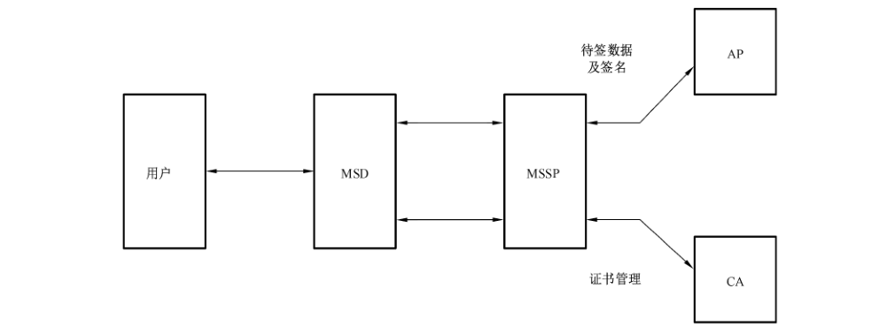
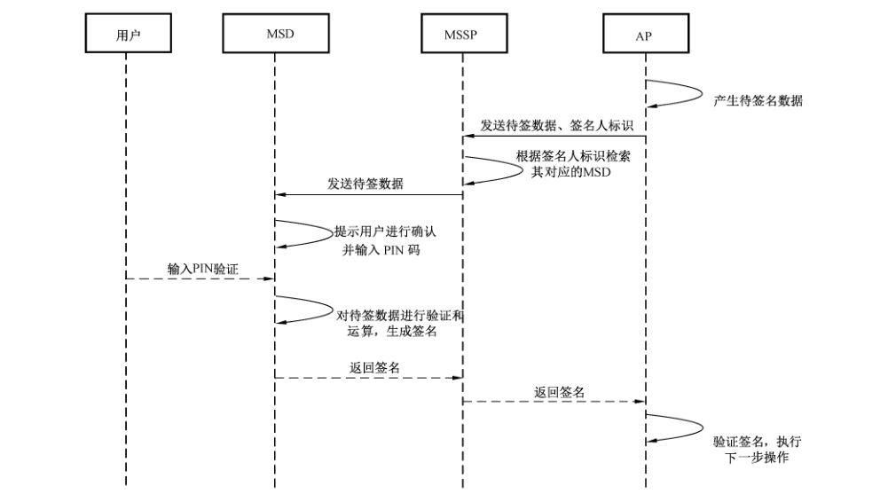
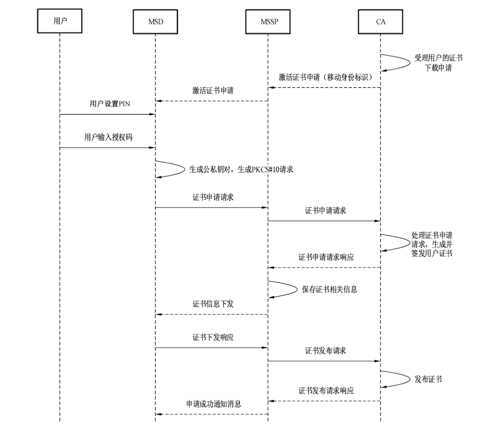
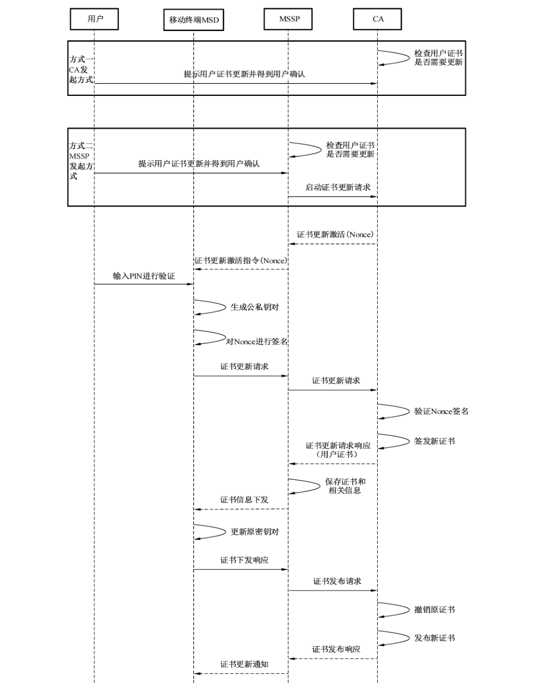
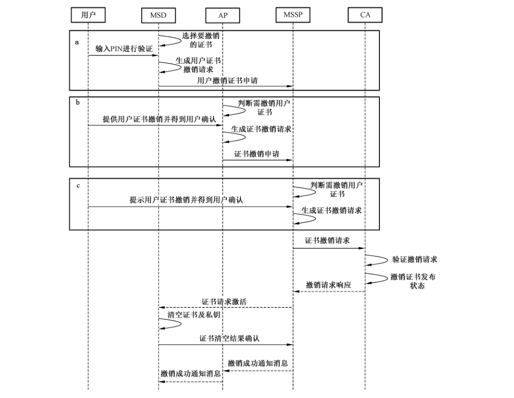

# GB/T 38646-2020 信息安全技术 移动签名服务技术要求

> 来源：[GB/T 38646-2020 国家标准详情](https://openstd.samr.gov.cn/bzgk/std/newGbInfo?hcno=846B1AE0ACFBA9B4F9C9E542235DCF24)；封面发布日期：2020-04-28；实施日期：2020-11-01。
> PDF SHA-256：5c22d1161a06934071f36fc969185e3f9569c45d0edf076d1f9c8f9fce983cb9。
> 转写说明：按页渲染官方 PDF 并对照全部原页校正文字和列表；保留图 1 至图 5，省略封面、目录、页眉、页脚和页码，合并跨页段落。正式引用请核对原 PDF。

## 前言

本标准按照 GB/T 1.1—2009给出的规则起草。

请注意本文件的某些内容可能涉及专利。本文件的发布机构不承担识别这些专利的责任。

本标准由全国信息安全标准化技术委员会（SAC/TC 260）提出并归口。

本标准起草单位：中国移动通信集团有限公司、中移（杭州）信息技术有限公司、中国信息通信研究院、北京数字认证股份有限公司、中国电信股份有限公司、工业和信息化部电子工业标准化研究院。

本标准主要起草人：于蓉蓉、张滨、杨志强、张锦卫、邱勤、樊山、杨超、路晓明、刘海龙、罗红、董靖宇、贾倩、鲁青、黄伟湘、林雪焰、杨正军、崇静、许东阳、于乐、蒋周良、安宝宇、马臣云、霍薇靖、蔡准。

## 1 范围

本标准规定了实现移动签名服务的技术要求，包括移动签名服务的基本框架、基本服务流程、参与移动签名服务的主要实体功能、接口功能及安全要求等。

本标准适用于移动签名服务的设备研制和平台开发。

## 2 规范性引用文件

下列文件对于本文件的应用是必不可少的。凡是注日期的引用文件，仅注日期的版本适用于本文件。凡是不注日期的引用文件，其最新版本（包括所有的修改单）适用于本文件。

- GB/T 19713 信息技术 安全技术 公钥基础设施 在线证书状态协议

- GB/T 20518 信息安全技术 公钥基础设施 数字证书格式

- GB/T 25064—2010 信息安全技术 公钥基础设施 电子签名格式规范

- GB/T 25065—2010 信息安全技术 公钥基础设施 签名生成应用程序的安全要求

- GM/T 0028—2014 密码模块安全要求

## 3 术语和定义

GB/T 25064—2010、GB/T 25065—2010界定的以及下列术语和定义适用于本文件。

### 3.1 应用提供者 application provider

为用户提供业务应用服务的实体。

### 3.2 移动设备 mobile device

可随身携带并能够随时接入移动通信网络的电子设备。

> 注：如手机、平板电脑、笔记本或其他专用设备。

### 3.3 移动签名 mobile signature

使用移动设备中的专用安全模块对数据进行电子签名的通用方法。

### 3.4 移动签名服务 mobile signature service

在移动设备上使用专用安全模块实现电子签名的服务。

### 3.5 移动签名服务平台 mobile signature service platform

向应用提供者和用户提供移动签名服务的功能实体。

### 3.6 移动签名设备 mobile signature device

移动设备中能够对电子签名完成处理的专用安全模块。

## 4 缩略语

下列缩略语适用于本文件。

AP：应用提供者（Application Provider）

APP：应用（Application）

CA：证书认证机构（Certification Authority）

MSD：移动签名设备（Mobile Signature Device）

MSSP：移动签名服务平台（Mobile Signature Service Platform）

PIN：个人身份识别码（Personal Identification Number）

## 5 概述

### 5.1 移动签名的基本特征

移动签名的核心流程在于，用户触发 AP将待签数据通过移动设备发送到 MSD 中，MSD 在用户输入 PIN 并确认后对待签数据完成签名，并将电子签名结果通过移动终端返回至 AP进行验证。

移动签名具有业务无关性，可作一种通用方法用于各种业务。MSD 作为一个通用设备，可存储用户的多个证书信息和私钥，通过某个业务首次使用电子签名时，只需到该业务所信任的CA 申请证书，并将证书信息及其对应的私钥存储到 MSD中，无需因使用不同的业务而持有多个电子签名硬件设备。

移动签名节约成本，无需安装客户端程序，降低用户操作复杂度，还可适用于多种业务，最大限度地发挥电子签名对电子交易的保护作用。

本标准凡涉及密码算法的相关内容，按国家有关法规实施；凡涉及采用密码技术解决保密性、完整性、真实性、不可否认性需求的遵循密码相关国家标准和行业标准。

### 5.2 移动签名服务的相关实体

移动签名的使用过程中共涉及五类实体：用户、MSD、AP、CA 和 MSSP，各实体的作用描述如下，相互基本关系如图1所示：

a） 用户，即移动签名人，是移动签名服务的使用者，用户在AP 的网站上选择商品或服务，并进行交易，用户需要对交易数据进行签名，代表自己对交易内容的认可。

b） MSD 是帮助用户随时随地实现移动签名的设备。

c） AP 是向用户提供业务的实体，AP需要验证用户的签名，通过验证的结果来判断当前交易是否是真实用户的行为，因此 AP 是验证者。

d） CA 作为电子认证服务机构，为用户签发数字证书，CA 应保证所签发证书的真实、可信。AP 在验证签名时应首先验证用户的数字证书的合法性，因此 AP 需信任 CA。

<ol type="a" start="5">
<li>

MSSP是提供移动签名服务的实体，介于用户与 AP、CA之间，主要实现如下两个功能：

<ol>
<li>

作为用户端与CA 的连接桥梁，协助CA实现对 MSD 中证书的生命周期管理，如申请、更新、撤销；
</li>
<li>

作为用户与AP的连接桥梁，实现 AP与用户之间待签数据与签名结果的传递，使AP的交易能够得到移动签名的保护。
</li>
</ol>
</li>
</ol>

图 1 移动签名服务的相关实体关系

## 6 移动签名服务的流程

### 6.1 移动签名基本流程

移动签名的基本实现流程如图2所示。

图 2 移动签名的基本流程

用户使用 AP 签名服务需提前完成数字证书的申请。

当用户使用移动签名服务，AP 发起一个移动签名流程：

a） AP产生待签数据；

b） AP 将待签数据及签名人标识发送给 MSSP；

c） MSSP 根据签名人标识检索对应的移动终端；

d） MSSP 将待签数据转发给移动终端；

e） 移动终端将待签数据传递到 MSD，MSD 对待签数据进行处理后，触发移动终端将待签信息展示给用户确认，并提示用户输入 PIN 进行验证；

f） 用户输入 PIN 验证；

g） 移动终端将 PIN 传递到 MSD，MSD 对 PIN 进行验证，验证成功后，MSD 对待签数据进行运算，生成对应该消息的电子签名；

h） MSD 通过移动终端将签名结果返回给 MSSP；

i） MSSP 将签名结果返回给 AP；

j） AP对签名进行验证，根据验证结果执行对应操作。

### 6.2 证书管理相关流程

#### 6.2.1 概述

用户在 MSSP 申请移动签名服务后，还需申请目标 AP所信任CA的证书，才能实现在该 AP上使用移动签名服务。MSSP应提供证书管理流程，以保证移动签名服务的连续性。证书管理相关流程至少应包括：

a） 证书申请与分发；

b） 证书更新；

c） 证书撤销。

本标准除下述流程外，其他证书管理流程或协议均按 GB/T 19713、GB/T 20518执行。

#### 6.2.2 证书申请与分发

CA 证书申请与分发需包含以下两个过程：

a） 身份审核预受理

身份审核预受理是指用户到 CA 的指定网点提出证书申请请求，CA 受理用户的请求，核实用户合法身份，并对证书的申请进行预受理。身份审核预受理过程应符合 CA 自身的安全要求，还应实现 MSD 与真实身份的绑定，并为用户颁发授权码，用于在后续证书申请和下载流程中认证用户。

b） 证书申请和下载

用户在完成身份审核预受理流程之后，即可进行证书申请/下载流程，如图 3 所示。

证书申请和下载的过程如下：

a） CA 接收到来自用户发起的证书下载申请，将授权码提供给用户；

b） CA向MSSP 发送激活证书申请；

c） MSSP 向 MSD 发送激活证书申请指令；

d） MSD 依次进行 PIN初始化设置，并输入授权码；

e） MSD 生成公私钥对，生成证书请求；

f） MSD 通过移动终端向 MSSP发起证书申请请求；

g） MSSP向 CA 发送证书申请请求；

h） CA处理证书申请请求，生成并签发用户证书；

i） CA向 MSSP返回证书申请请求响应，其中包含用户证书；

j） MSSP 解析证书，保存证书相关信息；

k） MSSP 向 MSD 发送证书信息下发指令，其中含有证书相关信息；

l） MSD 向 MSSP 发送证书下发响应；

m）MSSP 将证书发布请求发送至CA；

n）CA根据证书发布请求发布证书；

o） CA向MSSP返回证书发布请求响应；

p） MSSP 可向用户发送提示消息，例如明文短信，提示用户证书申请成功。

图 3 用户证书申请和下载流程

#### 6.2.3 证书更新

为增强用户体验，应支持 MSSP 侧发起的证书更新和CA侧发起的证书更新，服务器包括 MSSP和CA 两类，如图4所示。

图 4 证书更新流程

证书更新的具体过程如下：

<ol type="a" start="1">
<li>

相关方发起证书更新流程，证书更新流程具有两种发起方式：

<ol>
<li>

CA 发起方式

<ul>
<li>CA 根据预定策略判断用户是否需要更新证书；</li>
<li>CA 向用户下发证书更新提示并得到用户确认。</li>
</ul>
</li>
<li>

MSSP 发起方式

<ul>
<li>MSSP 根据预定策略判断用户是否需要更新证书；</li>
<li>MSSP 向用户下发证书更新提示并得到用户确认；</li>
<li>MSSP 向 CA 发送启动证书更新请求。</li>
</ul>
</li>
</ol>
</li>
</ol>

b） CA向MSSP发送证书申请激活消息，该消息包含一个随机数（Nonce）。

c） MSSP 向 MSD发送证书申请激活指令。

d） 用户输入 PIN进行验证。

e） MSD对PIN 验证通过后，生成新的公私钥对，并生成证书请求。

f） MSD 用原私钥对 Nonce 进行签名。

g） MSD 通过移动终端将证书更新请求发送给 MSSP。

h） MSSP 将证书请求、Nonce 签名发送至CA。

i） CA 验证 Nonce 签名，鉴别签名人身份。

j） CA 处理证书请求，签发新证书。

k）CA向MSSP返回新证书。

l） MSSP 解析证书，保存证书相关信息。

m）MSSP 下发证书信息给MSD。

n） MSD启用步骤e）生成的新的公私钥对，并删除原公私钥对。

o） MSD 发送证书下发响应给 MSSP。

p） MSSP 发送证书发布请求给 CA。

q） CA 撤销用户原证书。

r） CA发布用户新证书。

s） CA向MSSP发送证书发布请求响应。

t） MSSP发送证书更新成功消息，提示用户证书更新成功。

#### 6.2.4 证书撤销

移动签名应支持三种形式的撤销流程：

a） 用户主动发起撤销流程；

b） AP判断需撤销证书，发起撤销流程；

c） MSSP判断需撤销证书，发起撤销流程。

证书撤销流程如图5所示。

图 5 证书撤销流程

证书撤销的具体过程如下：

<ol type="a" start="1">
<li>

相关方发起证书撤销流程，包括三类撤销证书发起方式：

<ol>
<li>

用户主动撤销证书：

<ul>
<li>用户在 MSD 中选择需撤销的证书；</li>
<li>用户输入 PIN，MSD 对用户 PIN 进行验证；</li>
<li>MSD 验证 PIN 成功，生成用户证书撤销请求；</li>
<li>MSD 向 MSSP 发起用户证书撤销申请。</li>
</ul>
</li>
<li>

AP 发起撤销证书：

<ul>
<li>AP 根据预定策略判断用户是否需要撤销证书；</li>
<li>AP 提示用户撤销证书并得到用户确认；</li>
<li>AP 生成证书撤销请求；</li>
<li>AP 向 MSSP 发起用户证书撤销申请。</li>
</ul>
</li>
<li>

MSSP 发起撤销证书：

<ul>
<li>MSSP 根据预定策略判断用户是否需要撤销证书；</li>
<li>MSSP 提示用户下发证书撤销提示并得到用户确认；</li>
<li>MSSP 生成证书撤销请求。</li>
</ul>
</li>
</ol>
</li>
</ol>

b）MSSP 向CA 发起证书撤销请求。

c） CA 验证证书撤销请求。

d） CA 撤销用户证书，并发布状态。

e） CA向MSSP发送证书撤销请求响应。

f） MSSP向 MSD发送证书清空激活指令。

g） MSD 清空自身所存储的证书及私钥。

h） MSD向 MSSP发送证书清空结果确认。

i） MSSP 发送证书撤销成功的通知消息，提示用户证书撤销成功。

## 7 移动签名服务的实体功能

### 7.1 MSSP

MSSP 平台作为移动签名服务的核心业务平台，应具备如下功能：

a） 业务管理，支持用户在 MSSP 对移动签名服务进行申请/受理、暂停/恢复、注销等操作；

b） 允许多 AP接入，AP 可以在 MSSP 对移动签名进行申请/受理、暂停/恢复、注销等操作；

c） 允许多CA 接入，AP根据自己的需要选择所信任的CA，用户可选择不同的CA申请证书；

d） 签名事务管理，MSSP 应提供完善的签名事务管理机制，最大限度保证签名操作的完整性，对于用户无法完成签名操作的场景，需要明确提示 AP 和用户签名未完成；

e）证书生命周期管理，对于证书申请与分发、更新、撤销等管理流程，MSSP 应提供完整的差错管理机制，最大限度保证流程的完整性，对于证书操作无法完成的场景，需明确提示CA 和用户；

f） 安全管理，MSSP应提供相应的安全通信机制，以确保与移动终端、MSD、AP、CA 之间的通信安全；

g） 历史交易记录管理，MSSP应对移动签名、证书管理等操作进行历史交易记录管理，用户、AP、CA 可分别进行交易记录查询、统计等。

### 7.2 MSD

MSD 应具备以下功能：

a） 具备密码运算功能，MSD 能够实现签名/验签等功能；

b） 具备私钥安全存储功能，MSD 不提供私钥导出指令，提升存储的安全性；

c） 具备签名人鉴别功能，MSD 在启用私钥进行签名之前，应对签名人进行鉴别，如 PIN或生物识别方式，只有鉴别通过才能生成签名，若鉴别不通过，则拒绝生成签名；

d） 签名人 PIN 管理，MSD 应对签名人 PIN 提供安全管理机制，保证该数据不能被导出，也能防止穷举攻击。

### 7.3 用户

用户即为使用移动签名服务的使用者，具备业务申请/受理、业务暂停及恢复、业务注销、客户服务等功能。

### 7.4 CA

CA 作为电子认证服务的机构，为用户签发数字证书，保证所签发证书的真实、可信，并具备业务申请/受理、业务暂停及恢复、业务注销、业务查询、客户服务等功能。

### 7.5 AP

AP 为用户提供移动签名服务应用的实体，具有移动签名的应用场景，并可以实现移动签名的调用功能。同时应支持业务申请/受理、业务暂停及恢复、业务注销、业务查询、客户服务等功能。

## 8 移动签名服务的接口功能

### 8.1 MSSP 与 AP之间的接口

#### 8.1.1 签名请求

该接口用于 AP 向 MSSP 发起签名请求，其中应包含待签数据和签名人标识。

#### 8.1.2 签名结果推送

该接口用于 MSSP 向 AP 推送签名结果，其中包含用户签名结果。

#### 8.1.3 状态查询

该接口用于 AP 向 MSSP 查询某次签名交易的状态，MSSP 在查询当前交易的状态，并将结果返回。

### 8.2 MSSP 与 MSD之间的接口

#### 8.2.1 用户签名

该接口用于实现用户的签名操作，包含签名请求和签名响应两条消息：

a） 签名请求：MSSP 向 MSD 发送，其中包含待签数据；

b） 签名响应：MSD 通过移动终端向 MSSP 发送，其中包含签名结果或用户取消信息。

#### 8.2.2 证书申请与分发

该接口用于 MSD 通过 MSSP实现证书申请、分发、下载操作，包含证书申请激活指令、证书申请请求、证书信息下发、证书下发响应四条消息：

a） 证书申请激活指令：MSSP 向 MSD发送，用于激活授权码输入界面；

b）证书申请请求：MSD 向 MSSP 发送，其中包含 MSD 内生成的证书申请；

c） 证书信息下发：MSSP 向 MSD 发送，其中包含用户证书或根据证书解析出来的信息，供用户查看；

d） 证书下发响应：MSD 向 MSSP 发送，作为证书信息下发的响应，表示 MSD已正确处理证书信息。

#### 8.2.3 证书更新

该接口用于实现 MSD 内的证书更新操作，包含证书更新激活指令、证书更新请求、证书更新信息下发、证书下发响应四条消息：

a） 证书更新激活指令：MSSP 向 MSD 发送，用于激活 PIN 输入界面；

b） 证书更新请求：MSD 向 MSSP发送，其中包含 MSD 新生成的证书请求及认证信息；

c） 证书更新信息下发：MSSP 向 MSD发送，其中包含新的用户证书或用新证书解析出来的信息；

d） 证书下发响应：MSD 向 MSSP 发送，作为证书更新信息下发的响应，表示 MSD 已正确处理证书更新信息，可以启用新密钥对。

#### 8.2.4 证书撤销

该接口用于实现 MSD 内的证书撤销操作，包括用户证书撤销请求、证书清空激活指令、证书清空结果确认：

a） 用户证书撤销请求：MSD 向 MSSP 发送，表示用户要撤销当前证书；

b） 证书清空激活指令：MSSP 向 MSD 发送，用于激活 MSD 内部程序，清空当前证书及对应的私钥；

c） 证书清空结果确认：MSD 向 MSSP 发送，告知 MSSP当前证书及私钥清空完成。

### 8.3 MSSP 与CA之间的接口

#### 8.3.1 证书申请与分发

在证书申请与分发过程中，MSSP 与CA之间可能需要进行多次交互，包含如下消息：

a） 证书申请激活：CA向 MSSP 发送，表示CA 要激活某用户来申请证书，MSSP 在接到该指令后应向对应的 MSD 发送证书申请激活指令；

b） 证书申请请求：MSSP 向CA发送，表示当前用户要申请证书，其中包含由 MSD生成的证书申请文件；

c） 证书申请请求响应：CA给 MSSP 的响应，其中包含用户证书或错误信息；

d） 证书发布请求：MSSP向CA发送，表示用户证书已下载完成，CA 可发布当前用户证书；

e） 证书发布请求响应：CA给 MSSP的响应，表示发布成功或失败。

#### 8.3.2 证书更新

在证书更新过程中，MSSP 与CA之间可能需要进行多次交互，包含如下消息：

a） 启动证书更新请求：MSSP 向CA发送，请求CA启动证书更新流程；

b） 证书更新激活：CA 向 MSSP 发送，表示CA要激活某用户关于本CA的证书更新流程，MSSP接到该指令后应向对应的 MSD发送证书更新激活指令；

c） 证书更新请求：MSSP 向CA发送，表示当前用户要更新证书，其中包含由MSD获得的证书请求及认证信息；

d） 证书更新请求响应：CA给 MSSP的响应，其中包含用户的新证书或错误信息。

#### 8.3.3 证书撤销

在证书撤销过程中，MSSP 与CA 间包含如下消息：

a） 证书撤销请求：MSSP 向CA发送，表示需撤销某证书，其中包含待撤销证书的序列号；

b） 证书撤销请求响应：CA 向 MSSP 发送，表示撤销成功或失败。

## 9 移动签名服务的安全要求

### 9.1 概述

移动签名服务的安全应包括移动签名服务实体、移动签名服务流程和移动签名服务审计等方面的安全。

### 9.2 实体安全

移动签名服务的实体 MSSP 和 MSD 应满足GM/T 0028—2014，同时 MSSP、MSD、CA、AP 应满足如下安全要求：

a） MSSP：应采用防火墙、病毒防治、漏洞扫描、数据备份、容灾备份等安全防护措施，保障网络、主机系统、应用系统及数据库运行的安全；

b） MSD：应采用严格的接口规范、安全的协议、密码算法和密钥管控等措施，保障接口安全、协议安全、密钥安全和物理安全；

c） 用户：应采用用户身份鉴别等手段，判断用户的合法性，保障用户安全；

d） CA：应采用严格的密钥分发、证书管理等手段，保障证书安全；

e） AP：应采用远程保护、加密存储、应用加固等措施，保障应用安全。

### 9.3 移动签名服务流程安全

移动签名实现的过程中应满足以下安全要求：

a） MSSP：应提供从 AP 接入网络到使用 MSD 的安全防护，采用双向安全认证技术，由 MSSP 对 AP 及 MSD 进行认证，确保请求消息来源的合法性。应使用加密机等专用安全设备进行密钥管理，涉及的数据加/解密逻辑均由专用安全设备实现。应提供完整的 MSD 生命周期管理，从注册、激活、使用、废止等各个环节进行管理。应提供远程数据销毁，当 MSD 丢失或者被盗时，可以对远程数据进行擦除。

b） MSD：应实现对签名人的鉴别，即在生成电子签名之前，应对电子签名人的身份进行鉴别，如要求签名人输入个人身份识别码、生物特征信息等，并在MSD 内部进行验证，验证通过后方可生成签名；应实现“所见即所签”。密钥在 MSD 中存储，所有加解密及签名运算均在MSD 中进行。

c） MSSP 与 MSD之间：应具备双向认证和完整性保护机制，保证 MSD 只能接受来自 MSSP的指令，可选具备机密性保护机制。通过同步机制保持 MSD 和MSSP 之间的同步状态，并防止重传攻击对 MSSP 的安全风险。

d） MSSP 与 APP、CA之间：应具备双向认证机制和完整性保护机制，可选实现机密性保护机制。

e） APP与 MSD之间：可选实现从 APP到MSD的端到端机密性保护机制，保证只有签名人才能看到待签数据。

f） 移动签名服务所使用的密码技术应符合国家密码技术相关政策及规范。

g） 移动签名服务的审计安全。

需提供事件级审计功能，提供移动签名流程中各个实体间交互日志，对涉及移动签名服务安全的行为、人员、时间的记录进行跟踪、统计和分析。

## 参考文献

[1] GB/T 25056 信息安全技术 证书认证系统密码及其相关安全技术规范

[2] GM/T 0014—2012 数字证书认证系统密码协议规范

[3] GM/T 0028—2014 密码模块安全技术要求

[4] GM/T 0029—2014 签名验签服务器技术规范

[5] ETSI TR 102 203 v1.1.1 Mobile Commerce (M-COMM); Mobile Signatures; Business and Functional Requirements

[6] ETSI TS 102 204 v1.1.4 Mobile Commerce (M-COMM); Mobile Signature Service; Web Service Interface

[7] ETSI TR 102 206 v1.1.3 Mobile Commerce (M-COMM); Mobile Signature Service; Security Framework

[8] ETSI TS 102 207 v1.1.3 Mobile Commerce (M-COMM); Mobile Signature Service; Specification for Roaming in Mobile Signature Services
