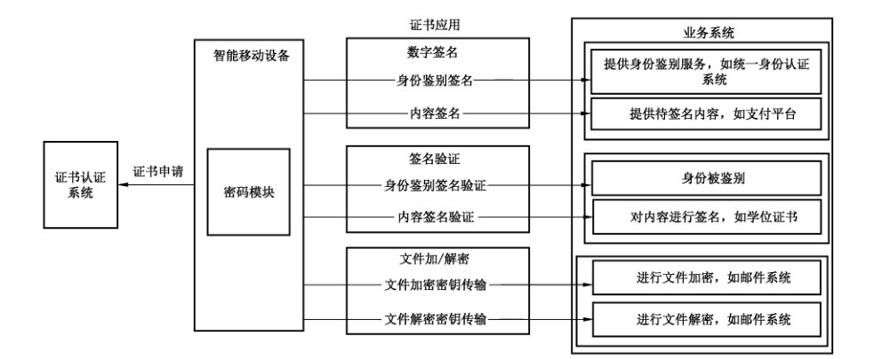
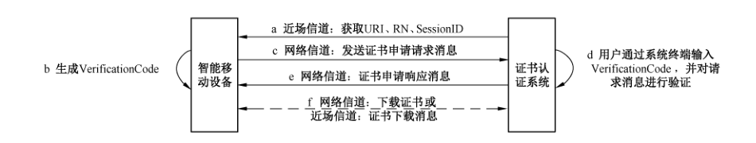
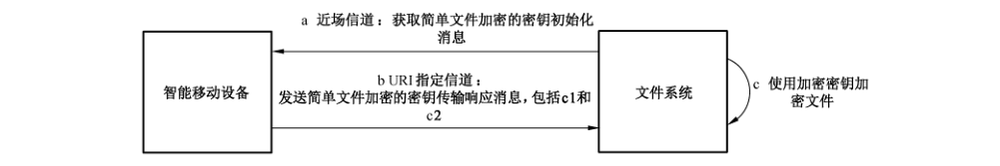
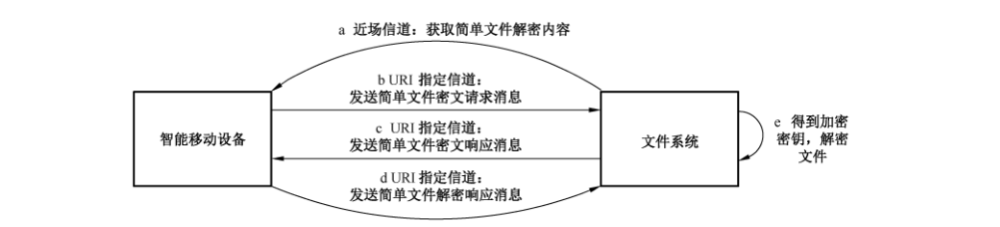

# GB/T 40018-2021 信息安全技术 基于多信道的证书申请和应用协议

> 来源：[GB/T 40018-2021 国家标准详情](https://openstd.samr.gov.cn/bzgk/std/newGbInfo?hcno=BE06BC25AF2EC422E3858B8555E56DAF)；封面发布日期：2021-04-30；实施日期：2021-11-01。
> PDF SHA-256：169619fd6a570072d833365a2e19f795159581ddd770d1aa6b3e90c4c6f23ea1。
> 转写说明：按页渲染官方 PDF 并对照全部 22 页校正文字、ASN.1 结构、表 1 和图 1 至图 8；省略封面、目录、页眉、页脚和页码，合并跨页段落。正式引用请核对原 PDF。

## 前言

本标准按照 GB/T 1.1—2009给出的规则起草。

请注意本文件的某些内容可能涉及专利。本文件的发布机构不承担识别这些专利的责任。

本标准由全国信息安全标准化技术委员会（SAC/TC 260）提出并归口。

本标准起草单位：中国科学院数据与通信保护研究教育中心、中国科学院大学、浙江蚂蚁小微金融服务集团股份有限公司、北京信安世纪科技股份有限公司、联想（北京）有限公司、国民认证科技（北京）有限公司、数安时代科技股份有限公司、上海市数字证书认证中心有限公司、北京数字认证股份有限公司。

本标准主要起草人：牛莹姣、荆继武、高能、陈星、刘丽敏、汪宗斌、贾世杰、雷灵光、杨楠、郑昉昱、马原、王平建、吕娜、钱文飞、张永强、王天华、林雪焰。

## 引言

本标准从信息安全角度提出了基于多信道的证书申请和应用协议，多信道包括近场信道和网络信道。近场信道指智能移动设备和证书认证系统终端或业务系统终端近距离连接的信道，如人工信道、光学信道、NFC等。网络信道指证书认证系统或业务系统通过网络连接智能移动设备的信道。近场信道的特征是带宽小，不能进行大量数据传输，数据以明文形式传递，但是通过该信道发送和接收的数据较不易被窃听，且能通过面对面的方式进行通信双方身份的鉴别。本标准通过引入近场信道协同网络信道完成证书申请和应用能更加有效地抵御信道窃听、数据篡改、终端假冒等攻击。

## 1 范围

本标准规定了利用智能移动设备进行证书申请和应用协议，包括证书申请协议、数字签名与验签协议、文件加解密协议。

本标准适用于多信道环境中应用系统的设计、开发、测试。

## 2 规范性引用文件

下列文件对于本文件的应用是必不可少的。凡是注日期的引用文件，仅注日期的版本适用于本文件。凡是不注日期的引用文件，其最新版本（包括所有的修改单）适用于本文件。

- GB/T 25069—2010 信息安全技术 术语
- GB/T 37092—2018 信息安全技术 密码模块安全要求
- GM/T 0014—2012 数字证书认证系统密码协议规范

## 3 术语、定义和缩略语

### 3.1 术语和定义

GB/T 25069—2010界定的以及下列术语和定义适用于本文件。

#### 3.1.1 近场信道 near field channel

智能移动设备和证书认证系统终端或业务系统终端近距离连接的信道。

> 示例：人工信道、光学信道、NFC等。

#### 3.1.2 网络信道 network channel

证书认证系统或业务系统通过网络连接智能移动设备的信道。

#### 3.1.3 厂商ID vendor ID

应用服务器分配给智能移动设备开发厂商、表明智能移动设备开发厂商身份的唯一标识。

#### 3.1.4 厂商私钥 vendor private key

智能移动设备开发厂商在智能移动设备中预先植入的用于证明厂商是否可信的密钥对中的私钥。

#### 3.1.5 厂商公钥 vendor public key

智能移动设备开发厂商在智能移动设备中预先植入的用于证明厂商是否可信的密钥对中的公钥。

### 3.2 缩略语

下列缩略语适用于本文件。

DER：可辨别编码规则（Distinguished Encoding Rules）  
ID：标识（Identification）  
NFC：近场通信（Near Field Communication）  
RN：随机数（Random Number）  
URI：统一资源标识符（Universal Resource Identifier）

## 4 总则

安装有密码模块（软件或硬件）的智能移动设备，可以代理申请人向证书认证系统申请证书，与业务系统协作使用证书实现签名、验签、文件加/解密等功能。本标准描述的智能移动设备应具有独立联网能力且具备二维码扫描、NFC 或蓝牙等功能。安装的密码模块应符合 GB/T 37092—2018 的要求，且通过主管部门的核准，提供密钥管理和密码运算功能。基于多信道的证书申请和应用协议框架见图 1。

协议中定义二维码格式为：TAG://CONTENT，其中 TAG 表示协议的类型，CONTENT 表示二维码中要携带的信息，CONTENT 中内容采用 DER 编码，并使用 BASE64 编码转变成可打印字符串。

其余通信内容均采用 DER 进行编码。关于协议中定义的二维码格式与通用二维码格式的兼容性分析参见附录 A。

协议中使用了 ASN.1 定义的数据类型，如表 1 所示。

**表1 数据类型描述**

| 数据类型 | 描述 |
| --- | --- |
| PrintableString | 可打印字符串 |
| OCTET STRING | 字节串 |
| INTEGER | 整数 |
| BIT STRING | 比特串（由0和1组成） |
| BOOLEAN | 布尔型，取值为“TRUE”或“FALSE” |
| SEQUENCE | 1个或多个字段组成的有序序列 |

## 5 基于多信道的证书申请协议

本协议规定了智能移动设备利用近场信道协同网络信道向证书认证系统申请证书的过程，协议开始之前申请人应在可信证书认证系统的用户注册管理系统完成身份审核，并提醒申请人使用智能移动设备获取证书认证系统通信地址后开始协议第一步，申请人对证书认证系统的鉴别不在本标准范围内，协议流程见图 2。

> 注：图中虚线表示可选或依赖于上下文关系的消息。

基于多信道的证书申请协议流程如下：

a）智能移动设备通过近场信道获取证书认证系统生成的证书申请登记报文，其数据结构如下：

~~~asn1
ApplyCertificateRegistration ::= SEQUENCE {
    tag             PrintableString,
    uri             UTF8String(Size(1..MAX)),
    rn              OCTET STRING,
    sessionID       OCTET STRING
}
~~~

证书申请登记报文各个域的含义如下：

- tag 域值为 CERT，表示协议类型为证书申请；
- uri 域是证书认证系统的网络信道通信地址；
- rn 域为随机数；
- sessionID 域为本次证书申请过程的会话 ID。

b）智能移动设备生成随机验证码 VerificationCode，应至少 8 个字节。

c）智能移动设备通过网络信道向登记报文中的 URI 发送证书申请请求消息，其数据结构如下：

~~~asn1
ApplyCertificateRequest ::= SEQUENCE {
    version                     Version,
    rn                          OCTET STRING,
    sessionID                   OCTET STRING,
    deviceID                    UTF8String(Size(1..MAX)),
    deviceName                  UTF8String(Size(1..MAX)),
    pubKey                      SubjectPublicKeyInfo,
    signatureOfNegotiatingData  Signature,
    vendorID                    UTF8String(Size(1..MAX)) OPTIONAL,
    vendorSignature             Signature OPTIONAL
}
~~~

证书申请请求消息中各个域的含义如下：

- version 域为请求消息的版本，其结构如下：

~~~asn1
Version ::= INTEGER { v1(0) };
~~~

- rn 域为智能移动设备获得的 RN；
- sessionID 域为本次证书申请过程的会话 ID；
- deviceID 域为智能移动设备 ID；
- deviceName 域为智能移动设备名称；
- pubKey 域为智能移动设备上密码模块中申请人的签名公钥和相应的公钥算法，其数据结构如下：

~~~asn1
SubjectPublicKeyInfo ::= SEQUENCE {
    algorithm         AlgorithmIdentifier,
    subjectPublicKey  BIT STRING
}
~~~

其中，公钥算法使用算法标识符 AlgorithmIdentifier 结构来表示。

- signatureOfNegotiatingData 域为智能移动设备上密码模块中申请人签名私钥对 NegotiatingData 的签名及使用的签名算法，其中 tag 值为 CERT，其数据结构如下：

~~~asn1
Signature ::= SEQUENCE {
    signatureAlgorithm  AlgorithmIdentifier,
    signature           BIT STRING
}
~~~

其中，signature 域为申请人签名私钥对 NegotiatingData 的 DER 编码签名的结果。NegotiatingData 数据结构如下：

~~~asn1
NegotiatingData ::= SEQUENCE {
    tag               PrintableString,
    uri               UTF8String(Size(1..MAX)),
    rn                OCTET STRING,
    sessionID         OCTET STRING,
    verificationCode  UTF8String(Size(1..MAX)),
    deviceID          UTF8String(Size(1..MAX))
}
~~~

- vendorID 域为厂商 ID，可选；
- vendorSignature 域为厂商私钥对 RN 的签名，可选。

d）证书认证系统接收到智能移动设备的请求消息后，要求申请人通过证书认证系统终端输入 b）中所生成的 VerificationCode。然后对智能移动设备的证书申请请求消息进行验证，包括：

- 验证 RN、SessionID 是否有效，使用申请人签名公钥验证签名是否正确；
- 厂商 ID 是否在可信厂商列表中（可选）；
- 厂商私钥对 RN 的签名是否有效（可选）。

e）证书认证系统通过网络信道向智能移动设备回复证书申请响应消息，其数据结构如下：

~~~asn1
ApplyCertificateResponse ::= SEQUENCE {
    status    BOOLEAN,
    response  ApplyCertificateResponseType OPTIONAL
}
~~~

证书申请响应消息中各个域的含义如下：

- status 域为证书申请处理结果，true 表示申请成功，false 表示申请失败；
- response 域为证书下载地址或证书，其数据结构如下：

~~~asn1
ApplyCertificateResponseType ::= CHOICE {
    uri       [0] UTF8String(Size(1..MAX)),
    fullCert  [1] SEQUENCE SIZE (1..MAX) OF Certificate
}
~~~

f）按照 GM/T 0014—2012 的要求下载证书，也可通过近场信道获取证书下载消息，其数据结构如下：

~~~asn1
CertificateDownloadInfo ::= SEQUENCE {
    tag  PrintableString,
    uri  UTF8String(Size(1..MAX))
}
~~~

证书下载消息中各个域的含义如下：

- tag 域为 CERTDOWN；
- uri 域为证书下载服务的地址。

基于二维码的证书申请协议示例参见附录 B。

## 6 基于多信道的数字签名与验签协议

### 6.1 数字签名

#### 6.1.1 用于身份鉴别的数字签名协议

本协议规定了利用智能移动设备的密码模块进行签名完成身份鉴别的过程，用户对业务系统的鉴别不在本标准范围内，协议流程见图 3。

用于身份鉴别的数字签名协议流程如下：

a）智能移动设备通过近场信道获取身份鉴别初始化报文，包括提供身份鉴别服务业务系统的 URI、RN、SessionID、业务系统描述和扩展字段等，其数据结构如下：

~~~asn1
AuthenticationInitialization ::= SEQUENCE {
    tag                PrintableString,
    uri                UTF8String(Size(1..MAX)),
    rn                 OCTET STRING,
    sessionID          OCTET STRING,
    systemDescription  PrintableString,
    extension          PrintableString OPTIONAL
}
~~~

身份鉴别初始化报文中各个域的含义如下：

- tag 域值为 AUTH，表示协议类型为身份鉴别；
- uri 域为提供身份鉴别服务业务系统的通信地址；
- rn 域为随机数；
- sessionID 域为本次身份鉴别过程的会话 ID；
- systemDescription 域为提供身份鉴别服务业务系统的描述；
- extension 域为扩展字段（可选）。

b）智能移动设备显示 a）中获取到的 URI 及系统描述信息，用户在智能移动设备端确认后，通过 URI 指定信道向业务系统发送身份鉴别请求消息，其数据结构如下：

~~~asn1
AuthenticationRequest ::= SEQUENCE {
    version         Version,
    rn              OCTET STRING,
    sessionID       OCTET STRING,
    pubKey          PublicKeyForm,
    signatureOfTUC  Signature
}
~~~

身份鉴别请求消息中各个域的含义如下：

- version 域表示请求消息的版本；
- rn 域表示智能移动设备获得的随机数 RN；
- sessionID 域表示智能移动设备获得的会话 ID；
- pubKey 域表示智能移动设备用户的公钥信息或证书信息。如果发送内容为公钥信息，则协议开始之前用户已在业务系统注册公钥等信息，其数据结构如下：

~~~asn1
PublicKeyForm ::= CHOICE {
    pubKeyInfo  [0] SubjectPublicKeyInfo,
    certificate [1] CertificateType
}
CertificateType ::= CHOICE {
    uri       [0] UTF8String(Size(1..MAX)),
    fullCert  [1] SEQUENCE SIZE (1..MAX) OF Certificate
}
~~~

- signatureOfTUC 域表示智能移动设备用户签名私钥对 TUC 的 DER 编码的签名，其中 tag 的值为 AUTH，TUC 数据结构如下：

~~~asn1
TUC ::= SEQUENCE {
    tag      PrintableString,
    uri      UTF8String(Size(1..MAX)),
    content  Content
}
Content ::= SEQUENCE {
    rn         OCTET STRING,
    sessionID  OCTET STRING
}
~~~

c）业务系统接收到智能移动设备的身份鉴别请求消息后，验证 SessionID 是否有效。如果有效，对请求消息进行验证，验证 RN、公钥以及对 TUC 的签名是否有效。

该协议的典型应用场景参见附录 C 中的 C.2。

#### 6.1.2 信息内容数字签名协议

本协议规定了利用智能移动设备的密码模块完成信息内容数字签名的过程，协议流程见图 4。

信息内容数字签名协议流程如下：

a）智能移动设备通过近场信道获取内容签名请求消息，包括业务系统的访问地址 URI 及访问令牌信息 AccessCode，其数据结构如下：

~~~asn1
ContentSignatureRequest ::= SEQUENCE {
    tag         PrintableString,
    uri         UTF8String(Size(1..MAX)),
    accessCode  OCTET STRING
}
~~~

内容签名请求消息中各个域的含义如下：

- tag 域值为 SIGN，表示协议类型为内容签名；
- uri 域为签名内容提供方提供的用户获取待签名数据以及上传签名信息的地址；
- accessCode 域为访问令牌信息。

b）智能移动设备通过 URI 指定信道向该 URI 发送请求消息，获取待签名内容，其数据结构如下：

~~~asn1
GetContentRequest ::= SEQUENCE {
    version     Version,
    accessCode  OCTET STRING
}
~~~

待签名内容获取消息中各个域的含义如下：

- version 域表示请求消息的版本；
- accessCode 域表示智能移动设备获得的访问令牌信息 AccessCode。

c）业务系统通过 URI 指定信道向智能移动设备发送待签名内容，其数据结构如下：

~~~asn1
TobeSignedContent ::= SEQUENCE {
    status    INTEGER,
    response  PrintableString
}
~~~

上述响应消息中各个域的含义如下：

- status 域表示业务系统对请求消息的处理结果；
- response 域表示响应消息体：如果请求消息处理成功，则为待签名内容；如果失败，则为失败原因。

d）智能移动设备显示签名内容，提示用户确认是否进行数字签名，用户确认后通过 URI 指定信道发送内容签名结果消息，其数据结构如下：

~~~asn1
ContentSignature ::= SEQUENCE {
    type            BOOLEAN,
    signatureOfTUC  Signature OPTIONAL
}
~~~

内容签名结果消息中各个域的含义如下：

- type 域为用户是否对内容签名：true 表示用户确认进行签名，false 表示用户取消签名；
- signatureOfTUC 域为智能移动设备上用户签名私钥对 TUC 的 DER 编码的签名，其中 tag 的值为 SIGN，TUC 数据结构如下：

~~~asn1
TUC ::= SEQUENCE {
    tag      PrintableString,
    uri      UTF8String(Size(1..MAX)),
    content  Content
}
Content ::= SEQUENCE {
    response  PrintableString
}
~~~

该协议的典型应用场景参见 C.3。

### 6.2 签名验证

#### 6.2.1 用于身份鉴别的数字签名验证协议

本协议规定了利用智能移动设备的密码模块进行签名验证，完成对目标系统或实体进行身份鉴别的过程，协议流程见图 5。

用于身份鉴别的数字签名验证协议流程如下：

a）智能移动设备通过近场信道获取用于身份鉴别的签名验证初始化消息，包括被鉴别方的 URI 及其访问令牌信息 AccessCode，其数据结构如下：

~~~asn1
VerifyAuthenticationSignature ::= SEQUENCE {
    tag         PrintableString,
    uri         UTF8String(Size(1..MAX)),
    accessCode  OCTET STRING
}
~~~

用于身份鉴别的签名验证初始化消息中各个域的含义如下：

- tag 域值为 AVERIFY，表示协议类型为用于身份鉴别的签名验证；
- uri 域为被鉴别方的通信地址；
- accessCode 域为访问令牌信息。

b）智能移动设备生成 RN，并通过 URI 指定的信道发送身份鉴别请求消息，其数据结构如下：

~~~asn1
VerifyRequest ::= SEQUENCE {
    version     Version,
    rn          OCTET STRING,
    accessCode  OCTET STRING,
    deviceID    UTF8String(Size(1..MAX))
}
~~~

身份鉴别请求消息中各个域的含义如下：

- version 域为鉴别消息的版本；
- rn 域为智能移动设备生成的 RN；
- accessCode 域为智能移动设备获得的访问令牌信息 AccessCode；
- deviceID 域为智能移动设备 ID。

c）被鉴别方接收到身份鉴别请求消息，验证其中的访问令牌信息 AccessCode 是否合法，并通过 URI 指定信道向智能移动设备回复身份鉴别响应消息，其数据结构如下：

~~~asn1
VerifyResponse ::= SEQUENCE {
    status       INTEGER,
    response     ResponseInformation,
    certificate  CertificateType OPTIONAL
}
~~~

身份鉴别响应消息中各个域的含义如下：

- status 域表示对请求消息的处理结果；
- response 域表示响应消息体：如果对请求消息处理失败，则为失败原因；如果成功，则为业务系统签名私钥对 RD 的 DER 编码的签名，其数据结构如下：

~~~asn1
ResponseInformation ::= CHOICE {
    failReason     [0] BIT STRING,
    signatureOfRD  [1] Signature
}
RD ::= SEQUENCE {
    rn        OCTET STRING,
    deviceID  UTF8String(Size(1..MAX))
}
~~~

- certificate 域为证书下载地址或业务系统证书，其数据结构如下：

~~~asn1
CertificateType ::= CHOICE {
    uri       [0] UTF8String(Size(1..MAX)),
    fullCert  [1] SEQUENCE SIZE (1..MAX) OF Certificate
}
~~~

d）智能移动设备接收到身份鉴别响应消息，提取证书或者通过 URI 下载证书，解析证书中的主体和公钥信息，用公钥验证业务系统对 RN 和 deviceID 的签名是否有效，并将验证结果显示给用户。

#### 6.2.2 信息内容数字签名验证协议

本协议规定了利用智能移动设备的密码模块完成信息内容数字签名验证的过程，协议流程见图 6。

信息内容数字签名验证协议流程如下：

a）智能移动设备通过近场信道获取内容签名验证初始化消息，包括业务系统访问地址 URI 以及访问令牌信息 AccessCode，其数据结构如下：

~~~asn1
VerifyContentSignature ::= SEQUENCE {
    tag         PrintableString,
    uri         UTF8String(Size(1..MAX)),
    accessCode  OCTET STRING
}
~~~

内容签名验证请求消息中各个域的含义如下：

- tag 域值为 CVERIFY，表示协议类型为内容签名验证；
- uri 域为业务系统的通信地址；
- accessCode 域为访问令牌信息。

b）智能移动设备通过 URI 指定信道发送内容签名验证请求消息，其数据结构如下：

~~~asn1
VerifyContentSignatureRequest ::= SEQUENCE {
    version     Version,
    accessCode  OCTET STRING
}
~~~

内容签名验证请求消息中各个域的含义如下：

- version 域为内容签名验证请求的版本；
- accessCode 域为智能移动设备获得的访问令牌信息 AccessCode。

c）URI 所在业务系统接收到内容签名验证请求消息后，验证其中的访问令牌信息 accessCode 是否合法，并通过 URI 指定信道向智能移动设备回复内容签名验证响应消息，其数据结构如下：

~~~asn1
VerifyContentSignatureResponse ::= SEQUENCE {
    message             UTF8String,
    signatureOfMessage  Signature,
    certificate         CertificateType
}
~~~

内容签名验证响应消息中各个域的含义如下：

- message 域表示被签名的数据；
- signatureOfMessage 域表示签名信息；
- certificate 域为证书下载地址或业务系统证书，其数据结构如下：

~~~asn1
CertificateType ::= CHOICE {
    uri       [0] UTF8String(Size(1..MAX)),
    fullCert  [1] SEQUENCE SIZE (1..MAX) OF Certificate
}
~~~

d）智能移动设备接收到内容签名验证响应消息后，从消息中提取证书或者通过 URI 下载证书，解析证书中的主体和公钥信息，验证签名信息是否为证书主体对 message 的签名，并将验证结果展示给用户。

该协议的典型应用场景参见 C.4。

## 7 基于多信道的文件加解密协议

### 7.1 文件加密密钥传输协议

本协议规定了利用智能移动设备的密码模块为文件系统提供密钥进行文件加密的过程，协议流程见图 7。

文件加密密钥传输协议流程如下：

a）智能移动设备通过近场信道获取文件加密的密钥初始化消息，包括文件系统访问地址 URI 及通信密钥 CommunicationKey，其数据结构如下：

~~~asn1
EncryptionRequest ::= SEQUENCE {
    tag               PrintableString,
    uri               UTF8String(Size(1..MAX)),
    communicationKey  KeyType
}
~~~

文件加密的密钥初始化消息中各个域的含义如下：

- tag 域值为 ENCRYPT，表示协议类型为文件加密；
- uri 域为数据文件系统的通信地址；
- communicationKey 域为用来保护通信内容的通信密钥，其数据结构如下：

~~~asn1
KeyType ::= CHOICE {
    accessKey  [0] OCTET STRING,
    pubKey     [1] SubjectPublicKeyInfo
}
~~~

b）智能移动设备产生随机数作为内容加密密钥 ContentKey，分别使用通信密钥 CommunicationKey 和文件接收者公钥加密内容加密密钥 ContentKey，得到密文 c1 和密文 c2，并通过 URI 指定信道向文件系统发送文件加密的密钥传输响应消息，其数据结构如下：

~~~asn1
EncryptionResponse ::= SEQUENCE {
    version  Version,
    c1       BIT STRING,
    c2       BIT STRING
}
~~~

文件加密的密钥传输响应消息中各个域的含义如下：

- version 域为文件加密响应消息的版本；
- c1 域为智能移动设备获得的通信密钥 CommunicationKey 对内容加密密钥 ContentKey 的加密结果；
- c2 域为智能移动设备使用文件接收者公钥对内容加密密钥 ContentKey 的加密结果。

c）文件系统接收到文件加密的密钥传输响应消息后解密密文 c1 得到内容加密密钥 ContentKey，并利用 ContentKey 加密文件，同时将 c2 与加密后的文件一起保存。

该协议的典型应用场景参见 C.5。

### 7.2 文件解密密钥传输协议

本协议规定了利用智能移动设备的密码模块为文件系统提供密钥进行文件解密的过程，协议流程见图 8。

文件解密密钥传输协议流程如下：

a）智能移动设备通过近场信道获取文件解密内容，包括文件系统访问地址 URI 及通信密钥 CommunicationKey，其数据结构如下：

~~~asn1
DecryptionCipherContent ::= SEQUENCE {
    tag               PrintableString,
    uri               UTF8String(Size(1..MAX)),
    communicationKey  KeyType
}
~~~

文件解密内容中各个域的含义如下：

- tag 域值为 DECRYPT，表示协议类型为文件解密；
- uri 域为数据文件系统的通信地址；
- communicationKey 域为用来保护通信内容的通信密钥，其数据结构如下：

~~~asn1
KeyType ::= CHOICE {
    accessKey  [0] OCTET STRING,
    pubKey     [1] SubjectPublicKeyInfo
}
~~~

b）智能移动设备通过 URI 指定信道向文件系统发送文件解密的密钥传输请求消息，其数据结构如下：

~~~asn1
DecryptionCipherRequest ::= SEQUENCE {
    version  Version
}
~~~

文件解密的密钥传输请求消息中 version 域为消息的版本号。

c）文件系统接收到文件解密的密钥传输请求消息后，通过 URI 指定信道向智能移动设备发送文件解密的密钥传输响应消息，主要包括用户公钥对内容加密密钥 ContentKey 的加密密文 c2 信息，其数据结构如下：

~~~asn1
DecryptionCipherResponse ::= SEQUENCE {
    c2  BIT STRING
}
~~~

文件密文的密钥传输响应消息中 c2 域表示用户公钥对内容加密密钥 ContentKey 的加密密文。

d）智能移动设备接收到文件解密的密钥传输响应消息，使用用户公钥对应的私钥解密 c2，得到内容加密密钥 ContentKey，并使用通信密钥 CommunicationKey 加密 ContentKey 得到密文 c1。智能移动设备通过 URI 指定信道向文件系统发送文件解密的密钥传输回复消息，其数据结构如下：

~~~asn1
DecryptionCipherReply ::= SEQUENCE {
    c1  BIT STRING
}
~~~

文件解密的密钥传输回复消息中 c1 域为通信密钥 CommunicationKey 对内容加密密钥 ContentKey 的加密结果。

e）文件系统接收到文件解密的密钥传输回复消息后，解密 c1 得到内容加密密钥 ContentKey，并使用 ContentKey 解密文件密文，得到文件明文。

该协议的典型应用场景参见 C.6。

## 附录 A（资料性附录）兼容性分析

### A.1 用途

本附录主要分析本标准定义协议与现有应用协议的兼容性。

### A.2 兼容性分析

目前二维码携带的信息通常为一个 URI，URI 的格式为：`[scheme:][//authority][path][?query]`，可以通过 scheme 来区分不同用途的二维码。本标准中二维码的内容也采用了 URI 格式，使用 TAG 作为 scheme 区分不同的应用场景，具体为：

- TAG 为 CERT，按照第 5 章协议进行证书申请；
- TAG 为 AUTH，按照 6.1.1 协议进行身份鉴别；
- TAG 为 SIGN，按照 6.1.2 协议进行信息内容数字签名；
- TAG 为 AVERIFY，按照 6.2.1 协议进行身份鉴别的数字签名验证；
- TAG 为 CVERIFY，按照 6.2.2 协议进行信息内容数字签名验证；
- TAG 为 ENCRYPT，按照 7.1 协议进行文件加密；
- TAG 为 DECRYPT，按照 7.2 协议进行文件解密。

## 附录 B（资料性附录）采用二维码的证书申请协议

### B.1 用途

本附录给出了证书申请中的一种模式，即近场信道基于二维码的证书申请示例。应用场景为通过手机向证书认证系统申请证书。

### B.2 采用二维码的证书申请协议

采用二维码进行证书申请的具体流程如下：

a）证书认证系统生成证书申请登记报文 ApplyCertificateRegistration 对应的二维码：首先对 ApplyCertificateRegistration 结构体进行 DER 编码，然后将编码结果通过 BASE64 转换成可打印的字符串 CONTENT，然后加前缀 CERT://，系统生成二维码；

b）手机通过扫码获取 CERT://CONTENT，并解析 CONTENT 获取证书认证系统生成的证书申请登记报文 ApplyCertificateRegistration；

c）手机生成随机验证码 VerificationCode 并展示给用户；

d）手机通过网络信道向该 URI 所在的证书认证系统发送证书申请请求消息；

e）证书认证系统接收到手机的请求消息后，显示输入界面，要求用户输入 c）中手机所生成的 VerificationCode；证书认证系统对手机的证书申请请求消息进行验证，包括验证 RN、SessionID 是否有效；用户签名公钥验证签名是否正确；厂商 ID 是否在可信厂商列表中，厂商私钥对 RN 的签名是否有效；

f）证书认证系统通过网络信道向手机回复证书申请响应消息；

g）用户可按照 GM/T 0014—2012 要求下载证书，也可通过近场信道获取证书下载消息。证书下载二维码的 TAG 为 DOWNLOAD，URI 为证书下载服务的地址。

## 附录 C（资料性附录）应用场景

### C.1 用途

本附录对标准中数字签名与验签协议、文件加解密协议的典型应用场景进行介绍。

### C.2 用于身份鉴别的数字签名协议应用场景

该协议的一种典型应用场景是智能门锁，可用于智能门锁对用户身份进行鉴别。协议开始前用户的公钥信息已在提供身份鉴别服务的业务系统中完成注册，具体流程如下：

a）用户选择通过智能移动设备进行开锁，智能移动设备通过 NFC 获取业务系统的网络访问地址 URI、RN、SessionID、业务系统描述信息等信息；

b）智能移动设备显示 a）中获取到的 URI 及系统描述信息，要求用户进行确认，确认通过后向业务系统发送身份鉴别请求消息；

c）业务系统收到身份鉴别请求消息后进行验证，验证通过后打开智能门锁。

### C.3 信息内容数字签名协议应用场景

该协议的一种典型应用场景是对网上交易内容进行签名，具体流程如下：

a）用户使用智能移动设备扫描二维码，获取提供交易内容业务系统的访问地址 URI 和访问令牌信息 AccessCode；

b）智能移动设备通过网络信道向业务系统发送获取交易内容请求消息；

c）业务系统通过网络信道向智能移动设备发送交易内容；

d）智能移动设备向用户显示签名内容，用户确认对显示内容进行签名后，智能移动设备将内容签名结果通过网络信道发送至业务系统。

### C.4 信息内容数字签名验证协议应用场景

该协议的一种典型应用场景是证件验证，具体流程如下：

a）用户使用智能移动设备扫描证件二维码，获取与证件验证系统通信方式为 NFC 以及访问令牌信息 AccessCode；

b）智能移动设备通过 NFC 向证件芯片发送证件内容签名验证请求消息；

c）证件芯片收到鉴别请求消息后首先验证 AccessCode 合法性，验证通过后对证件内容进行签名，同证书下载地址或证书一起发送给智能移动设备；

d）智能移动设备提取证书或根据下载地址下载证书，验证签名值是否有效。

### C.5 文件加密的密钥传输协议应用场景

该协议的一种典型应用场景是邮件内容加密，协议开始前用户已将邮件接收者的公钥信息导入到智能移动设备中，具体流程如下：

a）邮件系统发送邮件内容前，生成二维码，用户使用智能移动设备扫描二维码获取邮件系统访问地址 URI 及通信密钥 CommunicationKey；

b）智能移动设备产生随机数作为内容加密密钥 ContentKey。分别使用通信密钥 CommunicationKey 和邮件接收者公钥加密内容加密密钥 ContentKey，得到密文 c1 和密文 c2，并通过网络信道发送至邮件系统；

c）邮件系统接收到数据后解密密文 c1 得到内容加密密钥 ContentKey，并利用 ContentKey 加密文件，同时将 c2 与加密后的文件一起发送至邮件接收者。

### C.6 文件解密的密钥传输协议应用场景

该协议的一种典型应用场景是邮件内容解密，对应 C.5 邮件内容加密流程，具体流程如下：

a）邮件接收者点击邮件内容，邮件系统生成二维码，接收者使用智能移动设备扫描二维码获取邮件系统访问地址 URI 及通信密钥 CommunicationKey；

b）智能移动设备通过网络信道向邮件系统发送文件解密的密钥传输请求消息；

c）邮件系统接收到文件解密的密钥传输请求消息后，通过网络信道向智能移动设备发送用接收者公钥对内容加密密钥 ContentKey 的加密密文 c2；

d）智能移动设备接收到文件解密的密钥传输响应消息，使用加解密密钥对中的私钥解密 c2，得到内容加密密钥 ContentKey，并使用通信密钥 CommunicationKey 加密 ContentKey 得到密文 c1，通过网络信道将 c1 发送至邮件系统；

e）邮件系统接收到 c1 数据后，解密 c1 得到内容加密密钥 ContentKey，并使用 ContentKey 解密文件密文，得到文件明文。

## 参考文献

- [1] GB/T 34095—2017 信息安全技术 用于电子支付的基于近距离无线通信的移动终端安全技术要求
- [2] ISO/IEC DIS 8824-1 Information technology—Abstract Syntax Notation One (ASN.1)—Part 1: Specification of basic notation
