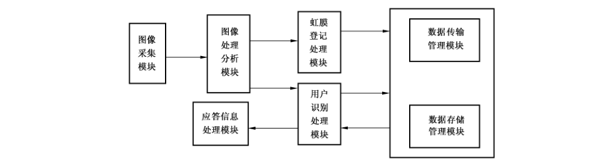
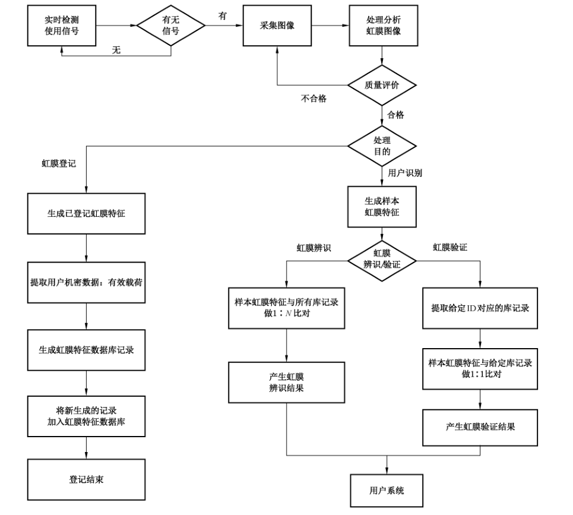

# GB/T 20979-2019 信息安全技术 虹膜识别系统技术要求

> 来源：[GB/T 20979-2019 国家标准详情](https://openstd.samr.gov.cn/bzgk/std/newGbInfo?hcno=7FF16D84B41297E279A295AD1BFD7A20)；发布日期：2019-08-30；实施日期：2020-03-01。
> PDF SHA-256：b1b7c1740c21701dc027097b591442f86d0b3b4b60cfe88332e733bc40c325c8。
> 转写说明：依据官方 PDF 全部 23 页的页面图像核对；省略封面、目录、页眉、页脚和页码，保留图示及附录表格。正式引用请核对原 PDF。

## 前言

本标准按照GB/T 1.1—2009给出的规则起草。

本标准代替 GB/T 20979—2007《信息安全技术 虹膜识别系统技术要求》。与 GB/T 20979—2007 相比，主要技术变化如下：

- 修改了标准的范围描述（见第 1 章，2007 年版的第 1 章）；
- 删除了“人体生物特征识别（见 2007 年版的 3.1）”“虹膜识别机制（见 2007 年版的 3.4）”“虹膜图像采集器（见 2007 年版的 3.6）”“自包含（见 2007 年版的 3.7）”“用户（见 2007 年版的 3.8）”“比对次数（见 2007 年版的 3.22）”“错误接受率（见 2007 年版的 3.23）”“错误拒绝率（见 2007 年版的 3.24）”的术语和定义；
- 增加了“虹膜图像（见 3.3）”的术语和定义；
- 修改了“虹膜（见 3.1，2007 年版的 3.2）”“虹膜识别（见 3.2，2007 年版的 3.3）”“虹膜识别系统（见 3.13，2007 年版的 3.5）”“虹膜识别数据（见 3.9，2007 年版的 3.17）”“候选者（见 3.16，2007 年版的 3.18）”的定义；
- 将术语“特征序列”改为“虹膜特征”（见 3.4，2007 年版的 3.14）、“用户登记”改为“虹膜登记”（见 3.5，2007 年版的 3.10）、“模板特征序列”改为“已登记虹膜特征”（见 3.6，2007 年版的 3.15）、“样本特征序列”改为“样本虹膜特征”（见 3.7，2007 年版的 3.16）、“虹膜特征序列数据库”改为“虹膜特征数据库”（见 3.8，2007 年版的 3.19）、“用户辨识”改为“虹膜辨识”（见 3.10，2007 年版的 3.12）、“用户确认”改为“虹膜验证”（见 3.11，2007 年版的 3.13）；
- 修改了分等级技术要求，由三级改为了基本级和增强级（见第 6 章、第 7 章、第 8 章、第 9 章，2007 年版的第 6 章）；
- 删除了基本功能要求中的自包含（见 2007 年版的 4.1）；
- 增加了虹膜登记和用户识别时提供可单双目、可任意眼的登记和识别策略，对可能影响虹膜登记、虹膜验证和虹膜辨识的情况应有相应的管理策略进行干预的要求（见 6.1.3、6.1.4）；
- 删除了虹膜登记和用户识别中两幅图像要求和四幅图像要求（见 2007 年版的 4.4.2、4.4.3、4.5.2、4.5.3）；
- 增加了特权用户以虹膜识别的方式确定其身份并取得相关操作权限的要求（见 6.1.4、6.2.4）；
- 修改了防伪造中的防死亡虹膜伪造为防假眼伪造，增加了防截取伪造和防生物伪造（见 6.2.6，2007 年版的 4.7）；
- 增加了虹膜图像质量作为基本性能要素（见 7.1.1、7.2.1）；
- 修改了各技术等级的性能指标，并增加了所对应的样本规模（见 7.1.2、7.2.2，2007 年版的 5.1、6.1.2.1、6.2.2.1、6.3.2.1）；
- 将“适用范围”改为“应用场景”，并增加了应用场景，删除了用于本地用户和远程用户、一般用户和特权用户的虹膜识别的内容（见 7.1.4、7.2.4，2007 年版的 5.3）；
- 增加了使用无伤害照明的具体规定内容（见 7.1.5、7.2.5）；
- 删除了安全功能中有关“环境安全”的内容（见 2007 年版的 6.1.3.1.1、6.2.3.1.1、6.3.3.1.1）；
- 将“自身安全保证要求”修改为“安全保障要求”（见第 9 章，2007 年版的 6.1.4、6.2.4、6.3.4）；
- 删除了依据失败次数判定识别失败的规定（见 2007 年版的 6.1.1.6、6.2.1.6、6.3.1.6）；
- 删除了保存用户虹膜图像和面部照片的相关内容（见 2007 年版的 6.3.1.4、A.1.3）；
- 删除了附录 D（见 2007 年版的附录 D）。

请注意本文件的某些内容可能涉及专利。本文件的发布机构不承担识别这些专利的责任。

本标准由全国信息安全标准化技术委员会（SAC/TC 260）提出并归口。

本标准起草单位：山西天地科技有限公司、中国科学院自动化研究所、西安凯虹电子科技有限公司、北京中科虹霸科技有限公司、公安部第一研究所、广州广电运通金融电子股份有限公司、浙江蚂蚁小微金融服务集团股份有限公司、中控智慧科技股份有限公司、中国电子技术标准化研究院、上海聚虹光电科技有限公司、四川天地风讯科技有限公司。

本标准主要起草人：宫雅卓、李海青、冷霜、李星光、郑征、胥建民、刘军、沈文忠、田启川、上官晓丽、孙哲南、冯春培、张默男、宁静、许东阳、何召锋、芦效东、苏杰、陈星、落红卫、陈书楷、李梅、刘梦涛、姚艳、李嘉扬、盛晓菲、苏晓婷、李杰。

本标准于2007年6月首次发布，本次为第一次修订。

## 1 范围

本标准规定了采用虹膜识别技术进行身份识别的虹膜识别系统的结构、功能、性能、安全要求及等级划分。

本标准适用于虹膜识别系统的设计与实现，对虹膜识别系统的测试、管理也可参照使用。

## 2 规范性引用文件

下列文件对于本文件的应用是必不可少的。凡是注日期的引用文件，仅注日期的版本适用于本文件。凡是不注日期的引用文件，其最新版本（包括所有的修改单）适用于本文件。

- GB 17859—1999 计算机信息系统 安全保护等级划分准则

- GB/T 18336.3—2015 信息技术 安全技术 信息技术安全评估准则 第3部分：安全保障组件

- GB/T 26237.6—2014 信息技术 生物特征识别数据交换格式 第6 部分：虹膜图像数据

- GB/T 26238—2010 信息技术 生物特征识别术语

- GB/T 29268.1—2012 信息技术 生物特征识别性能测试和报告 第1部分：原则与框架

- GB/T 33767.6—2018 信息技术 生物特征样本质量 第6部分：虹膜图像数据

## 3 术语和定义

GB/T 26237.6—2014、GB/T 26238—2010、GB/T 29268.1—2012界定的以及下列术语和定义适用于本文件。

### 3.1 虹膜 iris

人眼前部由肌肉组织、结缔组织、色素细胞组成的，主要用来控制瞳孔收缩的彩色环形生理组织。

### 3.2 虹膜识别 iris recognition

基于虹膜的特征对个体进行自动识别。

### 3.3 虹膜图像 iris image

由专用的虹膜采集模块对人体虹膜进行拍摄生成的图像。

### 3.4 虹膜特征 iris feature

通过对虹膜图像进行特征分析，生成用于区分个体的唯一的特征数据。

### 3.5 虹膜登记 iris enrollment

分析用户虹膜图像、提取虹膜数字特征、生成并存储已登记虹膜特征的过程。

### 3.6 已登记虹膜特征 enrolled iris feature

对采集到的用于登记的虹膜图像进行分析提取所生成的特征数据。

### 3.7 样本虹膜特征 sample iris feature

对采集到的待识别用户的虹膜图像进行分析提取所生成的特征数据。

### 3.8 虹膜特征数据库 iris feature database

专门用于存储已登记虹膜特征数据的数据库。

### 3.9 虹膜识别数据 iris recognition data

已登记虹膜特征、样本虹膜特征以及虹膜识别过程中用到的用于进行虹膜识别的其他数据。

### 3.10 虹膜辨识 iris identification

将所生成的样本虹膜特征与已存储的指定范围内的所有用户的已登记虹膜特征进行比对（1：N比对），选出相符的用户，以揭示用户的实际身份。

### 3.11 虹膜验证 iris verification

将所生成的样本虹膜特征与按用户标识信息给定的已登记虹膜特征进行比对（1:1比对），以确认用户所声称的身份。

### 3.12 用户识别 user recognition

采集和分析用户虹膜图像、提取虹膜特征、产生样本虹膜特征，并将该样本虹膜特征与已存储的已登记虹膜特征进行比对，用以识别用户身份的过程。

> 注：用户识别分为虹膜辨识和虹膜验证。

### 3.13 虹膜识别系统 iris recognition system

按照确定的策略和方法，实现虹膜识别功能的专用信息处理系统，具有虹膜图像采集模块和虹膜信息处理软、硬件，能够实现虹膜图像采集、虹膜图像处理、虹膜特征生成及虹膜特征比对等功能。

### 3.14 一般用户 general user

由虹膜识别系统的管控人员根据应用需求确定，当虹膜识别用于信息系统的用户身份识别时，具有普通权限的用户。

### 3.15 特权用户 privileged user

由虹膜识别系统的管控人员根据应用需求确定，当虹膜识别用于信息系统的用户身份识别时，具有特殊权限的用户。

### 3.16 候选者 candidate

在一次识别尝试中，通过与虹膜特征数据库中的已登记虹膜特征进行比对，确定出的在设定的阈值范围内与样本虹膜特征相似的已登记用户。

> 注：改写 GB/T 26238—2010，定义 2.2.2.3.2。

### 3.17 有效载荷 payload

在用户识别成功时释放出来的由用户给出的数据，用以对该用户进行授权等操作。

### 3.18 不透明数据 opaque data

虹膜特征数据库记录的组成部分，由已登记虹膜特征和有效载荷组成。

## 4 虹膜识别系统结构

### 4.1 虹膜识别系统的组成

图1给出了虹膜识别系统的基本组成和相互关系。

虹膜识别系统包含图像采集、图像处理分析、虹膜登记处理、用户识别处理、数据传输、数据存储、应答信息处理等功能模块。这些模块用以实现两种基本功能：虹膜登记和用户识别。进行虹膜登记或用户识别时，由图像采集模块采集用户虹膜图像，经图像处理分析模块处理，当进行虹膜登记时，由虹膜登记处理模块生成虹膜登记信息并存入数据库；当进行用户识别时，由用户识别处理模块生成用户识别信息，并将识别信息与登记信息进行比对，得出识别结果。

### 4.2 虹膜识别系统各模块功能

#### 4.2.1 虹膜图像采集模块

虹膜图像采集模块用于采集待识别对象的虹膜图像。

#### 4.2.2 虹膜图像处理模块

虹膜图像处理模块从虹膜中提取有区分力的特征，一般包括图像质量评估、虹膜区域分割、特征提取等操作。这些操作可能会被调整顺序或增减，例如在分割之后再次做质量评估。当图像的质量评估结果较差时，虹膜图像采集模块可能会采集新的图像。

#### 4.2.3 数据传输模块

传输模块在各个模块之间传输样本虹膜特征或已登记虹膜特征等数据。

#### 4.2.4 数据存储模块

数据存储模块把已登记虹膜特征和用户数据保存在虹膜特征数据库中，并将已登记虹膜特征与登记用户的身份等信息关联。这些数据可存储在便携式存储媒介（如智能卡）、个人电脑、本地服务器或中央数据库中。

#### 4.2.5 虹膜登记处理模块

根据虹膜图像处理模块提供的信息，进行虹膜登记处理，并将虹膜特征数据信息提交数据存储管理模块进行存储。

#### 4.2.6 用户识别处理模块

根据虹膜图像处理模块提供的信息，以及由数据存储管理模块所提供的信息，进行用户识别处理，并按识别结果形成回答信息。

#### 4.2.7 应答信息处理模块

根据需要将来自用户识别处理模块的应答信息转换成所要求的表示形式，为上层应用提供支持。

### 4.3 虹膜识别系统的工作流程

虹膜识别系统的工作流程见图2。

## 5 安全分级

虹膜识别系统是信息系统身份识别的实现方式之一。根据GB 17859—1999的安全保护等级划分的思想，并基于 GB/T 18336.3—2015中 EAL 3 和 EAL 4的安全保障要求，本标准将虹膜识别系统的功能、性能和安全要求分为基本级和增强级，黑体字增强级相对于基本级新增的要求，基本级和增强级的简要描述见附录 A。本标准凡涉及密码算法的相关内容，按国家有关法规实施；凡涉及采用密码技术解决机密性、完整性、真实性、不可否认性需求的应遵循密码相关国家标准和行业标准，采用的密码模块的等级应与信息系统的安全等级相一致。

## 6 功能要求

### 6.1 基本级要求

#### 6.1.1 虹膜图像采集与处理

应具有图像采集与处理功能，并满足以下要求：

a） 由虹膜图像采集模块进行虹膜图像的采集，不应以任何其他方式采集或输入；

b） 只对现场采集到的虹膜图像进行处理；

c） 通过图像处理，生成用于进行虹膜登记和用户识别的虹膜特征数据信息；

d） 除国家授权部门外，不应保存虹膜原始图像。

#### 6.1.2 用户标识

应具有用户标识功能并满足以下要求：

a） 在用户进行虹膜登记时标识用户；

b） 用户标识以用户名和用户标识符（ID） 实现；

c） 实现同一信息系统中用户标识具有唯一性。

#### 6.1.3 虹膜登记

应具有虹膜登记功能并满足以下要求：

a） 将获准进行登记的用户的虹膜特征作为已登记虹膜特征存入虹膜特征数据库；

b） 同一用户在相关的信息系统中的已登记虹膜特征宜具有相同的数据库记录结构，以保持已登记虹膜特征的一致性，便于信息共享和集中管理；

c） 同一用户在同一虹膜特征数据库中成功登记后，除需要更新特征信息之外，不应重复登记，且更新特征信息时，应终止先前的已登记虹膜特征；

d） 对虹膜登记进行审计；

e） 宜提供双眼登记、左眼登记、右眼登记等多种登记策略；

f） 对可能影响虹膜登记和用户识别的情况有相应的管理策略进行干预；

g） 初次使用虹膜识别系统，先对第一个特权用户进行虹膜登记，该特权用户默认获得虹膜识别系统操作权限和虹膜后台管理软件操作权限；

h） 由已登记特权用户进行虹膜识别登录后，再对未登记的特权用户和一般用户按虹膜登记的相关要求进行虹膜登记，并按实际需要分配权限给登记用户；

i） 以数据库或文件形式将用户的已登记虹膜特征进行存储；

j） 有效载荷数据部分可为空；

k） 签名部分可为空。

#### 6.1.4 用户识别

应具有用户识别功能，用户识别包括虹膜辨识和虹膜验证，并满足以下要求：

a） 进行虹膜辨识时应满足：

1） 进行虹膜辨识时，用户虹膜图像是唯一的虹膜辨识信息；

2） 用样本虹膜特征进行虹膜辨识，将实时采集的用户虹膜图像生成的样本虹膜特征与存储的已登记虹膜特征逐一进行比对，输出虹膜辨识结果；

b） 进行虹膜验证时应满足：

1） 进行虹膜验证时，需要虹膜图像信息和用户标识信息；

2） 根据用户标识信息，从虹膜特征数据库中检索出该用户标识对应的已登记虹膜特征；

3） 用样本虹膜特征进行虹膜验证，从实时采集的用户虹膜图像生成样本虹膜特征，并与检索出的用户已登记虹膜特征进行比对，输出虹膜验证结果；

c） 为适应不同的用户规模和安全要求，提供多种识别策略，例如双眼同时识别、任意眼识别、左眼识别、右眼识别等，并提供多种识别阈值供选择；

d） 对一般用户和特权用户，按照虹膜辨识和虹膜验证的相关要求进行用户识别；

e） 对特权用户，应以虹膜识别技术进行身份识别的方式取得虹膜识别系统的操作权限。

#### 6.1.5 识别失败的判定及处理

应具有识别失败的判定及处理功能，并满足以下要求：

a） 虹膜识别系统应能在出现以下情形中的一项或多项时，做出识别失败的判定：

1） 设备故障：不能成功采集图像；

2） 像质障碍：采集的图像质量不适于生成已登记虹膜特征或生成样本虹膜特征；

3） 超时断开：终端操作超时断开；

b） 在用户未能通过虹膜验证或虹膜辨识时显示识别失败信息；

c） 对识别失败的处理应提供以下功能：

1） 制定识别失败返回值表；

2） 在出现识别失败情况时，按照失败返回值表返回错误代码或错误值；

3） 针对不同的识别失败原因有相应的处理方式，制定明确的识别失败处理策略，实现识别失败处理功能。

#### 6.1.6 防伪造

应具有防伪造功能并满足以下要求：

a） 防复制伪造：应能检测或防止对当前用户识别数据的复制和非授权保存；

b） 防照片伪造：应能检测或防止使用照片伪造虹膜识别图像；

c） 防隐形镜片伪造：应能检测或防止在隐形镜片上复制伪造虹膜识别图像；

d） 在检测出以上任一伪造或非授权操作事件时应终止违例进程并取消服务。

#### 6.1.7 警告与报警

应具有警告与报警功能，并满足以下要求：

a） 进行虹膜验证时，如用户的样本虹膜特征与所比对的已登记虹膜特征不符，或在进行虹膜辨识时，如在虹膜特征数据库中检索不到与样本虹膜特征相符的候选者，应给出警告信息；

b） 检测出伪造虹膜识别图像、识别数据，或复制虹膜图像、识别数据，或非授权保存虹膜图像、识别数据，或非授权数据库操作时，应给出报警信息。

### 6.2 增强级要求

#### 6.2.1 虹膜图像采集与处理

应具有图像采集与处理功能，并满足以下要求：

a） 由虹膜图像采集模块进行虹膜图像的采集，不应以任何其他方式采集或输入；

b） 只对现场采集到的虹膜图像进行处理；

c） 通过图像处理，生成用于进行虹膜登记和用户识别的虹膜特征数据信息；

d） 除国家授权部门外，不应保存虹膜原始图像。

#### 6.2.2 用户标识

应具有用户标识功能并满足以下要求：

a） 在用户进行虹膜登记时标识用户；

b） 用户标识以用户名和用户标识符（ID）实现；

c） 实现同一信息系统中用户标识具有唯一性。

#### 6.2.3 虹膜登记

应具有虹膜登记功能，并满足以下要求：

a） 将获准进行登记的用户的虹膜特征作为已登记虹膜特征存入虹膜特征数据库；

b） 同一用户在相关的信息系统中的已登记虹膜特征宜具有相同的数据库记录结构，以保持已登记虹膜特征的一致性，便于信息共享和集中管理；

c） 同一用户在同一虹膜特征数据库中成功登记后，除需要更新特征信息之外，不应重复登记，且更新特征信息时，应终止先前的已登记虹膜特征；

d） 对虹膜登记进行审计；

e） 宜提供双眼登记、左眼登记、右眼登记等多种登记策略；

f） 对可能影响虹膜登记和用户识别的情况有相应的管理策略进行干预；

g） 初次使用虹膜识别系统，先对第一个特权用户进行虹膜登记，该特权用户默认获得虹膜识别系统操作权限和虹膜后台管理软件操作权限；

h） 由已登记特权用户进行虹膜识别登录后，再对未登记的特权用户和一般用户按虹膜登记的相关要求进行虹膜登记，并按实际需要分配权限给登记用户；

i） **以数据库或文件形式将用户的已登记虹膜特征进行存储**；

j） **有效载荷数据部分不应为空，且有效载荷与已登记虹膜特征应以相应级别的密码进行加密保护**；

k） **签名数据部分不应为空**。

#### 6.2.4 用户识别

应具有用户识别功能，用户识别包括虹膜辨识和虹膜验证，并满足以下要求：

a） 进行虹膜辨识时应满足：

1） 进行虹膜辨识时，用户虹膜图像是唯一的虹膜辨识信息；

2） 用样本虹膜特征进行虹膜辨识，将实时采集的用户虹膜图像生成的样本虹膜特征与存储的已登记虹膜特征逐一进行比对，输出虹膜辨识结果；

b） 进行虹膜验证时应满足：

1） 进行虹膜验证时，需要虹膜图像信息和用户标识信息；

2） 根据用户标识信息，从虹膜特征数据库中检索出该用户标识对应的已登记虹膜特征；

3） 用样本虹膜特征进行虹膜验证，从实时采集的用户虹膜图像生成样本虹膜特征，并与检索出的用户已登记虹膜特征进行比对，输出虹膜验证结果；

c） 为适应不同的用户规模和安全要求，提供多种识别策略，例如双眼同时识别、任意眼识别、左眼识别、右眼识别等，并提供多种识别阈值供选择；

d） 对一般用户和特权用户，按照虹膜辨识和虹膜验证的相关要求进行用户识别；

e） 对特权用户，应以虹膜识别进行身份鉴别的方式取得虹膜识别系统的操作权限。

#### 6.2.5 识别失败的判定及处理

应具有识别失败的判定及处理功能，并满足以下要求：

a） 虹膜识别系统应能在出现以下情形中的一项或多项时，作出识别失败的判定：

1） 设备故障：不能成功采集图像；

2） 像质障碍：采集的图像质量不适于生成已登记虹膜特征或生成样本虹膜特征；

3） 超时断开：终端操作超时断开；

4） **数据故障：虹膜特征数据库故障且在规定尝试次数内未能消除**；

5） **尝试超次：对虹膜验证与虹膜辨识，应分别设定警告次数阈值，连续警告次数大于该阈值时视作尝试超次**；

b） 在用户未能通过虹膜验证或虹膜辨识时显示识别失败信息；

c） **应在虹膜特征数据库出现故障时显示故障信息**；

d） 对识别失败的处理应提供以下功能：

1） 制定识别失败返回值表；

2） 在出现识别失败情况时，按照失败返回值表返回错误代码或错误值；

3） 针对不同的识别失败原因有相应的处理方式，制定明确的识别失败处理策略，实现识别失败处理功能。

#### 6.2.6 防伪造

应具有防伪造功能，增强级要求：

a） 防复制伪造：应能检测或防止对当前用户识别数据的复制和非授权保存；

b） 防照片伪造：应能检测或防止使用照片伪造虹膜识别图像；

c） 防隐形镜片伪造：应能检测或防止在隐形镜片上复制伪造虹膜识别图像；

d） **防录像伪造：应能检测或防止使用录像伪造虹膜图像**；

e） **防假眼伪造：应能检测或防止仿生材料制作的假眼**；

f） **防截取伪造：应能检测或防止传输虹膜图像和识别数据时被截取并伪造**；

g） **防生物伪造：应能检测或防止使用其他生物眼球伪造虹膜图像**；

h） 在检测出以上任一伪造或非授权操作事件时应终止违例进程并取消服务。

#### 6.2.7 警告与报警

应具有警告与报警功能，并满足以下要求：

a） 进行虹膜验证时，如用户的样本虹膜特征与所比对的已登记虹膜特征不符，或在进行虹膜辨识时，如在虹膜特征数据库中检索不到与样本虹膜特征相符的候选者，应给出警告信息；

b） 检测出伪造虹膜识别图像、识别数据，或复制虹膜图像、识别数据，或非授权保存虹膜图像、识别数据，或非授权数据库操作时，应给出报警信息。

## 7 性能要求

### 7.1 基本级要求

#### 7.1.1 虹膜图像质量

虹膜识别系统采集到的虹膜图像质量应符合 GB/T 33767.6—2018第6章和第7章的规定。

#### 7.1.2 错误接受率和错误拒绝率

虹膜识别系统的错误接受率和错误拒绝率应能进行调节，使其中之一变大时另一个变小，以满足不同的应用需要。应在总比对次数不小于500万次、样本来源不少于3000只眼睛时，错误接受率不大于0.000 1%时错误拒绝率不大于3％。

#### 7.1.3 响应时间

虹膜识别系统功能的实现，应在充分考虑承载其运行的处理器速度、存储器容量、数据处理量和其他相关因素的基础上，采取有效的算法，确保其时间与速度能满足使用的需要。

#### 7.1.4 应用场景

虹膜识别系统的应用场景包括但不限于：

a） 适用于各个年龄段人群的虹膜识别；

b） 适用于眼睛大小不同人群的虹膜识别；

c） 适用于戴眼镜和不戴眼镜人群的虹膜识别；

d） 适用于各种人种的虹膜识别。

#### 7.1.5 使用安全条件

虹膜识别系统所提供的使用安全条件应满足：采用无伤害照明，在 8 h（30 000 s）曝辐中不造成光化学紫外危害（E_S），并且在 1 000 s（约 16 min）内不造成近紫外危害（E_UVA），并且在 10 000 s（约 2.8 h）内不造成对视网膜蓝光危害（L_B）（不适反应），并且在 10 s 内不造成对视网膜热危害（L_R）（不适反应），并且在 1 000 s 内不造成对眼睛的红外辐射危害（E_IR）。

### 7.2 增强级要求

#### 7.2.1 虹膜图像质量

虹膜识别系统采集到的虹膜图像质量应符合 GB/T 33767.6—2018第6章和第7章的规定。

#### 7.2.2 错误接受率和错误拒绝率

虹膜识别系统的错误接受率和错误拒绝率应能进行调节，使其中之一变大时另一个变小，以满足不同的应用需要。应在总比对次数不小于5000万次、样本来源不少于4000只眼睛时，错误接受率不大于0.000 01%时错误拒绝率不大于3%。

#### 7.2.3 响应时间

虹膜识别系统功能的实现，应在充分考虑承载其运行的处理器速度、存储器容量、数据处理量和其他相关因素的基础上，采取有效的算法，确保其时间与速度能满足使用的需要。

#### 7.2.4 应用场景

虹膜识别系统的应用场景包括但不限于：

a） 适用于各个年龄段人群的虹膜识别；

b） 适用于眼睛大小不同人群的虹膜识别；

c） 适用于戴眼镜和不戴眼镜人群的虹膜识别；

d） 适用于各种人种的虹膜识别。

#### 7.2.5 使用安全条件

虹膜识别系统所提供的使用安全条件应满足：采用无伤害照明，在 8 h（30 000 s）曝辐中不造成光化学紫外危害（E_S），并且在 1 000 s（约 16 min）内不造成近紫外危害（E_UVA），并且在 10 000 s（约 2.8 h）内不造成对视网膜蓝光危害（L_B）（不适反应），并且在 10 s 内不造成对视网膜热危害（L_R）（不适反应），并且在 1 000 s 内不造成对眼睛的红外辐射危害（E_IR）。

## 8 安全功能要求

### 8.1 基本级要求

#### 8.1.1 设备安全

每台虹膜识别设备都应有明显的无法除去的标记，以防更换和方便丢失后查找。

#### 8.1.2 安全审计

##### 8.1.2.1 安全审计数据产生

安全审计功能应按以下要求产生审计数据：

a） 为下述可审计事件产生审计记录：

- 审计功能的开启和关闭；
- 使用身份鉴别机制；
- 将客体引入用户地址空间（例如：打开文件、程序初始化）；
- 删除客体；
- 系统管理员、安全员、审计员所实施的操作；
- 其他与系统安全有关的事件或专门定义的可审计事件；
- 伪造虹膜图像；
- 虹膜假体仿冒；
- 复制虹膜特征数据；
- 篡改识别结果数据；
- 非授权保存虹膜特征数据；
- 非授权进行数据库操作。

b） 对于每一个事件，其审计记录应包括：事件的日期和时间、用户、事件类型、事件是否成功，及其他与审计相关的信息；日志记录中不应出现明文形式的已登记虹膜特征、私钥、对称密钥和其他安全相关的参数；审计功能部件应能将可审计事件与发起该事件的用户身份相关联。

c） 对于身份识别事件，审计记录应包含请求的来源（例如：虹膜设备标识符）。

##### 8.1.2.2 安全审计查阅

应对审计日志的查阅进行如下设置：

a） 审计功能部件应为管理员提供查看日志所有信息的能力；

b） 审计功能部件应以适于阅读和解释的方式向阅读者提供日志信息。

##### 8.1.2.3 安全审计事件选择

审计功能部件应可根据下列属性选择或排除审计事件集中的可审计事件：用户标识、事件类型、主体标识、客体标识等。

##### 8.1.2.4 安全审计事件存储

应提供以下功能对审计事件进行存储：

a） 受保护的审计踪迹存储：审计踪迹的存储受到应有的保护，能检测或防止对审计记录的修改；

b） 防止审计数据丢失：在审计踪迹存储空间达到阈值时，应通知系统管理员。

##### 8.1.2.5 审计日志保护

应能提供审计日志保护功能，主要包括：

a） 审计功能部件应定期对审计日志做数字签名等完整性保护运算；

b） 完整性保护运算的对象是从上次签名后加入的所有审计日志条目以及上次签名的结果；

c） 对审计日志签名的时间周期应是可配置的；

d） 对审计日志签名的事件应写入审计日志中，审计日志签名结果应包含在其中。

#### 8.1.3 用户数据保护

##### 8.1.3.1 访问控制

应建立访问控制策略，根据附录B表B.1所表示的主、客体对应关系及操作规则，实现不同主体对已登记虹膜特征和样本虹膜特征的访问控制。

##### 8.1.3.2 数据存储安全

应从以下方面对虹膜识别数据的存储进行保护：

a） 具备对已登记虹膜特征等个人信息数据加密存储能力，满足数据保密性保护要求；

b） 利用存储访问控制模块实施虹膜识别数据用户身份标识与鉴别策略、数据访问控制策略，并实现相关安全控制措施。

##### 8.1.3.3 数据传输安全

应采用满足数据传输安全策略相应的安全控制措施，如数据加密等，对虹膜识别数据的传输进行保护。

#### 8.1.4 时间戳

虹膜识别系统的安全功能应能为自身的应用提供可靠的时间戳。

#### 8.1.5 备份与故障恢复

虹膜识别系统应设置信息备份功能，并在虹膜识别系统运行中出现致使信息丢失的故障时，能进行信息恢复。

### 8.2 增强级要求

#### 8.2.1 设备安全

每台虹膜识别设备都应有明显的无法除去的标记，以防更换和方便丢失后查找。**设备应具有防拆卸功能，当设备被拆卸或破坏时，应以声音或灯光发出警告。**

#### 8.2.2 安全审计

##### 8.2.2.1 安全审计数据产生

安全审计功能应按以下要求产生审计数据：

a） 为下述可审计事件产生审计记录：

- 审计功能的开启和关闭；
- 使用身份鉴别机制；
- 将客体引入用户地址空间（例如：打开文件、程序初始化）；
- 删除客体；
- 系统管理员、安全员、审计员所实施的操作；
- 其他与系统安全有关的事件或专门定义的可审计事件；
- 伪造虹膜图像；
- 虹膜假体仿冒；
- 复制虹膜特征数据；
- 篡改识别结果数据；
- 非授权保存虹膜特征数据；
- 非授权进行数据库操作。

b） 对于每一个事件，其审计记录应包括：事件的日期和时间、用户、事件类型、事件是否成功，及其他与审计相关的信息；日志记录中不应出现明文形式的已登记虹膜特征、私钥、对称密钥和其他安全相关的参数；审计功能部件应能将可审计事件与发起该事件的用户身份相关联。

c） 对于身份识别事件，审计记录应包含请求的来源（例如：虹膜设备标识符）。

##### 8.2.2.2 安全审计查阅

应对审计日志的查阅进行如下设置：

a） 审计功能部件应为管理员提供查看日志所有信息的能力；

b） 审计功能部件应以适于阅读和解释的方式向阅读者提供日志信息。

##### 8.2.2.3 安全审计事件选择

审计功能部件应可根据下列属性选择或排除审计事件集中的可审计事件：用户标识、事件类型、主体标识、客体标识等。

##### 8.2.2.4 安全审计事件存储

应提供以下功能对审计事件进行存储：

a） 受保护的审计踪迹存储：审计踪迹的存储受到应有的保护，能检测或防止对审计记录的修改；

b） 防止审计数据丢失：在审计踪迹存储空间达到阈值时，应通知系统管理员；

c） **审计数据的可用性确保：在意外情况出现时，能检测或防止对审计记录的修改，以及在发生审计存储已满、存储失败或存储受到攻击时，确保审计记录不被破坏。**

##### 8.2.2.5 审计日志保护

应能提供审计日志保护功能，主要包括：

a） 审计功能部件应定期对审计日志做数字签名等完整性保护运算；

b） 完整性保护运算的对象是从上次签名后加入的所有审计日志条目以及上次签名的结果；

c） 对审计日志签名的时间周期应是可配置的；

d） 对审计日志签名的事件应写入审计日志中，审计日志签名结果应包含在其中。

#### 8.2.3 用户数据保护

##### 8.2.3.1 访问控制

应建立访问控制策略，根据表 B.2 所表示的主、客体对应关系及操作规则，**采用标记的方法为主、客体标明其安全属性**，实现对已登记虹膜特征、样本虹膜特征和**有效载荷信息**的访问控制。**对虹膜特征数据库的访问控制粒度应为库/表级、记录级、字段级。**

##### 8.2.3.2 数据存储安全

应从以下方面对虹膜识别数据的存储进行保护：

a） 具备对已登记虹膜特征等个人信息数据加密存储能力，满足数据保密性和**完整性**保护要求；

b） 利用存储访问控制模块实施用户身份标识与鉴别策略、数据访问控制策略，并实现相关安全控制措施；

c） **具备对虹膜识别数据进行备份的能力以及相应的恢复控制措施。**

##### 8.2.3.3 数据传输安全

应从以下方面对虹膜识别数据的传输进行保护：

a） 采用满足数据传输安全策略相应的安全控制措施，如**安全通道、可信通道**、数据加密等；

b） **具备在构建传输通道前对两端主体身份进行鉴别的能力**；

c） **具备对传输数据的完整性进行检测的能力以及相应的恢复控制措施**。

#### 8.2.4 时间戳

虹膜识别系统的安全功能应能为自身的应用提供可靠的时间戳。

#### 8.2.5 备份与故障恢复

应具有备份和恢复功能：

a） 设置信息备份功能，并在虹膜识别系统运行中出现致使信息丢失的故障时，能进行信息恢复；

b） **设置系统备份功能，并在虹膜识别系统运行中出现致使系统无法运行的故障时，能进行恢复。**

## 9 安全保障要求

### 9.1 基本级要求

虹膜识别系统基本级应具有 GB/T 18336.3—2015 中 EAL 3所要求的安全保障组件。

### 9.2 增强级要求

虹膜识别系统增强级应具有 GB/T 18336.3—2015 中 EAL 4 所要求的安全保障组件。

## 附录 A（规范性附录）虹膜识别系统基本级和增强级要求

对虹膜识别系统基本级和增强级要求的简要概括见表 A.1、表 A.2 以及表 A.3。

**表A.1 虹膜识别系统功能要求**

| 功能要求 | 基本级要求 | 增强级要求 |
| --- | --- | --- |
| 虹膜图像采集与处理 | \* | \* |
| 用户标识 | \* | \* |
| 虹膜登记 | \* | \*\* |
| 用户识别 | \* | \* |
| 识别失败的判定及处理：设备故障 | \* | \* |
| 识别失败的判定及处理：像质障碍 | \* | \* |
| 识别失败的判定及处理：超时断开 | \* | \* |
| 识别失败的判定及处理：数据库故障 |  | \* |
| 识别失败的判定及处理：尝试超次 |  | \* |
| 防伪造：防复制伪造 | \* | \* |
| 防伪造：防照片伪造 | \* | \* |
| 防伪造：防隐形镜片伪造 | \* | \* |
| 防伪造：防录像伪造 |  | \* |
| 防伪造：防假眼伪造 |  | \* |
| 防伪造：防截取伪造 |  | \* |
| 防伪造：防生物伪造 |  | \* |
| 警告与报警 | \* | \* |

> 注：“\*”表示该级对相应功能有要求，“\*”数量的增加表示要求的提高。

**表A.2 虹膜识别系统性能要求**

| 性能要求 | 基本级要求 | 增强级要求 |
| --- | --- | --- |
| 虹膜图像质量 | \* | \* |
| 错误接受率不大于 0.000 1% 时错误拒绝率为 3% | \* |  |
| 错误接受率不大于 0.000 01% 时错误拒绝率为 3% |  | \* |
| 响应时间 | \* | \* |
| 应用场景 | \* | \* |
| 使用安全条件 | \* | \* |

> 注：“\*”表示该级对相应性能有要求。

**表A.3 虹膜识别系统安全功能和安全保障要求**

| 安全功能要求 | 基本级要求 | 增强级要求 |
| --- | --- | --- |
| 设备安全 | \* | \*\* |
| 安全审计：审计数据产生 | \* | \* |
| 安全审计：审计日志查阅 | \* | \* |
| 安全审计：审计事件选择 | \* | \* |
| 安全审计：审计事件存储 | \* | \*\* |
| 安全审计：审计日志保护 | \* | \* |
| 用户数据保护：访问控制 | \* | \*\* |
| 用户数据保护：数据存储安全 | \* | \*\* |
| 用户数据保护：数据传输安全 | \* | \*\* |
| 时间戳 | \* | \* |
| 备份与恢复 | \* | \*\* |
| 安全保障要求 | 基本级要求 | 增强级要求 |
| GB/T 18336.3—2015 EAL 3 | \* |  |
| GB/T 18336.3—2015 EAL 4 |  | \* |

> 注：“\*”表示该级对相应安全功能或安全保障有要求，“\*”数量的增加表示要求的提高。

## 附录 B（规范性附录）主、客体的访问操作关系

### B.1 概述

#### B.1.1 主体

虹膜识别系统中有两类主体：一类是特权用户，包括系统管理员、系统安全员和系统审计员；另一类是处理专门事务的系统进程。

系统管理员的主要职责是通过专门为管理员提供的操作界面进行系统安装、启动，并对存放已登记虹膜特征数据的数据库进行维护，以及进行虹膜登记；系统安全员的主要功能是进行主、客体安全属性标记的设置，这些安全属性标记是实现主、客体之间访问控制的基础；系统审计员的主要功能是设置审计机制，查看和处理审计信息。嵌入在信息系统中的虹膜识别子系统，其系统管理员、系统安全员和系统审计员可以由信息系统的相应人员承担。

#### B.1.2 客体

虹膜识别系统中的客体是指主体所能操作的对象，包括作为图像处理、数据存储的对象和为用户服务的进程。前者主要包括：虹膜图像、面部照片、已登记虹膜特征、样本虹膜特征、虹膜特征数据库、有效载荷、虹膜验证结果、虹膜辨识结果；后者主要包括：系统管理员操作进程、数据库操作进程、安全员操作进程、审计员操作进程。

### B.2 适用于基本级的主、客体之间的访问操作关系

表 B.1 表示适用于基本级的虹膜识别系统中主体与客体之间的访问操作关系。

**表B.1 适用于基本级的访问操作关系（已登记虹膜特征以数据库或文件形式存储）**

| 主体 | 对应客体 | 允许操作 | 不允许操作 |
| --- | --- | --- | --- |
| 虹膜特征生成进程 | 虹膜图像 已登记虹膜特征 样本虹膜特征 | 图像变换、图像分析、特征表述 | 复制、传输、修改、保存 |
| 虹膜登记进程 | 已登记虹膜特征 | 将已登记虹膜特征存入数据库或文件系统 | 复制、传输、修改、保存 |
| 用户识别进程 | 样本虹膜特征 已登记虹膜特征 | 将样本虹膜特征与数据库或文件系统中的已登记虹膜特征比对 | 复制、传输、修改、保存 |
| 应用系统通信接口进程 | 样本虹膜特征 已登记虹膜特征 虹膜验证结果 虹膜辨识结果（候选者） | 传输样本虹膜特征或已登记虹膜特征 传输识别（验证或辨识）结果 | 修改 |
| 系统管理员 | 系统管理员操作任务 数据库操作进程 | 安装，数据库维护 SELECT、INSERT、DELECT、UPDATE 操作 | 非授权操作 |
| 系统审计员 | 系统审计员操作进程 | 安全审计 | 非授权操作 |

### B.3 适用于增强级的主、客体之间的访问操作关系

表 B.2 表示适用于增强级的虹膜识别系统中主体与客体之间的访问操作关系。

**表B.2 适用于增强级的访问操作关系（已登记虹膜特征以数据库形式存储）**

| 主体 | 对应客体 | 允许操作 | 不允许操作 |
| --- | --- | --- | --- |
| 虹膜特征生成进程 | 虹膜图像 已登记虹膜特征 样本虹膜特征 | 图像变换、图像分析、特征表述 | 复制、传输、修改、保存 |
| 虹膜登记进程 | 虹膜图像 已登记虹膜特征 有效载荷 | 将已登记虹膜特征及有效载荷组合为不透明数据，将记录头及不透明数据组合为数据库记录，数据库 INSERT 操作 | 复制、传输、修改、保存 |
| 用户识别进程 | 样本虹膜特征 已登记虹膜特征 | 数据库 SELECT 操作，将样本虹膜特征与库记录中的已登记虹膜特征比对 | 复制、传输、修改、保存 |
| 应用系统通信接口进程 | 样本虹膜特征 已登记虹膜特征 虹膜验证结果 虹膜辨识结果（候选者） | 传输样本虹膜特征或已登记虹膜特征 传输识别（验证或辨识）结果 | 修改 |
| 系统管理员 | 系统管理员操作任务 数据库操作进程 | 安装，数据库维护 SELECT、INSERT、DELECT、UPDATE 操作 | 非授权操作 |
| 系统审计员 | 系统审计员操作进程 | 安全审计 | 非授权操作 |
| 系统安全员 | 系统安全员操作进程 | 主、客体安全属性标记 | 非授权操作 |

## 参考文献

- ［1］ GB/T 18336.1—2015 信息技术 安全技术 信息技术安全评估准则 第 1 部分：简介和一般模型

- ［2］ GB/T 18336.2—2015 信息技术 安全技术 信息技术安全评估准则 第 2 部分：安全功能组件

- ［3］ GB/T 20271—2006 信息安全技术 信息系统通用安全技术要求

- ［4］ GB/T 20273—2006 信息安全技术 数据库管理系统安全技术要求

- ［5］ IEC/EN 62471 Photobiological Safety of Lamps and Lamp Systems
