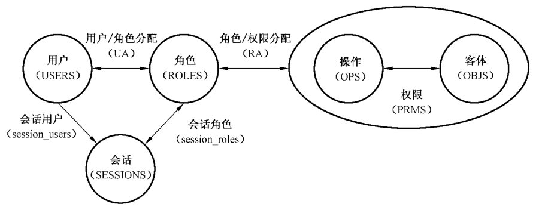
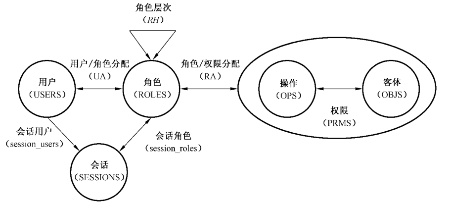
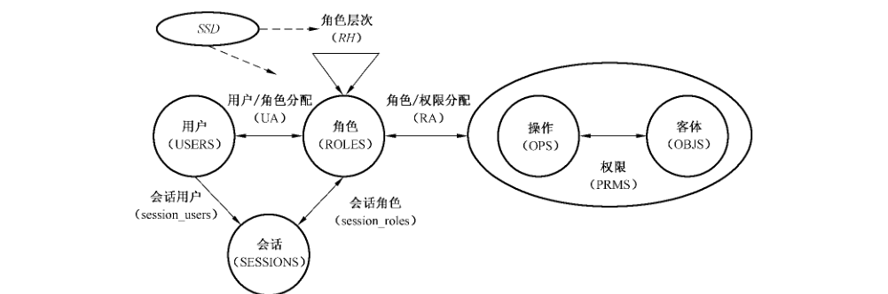
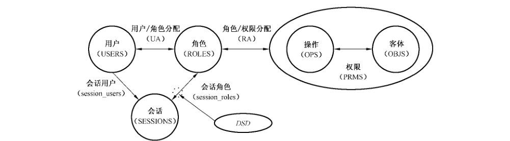
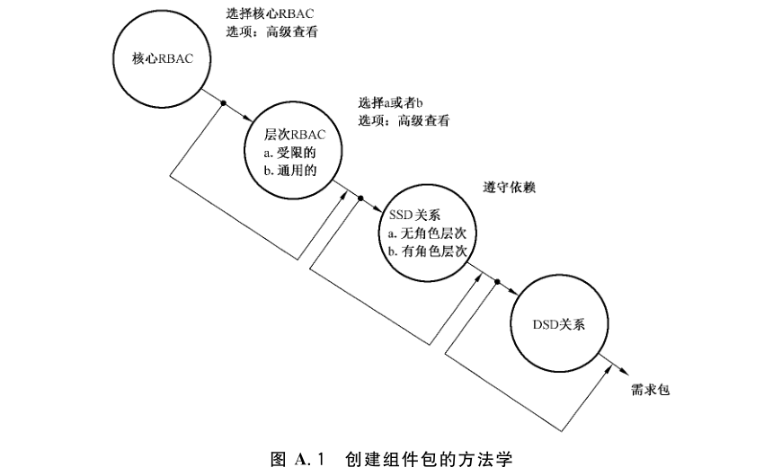

# GB/T 25062-2010 信息安全技术 鉴别与授权 基于角色的访问控制模型与管理规范

> 国家标准；ICS 35.040，CCS L 80；中华人民共和国国家质量监督检验检疫总局、中国国家标准化管理委员会发布；2010-09-02 发布，2011-02-01 实施。
> 来源：[GB/T 25062-2010 国家标准详情](https://openstd.samr.gov.cn/bzgk/std/newGbInfo?hcno=B16D84782B54E732E30D170DB6FBA689)。
> 官方 PDF SHA-256：d78a74f3a0a1fa1302d5fd1aff2a5281f82d3005d7f2256fad2d0a710e766e77。
> 依据官方 PDF 的 36 页页图逐页核对，保留正文与资料性附录；省略封面、目录、物理分页、页眉页脚和封底出版信息。正式引用请核对官方原文。

> 转写注（原版异文）：下列措辞、符号或名称的不一致均见官方 PDF，照录保留，不按模型语义改写。
> - 正文第 3～4 页（PDF 第 9～10 页）使用 `OBS`、`PERMS`、`session_users` 和单数 `assigned_permission`，图 1～4 的权限分配标签为 `RA`，均未统一为其他位置的写法。
> - 正文第 6～10 页（PDF 第 12～16 页）原文有“可用以”“当要待创建用户”“如何处理这些话”“该对象是该 OBJS 数据集的成员”，以及 `assigned_users(roles)`、`assigned_permissions(roles)`、`2^NAMES`、`session_role`、`USER`、AssignedRoles 的 `2^USERS`、标题与模式名的 `RolePermissions/RolePermission` 和 `UserPermissions/UserPermission` 差异；DropActiveRole 模式起始符原为 `▷`，均照录。
> - 正文第 11～18 页（PDF 第 17～24 页）AddAscendant 的说明引用 `AddInheritance`，AuthorizedRoles 结果式原以圆括号起始、花括号结束；层次 UserOperationsOnObject 参数中未列 `obj`；7.4.1.1 AssignUser 原有 `(user ↦ role) ∉ role`、`∀ssd ∉ SSD`；7.4.1.1 未列 AddSsdRoleMember；SetSsdSetCardinality 对应模式名原为 SetSsdCardinality，其中 7.4.1.1 的模式未印起始三角符；7.4.2.1 的 AddSsdRoleMember 结果式使用未声明的 `n`。这些内容均保留原版写法。
> - 正文第 18～21 页（PDF 第 24～27 页）动态职责分离定义原为 `∀dsd ∈ SSD`；CreateDsdSet 的 `dsd_set′` 使用差集 `∖`；两处条件文字以“基”结尾；7.5.2.2 CreateSession 使用 `sessions_user′`，均未修正。
> - 附录 A、B（PDF 第 29～34 页）的 `USER`、“对 UA 的进行管理”、`AddAsendant`、`AuthorizedUser`、`DeleteActiveRole`、A.5.3 引用 7.4.1、B.3 将偏序描述为“自反的、对称的、传递的”、B.5 的“的中 n 个”等均为原版文字；附录与正文的函数名称、大小写和描述差异照录保留。

## 前言

本标准的附录 A、附录 B 和附录 C 为资料性附录。

本标准由全国信息安全标准化技术委员会（SAC/TC 260）提出并归口。

本标准起草单位：中国科学院软件研究所，信息安全共性技术国家工程研究中心。

本标准主要起草人：冯登国、徐震、翟征德、张敏、张凡、黄亮、庄湧。

## 引言

主流IT产品供应商开始在他们的数据库管理系统、安全管理系统、网络操作系统等产品中大量实现基于角色的访问控制功能，然而却没有对其特征集达成一致。缺乏广为接受的模型，导致了对基于角色的访问控制效用和含义理解的不规范性和不确定性。本标准参照 ANSI INCITS 359-2004，使用一个参考模型来定义基于角色的访问控制的特征，并描述这些特征的功能规范，通过以上方法来解决这些不规范与不确定的问题。

## 1 范围

本标准规定了基于角色的访问控制（RBAC）模型、RBAC系统和管理功能规范。

本标准适用于信息系统中 RBAC子系统的设计和实现，相关系统的测试和产品采购亦可参照使用。

## 2 规范性引用文件

下列文件中的条款通过本标准的引用而成为本标准的条款。凡是注日期的引用文件，其随后所有的修改单（不包括勘误的内容）或修订版均不适用于本标准，然而，鼓励根据本标准达成协议的各方研究是否可使用这些文件的最新版本。凡是不注日期的引用文件，其最新版本适用于本标准。

- ISO/IEC 13568:2002 信息技术 Z 形式规范注释语法、形式系统和语义学

## 3 术语和定义

下列术语和定义适用于本标准。

### 3.1 组件 component

这里是指四个 RBAC特征集之一：核心 RBAC、层次 RBAC、静态职责分离关系、动态职责分离关系。

### 3.2 对象 object

需要进行访问控制的系统资源，例如文件、打印机、终端、数据库记录等。

### 3.3 操作 operation

一个程序的可执行映像，当被调用时为用户执行某些功能。

### 3.4 权限 permission

对受 RBAC保护的一个或多个对象执行某个操作的许可。

### 3.5 角色 role

组织语境中的一个工作职能，被授予角色的用户将具有相应的权威和责任。

### 3.6 用户 user

人、机器、网络、自主智能代理等，进行资源或服务访问的实施主体。

### 3.7 会话 session

从用户到其激活的角色集合的一个映射。

### 3.8 职责分离 separation of duty

限制用户获得存在利益冲突的权限集的约束，例如用户不能同时获得会计和审计的权限。

## 4 缩略语

下列缩略语适用于本标准：

| 缩略语 | 含义 |
| --- | --- |
| RBAC | 基于角色的访问控制（Role Based Access Control） |
| SSD | 静态职责分离（Static Separation of Duty） |
| DSD | 动态职责分离（Dynamic Separation of Duty） |
| USERS | 用户集（User Set） |
| ROLES | 角色集（Role Set） |
| OBJS | 对象集（Object Set） |
| OPS | 操作集（Operation Set） |
| SESSIONS | 会话集（Session Set） |
| PRMS | 权限集（Privilege Management Set） |
| ACL | 访问控制列表（Access Control List） |

## 5 一致性

对于特定的应用，并非所有的 RBAC 特征都是必要的。因此，本标准提供了一种通过对功能组件和同一功能组件内的特征进行选择，以组装构成所需要的 RBAC 特征的方法。本标准首先定义了一个 RBAC 的特征核心集合，任何其他的特征包都必须包含这一核心特征集。在构建 RBAC 特征包时，角色层次，静态约束（静态职责分离），动态约束（动态职责分离）是可选组件。

## 6 RBAC 参考模型

### 6.1 概述

RBAC 参考模型通过四个 RBAC 模型组件来进行定义——核心 RBAC、角色层次 RBAC、静态职责分离关系，动态职责分离关系。

核心 RBAC定义了能够完整地实现一个 RBAC 系统所必需的元素、元素集和关系的最小集合，其中包括最基本的用户/角色分配和权限/角色分配关系。此外，它还引入了角色激活的概念作为计算机系统中用户会话的一个组成部分。核心 RBAC对于任何 RBAC 系统而言都是必需的，其他 RBAC组件彼此相互独立并且可以被独立地实现。

角色层次 RBAC组件支持角色层次。角色层次从数学上讲是一个定义角色之间级别关系的偏序，高级别的角色获得低级别角色的权限，低级别角色获得高级别角色的用户成员。此外，层次 RBAC还引入了角色的授权用户和授权权限的概念。

静态职责分离针对用户/角色分配定义了角色间的互斥关系。由于可能与角色继承产生不一致，静态职责分离关系组件在没有角色层次和存在角色层次的情况下分别进行了定义。

动态职责分离关系针对用户会话中可以激活的角色定义了互斥关系。

每个模型组件都由下列子组件来定义：

<ol type="a">
<li>一些基本元素集；</li>
<li>一些基于上述基本元素集的 RBAC 关系；</li>
<li>一些映射函数，在给定来自某个元素集的实例元素的情况下能够得到另一个元素集的某些实例元素。</li>
</ol>

RBAC参考模型给出了一种 RBAC 特征的分类，可以基于这些分类的特征构建一系列 RBAC 特征包。本标准的主要目的不是试图定义 RBAC 特征的全集，而是致力于提供一组标准的术语来定义已有的模型和商业产品中最主要的 RBAC特征。

### 6.2 核心 RBAC

核心RBAC的元素集和关系在图1中进行了定义。核心 RBAC包含了5个基本的数据元素：用户集（USERS）、角色集（ROLES）、对象集（OBJS）、操作集（OPS）、权限集（PRMS）。权限被分配给角色，角色被分配给用户，这是 RBAC的基本思想。角色命名了用户和权限之间的多对多的关系。此外，核心 RBAC 中还包含了用户会话集，会话是从用户到该用户的角色集的某个激活角色子集的映射。

角色是组织上下文中的一个工作职能，被授予了角色的用户将具有相应的权威和责任。权限是对某个或某些受 RBAC 保护的对象执行操作的许可。操作是一个程序的可执行映像，被调用时能为用户执行某些功能。操作和对象的类型依赖于具体系统，例如在一个文件系统中，操作可以包含读、写、执行；在数据库管理系统中，操作包含 select、insert、delete、update 等。

访问控制机制的核心功能是保护系统资源。与以前的访问控制模型一致，RBAC模型中的对象是包含或接收信息的实体。对一个实现 RBAC 的系统，对象可以代表信息容器（如操作系统中的文件和目录或数据库中的表、视图、字段），或者诸如打印机、磁盘空间、CPU 周期等可耗尽的系统资源。

RBAC覆盖的对象包括所有在分配给角色的权限中出现的对象。

RBAC 中一个很重要的概念是角色的相关分配关系。图1中给出了用户分配关系（UA）和权限分配关系（PA）。图中的箭头表示关系是多对多的（例如，一个用户可以被分配给多个角色并且一个角色可以被分配给多个用户）。这种安排带来了给角色分配权限和给角色分配用户时的灵活性和细粒度。

如果没有这些，就有可能造成给用户分配过多的对资源的访问权限；能够更灵活地控制对资源的访问权限也有助于最小特权原则的实施。

用户在建立一个会话的时候可以激活他/她所被分配的角色的某个子集。一个会话只能与一个用户关联，一个用户可能同时拥有多个会话。函数 `session_roles` 返回一个会话激活的角色，函数 `session_user` 给出会话的用户。在用户的会话中保持激活状态的角色的权限构成了用户的可用权限。以下为核心 RBAC 规范：

<ol type="a">
<li><code>USERS, ROLES, OPS, OBJS</code> 分别代表：用户集、角色集、操作集、对象集；</li>
<li><code>UA ⊆ USERS × ROLES</code>，一个多对多的映射，代表用户/角色分配关系；</li>
<li><code>assigned_users(r: ROLES) → 2^USERS</code>，一个映射，给出分配了角色 <code>r</code> 的用户，<code>assigned_users(r) = {u ∈ USERS | (u,r) ∈ UA}</code>；</li>
<li><code>PRMS ⊆ 2^(OPS×OBS)</code>，权限集；</li>
<li><code>PA ⊆ PERMS × ROLES</code>，一个多对多的映射，代表权限/角色分配关系；</li>
<li><code>assigned_permissions(r: ROLES) → 2^PRMS</code>，一个映射，给出分配给角色 <code>r</code> 的权限，<code>assigned_permissions(r) = {p ∈ PRMS | (p,r) ∈ PA}</code>；</li>
<li><code>ops(p: PRMS) → {op ⊆ OPS}</code>，权限到操作的映射，给出与权限 <code>p</code> 关联的操作；</li>
<li><code>obs(p: PRMS) → {ob ⊆ OBS}</code>，权限到对象的映射，给出与权限 <code>p</code> 关联的对象；</li>
<li><code>SESSIONS</code>，会话集；</li>
<li><code>session_user(s: SESSIONS) → USERS</code>，一个从会话 <code>s</code> 到对应用户的映射；</li>
<li><code>session_roles(s: SESSIONS) → 2^ROLES</code>，一个从会话 <code>s</code> 到其激活的角色集的映射，<code>session_roles(s) ⊆ {r ∈ ROLES | (session_users(s),r) ∈ UA}</code>；</li>
<li><code>avail_session_perms(s: SESSIONS) → 2^PRMS</code>，一个从会话 <code>s</code> 到它拥有的权限集的映射，<code>avail_session_perms(s) = ⋃_{r∈session_roles(s)} assigned_permission(r)</code>。</li>
</ol>

### 6.3 层次 RBAC

#### 6.3.1 导引

如图2所示，层次 RBAC 引入了角色层次。角色层次通常被作为 RBAC模型的重要部分，并且经常在 RBAC商业产品中得以实现。角色层次可以有效地反映组织内权威和责任的结构。

角色层次定义了角色间的继承关系。继承通常是从权限的角度来说的，例如，如果角色 r₁“继承”角色 r₂，角色 r₂ 的所有权限都同时为角色 r₁ 所拥有。在某些分布式 RBAC实现中，角色层次是集中管理的，而权限/角色分配却是非集中管理的。对这些系统，角色层次的管理主要是从用户成员包含关系的角度进行的：如果角色 r₁ 的所有用户都隐含地成为角色 r₂ 的用户，则称角色 r₁“包含”角色 r₂。这种用户成员包含关系隐含了这样一个事实：角色 r₁ 的用户将拥有角色 r₂ 的所有权限。然而角色 r₁ 和角色 r₂ 之间的权限继承关系并不对它们的用户分配做任何假设。

本标准认可两种类型的角色层次——通用角色层次和受限角色层次。通用角色层次支持任意偏序关系，从而支持角色之间的权限和用户成员的多重继承。受限角色层次通过施加限制来得到一个简单的树结构（即：一个角色可以拥有一个或多个直接祖先，但只能有一个直接后代）。

#### 6.3.2 通用角色层次

通用角色层次的规范在核心 RBAC 的基础上扩展如下内容：

<ol type="a">
<li><code>RH ⊆ ROLES × ROLES</code> 是一个称为继承的角色之间的偏序关系，记作 <code>≽</code>。如果 <code>r₁ ≽ r₂</code>，则角色 <code>r₁</code> 拥有角色 <code>r₂</code> 的所有权限并且角色 <code>r₁</code> 的用户都将是角色 <code>r₂</code> 的用户；</li>
<li><code>authorized_users(r: ROLES) → 2^USERS</code>，一个在角色层次存在的情况下从角色到该角色的授权用户的映射，<code>authorized_users(r) = {u ∈ USERS | r′ ≽ r ∧ (u,r′) ∈ UA}</code>；</li>
<li><code>authorized_permissions(r: ROLES) → 2^PRMS</code>，一个在角色层次存在的情况下从角色到其授权权限的映射，<code>authorized_permissions(r) = {p ∈ PRMS | r ≽ r′ ∧ (p,r′) ∈ PA}</code>。</li>
</ol>

通用角色层次支持多重继承的概念，从而使得一个角色可以从两个或者更多其他角色继承权限或用户成员。多重继承具有两个重要的性质。第一，多重继承使得可以通过从几个低级别的角色来构建较高级别角色的方式来定义角色间的关系以反映组织和事务的结构。第二，多重继承使得可以一致地对待用户/角色分配关系和角色/角色继承关系。用户也可以被包含在角色层次中，并且仍然用≽来代表用户/角色分配以及用户对角色权限的继承。

在受限角色层次中，一个角色只能有一个直接后代。尽管受限角色层次不支持权限的多重继承，但与层次 RBAC比较却具有管理上的优势。

如果 `r₁ ≽ r₂` 并且这两个角色之间不存在其他的角色（即不存在不同于角色 `r₁` 和角色 `r₂` 的角色 `r₃`，满足 `r₁ ≽ r₃ ≽ r₂`），则 `r₁` 是 `r₂` 的直接祖先，记作 `r₁ ≻≻ r₂`。

#### 6.3.3 受限角色层次

受到下述限制的通用角色层次：`∀ r,r₁,r₂ ∈ ROLES, r ≻≻ r₁ ∧ r ≻≻ r₂ ⇒ r₁ = r₂`。

角色层次可以用偏序图来表示。图中的节点代表角色，如果 `r₁` 是 `r₂` 的直接后代，则存在从 `r₁` 指向 `r₂` 的有向箭头。在角色层次的偏序图上，`rₓ ≽ rᵧ` 当且仅当存在从 `rₓ` 到 `rᵧ` 的有向路径。由于角色之间的偏序关系是传递和反对称的，所以不存在有向回路。通常，角色层次图上的箭头与角色间的继承关系相一致都是自上而下的，因此角色用户成员的继承是自上而下的，而角色权限的继承是自下而上的。

### 6.4 带约束的 RBAC

#### 6.4.1 概述

带约束的 RBAC 模型增加了职责分离关系。职责分离关系可以被用来实施利益冲突（Conflict Of Interest）策略（防止某个人或某些人同时对于不同的某些个人、某些集团或组织以及某种事物在忠诚度和利害关系上发生矛盾的策略）以防止组织中用户的越权行为。

作为一项安全原则，职责分离在工商业界和政府部门得到了广泛的应用，其目的是保证安全威胁只有通过多个用户之间的串通勾结才能实现。具有不同技能和利益的工作人员分别被分配一项事务中不同的任务，以保证欺诈行为和重大错误只有通过多个用户的勾结才可能发生。本标准支持静态和动态的职责分离。

#### 6.4.2 静态职责分离关系

在RBAC 系统中，一个用户获得了相互冲突的角色的权限就会引起利益冲突。阻止这种利益冲突的一个方法是静态职责分离，即对用户/角色分配施加约束。

本标准中定义的静态约束主要是作用于角色，特别是用户/角色分配关系，也就是说，如果用户被分配了一个角色，他/她将不能被分配另一些特定的角色。从策略的角度，静态约束关系提供了一种有效的在 RBAC 元素集上实施职责分离和其他分离规则的有效手段。静态约束通常要限制那些可能会破坏高层职责分离策略的管理操作。

以往的 RBAC模型通常通过限制一对角色上的用户分配来定义静态职责分离（一个用户不能同时分配处于 SSD关系下的两个角色）。尽管现实世界中确实存在这样的例子，这样定义的SSD 在两个方面限制性太强：SSD 关系中角色集的成员数（只能为2）和角色集中角色的可能组合情况（每个用户最多只能分配角色集中的一个角色）。在本标准中，静态职责分离通过两个参数定义：一个包含两个或更多角色的角色集和一个大于1的阈值（用户拥有的角色中包含在该角色集中角色的数量小于这个阈值）。

例如，一个组织可能要求任何一个用户不能被分配代表采购职能的4个角色中的3个。

正如图3所示，静态职责分离可能存在于层次 RBAC中。在存在角色层次的情况下，必须注意不要让用户成员的继承违反静态职责分离策略。为此，层次 RBAC也被定义为继承静态职责分离约束。在角色层次 RBAC 中，为了解决可能出现的不一致性，静态职责分离被定义为针对角色的授权用户的约束。

静态职责分离和层次 RBAC 下的静态职责分离分别定义如下：

<ol type="a">
<li>静态职责分离。<code>SSD ⊆ (2^ROLES × N)</code> 由一组形如 <code>(rs,n)</code> 的对构成，其中 <code>rs</code> 是角色的集合，<code>t</code> 是 <code>rs</code> 的子集，<code>n ≥ 2</code>，满足任何用户都不能同时被分配 <code>rs</code> 中的 <code>n</code> 个或者更多角色，<code>∀ (rs,n) ∈ SSD, ∀ t ⊆ rs: |t| ≥ n ⇒ ⋂_{r∈t} assigned_users(r) = ∅</code>。</li>
<li>层次 RBAC 下的静态职责分离。在存在角色层次的情况下，静态职责分离基于角色的授权用户而不是直接分配了该角色的用户进行重新定义，<code>∀ (rs,n) ∈ SSD, ∀ t ⊆ rs: |t| ≥ n ⇒ ⋂_{r∈t} authorized_users(r) = ∅</code>。</li>
</ol>

#### 6.4.3 动态职责分离关系

静态职责分离关系和动态职责分离（DSD）关系的目的都是限制用户的可用权限，不过它们施加约束的上下文不同。SSD 定义并且施加约束到用户总的权限空间上，而 DSD 通过约束一个用户会话可以激活的角色来限制用户的可用权限。DSD 使用户可用以在不同的时间拥有不同的权限，从而进一步扩展了对最小特权原则的支持。DSD 能够保证权限的有效期不超过完成某项职责所需要的时间段，这通常被称为信任的及时撤销。在没有 DSD 的情况下，动态的权限撤销是非常困难的，因此通常被忽略。

SSD 解决在给用户分配角色的时候可能存在的利益冲突问题。DSD 允许用户同时拥有两个或者更多这样的角色：这些角色在各自独立地被激活时不会产生安全威胁，而同时被激活时就可能会产生违反安全策略的行为。

动态职责分离被定义为针对用户会话激活的角色的约束，如图4所示。

`DSD ⊆ 2^ROLES × N` 由一组形如 `(rs,n)` 的对构成，其中 `rs` 是角色的集合，`n ≥ 2`，满足没有任何主体能激活 `rs` 中的 `n` 个或更多角色。

`∀ rs ∈ 2^ROLES, n ∈ N, (rs,n) ∈ DSD ⇒ n ≥ 2 ∧ |rs| ≥ n ∧ ∀ s ∈ SESSIONS, ∀ rs ∈ 2^ROLES, ∀ role_subset ∈ 2^ROLES, ∀ n ∈ N, (rs,n) ∈ DSD, role_subset ⊆ rs, role_subset ⊆ session_roles(s) ⇒ |role_subset| < n`

## 7 RBAC系统和管理功能规范

### 7.1 概述

RBAC功能规范描述了创建和维护 RBAC元素集和 RBAC 关系的管理操作；进行管理查询的管理查看函数；创建和维护用户会话的 RBAC属性和进行访问控制决策的系统函数。本标准对这些函数进行了足够细致的定义，以便支持一致性测试和保证的需要，同时给开发者提供了足够的设计灵活性以满足用户的需求。

RBAC 功能规范使用的 Z 标记方法由 ISO/IEC 13568:2002 定义。唯一的例外是模式表示如下：模式名（声明）◁ 谓词；……；谓词 ▷。

这里使用的大多数抽象数据类型和函数都来自 RBAC参考模型，但在必要的时候，将会引入新的抽象数据类型和函数。为了描述方便，这里首先需要引入符号 NAME。NAME是个元素为实体标识的抽象数据类型，这些实体可能包含在 RBAC 系统之中或者之外（角色、用户、会话等）。

### 7.2 核心 RBAC

#### 7.2.1 核心 RBAC 管理函数

本条定义了核心 RBAC 的管理函数。

<ol type="a">
<li>

<code>AddUser</code>

该命令创建一个新的用户。当要待创建用户尚不存在于 USERS 集合中时，该命令可用。命令执行后，USERS 被更新，新创建的用户不拥有任何的会话。下面的模式形式化地描述了 AddUser：

<pre><code>AddUser(user: NAME) ◁
  user ∉ USERS
  USERS′ = USERS ∪ {user}
▷</code></pre>
</li>
<li>

<code>DeleteUser</code>

该命令从 RBAC 数据库中删除一个已经存在的用户。该命令可用当且仅当被删除的用户是 USERS 数据集的一个成员。USERS 数据集、UA 数据集和 assigned_users 函数被更新。如果一个正处在会话中的用户被删除，如何处理该用户的会话依赖于具体实现。实际 RBAC 系统可以等待该会话结束或者强行终止它。下面的模式形式化地描述了 DeleteUser：

<pre><code>DeleteUser(user: NAME) ◁
  user ∈ USERS
  [∀ s ∈ SESSIONS • user = session_user(s) ⇒ DeleteSession(s)]
  UA′ = UA ∖ {r: ROLES • user ↦ r}
  assigned_users′ = {r: ROLES • r ↦ (assigned_users(r) ∖ {user})}
  USERS′ = USERS ∖ {user}
▷</code></pre>
</li>
<li>

<code>AddRole</code>

该命令创建一个新的角色。该命令可用当且仅当要创建的角色尚且不存在于 ROLES 数据集。

ROLES 数据集、assigned_users 和 assigned_permissions 函数被更新。初始时，新创建的角色没有分配任何用户和权限。下面的模式形式化地描述了 AddRole：

<pre><code>AddRole(role: NAME) ◁
  role ∉ ROLES
  ROLES′ = ROLES ∪ {role}
  assigned_users′ = assigned_users ∪ {role ↦ ∅}
  assigned_permissions′ = assigned_permissions ∪ {role ↦ ∅}
▷</code></pre>
</li>
<li>

<code>DeleteRole</code>

该命令从 RBAC 数据库中删除一个角色。该命令可用当且仅当被删除的角色是 ROLES 数据集的成员。如果被删除的角色在某些会话中尚且是激活的，如何处理这些话是一个具体实现需要决定的问题。实际 RBAC 系统可以等待这样的会话结束或强行终止它们或从会话中删除这个角色然后允许会话继续执行。下面的模式形式化地描述了 DeleteRole：

<pre><code>DeleteRole(role: NAME) ◁
  role ∈ ROLES
  [∀ s ∈ SESSIONS • role ∈ session_roles(s) ⇒ DeleteSession(s)]
  UA′ = UA ∖ {u: USERS • u ↦ role}
  assigned_users′ = assigned_users ∖ {role ↦ assigned_users(role)}
  PA′ = PA ∖ {op: OPS, obj: OBJS • (op,obj) ↦ role}
  assigned_permissions′ = assigned_permissions ∖ {role ↦ assigned_permissions(role)}
  ROLES′ = ROLES ∖ {role}
▷</code></pre>
</li>
<li>

<code>AssignUser</code>

该命令给用户分配角色。该命令可用当且仅当该用户是 USERS 数据集的成员，该角色是 ROLES 数据集的成员，并且该角色尚未分配给该用户。数据集 UA 和函数 assigned_users 被更新。下面模式形式化地描述了该命令：

<pre><code>AssignUser(user, role: NAME) ◁
  user ∈ USERS; role ∈ ROLES; (user ↦ role) ∉ UA
  UA′ = UA ∪ {user ↦ role}
  assigned_users′ = assigned_users ∖ {role ↦ assigned_users(role)} ∪
                    {role ↦ (assigned_users(role) ∪ {user})}
▷</code></pre>
</li>
<li>

<code>DeassignUser</code>

该命令删除一个角色 role 到用户 user 的分配。该命令可用当且仅当 user 是 USERS 数据集的成员，role 是 ROLES 数据集的成员，并且角色 role 已经分配给了用户 user。

如果 user 正拥有某些会话并且 role 在这些会话中是激活的，如何处理这样的会话是一个具体实现需要决定的问题。实际 RBAC 系统可以等待这样一个会话结束，或者强行终止它，或者取消激活该角色。下面模式形式化地描述了该命令：

<pre><code>DeassignUser(user, role: NAME) ◁
  user ∈ USERS; role ∈ ROLES; (user ↦ role) ∈ UA
  [∀ s: SESSIONS • user = session_user(s) ∧ role ∈ session_roles(s) ⇒ DeleteSession(s)]
  UA′ = UA ∖ {user ↦ role}
  assigned_users′ = assigned_users ∖ {role ↦ assigned_users(roles)} ∪
                    {role ↦ (assigned_users(role) ∖ {user})}
▷</code></pre>
</li>
<li>

<code>GrantPermission</code>

该命令给一个角色分配对一个对象执行某个操作的权限。该命令可用当且仅当给定的（操作，对象）代表了一项权限并且该角色是 ROLES 数据集的成员。在实际实现中，该命令可能实现为授予对应于该角色的组以相应的权限，即修改对象的 ACL。下面的模式形式化地定义了该命令：

<pre><code>GrantPermission(object, operation, role: NAME) ◁
  (operation,object) ∈ PERMS; role ∈ ROLES
  PA′ = PA ∪ {(operation,object) ↦ role}
  assigned_permissions′ = assigned_permissions ∖ {role ↦ assigned_permissions(roles)} ∪
                          {role ↦ (assigned_permissions(role) ∪ {(operation,object)})}
▷</code></pre>
</li>
<li>

<code>RevokePermission</code>

该命令从分配给角色的权限集中撤销对某个对象执行某个操作的权限。该命令可用当且仅当（操作，对象）代表一项权限，并且该权限已经分配给了该角色。在实际的实现中，该命令可能实现为撤销对应于该角色的组的权限，即修改对象的 ACL。

下面的模式形式化地描述了该命令：

<pre><code>RevokePermission(operation, object, role: NAME) ◁
  (operation,object) ∈ PERMS; role ∈ ROLES; ((operation,object) ↦ role) ∈ PA
  PA′ = PA ∖ {(operation,object) ↦ role}
  assigned_permissions′ = assigned_permissions ∖ {role ↦ assigned_permissions(roles)} ∪
                          {role ↦ (assigned_permissions(role) ∖ {(operation,object)})}
▷</code></pre>
</li>
</ol>

#### 7.2.2 核心 RBAC 支持系统函数

本条定义了核心 RBAC 的支持系统函数。

<ol type="a">
<li>

<code>CreateSession</code>

该函数创建一个新的会话，以指定的用户作为会话拥有者，以指定的角色集作为激活角色集。该函数可用当且仅当用户 user 是 USERS 数据集的成员并且激活角色集是用户分配的角色集的子集。在实际 RBAC 实现中，会话的角色集可能对应于一些组。

下面的模式形式化地描述了该函数。Session 参数是一个由底层系统产生的用于标识会话的标识符。

<pre><code>CreateSession(user: NAME; ars: 2^NAMES; session: NAME) ◁
  user ∈ USERS; ars ⊆ {r: ROLES | (user ↦ r) ∈ UA}; session ∉ SESSIONS
  SESSIONS′ = SESSIONS ∪ {session}
  session_user′ = session_user ∪ {session ↦ user}
  session_roles′ = session_roles ∪ {session ↦ ars}
▷</code></pre>
</li>
<li>

<code>DeleteSession</code>

该函数删除一个会话。该函数可用当且仅当会话标识符是 SESSIONS 数据集的成员。下面的模式形式化地描述了该函数。

<pre><code>DeleteSession(session: NAME) ◁
  session ∈ SESSIONS
  session_user′ = session_user ∖ {session ↦ session_user(session)}
  session_roles′ = session_role ∖ {session ↦ session_roles(session)}
  SESSIONS′ = SESSIONS ∖ {session}
▷</code></pre>
</li>
<li>

<code>AddActiveRole</code>

该函数为给定的用户会话增加一个激活角色。该函数可用当且仅当：

<ol>
<li>该用户是 USERS数据集的成员；</li>
<li>该角色是 ROLES 数据集的成员；</li>
<li>会话标识符是 SESSIONS 数据集的成员；</li>
<li>该角色已经分配给了该用户；</li>
<li>该用户拥有该会话。</li>
</ol>

在实现时，该角色可能对应于一个相应的组。下面的模式形式化地描述了该函数：

<pre><code>AddActiveRole(user, session, role: NAME) ◁
  user ∈ USERS; session ∈ SESSIONS; role ∈ ROLES; session ∈ user_sessions(user)
  (user ↦ role) ∈ UA; role ∉ session_roles(session)
  session_roles′ = session_roles ∖ {session ↦ session_roles(session)} ∪
                   {session ↦ (session_roles(session) ∪ {role})}
▷</code></pre>
</li>
<li>

<code>DropActiveRole</code>

该函数从给定用户会话中删除一个激活角色。该函数可用当且仅当该用户是 USERS 数据集的成员，会话标识是 SESSIONS 数据集的成员，该用户是该会话的拥有者并且该角色是该会话的一个激活角色。下面的模式形式化地描述了该函数：

<pre><code>DropActiveRole(user, session, role: NAME) ▷
  user ∈ USERS; role ∈ ROLES; session ∈ SESSIONS
  session ∈ user_sessions(user); role ∈ session_roles(session)
  session_roles′ = session_role ∖ {session ↦ session_role(session)} ∪
                   {session ↦ (session_roles(session) ∖ {role})}
▷</code></pre>
</li>
<li>

<code>CheckAccess</code>

该函数决定一个给定的会话的主体是否允许对给定的对象执行某个给定的操作并返回一个布尔值。该函数可用当且仅当会话标识符是 SESSIONS 数据集的成员，该对象是 OBJS 数据集的成员，该操作是 OPS 数据集的成员。会话的主体可以对该对象执行该操作当且仅当会话的某个激活角色拥有对应的权限。实际实现可能使用在对象的 ACL 中的对应于激活角色的组和其相应的权限。下面的模式形式化地描述了该函数：

<pre><code>CheckAccess(session, operation, object: NAME; result: BOOLEAN) ◁
  session ∈ SESSIONS; operation ∈ OPS; object ∈ OBJS
  result = (∃r: ROLES • r ∈ session_roles(session) ∧ ((operation,object) ↦ r) ∈ PA)
▷</code></pre>
</li>
</ol>

#### 7.2.3 核心 RBAC 查看函数

本条定义了核心 RBAC的查看函数。

<ol type="a">
<li>

<code>AssignedUsers</code>

该函数返回被分配给了某个指定角色的用户。该函数可用当且仅当该角色是 ROLES 数据集的成员。下面的模式形式化地描述了该函数：

<pre><code>AssignedUsers(role: NAME; result: 2^USERS) ◁
  role ∈ ROLES
  result = {u: USERS | (u ↦ role) ∈ UA}
▷</code></pre>
</li>
<li>

<code>AssignedRoles</code>

该函数返回分配给了一个给定用户的角色。该函数可用当且仅当该用户是 USER 数据集的成员。

下面的模式形式化地描述了该函数：

<pre><code>AssignedRoles(user: NAME; result: 2^USERS) ◁
  user ∈ USERS
  result = {r: ROLES | (user ↦ r) ∈ UA}
▷</code></pre>
</li>
</ol>

#### 7.2.4 核心 RBAC高级查看函数

本条定义了核心 RBAC 的高级查看函数。

<ol type="a">
<li>

<code>RolePermissions</code>

该函数返回分配给一个给定角色的权限。该函数可用当且仅当该角色是 ROLES 数据集的成员。

下面的模式形式化地描述了该函数：

<pre><code>RolePermission(role: NAME; result: 2^PERMS) ◁
  role ∈ ROLES
  result = {op: OPS; obj: OBJS | ((op,obj) ↦ role) ∈ PA}
▷</code></pre>
</li>
<li>

<code>UserPermissions</code>

该函数返回一个给定用户的权限。该函数可用当且仅当该用户是 USERS 数据集的成员。下面的模式形式化地描述了该函数：

<pre><code>UserPermission(user: NAME; result: 2^PERMS) ◁
  user ∈ USERS
  result = {r: ROLES; op: OPS; obj: OBJS | (user ↦ r) ∈ UA ∧
            ((op,obj) ↦ r) ∈ PA • (op,obj)}
▷</code></pre>
</li>
<li>

<code>SessionRoles</code>

该函数返回给定会话的激活角色。该函数可用当且仅当该会话标识符是 SESSIONS 数据集的成员。下面的模式形式化地描述了该函数：

<pre><code>SessionRoles(session: NAME; result: 2^ROLES) ◁
  session ∈ SESSIONS
  result = session_roles(session)
▷</code></pre>
</li>
<li>

<code>SessionPermissions</code>

该函数返回给定会话的权限，即该会话的激活角色拥有的权限。该函数可用当且仅当会话标识符是 SESSIONS 数据集的成员。下面的模式形式化地描述了该函数：

<pre><code>SessionPermissions(session: NAME; result: 2^PERMS) ◁
  session ∈ SESSIONS
  result = {r: ROLES; op ∈ OPS; obj ∈ OBJS |
            r ∈ session_roles(session) ∧ ((op,obj) ↦ r) ∈ PA • (op,obj)}
▷</code></pre>
</li>
<li>

<code>RoleOperationsOnObject</code>

该函数返回一个给定角色被允许的对给定对象执行的操作。该函数可用当且仅当该角色是 ROLES 数据集的成员，该对象是 OBJS 数据集的成员。下面的模式形式化地描述了该函数：

<pre><code>RoleOperationsOnObject(role: NAME; obj: NAME; result: 2^OPS) ◁
  role ∈ ROLES
  obj ∈ OBJS
  result = {op: OPS | ((op,obj) ↦ role) ∈ PA}
▷</code></pre>
</li>
<li>

<code>UserOperationsOnObject</code>

该函数返回给定用户被允许的针对给定对象执行的操作。该函数可用当且仅当该用户是 USERS 数据集的成员，该对象是该 OBJS 数据集的成员。下面模式形式化地描述了该函数：

<pre><code>UserOperationsOnObject(user: NAME; obj: NAME; result: 2^OPS) ◁
  user ∈ USERS
  obj ∈ OBJS
  result = {r: ROLES; op: OPS | (user ↦ r) ∈ UA ∧
            ((op,obj) ↦ r) ∈ PA • op}
▷</code></pre>
</li>
</ol>

### 7.3 层次 RBAC

#### 7.3.1 通用角色层次

##### 7.3.1.1 通用角色层次管理函数

7.2.1中的函数在本条当中都是有效的，这里还定义了一些新的函数。

<ol type="a">
<li>

<code>AddInheritance</code>

该命令在两个已经存在的角色 r_asc 和 r_desc 之间建立直接继承关系 r_asc &gt;&gt; r_desc。该命令可用当且仅当 r_asc 和 r_desc 都是 ROLES 数据集的成员，r_asc 不是 r_desc 的直接祖先，并且 r_desc 不继承 r_asc（避免产生回路）。以下模式使用了下述记号：

<pre><code>≥ == ≽
&gt;&gt; == ≻≻</code></pre>

该命令的形式化描述如下：

<pre><code>AddInheritance(r_asc, r_desc: NAME) ◁
  r_asc ∈ ROLES; r_desc ∈ ROLES; ¬(r_asc &gt;&gt; r_desc); ¬(r_desc ≥ r_asc)
  ≥′ = ≥ ∪ {r,q: ROLES | r ≥ r_asc ∧ r_desc ≥ q • r ↦ q}
▷</code></pre>
</li>
<li>

<code>DeleteInheritance</code>

该命令删除已经存在的直接继承关系 r_asc &gt;&gt; r_desc。该命令可用当且仅当 r_asc 和 r_desc 是 ROLES 数据集的成员，r_asc 是 r_desc 的直接祖先。在执行完该命令以后，新的继承关系是新的直接继承关系的自反传递闭包。下面的模式形式化地描述了该命令：

<pre><code>DeleteInheritance(r_asc, r_desc: NAME) ◁
  r_asc ∈ ROLES; r_desc ∈ ROLES; r_asc &gt;&gt; r_desc
  ≥′ = (&gt;&gt; ∖ {r_asc ↦ r_desc})*
▷</code></pre>
</li>
<li>

<code>AddAscendant</code>

该命令创建一个新角色 r_asc，并作为现存角色 r_desc 的直接祖先插入到角色层次中去。该命令可用当且仅当 r_asc 不是 ROLES 的成员，r_desc 是 ROLES 数据集的成员。注意可用性条件的验证是在 AddInheritance 中引用的模式 AddRole 和 AddInheritance 中进行的。

<pre><code>AddAscendant(r_asc, r_desc: NAME) ◁
  AddRole(r_asc)
  AddInheritance(r_asc, r_desc)
▷</code></pre>
</li>
<li>

<code>AddDescendant</code>

该命令创建一个新的角色作为现存角色 r_asc 的直接后代插入到角色层次中。该命令可用当且仅当 r_desc 不是 ROLES 的成员，r_asc 是 ROLES 数据集的成员。注意可用性条件是在 AddDescendant 中引用的 AddRole 和 AddInheritance 中验证的。

<pre><code>AddDescendant(r_asc, r_desc: NAME) ◁
  AddRole(r_desc)
  AddInheritance(r_asc, r_desc)
▷</code></pre>
</li>
</ol>

##### 7.3.1.2 通用角色层次支持系统函数

本条扩展了7.2.2的函数 CreateSession 和 AddActiveRole。7.2.2条的其余函数都保持有效。

<ol type="a">
<li>

<code>CreateSession</code>

该函数为指定用户的创建一个新会话，该会话以指定的角色集作为其激活角色集。该函数可用当且仅当：

<ol>
<li>该用户是 USERS数据集的成员；</li>
<li>指定的激活角色集是该用户授权角色集的子集。注意，即使一个角色在一个会话中是激活的，它的祖先和后代在该会话中未必激活。在实际的 RBAC 实现中，会话的激活角色集可以实现为与这些角色对应的组。</li>
</ol>

下面的模式形式化地描述了该函数。参数 Session 实际上是由底层系统产生的。

<pre><code>CreateSession(user: NAME; ars: 2^NAME; session: NAME) ◁
  user ∈ USERS; ars ⊆ {r,q: ROLES | (user ↦ q) ∈ UA ∧ q ≥ r • r};
  session ∉ SESSIONS
  SESSIONS′ = SESSIONS ∪ {session}
  session_user′ = session_user ∪ {session ↦ user}
  session_roles′ = session_roles ∪ {session ↦ ars}
▷</code></pre>
</li>
<li>

<code>AddActiveRole</code>

该函数给指定的用户会话增加一个激活角色。该函数可用当且仅当：

<ol>
<li>该用户是 USERS数据集的成员；</li>
<li>该角色 ROLES数据集的成员；</li>
<li>该会话标识符是 SESSIONS 数据集的成员；</li>
<li>该角色是该用户的授权角色；</li>
<li>该用户拥有该会话。</li>
</ol>

下面的模式形式化地描述了该函数：

<pre><code>AddActiveRole(user, session, role: NAME) ◁
  user ∈ USERS; session ∈ SESSIONS; role ∈ ROLES;
  user = session_user(session)
  user ∈ authorized_users(role); role ∉ session_roles(session)
  session_roles′ = session_roles ∖ {session ↦ session_roles(session)} ∪
                   {session ↦ (session_roles(session) ∪ {role})}
▷</code></pre>
</li>
</ol>

##### 7.3.1.3 通用角色层次查看函数

7.2.3所有的函数都可用。本条定义了如下查看函数：

<ol type="a">
<li>

<code>AuthorizedUsers</code>

该函数返回拥有给定角色的授权用户。该函数可用当且仅当给定角色是 ROLES 的成员。下面的模式形式化地描述了该函数：

<pre><code>AuthorizedUsers(role: NAME; result: 2^USERS) ◁
  role ∈ ROLES
  result = authorized_users(role)
▷</code></pre>
</li>
<li>

<code>AuthorizedRoles</code>

该函数返回给定用户的授权角色。该函数可用当且仅当该用户是 USERS 数据集的成员。下面的模式形式化地描述了该函数：

<pre><code>AuthorizedRoles(user: NAME; result: 2^ROLES) ◁
  user ∈ USERS
  result = (r,q: ROLES | (user ↦ q) ∈ UA ∧ q ≥ r}
▷</code></pre>
</li>
</ol>

##### 7.3.1.4 通用角色层次高级查看函数

本条扩展了7.2.4的 RolePermissions 和 UserPermissions 函数。该条其余函数都保持有效。

<ol type="a">
<li>

<code>RolePermissions</code>

该函数返回给定角色的所有权限。该函数可用当且仅当该角色是 ROLES 数据集的成员。下面模式形式化地描述了该函数：

<pre><code>RolePermissions(role: NAME; result: 2^PERMS) ◁
  role ∈ ROLES
  result = {q: ROLES; op: OPS; obj: OBJS |
            (role ≥ q) ∧ ((op,obj) ↦ q) ∈ PA • (op,obj)}
▷</code></pre>
</li>
<li>

<code>UserPermissions</code>

该函数返回给定用户所有授权角色的权限。该函数可用当且仅当该用户是 USERS 数据集的成员。下面的模式形式化地描述了该函数：

<pre><code>UserPermission(user: NAME; result: 2^PERMS) ◁
  user ∈ USERS
  result = {r,q: ROLES; op: OPS; obj: OBJS |
            (user ↦ q) ∈ UA ∧ (q ≥ r) ∧ ((op,obj) ↦ r) ∈ PA • (op,obj)}
▷</code></pre>
</li>
<li>

<code>RoleOperationsOnObject</code>

该函数返回角色针对给定对象可以执行的操作集，这些操作有可能是该角色直接分配的和继承来的。该函数可用当且仅当该角色是 ROLES 数据集的成员，该对象是 OBJS 的成员。下面的模式形式化地描述了该函数：

<pre><code>RoleOperationsOnObject(role: NAME; obj: NAME; result: 2^OPS) ◁
  role ∈ ROLES
  obj ∈ OBJS
  result = {q: ROLES; op: OPS | (role ≥ q) ∧
            ((op,obj) ↦ q) ∈ PA • op}
▷</code></pre>
</li>
<li>

<code>UserOperationsOnObject</code>

该函数返回给定用户针对给定对象可以执行的所有操作。该函数可用当且仅当用户是 USERS 数据集的成员，该对象是 OBJS 数据集的成员。下面模式形式化地描述了该函数：

<pre><code>UserOperationsOnObject(user: NAME; result: 2^OPS) ◁
  user ∈ USERS
  obj ∈ OBJS
  result = {r,q: ROLES; op: OPS | (user ↦ q) ∈ UA ∧ (q ≥ r) ∧
            ((op,obj) ↦ r) ∈ PA • op}
▷</code></pre>
</li>
</ol>

#### 7.3.2 受限角色层次

##### 7.3.2.1 受限角色层次管理函数

本条重新定义了 7.3.1.1 的 AddInheritance 函数，该条中所有其他函数保持有效。AddInheritance 定义如下：该命令在两个已存在的角色 r_asc 和 r_desc 之间创建直接继承关系 r_asc >> r_desc。该命令有效当且仅当 r_asc 和 r_desc 是 ROLES 数据集的成员，r_asc 没有后代，r_desc 不继承 r_asc（避免出现回路）。下面的模式使用了如下记法：

~~~text
≥ == ≽
>> == ≻≻
~~~

形式化地：

~~~text
AddInheritance(r_asc, r_desc: NAME) ◁
  r_asc ∈ ROLES; r_desc ∈ ROLES;
  ∀r ∈ ROLES • ¬(r_asc >> r); ¬(r_desc ≥ r_asc)
  ≥′ = ≥ ∪ {r,q: ROLES | r ≥ r_asc ∧ r_desc ≥ q • r ↦ q}
▷
~~~

##### 7.3.2.2 受限角色层次支持系统函数

7.3.1.2 定义的函数都有效。

##### 7.3.2.3 受限角色层次查看函数

7.3.1.3 定义的函数都有效。

##### 7.3.2.4 受限角色层次高级查看函数

7.3.1.4 定义的函数都有效。

### 7.4 静态职责分离关系

#### 7.4.1 静态职责分离

本标准中的静态职责分离关系使用一组由角色集和阈值构成的 SSD 对。本条定义了新的数据类型 SSD，该类型可以看作是用来标识 SSD 对的角色集的名字的集合。

函数 ssd_set 和 ssd_card 分别用来获得 SSD 对中的角色集和阈值。

~~~text
ssd_set: SSD → 2^ROLES
ssd_card: SSD → N
∀ssd ∈ SSD • ssd_card(ssd) ≥ 2 ∧ ssd_card(ssd) ≤ |ssd_set(ssd)|
~~~

##### 7.4.1.1 SSD 关系管理函数

本条扩展了 7.2.1 的 AssignUser 函数，该条的其余函数保持有效。本条还定义了一系列新的函数。

<ol type="a">
<li>

<code>AssignUser</code>

该命令取代核心 RBAC 中的同名函数。该命令给用户分配一个角色，其可用当且仅当：

<ol>
<li>该用户是 USERS数据集的成员；</li>
<li>该角色是 ROLES 数据集的成员；</li>
<li>该用户还没有被分配该角色；</li>
<li>所有SSD约束在执行完该命令后仍然被满足。</li>
</ol>

数据集 UA 和函数 assigned_users 被更新。下面的模式形式化地描述了该命令：

<pre><code>AssignUser(user, role: NAME) ◁
  user ∈ USERS; role ∈ ROLES; (user ↦ role) ∉ role
  ∀ssd ∉ SSD •
    ⋂_{r∈subset, subset⊆ssd_set(ssd), |subset|=ssd_card(ssd),
       us=if r=role then {user} else ∅}
      (assigned_users(r) ∪ us) = ∅
  UA′ = UA ∪ {user ↦ role}
  assigned_users′ = assigned_users ∖ {role ↦ assigned_users(role)} ∪
                    {role ↦ (assigned_users(role) ∪ {user})}
▷</code></pre>
</li>
<li>

<code>CreateSsdSet</code>

该命令创建一个命名的 SSD 角色集合，并设定相应的阈值。该命令可用当且仅当：

<ol>
<li>SSD 角色集的名称还没有被使用；</li>
<li>SSD 角色集中的角色都是 ROLES 数据集的成员；</li>
<li>n是一个大于或等于2自然数，同时还要小于或等于 SSD 角色集的基数；</li>
<li>新的SSD角色集的约束当前是被满足的。</li>
</ol>

下面的模式形式化地描述了该命令：

<pre><code>CreateSsdSet(set_name: NAME; role_set: 2^NAMES; n: N) ◁
  set_name ∉ SSD; (n ≥ 2) ∧ (n ≤ |role_set|); role_set ⊆ ROLES
  ⋂_{r∈subset, subset⊆role_set, |subset|=n} assigned_users(r) = ∅
  SSD′ = SSD ∪ {set_name}
  ssd_set′ = ssd_set ∪ {set_name ↦ role_set}
  ssd_card′ = ssd_card ∪ {set_name ↦ n}
▷</code></pre>
</li>
<li>

<code>DeleteSsdRoleMember</code>

该命令从一个命名的 SSD 角色集中删除一个角色，关联的阈值不发生改变。该命令有效当且仅当：

<ol>
<li>SSD 角色集已经存在；</li>
<li>要删除的角色是该 SSD 角色集的成员；</li>
<li>该SSD 角色集关联的阈值小于该角色集的基数。</li>
</ol>

注意：修改后的 SSD 约束应该当前是被满足的。下面的模式形式化地描述了该命令：

<pre><code>DeleteSsdRoleMember(set_name: NAME; role: NAME) ◁
  set_name ∈ SSD; role ∈ ssd_set(set_name);
  ssd_card(set_name) &lt; |ssd_set(set_name)|
  ssd_set′ = ssd_set ∖ {set_name ↦ ssd_set(set_name)} ∪
             {set_name ↦ (ssd_set(set_name) ∖ {role})}
▷</code></pre>
</li>
<li>

<code>DeleteSsdSet</code>

该命令删除一个 SSD 角色集。该命令可用当且仅当该 SSD 角色集存在。下面的模式形式化地描述了该命令：

<pre><code>DeleteSsdSet(set_name: NAME) ◁
  set_name ∈ SSD
  ssd_card′ = ssd_card ∖ {set_name ↦ ssd_card(set_name)}
  ssd_set′ = ssd_set ∖ {set_name ↦ ssd_set(set_name)}
  SSD′ = SSD ∖ {set_name}
▷</code></pre>
</li>
<li>

<code>SetSsdSetCardinality</code>

该命令设定 SSD 角色集关联的阈值。该命令可用当且仅当：

<ol>
<li>该 SSD角色集存在；</li>
<li>新的阈值是一个大或者等于2的自然数，它要小于或等于 SSD角色集的基数；</li>
<li>新的 SSD约束当前应该是被满足的。</li>
</ol>

下面模式形式化地描述了该命令：

<pre><code>SetSsdCardinality(set_name: NAME; n: N)
  set_name ∈ SSD; (n ≥ 2) ∧ (n ≤ |ssd_set(set_name)|)
  ⋂_{r∈subset, subset⊆ssd_set(set_name), |subset|=n} assigned_users(r) = ∅
  ssd_card′ = ssd_card ∖ {set_name ↦ ssd_card(set_name)} ∪ {set_name ↦ n}
▷</code></pre>
</li>
</ol>

##### 7.4.1.2 静态职责分离支持系统功能

7.2.2 中的函数保持有效。

##### 7.4.1.3 静态职责分离查看函数

7.2.3 中的函数保持有效，此外本节还定义了如下函数：

<ol type="a">
<li>

<code>SsdRoleSets</code>

该函数返回所有 SSD 角色集的名称。下面的模型形式化地描述了该函数：

<pre><code>SsdRoleSets(result: 2^NAME) ◁
  result = SSD
▷</code></pre>
</li>
<li>

<code>SsdRoleSetRoles</code>

该函数返回一个给定 SSD 角色集中的角色。该函数可用当且仅当该角色集存在。下面的模式形式化地描述了该函数：

<pre><code>SsdRoleSetRoles(set_name: NAME; result: 2^ROLES) ◁
  set_name ∈ SSD
  result = ssd_set(set_name)
▷</code></pre>
</li>
<li>

<code>SsdRoleSetCardinality</code>

该函数返回与给定 SSD 角色集关联的阈值。该函数可用当且仅当该角色集存在。下面的函数形式化地描述了该函数：

<pre><code>SsdRoleSetCardinality(set_name: NAME; result: N) ◁
  set_name ∈ SSD
  result = ssd_card(set_name)
▷</code></pre>
</li>
</ol>

##### 7.4.1.4 静态职责分离高级查看函数

7.2.4 中的函数保持有效。

#### 7.4.2 通用角色层次静态职责分离

##### 7.4.2.1 通用角色层次静态职责分离管理函数

本条重新定义了 7.3.1.1 的 AssignUser 及 AddInheritance 函数和 7.4.1.1 的 CreateSsdSet、AddSsdRoleMember、SetSsdSetCardinality。这两条中其余的函数保持有效。

<ol type="a">
<li>

<code>AssignUser</code>

该命令取代了核心 RBAC 静态职责分离中的同名函数。该命令进行用户/角色分配，它可用当且仅当：

<ol>
<li>该用户是 USERS数据集的成员；</li>
<li>该角色是 ROLES数据集的成员；</li>
<li>该用户尚且没有被分配该角色；</li>
<li>在该命令执行之后所有 SSD约束仍然是满足的。</li>
</ol>

数据集 UA 和函数 assigned_users 被更新。下面的模式形式化地描述了该命令：

<pre><code>AssignUser(user, role: NAME) ◁
  user ∈ USERS; role ∈ ROLES; (user ↦ role) ∉ UA
  ∀ssd ∈ SSD •
    ⋂_{r∈subset, subset⊆ssd_set(ssd), |subset|=ssd_card(ssd),
       au=if r=role then {user} else ∅}
      (authorized_users(r) ∪ au) = ∅
  UA′ = UA ∪ {user ↦ role}
  assigned_users′ = assigned_users ∖ {role ↦ assigned_users(role)} ∪
                    {role ↦ (assigned_users(role) ∪ {user})}
▷</code></pre>
</li>
<li>

<code>AddInheritance</code>

该命令在两个角色 r_asc 和 r_desc 之间建立直接继承关系 r_asc &gt;&gt; r_desc。该命令可用当且仅当：

<ol>
<li>r_asc 和 r_desc 都是 ROLES 数据集的成员；</li>
<li>r_asc 不是 r_desc 的直接祖先；</li>
<li>r_desc 不继承 r_asc；</li>
<li>SSD 约束在该命令执行后仍是满足的。</li>
</ol>

下面的模式使用了如下记法：

<pre><code>≥ == ≽
&gt;&gt; == ≻≻</code></pre>

来形式化地描述该命令。

<pre><code>AddInheritance(r_asc, r_desc: NAME) ◁
  r_asc ∈ ROLES; r_desc ∈ ROLES;
  ¬(r_asc &gt;&gt; r_desc); ¬(r_desc ≥ r_asc)
  ∀ssd ∈ SSD •
    ⋂_{r∈subset, subset⊆ssd_set(ssd), |subset|=ssd_card(ssd),
       au=if r=r_desc then authorized_users(r_asc) else ∅}
      (authorized_users(r) ∪ au) = ∅
  ≥′ = ≥ ∪ {r,q: ROLES | r ≥ r_asc ∧ r_desc ≥ q • r ↦ q}
▷</code></pre>
</li>
<li>

<code>CreateSsdSet</code>

该命令创建一个命名的 SSD 角色集合，并设定相应的阈值。该命令可用当且仅当：

<ol>
<li>SSD 角色集的名称还没有被使用；</li>
<li>SSD 角色集中的角色都是 ROLES 数据集的成员；</li>
<li>n是一个大于或等于2自然数，同时还要小于或等于 SSD 角色集的基数；</li>
<li>新的SSD 角色集的约束当前是被满足的。</li>
</ol>

下面的模式形式化地描述了该命令：

<pre><code>CreateSsdSet(set_name: NAME; role_set: 2^NAMES; n: N) ◁
  set_name ∉ SSD; (n ≥ 2) ∧ (n ≤ |role_set|); role_set ⊆ ROLES
  ⋂_{r∈subset, subset⊆role_set, |subset|=n} authorized_users(r) = ∅
  SSD′ = SSD ∪ {set_name}
  ssd_set′ = ssd_set ∪ {set_name ↦ role_set}
  ssd_card′ = ssd_card ∪ {set_name ↦ n}
▷</code></pre>
</li>
<li>

<code>AddSsdRoleMember</code>

该命令为 SSD 角色集增加一个角色，该 SSD 角色集关联的阈值不发生改变。

该命令可用当且仅当：

<ol>
<li>该 SSD角色集存在；</li>
<li>该角色是 ROLES 数据集的成员，并且尚不属于该 SSD 角色集；</li>
<li>该命令执行之后，SSD约束仍然是满足的。</li>
</ol>

下面的模式形式化地描述了该模式：

<pre><code>AddSsdRoleMember(set_name: NAME; role: NAME) ◁
  set_name ∈ SSD; role ∈ ROLES; role ∉ ssd_set(set_name)
  ⋂_{r∈subset, subset⊆ssd_set(set_name)∪{role}, |subset|=n}
    authorized_users(r) = ∅
  ssd_set′ = ssd_set ∖ {set_name ↦ ssd_set(set_name)} ∪
             {set_name ↦ (ssd_set(set_name) ∪ {role})}
▷</code></pre>
</li>
<li>

<code>SetSsdSetCardinality</code>

该命令设定与给定的 SSD 角色集关联的阈值。该命令可用当且仅当：

<ol>
<li>该SSD 角色集存在；</li>
<li>新的阈值是一个大或者等于2的自然数，它小于或等于 SSD角色集的基数；</li>
<li>该命令执行之后，SSD约束仍然是满足的。</li>
</ol>

下面模式形式化地描述了该命令：

<pre><code>SetSsdCardinality(set_name: NAME; n: N) ◁
  set_name ∈ SSD; (n ≥ 2) ∧ (n ≤ |ssd_set(set_name)|)
  ⋂_{r∈subset, subset⊆ssd_set(set_name), |subset|=n}
    authorized_users(r) = ∅
  ssd_card′ = ssd_card ∖ {set_name ↦ ssd_card(set_name)} ∪ {set_name ↦ n}
▷</code></pre>
</li>
</ol>

##### 7.4.2.2 通用角色层次静态职责分离支持系统函数

7.3.1.2 的函数都保持有效。

##### 7.4.2.3 通用角色层次静态职责分离查看函数

7.3.1.3 和 7.4.1.3 的函数保持有效。

##### 7.4.2.4 通用角色层次静态职责分离高级查看函数

7.3.1.4 的函数保持有效。

#### 7.4.3 受限角色层次静态职责分离关系

##### 7.4.3.1 受限角色层次静态职责分离管理函数

本条重新定义了 7.4.2.1 的 AddInheritance 函数，7.4.2.1 其余的函数保持有效。AddInheritance 定义如下：该命令在两个现存的角色 r_asc 和 r_desc 之间建立直接继承关系 r_asc >> r_desc。该命令可用当且仅当：r_asc 和 r_desc 都是 ROLES 数据集的成员，r_asc 没有后代，r_desc 不继承 r_asc（避免出现回路）。

下面的模式使用如下的记法：

~~~text
≥ == ≽
>> == ≻≻
~~~

形式化地描述了该命令：

~~~text
AddInheritance(r_asc, r_desc: NAME) ◁
  r_asc ∈ ROLES; r_desc ∈ ROLES;
  ∀r ∈ ROLES • ¬(r_asc >> r); ¬(r_desc ≥ r_asc)
  ∀ssd ∈ SSD •
    ⋂_{r∈subset, subset⊆ssd_set(ssd), |subset|=ssd_card(ssd),
       au=if r=r_desc then authorized_users(r_asc) else ∅}
      (authorized_users(r) ∪ au) = ∅
  ≥′ = ≥ ∪ {r,q: ROLES | r ≥ r_asc ∧ r_desc ≥ q • r ↦ q}
▷
~~~

##### 7.4.3.2 受限角色层次静态职责分离支持系统函数

7.4.2.2 的函数保持有效。

##### 7.4.3.3 受限角色层次静态职责分离查看函数

7.3.2.3 和 7.4.1.3 的函数保持有效。

##### 7.4.3.4 受限角色层次静态职责分离高级查看函数

7.3.2.4 的函数保持有效。

### 7.5 动态职责分离

#### 7.5.1 动态职责分离

本标准中的动态职责分离关系使用一组由角色集和阈值的构成的 DSD 对。本条定义了新的数据类型 DSD，该类型可以看作是用来标识 DSD 对的角色集的名字的集合。

函数 dsd_set 和 dsd_card 分别用来获得 DSD 对中的角色集和阈值。

~~~text
dsd_set: DSD → 2^ROLES
dsd_card: DSD → N
∀dsd ∈ SSD • dsd_card(dsd) ≥ 2 ∧ dsd_card(dsd) ≤ |dsd_set(dsd)|
~~~

##### 7.5.1.1 动态职责分离关系管理函数

7.2.1 的函数保持有效，此外本条还定义了如下函数：

<ol type="a">
<li>

<code>CreateDsdSet</code>

该命令创建一个命名的 DSD 角色集合，并设定相应的阈值。该 DSD 约束要求 DSD 角色集中任何 n 个或者更多角色不能都在某个用户会话过程中被激活。该命令可用当且仅当：

<ol>
<li>DSD 角色集的名称还没有被使用；</li>
<li>DSD 角色集中的角色都是 ROLES 数据集的成员；</li>
<li>n是一个大于或等于2自然数，同时还要小于或等于 DSD 角色集的基；</li>
<li>新的DSD 角色集的约束当前是被满足的。</li>
</ol>

下面模式形式化地描述了该命令：

<pre><code>CreateDsdSet(set_name: NAME; role_set: 2^NAMES; n: N) ◁
  set_name ∉ DSD; (n ≥ 2) ∧ (n ≤ |role_set|); role_set ⊆ ROLES
  ∀s: SESSIONS; role_subset: 2^role_set •
    role_subset ⊆ session_roles(s) ⇒ |role_subset| &lt; n
  DSD′ = DSD ∪ {set_name}
  dsd_set′ = dsd_set ∖ {set_name ↦ role_set}
  dsd_card′ = dsd_card ∪ {set_name ↦ n}
▷</code></pre>
</li>
<li>

<code>AddDsdRoleMember</code>

该命令为一个给定的 DSD 角色集增加一个角色，DSD 角色集关联的阈值不发生改变。该命令有效当且仅当：

<ol>
<li>该DSD 角色集存在；</li>
<li>该角色是 ROLES 数据集的成员，并且尚不属于该 DSD 角色集；</li>
<li>该命令执行之后，DSD约束仍然是满足的。</li>
</ol>

下面模式形式化地描述了该模式：

<pre><code>AddDsdRoleMember(set_name: NAME; role: NAME) ◁
  set_name ∈ DSD; role ∈ ROLES; role ∉ dsd_set(set_name)
  ∀s: SESSIONS; role_subset: 2^(dsd_set(set_name)∪{role}) •
    role_subset ⊆ session_roles(s) ⇒
    |role_subset| &lt; dsd_card(set_name)
  dsd_set′ = dsd_set ∖ {set_name ↦ dsd_set(set_name)} ∪
             {set_name ↦ (dsd_set(set_name) ∪ {role})}
▷</code></pre>
</li>
<li>

<code>DeleteDsdRoleMember</code>

该命令从 DSD 角色集中删除一个角色，其关联的阈值不发生改变。该命令有效当且仅当：

<ol>
<li>DSD 角色集已经存在；</li>
<li>要删除的角色是该 DSD 角色集的成员；</li>
<li>该DSD角色集关联的阈值小于该角色集的成员数。</li>
</ol>

注意：修改后的 DSD 约束当前应该是被满足的。下面的模式形式化地描述了该命令：

<pre><code>DeleteDsdRoleMember(set_name: NAME; role: NAME) ◁
  set_name ∈ DSD; role ∈ dsd_set(set_name);
  dsd_card(set_name) &lt; |dsd_set(set_name)|
  dsd_set′ = dsd_set ∖ {set_name ↦ dsd_set(set_name)} ∪
             {set_name ↦ (dsd_set(set_name) ∖ {role})}
▷</code></pre>
</li>
<li>

<code>DeleteDsdSet</code>

该命令删除一个 DSD 角色集。该命令可用当且仅当该 DSD 角色集存在。下面的模式形式化地描述了该命令：

<pre><code>DeleteDsdSet(set_name: NAME) ◁
  set_name ∈ DSD
  dsd_card′ = dsd_card ∖ {set_name ↦ dsd_card(set_name)}
  dsd_set′ = dsd_set ∖ {set_name ↦ dsd_set(set_name)}
  DSD′ = DSD ∖ {set_name}
▷</code></pre>
</li>
<li>

<code>SetDsdSetCardinality</code>

该命令设定与给定的 DSD 角色集关联的阈值。该命令可用当且仅当：

<ol>
<li>该DSD角色集存在；</li>
<li>新的阈值是一个大或者等于2的自然数，它要小于或等于 DSD 角色集的基；</li>
<li>新的DSD约束当前应该是被满足的。</li>
</ol>

下面模式形式化地描述了该命令：

<pre><code>SetDsdSetCardinality(set_name: NAME; n: N) ◁
  set_name ∈ DSD; (n ≥ 2) ∧ (n ≤ |dsd_set(set_name)|)
  ∀s: SESSIONS; role_subset: 2^dsd_set(set_name) •
    role_subset ⊆ session_roles(s) ⇒ |role_subset| &lt; n
  dsd_card′ = dsd_card ∖ {set_name ↦ dsd_card(set_name)} ∪ {set_name ↦ n}
▷</code></pre>
</li>
</ol>

##### 7.5.1.2 动态职责分离支持系统函数

本条重新定义了 7.2.2 的 CreateSession 和 AddActiveRole 函数，7.2.2 的其余函数保持有效。

<ol type="a">
<li>

<code>CreateSession</code>

该函数创建为指定的用户创建一个以给定的角色集作为激活角色集的会话。该函数可用当且仅当：

<ol>
<li>该用户是 USERS数据集的成员；</li>
<li>该会话的激活角色集是该用户分配的角色集的一个子集；</li>
<li>该会话的激活角色集满足所有的 DSD约束。</li>
</ol>

下面模式形式化地描述了该命令。Session 参数用来标识会话，它是由底层系统产生的。

<pre><code>CreateSession(user: NAME; ars: 2^NAME; session: NAME) ◁
  user ∈ USERS; ars ⊆ {r: ROLES | (user ↦ r) ∈ UA};
  session ∉ SESSIONS
  ∀dset: DSD; rset: 2^NAME •
    rset ⊆ dsd_set(dset) ∧ rset ⊆ ars ⇒ |rset| &lt; dsd_card(dset)
  SESSIONS′ = SESSIONS ∪ {session}
  session_user′ = session_user ∪ {session ↦ user}
  session_roles′ = session_roles ∪ {session ↦ ars}
▷</code></pre>
</li>
<li>

<code>AddActiveRole</code>

该函数为给定的用户会话增加一个激活角色。该函数可用当且仅当：

<ol>
<li>该用户是 USERS数据集的成员；</li>
<li>该角色是 ROLES 数据集的成员；</li>
<li>会话标识符是 SESSIONS 数据集的成员；</li>
<li>该角色已经分配给了该用户；</li>
<li>该用户拥有该会话；</li>
<li>在给该会话增加新的激活角色后，所有的 DSD约束都被满足。</li>
</ol>

下面的模式形式化的描述了该函数：

<pre><code>AddActiveRole(user, session, role: NAME) ◁
  user ∈ USERS; session ∈ SESSIONS; role ∈ ROLES;
  user = session_user(session)
  user ∈ assigned_users(role); role ∉ session_roles(session)
  ∀dset: DSD; rset: 2^NAME •
    rset ⊆ dsd_set(dset) ∧ rset ⊆ session_roles(session) ∪ {role} ⇒
    |rset| &lt; dsd_card(dset)
  session_roles′ = session_roles ∖ {session ↦ session_roles(session)} ∪
                   {session ↦ (session_roles(session) ∪ {role})}
▷</code></pre>
</li>
</ol>

##### 7.5.1.3 动态职责分离关系查看函数

7.2.3 的函数保持有效。本条定义了如下新函数。

<ol type="a">
<li>

<code>DsdRoleSets</code>

该函数返回所有的 DSD 角色集。下面的模式形式化地描述了该函数：

<pre><code>DsdRoleSets(result: 2^NAME) ◁
  result = DSD
▷</code></pre>
</li>
<li>

<code>DsdRoleSetRoles</code>

该函数返回给定的 DSD 角色集中的角色。该函数可用当且仅当该角色集存在。下面模式形式化地描述了该函数：

<pre><code>DsdRoleSetRoles(set_name: NAME; result: 2^ROLES) ◁
  set_name ∈ DSD
  result = dsd_set(set_name)
▷</code></pre>
</li>
<li>

<code>DsdRoleSetCardinality</code>

该函数返回与给定 DSD 角色集关联的阈值。该函数可用当且仅当该角色集存在。下面的函数形式化地描述了该函数：

<pre><code>DsdRoleSetCardinality(set_name: NAME; result: N) ◁
  set_name ∈ DSD
  result = dsd_card(set_name)
▷</code></pre>
</li>
</ol>

##### 7.5.1.4 动态职责分离关系高级查看函数

7.2.4 的函数保持有效。

#### 7.5.2 通用角色层次动态职责分离

##### 7.5.2.1 通用角色层次动态职责分离管理功能

7.3.1.1 和 7.5.1.1 的函数保持有效。

##### 7.5.2.2 通用角色层次动态职责分离支持系统函数

本条重新定义了 7.2.2 的 CreateSession 和 AddActiveRole 函数，7.2.2 中其余的函数保持有效。

<ol type="a">
<li>

<code>CreateSession</code>

该函数创建为指定的用户创建一个以给定的角色集作为激活角色集的会话。该函数可用当且仅当：

<ol>
<li>该用户是 USERS 数据集的成员；</li>
<li>该会话的激活角色集是该用户的授权角色集的一个子集；</li>
<li>该会话的激活角色集满足所有的 DSD约束。</li>
</ol>

新会话的标识符是由底层系统产生的。下面模式形式化地描述了该函数：

<pre><code>CreateSession(user: NAME; ars: 2^NAME; session: NAME) ◁
  user ∈ USERS; ars ⊆ {r,q: ROLES | (user ↦ q) ∈ UA ∧ q ≥ r • r};
  session ∉ SESSIONS
  ∀dset: DSD; rset: 2^NAME •
    rset ⊆ dsd_set(dset) ∧ rset ⊆ ars ⇒ |rset| &lt; dsd_card(dset)
  SESSIONS′ = SESSIONS ∪ {session}
  sessions_user′ = session_user ∪ {session ↦ user}
  session_roles′ = session_roles ∪ {session ↦ ars}
▷</code></pre>
</li>
<li>

<code>AddActiveRole</code>

该函数为用户会话增加一个激活角色。该函数可用当且仅当：

<ol>
<li>该用户是 USERS数据集的成员；</li>
<li>该角色是 ROLES 数据集的成员；</li>
<li>会话标识符是 SESSIONS 数据集的成员；</li>
<li>该用户是该角色的授权用户；</li>
<li>该用户拥有该会话；</li>
<li>在给该会话增加新的激活角色后，所有的 DSD约束都被满足。</li>
</ol>

下面模式形式化的描述了该函数：

<pre><code>AddActiveRole(user, session, role: NAME) ◁
  user ∈ USERS; session ∈ SESSIONS; role ∈ ROLES;
  user = session_user(session)
  user ∈ authorized_users(role); role ∉ session_roles(session)
  ∀dset: DSD; rset: 2^NAME •
    rset ⊆ dsd_set(dset) ∧ rset ⊆ session_roles(session) ∪ {role} ⇒
    |rset| &lt; dsd_card(dset)
  session_roles′ = session_roles ∖ {session ↦ session_roles(session)} ∪
                   {session ↦ (session_roles(session) ∪ {role})}
▷</code></pre>
</li>
</ol>

##### 7.5.2.3 通用角色层次动态职责分离查看函数

7.5.1.3 和 7.3.1.3 的函数保持有效。

##### 7.5.2.4 通用角色层次动态职责分离高级查看函数

7.3.1.4 的函数保持可用。

#### 7.5.3 受限角色层次动态职责分离

##### 7.5.3.1 受限角色层次动态职责分离管理函数

7.3.2.1 和 7.5.1.1 函数保持有效。

##### 7.5.3.2 受限角色层次动态职责分离支持系统函数

7.5.2.2 的函数保持有效。

##### 7.5.3.3 受限角色层次动态职责分离查看函数

7.5.2.3 的函数保持有效。

##### 7.5.3.4 受限角色层次动态职责分离高级查看函数

7.3.1.4 的函数保持有效。

## 附录 A（资料性附录）功能规范概述

### A.1 概述

本附录提供了对前面章节中为每个组件定义的规范的概述。第 6 章从元素集、关系和管理查询的角度把 RBAC 参考模型定义成四个模型组件。本附录从管理操作、会话管理、管理查看的功能规范的角度来讨论抽象的模型概念。RBAC 功能规范描述了对 RBAC 模型组件进行创建和维护的函数以及支持系统函数的语义。

RBAC 功能规范中的函数分为三类：

<ol type="a">
<li>管理函数：创建和维护模型组件的元素集和关系的函数；</li>
<li>支持系统函数：RBAC 实现在用户和 IT 系统交互的过程中用来支持 RBAC 模型构建（例如 RBAC 会话属性和访问决策逻辑）的函数；</li>
<li>查看函数：查看管理操作的执行结果的函数。</li>
</ol>

第 7 章中给出了用 ISO/IEC 13568:2002 中定义的 Z 记法表示的这些函数的规范，本附录针对其每个章节给出了概述。

### A.2 核心 RBAC 的功能规范

#### A.2.1 管理函数

元素集的创建和维护：核心 RBAC 的基本元素集包括：USERS、ROLES、OPS、OBJS。OPS 和 OBJS 被认为是由部署 RBAC 的底层系统进行定义的。管理员可以创建和删除 USER 以及 ROLES 的成员，并且建立角色和操作与对象之间的联系。对 USERS 进行管理的函数是 AddUser 和 DeleteUser，对 ROLES 进行管理的函数是 AddRole 和 DeleteRole。

关系的创建与维护：核心 RBAC 的两个主要关系是 UA 和 PA。对 UA 的进行管理的函数是 AssignUser 和 DeassignUser，对 PA 进行管理的函数是 GrantPermission 和 RevokePermission。

#### A.2.2 支持系统函数

支持系统函数的主要作用是会话管理和访问控制决策。创建会话的函数给这个会话指定一组缺省的激活角色，这组缺省激活角色可以由用户进行增加和删除。主要的函数包括：

CreateSession：创建会话并给会话指定一组缺省激活角色。

AddActiveRole：向会话的激活角色集中添加一个角色。

DropActiveRole：从会话的激活角色集中删除一个角色。

CheckAccess：判断会话主体是否可以对某个对象执行某个操作。

#### A.2.3 查看函数

当 PA 和 UA 实例被建立起来之后，应该可以从用户和角色的角度去查看它们的内容。例如，对于 UA 关系，管理员应该可以查看分配了给定角色的用户和一个用户分配的角色。此外管理员应该也可以查看支持系统函数的执行结果以确定会话的属性，如会话的激活角色集和会话的全部权限空间。因为并不是所有的 RBAC 实现都支持这些查看功能，这些函数分别被指定为可选或强制函数，分别用 O 和 M 表示。

AssignedUsers（M）：返回分配了给定角色的用户。

AssignedRoles（M）：返回分配给了给定用户的角色。

UserPermission（O）：返回用户的可用权限。

SessionRoles（O）：返回会话的激活角色集。

SessionPermissions（O）：返回会话可用的权限。

RoleOperationsOnObject（O）：返回给定角色针对给定对象可以执行的操作。

UserOperationsOnObject（O）：返回给定用户针对给定对象可以执行的操作。

### A.3 层次 RBAC 功能规范

#### A.3.1 层次管理函数

层次 RBAC 需要的管理函数包括核心 RBAC 中的所有管理函数，但是由于角色层次引入了角色授权用户的概念，DeassignUser 函数的语义必须被重新定义。用户可以从一个他/她没有被直接分配的角色继承权限，因此一个很重要的问题是用户仅仅可以被删除直接分配给他/她的角色还是可以被删除他/她被授权的任何角色。本标准认为这是具体实现需要决定的问题，因此没有做出规定。

层次 RBAC 需要的额外的管理函数主要涉及到角色间偏序关系的维护。这些包括：（a）创建和删除现存角色间的直接继承关系（b）把一个新创建的角色加入到现存的角色层次上。各个函数的说明如下：

AddInheritance：在现存的两个角色之间创建直接继承关系。

DeleteInheritance：删除两个现存的角色之间的直接继承关系。

AddAsendant：创建一个新角色，并把它指定为一个现存角色的直接祖先。

AddDescendant：创建一个角色，并把它指定为一个现存角色的直接后代。

本标准支持通用角色层次和受限角色层次。通用角色层次允许多重继承，受限角色层次从本质上讲是棵树。对受限角色层次，AddInheritance 函数需要保证每个角色只有一个直接后代。

DeleteInheritance 函数的结果可能存在多种情况。假设针对角色 A 和角色 B 调用该函数，实现系统需要考虑实现下面两种选择中的一种：

<ol type="a">
<li>系统保持角色 A 和角色 B 各自原来的隐含继承关系。也就说，如果原来角色 A 通过角色 B 继承了角色 C 和 D，则角色 A 在与角色 B 之间的直接继承关系被删除后，仍然继承角色 C 和角色 D。</li>
<li>系统打破上述隐含继承关系。</li>
</ol>

函数 DeleteInheritance 应该采用哪种语义取决于实现系统，本标准没有做出要求。

#### A.3.2 支持系统函数

层次 RBAC 需要的支持系统函数与核心 RBAC 相同。但是由于角色层次的存在，CreateSession 和 AddActiveRole 函数需要重新定义。CreateSession 函数创建的激活角色集不仅可以包括直接分配给用户的角色还可以包含这些角色继承的角色。与此类似，通过 AddActiveRole 函数，用户不仅可以激活其直接分配的角色也可以激活这些角色继承的角色。当一个角色被激活时，该角色继承的那些角色被自动激活还是必须被显式地激活是一个实现需要考虑的问题，这里不作明确的要求。

#### A.3.3 查看函数

核心 RBAC 中的查看函数保持有效。由于角色层次带来用户成员的继承，这里定义了如下函数：

AuthorizedUser：返回分配了给定角色或该角色继承的角色的用户（给定角色的授权用户）。

AuthorizedRoles：返回给定用户被直接分配的角色和继承这些角色的角色（给定用户的授权角色）。

由于角色层次带来了权限的继承，这里还定义下列可选（高级）函数：

RolePermissions：返回给定角色直接分配或继承来的权限。

UserPermissions：返回给定用户通过直接分配的角色或者这些角色继承的其他角色获得的权限。

RoleOperationsOnObject：返回给定角色拥有的（直接分配或继承来的）针对给定对象执行的操作。

UserOperationsOnObject：返回给定用户可以执行的针对给定对象的操作（通过直接分配的角色或这些角色继承的角色）。

### A.4 静态职责分离关系功能规范

#### A.4.1 管理函数

非角色层次 SSD RBAC 的管理函数包含核心 RBAC 的所有管理函数。但是由于 SSD 限制用户同时可以被分配的角色，AssignUser 函数应该保证不违反任何 SSD 约束。

一个 SSD 关系由一个形如（SSD_Set_Name, role_set, SSD_Card）的三元组构成。SSD_Set_Name 指示了要限制用户/角色分配以贯彻利益冲突策略的事务或商业过程的名称。role_set 是 SSD_Set_Name 对应的角色集。SSD_Card 给出了阈值。因此，创建和维护 SSD 关系的管理函数包括创建和删除 SSD 关系、添加和删除 SSD 关系中角色集的成员、设置 SSD_Card 参数。下面是相关的管理函数：

CreateSSDSet：创建一个命名的 SSD 关系。

DeleteSSDSet：删除一个现存的SSD关系。

AddSSDRoleMember：添加一个角色到给定 SSD 角色集。

DeleteSSDRoleMember：从一个给定SSD 角色集删除一个角色。

SetSSDCardinality：为给定的SSD角色集设定阈值。

对于角色层次（通用角色层次和受限角色层次）RBAC 下的SSD，上面的函数基本上产生同样的结果。唯一的例外是：这些函数在执行时，针对角色层次的组合约束和SSD 约束都应该被满足，例如同一角色层次链上的角色不能被包含在同一SSD 角色集中。

#### A.4.2 支持系统函数

静态职责分离 RBAC 模型的支持系统函数与核心 RBAC 相同。

#### A.4.3 查看函数

这里包含核心 RBAC 的所有查看函数。此外，7.4.1 列出的查看管理函数执行结果的查看函数在这里也是需要的。这些包括：

<ol type="a">
<li>一个查看已创建的 SSD 关系的函数；</li>
<li>一个返回命名的角色集包含的所有角色的函数；</li>
<li>一个返回与命名角色集关联的阈值的函数。</li>
</ol>

SSDRoleSets：返回SSD RBAC 中的命名SSD关系。

SSDRoleSetRoles：返回与给定的命名角色集关联的角色。

SSDRoleSetCardinality：返回与命名的给定角色集关联的阈值。

### A.5 动态职责分离关系功能规范

#### A.5.1 管理功能

创建一个 DSD 实例的语义和创建 SSD 实例的语义相同。SSD 约束在用户角色/分配时实施，而 DSD 约束在用户会话激活角色时实施。下面是 DSD RBAC 需要的管理函数：

CreateDSDSet：创建 DSD 关系的一个命名实例。

DeleteDSDSet：删除一个现存的 DSD关系。

AddDSDRoleMember：添加一个角色到命名 DSD 角色集。

DeleteDSDRoleMember：从命名的DSD 角色集删除一个角色。

SetDSDCardinality：设定与命名 DSD 角色集关联的阈值。

#### A.5.2 支持系统函数

7.2.2 定义了核心 RBAC 的支持系统函数：CreateSession、AddActiveRole、DeleteActiveRole。对于非角色层次动态职责分离 RBAC 而言，这些都是可用的。不过需要对它们做出额外的要求：不能违反任何 DSD 约束。例如，在 CreateSession 执行时，创建的激活角色集不能违反任何 DSD 约束。同样的，AddActiveRole 函数必须确保添加角色后不违反任何 DSD 约束。

角色层次 RBAC动态职责分离的支持系统函数的语义与7.3.2相应的函数相同。

CreateSession：创建一个会话并指定缺省的激活角色集。

AddActiveRole：给会话的激活角色集增加一个激活角色。

DropActiveRole：从会话的激活角色集中删除一个角色。

#### A.5.3 查看函数

这里需要包含核心 RBAC 的所有查看函数。此外，7.4.1 列出的查看管理函数执行结果的查看函数在这里都是需要的。这些包括：

<ol type="a">
<li>一个查看已创建的命名的 DSD 关系的函数；</li>
<li>一个返回与命名的角色集所有角色的函数；</li>
<li>一个返回与命名角色集关联的阈值的函数。</li>
</ol>

DSDRoleSets：返回 DSD RBAC 中命名的 DSD关系。

DSDRoleSetRoles：返回与给定的命名角色集关联的角色。

DSDRoleSetCardinality：返回与给定的命名角色集关联的阈值。

### A.6 功能规范包

RBAC 是一项提供诸多访问控制管理特征的技术。第 6 章定义了一个功能组件族：核心 RBAC、层次 RBAC、静态职责分离关系、动态职责分离关系。每个功能组件包含三个部分：创建和维护 RBAC 元素集和关系的管理操作、管理查看函数、系统级别的用于会话管理和访问控制决策的函数。

该部分描述了定义功能组件包的逻辑方法，每个组件包可能适用于不同的威胁环境和市场需求。除了核心 RBAC 必须被包含在每个组件包中，其他任何组件可以被可选地包含在任何组件包中。在选择组件的时候，可以参考附录 B 中给出的每个组件的原理。图 A.1 给出了构建组件包的方法学的概述。

任何组件包都必须从选择包含核心 RBAC 开始，核心 RBAC 中包含的高级查看特征是可选的。

层次 RBAC 包含两个子组件——通用角色层次和受限角色层次。因此如果一个组件包需要包含角色层次 RBAC，它必须决定选择哪一个子组件。层次 RBAC 的高级查看功能也是可选的。

静态职责分离关系组件也包括两个子组件：无角色层次下的静态职责分离和角色层次下的静态职责分离。如果在一个组件包中需要选择静态职责分离关系组件，就需要遵循依赖关系。也就是说，如果该组件包选择了角色层次 RBAC，则就要选择角色层次下的静态职责分离，否则只能选择静态职责分离关系。

最后一个组件是动态职责分离关系。该组件不包含任何可选项和任何对除了核心 RBAC以外的依赖关系。

## 附录 B（资料性附录）组件原理

### B.1 概述

本 RBAC 标准包含两个主要部分：RBAC 参考模型和 RBAC 功能规范。RBAC 参考模型严格定义了 RBAC 模型集合和关系，它的主要目的在于定义通用的术语以便一致地描述需求和设定标准中 RBAC 特征的范围。RBAC 功能规范定义了创建和维护 RBAC 元素集和关系的操作；进行管理查询的查看函数；创建和维护会话特征和进行访问控制决策的系统函数。

RBAC模型和功能规范被组织成四个 RBAC组件。下面针对每个组件提供了其基本原理。

### B.2 核心 RBAC

核心 RBAC 包含了 RBAC 的核心元素。RBAC 的基本思想是给用户分配角色，给角色分配权限，用户通过角色获取相应权限。核心 RBAC 包括支持多对多的用户/角色和角色/权限分配函数，因此一个用户可以被分配多个角色，一个角色可以被分配给多个用户。一项权限可以被分配给多个角色，一个角色可以被分配多项权限。核心 RBAC 包含查看用户/角色分配的查看函数，通过这些函数可以获得分配了给定角色的用户和分配给了给定用户的角色。与此相似的权限/角色查看函数被定义为高级（可选）函数。最后，核心 RBAC 要求一个用户能够同时行使他/她多个角色的权限。按照这一要求，那些仅仅允许用户激活一个角色的产品将不能宣称与本标准一致。

核心 RBAC 体现了现在操作系统中传统的基于组的访问控制的特征。核心 RBAC 的特征对于任何形式的 RBAC 都是基本的。在定义核心 RBAC 时，关键的问题是确定包含哪些特征。本标准尽力保持一个最小的核心特征集，特别地，这些特征容纳传统的基于组的访问控制。但是并非任何基于组的访问控制都能符合核心 RBAC 的要求。核心 RBAC 对于角色/权限查看没有做强制的要求（仅仅定义为可选的），尽管这一特征是令人期望的，但许多目前广泛部署的 RBAC 系统并没有提供这一特征。

### B.3 层次 RBAC

层次 RBAC 添加了支持角色层次的函数。角色层次是数学上的偏序关系，高级别的角色继承低级别角色的权限，低级别角色继承较高级别角色的用户成员。本标准认可两种类型的角色层次：

<ol type="a">
<li>通用角色层次—支持任意的偏序关系作为角色层次，从而支持权限的和用户成员关系的多重继承。</li>
<li>受限角色层次—有些系统对角色层次进行限制，最常用的形式是限制角色层次为一棵树。</li>
</ol>

角色可以拥有重合的权能，因此被分配了不同角色的用户可以拥有重合的权限。在许多组织结构中，一些通用权限为广泛的用户所行使，重复地给每个角色分配这些通用的权限是低效的和管理上复杂的。因此众多的RBAC模型和商业实现都支持角色层次。通用角色层次被认为是核心 RBAC之外最值得期望的特征。该特征在 RBAC历史上被广泛提及，并在商业产品中得到广泛实现。需要一个自反的、对称的、传递的偏序关系来支持角色层次，这一点已经得到了广泛的讨论并达成了共识。有一些实现仅支持受限角色层次，这也能够提供显著超出核心 RBAC 的功能。

### B.4 静态职责分离关系

职责分离关系被用来实施利益冲突策略。在基于角色的系统中，用户获得了相互冲突的角色关联的权限可能导致利益冲突策略的违反。一种防止这种策略违反的方法是静态职责分离，即对用户/角色分配进行约束。一个例子是两个角色可能需要是相互冲突的，例如一个角色请求支付而另一个角色批准支付，组织策略可能要求任何一个用户不能同时拥有这两个角色。因为 SSD 关系和角色层次上的继承关系可能产生冲突，SSD 规范在角色层次存在和不存在的情况下分别进行了定义：

<ol type="a">
<li>静态职责分离—静态职责分离约束用户/角色分配。一个用户在已经被分配某个角色的情况下可能会被阻止被分配另一个或者另一些角色。</li>
<li>角色层次下的静态职责分离—除了用户直接分配的角色和间接继承的角色都要考虑职责分离之外，其余与非角色层次下的静态职责分离相同。</li>
</ol>

SSD 被定义为形如（role_set,n）的对，用户不能被分配属于 role_set 角色集的 n 个或者更多角色。

从策略的角度来看，SSD是一种有效的在 RBAC元素集上实施利益冲突策略的机制。静态约束通常对那些可能违反高层组织职责分离策略的管理操作施加限制。

静态约束有多种形式，常见的例子就是静态职责分离。然而静态约束已经被证明也是一种有效地实施其他职责分离策略的手段。本标准中定义的静态约束仅限于针对用户/角色关系的限制。

### B.5 动态职责分离

动态职责分离与静态职责分离都致力于限制用户可用的权限。DSD 和 SSD 区别在它们被实施的上下文不同。DSD 通过限制用户会话中可以被激活的角色来限制用户权限的可用性。

同 SSD，DSD 关系把约束定义为形如（role_set,n）的对（n≥2），要求没有用户会话能够激活属于角色集 role_set 的中 n 个或者更多的角色。

DSD 通过使得用户在不同的时间拥有不同的权限来进一步支持最小特权原则。它确保权限的可用时间不会超过履行职责所需要的时间段。这种最小特权通常被称为信任的及时撤销。在没有动态职责分离的情况下，动态权限撤销是非常复杂的，因此过去通常被忽略。

SSD 提供了当用户被分配角色时实施利益冲突策略的手段，而DSD 允许用户被分配一些各自独立地被激活时不会产生利益冲突，然而同时被激活却违反策略的角色。尽管这种职责分离也可以通过静态的职责分离来实现，但是动态职责分离提供了更大的灵活性。

## 附录 C（资料性附录）Z 语言示例

Z 语言的基本单位是模式。它分成说明部分和谓词部分。说明部分定义了一些状态或模式变量；谓词部分是一般的谓词公式，它给出了变量间的限定关系。模式可定义系统的状态空间、初始状态和状态变换。另外，在 Z 中要使用到一些全程变量和常量，也是通过声明部分和谓词部分加以定义。

下面以本标准 7.2.1 的 AssignUser 模式来举例说明其含义。该模式名称为 AssignUser，其参数为来自域 NAME 的 user 和 role。模式的第 2 行给出了变量的定义域和其需要满足的约束条件，这构成了模式的说明部分。剩余的内容构成了模式的谓词部分，它定义了在该模式执行前后，变量 UA 和 assigned_users 的新旧值之间各自需要满足的约束。

~~~text
AssignUser(user, role: NAME) ◁
  user ∈ USERS; role ∈ ROLES; (user ↦ role) ∉ UA
  UA′ = UA ∪ {user ↦ role}
  assigned_users′ = assigned_users ∖ {role ↦ assigned_users(role)} ∪
                    {role ↦ (assigned_users(role) ∪ {user})}
▷
~~~

注：Z 语言规范详见 ISO/IEC 13568:2002。
