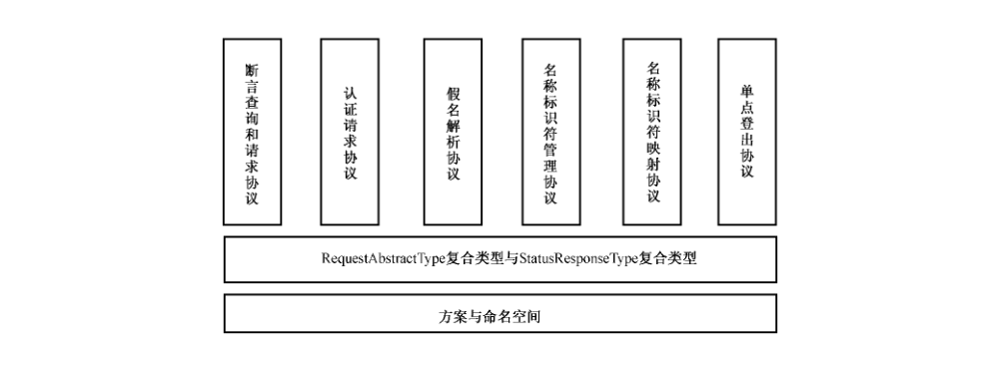

# GB/T 29242-2012 信息安全技术 鉴别与授权 安全断言标记语言

> 来源：[GB/T 29242-2012 国家标准详情](https://openstd.samr.gov.cn/bzgk/std/newGbInfo?hcno=65DF1EE9854A252CA0022C165835E292)；发布日期：2012-12-31；实施日期：2013-06-01。
> PDF SHA-256：a1a1240507eaf21986fe8228648d23aedb626f65aec4addd32e1c9a01268eabd。
> 转写说明：按页渲染官方 PDF 并进行图像识别，逐页对照全部 72 页原图校正文字、表格、图示和 XML 示例；合并跨页内容，省略封面、目录、页眉、页码及封底出版信息。附录 B 原文说明签名无效。正式引用请核对原 PDF。

## 前言

本标准依据 GB/T 1.1—2009 给出的规则起草，在制定过程中参考了信息标准促进组织（OASIS：Organization for the Advancement of Structured Information Standards）的 saml-core-2.0-os。

本标准由全国信息安全标准化技术委员会（SAC/TC 260）提出并归口。

本标准起草单位：中国科学院软件研究所、工业和信息化部电信研究院。

本标准主要起草人：陈驰、冯登国、付艳艳、张立武、荆继武、聂秀英、毕立波、薛宁、江浩清、武静。

## 引言

近年来，越来越多的信息系统通过 Web 服务、门户和集成化应用程序等方式实现互联，彼此间的安全信息共享需求日益强烈。但在互联网跨安全领域应用场景中，缺乏关于认证、属性和授权信息传输格式和协议的规范，信息安全产品之间互操作困难的情况，仍没有得到很好的解决。本标准通过定义一整套严格的、遵从 XML 编码格式的、关于安全断言的语法和语义规范以及标准的协议集合来缓解这种状况。

本标准参考了结构化信息标准促进组织（OASIS）的文件 Security Assertion Markup Language（SAML） v2.0。在原文件的基础上增加了“术语和定义”部分，增加了对标准范围的说明，修改了原文件的简介部分并增设了附录说明。同时新增了协议关系图说明各 SAML协议间的关系。

## 1 范围

本标准定义了一系列遵从 XML 编码格式的关于安全断言的语法、语义规范、系统实体间传递和处理 SAML 断言的协议集合和 SAML 系统管理相关的处理规则。

本标准适用于在互联网跨安全域应用场景中，身份鉴别，认证与授权服务的开发、测试、评估和采购。

## 2 规范性引用文件

下列文件对于本文件的应用是必不可少的。凡是注日期的引用文件，仅注日期的版本适用于本文件。凡是不注日期的引用文件，其最新版本（包括所有的修改单）适用于本文件。

- ISO/IEC 13568:2002 信息技术 Z 形式规范注释 语法、形式系统和语义学（Information technology—Z formal specification notation—Syntax, type system and semantics）
- RFC 1510 Kerberos 网络认证请求器（V5）（The Kerberos Network Authentication Service（V5））
- RFC 2253 轻量级目录访问控制（V3）（Lightweight Directory Access Protocol（V3））
- RFC 2396 统一资源标识：通用语法（Uniform Resource Identifiers（URI）：Generic Syntax）
- RFC 2822 因特网消息格式（Internet Message Format）
- RFC 3513 IPV6 地址结构（Internet Protocol Version 6（IPv6）Addressing Architecture）

## 3 术语和定义

下列术语和定义适用于本文件。

### 3.1 断言 assertion

由SAML 权威生成的对于主体认证行为的结果，包括与主体相关的属性信息或主体可使用的授权信息等数据。

### 3.2 鉴别 authentication

验证实体所声称的身份的动作。

### 3.3 授权 authorization

给予权利，包括访问权的授予。

### 3.4 绑定，协议绑定 binding,protocol binding

将一个关于协议消息和消息交换模式的标准映射到另一个协议的具体形式标准。

> 注：将 SAML 中的〈AuthnRequest〉消息映射到 HTTP 就是绑定的一个例子。下文中，在 SAML 上每个绑定都以“SAML xxx binding”的格式命名。

### 3.5 依赖方 relying party

根据从另一实体处获得的信息来决定如何进行动作的系统实体。

> 注：SAML 依赖方依赖于从断言方（SAML 权威）接收到的关于主体的断言。

### 3.6 SAML 权威 SAML authority

SAML 域模型中签发断言的抽象系统实体。

### 3.7 主体 subject

能访问客体的主动实体。

> 注：在本标准中，SAML 断言是对主体进行的声明。

### 3.8 用户 user

使用系统和系统资源的自然人。

> 注：尽管用户的概念能够被扩充以包含机器、网络、自主智能代理，但在本标准中，用户仅限于自然人。

## 4 缩略语

下列缩略语适用于本标准：

- HTTP 超文本传输协议（Hypertext Transfer Protocol）
- IdP 身份提供者（Identity Provider）
- RFC 请求注解（Request For Comments）
- SAML 安全断言置标语言（Security Assertion Markup Language）
- SOAP 简单对象访问协议（Simple Object Access Protocol）
- SP 服务提供者（Service Provider）
- URI 统一资源标识（Uniform Resource Identifier）
- URL 统一资源定位符（Uniform Resource Locator）
- URN 统一资源名（Uniform Resource Name）
- UTC 世界标准时间（Universal Time Coordinated）
- XML 可扩展置标语言（eXtensible Markup Language）

## 5 一致性

对于一个特定的应用，并非必须涉及安全断言置标语言的所有特征。鉴于此，本标准提供了一种通过对置标语言的特征进行选择以适用特定应用的方法。本标准中所定义的所有必需的核心特征集合都采用显式的［必需］进行标注，其他可选的特征集合则会采用［可选］进行标注，以方便使用者针对特定的应用进行选择。

## 6 SAML 断言

### 6.1 概述

断言是一个包含零个或更多个由 SAML 权威作出的声明的信息包。SAML 断言通常与由〈Subject〉元素表示的主体有关，但是断言中的〈Subject〉元素是可选的，以便其他的标准利用 SAML 断言来构建不包含特定主体的声明或通过其他方式来指定主体。通常，多个服务提供者 SP 会利用关于主体的断言来进行访问控制和提供个性化服务，这些 SP 就成为了这些断言发布者（称为身份提供者 IdP）的依赖方。

本标准定义了 SAML 权威可以生成的三种不同的断言声明。所有符合 SAML 定义的声明都与一个主体有关。这三种声明分别为：

a） 认证

断言主体在特定的时间通过特定的方式被认证过。

b） 属性

断言主体与提供的属性相关联。

c） 授权结果

断言主体对特定资源的访问请求通过或被拒绝。

断言的外部结构是通用的，提供了内部声明的公共信息。断言内部，通过一系列的内部元素描述了认证、属性、授权结果以及用户自定义的声明。

SAML 断言方案允许用户对现有断言和声明进行扩展或定义新的断言和声明类型，相关信息参见第 11 章。

### 6.2 方案头与命名空间声明

下面的示例定义了断言方案的XML命名空间以及其他头信息。

示例：

```xml
<schema targetNamespace = "urn:oasis:names:tc:SAML:2.0:assertion"
  xmlns = "http://www.w3.org/2001/XMLSchema"
  xmlns:saml = "urn:oasis:names:tc:SAML:2.0:assertion"
  xmlns:ds = "http://www.w3.org/2000/09/xmldsig#"
  xmlns:xenc = "http://www.w3.org/2001/04/xmlenc#"
  elementFormDefault = "unqualified"
  attributeFormDefault = "unqualified"
  blockDefault = "substitution"
  version = "2.0">
  <import namespace = "http://www.w3.org/2000/09/xmldsig#"
    schemaLocation = "http://www.w3.org/TR/2002/REC-xmldsig-core-20020212/xmldsig-core-schema.xsd"/>
  <import namespace = "http://www.w3.org/2001/04/xmlenc#"
    schemaLocation = "http://www.w3.org/TR/2002/REC-xmlenc-core-20021210/xenc-schema.xsd"/>
  <annotation>
    <documentation>
      Document identifier: saml-schema-assertion-2.0
      Location: http://docs.oasis-open.org/security/saml/v2.0/
      Revision history:
      V1.0 (November, 2002):
      Initial Standard Schema.
      V1.1 (September, 2003):
      Updates within the same V1.0 namespace.
      V2.0 (March, 2005):
      New assertion schema for SAML V2.0 namespace.
    </documentation>
  </annotation>
  ...
</schema>
```

### 6.3 名称标识符

#### 6.3.1 概述

本节中定义了包含主体、断言签发者和协议消息的描述标识符的 SAML 结构体。

在某些环境中，SAML 中的两个系统实体需要关于第三方进行一些通信（例如 SAML 认证协议允许第三方认证一个主体），因此有必要建立一个将参与方与标识符进行关联的方法。在某些情况下，需要限制标识符的使用范围，使其只能被少数几个系统实体使用（例如保护主体的隐私）。类似的标识符也可以用来引用协议消息或断言的签发者。

多个系统实体可能会对不同的身份使用同样的标识符，因为不同的系统实体对同样名称的理解是不同的。SAML 通过名称限定词，即把名称标识符置入一个和名称限定词相关的命名空间来消除该种歧义。SAML 允许标识符通过断言发布方和特定依赖方或从属关系的方式被限定，需要时允许以配对语意的形式出现。

当需要通过中间人来传输名称标识符时，可以通过对标识符加密来增强其隐私保护特性。

> 注：为了避免使用高级 XML 方案结构（以及其他原因），不同类型的标识符元素不能共享同一个类型层次。

#### 6.3.2 〈BaseID〉元素

〈BaseID〉元素是一个扩展点，使得应用程序可以添加新类型的标识符。它是 BaseIDAbstractType 复合类型的元素，该复合类型是一个抽象类型，因此只能作为被继承的源类型。它包含下列用来扩展的属性：

a） NameQualifier［可选］限定该标识符的安全域或管理域的名称。该属性与标识符联合作用，以避免同名用户的冲突。

b） SPNameQualifier［可选］使用服务提供者的名称进一步限定标识符。该属性为依赖方提供了一种联合标识符的方法。

如果标识符类型定义中未明确定义 NameQualifier 和 SPNameQualifier 的用途和语义，则这两个属性应该被省略。

下面的示例定义了〈BaseID〉元素及 BaseIDAbstractType 复合类。

示例：

```xml
<attributeGroup name = "IDNameQualifiers">
  <attribute name = "NameQualifier" type = "string" use = "optional"/>
  <attribute name = "SPNameQualifier" type = "string" use = "optional"/>
</attributeGroup>
<element name = "BaseID" type = "saml:BaseIDAbstractType"/>
<complexType name = "BaseIDAbstractType" abstract = "true">
  <attributeGroup ref = "saml:IDNameQualifiers"/>
</complexType>
```

#### 6.3.3 NameIDType 复合类

当元素通过字符串描述一个实体时，需要使用 NameIDType 复合类。它比〈BaseID〉元素拥有更加严格的限制，它也是〈NameID〉元素和〈Issuer〉元素的底层类型。除了描述实体的字符串外，它还包括下列属性：

a） NameQualifier［可选］限定该标识符的安全域或管理域的名称。该属性把标识符和名称限定词联合以避免同名用户的冲突。

b） SPNameQualifier［可选］使用服务提供者的名称进一步限定标识符，该属性为依赖方提供了一种联合标识符的方法。

c） Format［可选］一个 URI指针，用于描述基于字符串的标识符所属的类别。

如果 Format 的值没有指定，并且没有其他特殊说明，则以 urn:oasis:names:tc:SAML:1.0:nameid-format:unspecified 作为默认值。如果指定的 Format 值不符合 12.4 给出的细节要求，将根据标准外提供的说明进行解释。

除非定义中明确指出，否则与断言发送方和依赖方相关的标识符的匿名性、假名性和持续性将由具体实现决定。

d） SPProvidedID［可选］服务提供者建立的一个与元素中的主标识符不同的名称标识符。该属性提供了一种根据服务提供者的标识符进行整合的方法。例如，一个已存在的标识符可以通过使用7.7节中描述的名称标识符管理协议“连结”一个实体。

关于上述属性的额外使用规则可以在使用此复合类的上层元素中定义，或者通过 Format 值来进行定义。如果上层元素定义和 Format 均未明确定义 NameQualifier 和 SPNameQualifier 的用途和语义，则这两个属性应该被省略。

下面的示例定义了 NameIDType 复合类。

示例：

```xml
<complexType name = "NameIDType">
  <simpleContent>
    <extension base = "string">
      <attributeGroup ref = "saml:IDNameQualifiers"/>
      <attribute name = "Format" type = "anyURI" use = "optional"/>
      <attribute name = "SPProvidedID" type = "string" use = "optional"/>
    </extension>
  </simpleContent>
</complexType>
```

#### 6.3.4 〈NameID〉元素

〈NameID〉元素为 NameIDType 类型，用在〈Subject〉和〈SubjectConfirmation〉元素等多种 SAML 断言结构和多种协议消息中。

下面的示例定义了〈NameID〉元素。

示例：

```xml
<element name = "NameID" type = "saml:NameIDType"/>
```

#### 6.3.5 〈EncryptedID〉元素

〈EncryptedID〉元素为 EncryptedElementType 类型，包含一个加密的标识符元素。〈EncryptedID〉元素包含以下元素：

a） 〈xenc:EncryptedData〉［必需］加密内容及相关细节。其 Type 属性应该存在，并且若该属性存在，应包含值 http://www.w3.org/2001/04/xmlenc#Element。加密内容应包含一个 NameIDType 或 AssertionType 类型的元素，或起源于 BaseIDAbstractType、NameIDType 和 AssertionType 类型的元素。

b） 〈xenc:EncryptedKey〉［0 个或多个］打包解密密钥。每个解密密钥应该包含一个 Recipient 属性，指出该密钥加密的实体，该属性的值应该为 SAML 系统实体的 URI 标识符。

加密标识符可在通过中间人进行明文的值传输时提供隐私保护。对于每个加密操作，密文应唯一。

一个完整的断言也可通过加密到该元素内作为标识符使用。这种情况下，该断言的〈Subject〉元素提供了该断言的主体标识符。如果该认证断言无效，则其内部的封装断言也是无效的。

下面的示例定义了〈EncryptedID〉元素及其 EncryptedElementType 复合类。

示例：

```xml
<complexType name = "EncryptedElementType">
  <sequence>
    <element ref = "xenc:EncryptedData"/>
    <element ref = "xenc:EncryptedKey" minOccurs = "0" maxOccurs = "unbounded"/>
  </sequence>
</complexType>
<element name = "EncryptedID" type = "saml:EncryptedElementType"/>
```

#### 6.3.6 〈Issuer〉元素

〈Issuer〉元素为 NameIDType 复合类型，提供了 SAML 断言或协议消息的签发者信息。该元素应使用字符串作为签发者的名称，可以包含其他类型的说明信息。

如果该元素的 Format 值没有指定，则以 urn:oasis:names:tc:SAML:2.0:nameid-format:entity作为默认值。

下面的示例定义了〈Issuer〉元素。

示例：

```xml
<element name = "Issuer" type = "saml:NameIDType"/>
```

### 6.4 断言

#### 6.4.1 〈AssertionIDRef〉元素

〈AssertionIDRef〉元素使用唯一的标识符来创建一个 SAML 断言的引用。该元素内不包含断言的签发者。参见 7.4.1 中给出的使用该索引来获取相应断言的具体协议元素。

下面的示例定义了〈AssertionIDRef〉元素。

示例：

```xml
<element name = "AssertionIDRef" type = "NCName"/>
```

#### 6.4.2 〈AssertionURIRef〉元素

〈AssertionURIRef〉元素使用 URI 指针来引用 SAML 断言。也就是说，可以通过 URI 指针以特定的方式来获取对应的断言。下面的示例定义了〈AssertionURIRef〉元素。

示例：

```xml
<element name = "AssertionURIRef" type = "anyURI"/>
```

#### 6.4.3 〈Assertion〉元素

〈Assertion〉元素为 AssertionType 复合类型。该类型对断言包含的基本信息进行了说明，包括下列元素和属性：

a） Version［必需］断言的版本。使用本标准中定义的标识符版本是“2.0”，更详细的版本信息参见第 8 章。

b） ID［必需］断言标识符的ID，用 xs:ID 格式表示，且应遵循附录A中关于唯一性的要求。

c） IssueInstant［必需］使用 UTC 格式表示的断言签发时间。

d） 〈Issuer〉［必需］声明该断言的 SAML 权威（签发者）。对于依赖方，签发者应该是明确的。

本标准没有定义本元素中所描述的实体和对断言进行签名的实体间的具体关系。任何由断言使用方作出的强制要求与本标准无关。

e） 〈ds:Signature〉［可选］用来保护断言完整性和认证签发者的 XML 签名。具体信息参见下面的描述以及第 9 章中的描述。

f） 〈Subject〉［可选］断言中声明的主体。

g）〈Conditions〉［可选］当使用断言或验证断言有效性时，应对条件进行评价。评价过程的细节见 6.6。

h）〈Advice〉［可选］进行操作时附加的帮助信息。应用程序可根据需要忽略这些信息。

断言中还包含零或多个的下列元素：

i） 〈Statement〉声明。应使用一个 xsi:type 属性来指出其具体类型。

j） 〈AuthnStatement〉认证声明。

k） 〈AuthzDecisionStatement〉授权结果声明。

l） 〈AttributeStatement〉属性声明。

一个不包含声明的断言应包含一个〈Subject〉元素，这样的断言确定了一个主体但并不包含任何该主体的其他信息。

除此之外，〈Subject〉元素定义了该断言内所有声明的主体。如果该元素被省略，则断言中的声明将应用于通过其他方法确定的一个主体上。SAML 标准本身没有对不包含〈Subject〉元素的断言进行定义，因此在本标准中不讨论此类断言的意义。

根据具体协议的要求，SAML 断言的签发者通常需要经过认证并拥有完整性保护。认证和完整性保护可以由协议绑定提供的机制来完成。SAML 断言可以通过签名来认证签发者并提供完整性保护。

如果应用了签名，则应同时使用〈ds:Signature〉元素，且依赖方应对签名的有效性进行检验。如果签名无效，则依赖方应不信任断言的内容。如果签名有效，依赖方应该对签名进行评价以确定签发者的身份及其适当性并进一步使用其标准对断言内容进行分析。

无论是否经过签名，如果它们的主体、环境等相同，则包含在同一断言内的一系列声明和单独包含这些声明的一系列断言在语意上都是相等的。

下面的示例定义了〈Assertion〉元素及 AssertionType 复合类。

示例：

```xml
<element name = "Assertion" type = "saml:AssertionType"/>
<complexType name = "AssertionType">
  <sequence>
    <element ref = "saml:Issuer"/>
    <element ref = "ds:Signature" minOccurs = "0"/>
    <element ref = "saml:Subject" minOccurs = "0"/>
    <element ref = "saml:Conditions" minOccurs = "0"/>
    <element ref = "saml:Advice" minOccurs = "0"/>
    <choice minOccurs = "0" maxOccurs = "unbounded">
      <element ref = "saml:Statement"/>
      <element ref = "saml:AuthnStatement"/>
      <element ref = "saml:AuthzDecisionStatement"/>
      <element ref = "saml:AttributeStatement"/>
    </choice>
  </sequence>
  <attribute name = "Version" type = "string" use = "required"/>
  <attribute name = "ID" type = "ID" use = "required"/>
  <attribute name = "IssueInstant" type = "dateTime" use = "required"/>
</complexType>
```

#### 6.4.4 〈EncryptedAssertion〉元素

〈EncryptedAssertion〉元素描述了一个加密的断言。该元素包含以下元素：

a） 〈xenc:EncryptedData〉［必需］加密内容及相关细节。其 Type 属性应该存在且若存在，应包含为 http://www.w3.org/2001/04/xmlenc#Element 的值。其加密部分应包含一个源自 AssertionType 的元素。

b） 〈xenc:EncryptedKey〉［0 个或多个］打包解密密钥。每个解密密钥应该包含一个 Recipient 属性以指出该密钥加密的实体，该属性的值应该为该实体的 SAML URI 标识符。

加密断言可在通过中间人进行明文的值传输时提供隐私保护。

下面的示例定义了〈EncryptedAssertion〉元素。

示例：

```xml
<element name = "EncryptedAssertion" type = "saml:EncryptedElementType"/>
```

### 6.5 主体

#### 6.5.1 〈Subject〉元素

可选的〈Subject〉元素确定了断言内所有声明（0 个或多个）的共同主体，包含一个标识符或者若干个主体证明。

a） 〈BaseID〉、〈NameID〉或〈EncryptedID〉［可选］确定主体。

b） 〈SubjectConfirmation〉［0 个或多个］可以证明主体的信息。如果存在一个以上的主体证明，则检验其中任意一个即可。

一个〈Subject〉元素可以同时包含标识符以及主体证明，使得依赖方可以在处理断言时进行校验。

如果其中包含的任意一个主体证明通过校验，依赖方可以将提出该断言的实体与断言内的主体和声明相关联，该实体可以不同于真正的主体。

如果不包含主体证明，断言的提交者与主体间不存在任何关系。

一个〈Subject〉元素不应该定义一个以上的主体。

下面的示例定义了〈Subject〉元素及 SubjectType 复合类。

示例：

```xml
<element name = "Subject" type = "saml:SubjectType"/>
<complexType name = "SubjectType">
  <choice>
    <sequence>
      <choice>
        <element ref = "saml:BaseID"/>
        <element ref = "saml:NameID"/>
        <element ref = "saml:EncryptedID"/>
      </choice>
      <element ref = "saml:SubjectConfirmation" minOccurs = "0" maxOccurs = "unbounded"/>
    </sequence>
    <element ref = "saml:SubjectConfirmation" maxOccurs = "unbounded"/>
  </choice>
</complexType>
```

#### 6.5.2 〈SubjectConfirmation〉元素

〈SubjectConfirmation〉元素为依赖方提供了校验主体的方法，它包含以下属性和元素：

a） Method［必需］指向确定主体的协议或机制的 URI 指针。协议使用者可以通过定义新的 URI 或私下协商来引入新的方法。

b） 〈BaseID〉、〈NameID〉或〈EncryptedID〉［可选］标明要验证是否满足主体证明请求的实体。

c） 〈SubjectConfirmationData〉［可选］某些证明方法需要的额外信息。例如一个〈ds:KeyInfo〉元素，可用来代表一个密钥。其他标准可对〈SubjectConfirmationData〉中包含的信息内容作具体要求。

下面的示例定义了〈SubjectConfirmation〉元素及 SubjectConfirmationType 复合类。

示例：

```xml
<element name = "SubjectConfirmation" type = "saml:SubjectConfirmationType"/>
<complexType name = "SubjectConfirmationType">
  <sequence>
    <choice minOccurs = "0">
      <element ref = "saml:BaseID"/>
      <element ref = "saml:NameID"/>
      <element ref = "saml:EncryptedID"/>
    </choice>
    <element ref = "saml:SubjectConfirmationData" minOccurs = "0"/>
  </sequence>
  <attribute name = "Method" type = "anyURI" use = "required"/>
</complexType>
```

#### 6.5.3 〈SubjectConfirmationData〉元素

〈SubjectConfirmationData〉元素属于 SubjectConfirmationDataType 复合类。提供了可以证明主体的额外信息。当依赖方需要校验提出断言的实体（即证明实体）和断言宣称的主体间的关系时，需要使用主体证明。主体证明包含了下列可选信息：

a） NotBefore［可选］UTC 格式的证明起始时间。

b） NotOnOrAfter［可选］UTC 格式的证明结束时间。

c） Recipient［可选］描述实体或某证明实体发布断言的地址的 URI。例如，该属性可限定断言应发送到特定的网络终端以避免中间人攻击。

d） InResponseTo［可选］一个 SAML 协议消息 ID，证明实体可发布断言到该 ID。该属性可以将一个 SAML 请求与该断言关联。

e） Address［可选］证明实体可发布断言的网络地址。该属性可将特定的终端地址与断言绑定以避免攻击者轻易的窃取和发布断言。IPv4 地址应该使用通常的点-十进制格式描述（例如，“1.2.3.4”）。IPv6 地址应该用 IETF RFC 3513［RFC 3513］中 2.2 定义的格式来表示（例如“FEDC:BA98:7654:3210:FEDC:BA98:7654:3210”）。

f） Arbitrary attributes

本复合类使用了〈xs:anyAttribute〉扩展点，从而可以在〈SubjectConfirmationData〉结构上添加任意的命名空间限定的 XML 属性，而不需要提出特定的扩展方案。这种附加域可按需添加，以提供所需要的附加证明信息。SAML 扩展应不添加任何本地（非命名空间限定的）XML 属性或 SubjectConfirmationDataType 类型及起源于该类型的 SAML 格式的命名空间限定的 XML 属性。这些属性为 SAML 所保留，以备维护及改进之用。

g） Arbitrary elements

本复合类可利用〈xs:any〉扩展点在〈SubjectConfirmationData〉结构上添加任意的 XML 元素，而不需要定义专门的扩展方案。从而可以视需要添加元素来附加证明信息。

如果时间限定存在，应该包含于〈Conditions〉元素的 NotBefore 和 NotOnOrAfter 属性中，且本复合类中 NotBefore 应早于 NotOnOrAfter。

下面的示例定义了〈SubjectConfirmationData〉元素以及 SubjectConfirmationDataType 复合类型。

示例：

```xml
<element name = "SubjectConfirmationData" type = "saml:SubjectConfirmationDataType"/>
<complexType name = "SubjectConfirmationDataType" mixed = "true">
  <complexContent>
    <restriction base = "anyType">
      <sequence>
        <any namespace = "##any" processContents = "lax" minOccurs = "0" maxOccurs = "unbounded"/>
      </sequence>
      <attribute name = "NotBefore" type = "dateTime" use = "optional"/>
      <attribute name = "NotOnOrAfter" type = "dateTime" use = "optional"/>
      <attribute name = "Recipient" type = "anyURI" use = "optional"/>
      <attribute name = "InResponseTo" type = "NCName" use = "optional"/>
      <attribute name = "Address" type = "string" use = "optional"/>
      <anyAttribute namespace = "##other" processContents = "lax"/>
    </restriction>
  </complexContent>
</complexType>
```

#### 6.5.4 KeyInfoConfirmationDataType 复合类

KeyInfoConfirmationDataType 复合类要求〈SubjectConfirmationData〉元素应包含若干个〈ds:KeyInfo〉元素，用〈ds:KeyInfo〉元素来指明认证证明方的密文密钥。证明方法中应详细定义数据使用的机制。SubjectConfirmationDataType 复合类中出现的可选属性也可以在本复合类中出现。

使用〈ds:KeyInfo〉元素来定义数据的证明方法应该可以使用本类型和本类型的衍生类。

所有〈ds:KeyInfo〉元素应识别单一的密文密钥。多重的密钥可以使用单独的〈ds:KeyInfo〉进行识别。例如，主体可利用不同的密钥向不同依赖方证明自己。

下面的示例定义了 KeyInfoConfirmationDataType 复合类。

示例：

```xml
<complexType name = "KeyInfoConfirmationDataType" mixed = "false">
  <complexContent>
    <restriction base = "saml:SubjectConfirmationDataType">
      <sequence>
        <element ref = "ds:KeyInfo" maxOccurs = "unbounded"/>
      </sequence>
    </restriction>
  </complexContent>
</complexType>
```

#### 6.5.5 经密钥认证的〈Subject〉实例

为了描述上述元素和类型如何共同作用，下面给出一个包含名称标识符和主体证明的〈Subject〉元素的实例。

请注意其中使用 KeyInfoConfirmationDataType 复合类型包含的〈ds:KeyInfo〉元素来定义证明信息的方式。

示例：

```xml
<Subject>
  <NameID Format = "urn:oasis:names:tc:SAML:1.1:nameid-format:emailAddress">
    scott@example.org
  </NameID>
  <SubjectConfirmation Method = "urn:oasis:names:tc:SAML:2.0:cm:holder-of-key">
    <SubjectConfirmationData xsi:type = "saml:KeyInfoConfirmationDataType">
      <ds:KeyInfo>
        <ds:KeyName>Scotts Key</ds:KeyName>
      </ds:KeyInfo>
    </SubjectConfirmationData>
  </SubjectConfirmation>
</Subject>
```

### 6.6 条件

#### 6.6.1 〈conditions〉元素

##### 6.6.1.1 概述

〈conditions〉元素可以包括下列元素与属性：

a） NotBefore［可选］指定了断言生效的最初时间。此时间值采用 UTC 编码，相关信息参见附录 A。

b） NotOnOrAfter［可选］指定了断言失效的时间。此时间值采用 UTC 编码，相关信息参见附录 A。

c）〈Condition〉［任意数目］定义在一个扩展方案中某个类型的条件。应使用属性 xsi:type 来指明实际的条件类别。

d）〈AudienceRestriction〉［任意数目］指定断言只能针对特定依赖方发布。

e）〈OneTimeUse〉［可选］指定断言应当立即被使用，不应保留备用。尽管方案允许多次出现，但对此元素应至多只有一个实例。

f）〈ProxyRestriction〉［可选］指定断言发送方对符合下列条件的依赖方作出的限制，依赖方希望下一步自己作为断言发送方根据初始断言中包含的信息发布自己的断言。尽管方案允许多次出现，但对此元素应至多只有一个实例。

使用属性 xsi:type 使得一个断言中可能会包含多个 ConditionsType 子类型（如 OneTimeUse 类型）的实例，方案中也并没有明确限制某 ConditionsType 的子类型可以被包含的次数。但是，特定的属性类型可以限定这类条件的使用。如上面的 ProxyRestriction 等。

下面的示例定义了元素〈Conditions〉及复合类型 ConditionsType。

示例：

```xml
<element name = "Conditions" type = "saml:ConditionsType"/>
<complexType name = "ConditionsType">
  <choice minOccurs = "0" maxOccurs = "unbounded">
    <element ref = "saml:Condition"/>
    <element ref = "saml:AudienceRestriction"/>
    <element ref = "saml:OneTimeUse"/>
    <element ref = "saml:ProxyRestriction"/>
  </choice>
  <attribute name = "NotBefore" type = "dateTime" use = "optional"/>
  <attribute name = "NotOnOrAfter" type = "dateTime" use = "optional"/>
</complexType>
```

##### 6.6.1.2 属性 NotBefore 与 NotOnOrAfter

属性 NotBefore 与 NotOnOrAfter 指定了断言在其使用上下文中断言有效性的时间限制。这两个属性并不保证断言中的陈述在该有效期内恰当或精确。

属性 NotBefore 指定有效期的起始时间。属性 NotOnOrAfter 指定有效期的终止时间。

若属性 NotBefore 或 NotOnOrAfter 的值被省略，则认为该值未指定。若属性 NotBefore 未指定（且所有其他条件值均为有效），则该断言在属性 NotOnOrAfter 指定的时间前的任何时刻都是关于条件有效的。若属性 NotOnOrAfter 未指定（且所有其他条件均为有效），则该断言从属性 NotBefore 指定的时间起关于条件有效，没有失效期。若两个属性都未指定（且所有其他条件均有效），则该断言任何时刻都是对于条件有效的。

若属性 NotBefore 与 NotOnOrAfter 都存在，则属性 NotBefore 的值应小于（或早于）属性 NotOnOrAfter 的值。

##### 6.6.1.3 〈Condition〉元素

〈Condition〉元素是为新条件提供的扩展点。其中的 ConditionAbstractType 复合类是抽象的，所以只可用作一个衍生类的基础。

下面的示例定义了〈Condition〉元素及 ConditionAbstractType 复合类。

示例：

```xml
<element name = "Condition" type = "saml:ConditionAbstractType"/>
<complexType name = "ConditionAbstractType" abstract = "true"/>
```

##### 6.6.1.4 〈AudienceRestriction〉与〈Audience〉元素

〈AudienceRestriction〉元素指定该断言将被发送给〈Audience〉元素标识的一个或多个特定的依赖方。虽然特定依赖方之外的一个 SAML 依赖方也能够从该断言中获得信息，但 SAML 断言发送方没有对这样的依赖方明确做出任何精确或可信的陈述。〈AudienceRestriction〉包括以下元素：

〈Audience〉

一个 URI 指针，标识了一个指定的依赖方。此 URI 指针可能标识一个文档，该文档描述了接收群的限制与条件。它也可能包含一个唯一的标识符 URI，代表一个系统实体的 SAML 名称标识符。

依赖方限制条件有效当且仅当该 SAML 依赖方是指定的一个或多个依赖方中的成员。

SAML 断言发送方无法阻止获取断言的依赖方在断言所提供信息的基础上采取行动。但是元素〈AudienceRestriction〉使得 SAML 断言发送方能够以机器及人可读的形式明确声明没有授权给这样的依赖方。尽管不能保证执法机构会在所有情况下支持这样的排除性授权，但可以显著增加支持排除性授权的可能性。

需要注意的是，一个断言中可能包含多个〈AudienceRestriction〉元素，每个元素应独立判断。在此需求和以上定义的共同作用下，对给定条件，依赖方间的关系是或（or），多重条件间的关系是与（and）。

下面的示例定义了〈AudienceRestriction〉元素及 AudienceRestrictionType 复合类。

示例：

```xml
<element name = "AudienceRestriction" type = "saml:AudienceRestrictionType"/>
<complexType name = "AudienceRestrictionType">
  <complexContent>
    <extension base = "saml:ConditionAbstractType">
      <sequence>
        <element ref = "saml:Audience" maxOccurs = "unbounded"/>
      </sequence>
    </extension>
  </complexContent>
</complexType>
<element name = "Audience" type = "anyURI"/>
```

##### 6.6.1.5 〈OneTimeUse〉元素

一般情况下，依赖方可能选择保留断言，或以其他形式保留断言中的信息，以备重用。〈OneTimeUse〉元素使得一个权威机构可以指明断言中的信息可能频繁变化，每次使用都应获取最新的信息。例如，一个断言中包含了〈AuthzDecisionStatement〉，代表访问控制决策的结果，其值是随一天中的时间变化的。

如果分布式环境中的系统时钟可以精确同步，则此需求可以通过精心使用有效期的方式来满足。

然而，由于系统间的时钟误差总是存在的，以及可能出现传输延迟，因此发布方没有便捷的方法既能适当地限制断言的有效期，又可避免断言可能在到达依赖方前就已失效的风险。

〈OneTimeUse〉元素指明依赖方应该立即使用该断言，不允许保留以备后用。依赖方可以在每次使用时请求一个新的断言。选择保留断言以备后用的实现应遵从〈OneTimeUse〉元素。本条件相对于 NotBefore 与 NotOnOrAfter 条件信息是独立的。

为了支持此一次性使用的限制，依赖方需要维护一个断言缓存，保存其所处理过的包含此条件的断言。一旦处理到包含此条件的断言，就检查缓存，确保本依赖方此前没有接收处理过同一条断言。

一个 SAML 权威不允许在一个断言的某个〈Conditions〉元素中包含多于一个〈OneTimeUse〉元素。

为了确定〈Conditions〉元素的有效性，〈OneTimeUse〉元素始终有效。亦即，此条件是一个使用条件，不影响断言的有效性。

下面的方案片断定义了〈OneTimeUse〉元素及 OneTimeUseType 复合类。

示例：

```xml
<element name = "OneTimeUse" type = "saml:OneTimeUseType"/>
<complexType name = "OneTimeUseType">
  <complexContent>
    <extension base = "saml:ConditionAbstractType"/>
  </complexContent>
</complexType>
```

##### 6.6.1.6 〈ProxyRestriction〉元素

该元素指定了断言发送方对依赖方的限制，指定哪些依赖方下一步可作为断言发送方，发布其在初始断言包含的信息基础上自行生成的断言。违反该元素中限制的依赖方不得作为断言发送方发布一个断言。

〈ProxyRestriction〉元素包含下述元素与属性：

a） Count［可选］指定了断言发送方允许存在于本断言与基于其发布的最终断言间的间接断言的最大数目。

b） 〈Audience〉［0 个或多个］指定了断言发送方允许的，基于本断言产生的新断言可发送到的依赖方的集合。

Count 值为 0，表明该依赖方绝对不可向另一个依赖方发布一个基于本断言的断言。如果大于 0，任何基于本断言发布的断言应包含一个元素〈ProxyRestriction〉，其中的 Count 值不得大于本断言的 Count 值减 1。

如果没有指定〈Audience〉元素，则没有向依赖方施加发布后续断言的依赖方限制。否则，这样发布的断言中应包含一个〈AudienceRestriction〉元素，其中至少包含本断言〈ProxyRestriction〉元素中的一个〈Audience〉元素；并且要求不得包含本断言的〈ProxyRestriction〉元素中不包括的〈Audience〉元素。

一个 SAML 权威不允许在一个断言的〈Conditions〉元素中包含多于一个的〈ProxyRestriction〉元素。

为了确定元素〈Conditions〉的有效性，〈ProxyRestriction〉条件始终有效。亦即，此条件是一个使用条件，不影响断言的有效性。

下面的方案片断定义了〈ProxyRestriction〉元素及 ProxyRestrictionType 复合类。

示例：

```xml
<element name = "ProxyRestriction" type = "saml:ProxyRestrictionType"/>
<complexType name = "ProxyRestrictionType">
  <complexContent>
    <extension base = "saml:ConditionAbstractType">
      <sequence>
        <element ref = "saml:Audience" minOccurs = "0" maxOccurs = "unbounded"/>
      </sequence>
      <attribute name = "Count" type = "nonNegativeInteger" use = "optional"/>
    </extension>
  </complexContent>
</complexType>
```

#### 6.6.2 一般处理规则

如果一个断言中包含元素〈Conditions〉，则该断言的有效性依赖于所给出的子元素与属性，所采用的规则如下文依次所述：

- 如果元素〈Conditions〉中没有子元素或属性，则该断言经过条件处理是有效的；
- 如果元素〈Conditions〉中的任何子元素或属性是无效的，则该断言是无效的；
- 如果元素〈Conditions〉中的任何子元素或属性的值不可读，或元素不可理解，则该断言的有效性无法确定，该断言是不确定的；
- 如果元素〈Conditions〉中的所有子元素与属性是有效的，则该断言经过条件处理是有效的。

前面的规则一旦适用，条件处理过程即终止，所以断言无效的判断优先于断言不确定的判断。

无效的或不确定的断言应被依赖方丢弃（不论其在何种上下文或保护轮廓中被处理），和该断言形式错误或不可使用的情况下的处理方式相同。

注 1：即使一个断言中条件有效性状态为有效，它仍可能不可信或无效，原因包括该断言形式不正确、方案无效、不是由可信 SAML 权威发布或不是以可信方式认证的等。

注 2：一些条件可能并不直接影响断言的有效性（断言总为有效），但会限制接收断言方在使用该断言方面的行为。

### 6.7 建议

本节定义了包含断言发送方希望提供给依赖方的关于断言的附加信息的 SAML 结构。

〈Advice〉元素中包含 SAML 权威希望提供的所有附加信息。这些信息可以忽略，既不会影响断言的语义，也不会影响断言的有效性。

〈Advice〉元素包含 0 个或多个〈Assertion〉、〈EncryptedAssertion〉、〈AssertionIDRef〉、〈AssertionURIRef〉元素，以及非 SAML 命名空间的其他命名空间有效元素。

下面是〈Advice〉元素的一些应用：

- 包含支持断言声明被引用的证据，可以是直接的（通过合并声明）或间接的（通过指向支持的断言）；
- 陈述断言声明的依据；
- 指定断言更新的时间与发布点。

下面的示例定义了〈Advice〉元素及 AdviceType 复合类。

示例：

```xml
<element name = "Advice" type = "saml:AdviceType"/>
<complexType name = "AdviceType">
  <choice minOccurs = "0" maxOccurs = "unbounded">
    <element ref = "saml:AssertionIDRef"/>
    <element ref = "saml:AssertionURIRef"/>
    <element ref = "saml:Assertion"/>
    <element ref = "saml:EncryptedAssertion"/>
    <any namespace = "##other" processContents = "lax"/>
  </choice>
</complexType>
```

### 6.8 声明

#### 6.8.1 〈Statement〉元素

〈Statement〉元素是一个扩展点，使得其他基于断言的应用能够重用 SAML 断言框架。SAML 自身就是从此扩展点得出其核心声明的。该元素所属的 StatementAbstractType 复合类是抽象的，所以只可用作一个衍生类的基础。

下述示例定义了〈Statement〉元素及 StatementAbstractType 复合类。

示例：

```xml
<element name = "Statement" type = "saml:StatementAbstractType"/>
<complexType name = "StatementAbstractType" abstract = "true"/>
```

#### 6.8.2 〈AuthnStatement〉元素

##### 6.8.2.1 概述

〈AuthnStatement〉元素描述了 SAML 权威作出的声明，声称断言主体是在特定时间以特定方式被认证的。包含〈AuthnStatement〉元素的断言应包含一个〈Subject〉元素。

通过附加下列元素与属性，AuthnStatementType 类扩展了 StatementAbstractType 类：

a） AuthnInstant［必需］指定了认证发生的时间。此时间值采用 UTC 编码，详细信息参见附录 A。

b） SessionIndex［可选］指定了 SAML 主体所标识的主体与认证权威间特定会话的索引。

c） SessionNotOnOrAfter［可选］指定了 SAML 主体所标识的主体与发布此声明的 SAML 权威间的会话应终止的时刻。此时间值采用 UTC 编码，详细信息参见附录 A。此属性与此断言中可能存在的 NotOnOrAfter 条件属性间没有必然联系。

d） 〈SubjectLocality〉［可选］指定了被认证的断言主体的系统的 DNS 域名与 IP 地址。

e）〈AuthnContext〉［必需］产生该声明的认证事件中的认证权威所使用的上下文。其中包含一个认证上下文类指针，一个认证上下文声明或声明的指针，或声明和声明指针两者都有。

通常，任何字符串值都可以用作 SessionIndex 值。然而，当考虑隐私时，应注意保证 SessionIndex 值不会使得其他隐私机制失效。因此，SessionIndex 值不能被用来关联一个主体与不同会话对象间的活动。为达到此目的，下面提供两种推荐方案：

- SessionIndex 值采用小正整数（或一个列表中的重用常数值）。SAML 权威应该选择该值的范围，使得集合中元素的个数充分的多，以防止特定主体与多个会话对象间的活动被关联。SAML 权威应该在此范围内随机选择 SessionIndex 值（除了应确保唯一值，以区分同一会话对象的不同会话部分的后继声明的情况）。
- 在 SessionIndex 中使用封装的断言 ID 值。

下面的示例定义了〈AuthnStatement〉断言及 AuthnStatementType 复合类。

示例：

```xml
<element name = "AuthnStatement" type = "saml:AuthnStatementType"/>
<complexType name = "AuthnStatementType">
  <complexContent>
    <extension base = "saml:StatementAbstractType">
      <sequence>
        <element ref = "saml:SubjectLocality" minOccurs = "0"/>
        <element ref = "saml:AuthnContext"/>
      </sequence>
      <attribute name = "AuthnInstant" type = "dateTime" use = "required"/>
      <attribute name = "SessionIndex" type = "string" use = "optional"/>
      <attribute name = "SessionNotOnOrAfter" type = "dateTime" use = "optional"/>
    </extension>
  </complexContent>
</complexType>
```

##### 6.8.2.2 〈SubjectLocality〉元素

〈SubjectLocality〉元素指定了认证断言主体的系统 DNS 域名与 IP 地址。〈SubjectLocality〉元素中有下列属性：

a） Address［可选］认证断言主体标识的主体系统的网络地址。IPv4 地址应该采用通常的点-十进制格式描述（例如“1.2.3.4”）。IPv6 地址应该用 IETF RFC 3513［RFC 3513］中 2.2 定义的格式来表示（例如“FEDC:BA98:7654:3210:FEDC:BA98:7654:3210”）。

b） DNSName［可选］认证断言主体标识的主体系统的 DNS 域名。

由于以上两个属性值都十分容易被欺骗，所以本元素完全用于参考，只在某些应用中可能是有用的信息。

下述示例定义了〈SubjectLocality〉元素及 SubjectLocalityType 复合类。

示例：

```xml
<element name = "SubjectLocality" type = "saml:SubjectLocalityType"/>
<complexType name = "SubjectLocalityType">
  <attribute name = "Address" type = "string" use = "optional"/>
  <attribute name = "DNSName" type = "string" use = "optional"/>
</complexType>
```

##### 6.8.2.3 〈AuthnContext〉元素

〈AuthnContext〉元素指定了一个认证事件的上下文。此元素可以包含一个认证上下文类指针，一个认证上下文声明或声明指针，或声明及声明指针两者都有。其复合类 AuthnContextType 中含有以下元素：

a） 〈AuthnContextClassRef〉［可选］标识一个认证上下文种类的 URI 指针，认证上下文种类描述了其后的认证上下文声明。

b） 〈AuthenticatingAuthority〉［0 个或多个］与主体认证有关的 0 个或多个认证权威的唯一标识符（不包括断言发送方，假定其必定相关因此无需在此特别指定）。

下面的示例定义了〈AuthnContext〉元素及 AuthnContextType 复合类。

示例：

```xml
<element name = "AuthnContext" type = "saml:AuthnContextType"/>
<complexType name = "AuthnContextType">
  <sequence>
    <choice>
      <sequence>
        <element ref = "saml:AuthnContextClassRef"/>
        <choice minOccurs = "0">
          <element ref = "saml:AuthnContextDecl"/>
          <element ref = "saml:AuthnContextDeclRef"/>
        </choice>
      </sequence>
      <choice>
        <element ref = "saml:AuthnContextDecl"/>
        <element ref = "saml:AuthnContextDeclRef"/>
      </choice>
    </choice>
    <element ref = "saml:AuthenticatingAuthority" minOccurs = "0" maxOccurs = "unbounded"/>
  </sequence>
</complexType>
<element name = "AuthnContextClassRef" type = "anyURI"/>
<element name = "AuthnContextDeclRef" type = "anyURI"/>
<element name = "AuthnContextDecl" type = "anyType"/>
<element name = "AuthenticatingAuthority" type = "anyURI"/>
```

#### 6.8.3 〈AttributeStatement〉元素

##### 6.8.3.1 概述

〈AttributeStatement〉元素描述 SAML 权威的声明，用于声称断言的主体与指定属性相关联。包含〈AttributeStatement〉元素的断言应包含一个〈Subject〉元素。

AttributeStatementType 类通过附加下述元素与属性，扩展了 StatementAbstractType 类：

〈Attribute〉或〈EncryptedAttribute〉［一个或多个］

〈Attribute〉元素指定了断言主体的一个属性。〈EncryptedAttribute〉元素中可能包含一个加密的 SAML 属性。

下面的示例定义了〈AttributeStatement〉元素及 AttributeStatementType 复合类。

示例：

```xml
<element name = "AttributeStatement" type = "saml:AttributeStatementType"/>
<complexType name = "AttributeStatementType">
  <complexContent>
    <extension base = "saml:StatementAbstractType">
      <choice maxOccurs = "unbounded">
        <element ref = "saml:Attribute"/>
        <element ref = "saml:EncryptedAttribute"/>
      </choice>
    </extension>
  </complexContent>
</complexType>
```

##### 6.8.3.2 〈Attribute〉元素

〈Attribute〉元素标识属性名并可选地包含其属性值。该元素属于 AttributeType 复合类，可以用在一个属性声明中，用来描述与断言主体相关联的特定属性及属性值。该元素也可用于属性查询中，用来请求返回特定 SAML 属性的值。〈Attribute〉元素包含以下 XML 属性：

a） Name［必需］属性名。

b） NameFormat［可选］用于对属性名进行解释的表示属性名分级的 URI 指针。可以用作 NameFormat 属性值的 URI 指针及其相关描述与处理规则见 12.3。如果没有指定 NameFormat 值，并且没有其他特别说明时，则以 urn:oasis:names:tc:SAML:2.0:attrname-format:unspecified 作为默认值。

c） FriendlyName［可选］提供属性名的可读串形式，在实际 Name 复杂或不透明的情况下（如 OID 或 UUID）可能有所帮助。本属性值不能用来正式标识 SAML 属性值。

d） Arbitrary attributes

此复合类采用一个〈xs:anyAttribute〉扩展点来向结构〈Attribute〉中添加任意的 XML 属性而不需要明确的方案扩展。这使得当需要使用额外的参数的时候，可以添加所需的额外字段。SAML 扩展不得向 AttributeType 复合类及其衍生类添加本地（无命名空间限定）的 XML 属性或 SAML 定义的命名空间所限定的 XML 属性；SAML 保留这样的属性用作未来自身的维护与改进。

e） 〈AttributeValue〉［任意数目］包含属性的一个值。如果一个属性包含有超过一个的不连续值，建议将出现的每个值都使用单独的〈AttributeValue〉元素存放。如果此属性中有多于一个的〈AttributeValue〉元素，且其中任意元素通过 xsi:type 分配了一个数据类型，则所有〈AttributeValue〉元素应分配同一个数据类型。

一个〈Attribute〉元素中若不包含〈AttributeValue〉元素，则其意义依赖于其上下文。在一个〈AttributeStatement〉元素中，如果 SAML 属性存在但是没有值，则〈AttributeValue〉元素应被忽略。在〈samlp:AttributeQuery〉中，如果出现没有值的情况，则意味着请求者对指定属性的任意或所有值感兴趣。

其他规范中如果涉及对〈Attribute〉元素的任何其他使用，应定义相应的语义来规范或忽略〈AttributeValue〉元素。

下面的示例定义了〈Attribute〉元素及 AttributeType 复合类。

示例：

```xml
<element name = "Attribute" type = "saml:AttributeType"/>
<complexType name = "AttributeType">
  <sequence>
    <element ref = "saml:AttributeValue" minOccurs = "0" maxOccurs = "unbounded"/>
  </sequence>
  <attribute name = "Name" type = "string" use = "required"/>
  <attribute name = "NameFormat" type = "anyURI" use = "optional"/>
  <attribute name = "FriendlyName" type = "string" use = "optional"/>
  <anyAttribute namespace = "##other" processContents = "lax"/>
</complexType>
```

〈AttributeValue〉元素提供了 SAML 属性的值。它是一个 xs:anyType 类，允许任何形式正确的 XML 出现在元素内容中。

如果〈AttributeValue〉元素的数据内容是一个 XML 简单类（例如 xs:integer 或 xs:string），则数据类型可以以一个 xsi:type 声明的方式直接声明于元素〈AttributeValue〉中。如果属性值中包含结构性数据，则必要的数据元素可以在扩展方案中定义。

需要注意的是，在〈AttributeValue〉元素中指定的数据类型若不是以 xsi:type 声明的 XML 方案简单类，则需要存在一个已定义的数据类型的扩展方案，以进行方案处理。

如果一个 SAML 属性包含一个空值，例如空串，则相应的〈AttributeValue〉元素应为空（一般表示为〈AttributeValue/〉）。这条规则的优先级高于附录 A 中 SAML 内容的串值至少包含一个非空白字符的需求。

如果 SAML 属性包含一个 null 值，则其对应的〈AttributeValue〉元素应为空，且应包含保留的 xsi:nil XML 属性，其值 true 或 1。

下面的示例定义了元素〈AttributeValue〉。

示例：

```xml
<element name = "AttributeValue" type = "anyType" nillable = "true"/>
```

##### 6.8.3.3 〈EncryptedAttribute〉元素

〈EncryptedAttribute〉元素代表一个加密 SAML 属性。〈EncryptedAttribute〉元素包含下列元素：

a） 〈xenc:EncryptedData〉［必需］加密内容与相关加密细节。其 Type 属性应该存在，若存在，则应包含一个 http://www.w3.org/2001/04/xmlenc#Element 值。加密内容应包含一个元素，该元素应衍生自 AttributeType 类型。

b） 〈xenc:EncryptedKey〉［0 个或多个］封装的解密密钥。每个解密密钥都应该包含一个 Recipient 属性，指定该密钥加密的实体。

Recipient 属性的值应该是一个 URI 标识符，标识一个拥有 SAML 名字标识符的系统实体。

加密属性在通过中间人进行明文传输时提供机密性保护。

下述示例定义了〈EncryptedAttribute〉元素。

示例：

```xml
<element name = "EncryptedAttribute" type = "saml:EncryptedElementType"/>
```

#### 6.8.4 〈AuthzDecisionStatement〉元素

##### 6.8.4.1 概述

〈AuthzDecisionStatement〉元素描述了一个 SAML 权威的声明。该声明表明，基于某些可选的证据，断言主体访问指定资源的请求已经获得了指定的授权决策结果。包含该元素的断言应包含一个〈Subject〉元素。

资源以 URI 指针方式标识。为了正确安全地解释断言，SAML 权威与 SAML 依赖方应以一致的方式解释每一个 URI 指针。如果不能在 URI 指针解释上达成一致，会因资源 URI 指针的编码差异而导致不一致的授权决策。

为了避免因 URI 编码差异导致歧义，SAML 系统实体应该尽可能地按照以下要求使用 URI 标准形式：

- SAML 权威应该以标准形式编码所有资源 URI 指针；
- 依赖方应该在处理前优先将资源 URI 指针转化为标准形式。

不一致的 URI 指针解释也可能因底层文件系统的 URI 指针语法语义的差异导致。当 URI 指针被用作指定一种访问控制策略语言时，需要特别注意。使用 SAML 断言的系统应该满足下列安全条件：

- 部分 URI 指针语法是大小写敏感的。如果底层文件系统是大小写敏感的，请求者不能通过改变部分资源 URI 指针的大小写来访问一个禁止访问的资源。
- 许多文件系统支持逻辑路径与符号链接等机制，这使得用户可以在文件系统入口间建立逻辑等价。请求者不能通过建立这种等价来访问一个禁止访问的资源。

〈AuthzDecisionStatement〉元素属于 AuthzDecisionStatementType 类，通过附加下述元素与属性，扩展了 StatementAbstractType 类：

a） Resource［必需］标识请求授权访问的资源 URI 指针。此属性中的 URI 指针值可能空（“”），其意义定义为“当前文档的起始”。

b） Decision［必需］SAML 权威做出的关于给定资源的决策。其值是简单类 DecisionType。

c）〈Action〉［一个或多个］获得授权，可在指定资源上执行的操作的集合。

d）〈Evidence〉［可选］SAML 权威做出决定时依赖的一组断言。

下面的示例定义了〈AuthzDecisionStatement〉元素及 AuthzDecisionStatementType 复合类。

示例：

```xml
<element name = "AuthzDecisionStatement" type = "saml:AuthzDecisionStatementType"/>
<complexType name = "AuthzDecisionStatementType">
  <complexContent>
    <extension base = "saml:StatementAbstractType">
      <sequence>
        <element ref = "saml:Action" maxOccurs = "unbounded"/>
        <element ref = "saml:Evidence" minOccurs = "0"/>
      </sequence>
      <attribute name = "Resource" type = "anyURI" use = "required"/>
      <attribute name = "Decision" type = "saml:DecisionType" use = "required"/>
    </extension>
  </complexContent>
</complexType>
```

##### 6.8.4.2 简单类 DecisionType

简单类 DecisionType 定义了在授权决策声明中可能的决策状态值。

a） Permit

允许该行为。

b） Deny

禁止该行为。

c） Indeterminate

SAML 权威不能确定指定行为应被允许还是禁止。

Indeterminate 值在下述情况使用：SAML 权威需要有能力提供一个确定的声明，但是在某些情况下却无法发布决策。拒绝或不能提供决策的原因可以作为附加信息以〈StatusDetail〉元素的形式封装在〈Response〉中返回。

下面的示例定义了简单类 DecisionType。

示例：

```xml
<simpleType name = "DecisionType">
  <restriction base = "string">
    <enumeration value = "Permit"/>
    <enumeration value = "Deny"/>
    <enumeration value = "Indeterminate"/>
  </restriction>
</simpleType>
```

##### 6.8.4.3 〈Action〉元素

〈Action〉元素指定了向指定资源申请权限的行为，以字符串数据的形式提供了这些行为的标签，并且包含以下属性：

Namespace［可选］

表示解释指定行为名称的命名空间的 URI 指针。若此元素不存在，则 12.2.2 中指定的命名空间 urn:oasis:names:tc:SAML:1.0:action:rwedc-negation 有效。

下面的示例定义了〈Action〉元素及 ActionType 复合类。

示例：

```xml
<element name = "Action" type = "saml:ActionType"/>
<complexType name = "ActionType">
  <simpleContent>
    <extension base = "string">
      <attribute name = "Namespace" type = "anyURI" use = "required"/>
    </extension>
  </simpleContent>
</complexType>
```

##### 6.8.4.4 〈Evidence〉元素

〈Evidence〉元素包含一个或多个断言或断言指针，SAML 权威依赖这些断言或断言指针来发布授权决定。它属于 EvidenceType 复合类，包含一个或多个下列元素：

a） 〈AssertionIDRef〉［任意数目］通过以该断言的 ID 属性值作为指针的方式指定一个断言。

b） 〈AssertionURIRef〉［任意数目］通过一个 URI 指针的方式指定一个断言。

c）〈Assertion〉［任意数目］通过值指定一个断言。

d） 〈EncryptedAssertion〉［任意数目］通过值指定一个加密断言。

作为依据的断言可以影响 SAML 依赖方与作出授权决定的 SAML 权威间的信任一致性。例如，SAML 依赖方在请求中向 SAML 权威提交一个断言的情况下，SAML 权威可以使用该断言作为作出授权决策的依据，无论对于依赖方还是对于其他第三方，都无需将〈Evidence〉元素的断言签署为有效。

下面的示例定义了〈Evidence〉元素及 EvidenceType 复合类。

示例：

```xml
<element name = "Evidence" type = "saml:EvidenceType"/>
<complexType name = "EvidenceType">
  <choice maxOccurs = "unbounded">
    <element ref = "saml:AssertionIDRef"/>
    <element ref = "saml:AssertionURIRef"/>
    <element ref = "saml:Assertion"/>
    <element ref = "saml:EncryptedAssertion"/>
  </choice>
</complexType>
```

## 7 SAML 协议

### 7.1 概述

SAML 协议消息可以通过多种协议生成和交换。SAML bindings specification［SAML.Bind］描述了使用常用的传输协议来传输协议消息的标准化方法。SAML profile specification［SAML.Prof］描述了本章提到的多种协议的应用以及额外的规则、限定和增强互操作性的要求。

标准化的 SAML 请求和响应消息起源于通用类型。请求者向响应者发送一个 RequestAbstractType 的衍生类元素，然后响应者生成一个与 StatusResponseType 类型兼容或者该类型的衍生类元素。

在特定情形中，当允许时，SAML 响应可以不由接受请求的实体生成。

SAML 协议完成以下操作：

- 返回一个或多个断言，作为直接请求或断言询问的响应；
- 对请求进行认证并返回相应断言；
- 注册一个名称标识符或终止一个名称注册请求；
- 生成一个通过 artifact 方式请求的协议消息；
- 对一系列相关进程执行同步登出（单点登出）；
- 为请求提供一个名称标识符映射。

SAML 各组成协议之间的关系如图 1 所示。其中，方案头与命名空间定义了协议的作用范围；在方案头与命名空间的范围内定义了 RequestAbstractType 复合类型与 StatusResponseType 复合类型，所有的 SAML 请求类型都是以 RequestAbstractType 复合类型为基础进行扩展而得来，所有的 SAML 响应类型都是以 StatusResponseType 复合类型为基础进行扩展而得来；针对主体与客体间会话目的不同，各个协议分别对主体与客体间的请求与响应的内容和格式进行一系列的规定。



本章中，SAML 协议命名空间中的元素和类型的文字描述不采用通常的 samlp: 前缀表示，为了清晰，采用 saml: 前缀表示这些元素和类型。

### 7.2 方案头与命名空间声明

下面的示例定义了协议方案的 XML 空间以及其他头信息。

示例：

```xml
<schema
  targetNamespace = "urn:oasis:names:tc:SAML:2.0:protocol"
  xmlns = "http://www.w3.org/2001/XMLSchema"
  xmlns:samlp = "urn:oasis:names:tc:SAML:2.0:protocol"
  xmlns:saml = "urn:oasis:names:tc:SAML:2.0:assertion"
  xmlns:ds = "http://www.w3.org/2000/09/xmldsig#"
  elementFormDefault = "unqualified"
  attributeFormDefault = "unqualified"
  blockDefault = "substitution"
  version = "2.0">
  <import namespace = "urn:oasis:names:tc:SAML:2.0:assertion"
    schemaLocation = "saml-schema-assertion-2.0.xsd"/>
  <import namespace = "http://www.w3.org/2000/09/xmldsig#"
    schemaLocation = "http://www.w3.org/TR/2002/REC-xmldsig-core-20020212/xmldsig-core-schema.xsd"/>
  <annotation>
    <documentation>
      Document identifier: saml-schema-protocol-2.0
      Location: http://docs.oasis-open.org/security/saml/v2.0/
      Revision history:
      V1.0 (November, 2002):
      Initial Standard Schema.
      V1.1 (September, 2003):
      Updates within the same V1.0 namespace.
      V2.0 (March, 2005):
      New protocol schema based in a SAML V2.0 namespace.
    </documentation>
  </annotation>
  ...
</schema>
```

### 7.3 请求与响应

#### 7.3.1 RequestAbstractType 复合类型

所有 SAML 请求都起源于抽象的 RequestAbstractType 复合类型。

本类型定义了与 SAML 请求相关的通用的属性和元素：

a） ID［必需］请求的标识符。属于 xs:ID 类型且应符合附录 A 中定义的有关标识符唯一性的要求。请求中 ID 属性的值与响应中 InResponseTo 属性的值应匹配。

b） Version［必需］请求的版本。使用本标准中定义的标识符版本是“2.0”，更详细的版本信息参见第 8 章。

c） IssueInstant［必需］UTC 编码的请求时间。

d） Destination［可选］指向请求接收地址的 URI 指针。可实现某些协议绑定中避免恶意转发的要求。如果本属性存在，接收者应检查该 URI 指针以识别消息的目的地是否匹配。如果不匹配，该请求应被抛弃。某些协议绑定可能要求使用本属性。

e） Consent［可选］指出是否从发送此请求的主体处获得了一个许可。某些可以用作本属性值的 URI 指针可以参见 12.5 节。如果没有 Consent 值，标识符 urn:oasis:names:tc:SAML:2.0:consent:unspecified 有效。

f） 〈saml:Issuer〉［可选］标识生成请求消息的实体。

g） 〈ds:Signature〉［可选］XML 签名，用于认证请求者和提供完整性保护。

h） 〈Extensions〉［可选］经双方协商的包含可选协议消息扩展元素的扩展点。不强制要求提供扩展方案以配合扩展点的使用。即使使用扩展的方案，松校验设定也不对扩展的有效性作强制要求。SAML 扩展元素应在一个非 SAML 命名空间中限定。

根据具体协议和配置文件的要求，SAML 请求者通常需要对自己进行认证并保护消息的完整性。

认证和完整性保护可以由协议绑定提供的机制来完成。为了认证请求者和保护完整性，SAML 请求可以使用签名。

如果应用了签名，则应同时使用〈ds:Signature〉元素，且响应方应对签名的有效性进行检验（确认是否被篡改）。如果签名无效，则响应方不得信任请求的内容并应该返回一个错误响应。如果签名有效，响应方应该对签名进行评价以决定签发者的身份及其适当性，并进一步使用其标准对请求进行处理。

如果请求包含 Consent 属性并且一些主要的许可已经获得，则该请求应该被签名。

如果 SAML 响应者认为一个请求无效，则其响应时应在响应消息中返回一个包含值为 urn:oasis:names:tc:SAML:2.0:status:Requester 的〈StatusCode〉元素。在某些情况下，例如怀疑被 DoS 攻击时，可以不进行任何响应。

下面的示例定义了 RequestAbstractType 复合类型。

示例：

```xml
<complexType name = "RequestAbstractType" abstract = "true">
  <sequence>
    <element ref = "saml:Issuer" minOccurs = "0"/>
    <element ref = "ds:Signature" minOccurs = "0"/>
    <element ref = "samlp:Extensions" minOccurs = "0"/>
  </sequence>
  <attribute name = "ID" type = "ID" use = "required"/>
  <attribute name = "Version" type = "string" use = "required"/>
  <attribute name = "IssueInstant" type = "dateTime" use = "required"/>
  <attribute name = "Destination" type = "anyURI" use = "optional"/>
  <attribute name = "Consent" type = "anyURI" use = "optional"/>
</complexType>
<element name = "Extensions" type = "samlp:ExtensionsType"/>
<complexType name = "ExtensionsType">
  <sequence>
    <any namespace = "##other" processContents = "lax" maxOccurs = "unbounded"/>
  </sequence>
</complexType>
```

#### 7.3.2 StatusResponseType 复合类型

##### 7.3.2.1 概述

所有 SAML 响应都起源于 StatusResponseType 复合类型。本类型定义了与 SAML 响应相关的通用的属性和元素：

a） ID［必需］响应的标识符。属于 xs:ID 类型且应遵循附录 A 中定义的有关标识符唯一性的要求。

b） InResponseTo［可选］指向 SAML 响应对应的请求标识符的指针。如果响应不是针对请求生成，或请求中的 ID 属性值不能确定（例如请求畸形），则本属性不应存在。除去以上情况，此属性应存在，且其值应与相应请求中的 ID 属性相匹配。

c） Version［必需］响应的版本。使用本标准中定义的标识符版本是“2.0”，更详细的版本信息参见第 8 章。

d） IssueInstant［必需］UTC 编码的请求时间。

e） Destination［可选］指向响应接收地址的 URI 指针。可实现某些协议绑定中避免恶意转发的要求。如果本属性存在，接收者应检查该 URI 指针以识别消息的目的地是否匹配。如果不匹配，该响应被抛弃。某些协议绑定可能要求本属性的使用。

f） Consent［可选］指出是否从发送此响应的主体处获得了一个许可。某些可以用作本属性值的 URI 指针可以参见 12.5 节。如果没有 Consent 值，标识符 urn:oasis:names:tc:SAML:2.0:consent:unspecified 有效。

g） 〈saml:Issuer〉［可选］标识生成响应消息的实体。

h） 〈ds:Signature〉［可选］XML 签名，用于认证响应者和提供完整性保护。

i） 〈Extensions〉［可选］经双方协商的包含可选协议消息扩展元素的扩展点。不强制要求提供扩展方案以配合扩展点的使用。即使使用扩展的方案，松校验设定也不对扩展的有效性作强制要求。SAML 扩展元素应在一个非 SAML 命名空间中限定。

j）〈Status〉［必需］描述相应请求状态的编码。

根据具体协议的要求，SAML 响应者通常需要对自己进行认证并保护消息的完整性。认证和完整性保护可以由协议绑定提供的机制来完成。SAML 响应可以通过签名来认证响应者和提供完整性保护。

如果应用了签名，则应同时使用〈ds:Signature〉元素，且接收该响应的请求者应对签名的有效性进行检验（确认是否被篡改）。如果签名无效，则请求者不得信任请求的内容并应该将其当作错误处理。

如果签名有效，请求者应该对签名进行评价以决定签发者的身份及其适当性并进一步对请求进行处理。

如果响应包含 Consent 属性且其值指出某些形式的主体许可已经获得，则该响应应该被签名。

下面的示例定义了 StatusResponseType复合类型。

示例：

```xml
<complexType name = "StatusResponseType">
  <sequence>
    <element ref = "saml:Issuer" minOccurs = "0"/>
    <element ref = "ds:Signature" minOccurs = "0"/>
    <element ref = "samlp:Extensions" minOccurs = "0"/>
    <element ref = "samlp:Status"/>
  </sequence>
  <attribute name = "ID" type = "ID" use = "required"/>
  <attribute name = "InResponseTo" type = "NCName" use = "optional"/>
  <attribute name = "Version" type = "string" use = "required"/>
  <attribute name = "IssueInstant" type = "dateTime" use = "required"/>
  <attribute name = "Destination" type = "anyURI" use = "optional"/>
  <attribute name = "Consent" type = "anyURI" use = "optional"/>
</complexType>
```

##### 7.3.2.2 〈Status〉元素

〈Status〉元素包含以下元素：

a） 〈StatusCode〉［必需］描述响应行为的状态编码。

b）〈StatusMessage〉［可选］可以返回给操作者的一条消息。

c）〈StatusDetail〉［可选］与请求状态相关的附加信息。

下面的示例定义了〈Status〉元素及其 StatusType 复合类型。

示例：

```xml
<element name = "Status" type = "samlp:StatusType"/>
<complexType name = "StatusType">
  <sequence>
    <element ref = "samlp:StatusCode"/>
    <element ref = "samlp:StatusMessage" minOccurs = "0"/>
    <element ref = "samlp:StatusDetail" minOccurs = "0"/>
  </sequence>
</complexType>
```

##### 7.3.2.3 〈StatusCode〉元素

〈StatusCode〉元素定义了描述相应请求状态的编码或嵌套的编码集合。〈StatusCode〉元素包含以下元素和属性：

a） Value［必需］状态编码值。本属性包含一个 URI 指针，顶层〈StatusCode〉元素值应从本节中提供的顶层状态列表中选择。

b）〈StatusCode〉［可选］提供更多细节信息的底层状态编码。响应者可以忽略这些状态编码以防止故意使用错误请求来探察信息的攻击。

被允许用作顶层状态的〈StatusCode〉值如下所示：

- `urn:oasis:names:tc:SAML:2.0:status:Success`：请求成功。附加信息可以通过〈StatusMessage〉和/或〈StatusDetail〉元素返回。
- `urn:oasis:names:tc:SAML:2.0:status:Requester`：由于请求者的错误造成请求不能执行。
- `urn:oasis:names:tc:SAML:2.0:status:Responder`：由于 SAML 响应方或 SAML 权威的错误造成请求不能执行。
- `urn:oasis:names:tc:SAML:2.0:status:VersionMismatch`：由于请求消息的版本错误造成 SAML 响应者无法处理请求。

以下定义的次级状态编码被本标准的很多章节所引用。更多的次级状态编码可以于以后版本 SAML 标准中定义。系统实体可以通过定义合适的 URI 指针来自由定义更多的标准状态编码。

- `urn:oasis:names:tc:SAML:2.0:status:AuthnFailed`：响应提供者不能成功认证主体。
- `urn:oasis:names:tc:SAML:2.0:status:InvalidAttrNameOrValue`：〈saml:Attribute〉或〈saml:AttributeValue〉中出现未预料或无效的内容。
- `urn:oasis:names:tc:SAML:2.0:status:InvalidNameIDPolicy`：响应提供者不能或不愿支持请求的名称标识符策略。
- `urn:oasis:names:tc:SAML:2.0:status:NoAuthnContext`：响应者无法支持认证上下文需求。
- `urn:oasis:names:tc:SAML:2.0:status:NoAvailableIDP`：由中间方使用，用来指出〈IDPList〉中不包含中间方支持的身份提供者或没有可用的身份提供者。
- `urn:oasis:names:tc:SAML:2.0:status:NoPassive`：响应提供者不能按照请求被动认证主体。
- `urn:oasis:names:tc:SAML:2.0:status:NoSupportedIDP`：由中间方使用，用来指出〈IDPList〉中没有中间方支持的身份提供者。
- `urn:oasis:names:tc:SAML:2.0:status:PartialLogout`：由进程权威使用，来向进程参与方指出不能进行登出广播。
- `urn:oasis:names:tc:SAML:2.0:status:ProxyCountExceeded`：响应提供者不能直接认证主体因此拒绝对其请求进行进一步代理。
- `urn:oasis:names:tc:SAML:2.0:status:RequestDenied`：SAML 响应者或 SAML 权威成功处理请求但选择不作响应。本状态编码可以在涉及到安全上下文或从特定请求者处接收到请求消息序列时使用。
- `urn:oasis:names:tc:SAML:2.0:status:RequestUnsupported`：SAML 响应者或 SAML 权威不支持该请求。
- `urn:oasis:names:tc:SAML:2.0:status:RequestVersionDeprecated`：SAML 响应者不能处理该协议版本的请求。
- `urn:oasis:names:tc:SAML:2.0:status:RequestVersionTooHigh`：因为请求消息版本过高，SAML 响应者不能处理请求。
- `urn:oasis:names:tc:SAML:2.0:status:RequestVersionTooLow`：因为请求消息版本过低，SAML 响应者不能处理请求。
- `urn:oasis:names:tc:SAML:2.0:status:ResourceNotRecognized`：请求中的资源值无效或不能识别。
- `urn:oasis:names:tc:SAML:2.0:status:TooManyResponses`：响应消息需要返回的元素数目超过了 SAML 响应者的返回能力。
- `urn:oasis:names:tc:SAML:2.0:status:UnknownAttrProfile`：实体无法理解配置文件中描述的特定属性。
- `urn:oasis:names:tc:SAML:2.0:status:UnknownPrincipal`：响应提供者不能识别请求中包含的主体。
- `urn:oasis:names:tc:SAML:2.0:status:UnsupportedBinding`：SAML 响应者不能使用协议绑定标准正确处理请求。

下面的示例定义了〈StatusCode〉元素及 StatusCodeType 复合类型。

示例：

```xml
<element name = "StatusCode" type = "samlp:StatusCodeType"/>
<complexType name = "StatusCodeType">
  <sequence>
    <element ref = "samlp:StatusCode" minOccurs = "0"/>
  </sequence>
  <attribute name = "Value" type = "anyURI" use = "required"/>
</complexType>
```

##### 7.3.2.4 〈StatusMessage〉元素

〈StatusMessage〉元素描述了可以返回给操作者的一个消息。

下面的示例定义了〈StatusMessage〉元素。

示例：

```xml
<element name = "StatusMessage" type = "string"/>
```

##### 7.3.2.5 〈StatusDetail〉元素

〈StatusDetail〉元素可以用来描述与请求状态相关的附加信息。该附加信息由 0 个或多个任意命名空间内的元素组成，且不包含任何关于方案的要求。

下面的示例定义了〈StatusDetail〉元素及其 StatusDetailType 复合类型。

示例：

```xml
<element name = "StatusDetail" type = "samlp:StatusDetailType"/>
<complexType name = "StatusDetailType">
  <sequence>
    <any namespace = "##any" processContents = "lax" minOccurs = "0" maxOccurs = "unbounded"/>
  </sequence>
</complexType>
```

### 7.4 断言查询和请求协议

#### 7.4.1 〈AssertionIDRequest〉元素

如果请求者知道若干断言的唯一标识符，则可通过〈AssertionIDRequest〉消息元素来发出请求，在〈Response〉消息中返回这些断言。〈saml:AssertionIDRef〉元素用来限定每个返回的断言。

下面的示例定义了〈AssertionIDRequest〉元素。

示例：

```xml
<element name = "AssertionIDRequest" type = "samlp:AssertionIDRequestType"/>
<complexType name = "AssertionIDRequestType">
  <complexContent>
    <extension base = "samlp:RequestAbstractType">
      <sequence>
        <element ref = "saml:AssertionIDRef" maxOccurs = "unbounded"/>
      </sequence>
    </extension>
  </complexContent>
</complexType>
```

#### 7.4.2 查询

##### 7.4.2.1 〈SubjectQuery〉元素

〈SubjectQuery〉消息元素是一个扩展点，允许 SAML 主体通过该扩展点定义新的 SAML 查询。其中的 SubjectQueryAbstractType 复合类型为抽象类，只能作为其他衍生类型的源类型。

SubjectQueryAbstractType 向 RequestAbstractType 类型中添加了〈saml:Subject〉元素。

下面的示例定义了〈SubjectQuery〉元素及 SubjectQueryAbstractType 复合类型。

示例：

```xml
<element name = "SubjectQuery" type = "samlp:SubjectQueryAbstractType"/>
<complexType name = "SubjectQueryAbstractType" abstract = "true">
  <complexContent>
    <extension base = "samlp:RequestAbstractType">
      <sequence>
        <element ref = "saml:Subject"/>
      </sequence>
    </extension>
  </complexContent>
</complexType>
```

##### 7.4.2.2 〈AuthnQuery〉元素

〈AuthnQuery〉消息元素用来生成查询“哪些断言包含适用于该主体的认证声明？”一个成功的〈Response〉将返回一或多个符合查询请求的断言。

在本协议中，不得利用〈AuthnQuery〉中提供的信任凭证来获取新的认证。〈AuthnQuery〉要求对指定主体与认证权威在以前的交互中产生的认证行为进行声明。

该元素属于 AuthnQueryType，由 SubjectQueryAbstractType 经下列元素和属性扩展得到：

a） SessionIndex［可选］

为可能的响应指定一个过滤器。查询“哪些断言包含进程上下文中提到的主体的认证声明？”

b）〈RequestedAuthnContext〉［可选］

为可能的响应指定一个过滤器。查询“哪些断言包含满足元素中认证上下文提到的主体的认证声明？”

为了响应一个认证查询，SAML 权威返回包含以下认证声明的断言：

——7.4.4 中的规则用来匹配查询中的〈Subject〉元素以确定返回的断言。

——如果查询中存在 SessionIndex 属性，则返回的〈AuthnStatement〉元素中至少有一个应包含与查询中 SessionIndex 属性相匹配的 SessionIndex 属性。是否返回所有匹配的断言集合是可选的。

——如果查询中存在〈RequestedAuthnContext〉元素，返回的集合中应至少包含一个满足查询中〈AuthnContext〉元素的〈AuthnStatement〉元素。是否返回所有匹配的断言集合是可选的。

下面的示例定义了〈AuthnQuery〉元素及 AuthnQueryType 复合类型。

示例：

```xml
<element name = "AuthnQuery" type = "samlp:AuthnQueryType"/>
<complexType name = "AuthnQueryType">
  <complexContent>
    <extension base = "samlp:SubjectQueryAbstractType">
      <sequence>
        <element ref = "samlp:RequestedAuthnContext" minOccurs = "0"/>
      </sequence>
      <attribute name = "SessionIndex" type = "string" use = "optional"/>
    </extension>
  </complexContent>
</complexType>
```

〈RequestedAuthnContext〉元素指定了查询或请求响应中返回的认证声明的上下文需求，并通过 RequestedAuthnContextType 复合类型定义了以下元素和属性：

〈saml:AuthnContextClassRef〉or〈saml:AuthnContextDeclRef〉［一个或多个］

指定若干 URI 指针来识别认证上下文类或声明。

c） Comparison［可选］

定义了评价上下文类或声明的对照方法，为 "exact""minimum""maximum" 或 "better" 之一，其中 "exact" 为默认。

可以使用类指针集合或声明指针的集合。指针的集合应作为排序集进行评价，其首元素是最符合要求的认证上下文类或声明。如果没有类或声明满足下述规则，则响应者返回的〈Response〉消息应包含值 urn:oasis:names:tc:SAML:2.0:status:NoAuthnContext 的次级〈StatusCode〉。

如果 Comparison 设置为 "exact" 或被省略，则认证声明中的上下文结果应精确匹配至少一个认证上下文。

如果 Comparison 设置为 "minimum"，则（响应者相信）认证声明中的上下文结果应至少同一个认证上下文一样强。

如果 Comparison 设置为 "better"，则（响应者相信）认证声明中的上下文结果应强于至少一个认证上下文。

如果 Comparison 设置为 "maximum"，则（响应者相信）认证声明中的上下文结果应在不超过的认证上下文中最强上限情况下尽可能强。

下面的示例定义了〈RequestedAuthnContext〉元素及 RequestedAuthnContextType 复合类型。

示例：

原文在下列完整定义前另有一行截断的“<element name = "RequestedAuthnContex”。

```xml
<element name = "RequestedAuthnContext" type = "samlp:RequestedAuthnContextType"/>
<complexType name = "RequestedAuthnContextType">
  <choice>
    <element ref = "saml:AuthnContextClassRef" maxOccurs = "unbounded"/>
    <element ref = "saml:AuthnContextDeclRef" maxOccurs = "unbounded"/>
  </choice>
  <attribute name = "Comparison" type = "samlp:AuthnContextComparisonType" use = "optional"/>
</complexType>
<simpleType name = "AuthnContextComparisonType">
  <restriction base = "string">
    <enumeration value = "exact"/>
    <enumeration value = "minimum"/>
    <enumeration value = "maximum"/>
    <enumeration value = "better"/>
  </restriction>
</simpleType>
```

##### 7.4.2.3 〈AttributeQuery〉元素

〈AttributeQuery〉元素用来生成一个“返回主体请求的属性”查询。一个成功的响应应该以包含属性声明的断言的格式返回信息。本元素为 AttributeQueryType 类型，由 SubjectQueryAbstractType 添加下列元素扩展得到：

〈saml:Attribute〉［任意数目］

每个〈saml:Attribute〉元素定义了一个将返回的属性。如果没有明确指定有哪些属性，则表明所有策略允许的属性都被请求。如果给出的一个〈saml:Attribute〉元素包含一或多个〈saml:AttributeValue〉元素，则一旦该属性被返回，返回的值应与查询中指定的值严格相等。如果缺少专门的文档或属性来确定相等性规则，则相等性被定义为同样的 XML 表示。

一个单独的查询不应包含两个相同名称或名称格式值的〈saml:Attribute〉元素（即一个给定的属性只应在查询中指定一次）。

在属性查询的响应中，SAML 权威返回如下属性声明的断言：

——7.4.4 中给出的规则使断言匹配查询中的〈Subject〉元素；

——如果查询中存在任何〈Subject〉元素，则按照上面提到的规则过滤属性并选择返回值；

——返回的属性和值可以同时被应用程序策略限制。

次级状态编码 urn:oasis:names:tc:SAML:2.0:status:UnknownAttrProfile 和 urn:oasis:names:tc:SAML:2.0:status:InvalidAttrNameOrValue 可以用来描述和解释查询中属性和值时遇到的问题。

下面的示例定义了〈AttributeQuery〉元素及其 AttributeQueryType 复合类型。

示例：

```xml
<element name = "AttributeQuery" type = "samlp:AttributeQueryType"/>
<complexType name = "AttributeQueryType">
  <complexContent>
    <extension base = "samlp:SubjectQueryAbstractType">
      <sequence>
        <element ref = "saml:Attribute" minOccurs = "0" maxOccurs = "unbounded"/>
      </sequence>
    </extension>
  </complexContent>
</complexType>
```

##### 7.4.2.4 〈AuthzDecisionQuery〉元素

〈AuthzDecisionQuery〉元素用来生成一个“基于给定的证据，主体对这些资源的这些行为是否被允许？”的查询，一个成功的响应应该以包含授权决定声明的断言的格式返回信息。

本元素属于 AuthzDecisionQueryType 类型，由 SubjectQueryAbstractType 添加下列元素和属性扩展得到：

a） Resource［必需］

指向被请求资源的 URI 指针。

b）〈saml:Action〉［一个或多个］

授权请求的行为。

c）〈saml:Evidence〉［可选］

SAML 权威可以用来作出授权决定的断言集合。

为了答复查询，SAML 权威会返回一个或者若干个包含授权决定声明的断言，并保证断言满足以下条件：按照 7.4.4 中给出的规则使断言匹配查询中的〈Subject〉元素。

下面的示例定义了〈AuthzDecisionQuery〉元素及 AuthzDecisionQueryType 复合类型。

示例：

```xml
<element name = "AuthzDecisionQuery" type = "samlp:AuthzDecisionQueryType"/>
<complexType name = "AuthzDecisionQueryType">
  <complexContent>
    <extension base = "samlp:SubjectQueryAbstractType">
      <sequence>
        <element ref = "saml:Action" maxOccurs = "unbounded"/>
        <element ref = "saml:Evidence" minOccurs = "0"/>
      </sequence>
      <attribute name = "Resource" type = "anyURI" use = "required"/>
    </extension>
  </complexContent>
</complexType>
```

#### 7.4.3 〈Response〉元素

〈Response〉消息元素用来生成一个响应。该响应包含 0 个或多个满足请求的断言。〈Response〉元素属于 ResponseType 复合类型，由 StatusResponseType 添加下列元素扩展得到：

〈saml:Assertion〉或〈saml:EncryptedAssertion〉［任意数目］

指定一个断言或加密断言。

下面的示例定义了〈Response〉元素及 ResponseType 复合类型。

示例：

```xml
<element name = "Response" type = "samlp:ResponseType"/>
<complexType name = "ResponseType">
  <complexContent>
    <extension base = "samlp:StatusResponseType">
      <choice minOccurs = "0" maxOccurs = "unbounded">
        <element ref = "saml:Assertion"/>
        <element ref = "saml:EncryptedAssertion"/>
      </choice>
    </extension>
  </complexContent>
</complexType>
```

#### 7.4.4 处理规则

为了响应 SAML 查询消息，SAML 权威返回的每个断言应包含一个〈saml:Subject〉元素，并要求该元素严格匹配查询中的〈saml:Subject〉元素。

〈saml:Subject〉元素 S1 严格匹配 S2 当且仅当同时满足以下两个条件：

——如果 S2 包含标识符元素（〈BaseID〉、〈NameID〉或〈EncryptedID〉），则 S1 应包含标识符元素，但该元素可以在 S1 或 S2 中加密。换言之，解密形式的标识符应相同。按照这个定义，加密标识符一经解密，将与原始标识符相同。

——如果 S2 包含一或多个〈saml:SubjectConfirmation〉元素，则 S1 应包含至少一个〈saml:SubjectConfirmation〉，且能够被 S2 中至少一个〈saml:SubjectConfirmation〉元素确认。

举例来说，S1 可以包含一个特定 Format 值的〈saml:NameID〉，S2 可以包含这个〈saml:NameID〉加密后的〈saml:EncryptedID〉元素。但是 S1 和 S2 不能包括不同 Format 值或元素内容的〈saml:NameID〉，即使这两个标识符代表同一主体。

如果 SAML 权威不能提供任何满足查询或符合断言索引限定的断言，则〈Response〉元素中应不包含〈Assertion〉元素，且应包含一个值为 urn:oasis:names:tc:SAML:2.0:status:Success 的次级〈StatusCode〉。

在处理 SAML 查询消息的过程中，也应遵守其他所有与请求响应消息相关的底层处理规则。

### 7.5 认证请求协议

#### 7.5.1 概述

当一个主体（或主体的代理）希望获得包含认证声明的断言以建立一个安全上下文时，可以使用认证请求协议来向 SAML 权威发送一个〈AuthnRequest〉消息元素以请求 SAML 权威返回包含若干上述断言的〈Response〉消息。返回的断言可以包含任意类型的附加声明，但至少有一个断言应包含认证声明。

支持本协议的 SAML 权威通常也称作身份提供者。

除了要满足以上要求，返回断言的内容还取决于其使用的配置文件或上下文。此外，虽然身份提供者认证主体或代理的方法可能与响应内容冲突，但协议中并不对其作限定。其余与认证凭证有效性相关的问题均不在本协议讨论范围之内。

本节中的描述和处理规则涉及到以下参与者，在实际应用中，他们中的某些可能是同一实体：

a） 请求者

创建认证请求及接收响应的实体。

b） 提交者

将请求提交给身份提供者的实体。如果提交者不是请求者，则其在请求者和身份提供者之间起中间人的作用。

c） 请求主体

被请求断言中的实体。

d） 证明实体

与结果断言中某个〈SubjectConfirmation〉元素相一致的实体。

e） 依赖方

使用断言达到配置文件中或使用上下文中定义的某种目的（通常是建立安全上下文）的实体。

f） 身份提供者

接收提交者发送的请求并作出响应的实体。

#### 7.5.2 〈AuthnRequest〉元素

##### 7.5.2.1 概述

为了请求认证声明，提交者向身份提供者发送一个〈AuthnRequest〉消息来描述响应断言应具有的属性。这些属性包括断言内容和/或〈Response〉消息的传递方法。对于提交者的认证处理可以在首次传递〈AuthnRequest〉消息之前、之中或之后进行。请求者和提交者可以不同，例如，请求者可以是使用结果断言来对主体认证或授权以获取服务的依赖方。

〈AuthnRequest〉消息应该被签名或使用其他方法以进行认证和保护其完整性。

本消息属于 AuthnRequestType 复合类型，由 RequestAbstractType 添加以下元素和属性扩展得到，所有扩展都是可选的，但可能受特定的配置文件所限定。

a）〈saml:Subject〉［可选］

定义了结果断言的请求主体。可以包含一或多个〈saml:SubjectConfirmation〉元素来指出结果断言可被谁证明。

如果不包含标识符，则认为提交者是请求主体。如果不包含〈saml:SubjectConfirmation〉元素，则认为提交者是唯一证明方且证明方法来源于配置文件和/或身份提供者的策略。

b）〈NameIDPolicy〉［可选］

描述了对主体名称标识符的限定。如果省略，则可使用身份提供者支持的所有标识符类型或使用相关的已发布标准进行限定。

c）〈saml:Conditions〉［可选］

定义了请求者期望的对结果断言的有效性和/或使用方法进行限定的 SAML 条件。响应者可以对其进行必要的修改或补充。本元素中的信息将在建立断言的过程中被当作输入的参数。

d）〈RequestedAuthnContext〉［可选］

定义了请求者向响应提供者提出的关于认证上下文的要求。关于本元素的处理规则见 7.4.2.3。

e）〈Scoping〉［可选］

定义了请求者信任的，可用来认证提交者的身份提供者集合，或是响应者对〈AuthnRequest〉消息代理的限制和相关上下文。

f） ForceAuthn［可选］

一个布尔值，如果为 "true"，则身份提供者应直接认证提交者而不能依赖于先前的安全上下文。如果该值未提供，则默认为 "false"。如果 ForceAuthn 和 IsPassive 同时为 "true"，除非能够满足 IsPassive 约束，否则，身份提供者不得连续地认证提交者。

g） IsPassive［可选］

一个布尔值，如果为 "true"，身份提供者和用户代理不应在请求者和提交者交互中强制控制用户接口。如果该值未提供，则默认为 "false"。

h） AssertionConsumerServiceIndex［可选］

间接指出〈Response〉消息应该返回的位置。只在请求者和提交者使用不同的配置文件时应用。

身份提供者应信任将给定的索引值映射到请求者相关位置的方法。如果该属性被忽略，则身份提供者应按照配置文件中描述的默认位置返回〈Response〉。如果索引无效，则身份提供者可以返回一个〈Response〉错误，也可以使用默认位置。本属性与 AssertionConsumerServiceURL 以及 ProtocolBinding 互斥。

i） AssertionConsumerServiceURL［可选］

指定〈Response〉消息应被返回的位置。响应者应通过某些方法保证该限定位置确实与请求者有关。对封装的〈AuthnRequest〉消息进行签名可以满足此种需求。本属性与 AssertionConsumerServiceIndex 属性互斥并通常与 ProtocolBinding 属性一起使用。

j） ProtocolBinding［可选］

指定〈Response〉返回时使用的 SAML protocol binding 的 URI 指针。本属性与 AssertionConsumerServiceIndex 属性互斥，并通常与 AssertionConsumerServiceURL 属性配合使用。

k） AttributeConsumingServiceIndex［可选］

间接指出请求者希望身份提供者在〈Response〉消息中提供的 SAML 属性。身份提供者应信任将给定的索引值映射到相关属性的方法。身份提供者可以使用这些信息来将若干〈saml:AttributeStatement〉元素组装入返回的断言内。

l） ProviderName［可选］

定义了可读的请求者名称，该名称被提交者的用户代理或身份提供者使用。

关于本消息的通用处理规则见 7.5.4。

下面的示例定义了〈AuthnRequest〉元素及 AuthnRequestType 复合类型。

示例：

```xml
<element name = "AuthnRequest" type = "samlp:AuthnRequestType"/>
<complexType name = "AuthnRequestType">
  <complexContent>
    <extension base = "samlp:RequestAbstractType">
      <sequence>
        <element ref = "saml:Subject" minOccurs = "0"/>
        <element ref = "samlp:NameIDPolicy" minOccurs = "0"/>
        <element ref = "saml:Conditions" minOccurs = "0"/>
        <element ref = "samlp:RequestedAuthnContext" minOccurs = "0"/>
        <element ref = "samlp:Scoping" minOccurs = "0"/>
      </sequence>
      <attribute name = "ForceAuthn" type = "boolean" use = "optional"/>
      <attribute name = "IsPassive" type = "boolean" use = "optional"/>
      <attribute name = "ProtocolBinding" type = "anyURI" use = "optional"/>
      <attribute name = "AssertionConsumerServiceIndex" type = "unsignedShort" use = "optional"/>
      <attribute name = "AssertionConsumerServiceURL" type = "anyURI" use = "optional"/>
      <attribute name = "AttributeConsumingServiceIndex" type = "unsignedShort" use = "optional"/>
      <attribute name = "ProviderName" type = "string" use = "optional"/>
    </extension>
  </complexContent>
</complexType>
```

##### 7.5.2.2 〈NameIDPolicy〉元素

〈NameIDPolicy〉元素对断言中的名称标识符进行剪裁。本元素的 NameIDPolicyType 复合类型定义了以下属性：

a） Format［可选］

定义了说明名称标识符格式的 URI 指针（见 12.4）。附加值 urn:oasis:names:tc:SAML:2.0:nameid-format:encrypted 用来限定请求结果中的标识符需要经过加密。

b） SPNameQualifier［可选］

定义了断言主体标识符可使用的请求者以外的服务提供者的命名空间，urn:oasis:names:tc:SAML:2.0:nameidformat:persistent 定义的一个例子见 12.4.7。

c） AllowCreate［可选］

用来指出身份提供者是否被允许在执行请求的过程中创建新的主体标识符的布尔值。默认为 "false"。如果为 "false"，请求者限定身份提供者只能在主体标识符已建立的情况下签发断言。注意本属性并不限定身份提供者在请求以外的上下文中创建该标识符（例如预先创建许多可能的标识符）。

当本属性被使用时，如果身份提供者不能理解或接受元素内容，则返回的〈Response〉消息应包含错误〈Status〉，消息中也可包含值为 urn:oasis:names:tc:SAML:2.0:status:InvalidNameIDPolicy 的次级〈StatusCode〉。

如果 Format 值被省略或被设置为 urn:oasis:names:tc:SAML:2.0:nameidformat:unspecified，则身份提供者可以随意返回任何种类的标识符，额外的限定应在元素内容或身份提供者和主体的策略中提供。

特殊的 Format 值 urn:oasis:names:tc:SAML:2.0:nameid-format:encrypted 用来限定结果断言中应使用一个〈EncryptedID〉元素来替代明文内容。解密后的标识符可以为身份提供者所支持的任何类型。

如果策略需要，身份提供者可以不遵循 Format 中的限制而在结果断言中返回一个〈EncryptedID〉。

注意如果请求者允许身份提供者为不存在的主体建立一个标识符，则应将 AllowCreate 属性设为 "true"。否则只有身份提供者已经建立的标识符才能使用。这在与 urn:oasis:names:tc:SAML:2.0:nameid-format:persistent 的联合中非常有用。

下面的示例定义了〈NameIDPolicy〉元素及 NameIDPolicyType 复合类型。

示例：

```xml
<element name = "NameIDPolicy" type = "samlp:NameIDPolicyType"/>
<complexType name = "NameIDPolicyType">
  <attribute name = "Format" type = "anyURI" use = "optional"/>
  <attribute name = "SPNameQualifier" type = "string" use = "optional"/>
  <attribute name = "AllowCreate" type = "boolean" use = "optional"/>
</complexType>
```

##### 7.5.2.3 〈Scoping〉元素

〈Scoping〉元素定义了请求者信任的身份提供者以及响应者定义的与〈AuthnRequest〉消息代理相关的限制和上下文。其 ScopingType 复合类型定义了以下元素和属性：

a） ProxyCount［可选］

定义了收到〈AuthnRequest〉的身份提供者与最终进行认证的身份提供者之间的最大代理数目。

如果数目为零，则说明不允许代理，如果该属性被省略，则代表无限制。

b）〈IDPList〉［可选］

可用的身份提供者信息列表。

c）〈RequesterID〉［0 个或多个］

定义了请求实体集合，使用 7.5.4 中描述的规则在代理链中进行通信。关于实体标识符的描述见 12.4.6。

在包含中间方的配置文件中，中间方可以检查该列表，如果中间方不能连接列表中的任何一个身份提供者或者列表中不包含中间方支持的身份提供者，则返回一个〈Response〉消息，其中可以包含错误〈Status〉和值 urn:oasis:names:tc:SAML:2.0:status:NoAvailableIDP 或 urn:oasis:names:tc:SAML:2.0:status:NoSupportedIDP 的次级〈StatusCode〉。

下面的示例定义了〈Scoping〉元素及 ScopingType 复合类型。

示例：

```xml
<element name = "Scoping" type = "samlp:ScopingType"/>
<complexType name = "ScopingType">
  <sequence>
    <element ref = "samlp:IDPList" minOccurs = "0"/>
    <element ref = "samlp:RequesterID" minOccurs = "0" maxOccurs = "unbounded"/>
  </sequence>
  <attribute name = "ProxyCount" type = "nonNegativeInteger" use = "optional"/>
</complexType>
<element name = "RequesterID" type = "anyURI"/>
```

##### 7.5.2.4 〈IDPList〉元素

〈IDPList〉元素定义了请求者信任的身份提供者。其 IDPListType 复合类型定义了以下元素：

a）〈IDPEntry〉［1 个或多个］

一个身份提供者的信息。

b）〈GetComplete〉［可选］

如果〈IDPList〉不完整，则使用本元素来定义一个用来获取完整列表的 URI 指针。该 URI 指针指向的资源应是一个根元素为〈IDPList〉且不包含〈GetComplete〉的 XML 实例。

下面的示例定义了〈IDPList〉元素及 IDPListType 复合类型。

示例：

```xml
<element name = "IDPList" type = "samlp:IDPListType"/>
<complexType name = "IDPListType">
  <sequence>
    <element ref = "samlp:IDPEntry" maxOccurs = "unbounded"/>
    <element ref = "samlp:GetComplete" minOccurs = "0"/>
  </sequence>
</complexType>
<element name = "GetComplete" type = "anyURI"/>
```

〈IDPEntry〉元素定义了请求者信任的一个身份提供者，其 IDPEntryType 复合类型定义了以下属性：

c） ProviderID［必需］

身份提供者的唯一标识符。

d） Name［可选］

可读的身份提供者名称。

e） Loc［可选］

指向支持认证请求协议的一个终端的位置的 URI 指针，其绑定应与配置无关。

下面的示例定义了〈IDPEntry〉元素及 IDPEntryType 复合类型。

示例：

```xml
<element name = "IDPEntry" type = "samlp:IDPEntryType"/>
<complexType name = "IDPEntryType">
  <attribute name = "ProviderID" type = "anyURI" use = "required"/>
  <attribute name = "Name" type = "string" use = "optional"/>
  <attribute name = "Loc" type = "anyURI" use = "optional"/>
</complexType>
```

#### 7.5.3 处理规则

〈AuthnRequest〉与〈Response〉的交互支持许多应用场景，在特定的上下文中也可以做典型的配置。在这样的上下文中，可选择性受到了限制，并对特定种类的输入与输出做了必需与禁止的规定。在此协议交换的任何配置文件中，下述处理规则均保持不变的。此外还应注意所有其他与基本请求、响应消息相关的处理规则。

响应者应最终以一个〈Response〉消息回应一个〈AuthnRequest〉，该〈Response〉消息中包含符合请求中所定义规范的一个或多个断言，或者包含一个描述了所发生错误的〈Status〉。响应者可以根据需要与提交者进行附加消息交换，以发起或完成认证过程，这一过程要依据所绑定的协议及认证机制的性质。在下节中将详细介绍，这一过程包括了通过签发响应方发送〈AuthnRequest〉消息从而将提交者转向另一个身份提供者，这样获得的断言可以用来向初始响应者认证提交者，也是使用 SAML 作为认证机制。

如果响应者不能认证提交者，或者不能识别进行请求的主体，或者响应者由于策略不能提供一个断言（例如主体已经禁止身份提供者向依赖者提供断言），则它应返回一个包含一个错误〈Status〉的〈Response〉消息，并可返回一个值 urn:oasis:names:tc:SAML:2.0:status:AuthnFailed 或值 urn:oasis:names:tc:SAML:2.0:status:UnknownPrincipal 的次级〈StatusCode〉。

如果〈saml:Subject〉元素在请求中出现，则所得到的断言的〈saml:Subject〉应与请求中的〈saml:Subject〉按 7.4.4 给出的要求严格匹配，除非标识符可以是〈NameIDPolicy〉中指定的不同格式。在这样的情况下，标识符的物理内容可以不同，但是应指向相同的主体。

所有在〈AuthnRequest〉中定义的内容都是可选的，但在特定的配置文件中某些内容可能是必需的。如果没有任何特定内容，默认满足下列条件：

——返回的断言应包含一个描述提交者的〈saml:Subject〉元素。标识符的类型与格式由身份提供者决定。但至少一个断言中的至少一个声明应是〈saml:AuthnStatement〉，且用来描述响应者或与其相关的认证服务进行的认证。

——请求的提交者应该是唯一能够满足断言〈saml:SubjectConfirmation〉的证明实体。在确认方法较弱的情况下可以使用绑定的专门或其他机制来帮助满足此需求。

——所得出的断言应包含一个〈saml:AudienceRestriction〉元素，用来向请求者指示一个合理的依赖方。在身份提供者认为合适的情况下也可以包括其他接收方。

#### 7.5.4 代理

如果一个收到〈AuthnRequest〉的身份提供者未认证提交者或者不能直接认证提交者，但相信提交者已经通过另一个身份提供者或非 SAML 的等价实体的认证，它可以通过发布一个新的〈AuthnRequest〉给另一个身份提供者或者发布一个非 SMAL 的等价实体可以识别的请求来获得响应。此时，原始身份提供者称为代理身份提供者。

当一个〈Response〉（或一个非 SAML 的等价实体）返回给代理提供者后，〈Response〉中所封装的断言（或非 SAML 等价体）可以用来认证提交者。这样，代理提供者可以通过发布一个断言来响应原始的〈AuthnRequest〉，从而完成整个消息交互。代理身份提供者与认证身份提供者可以在它们发布的消息与断言中包括其他章节所描述的代理活动限制。

请求者可以通过加入一个包含 ProxyCount 值的〈Scoping〉元素影响代理的行为，并且/或者通过一个有序的〈IDPList〉来指定一系列优先选择的可以提供代理的身份提供者。

一个身份提供者可以通过在它发布的断言中使用一个〈ProxyRestriction〉元素来控制代理身份提供者对其断言的后续使用。

如果属性〈ProxyCount〉被省略或者大于 0，则身份提供者可以代理一个〈AuthnRequest〉。究竟是否代理由本地策略决定。一个身份提供者可以为〈IDPList〉中指定的提供者作代理，但并不是必须这样做。

当一个请求的〈ProxyCount〉值为 0 时，一个身份提供者不应代理该请求。除非可以直接认证该提交者，否则身份提供者应返回一个错误〈Status〉，其中包含一个值 urn:oasis:names:tc:SAML:2.0:status:ProxyCountExceeded 的次级〈StatusCode〉。

如果它选择一个 SAML 身份提供者作为身份提供者，在创建一个新的〈AuthnRequest〉时，代理身份提供者应包含与原始请求（如认证上下文策略）中的所有信息对等或更严格的格式。注意，代理提供者可以自由指定〈NameIDPolicy〉，以使响应成功的可能性最大。

如果认证身份提供者不是一个 SAML 身份提供者，则代理提供者应使用一些其他方法来确保管理用户代理交互的元素（例如〈IsPassive〉）能够被认证提供者认同。

新的〈AuthnRequest〉应包含一个〈ProxyCount〉属性，其值要比原始值至少小 1。如果原始请求中不包含〈ProxyCount〉属性，则新请求应该包含一个〈ProxyCount〉属性。

如果原始请求中指定了一个〈IDPList〉，新请求中也应包含一个〈IDPList〉。代理身份提供者可以在〈IDPList〉的末尾添加额外的身份提供者，但是不得从列表中删除任何身份提供者。

认证请求与响应以标准方式处理，并且应与在本章中给出的规则及使用的配置文件保持一致。一旦提交者已经通过代理身份提供者认证（在 SAML 中，以传递〈Response〉的形式体现），则执行下述步骤：

——代理身份提供者通过复制原始断言或非 SAML 等价体中的相关信息准备一个新断言。

——新断言的〈saml:Subject〉应包含一个标识符，满足原始请求者在其元素〈NameIDPolicy〉中所定义的选择。

——新断言中的〈saml:AuthnStatement〉应包含一个〈saml:AuthnContext〉元素，该元素包含一个〈saml:AuthenticationAuthority〉元素。〈saml:AuthenticationAuthority〉元素用来指向一个身份提供者，代理身份提供者向其询问关于提交者的身份信息。如果原始断言包含的〈saml:AuthnContext〉信息中包括一个或多个〈saml:AuthenticationAuthority〉元素，则这些元素应当被包括进新断言中，新增元素置于其后。

——如果认证身份提供者不是一个 SAML 提供者，则代理身份提供者应为认证提供者生成一个唯一标识符值。此值应当在不同时间不同请求的情况下保持一致且不应与其他 SAML 提供者使用或生成的值冲突。

——只要满足请求者规定的原始需求，〈saml:AuthnContext〉的任何其他信息都可以按照代理身份提供者的策略进行复制、翻译或忽略。

在上述过程执行完毕后，如果身份提供者被要求认证同一个提交者的另一个请求者，而此请求在精确程度上等同或小于原始请求（由代理身份提供者决定），则身份提供者可以跳过给认证身份提供者创建一个新的〈AuthnRequest〉的行为，而立即发布另一个断言（假定它收到的原始断言或非 SAML 等价体仍然有效）。

### 7.6 假名解析协议

#### 7.6.1 概述

假名解析协议提供了一种机制：SAML 协议消息可以在 SAML 绑定中以指针引用而非数值的形式传输。利用此特殊的协议可以通过指针获取请求与响应。消息发送方不需将消息绑定到一个传输协议上，而是使用绑定发送称为假名的一小段数据。一个假名可以有多种形式，但应使接收方可以通过某种方式确定该假名由谁发送。如果接收方愿意，可以将协议与一个不同的（通常是同步的）SAML 绑定协议联合使用来将该假名解析为原始协议消息。

本机制的最普遍应用是由于规模限制导致绑定难以携带一个消息，或者是为了使一个消息可以通过一个安全信道在 SAML 请求者与响应方间传输，而不需使用签名。

根据经由指针传递的消息的性质，假名解析协议可以要求所绑定的用来解析假名的协议提供诸如双向认证、完整性保护和机密性等保护措施。在任何情况下，假名应以一次使用的语义出现，以保证当其被成功解析后，不会再被任何人使用。

无论所获得的协议消息如何，假名解析结果的处理方式应与假名所替代的原始消息的处理方式完全相同。

#### 7.6.2 〈ArtifactResolve〉元素

〈ArtifactResolve〉消息用来请求返回一条〈ArtifactResponse〉消息，该消息中包含一个假名代表的 SAML 协议消息。假名的初始传输由所使用的绑定协议负责。

应当使用用来发送消息的绑定协议来对消息〈ArtifactResolve〉进行签名或认证，并提供完整性保护。

本消息为复合类 ArtifactResolveType，它扩展了 RequestAbstractType 并添加了下列元素：

〈Artifact〉［必需］

请求者收到的假名值，希望将其翻译为它所代表的协议消息。

下面的示例定义了元素〈ArtifactResolve〉及复合类 ArtifactResolveType。

示例：

```xml
<element name = "ArtifactResolve" type = "samlp:ArtifactResolveType"/>
<complexType name = "ArtifactResolveType">
  <complexContent>
    <extension base = "samlp:RequestAbstractType">
      <sequence>
        <element ref = "samlp:Artifact"/>
      </sequence>
    </extension>
  </complexContent>
</complexType>
<element name = "Artifact" type = "string"/>
```

#### 7.6.3 〈ArtifactResponse〉元素

收到〈ArtifactResolve〉消息后应以〈ArtifactResponse〉消息元素进行响应。此元素为复合类 ArtifactResponseType，由 StatusResponseType 扩展而来，在其中加入了一个可选的通配符元素，对应所返回的 SAML 协议消息。

应当使用用来发送消息的绑定协议对消息〈ArtifactResponse〉进行签名或认证，并提供完整性保护。

下面的示例定义了元素〈ArtifactResponse〉及复合类 ArtifactResponseType。

示例：

```xml
<element name = "ArtifactResponse" type = "samlp:ArtifactResponseType"/>
<complexType name = "ArtifactResponseType">
  <complexContent>
    <extension base = "samlp:StatusResponseType">
      <sequence>
        <any namespace = "##any" processContents = "lax" minOccurs = "0"/>
      </sequence>
    </extension>
  </complexContent>
</complexType>
```

#### 7.6.4 处理规则

如果响应方认为假名有效，则在消息元素〈ArtifactResponse〉中以相应的协议消息进行响应。否则，以无植入消息的元素〈ArtifactResponse〉进行响应。在这两种情况下，〈Status〉元素都应包含一个值为 urn:oasis:names:tc:SAML:2.0:status:Success 的〈StatusCode〉元素。无植入消息的响应消息在本章其余部分称为空响应。

响应方应确保任何假名只能使用一次的特性，可通过保证任何请求者对同一个假名的后续请求都导致上文描述的空响应来实现。

某些 SAML 协议消息，尤其是一些配置文件中的〈AuthnRequest〉消息，可以由任何接收到该消息并正确响应的接收方使用。然而在大多数其他情况下，一条消息只针对一个特定的实体。在这样的情况下，所发布的假名应与假名指代的特定消息接收方相关联。如果假名发布方从请求者处收到一个〈ArtifactResolve〉消息，且该消息不能认证请求者是原始指定的接收者，则假名发布方应返回一个空响应。

假名发布方应当在一个假名的使用上施加最短的应用时间限制，这样，在假名接收方获得假名并将其在一个〈ArtifactResolve〉消息中返回发布方的过程中，存在一个接收时间窗口。

需要注意〈ArtifactResponse〉消息的 InResponseTo 属性应包含与〈ArtifactResolve〉消息中 ID 属性值相对应的值，但是被植入的协议消息将包含它自身的消息标识符，作为一个植入响应的情况，可能包含一个不同的 InResponseTo 值，对应于此植入消息所响应的原始请求消息。

所有其他与基本请求、响应消息相关的处理规则也应得到遵守。

### 7.7 名称标识符管理协议

#### 7.7.1 概述

在为一个主体建立一个名称标识符后，身份提供者希望改变该标识符的值和/或格式以供未来引用该主体时使用，或者指明一个名字标识符不再用来引用该主体。这时，身份提供者就向服务提供者发送一个〈ManagementNameIDRequest〉消息来告知这种变化。

服务提供者也使用此消息来注册或改变在通信时需要使用的名称标识符的 SPProvidedID 值，或终止一个名称标识符在其与身份提供者间的使用。

注意此协议不应用于暂时性的名称标识符，因为其值不需要进行长期管理。

#### 7.7.2 〈ManageNameIDRequest〉元素

提供者发送一个〈ManagementNameIDRequest〉消息来告知接收方一个更改了的名称标识符，或指明一个名称标识符的使用终止。

应当使用用来发送消息的绑定协议对〈ManagementNameIDRequest〉消息进行签名或认证，并提供完整性保护。

本消息为复合类 ManagementNameIDRequestType，扩展了 RequestAbstractType，并添加了下列元素：

a）〈saml:NameID〉或〈saml:EncryptedID〉［必需］

详细说明主体的名称标识符与相关描述数据（以明文或加密形式），该主体最近在此请求前曾被身份提供者与服务提供者确认过。

b）〈NewID〉或〈NewEncryptedID〉或〈Terminate〉［必需］

新的名称标识符（以明文或加密形式），在与进行请求的提供者通信时指代本主体，或表明旧标识符的使用已经中止。在前一种情况中，如果请求者是服务提供者，新的标识符应在元素〈NameID〉中的 SPProvidedID 属性中出现。如果请求者是身份提供者，新的值应在元素〈NameID〉中作元素内容出现。

下面的示例定义了〈ManagementNameIDRequest〉元素及复合类 ManagementNameIDRequestType。

示例：

```xml
<element name = "ManageNameIDRequest" type = "samlp:ManageNameIDRequestType"/>
<complexType name = "ManageNameIDRequestType">
  <complexContent>
    <extension base = "samlp:RequestAbstractType">
      <sequence>
        <choice>
          <element ref = "saml:NameID"/>
          <element ref = "saml:EncryptedID"/>
        </choice>
        <choice>
          <element ref = "samlp:NewID"/>
          <element ref = "samlp:NewEncryptedID"/>
          <element ref = "samlp:Terminate"/>
        </choice>
      </sequence>
    </extension>
  </complexContent>
</complexType>
<element name = "NewID" type = "string"/>
<element name = "NewEncryptedID" type = "saml:EncryptedElementType"/>
<element name = "Terminate" type = "samlp:TerminateType"/>
<complexType name = "TerminateType"/>
```

#### 7.7.3 〈ManagementNameIDResponse〉元素

〈ManagementNameIDRequest〉消息的接收方应以〈ManagementNameIDResponse〉消息进行响应，该消息为 StatusResponseType 类，没有附加内容。

应当使用用来发送消息的绑定协议对〈ManagementNameIDResponse〉消息进行签名或认证，并提供完整性保护。

下面的示例定义了〈ManagementNameIDResponse〉元素。

示例：

```xml
<element name = "ManageNameIDResponse" type = "samlp:StatusResponseType"/>
```

#### 7.7.4 处理规则

如果请求包含一个接收方无法认知的〈saml:NameID〉（或加密版本），则响应提供者应返回错误〈Status〉，并可以返回一个值为 urn:oasis:names:tc:SAML:2.0:status:UnknownPrincipal 的次级〈StatusCode〉。

如果〈Terminate〉元素包含在请求中，请求提供者意在（为服务提供者的情况下）说明它不再接收身份提供者的断言，或者（为身份提供者的情况下）它不再发布关于该主体的断言给服务提供者。收到这一请求的提供者可以认为名称标识符所代表的关系终止，并进行相关处理。例如可以选择令关系已终止的主体的活动会话失效。

如果服务提供者通过包含一个〈NewID〉（或〈NewEncryptedID〉）元素请求改变该主体的标识符，身份提供者应在其后续与该服务提供者进行关于此主体的通信时的 SPProvidedID 中包含该元素的内容。

如果身份提供者通过包含一个〈NewID〉（或〈NewEncryptedID〉）元素请求改变该主体的标识符，服务提供者应在后续与该身份提供者进行关于此主体的通信时使用该元素的内容作为〈saml:NameID〉元素的内容。

需要注意原始标识符与新标识符可以是都不被加密、任一个被加密或全部都被加密（使用元素〈EncryptedID〉与〈NewEncryptedID〉）。

在任何情况下，请求中〈saml:NameID〉的内容与其相关的 SPProvidedID 属性应包含提供者间为主体建立的最新的名称标识符信息。

在一个标识符的 Format 是 urn:oasis:names:tc:SAML:2.0:nameidformat:Persistent 的情况下，NameQualifier 属性应包含创建该标识符的身份提供者的唯一标识符。如果该标识符在身份提供者与一个以服务提供者为一员的联合群组间建立，则 SPNameQualifier 属性应包含该联合群组的唯一标识符。否则，它应包含该服务提供者的唯一标识符。如果其值匹配包含它们的协议消息的〈Issuer〉元素值，则这些属性可以省略，但是由于混淆的可能较大，所以不推荐这种方法。

对这些标识符的改变可能占用请求者与响应方的大量时间来向整个系统广播此变动。具体实现可能希望允许每一方在一个名字标识符成功完成更新后一段时间内仍接受原有标识符。否则，可能导致主体不能访问资源。

所有其他与基本请求、响应消息相关的处理规则也应得到遵守。

### 7.8 单点登出协议

#### 7.8.1 概述

单点登出协议提供了一个消息交换协议，通过此协议由特定会话权威提供的所有会话可以几乎同步地终止。单点登出协议可以在一个主体从一个会话参与方或直接从一个会话权威登出的时候使用。

此协议也可以在超出时限的情况下登出一个实体。登出事件的原因通过 Reason 属性指出。

主体可以与会话权威以及每个独立的会话参与方建立认证会话，会话的建立基于会话权威提供的包含认证声明的断言。

当主体从一个会话参与方处调用一个单点登出过程，会话参与方应发送一个〈LogoutRequest〉消息给提供断言的会话权威，其中包含会话参与方中与会话相关的认证声明。

当主体从会话权威处调用一个登出，或会话参与方代表该实体发送一个登出请求给会话权威时，会话权威应当发送一个消息〈LogoutRequest〉给那些未向该权威发送消息〈LogoutRequest〉的每个会话参与方，向它们提供的断言中包含关于该主体的当前会话下的认证声明。它应当使用此协议尝试联系尽可能多的参与方，终止其自身与主体的会话，并最终返回一个〈LogoutResponse〉消息到提出请求的会话参与方。

#### 7.8.2 〈LogoutRequest〉元素

一个会话参与方或会话权威发送一个消息〈LogoutRequest〉来指明一个会话的终止。

应当使用用来发送消息的绑定协议对〈LogoutRequest〉消息进行签名或认证，并进行完整性保护。

此消息为 LogoutRequestType 复合类型，它扩展了 RequestAbstractType 并加入了下列元素与属性：

a） NotOnOrAfter［可选］

请求失效的时间，如果超出此时间，接收方可以丢弃此消息。此时间值采用 UTC 编码。

b） Reason［可选］

以 URI 指针的形式指明登出原因。

c）〈saml:BaseID〉或〈saml:NameID〉或〈saml:EncryptedID〉［必需］

详细说明主体的标识符与相关属性（以明文或加密形式），该主体最近在此请求前曾被身份提供者与服务提供者确认过。

d）〈SessionIndex〉［可选］

为消息接收方指示此会话的标识符。

下述示例定义了元素〈LogoutRequest〉及相关复合类 LogoutRequestType。

示例：

```xml
<element name = "LogoutRequest" type = "samlp:LogoutRequestType"/>
<complexType name = "LogoutRequestType">
  <complexContent>
    <extension base = "samlp:RequestAbstractType">
      <sequence>
        <choice>
          <element ref = "saml:BaseID"/>
          <element ref = "saml:NameID"/>
          <element ref = "saml:EncryptedID"/>
        </choice>
        <element ref = "samlp:SessionIndex" minOccurs = "0" maxOccurs = "unbounded"/>
      </sequence>
      <attribute name = "Reason" type = "string" use = "optional"/>
      <attribute name = "NotOnOrAfter" type = "dateTime" use = "optional"/>
    </extension>
  </complexContent>
</complexType>
<element name = "SessionIndex" type = "string"/>
```

#### 7.8.3 〈LogoutResponse〉元素

消息〈LogoutRequest〉的接收方应以消息〈LogoutResponse〉进行响应，并且响应消息类型为 StatusResponseType，没有专门附加内容。

应当使用用来发送消息的绑定协议对消息〈LogoutResponse〉进行签名或认证，并提供完整性保护。

下面的示例定义了元素〈LogoutResponse〉。

示例：

```xml
<element name = "LogoutResponse" type = "samlp:StatusResponseType"/>
```

#### 7.8.4 处理规则

##### 7.8.4.1 概述

消息发送方可以使用 Reason 属性来指明发送〈LogoutRequest〉的原因。本规范定义了下述值供所有消息发送方使用，由各参与方达成一致的情况下也可以使用其他的值。

urn:oasis:names:tc:SAML:2.0:logout:user

指定发送消息是因为主体希望终止指定会话。

urn:oasis:names:tc:SAML:2.0:logout:admin

指定发送消息是因为管理者希望终止到该主体的指定会话。

所有其他与基本请求、响应消息相关的处理规则也应得到遵守。附加处理规则在下面的章节中给出。

##### 7.8.4.2 会话参与方规则

当一个会话参与方收到一个〈LogoutRequest〉消息时，会话参与方应认证该消息。如果发送方是提供断言的权威，断言中包含一个链接到主体当前会话的认证声明，则会话参与方应通过〈saml:BaseID〉、〈saml:NameID〉或〈saml:EncryptedID〉元素，或消息中给出的任何〈SessionIndex〉元素令所指向的主体的会话无效。如果没有提供〈SessionIndex〉元素，则应令所有与该主体相关的会话失效。

会话参与方应将登出请求消息应用到任何满足下列条件的断言，即使断言在登出请求之后到达：

——断言的主体严格匹配〈LogoutRequest〉中的〈saml:BaseID〉、〈saml:NameID〉或〈saml:EncryptedID〉元素，符合 7.4.4 规定；

——断言认证声明中的一个 SessionIndex 属性匹配登出请求中描述的一个〈SessionIndex〉元素，或者登出请求不包含〈SessionIndex〉元素；

——基于断言自身描述的时间条件（尤其是在条件或主体证实数据中所描述的 NotOnOrAfter 属性值）断言有效；

——登出请求没有超时（通过检验消息中的 NotOnOrAfter 属性来确定）。

> 注：此规则的目的是避免会话参与方在收到一个真实的，可能仍然有效的断言之前收到一个登出请求，其目标包括了刚收到的断言的一个或多个断言（由〈SessionIndex〉元素标识）。它应该保留登出请求直到登出请求自身可以被抛弃（超出了请求中的 NotOnOrAfter 值）或者登出请求的目标断言已经被收到且已经被适当处理。

##### 7.8.4.3 会话权威规则

当一个会话权威收到一个〈LogoutRequest〉消息，该会话权威应认证发送方。如果会话权威要提供包含对当前会话的认证声明到发送方，则会话权威应当按照指定顺序执行下列行为：

——发送一个〈LogoutRequest〉消息给任何由本会话权威代理了主体认证的其他会话权威，除非会话权威是〈LogoutRequest〉消息的初始发送方；

——除了当前〈LogoutRequest〉消息的初始发送方以外，发送一个〈LogoutRequest〉消息给每个本会话权威在当前会话中提供了断言的会话参与方；

——终止主体当前会话，根据〈saml:BaseID〉、〈saml:NameID〉或〈saml:EncryptedID〉元素，或登出请求消息中给出的任何〈SessionIndex〉元素的说明执行终止。

如果会话权威成功终止主体关于其自身的会话，则它应对原始请求者作出响应（如果原始请求者存在）。响应是一个〈LogoutResponse〉消息，其中包含一个顶级状态编码 urn:oasis:names:tc:SAML:2.0:status:Success。如果不能做到，则它应以〈LogoutResponse〉消息响应，其中包含一个描述错误的顶层状态代码。这样，顶层状态指明了关于会话权威自身的登出操作的状态。

会话权威应当尝试使用任何可应用的绑定协议来联系各会话参与方，即使此种尝试失败或不能执行（例如因为初始请求的发生所使用的绑定协议不能将登出传播给所有参与方）。

在并非所有会话参与方都成功响应〈LogoutRequest〉消息（或并非所有参与方都可以联系上）的情况下，会话权威应在〈LogoutResponse〉消息中包含一个次级状态编码 urn:oasis:names:tc:SAML:2.0:status:PartialLogout，来指明并不是所有其他会话参与方都对登出确认进行了成功的响应。

注意会话权威可以在未从一个会话参与方处收到一个〈LogoutRequest〉的情况下发起一个登出，原因包括但不局限于以下：

——如果与一个会话参与方之间的某个时间期限过期，会话权威可以发送一个〈LogoutRequest〉到该会话参与方；

——一个达成共识的全局时间期限过期；

——一个主体或其他可信实体直接向会话权威请求主体登出；

——会话权威确定主体的证书被攻破。

在构造一个登出请求消息时，会话权威应将消息中的 NotOnOrAfter 值设置成一个时间值，指明消息的时限，在该时限之后，登出请求可以被接收方抛弃。此值应当被设置成一个等于或大于最新发布的断言中的 NotOnOrAfter 值的时间值，该断言作为目标会话（如登出请求中的〈SessionIndex〉属性所指明）的一部分发布。

除 7.7.4 中为 Reason 属性说明的值之外，会话权威也可以使用下述值：

urn:oasis:names:tc:SAML:2.0:logout:global-timeout

发送消息的原因是超出了全局会话时间期限。

urn:oasis:names:tc:SAML:2.0:logout:sp-timeout

发送消息的原因是超出了在参与方与会话权威间达成一致的会话时间期限。

### 7.9 名称标识符映射协议

#### 7.9.1 概述

一个实体和身份提供者分享一个主体的主体标识符，当此实体希望为同一个主体获得一个指定格式或联合命名空间的名字标识符时，它可以使用此协议发送请求到身份提供者。

例如，一个服务提供者想与另一个服务提供者通信，却没有共享一个该主体的标识符，一个身份提供者与两个服务提供者都共享了该实体的标识符，则该服务提供者可以利用身份提供者来将其上的标识符映射到（通常是加密地）一个新的标识符，利用新标识符它可以与另一个服务提供者通信。

除非专门指明加密是不必要的，否则无论所包含的标识符的类型是什么，映射后的标识符都应当被加密成〈saml:EncryptedID〉元素。

#### 7.9.2 〈NameIDMappingRequest〉元素

为了给某主体向身份提供者请求一个名称标识符，请求者发送一个消息〈NameIDMappingRequest〉。

本消息为 NameIDMappingRequestType 复合类型，它扩展了 RequestAbstractType，并加入了下列元素：

a）〈saml:BaseID〉或〈saml:NameID〉或〈saml:EncryptedID〉［必需］

标识符与相关属性（以明文或加密形式）详细说明了主体，该主体最近在此请求前曾被身份提供者与服务提供者确认过。

b）〈NameIDPolicy〉［必需］

需要返回的关于标识符格式与可选名称限定的需求。

应当使用用来发送消息的绑定协议对〈NameIDMappingRequest〉消息进行签名或认证，并提供完整性保护。

下面的示例定义了元素〈NameIDMappingRequest〉及复合类 NameIDMappingRequestType。

示例：

```xml
<element name = "NameIDMappingRequest" type = "samlp:NameIDMappingRequestType"/>
<complexType name = "NameIDMappingRequestType">
  <complexContent>
    <extension base = "samlp:RequestAbstractType">
      <sequence>
        <choice>
          <element ref = "saml:BaseID"/>
          <element ref = "saml:NameID"/>
          <element ref = "saml:EncryptedID"/>
        </choice>
        <element ref = "samlp:NameIDPolicy"/>
      </sequence>
    </extension>
  </complexContent>
</complexType>
```

#### 7.9.3 〈NameIDMappingResponse〉元素

消息〈NameIDMappingRequest〉的接收方应以〈NameIDMappingResponse〉消息进行响应。此消息为 NameIDMappingResponseType 复合类型，它扩展了 StatusResponseType 并添加了下列元素：

〈saml:NameID〉或〈saml:EncryptedID〉［必需］

详细说明主体的标识符与相关属性（以明文或加密形式），该主体最近在此请求前曾被身份提供者与服务提供者确认过。

应当使用用来发送消息的绑定协议对消息〈NameIDMappingResponse〉进行签名或认证，并进行完整性保护。

下面的示例定义了元素〈NameIDMappingResponse〉及复合类 NameIDMappingResponseType。

示例：

```xml
<element name = "NameIDMappingResponse" type = "samlp:NameIDMappingResponseType"/>
<complexType name = "NameIDMappingResponseType">
  <complexContent>
    <extension base = "samlp:StatusResponseType">
      <choice>
        <element ref = "saml:NameID"/>
        <element ref = "saml:EncryptedID"/>
      </choice>
    </extension>
  </complexContent>
</complexType>
```

#### 7.9.4 处理规则

如果响应方不能识别请求中标识的主体，它可以响应以错误〈Status〉，其中包含一个值 urn:oasis:names:tc:SAML:2.0:status:UnknownPrincipal 的次级〈StatusCode〉。

根据响应方的判断，可返回 urn:oasis:names:tc:SAML:2.0:status:InvalidNameIDPolicy，指明不能或不愿以所请求的格式或命名空间提供一个标识符。

所有其他与基本请求、响应消息相关的处理规则也应得到遵守。

## 8 SAML 版本

### 8.1 概述

SAML 规范集使用两种独立的方式标注版本。在下述章节中将对这两种方式与检测及处理版本差异的处理规则进行讨论。此外还包括对未来的修订中在何种情况下需要修改某些版本信息的说明。

版本信息分为主要与次要版本表述，表述形式是 Major.Minor。版本号 MajorB.MinorB 高于版本号 MajorA.MinorA 当且仅当（MajorB > MajorA）或（（MajorB = MajorA）且（MinorB > MinorA））。

### 8.2 SAML 规范集版本

#### 8.2.1 概述

每个发布的 SAML 规范集将包含一个主要版本与一个次要版本，此标识描述了它与前后规范集版本的关系。版本将通过发布的文档的内容与文件名字显示出来，包括规范集文档与 XML 方案文档。

规范集的版本管理没有专门规则，因规范集是一系列规范文档的集合，而这些规范文档中已经包含了相应的处理规则。

规范集文档的总体规模与范围变化显示出本次修订的一系列改动形成的是主要版本还是次要版本。通常，如果规范集向后兼容早期规范集（也就是说，旧版本中有效的语义，协议与语法仍然有效），则新版本会是一个次要版本，否则，则是一个主要版本。

#### 8.2.2 方案版本

作为一个非标准化的文档管理机制，作为规范集的一部分发布的任何 XML 方案文档需要在元素〈xs:schema〉中包含一个 version 属性，其值以 Major.Minor 形式出现，指出它所属的规范集的版本。

确定的实现可以使用该属性来区分用来验证消息的方案的版本，或者支持同一逻辑方案的多种版本。

#### 8.2.3 SAML 断言版本

SAML〈Assertion〉元素包含一个用来表示断言的主要次要版本的属性，表示以 Major.Minor 字符串形式出现。每个 SAML 规范集的版本都会被解释，以证明与该断言相同版本的语法、语义与处理规则。也就是说，规范集版本 1.0 描述断言版本 1.0，以此类推。

断言版本和该版本的方案定义中指定的目标 XML 命名空间之间没有关联。

需要应用下述处理规则：

——如果一个断言版本号不被权威所支持，SAML 断言发送方不得以该 Major.Minor 断言版本号发布任何断言；

——SAML 依赖方不应处理不支持的主要断言版本标识的任何断言；

——如果一个断言的次要版本号高于依赖方支持的次要版本号，SAML 依赖方可以处理或抛弃该断言。然而，所有共享一个主要断言版本号的断言应共享相同的一般处理规则与语义，并应该可以在具体实现中以统一的方式处理。例如，如果一个 V1.1 断言共享 V1.0 断言的语法，在具体实现中可以将该断言作 V1.0 断言处理，而不会产生任何问题。

#### 8.2.4 SAML 协议版本

##### 8.2.4.1 概述

各种 SAML 协议的请求与响应元素包含一个版本属性，该使用一个 Major.Minor 形式的字符串来表示请求或响应消息的主要和次要版本。每个 SAML 规范集的版本都会被解释，以证明与该断言相同版本的语法、语义与处理规则。也就是说，规范集版本 1.0 描述断言版本 1.0，以此类推。

在断言版本与针对同版本的方案定义的目标 XML 命名空间之间明确地没有关联。

SAML 协议请求与响应元素中使用的版本号匹配任何特定的 SAML 规范集的修订。

##### 8.2.4.2 请求版本

下面是请求处理规则中关于版本方面的规定：

——一个 SAML 请求方应当使用 SAML 请求方与 SAML 响应方所支持的最高请求版本发布请求；

——如果 SAML 请求方不知道 SAML 响应方的能力，则它应当假定响应方支持 SAML 请求方所支持的最高请求版本；

——一个 SAML 请求方不得以一个请求者不支持的响应版本号所对应的 Major.Minor 请求版本号发布一个请求消息；

——一个 SAML 响应方应拒绝任何响应方不支持的主要请求版本号的请求；

——若请求的次要请求版本号高于响应方支持的最高请求版本，则 SAML 响应方可以处理或可以抛弃该请求。然而，所有共享一个主要请求版本号的版本应共享相同的一般规则与语义，并应该可以根据实现以统一的方式处理。例如，如果一个 V1.1 请求共享 V1.0 请求的语法，响应方可以将该请求消息作为 V1.0 请求处理，而不会产生任何问题。

##### 8.2.4.3 响应版本

下面是响应处理规则中关于版本方面的规定：

——一个 SAML 响应方不得以一个高于对应请求消息的请求版本号的响应版本号发布一个响应消息；

——一个 SAML 响应方不得以一个低于对应请求消息的主要请求版本号的主要响应版本号发布一个响应消息，除非报告 urn:oasis:names:tc:SAML:2.0:status:RequestVersionTooHigh 错误时；

——一个源自不兼容的 SAML 协议版本的错误响应应报告一个〈StatusCode〉值 urn:oasis:names:tc:SAML:2.0:status:VersionMismatch，且可以报告下述次级值中的一个：urn:oasis:names:tc:SAML:2.0:status:RequestVersionTooHigh、urn:oasis:names:tcSAML:2.0:status:RequestVersionTooLow，或 urn:oasis:names:tc:SAML:2.0:status:RequestVersionDeprecated。

##### 8.2.4.4 允许的版本合并

特定主要版本的断言只出现于同一主要版本的响应消息中，但允许从 SAML 断言命名空间中导入到协议方案中。例如，如果在命名空间导入中引用适当的断言方案，一个 V1.1 的断言可以出现在一个 V1.0 的响应消息中，一个 V1.0 的断言可以出现在一个 V1.1 的响应消息中。但是一个 V1.0 的断言不可以出现在一个 V2.0 的响应消息中，因为它们属于不同的主要版本。

### 8.3 SAML 命名空间版本

作为规范集的一部分发布的 XML 方案文档包含了一个或更多目标命名空间，其中置入了类型、元素与属性的定义。命名空间各自不同，并且代表了组成该部分规范的构造与语法定义。

由规范集定义的命名空间 URI 指针一般在 URI 中的某处包含版本信息 Major.Minor。当规范集中的命名空间第一次被引入及定义时，URI 中的主要版本与次要版本应对应于规范集的主要版本与次要版本。此信息不是由不透明地处理命名空间的 XML 处理器使用的，而是用来沟通规范集与其定义的命名空间间的关系。此类型也适用于第 12 章中列出的 SAML 定义的基于 URI 的标识符。

作为一般规则，实现方可以认为规范集的一个主要修订版本定义的命名空间与相关方案定义在该规范的次要修订版本中保持有效与稳定。可能引入新的命名空间，必要时也会替换旧的命名空间，但是这种情况极少发生。在这种情况下，旧的命名空间及其相关定义的有效性将保持到下一个主要规范集修订版本。

一般来说，在添加或修改方案内容的同时保持命名空间的稳定是一个颇具挑战性的任务。不过，特定的设计策略可以支持这种改变。因为很难预测旧版本对一些特定的变化会如何反应，前向兼容性就难以实现。为了保证命名空间的稳定性，在次要修订版本中进行修改的权利仍然需要保留。除了在特殊的环境下（例如弥补严重不足或更正错误），具体实现方法应该考虑到次要修订版中的前向兼容的方案的变化，并允许新的消息在旧的方案中生效。

实现应当预料到并准备好处理新的扩展和新的消息类型与该类型的处理规则的一致性问题。次要版本可以引入新的类型以支持第 11 章中所描述的扩展能力。旧版实现应当在遇到强制语义的上下文时拒绝这种扩展，例如新的查询、声明或条件类型。

## 9 SAML 和 XML 签名句法与处理

### 9.1 概述

SAML 断言和协议请求响应消息可以使用签名。签名可带来以下好处：经过签名的断言支持断言完整性保护，可以认证断言和消息的发布方，如果签名基于发布方的公私钥对，签名还将保证不可否认性。

SAML 中，数字签名并不是必要的，在某些情况下，签名可以通过继承得到，例如无签名的断言可以受到协议响应消息上的签名的保护。

如果内部对象（例如断言）拥有长时间的有效性，那么通过继承得到的签名需要被小心的使用，为了保证其有效性，整个上下文都需要被保留。

另外一个例子是 SAML 依赖方或请求方可能直接通过安全信道从可信的发布方那里得到一个断言或协议消息，这种方法也不需要数字签名。

许多技术可以实现这种直接认证和安全信道的建立，包括 TLS/SSL、HMAC 以及基于口令的机制等。另外，安全性还与通信环境有关，因此推荐在其他所有上下文中对断言和请求响应信息使用数字签名。

以下条款需要特别注意：

——依赖方从 SAML 发布方以外的实体获得的断言应该经过发布方签名；

——由消息起源方以外的实体发出的消息应该经过消息的起源方签名；

——配置文件可以指定其他的签名机制，如 S/MIME 或包含 SAML 文档的签名 Java 对象，但请注意保留互操作性。XML 签名被当作是 SAML 的主要签名机制，但本标准努力保持与其他签名机制的兼容性；

——如果一个概述中未明确声明使用其他的签名机制，任何 XML 数字签名应使用 enveloped 形式。

### 9.2 签名断言

所有的 SAML 断言都可以使用 XML 签名，这已经在第 6 章中描述的断言方案中有所体现。

### 9.3 请求/响应签名

所有的 SAML 请求响应信息都可以使用 XML 签名，这已经在第 7 章中描述的方案中有所体现。

### 9.4 签名的继承

一个 SAML 断言可以嵌入另一个 SAML 元素，例如封装后的〈Assertion〉或请求响应消息。如果一个 SAML 断言不包含〈ds:Signature〉元素，但被包含在一个包含〈ds:Signature〉元素的封装元素中，并且该签名被应用到〈Assertion〉元素及其所有子元素，则可以认为该 SMAL 断言继承了一个签名，这与对断言本身使用同样密钥和方法进行签名是等同的。

许多 SAML 应用支持这种保护方法，例如签名 SOAP 消息、S/MIME 包以及可信 SSL 连接等。

SAML 配置文件可以定义额外的签名和认证信息的继承方法，但应在配置文件中特别声明。

> 转写注：9.4 中的“SMAL”为原文写法。

### 9.5 XML 签名机制

#### 9.5.1 概述

XML Signature specification［XMLSig］定义了一个高适应性的通用 XML 数据签名机制。本节将对其加以限定以简化 SAML 处理者的处理。这种用法对根元素上的 xs:ID 类型属性，特别是〈Assertion〉中的 ID 属性以及多种请求响应元素进行了专门的限定。这些属性在本节中将被称为标识符属性。

SAML 配置文件只使用断言和请求响应中直接得到的〈ds:Signature〉元素，其他配置文件中可以使用自定义方法以获取在其他地方出现的签名。附录 B 中给出了一个签名响应的示例。

#### 9.5.2 签名格式和算法

XML 签名中包含三种签名和文档的关联方法：enveloping、enveloped 和 detached。

SAML 断言和协议应使用 enveloped 方式的签名，SAML 处理者应该支持 http://www.w3.org/2000/09/xmldsig#rsa-sha1 中描述的 RSA 签名和校验操作。

#### 9.5.3 指针

SAML 签名断言和协议消息应为根元素中的 ID 属性指定值，该根元素可以不是包含该断言或消息的 XML 文档的根元素（例如，消息可能被封装在一个 SOAP 消息中）。

签名应包含一个单独的〈ds:Reference〉，其中包含根元素中 ID 属性值的指针。举例来说，如果 ID 属性的值为 "foo"，则〈ds:Reference〉元素中的 URI 属性的值应为 "#foo"。

#### 9.5.4 规范化方法

SAML 操作应该在〈ds:SignedInfo〉中的〈ds:CanonicalizationMethod〉元素以及〈ds:Transform〉算法中使用 Exclusive Canonicalization［Excl-C14N］。使用 Exclusive Canonicalization 能够确保嵌入 XML 上下文的 SAML 消息上的签名可以被独立识别。

#### 9.5.5 转化

SAML 消息签名不应该包含除 enveloped signature transform（名称标识符 http://www.w3.org/2000/09/xmldsig#enveloped-signature）和 exclusive canonicalization transforms（名称标识符 http://www.w3.org/2001/10/xml-exc-c14n# 或者 http://www.w3.org/2001/10/xml-exc-c14n#WithComments）外的转化。

签名的校验者可以拒绝包含其他转化算法的签名或者应保证所有 SAML 消息都在签名内。这可以通过达成外部的共识或对内容进行转化后再行校验。

#### 9.5.6 密钥信息

XML 签名定义了〈ds:KeyInfo〉元素的使用。SAML 不需要使用〈ds:KeyInfo〉，也不对其使用作任何限制，因此〈ds:KeyInfo〉可以忽略。

## 10 SAML 和 XML 加密句法与处理

### 10.1 概述

加密可以实现机密性，用来保护个人隐私或组织的机密信息。除此之外，机密性也可以用来确保其他安全机制的有效性，例如对口令和密钥的加密。

通常使用某些加密操作来对 SAML 断言进行保护。

通信机密性可以由具体的绑定和配置文件来提供：

——〈SubjectConfirmation〉的机密可通过使用〈SubjectConfirmationData〉中的〈ds:KeyInfo〉元素来保护，该元素允许对密钥和其他机密信息进行加密；

——完整的〈Assertion〉元素可以按照 6.4.4 的要求进行加密；

——〈BaseID〉和〈NameID〉元素可以按照 6.3.5 的要求进行加密。

〈Attribute〉元素可以按照 6.8.3.3 的要求进行加密。

加密信息与密钥应替换 XML 实例中的原有明文信息。〈EncryptedData〉的 Type 属性应该存在，且若存在，应为 http://www.w3.org/2001/04/xmlenc#Element。

任何 XML 加密中定义的算法都可以被用来加密。SAML 方案对此做了相关定义以保证加密数据的内容产生合法实例。

### 10.2 签名和加密的组合

XML 签名和 XML 加密可以进行组合。当断言同时被签名和加密时，依赖方应按照签名和加密操作逆序进行签名验证和解密操作。

——当签名的〈Assertion〉被加密时，应在加密之前先进行签名；

——当〈BaseID〉、〈NameID〉和〈Attribute〉元素被加密时，应首先执行加密操作，然后才能对包含加密元素的消息进行签名。

## 11 SAML 扩展性

### 11.1 概述

SAML 支持多种途径的扩展，包括扩展断言和协议方案。本节将讨论 SAML 断言和协议的扩展特性。

SAML 扩展可以与配置文件的定义相结合，从而发展 SAML 框架的新用途。

### 11.2 方案扩展

#### 11.2.1 概述

SAML 方案中的元素对置换是封闭的，这意味着 SAML 元素不能作为置换组的头元素。但是 SAML 类型并不具有 final 属性，因此所有的 SAML 类型都可以进行扩展和限制。通常情况下，这意味着扩展是对于类型而不是元素来定义的，并且它依靠 xsi:type 属性包含于 SAML 实例中。本节将讨论专门为支持扩展性而设计的元素和类型。

#### 11.2.2 断言方案扩展

SAML 断言方案是为了对使用了扩展机制的断言包或内部声明进行单独处理而设计的。

下列元素用来作为扩展方案中的扩展点；它们的类型为抽象类，因此只能作为衍生类型的源类型：

——〈BaseID〉和 BaseIDAbstractType；

——〈Condition〉和 ConditionAbstractType；

——〈Statement〉和 StatementAbstractType。

下列结构直接被用来作为 SAML 中扩展的部分：

——〈AuthnStatement〉和 AuthnStatementType；

——〈AttributeStatement〉和 AttributeStatementType；

——〈AuthzDecisionStatement〉和 AuthzDecisionStatementType；

——〈AudienceRestriction〉和 AudienceRestrictionType；

——〈ProxyRestriction〉和 ProxyRestrictionType；

——〈OneTimeUse〉和 OneTimeUseType。

#### 11.2.3 协议方案扩展

下列 SAML 协议元素作为扩展方案中的扩展点；它们的类型为抽象类，因此只能作为衍生类型的源类型：

——〈Request〉和 RequestAbstractType；

——〈SubjectQuery〉和 SubjectQueryAbstractType；

——〈AuthnQuery〉和 AuthnQueryType；

——〈AuthzDecisionQuery〉和 AuthzDecisionQueryType；

——〈AttributeQuery〉和 AttributeQueryType；

——StatusResponseType。

### 11.3 方案通配符扩展点

#### 11.3.1 断言扩展点

断言方案中的下列结构允许其内部出现任何命名空间中的结构：

——〈SubjectConfirmationData〉：使用 xs:anyType，支持任意的子元素和类型。

——〈AuthnContextDecl〉：使用 xs:anyType，支持任意的子元素和类型。

——〈AttributeValue〉：使用 xs:anyType，支持任意的子元素和类型。

——〈Advice〉和 AdviceType：除了支持 SAML 元素外，还可使用任何支持 lax schema validation processing 的命名空间中的元素。

〈Attribute〉和 AttributeType 允许任意的全局属性出现在其结构中。

#### 11.3.2 协议扩展点

协议方案中的下列结构允许其内部出现任何命名空间中的结构：

——〈Extensions〉和 ExtensionsType：任何使用宽松架构验证的命名空间中的元素；

——〈StatusDetail〉和 StatusDetailType：任何使用 lax schema validation processing 的命名空间中的元素；

——〈ArtifactResponse〉和 ArtifactResponseType：使用 lax schema validation processing 的命名空间中的任意元素。（但其主要是用来携带 SAML 请求响应消息元素。）

### 11.4 标识符扩展

SAML 出于状态编码和名称标识符格式等原因使用基于 URI 的标识符，并定义了一些可以用于这些用途的标识符；相关信息参见第 12 章。

定义新的标识符也是被允许的，但推荐使用形式化的配置方法来定义。且 URI 的含义不应当做大的改动，也不应同时用来代表两个不同事物。

## 12 SAML 定义标识符

### 12.1 概述

下面的章节定义了针对一般资源访问行为的基于 URI 的标识符，以及主体名称标识符格式与属性名称格式。其中，行为命名空间标识符可以用于〈Action〉元素中的 Namespace 属性，来指示作用于资源上的一般行为集合；属性名称格式标识符可以用于 AttributeType 复合类型中定义的 NameFormat 属性，用来指向属性名称的标准分类，以便于解释名称；名称标识符格式标识符可以在〈NameID〉、〈NameIDPolicy〉与〈Issuer〉元素的 Format 属性中使用，指示元素内容的一般格式及其相关处理规则（如果有的话）；许可标识符可以用于 RequestAbstractType 与 StatusResponseType 复合类型中定义的 Consent 属性中，用来传达一个主体是否对消息给予了认可，以及在何种条件下给予了认可。

一个现有 URN 可以用来指定一个协议。在 IETF 协议的框架下，最新 RFC 的 URN 可用来指定该协议。根据它们最初引入的规范集版本，专门为 SAML 创建了包含下述中的一个词干的 URI 指针：

urn:oasis:names:tc:SAML:1.0:

urn:oasis:names:tc:SAML:1.1:

urn:oasis:names:tc:SAML:2.0:

### 12.2 行为命名空间标识符

#### 12.2.1 Read/Write/Execute/Delete/Control

URI: urn:oasis:names:tc:SAML:1.0:action:rwedc

所定义行为：Read Write Execute Delete Control

这些行为作下述解释：

a） Read

主体可以读资源。

b） Write

主体可以修改资源。

c） Execute

主体可以执行资源。

d） Delete

主体可以删除资源。

e） Control

主体可以为资源指定访问控制策略。

#### 12.2.2 带有否定的 Read/Write/Execute/Delete/Control

URI: urn:oasis:names:tc:SAML:1.0:action:rwedc-negation

所定义行为：Read Write Execute Delete Control ~Read ~Write ~Execute ~Delete ~Control

12.2.1 节中说明的行为在此以相同方式解释。以 ~ 为前缀是不允许的意思，用来说明所描述的行为不被允许。一个被授权执行动作 ~Read 的主体实际上是被禁止了读行为。

一个 SAML 权威不得同时授权一个行为与其否定形式。

#### 12.2.3 Get/Head/Put/Post

URI: urn:oasis:names:tc:SAML:1.0:action:ghpp

所定义行为：GET HEAD PUT POST

这些行为绑定于相应的 HTTP 操作。例如一个被授权对一个资源执行 GET 行为的主体是指被授权重新得到它。

GET 与 HEAD 行为松耦合常规的读允许，PUT 与 POST 行为松耦合写允许。但耦合性并不精确，因为一个 HTTP GET 操作可以修改数据，一个 POST 操作可以对资源作出修改。因此，才提出一个单独的行为 URI 指针描述。

#### 12.2.4 UNIX 文件许可

URI: urn:oasis:names:tc:SAML:1.0:action:unix

所定义的行为是 UNIX 文件访问许可集合，以数字（八进制）符号来表示。

行为串是一个四位阿拉伯数字的代码：

extended user group world

a） extended 访问许可的值：

+2，若设置 sgid。

+4，若设置 suid。

b） user、group 与 world 访问许可的值：

+1，若准予 execute 许可。

+2，若准予 write 许可。

+4，若准予 read 许可。

例如，0754 代表 UNIX 文件访问许可：user read, write 与 execute; group read 与 execute; world read。

### 12.3 属性名称格式标识符

#### 12.3.1 未指定

URI: urn:oasis:names:tc:SAML:2.0:attrname-format:unspecified

属性名称的解释由实现自身决定。

#### 12.3.2 URI 指针

URI: urn:oasis:names:tc:SAML:2.0:attrname-format:uri

属性名称符合 URI references［RFC 2396］的规范。URI 内容或命名方案的解释是由应用指定的。

#### 12.3.3 基本

URI: urn:oasis:names:tc:SAML:2.0:attrname-format:basic

可接受为属性名称的字符串类应从属于 xs:Name 原始类型的值集合中选取。

### 12.4 名称标识符格式标识符

#### 12.4.1 未指定

URI: urn:oasis:names:tc:SAML:1.1:nameid-format:unspecified

元素内容的解释由实现自身决定。

#### 12.4.2 Email 地址

URI: urn:oasis:names:tc:SAML:1.1:nameid-format:emailAddress

指示元素内容格式符合 email 地址的形式，特别是 IETF RFC 2822［RFC 2822］3.4.1 中定义的“addr-spec”。一个 addr-spec 的格式是 local-part@domain。注意 addr-spec 前没有短语（如一个普通名字），后面没有注释（圆括号中的文本），并且不能用“<”和“>”括住。

#### 12.4.3 X.509 主体名称

URI: urn:oasis:names:tc:SAML:1.1:nameid-format:X509SubjectName

指示元素内容格式与 XML Signature Recommendation［XMLSig］中指定的〈ds:X509SubjectName〉元素的格式相同。实现方应注意的是，XML 签名规范详细描述了对 X.509 主体名字的编码规则，这与 IETF RFC 2253［RFC 2253］中所给出的规则不同。

#### 12.4.4 Windows 域保留名称

URI: urn:oasis:names:tc:SAML:1.1:nameid-format:WindowsDomainQualifiedName

指示元素内容是一个 Windows 域保留名称。域保留用户名称是一个格式为“DomainName\UserName”的字符串，域名称与“\”分隔符可以省略。

#### 12.4.5 Kerberos 主体名称

URI: urn:oasis:names:tc:SAML:2.0:nameid-format:kerberos

指示元素内容是一个 Kerberos 主体名字的格式，格式是 name［/instance］@REALM。名字、示例与范围的语法、格式与符号在 IETF RFC 1510［RFC 1510］中描述。

#### 12.4.6 实体标识符

URI: urn:oasis:names:tc:SAML:2.0:nameid-format:entity

指示元素内容是一个实体的标识符。该实体提供基于 SAML 的服务（如一个 SAML 权威、请求方或响应方），或是一个 SAML 配置文件中的参与方（如一个支持浏览器 SSO 配置文件的服务提供者）。

这样的一个标识符可以用于元素〈Issuer〉中，来标识一个 SAML 请求、响应或断言的发布方，或者用于元素〈NameID〉中，来形成关于系统实体的断言，以发布 SAML 请求、响应与断言。也可以用于其他元素与属性中，其目的是在各种协议交互中标识一个系统实体。

实体标识符的语法是一个长度不超过 1024 个字符的 URI。推荐一个系统实体使用一个 URL，其中包含其自身的域名，以标识其自身。

NameQualifier、SPNameQualifier 与 SPProvidedID 属性应被省略。

#### 12.4.7 持久标识符

URI: urn:oasis:names:tc:SAML:2.0:nameid-format:persistent

指示元素内容是一个实体特别针对一个身份提供者与一个服务提供者或一个服务提供者的联合体的持久不透明的标识符。持久名称标识符由身份提供者生成，它应使用随机假名值构成，且相对主体的实际标识符（例如用户名）没有任何可识别的对应性。目的是创建一个非公开的假名来防止主体的身份或活动被发现。持久名字标识符值的长度不得超过 256 字符。

元素的 NameQualifier 属性值如果存在，则应包含生成此标识符的身份提供者的唯一的标识符。

它可以被省略，如果该值可以由包含元素的消息的上下文衍生出来，例如一个协议消息的发布方，或一个在其主体中包含标识符的断言。注意一个不同的系统实体可能于其后发布它自己的协议消息或包含该标识符的断言；在这种情况下 NameQualifier 属性不需要改变，但是应继续标识原始创建标识符时所标识的实体（并且在这种情况下不得被省略）。

元素的 SPNameQualifier 属性如果存在，则应包含一个服务提供者或提供者联合体的唯一标识符，此持久标识符是为这个服务提供者或提供者联合体生成的。它可以被省略，如果消息中包含的元素的目的只是为了由服务提供者直接使用，而该值是服务提供者的唯一标识符。

如果服务提供者或联合体最近为实体设置了其他标识符，则该标识符应包含在 SPProvidedID 属性中。如果没有建立这样的标识符，则此属性应被省略。

持久标识符的目的是作为一个隐私保护机制，所以除非提供者已经建立了共享标识符，否则它们不得以明文的形式在提供者间共享。此外，它们不得在日志文档或相似的没有适当控制与保护的位置出现。没有这些需求的应用可以在 SAML 交互中自由使用其他类型的标识符，但是不得在此格式中加入持久但非不透明的值。

注意当持久标识符用来反映一对提供者间的帐户链接关系时，一个服务提供者没有责任来识别或使用持久标识符的长期有效性质，或者建立这样的链接。这样的“单方”的关系并不会影响身份提供者的行为和此规范中定义的针对协议中持久标识符的任何处理规则。

最后，注意 NameQualifier 与 SPNameQualifier 属性指明了创建而不是使用的定向性。如果一个持久标识符由一个特定身份提供者创建，NameQualifier 属性值在那一刻即永久性建立了。如果一个收到此标识符的服务提供者作为身份提供者发布其自己的断言，其中包含了该标识符，NameQualifier 属性值不会变化（也不会被省略）。它可以选择创建自身的持久标识符来代表主体并关联两个值。这是由应用决定的。

#### 12.4.8 临时标识符

URI: urn:oasis:names:tc:SAML:2.0:nameid-format:transient

指示元素内容是一个有临时语义的标识符，应当被依赖方作为一个不透明的临时值来处理。临时标识符值应依据 SAML 标识符的规则生成，且不得超过 256 字符长度。

NameQualifier 与 SPNameQualifier 属性可以用来表示标识符是一个临时标识符。在这种情况下，它们可以按 12.4.7 的规定被省略。

### 12.5 许可标识符

#### 12.5.1 未指定

URI: urn:oasis:names:tc:SAML:2.0:consent:unspecified

没有关于主体给予认可的声明。

#### 12.5.2 包含

URI: urn:oasis:names:tc:SAML:2.0:consent:obtained

指明消息的发布方已经获取了主体的认可。

#### 12.5.3 预先许可

URI: urn:oasis:names:tc:SAML:2.0:consent:prior

指明在生成消息的行为之前，消息的发布方已经在某种程度上获取了主体的认可。

#### 12.5.4 默认许可

URI: urn:oasis:names:tc:SAML:2.0:consent:current-implicit

指明消息的发布方已经在生成消息的行动期间获取了主体的默认许可。默认许可比预先许可在时间与表达上都更接近于对当前行为的描述，例如：对当前会话活动中某一部分的默认许可。

#### 12.5.5 明确许可

URI: urn:oasis:names:tc:SAML:2.0:consent:current-explicit

指明消息的发布方已经明确的在生成消息的行动期间获取了主体的认可。

#### 12.5.6 未获取

URI: urn:oasis:names:tc:SAML:2.0:consent:unavailable

指明消息的发布方没有获取认可。

#### 12.5.7 不适用

URI: urn:oasis:names:tc:SAML:2.0:consent:inapplicable

指明消息的发布方不认为它们需要获取或报告认可。

## 附录 A（规范性附录）部分定义和格式要求

### A.1 方案组织和命名空间 schema organization and namespaces

［SAML-XSD］方案定义了 SAML 断言结构，它与下列 XML 命名空间相关联：urn:oasis:names:tc:SAML:2.0:assertion。

［SAMLP-XSD］方案定义了 SAML 请求-响应协议结构，与下列 XML 命名空间相关联：urn:oasis:names:tc:SAML:2.0:protocol。

断言方案被导入协议方案。8.3 包含了 SAML 命名空间的版本信息说明。

断言方案还被导入 XML 签名方案。它与下列 XML 命名空间相关联：http://www.w3.org/2000/09/xmldsig#。

最后，XML 加密方案被导入断言方案，并与下列 XML 命名空间相关联：http://www.w3.org/2001/04/xmlenc#。

XML 命名空间前缀被用来替代下列标准的各自的命名空间，表 A.1 是这种替代的详细说明。

**表 A.1 XML 命名空间前缀**

| 前缀 | 命名空间 | XML 内容 |
| --- | --- | --- |
| saml: | urn:oasis:names:tc:SAML:2.0:assertion | 定义于［SAML-XSD］方案里的 SAML 2.0 断言命名空间，当谈论 SAML 断言相关元素时，通常省略该前缀。 |
| samlp: | urn:oasis:names:tc:SAML:2.0:protocol | 定义于［SAMLP-XSD］方案里的 SAML 2.0 协议命名空间，当谈论 SAML 协议相关元素时，通常省略该前缀。 |
| ds: | http://www.w3.org/2000/09/xmldsig# | XML 签名句法与处理标准［XMLSig］及其管理方案［XMLSig-XSD］中定义的命名空间。 |
| xenc: | http://www.w3.org/2001/04/xmlenc# | XML 加密句法与处理标准［XMLEnc］及其管理方案［XMLEnc-XSD］中定义的命名空间。 |
| xs: | http://www.w3.org/2001/XMLSchema | W3C XML 方案标准［Schema1］中定义的命名空间。作为默认的命名空间通常会省略此前缀，但当谈论 XML 方案相关结构时，通常不作省略。 |
| xsi: | http://www.w3.org/2001/XMLSchema-instance | W3C XML 方案标准［Schema1］中定义的命名空间，用来标记 XML 实例。 |

### A.2 字符串值 string values

无特殊说明时，所有的 SAML 字符串值都应采用 W3C XML 方案数据类型标准［Schema2］中定义的 xs:string 类型，且应至少包含一个非空白字符（非空白字符的定义参见 XML Recommendation［XML］的 2.3 节）。

所有 XML 方案 xs:string 类型或衍生自该类型的 SAML 元素，应使用精确的二进制进行比较。

此外，SAML 执行和发布应不依赖于不敏感的字符串比较、空白字符的规格化以及非通用的格式转化。

这是为了遵守 W3C 工作草案的要求。

如果一个操作要比较不同编码的字符，则该操作返回的结果应与将字符转化为 C 规格化 Unicode 字符编码［UNICODE-C］后进行精确二进制比较的结果相同。这些需求是为了遵守 W3C 互联网字符模型［W3C-CharMod］及 Unicode 标准化文本的要求。

比较 SAML 文档和外部数据的操作应考虑到 XML 规格化的要求。元素内的文本应经过规格化，行尾使用 XML Recommendation［XML］2.11 描述的换行符（十进制 ASCII 编码 10）。定义为字符串或字符串衍生类型的 XML 属性值，按照［XML］3.3.3 的描述进行规格化。所有的空白字符被替换为空格（十进制 ASCII 编码 32）。

SAML 标准没有定义 XML 属性值和元素内容的整理或排列顺序，因此 SAML 操作不应依赖于这些值的特定排列，以免造成由于主机设置不同引发的操作问题。

### A.3 URI 值 URI values

所有的 SAML URI 值都应使用 W3C XML 方案数据类型标准［Schema2］中定义的 xs:anyURI 类型。

如果没有特别说明，所有 SAML 元素和属性中的 URI 指针值都应至少包含一个非空白字符，且需要是绝对的 URI。

SAML 标准将 URI 指针作为标识符广泛使用，例如状态编码、格式类型、属性及系统实体名称等。

在这种情况下，须保持值的唯一性和一致性，即同一个 URI 决不能在不同时间用来引用不同的信息。

### A.4 时间值 time values

所有的 SAML 时间值都应使用 W3C XML 方案数据类型标准［Schema2］中定义的 xs:dateTime 类型，且应使用无时区的 UTC 格式表示。

SAML 系统实体不应当依赖于比毫秒更精确的时间粒度。具体实现时，系统实体不应使用带有闰秒的时刻。

### A.5 ID 及 ID 引用值 id and id reference values

xs:ID 简单类用来描述 SAML 断言、请求及响应的标识符。本标准中所有 xs:ID 类型的值除了满足其本身要求外，还应满足下列附加特性：

- 任何分配标识符的参与方应保证该参与方或其他参与方将相同的标识符分配给不同的数据对象的概率极小，可以忽略；

- 当数据对象宣称拥有一个标识符时，应确实有这样一个宣称存在。

SAML 系统实体保证标识符的唯一性的机制依赖于具体实现。当使用随机或伪随机技术时，两个随机生成的标识符相同的概率应小于或等于 2⁻¹²⁸，并且最好小于或等于 2⁻¹⁶⁰。该随机数可以通过对一个 128 到 160 比特长度的随机值进行编码得到，该编码应符合 xs:ID 数据类型中的相关规定。伪随机数生成器应使用具有唯一性的种子以保证不同系统间的唯一性。

当 xs:IDREF 不能引用标识符时，SAML 使用 xs:NCName 简单类来完成引用。被 SAML 标识符引用的实体可以与标识符分开定义。使用 xs:IDREF 可能会发生引用的值与 ID 属性值相同的问题。

## 附录 B（资料性附录）签名响应的示例

下面是签名响应的一个示例，包含一个签名断言。该签名是无效的，无法通过实际校验。

示例：

```xml
<Response
  IssueInstant="2003-04-17T00:46:02Z" Version="2.0"
  ID="_c7055387-af61-4fce-8b98-e2927324b306"
  xmlns="urn:oasis:names:tc:SAML:2.0:protocol"
  xmlns:saml="urn:oasis:names:tc:SAML:2.0:assertion">
  <saml:Issuer>https://www.opensaml.org/IDP</saml:Issuer>
  <ds:Signature xmlns:ds="http://www.w3.org/2000/09/xmldsig#">
    <ds:SignedInfo>
      <ds:CanonicalizationMethod Algorithm="http://www.w3.org/2001/10/xml-exc-c14n#"/>
      <ds:SignatureMethod Algorithm="http://www.w3.org/2000/09/xmldsig#rsa-sha1"/>
      <ds:Reference URI="#_c7055387-af61-4fce-8b98-e2927324b306">
        <ds:Transforms>
          <ds:Transform Algorithm="http://www.w3.org/2000/09/xmldsig#envelopedsignature"/>
          <ds:Transform Algorithm="http://www.w3.org/2001/10/xml-exc-c14n#">
            <InclusiveNamespaces PrefixList="#default saml ds xs xsi"
              xmlns="http://www.w3.org/2001/10/xml-exc-c14n#"/>
          </ds:Transform>
        </ds:Transforms>
        <ds:DigestMethod Algorithm="http://www.w3.org/2000/09/xmldsig#sha1"/>
        <ds:DigestValue>TCDVSuG6grhyHbzhQFWFzGrxIPE=</ds:DigestValue>
      </ds:Reference>
    </ds:SignedInfo>
    <ds:SignatureValue>
x/GyPbzmFEe85pGD3c1aXG4Vspb9V9jGCjwcRCKrtwPS6vdVNCcY5rHaFPYWkf+5
EIYcPzx+pX1h43SmwviCqXRjRtMANWbHLhWAptaK1ywS7gFgsD01qjyen3CP+m3D
w6vKhaqledl0BYyrIzb4KkHO4ahNyBVXbJwqv5pUaE4=
    </ds:SignatureValue>
    <ds:KeyInfo>
      <ds:X509Data>
        <ds:X509Certificate>
MIICyjCCAjOgAwIBAgICAnUwDQYJKoZIhvcNAQEEBQAwgakxCzAJBgNVBAYTAlVT
MRIwEAYDVQQIEwlXaXNjb25zaW4xEDAOBgNVBAcTB01hZGlzb24xIDAeBgNVBAoT
F1VuaXZlcnNpdHkgb2YgV2lzY29uc2luMSswKQYDVQQLEyJEaXZpc2lvbiBvZiBJ
bmZvcm1hdGlvbiBUZWNobm9sb2d5MSUwIwYDVQQDExxIRVBLSSBTZXJ2ZXIgQ0Eg
LS0gMjAwMjA3MDFBMB4XDTAyMDcyNjA3Mjc1MVoXDTA2MDkwNDA3Mjc1MVowgYsx
CzAJBgNVBAYTAlVTMREwDwYDVQQIEwhNaWNoaWdhbjESMBAGA1UEBxMJQW5uIEFy
Ym9yMQ4wDAYDVQQKEwVVQ0FJRDEcMBoGA1UEAxMTc2hpYjEuaW50ZXJuZXQyLmVk
dTEnMCUGCSqGSIb3DQEJARYYcm9vdEBzaGliMS5pbnRlcm5ldDIuZWR1MIGfMA0G
CSqGSIb3DQEBAQUAA4GNADCBiQKBgQDZSAb2sxvhAXnXVIVTx8vuRay+x50z7GJj
IHRYQgIv6IqaGG04eTcyVMhoekE0b45QgvBIaOAPSZBl13R6+KYiE7x4XAWIrCP+
c2MZVeXeTgV3Yz+USLg2Y1on+Jh4HxwkPFmZBctyXiUr6DxF8rvoP9W7O27rhRjE
pmqOIfGTWQIDAQABox0wGzAMBgNVHRMBAf8EAjAAMAsGA1UdDwQEAwIFoDANBgkq
hkiG9w0BAQQFAAOBgQBfDqEW+OI3jqBQHIBzhujN/PizdN7s/z4D5d3pptWDJf2n
qgi7lFV6MDkhmTvTqBtjmNk3No7v/dnP6Hr7wHxvCCRwubnmIfZ6QZAv2FU78pLX
8I3bsbmRAUg4UP9hH6ABVq4KQKMknxu1xQxLhpR1ylGPdiowMNTrEG8cCx3w/w==
        </ds:X509Certificate>
      </ds:X509Data>
    </ds:KeyInfo>
  </ds:Signature>
  <Status>
    <StatusCode Value="urn:oasis:names:tc:SAML:2.0:status:Success"/>
  </Status>
  <Assertion ID="_a75adf55-01d7-40cc-929f-dbd8372ebdfc"
    IssueInstant="2003-04-17T00:46:02Z" Version="2.0"
    xmlns="urn:oasis:names:tc:SAML:2.0:assertion">
    <Issuer>https://www.opensaml.org/IDP</Issuer>
    <ds:Signature xmlns:ds="http://www.w3.org/2000/09/xmldsig#">
      <ds:SignedInfo>
        <ds:CanonicalizationMethod Algorithm="http://www.w3.org/2001/10/xml-exc-c14n#"/>
        <ds:SignatureMethod Algorithm="http://www.w3.org/2000/09/xmldsig#rsa-sha1"/>
        <ds:Reference URI="#_a75adf55-01d7-40cc-929f-dbd8372ebdfc">
          <ds:Transforms>
            <ds:Transform Algorithm="http://www.w3.org/2000/09/xmldsig#envelopedsignature"/>
            <ds:Transform Algorithm="http://www.w3.org/2001/10/xml-exc-c14n#">
              <InclusiveNamespaces PrefixList="#default saml ds xs xsi"
                xmlns="http://www.w3.org/2001/10/xml-exc-c14n#"/>
            </ds:Transform>
          </ds:Transforms>
          <ds:DigestMethod Algorithm="http://www.w3.org/2000/09/xmldsig#sha1"/>
          <ds:DigestValue>Kclet6XcaOgOWXM4gty6/UNdviI=</ds:DigestValue>
        </ds:Reference>
      </ds:SignedInfo>
      <ds:SignatureValue>
hq4zk+ZknjggCQgZm7ea8fI79gJEsRy3E8LHDpYXWQIgZpkJN9CMLG8ENR4Nrw+n
7iyzixBvKXX8P53BTCT4VghPBWhFYSt9tHWu/AtJfOTh6qaAsNdeCyG86jmtp3TD
MwuL/cBUj2OtBZOQMFn7jQ9YB7klIz3RqVL+wNmeWI4=
      </ds:SignatureValue>
      <ds:KeyInfo>
        <ds:X509Data>
          <ds:X509Certificate>
MIICyjCCAjOgAwIBAgICAnUwDQYJKoZIhvcNAQEEBQAwgakxCzAJBgNVBAYTAlVT
MRIwEAYDVQQIEwlXaXNjb25zaW4xEDAOBgNVBAcTB01hZGlzb24xIDAeBgNVBAoT
F1VuaXZlcnNpdHkgb2YgV2lzY29uc2luMSswKQYDVQQLEyJEaXZpc2lvbiBvZiBJ
bmZvcm1hdGlvbiBUZWNobm9sb2d5MSUwIwYDVQQDExxIRVBLSSBTZXJ2ZXIgQ0Eg
LS0gMjAwMjA3MDFBMB4XDTAyMDcyNjA3Mjc1MVoXDTA2MDkwNDA3Mjc1MVowgYsx
CzAJBgNVBAYTAlVTMREwDwYDVQQIEwhNaWNoaWdhbjESMBAGA1UEBxMJQW5uIEFy
Ym9yMQ4wDAYDVQQKEwVVQ0FJRDEcMBoGA1UEAxMTc2hpYjEuaW50ZXJuZXQyLmVk
dTEnMCUGCSqGSIb3DQEJARYYcm9vdEBzaGliMS5pbnRlcm5ldDIuZWR1MIGfMA0G
CSqGSIb3DQEBAQUAA4GNADCBiQKBgQDZSAb2sxvhAXnXVIVTx8vuRay+x50z7GJj
IHRYQgIv6IqaGG04eTcyVMhoekE0b45QgvBIaOAPSZBl13R6+KYiE7x4XAWIrCP+
c2MZVeXeTgV3Yz+USLg2Y1on+Jh4HxwkPFmZBctyXiUr6DxF8rvoP9W7O27rhRjE
pmqOIfGTWQIDAQABox0wGzAMBgNVHRMBAf8EAjAAMAsGA1UdDwQEAwIFoDANBgkq
hkiG9w0BAQQFAAOBgQBfDqEW+OI3jqBQHIBzhujN/PizdN7s/z4D5d3pptWDJf2n
qgi7lFV6MDkhmTvTqBtjmNk3No7v/dnP6Hr7wHxvCCRwubnmIfZ6QZAv2FU78pLX
8I3bsbmRAUg4UP9hH6ABVq4KQKMknxu1xQxLhpR1ylGPdiowMNTrEG8cCx3w/w==
          </ds:X509Certificate>
        </ds:X509Data>
      </ds:KeyInfo>
    </ds:Signature>
    <Subject>
      <NameID Format="urn:oasis:names:tc:SAML:1.1:nameid-format:emailAddress">
        scott@example.org
      </NameID>
      <SubjectConfirmation Method="urn:oasis:names:tc:SAML:2.0:cm:bearer"/>
    </Subject>
    <Conditions NotBefore="2003-04-17T00:46:02Z"
      NotOnOrAfter="2003-04-17T00:51:02Z">
      <AudienceRestriction>
        <Audience>http://www.opensaml.org/SP</Audience>
      </AudienceRestriction>
    </Conditions>
    <AuthnStatement AuthnInstant="2003-04-17T00:46:00Z">
      <AuthnContext>
        <AuthnContextClassRef>urn:oasis:names:tc:SAML:2.0:ac:classes:Password</AuthnContextClassRef>
      </AuthnContext>
    </AuthnStatement>
  </Assertion>
</Response>
```


## 参考文献

- ［1］ J. Boyer et al. Exclusive XML Canonicalization Version 1.0［EB/OL］. World Wide Web Consortium, July 2002.［2005-03-15］. http://www.w3.org/TR/xml-exc-c14n/
- ［2］ H. S. Thompson et al. XML Schema Part 1: Structures［EB/OL］. World Wide Web Consortium Recommendation, May 2001.［2005-03-15］. http://www.w3.org/TR/xmlschema-1/
- ［3］ P. V. Biron et al. XML Schema Part 2: Datatypes［EB/OL］. World Wide Web Consortium Recommendation, May 2001.［2005-03-15］. http://www.w3.org/TR/xmlschema-2/
- ［4］ T. Bray, et al. Extensible Markup Language (XML) 1.0 (Second Edition)［EB/OL］. World Wide Web Consortium, October 2000.［2005-03-15］. http://www.w3.org/TR/REC-xml
- ［5］ D. Eastlake et al. XML Encryption Syntax and Processing［EB/OL］. World Wide Web Consortium.［2005-03-15］. http://www.w3.org/TR/2002/REC-xmlenc-core-20021210/
- ［6］ XML Encryption Schema［EB/OL］. World Wide Web Consortium.［2005-03-15］. http://www.w3.org/TR/2002/REC-xmlenc-core-20021210/xenc-schema.xsd
- ［7］ T. Bray et al. Namespaces in XML［EB/OL］. World Wide Web Consortium, January 1999.［2005-03-15］. http://www.w3.org/TR/REC-xml-names
- ［8］ D. Eastlake et al. XML-Signature Syntax and Processing［EB/OL］. World Wide Web Consortium, February 2002.［2005-03-15］. http://www.w3.org/TR/xmldsig-core/.
- ［9］ XML Signature Schema［EB/OL］. World Wide Web Consortium.［2005-03-15］. http://www.w3.org/TR/2000/CR-xmldsig-core-20001031/xmldsig-coreschema.xsd
- ［10］ J. Beatty et al. Liberty Protocols and Schema Specification Version 1.1［EB/OL］. Liberty Alliance Project, January 2003.［2005-03-15］. http://www.projectliberty.org/specs/archive/v1_1/liberty-architecture-protocolsschema-v1.1.pdf
- ［11］ J. Kohl, C. Neuman. The Kerberos Network Authentication Requestor (V5)［EB/OL］. IETF RFC 1510, September 1993.［2005-03-15］. http://www.ietf.org/rfc/rfc1510.txt
- ［12］ S. Bradner. Key words for use in RFCs to Indicate Requirement Levels［EB/OL］. IETF RFC 2119, March 1997.［2005-03-15］. http://www.ietf.org/rfc/rfc2119.txt
- ［13］ T. Dierks, C. Allen. The TLS Protocol Version 1.0［EB/OL］. IETF RFC 2246, January 1999.［2005-03-15］. http://www.ietf.org/rfc/rfc2246.txt
- ［14］ M. Wahl et al. Lightweight Directory Access Protocol (v3): UTF-8 String Representation of Distinguished Names［EB/OL］. IETF RFC 2253, December 1997.［2005-03-15］. http://www.ietf.org/rfc/rfc2253.txt
- ［15］ T. Berners-Lee et al. Uniform Resource Identifiers (URI): Generic Syntax［EB/OL］. IETF RFC 2396, August, 1998.［2005-03-15］. http://www.ietf.org/rfc/rfc2396.txt
- ［16］ P. Resnick. Internet Message Format［EB/OL］. IETF RFC 2822, April 2001.［2005-03-15］. http://www.ietf.org/rfc/rfc2822.txt
- ［17］ D. Eastlake, J. Reagle, D. Solo. XML-Signature Syntax and Processing［EB/OL］. IETF RFC 3075, March 2001.［2005-03-15］. http://www.ietf.org/rfc/rfc3075.txt
- ［18］ R. Hinden, S. Deering. Internet Protocol Version 6 (IPv6) Addressing Architecture［EB/OL］. IETF RFC 3513, April 2003.［2005-03-15］. http://www.ietf.org/rfc/rfc3513.txt
- ［19］ J. Kemp et al. Authentication Context for the OASIS Security Assertion Markup Language (SAML) V2.0［EB/OL］. OASIS SSTC, March 2005.［2005-03-15］. http://www.oasis-open.org/committees/security/
- ［20］ S. Cantor et al. Bindings for the OASIS Security Assertion Markup Language (SAML) V2.0［EB/OL］. OASIS SSTC, March 2005.［2005-03-15］. http://www.oasis-open.org/committees/security
- ［21］ P. Mishra et al. Conformance Requirements for the OASIS Security Assertion Markup Language (SAML) V2.0［EB/OL］. OASIS SSTC, March 2005.［2005-03-15］. http://www.oasis-open.org/committees/security/
- ［22］ J. Hodges et al. Glossary for the OASIS Security Assertion Markup Language (SAML) V2.0［EB/OL］. OASIS SSTC, March 2005.［2005-03-15］. http://www.oasis-open.org/committees/security
- ［23］ S. Cantor et al. Metadata for the OASIS Security Assertion Markup Language (SAML) V2.0［EB/OL］. OASIS SSTC, March 2005.［2005-03-15］. http://www.oasis-open.org/committees/security
- ［24］ S. Cantor et al. SAML protocols schema［EB/OL］. OASIS SSTC, March 2005.［2005-03-15］. http://www.oasisopen.org/committees/security/
- ［25］ S. Cantor et al. Profiles for the OASIS Security Assertion Markup Language (SAML) V2.0［EB/OL］. OASIS SSTC, March 2005.［2005-03-15］. http://www.oasis-open.org/committees/security
- ［26］ F. Hirsch et al. Security and Privacy Considerations for the OASIS Security Assertion Markup Language (SAML) V2.0［EB/OL］. OASIS SSTC, March 2005.［2005-03-15］. http://www.oasisopen.org/committees/security/
- ［27］ J. Hughes et al. SAML Technical Overview［EB/OL］. OASIS, February 2005.［2005-03-15］. http://www.oasisopen.org/committees/security/
- ［28］ S. Cantor et al., SAML assertions schema［EB/OL］. OASIS SSTC, March 2005.［2005-03-15］. See http://www.oasisopen.org/committees/security/
- ［29］ A. Frier et al. The SSL 3.0 Protocol［EB/OL］. Netscape Communications Corp, November 1996.［2005-03-15］
- ［30］ M. Davis, M. J. Dürst. Unicode Normalization Forms［EB/OL］. UNICODE Consortium, March 2001.［2005-03-15］. http://www.unicode.org/unicode/reports/tr15/tr15-21.html
- ［31］ M. J. Dürst. Requirements for String Identity Matching and String Indexing［EB/OL］. World Wide Web Consortium, July 1998.［2005-03-15］. http://www.w3.org/TR/WD-charreq
- ［32］ M. J. Dürst. Character Model for the World Wide Web 1.0: Normalization［EB/OL］. World Wide Web Consortium, February 2004.［2005-03-15］. http://www.w3.org/TR/charmodnorm/
- ［33］ eXtensible Access Control Markup Language (XACML)［EB/OL］, product of the OASIS XACML TC.［2005-03-15］. http://www.oasis-open.org/committees/xacml
- ［34］ J. Marsh et al. xml:id Version 1.0［EB/OL］. World Wide Web Consortium, April 2004.［2005-03-15］. http://www.w3.org/TR/xml-id
