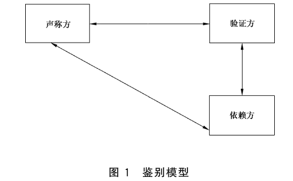
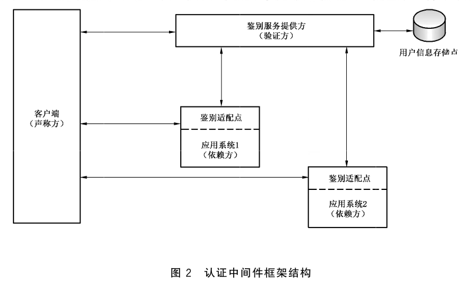
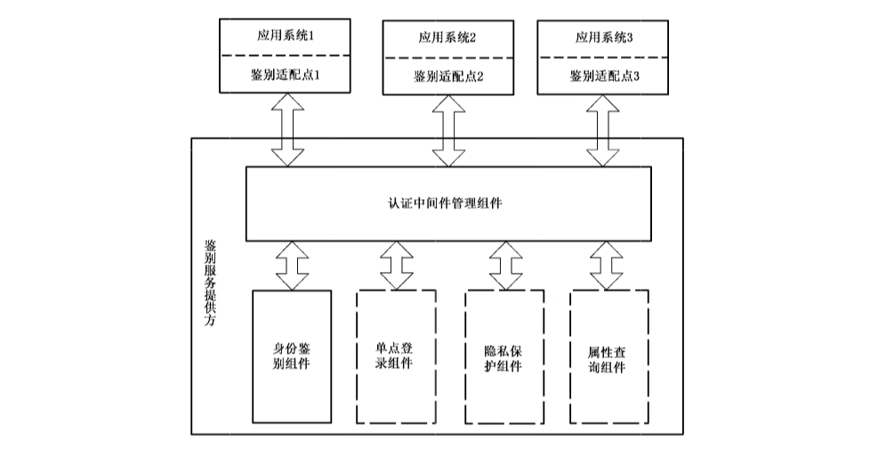
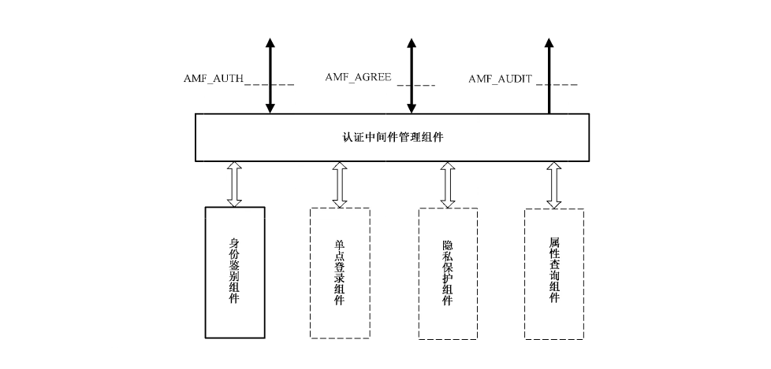
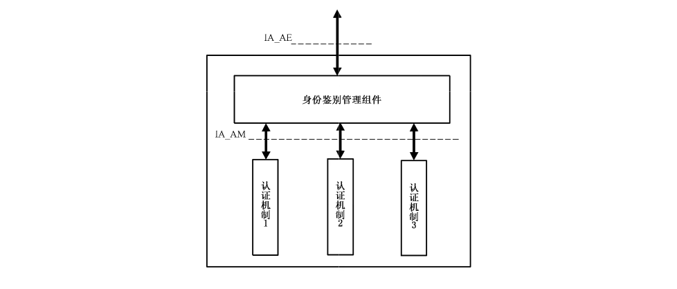
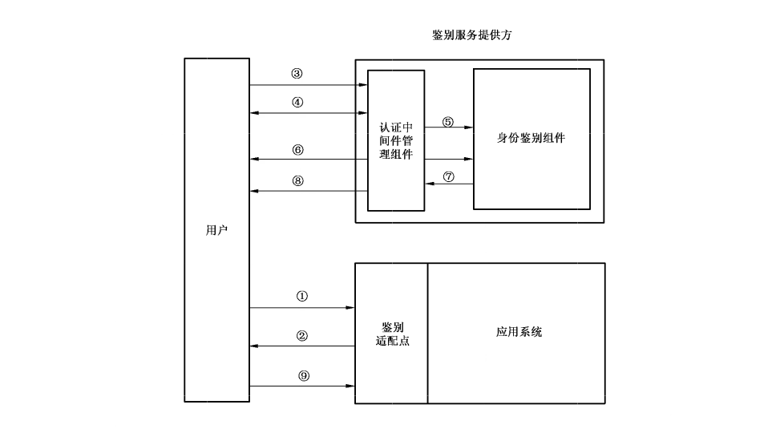
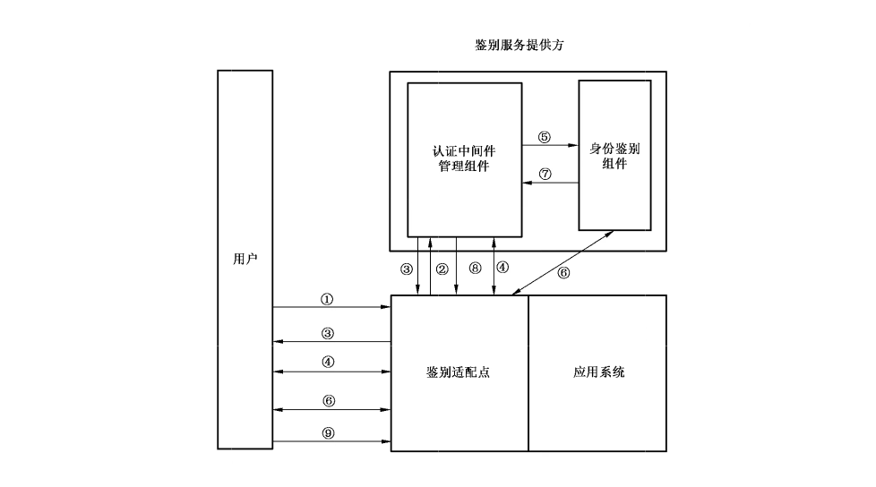
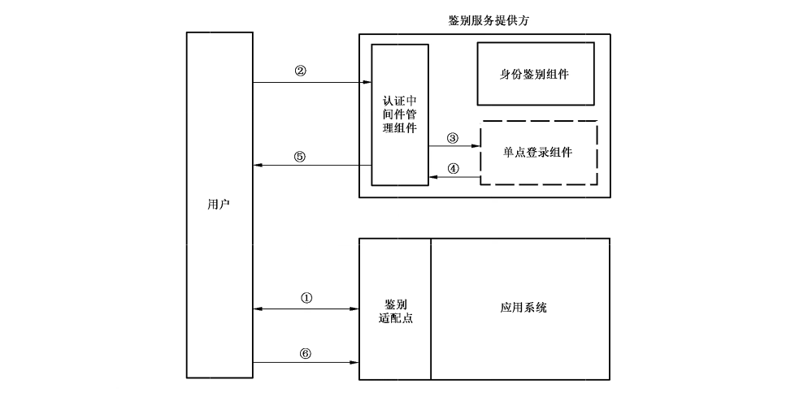

# GB/T 30275-2013 信息安全技术 鉴别与授权 认证中间件框架与接口规范

> 来源：[GB/T 30275-2013 国家标准详情](https://openstd.samr.gov.cn/bzgk/std/newGbInfo?hcno=9175038450F14A59F222B2A63042BBD2)；封面发布日期：2013-12-31；实施日期：2014-07-15。
> 官方在线预览截图 SHA-256：f267ef0c6db3cdac19ffd2f54bfd1ece02f19ad1d682061fd757c582f875cd08。
> 转写说明：逐页对照官方在线预览的全部 28 页截图，保留正文、图示、附录和参考文献；省略封面、目录、页眉、页脚、页码及封底。正式引用请核对官方原件。

## 前言

本标准按照 GB/T1.1—2009给出的规则起草。

本标准由全国信息安全标准化技术委员会（SAC/TC 260）提出并归口。

本文件某些内容可能涉及专利，本文件的发布机构不承担识别这些专利的责任。

本标准主要起草单位：中国科学院软件研究所、中国科学院数据与通信保护研究教育中心、北京数字证书认证中心有限公司。

本标准主要起草人：徐静、冯登国、荆继武、张立武、张严、李强、杨婧、张振峰、詹榜华、阎实。

## 引言

身份鉴别是保障系统安全的最基本功能之一，是绝大多数信息系统的首要安全需求。然而长期以来，安全功能与具体业务的紧密结合使得应用系统开发人员往往在考虑业务功能的同时还需要考虑安全功能的实现。因为不是所有的开发人员都具备全面的安全知识，这样做不仅费时费力，还不能保证安全功能的完整实施。因此，将安全功能，特别是身份鉴别功能与业务功能剥离，以中间件的方式为应用系统提供专门的安全保护，是安全领域的发展趋势。

此外，由于各个系统在建设过程中缺乏规范的鉴别接口和参考模型，不同系统之间互不兼容，无法互通互联，造成大量重复开发建设，浪费严重。同时更给进一步的系统集成工作带来困难。

因此，我国迫切需要制定认证中间件的框架及接口规范，对信息系统的鉴别过程进行标准化。从而提升信息系统的互操作能力，促进认证中间件的研发和推广，从宏观角度看来也将有助于推进我国信息安全保障体系建设。

本标准的主要目标是提供一套认证中间件的框架规范及其组件描述，并对鉴别实施过程予以规范，但为使本标准具有更好的可实现性与可操作性，本标准中同时对通用接口进行了若干定义，以便作为实现时的参考，这些定义不影响本标准中认证中间件框架的通用性。在实际应用中，可根据需求对这些接口进行进一步规范。

## 1 范围

本标准规定了认证中间件体系框架、组件、功能及通用接口，并给出了认证中间件的工作流程。

本标准适用于认证中间件及其组件的设计、开发，并可指导对该类系统的检测及相关应用的开发。

## 2 规范性引用文件

下列文件对于本文件的应用是必不可少的。凡是注日期的引用文件，仅注日期的版本适用于本文件。凡是不注日期的引用文件，其最新版本（包括所有的修改单）适用于本文件。

- GB/T 9387.2—1995 信息处理系统 开放系统互连 基本参考模型 第2部分：安全体系结构

- GB/T 15843.1—2008 信息技术 安全技术 实体鉴别 第1部分：概述

- GB/T 18794.2—2002 信息技术 开放系统互连 开放系统安全框架 第2部分：鉴别框架

- GB/T 25069—2010 信息安全技术 术语

## 3 术语和定义

GB/T 9387.2—1995、GB/T 15843.1—2008、GB/T 18794.2—2002 和 GB/T 25069—2010 界定的以及下列术语和定义适用于本文件。

### 3.1 依赖方 relying party

根据从另一方实体处获得的信息来决定如何进行动作的系统实体。

> 注：例如应用系统依赖于认证中间件对用户进行身份鉴别。

### 3.2 断言 assertion

给依赖方的包含了用户身份信息的可信声明，也可以包含验证过的属性。

> 注：断言可能是经过数字签名的，或者是通过一个安全协议从可信源获取的。

### 3.3 属性 attribute

对象的性质及对象之间的关系的统称。

### 3.4 鉴别 authentication

在用户身份间建立信任的过程。

### 3.5 鉴别密钥协商 authenticated key agreement

两方或者两方以上的实体通过交互建立起彼此间身份的信任关系，并形成一个共同的秘密密钥，用于保护后续的通信安全。

### 3.6 认证中间件 authentication middleware

可提供消息鉴别、身份鉴别以及单点登录等功能的中间件系统。

### 3.7 鉴别协议 authentication protocol

两方或者两方以上的实体为了实现对某一实体或某些实体的身份鉴别，经过协商后达成的一致意见。

### 3.8 鉴别服务提供方 authentication service provider

对用户身份进行鉴别的实体。

### 3.9 鉴别服务适配点 authentication service adapter

对鉴别请求进行过滤，并维持用户鉴别状态的实体。

### 3.10 上下文 context

保证系统中不同的组件能够一致运行所需要保存的一些信息，比如用户的连接信息、鉴别状态等。

### 3.11 实体 entity

任何可以发送或接收信息的硬件或软件进程。

> 注：实体就是一个特定的软件模块。

### 3.12 身份 identity

个体唯一确定的名字。

> 注：当个人法律上的名字不唯一时，可以通过地址、雇员或账户号码等附加信息来保证身份的唯一性。

### 3.13 遗留系统 legacy system

那些基本上不能进行修改和进化以满足新变化了的业务需求的信息系统。

> 注：通常是大型的软件系统，已经融入企业的业务运行和决策管理机制之中，维护工作困难。

### 3.14 中间件 middleware

一种独立的系统软件，它处于操作系统软件与应用软件的中间，属于可复用软件的范畴。

### 3.15 单点登录 single sign on

在多个应用系统中，用户只需要登录一次就可以访问所有相互信任的应用系统。

### 3.16 状态码 status code

用于表示某一组件功能是否成功实现以及可能的错误原因的值。

## 4 缩略语

下列缩略语适用于本文件。

- AKA：鉴别密钥协商（Authenticated Key Agreement）
- ASP：鉴别服务提供方（Authentication Service Provider）
- ASA：鉴别服务适配点（Authentication Service Adapter）
- C/S：客户端服务器应用（Client/Server Application）
- SSL：安全套接字层协议（Security Socket Layer）
- SSO：单点登录（Single Sign On）
- TTP：可信第三方（Trusted Third Party）

## 5 认证中间件目标

### 5.1 功能性目标

认证中间件应实现以下功能性目标：

a） 认证中间件应提供一套与应用系统无关的鉴别框架，帮助应用系统与用户实体之间建立信任关系，为进一步判断用户是否可以访问资源提供先决条件；

b） 认证中间件定义的接口应与所处理的鉴别信息无关，可以支持所有可能的交互流程；

c） 认证中间件应支持应用系统调用相关接口建立用户安全上下文；

d） 一旦会话终止，或用户登出后，认证中间件应启动清理会话服务，清除用户上下文。

### 5.2 非功能性目标

认证中间件应实现以下非功能性目标：

a） 认证中间件不指定具体的鉴别机制；

b） 认证中间件框架与具体的操作系统或平台是无关的，但认证中间件的具体实现系统可能是相关的；

c） 认证中间件应能够与遗留系统进行集成。

### 5.3 安全目标

认证中间件应实现以下安全目标：

a） 认证中间件不能对应用系统引入错误；

b） 认证中间件不能恶意的影响系统的其他服务；

c） 认证中间件应确保不能被绕过；

d） 认证中间件应能够支持应用系统中的授权机制；

e） 认证中间件应保证认证中间件环境中出现的安全相关的事件都是可审计的；

f） 认证中间件的具体实现应保护其获得或生成的安全相关信息的安全性，使得其他服务能足够信任该中间件提供的信息；

g） 认证中间件的具体实现应能够保护在其组件之间传递及组件与其他服务之间传递的安全相关信息的安全性。

## 6 认证中间件框架

### 6.1 概述

认证中间件所采用的鉴别模型如图1所示。声称方与验证方交互完成身份的鉴别，然后由验证方将鉴别结果以断言的形式发布给依赖方。声称方与验证方之间的身份鉴别过程可能是有可信第三方的参与。验证方与依赖方可以是同一实体，也可以是分开的不同实体。

根据图 1 中的鉴别模型，认证中间件的整体框架结构如图 2 所示。认证中间件采用分布式架构，可以同时为多个应用系统服务。认证中间件由鉴别服务提供方与鉴别服务适配点组件两部分共同组成。

鉴别服务提供方的主要功能是通过一定的身份鉴别机制，完成对用户身份的鉴别，并将鉴别结果以断言形式发布给各应用系统。鉴别服务提供方并不限定具体的身份鉴别机制，只是提供统一的接口，具体与用户的鉴别交互过程由各鉴别机制的实现自己完成。同时，作为附加功能，它还可以提供用户单点登录、隐私保护以及属性查询功能。鉴别服务提供方对应于鉴别模型中的验证方。

鉴别服务适配点作用于应用系统内，与鉴别服务提供方交互，辅助完成用户身份鉴别过程。鉴别适配点与应用系统一起对应于鉴别模型中的依赖方。

鉴别服务适配点与鉴别服务提供方之间的通信默认是通过可信信道保护的。如果应用系统与鉴别服务提供方集成在一起，即验证方与依赖方为统一实体，则这种可信信道为系统内部数据传输。如果应用系统与鉴别服务提供方分布在不同的系统中，彼此之间需要远程通信，则这种可信信道为二者之间的加密信道。

用户通过客户端完成与认证中间件及应用系统的交互，从而完成对用户身份的鉴别。客户端根据不同的应用场景表现为不同的形式。例如：在普通的C/S应用中，本标准中的客户端即为普通意义上的用户端应用程序；在基于 Web的应用中，本标准中的客户端为用户浏览器；在移动应用中，本标准中的客户端为便携设备。客户端对应于鉴别抽象模型中的声称方。

用户信息存储点存放用户身份信息。一个用户的身份信息中需包含一个可区分标识符，用以唯一标识该用户。在本标准中以用户名指代该可区分标识符。

认证中间件的内部组成框架如图3所示。在鉴别服务提供方内部，身份鉴别组件是必需组件，单点登录组件、隐私保护组件以及属性查询组件是可选组件。这些组件独立完成各自的功能，并通过认证中间件管理组件完成统一灵活的组装与调用，以满足不同应用场景的需求。

### 6.2 认证中间件的工作模式

#### 6.2.1 直接鉴别模式

直接鉴别模式指的是鉴别服务提供方直接与用户交互完成身份鉴别。

在直接鉴别模式下，认证中间件中的鉴别服务提供方与鉴别服务适配点不共享同一个用户上下文，而是分别与用户建立上下文，鉴别服务提供方和鉴别服务适配点与同一个用户的会话是异步的。

在用户鉴别过程中，鉴别服务适配点不直接向鉴别服务提供方发出鉴别请求，而是告知未鉴别的用户需要进行身份鉴别。用户通过一定的机制，找到自己的鉴别服务提供方，并与之直接交互完成身份鉴别。之后，用户携带鉴别断言再次访问应用系统，鉴别适配点检验断言确实是由认可的鉴别服务提供方发布，即完成用户身份鉴别过程。该过程中，鉴别断言中必须加入完整性保护机制，以保证身份鉴别结果不被篡改。

直接鉴别模式的典型使用场景是基于 Web的应用服务。直接鉴别模式下典型的工作流程见附录A，但并不限定只能按照这些流程执行。同时，在具体实现时，应采用相应的通信组件对流程中的消息内容进行封装。

#### 6.2.2 代理鉴别模式

代理鉴别模式指的是鉴别服务提供方不直接与用户交互完成身份鉴别，而是通过作用于应用系统中的鉴别适配点代理完成交互的通信过程。

在代理鉴别模式下，只有鉴别适配点与用户交互，建立用户上下文，鉴别服务提供方和鉴别服务适配点与同一个用户的会话是同步的。

在用户鉴别过程中，由鉴别服务适配点直接向鉴别服务提供方发起身份鉴别请求，并转发用户与鉴别服务提供方之间的通信交互消息。鉴别过程完成后，鉴别服务提供方直接将鉴别断言返回给鉴别服务适配点。该过程中，鉴别服务适配点与鉴别服务提供方之间应建立可信信道。

代理鉴别模式的典型使用场景是使用 RADIUS或 DIAMETER 协议的应用服务，或者应用系统直接与鉴别服务提供方集成在一起的情况。代理鉴别模式下典型的工作流程见附录A，但并不限定只能按照这些流程执行。同时，在具体实现时，应采用相应的通信组件对流程中的消息内容进行封装。

### 6.3 组件描述

#### 6.3.1 认证中间件管理组件

认证中间件管理组件是认证中间件框架的必需部分，是保证整个中间件正常运转的关键功能模块。

它根据中间件的配置完成组件的组装，以及同鉴别适配点之间可信信道的建立。然后根据不同应用情景下的工作流程，通过一定的通信组件与用户以及鉴别适配点交互，并且调用相应的组件完成既定的功能目标。认证中间件管理组件应支持安全相关的事件审计。

#### 6.3.2 身份鉴别组件

身份鉴别组件是认证中间件框架中必需的部分，是完成用户身份鉴别的核心。对外，该组件屏蔽了内部的具体鉴别机制，只提供一般的身份鉴别接口。对内，它可以支持各种不同身份鉴别机制的实现。

鉴别机制按照其实现结果的不同分为简单身份鉴别机制与带密钥协商的身份鉴别机制。身份鉴别组件中至少应包含一种简单身份鉴别机制的实现。对于带密钥协商的身份鉴别机制，在某些应用场景下可以不实现。

采用简单身份鉴别机制，则认证中间件与用户交互后，实现对用户身份的识别与验证。在简单身份鉴别机制下，身份鉴别组件输出的鉴别结果中只包含用户的身份信息。同时，在鉴别过程中以及之后，需要通过其他的通信加密机制，如SSL等，来保护用户与认证中间件以及应用系统之间的通信。简单身份鉴别适用于认证中间件的直接鉴别工作模式以及代理鉴别工作模式。

采用带密钥协商的身份鉴别，则认证中间件与用户交互后，不仅完成对用户身份的识别，同时与用户协商建立会话密钥。在带密钥协商的身份鉴别机制下，身份鉴别组件输出的鉴别结果中包含用户的身份信息以及协商生成的会话密钥。同时，在鉴别完成后，用户与应用系统之间的通信通过该会话密钥来保护。带密钥协商的身份鉴别主要适用于认证中间件的代理鉴别工作模式。

本标准不对具体的身份鉴别机制及其安全性进行规定，但它们的实现应符合一定的标准规范，达到相应标准规范中的安全要求。

#### 6.3.3 鉴别适配点组件

鉴别服务适配点组件是认证中间件框架中必需的部分，它主要负责对用户鉴别状态的过滤，以及对于鉴别断言的解析。同时，当鉴别服务提供方不与用户直接交互的情况下，该组件将负责二者通信信息的传递。

在简单身份鉴别方式下，该组件负责将鉴别服务提供方发布的鉴别断言解析为本地应用系统需要的鉴别结果形式，供应用系统获取用户身份信息。

在带密钥协商的身份鉴别方式下，该组件负责解析鉴别服务提供方发布的鉴别断言，向应用系统输出用户身份信息，并储存会话密钥，负责对用户与应用系统之间通信内容的加解密工作。

如果鉴别服务提供方需要与鉴别服务适配点之间建立加密信道，则鉴别服务适配点组件需要与鉴别服务提供方中的认证中间件管理组件通过预享机制，完成加密信道的建立。

#### 6.3.4 单点登录组件

单点登录组件是认证中间件框架中可选的部分，主要负责实现用户访问与一个认证中间件相连的多个应用系统时，可以获得“一次登录，多次访问”的体验过程。

只考虑认证中间件工作于直接鉴别模式，且身份鉴别组件提供简单身份鉴别情况下的单点登录。

对于其他情况，不考虑其单点登录过程。

#### 6.3.5 隐私保护组件

隐私保护组件是认证中间件框架中可选的部分，主要负责提供保护用户隐私信息的机制。

根据用户需求的不同以及应用场景的不同，隐私信息包含的范围和隐私保护所涉及的实体范围都是不同的，本标准只考虑通过假名映射的方式保护用户身份的隐私性。即，鉴别服务提供方向应用系统提供用户的假名，从而避免应用系统获得用户的真实身份。

对于其他的隐私保护实现方式，本标准不予以规范。

#### 6.3.6 属性查询组件

属性查询组件是认证中间件框架中可选的部分，主要负责用户身份鉴别之后，对用户属性信息的查询。属性查询同时涉及数字身份管理以及授权访问控制领域，因此本标准只规定通用的属性查询接口，具体的实现方式不予以规范。

### 6.4 鉴别断言

在鉴别过程结束后，鉴别服务提供方应为鉴别后的用户生成鉴别断言以使得鉴别依赖方能够验证用户的身份合法性。此处所述鉴别断言是指由鉴别服务提供方生成，包含了用户身份等信息的可信消息。本标准中使用的鉴别断言可能包含用户身份信息和密钥协商信息等信息。其中身份信息至少包含用户身份标识、鉴别方式和鉴别时间这三个部分，根据实际需求的不同还可以包含其他的一些信息，比如用户 IP 地址等。密钥协商信息至少包含会话密钥值、密钥类型这两个部分，根据实际需求的不同还可以包含其他的一些信息，比如密钥有效期等。

在实际应用中，可根据需要自行设计断言格式。此时鉴别断言必须采用相应的安全机制（例如，鉴别服务提供方的数字签名）来保证用户身份信息，鉴别服务提供方标识等信息的完整性，防止被篡改。

此外，在实际应用中，鉴别断言中还可以同时包含如用户属性等在内的其他信息，本标准不对这些信息的内容进行限定，但这些信息不应影响断言中用户身份信息与密钥协商信息的安全。

### 6.5 认证中间件与应用系统的关系

鉴别适配点组件作用于应用系统内部，应用系统对它的输出结果是完全信任的。

在简单身份鉴别方式下，鉴别适配点组件解析鉴别断言后，向应用系统输出用户身份信息。应用系统无条件信任该信息。

在带密钥协商的身份鉴别方式下，鉴别服务适配点组件解析鉴别断言，向应用系统输出用户身份信息，并储存会话密钥。应用系统无条件信任鉴别服务适配点组件输出的用户身份信息，并且相信与用户的通信过程是在加密信道保护下完成的。

### 6.6 认证中间件与面向服务架构

本标准仅对认证中间件各组件实现的功能及其应满足的安全需求进行了限定，而并未对认证中间件各组件的具体实现及配置方式进行要求，故本标准规定的认证中间件对面向服务架构兼容。特别的，本标准中规定的认证中间件所应满足的与具体应用形态无关特性与面向服务架构相关需求吻合，因此本标准所规定的认证中间件可以通过扩展以鉴别服务的形式实现，以便于其在现有面向服务相关业务流程中的实施。

对具体扩展模式不予规范，该扩展应在不破坏本标准规定的相关功能需求、非功能需求及安全功能的前提下，满足面向服务架构相关标准的要求。

## 7 组件规范

### 7.1 认证中间件管理组件

#### 7.1.1 概述

认证中间件管理组件结构如图4所示。

认证中间件管理组件负责整个认证中间件的初始化以及系统中各组件的运作管理。对外，它通过与具体应用相关的通信组件，实现和用户以及鉴别服务适配点之间的交互。对内，它根据认证中间件的配置情况以及所完成的功能，与鉴别服务提供方中的各个组件进行交互。

认证中间件管理组件提供了一个接口处理来自用户或者鉴别适配点组件的鉴别请求。用户和鉴别适配组件通过这个接口来通知认证中间件管理组件进行鉴别处理，并获取此次鉴别处理的鉴别断言。

认证中间件可以提供不同的鉴别方式。当认证中间件支持用户对鉴别方式进行选择时，认证中间件管理组件提供了一个与用户交互的接口，用以协商确定具体的鉴别方式。认证中间件管理组件应能够对用户选择的鉴别方式进行检查，以确定是否支持该方式，以及其实现组件能否正常启动。

认证中间件管理组件还提供一个用于审计的接口，它会输出当前鉴别用户的信息，至少包括用户名、鉴别方式、鉴别状态、鉴别时间等，从而保证认证中间件中的用户鉴别事件是可审计的。

在认证中间件内部，认证中间件管理组件并不实现具体的鉴别功能。因此，在认证中间件管理组件与其他的各个组件之间都存在着交互的接口。这些接口的具体描述参见第7章其他条中各组件的接口规范。

#### 7.1.2 接口描述

##### 7.1.2.1 鉴别接口 AMF_AUTH

AMF_AUTH 接口用于启动整个用户身份鉴别流程，它需要提供以下输入和输出：

输入：

a） 用户上下文

用户上下文包括用户的相关信息，可以用于区分不同的用户。从用户上下文中可以获取用户的连接信息等内容。此接口可以由用户或者鉴别适配组件来调用，分别对应于直接鉴别模式和代理鉴别模式。若是由用户调用，则此参数为空，认证中间件管理组件会在后面与用户的交互中来生成用户上下文；如果是鉴别适配组件来调用，则需要由鉴别适配点来给出用户上下文。

b） 适配点会话标识

用户在鉴别前与适配点建立连接的会话标识，此信息会被加入到最后输出的鉴别断言中，用以防止鉴别断言被其他人截获冒用或重放。

输出：

a） 鉴别断言

鉴别处理的结果将以鉴别断言的形式输出。

鉴别处理结果可能包括两个部分：用户身份信息和密钥协商信息。身份信息至少包含用户身份标识、鉴别方式和鉴别时间这三个部分，根据实际需求的不同还可以包含其他的一些信息，比如用户IP地址等。密钥协商信息至少包含会话密钥值、密钥类型这两个部分，根据实际需求的不同还可以包含其他的一些信息，比如密钥有效期等。

b） 状态码

根据情况的不同，可能返回以下几种状态码：

| 状态码 | 含义 |
| --- | --- |
| AMMC_ERR | 认证中间件管理组件错误 |
| IA_ERR | 身份鉴别组件错误 |
| IA_AM_ERR | 鉴别机制模块错误 |
| AMF_SYS_ERR | 系统错误 |
| AMF_CON_ERR | 连接错误 |
| AMF_AUTH_ERR | 鉴别错误 |
| AMF_AUTH_FAILURE | 鉴别失败 |
| AMF_AUTH_SUCC | 鉴别成功 |
| AMF_KA_ERR | 密钥协商错误 |
| AMF_KA_FAILURE | 密钥协商失败 |
| AMF_AKA_SUCC | 鉴别密钥协商成功 |

##### 7.1.2.2 鉴别方式协商接口 AMF_AGREE

用户和认证中间件管理组件通过 AMF_AGREE接口来进行协商并确定此次鉴别所采用的鉴别方式，此接口需要提供以下的输入和输出。

输入：

a） 鉴别方式

鉴别方式用于指定身份鉴别组件所采用的鉴别机制，如口令鉴别、证书鉴别以及其他鉴别协议等。这个参数会传递给身份鉴别组件来判断是否支持相应的鉴别方式，如果支持，则返回协商成功；否则会返回错误信息。

输出：

a） 状态码

根据认证中间件管理组件处理结果的不同，可能返回以下几种状态码：

| 状态码 | 含义 |
| --- | --- |
| UNKOWN_AUTHMETHOD | 身份鉴别组件不支持用户选择的鉴别方式 |
| AMMC_ERR | 认证中间件管理组件错误 |
| AMF_AGREE_SUCC | 鉴别方式协商成功 |
| AMF_SYS_ERR | 系统错误 |

##### 7.1.2.3 审计信息接口 AMF_AUDIT

审计系统可以通过此接口获取用户鉴别事件的相关信息，此接口需要提供以下的输入和输出。

输入：

a） 审计信息

审计信息是一些与用户此次鉴别相关的一些信息，可以用来识别和追踪一些非法的用户操作，从而保证系统的正常工作。审计信息一般包括以下几个部分：用户名、鉴别状态、鉴别方式、鉴别时间等。

输出：

a） 状态码

根据认证中间件管理组件处理结果的不同，可能返回以下几种状态码：

| 状态码 | 含义 |
| --- | --- |
| AMF_AUDIT_SUCC | 审计信息输出成功 |
| AMF_AUDIT_ERR | 审计信息输出错误 |
| AMF_AUDIT_FAILURE | 审计信息输出失败 |
| AMF_UNKOWN_USER | 未知用户 |
| AMF_SYS_ERR | 系统错误 |

### 7.2 身份鉴别组件

#### 7.2.1 概述

身份鉴别组件是认证中间件中必需实现的组件之一，它的主要功能是完成对用户身份进行鉴别以及与用户之间的密钥协商，身份鉴别组件结构如图5所示。

身份鉴别组件由身份鉴别管理组件和不同的鉴别机制实现组件组成。身份鉴别管理组件负责整个身份鉴别组件的管理运作，向上与认证中间件管理组件交互，向下与鉴别机制实现组件进行交互。

身份鉴别组件实现了具体的鉴别过程。

认证中间件管理组件从客户端获取了对鉴别方式的选择之后，需要通过身份鉴别组件来确定是否支持该鉴别方式，以及该鉴别方式能否正常实现。另外，在身份鉴别完成之后，身份鉴别组件返回身份鉴别结果给上层认证中间件管理组件。

身份鉴别管理组件提供了与各种鉴别机制交互的接口，用于启动鉴别机制以及获取鉴别结果。

鉴别机制实现组件完成具体的鉴别以及密钥协商过程，并提供相应的接口由身份鉴别管理组件调用。

#### 7.2.2 接口描述

##### 7.2.2.1 鉴别执行接口 IA_AE

身份鉴别组件通过 IA_AE 接口与上层认证中间件管理组件进行交互，用于获取鉴别方式并返回鉴别结果，它需要提供以下的输入和输出：

输入：

a） 鉴别方式

鉴别方式指定认证中间件所使用的身份鉴别方式，身份鉴别管理组件首先检查系统配置中是否存在对应的身份鉴别方式。如果存在，那么身份鉴别管理组件就会启动相应的鉴别机制，并完成初始化。

b） 用户上下文

用户上下文包括了用户的相关信息，此信息会传递给下层的鉴别机制在实现鉴别功能的时候使用。如果此参数为空，则身份鉴别组件只进行鉴别方式的检查，然后返回鉴别机制初始化状态。

输出：

a） 鉴别结果

鉴别结果由身份鉴别结果和密钥协商结果两部分组成：身份鉴别管理组件根据鉴别机制与用户交互后返回的身份鉴别结果和认证中间件管理组件的格式需求来生成相应的鉴别结果，它至少应包括用户身份标识、鉴别方式以及鉴别时间三部分内容；身份鉴别管理组件根据鉴别机制与用户交互后返回的密钥协商结果和认证中间件管理组件的格式需求来生成相应的密钥协商结果，它至少应包含协商密钥值以及密钥类型两部分内容。

b） 状态码

根据身份鉴别组件处理结果的不同，有以下几种状态码：

| 状态码 | 含义 |
| --- | --- |
| UNKOWN_AUTHMETHOD | 身份鉴别组件不支持此鉴别方式 |
| IA_AMINIT_ERR | 鉴别机制初始化错误 |
| IA_ERR | 身份鉴别管理组件错误 |
| IA_AUTH_SUCC | 鉴别成功 |
| IA_AUTH_FAILURE | 鉴别失败 |
| IA_AUTH_ERR | 鉴别错误 |
| IA_CON_ERR | 与用户连接错误 |
| IA_AMINIT_SUCC | 鉴别机制初始化成功 |
| IA_UNKOWN_USER | 未知用户 |
| IA_KA_ERR | 密钥协商错误 |
| IA_KA_FAILURE | 密钥协商失败 |
| IA_AKA_SUCC | 鉴别密钥协商成功 |

##### 7.2.2.2 鉴别机制接口 IA_AM

身份鉴别组件通过 IA_AM 接口与具体的鉴别机制进行交互，用于启动相应的鉴别机制并获取鉴别结果，它需要提供以下的输入和输出：

输入：

a） 用户上下文

由身份鉴别组件从认证中间件管理组件处获取，根据用户上下文，鉴别机制实现组件可以获取与用户交互完成鉴别需要的信息。

输出：

a） 鉴别结果

鉴别结果由身份鉴别结果和密钥协商结果两部分组成：身份鉴别结果是鉴别结果中必须包含的内容，根据鉴别机制的不同，返回的身份鉴别结果形式是不同的，但是它输出的主要信息就是鉴别过的用户身份标识；根据鉴别机制的不同，除了身份鉴别结果，可能还包含有密钥协商结果，密钥协商结果至少应包含协商密钥值以及密钥类型这两部分信息。

b） 状态码

根据鉴别机制处理结果的不同，有以下几种状态码：

| 状态码 | 含义 |
| --- | --- |
| AM_INIT_ERR | 鉴别机制初始化错误 |
| AM_INIT_SUCC | 鉴别机制初始化成功 |
| AM_AUTH_SUCC | 鉴别成功 |
| AM_AUTH_FAILURE | 鉴别失败 |
| AM_AUTH_ERR | 鉴别错误 |
| AM_CON_ERR | 与用户连接错误 |
| AM_UNKOWN_USER | 未知用户 |
| AM_KA_ERR | 密钥协商错误 |
| AM_KA_FAILURE | 密钥协商失败 |
| AM_AKA_SUCC | 鉴别密钥协商成功 |

### 7.3 单点登录组件

#### 7.3.1 概述

单点登录组件主要负责实现用户访问与一个鉴别服务提供方相连的多个应用资源系统时，可以“一次登录，多次访问”的体验过程。

本标准只讨论通过记录用户鉴别信息的方式实现的单点登录，不排除具体系统通过实现其他方式的单点登录及进行进一步的扩展。

单点登录组件的接口组成如图6所示。

单点登录组件应实现的功能包括鉴别状态信息添加、维护、查询以及删除。

当用户首次完成鉴别后，如果需要实现单点登录，认证中间件管理组件调用单点登录组件的鉴别状态信息添加接口。单点登录组件创建并维护相应的用户鉴别状态记录，该记录中应包含用户的身份标识符，鉴别状态及鉴别状态的有效期。

此外，单点登录组件还应在用户访问过程中根据认证中间件管理组件的请求对鉴别状态信息进行更新、删除等。

单点登录组件应可对认证中间件管理组件发起的查询请求进行正确响应，对于收到的鉴别状态查询请求，单点登录组件应在其维护的用户鉴别状态记录查找相应的用户记录，并返回一个关于当前用户鉴别状态的查询结果。

#### 7.3.2 接口描述

##### 7.3.2.1 鉴别状态信息添加接口 SSO_ADD

单点登录组件通过 SSO_ADD 接口与上层认证中间件管理组件进行交互，用于添加需要维护的用户鉴别状态信息，并返回一个唯一标识符供查询及维护。它需要提供以下的输入和输出：

输入：

a） 用户上下文

认证中间件管理组件根据与用户的交互信息而生成的用户上下文。该上下文唯一标识了用户与认证中间件的一次会话。

b） 鉴别结果

认证中间件管理组件从身份鉴别组件处获取的鉴别结果，鉴别结果由身份鉴别结果和密钥协商结果两部分组成：身份鉴别结果是鉴别结果中必须包含的内容，根据鉴别机制的不同，返回的身份鉴别结果形式可以是不同的，但是至少应包括用户身份标识、鉴别方式以及鉴别时间这三部分信息；密钥协商结果是鉴别结果中的可选内容，但如果密钥协商结果存在，则至少应包含协商密钥值以及密钥类型这两部分信息。

输出：

a） 唯一标识符 SID

由单点登录组件创建的唯一标识符，单点登录组件应创建并维护该唯一标识符与用户鉴别信息相关联的列表，供认证中间件管理组件查询时使用。

b） 状态码

根据单点登录组件处理结果的不同，有以下几种状态码：

| 状态码 | 含义 |
| --- | --- |
| SSO_ERR | 单点登录组件错误 |
| SSO_ADD_SUCC | 用户鉴别状态维护成功 |
| SSO_ADD_FAILURE | 用户鉴别状态维护失败 |
| SSO_ADD_ERR | 用户鉴别状态维护错误 |
| SSO_UNKOWN_USER | 未知用户 |

##### 7.3.2.2 鉴别状态信息维护接口 SSO_MAINT

单点登录组件通过 SSO_MAINT 接口与上层认证中间件管理组件进行交互，用于获取要维护的用户信息并返回一个唯一标识符供查询使用，它需要提供以下的输入和输出：

输入：

a） 唯一标识符 SID

在单点登录组件内部维护的用户鉴别信息列表中与用户鉴别信息相关联的唯一标识符。

b） 更新信息

用户鉴别状态中需要更新的信息，如用户属性信息等。

输出：

a） 状态码

根据单点登录组件处理结果的不同，有以下几种状态码：

| 状态码 | 含义 |
| --- | --- |
| SSO_ERR | 单点登录组件错误 |
| SSO_MAINT_SUCC | 用户鉴别状态维护成功 |
| SSO_MAINT_FAILURE | 用户鉴别状态维护失败 |
| SSO_MAINT_ERR | 用户鉴别状态维护错误 |
| SSO_UNKOWN_USER | 未知用户 |

##### 7.3.2.3 鉴别状态信息查询接口 SSO_QUERY

上层认证中间件管理组件通过 SSO_QUERY 接口与单点登录组件进行交互，通过 SID 获取包含用户鉴别状态信息。它需要提供以下的输入和输出：

输入：

a） 唯一标识符 SID

在单点登录组件内部维护的用户鉴别信息列表中与用户鉴别信息相关联的唯一标识符，该标识符通过调用鉴别状态维护接口获得。

输出：

a） 查询结果

在获取 SID 后，单点登录组件查询其维护的列表中是否存在该 SID 及与之对应的信息，如果不存在，则返回空值及状态码 SSO_QUERY_SIDUNKNOWN。否则单点登录组件获取与该 SID 相关联的用户鉴别状态信息并返回。

b） 状态码

根据处理结果的不同，有以下几种状态码：

| 状态码 | 含义 |
| --- | --- |
| SSO_QUERY_SUCC | 查询成功 |
| SSO_QUERY_SIDUNKNOWN | 无法识别的 SID |
| SSO_QUERY_ERR | 查询错误 |

##### 7.3.2.4 鉴别状态信息删除接口 SSO_DELETE

上层认证中间件管理组件通过 SSO_DELETE 接口与单点登录组件进行交互，通过 SID 删除对应用户的鉴别状态记录。它需要提供以下的输入和输出：

输入：

a） 唯一标识符 SID

在单点登录组件内部维护的用户鉴别信息列表中与用户鉴别信息相关联的唯一标识符，该标识符通过调用鉴别状态维护接口获得。

输出：

a） 状态码

根据处理结果的不同，有以下几种状态码：

| 状态码 | 含义 |
| --- | --- |
| SSO_DELETE_SUCC | 删除成功 |
| SSO_DELETE_SIDUNKNOWN | 无法识别的 SID |
| SSO_DELETE_ERR | 删除错误 |

### 7.4 隐私保护组件

#### 7.4.1 概述

本标准只对提供假名映射机制的隐私保护组件进行规范，不排除具体实现中，提供其他的隐私保护机制。

假名映射机制的实现需要提供的功能包括：首先，能够生成一个用户假名，其他实体无法从用户假名中获取用户名的相关信息，也无法将同一用户的不同假名关联起来；其次，能够识别用户假名对应的真实用户；最后，能够撤销用户假名。

如果认证中间件中配置了隐私保护组件，那么在用户鉴别完成后，在认证中间件管理组件返回的鉴别断言中的用户名信息应是用户假名，在之后的一些操作中也都应使用用户假名来作为用户标识。而在用户登出或者会话过期之后，需要调用假名撤销功能来撤销用户假名。同时，在对用户属性进行查询时，也需要由认证中间件管理组件首先查询隐私保护组件获得用户真实身份，进而再调用属性查询组件获得相应属性。

隐私保护组件的接口组成如图7所示。

#### 7.4.2 接口描述

##### 7.4.2.1 假名生成接口 PP_AG

认证中间件管理组件通过 PP_AG 接口与隐私保护组件接口交互，用于获取某一用户的假名，它需要提供以下的输入和输出：

输入：

a） 用户名

用户名是用户的真实身份标识。

输出：

a） 用户假名

通常是一个随机串，只有隐私保护组件才能建立起用户假名与真实用户之间的关系。

b） 状态码

根据隐私保护组件处理结果的不同，有以下几种状态码：

| 状态码 | 含义 |
| --- | --- |
| PP_AG_SUCC | 假名生成成功 |
| PP_AG_FIALURE | 假名生成失败 |
| PP_AG_ERR | 假名生成错误 |
| PP_ERR | 隐私保护组件错误 |

##### 7.4.2.2 假名解析接口 PP_AP

认证中间件管理组件通过 PP_ATR 接口与隐私保护组件接口交互，用于获取某一假名对应的真实用户，它需要提供以下的输入和输出：

输入：

a） 用户假名

需要转换的用户假名信息，通过调用假名生成接口 PP_RTA 获得。

输出：

a） 用户名

用户名是用户的真实身份标识。

b） 状态码

根据隐私保护组件处理结果的不同，有以下几种状态码：

| 状态码 | 含义 |
| --- | --- |
| PP_AP_UNKOWN_ARTIFACT | 未知用户假名 |
| PP_AP_SUCC | 假名解析成功 |
| PP_AP_FAILURE | 假名解析失败 |
| PP_AP_ERR | 假名解析错误 |
| PP_ERR | 隐私保护组件错误 |

##### 7.4.2.3 假名撤销接口 PP_AR

认证中间件管理组件通过 PP_AR 接口与隐私保护组件接口交互，用于撤销假名与真实用户之间的映射，它需要提供以下的输入和输出：

输入：

a） 用户名

用户名是用户的真实身份标识。

输出：

a） 状态码

根据隐私保护组件处理结果的不同，有以下几种状态码：

| 状态码 | 含义 |
| --- | --- |
| PP_AR_UNKOWN_USER | 未知用户名 |
| PP_AR_SUCC | 假名撤销成功 |
| PP_AR_FAILURE | 假名撤销失败 |
| PP_AR_ERR | 假名撤销错误 |
| PP_ERR | 隐私保护组件错误 |

### 7.5 属性查询组件

#### 7.5.1 概述

属性查询组件主要用于在用户鉴别完成后，查询此用户的相关属性信息。这些属性信息通常是用于访问控制过程中，当用户需要访问某一资源时，访问控制系统需要通过用户的相关属性信息来做出访问控制判定。此组件是认证中间件与访问控制、数字身份管理等相关系统的结合点。因此本标准只规定属性查询的通用接口，具体的实现方式不予以规范。

属性查询组件的接口组成如图8所示。

#### 7.5.2 接口描述

##### 7.5.2.1 属性查询接口 AQ_QUERY

认证中间件管理组件通过 AQ_QUERY 接口与属性查询组件进行交互，用于获取用户的相关属性，如用户角色、分组等。它需要提供以下的输入和输出：

输入：

a） 用户标识

属性查询实现过程中能够唯一标识用户身份的信息，一般来说是用户名。

b） 属性查询请求信息

被查询属性的相关信息，一般为属性名及属性颁发机构。

输出：

a） 属性查询结果

与用户标识所对应的用户相关的一些属性信息。

b） 状态码

根据属性查询组件处理结果的不同，有以下几种状态码：

| 状态码 | 含义 |
| --- | --- |
| AQ_UNKOWN_USER | 未知用户标识 |
| AQ_QUERY_ERR | 属性查询错误 |
| AQ_QUERY_FAILURE | 属性查询失败 |
| AQ_QUERY_SUCC | 属性查询成功 |
| AQ_ERR | 属性查询组件错误 |

## 附录 A（资料性附录）认证中间件工作流程

### A.1 概述

本附录介绍了认证中间件在不同工作模式下典型的工作流程，但并不限定只能按照这些流程执行。

为简化描述并突出流程，本附录内容不涉及具体的通信协议。在具体实现时，应采用相应的通信组件对流程中的消息内容进行封装。

### A.2 身份鉴别流程

#### A.2.1 直接鉴别模式下的身份鉴别流程

在直接鉴别模式下，认证中间件与用户直接交互完成身份鉴别。在该模式下，一般不选择带密钥协商的身份鉴别。

直接鉴别模式下的典型身份鉴别流程如图A.1 所示，具体表述如下：

a） 用户对应用系统的访问请求被部署在应用系统前端的鉴别服务适配点组件拦截；

b） 鉴别服务适配点组件检查用户是否经过鉴别，若未鉴别则建立一个新的用户上下文，返回当前会话标识，并告知用户需进行鉴别；

c） 用户使用鉴别服务适配点组件返回的会话标识向鉴别服务提供方发出鉴别请求，启动鉴别过程。认证中间件管理组件获得该请求后建立新的用户上下文；

d） 用户与认证中间件管理组件协商，确定采用的具体鉴别机制；

e） 认证中间件管理组件调用身份鉴别组件，启动相应鉴别机制实现；

f） 用户与具体的鉴别机制实现组件进行交互，执行身份鉴别协议；

g） 身份鉴别组件向认证中间件管理组件返回鉴别结果；

如果认证中间件实现了单点登录功能，则在本步骤中，在认证中间件管理组件从身份鉴别组件处获取了鉴别结果后，需要将用户上下文和鉴别结果发送给单点登录组件进行鉴别状态添加，并将单点登录组件生成的唯一标识 SID 写入用户上下文，以便在之后的过程中实现单点登录功能；

h） 认证中间件管理组件封装鉴别断言返回给用户；

i） 用户将获得的鉴别断言发送给鉴别服务适配点组件。该组件对鉴别断言进行解析和校验，检查鉴别断言中的会话标识与当前会话是否一致，并根据校验结果对用户请求进行相应处理。

#### A.2.2 代理鉴别模式下的身份鉴别流程

在代理鉴别模式下，认证中间件与用户通过鉴别服务适配点，间接交互完成身份鉴别。在该模式下，可以选择简单身份鉴别或带密钥协商的身份鉴别。

代理鉴别模式下的典型身份鉴别流程如图A.2 所示，具体表述如下：

a） 用户对应用系统的访问请求被部署在应用系统前端的鉴别服务适配点组件拦截；

b） 鉴别服务适配点组件检查用户是否经过鉴别，若未鉴别则建立新的用户上下文，并将用户上下文传递给鉴别服务提供方，启动身份鉴别过程；

c） 鉴别服务提供方通过鉴别服务适配点组件向用户发出鉴别请求；

d） 用户与认证中间件管理组件进行协商，确定采用的具体鉴别机制，其传输数据由鉴别服务适配点组件进行转发；

e） 认证中间件管理组件调用身份鉴别组件，启动相应鉴别机制实现；

f） 用户与鉴别服务提供方交互执行身份鉴别协议，其传输数据由鉴别服务适配点进行转发；

g） 身份鉴别组件向认证中间件管理组件返回鉴别结果；

h） 认证中间件管理组件将鉴别结果封装为鉴别断言返回给鉴别服务适配点组件；

i） 在收到鉴别服务提供方返回的鉴别断言后，鉴别服务适配点组件对鉴别断言进行解析和校验，并根据校验结果对用户请求进行相应处理。

#### A.2.3 单点登录流程

单点登录需求多见于直接鉴别模式，因此本标准只讨论该模式下的相关流程。

在单点登录过程中，只考虑身份鉴别组件提供的是简单身份鉴别结果的情况。对于带密钥协商的身份鉴别，本标准不考虑其单点登录的情况。

假设用户已经访问过应用系统 A，认证中间件已对其进行过身份鉴别，则用户访问新的应用系统 B 时，其单点登录过程如图 A.3 所示，具体表述如下：

a） 用户访问新的应用系统 B，该访问请求被部署在应用系统 B 前端的鉴别服务适配点组件拦截。鉴别服务适配点组件检查用户是否经过鉴别，若未鉴别则建立用户上下文，返回当前会话标识，并告知用户需进行鉴别；

b） 用户使用鉴别服务适配点组件返回的会话标识向鉴别服务提供方发出鉴别请求，认证中间件管理组件从请求中获取用户上下文；

c） 认证中间件管理组件根据用户上下文，调用单点登录组件查询用户鉴别状态信息；

d） 单点登录组件在其维护的用户鉴别状态信息中对当前用户进行查询，如果查询到了有效的鉴别信息，则单点登录组件向认证中间件管理组件返回用户的鉴别结果；

e） 认证中间件管理组件将单点登录组件返回的鉴别结果及适配点会话标识封装为鉴别断言发送给用户。如果单点登录组件未查询到该用户的鉴别状态信息，则认证中间件管理组件改为调用身份鉴别组件启动新的鉴别过程；

f） 用户在收到鉴别服务提供方返回的身份鉴别断言后，将该断言返回给应用系统 B 中的鉴别服务适配点组件，在接收到身份鉴别断言后，鉴别服务适配点组件对该身份鉴别断言进行解析，检查鉴别断言中的会话标识与当前会话是否一致，并根据结果对用户请求进行相应处理，从而实现单点登录过程。

## 参考文献

- ［1］ The Open Group. X/Open Single SignOn Service（XSSO）Pluggable Authentication Modules
- ［2］ RFC 2865 Remote Authentication Dial In User Service
- ［3］ RFC 3588 Diameter Base Protocol
